# 2023-08-13UC伯克利教授惊人预测：`2030`年`GPT`可执行人类180万年工作，一天学2500年知识

> 来源：[https://xuqiwei1986.feishu.cn/docx/JI7WdVlZio2piaxkHLBc2XTwnAf](https://xuqiwei1986.feishu.cn/docx/JI7WdVlZio2piaxkHLBc2XTwnAf)

> 🔗 原文链接：https://mp.weixin.qq.com/s?__biz=MzI3MTA0MTk1MA==&mid=2652366159&idx=2&sn=9e1e93a017332b0f2ea0c55dc1647081

> 新智元 新智元 2023-08-13 12:53 发表于 北京

---

## 新智元报道

编辑：Aeneas 拉燕

### 【新智元导读】
`GPT-2030`会进化到什么版本？这位UC伯克利教授给出了史上最硬核预测。准备好，前方高能来袭！

现在是 `GPT-4`，时间是 `2023` 年。

7年之后，`2030` 年，那时的 `GPT` 会是什么样子？

UC伯克利的一位机器学习教授 `Jacob Steinhard` 发表长文，对 `2030` 年的 `GPT`（以下简称为 `GPT 2030`）作了预测。

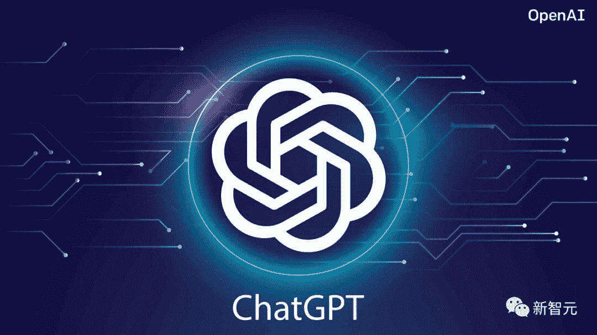

为了更好地进行预测，`Jacob` 查询了各种来源的信息，包括经验缩放定律、对未来计算和数据可用性的预测、特定基准的改进速度、当前系统的经验推理速度，以及未来可能的并行性改进。

概括来看，`Jacob` 认为，`GPT 2030` 会在以下几个方面超过人类工作者。

1. 编程、黑客任务、数学、蛋白质设计。

2. 工作和思考的速度：预计 `GPT 2030` 每分钟处理的单词是人类的5倍，而每 `FLOP` 都多5倍的话，总共就是125倍。

3. `GPT 2030` 可以进行任意复制，并进行并行运算。算力足够的话，它足以完成人类需要执行180万年的工作，结合2中的结论，这些工作只需2.4个月，就能完成。

4. 由于具有相同的模型权重，`GPT` 的副本之间可以共享知识，实现快速的并行学习。因此，`GPT` 可以在1天内学完人类需要学2500年的知识。

5. 除了文本和图像，`GPT` 还能接受其它模态的训练，甚至包括各种违反直觉的方式，比如分子结构、网络流量、低级机器码、天文图像和脑部扫描。因此，它可能会对我们经验有限的领域具有很强的直觉把握，甚至会形成我们没有的概念。

当然，除了飞跃的性能，`Jacob` 表示，`GPT` 的滥用问题也会更加严重，并行化和高速将使模型严重威胁网络安全。

它的快速并行学习还会转向人类行为，而因为自己已经掌握了「千年」的经验，它想要操控和误导人类也会很轻易。

在加速方面，最大的瓶颈是 `GPT` 的自主性。

在数学研究这种可以自动检查工作的领域，`Jacob` 预测，`GPT 2030` 将超过大多数专业数学家。

在机器学习领域，他预测 `GPT` 将能独立完成实验并生成图表和论文，但还是需要人类科研者给出具体指导、评估结果。

在这两种情况下，`GPT 2030` 都将是科研过程中不可或缺的一部分。

`Jacob` 表示，他对 `GPT 2030` 特性的预测并不是从今天的系统中直观得出的，它们可能是错误的，因为 `ML` 在 `2030` 年会是什么样子，还存在很大的不确定性。

然而，无论 `GPT 2030` 会是什么样子，`Jacob` 都相信，它至少是一个更好版本的 `GPT-4`。

所以，我们现在就该为 `AI` 可能造成的影响（比如影响1万亿美元、1000万人的生命，或者对人类社会进程造成重大破坏）做好准备，而不是在7年以后。

## 特定能力

`GPT 2030` 应该会具有超人的编码、黑客和数学能力。

在阅读和处理大型语料库，以获取模式和见解以及回忆事实的能力方面，它都会能力惊人。

因为 `AlphaFold` 和 `AlphaZero` 在蛋白质结构预测和游戏方面都具有超人的能力，`GPT 2030` 显然也可以，比如让它在与 `AlphaFold/AlphaZero` 模型相似的数据上进行多模态训练。

## 编程能力

`GPT-4` 在 `LeetCode` 问题上的表现优于训练截止后的人类基线，并通过了几家大型科技公司的模拟面试。

他们的进步速度也很快，从 `GPT-3` 到 `GPT-4`，直接跃升了19%。

在更具挑战性的 `CodeForces` 竞赛中，`GPT-4` 的表现较差，但 `AlphaCode` 与 `CodeForces` 竞争对手的中值水平相当。

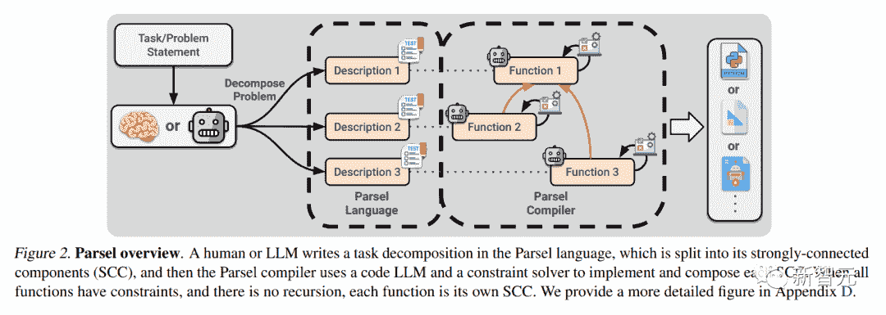

在更难的 `APPS` 数据集上，`Parcel` 进一步超越了 `AlphaCode`（7.8%->25.5%）。

展望未来，预测平台 `Metaculus` 给出的中位数是 `2027` 年，届时在 `APPS` 上将有80%的 `AI`，将超越除了最优秀程序员之外的所有人类。

## 黑客

`Jacob` 预测，`GPT 2030` 的黑客能力将随着编程能力的提高而提高，而且，`ML` 模型可以比人类更有规模、更认真地搜索大型代码库中的漏洞。

事实上，`ChatGPT` 早已被用于帮助生成漏洞。

`ChatGPT` 生成的网络钓鱼邮件

## 数学

`Minerva` 在竞赛数学基准（`MATH`）上的准确率达到50%，优于大多数人类竞争对手。

而且，它的进步速度很快（一年内>30%），而且通过自动形式化、减少算法错误、改进思维链和更好的数据的加持，取得了显著的成果。

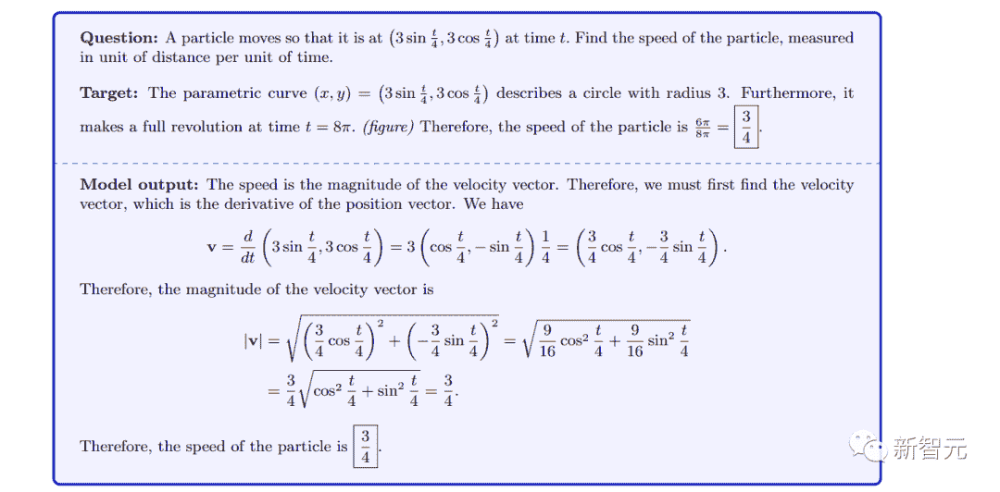

`Metaculus` 预测，到 `2025` 年 `GPT` 的数学成绩将达到92%，`AI` 在国际数学奥赛中获得金牌的中位数为 `2028` 年，能够比肩全世界成绩最拔尖的高中生。

`Jacob` 个人预计，`GPT 2030` 在证明定理方面将优于大多数专业数学家。

## 信息处理

回忆事实和处理大型语料库，是语言模型的记忆能力和大型上下文窗口的自然结果。

根据经验，`GPT-4` 在 `MMLU` 上的准确率达到86%，这是一套广泛的标准化考试，包括律师考试、`MCAT` 以及大学数学、物理、生物化学和哲学；即使考虑到可能存在测试污染，这也超出了任何人类的知识广度。

关于大型语料库，有研究人员使用 `GPT-3` 构建了一个系统，该系统发现了大型文本数据集中的几种以前未知的模式，以及某篇工作中的缩放率，这表明模型很快就会成为「超人」。

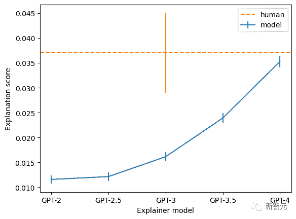

这两项工作都利用了 `LLM` 的大型上下文窗口，目前该窗口已超过100,000个 `token`，并且还在不断增长。

更一般地说，机器学习模型具有与人类不同的技能特征，因为人类和机器学习适应的是非常不同的数据源（前者是通过进化，后者是通过海量的互联网数据）。

当模型在视频识别等任务上达到人类水平时，它们在许多其他任务（例如数学、编程和黑客攻击）上可能会成为超人。

此外，随着时间的推移，会出现更大的模型和更好的数据，这会让模型功能变得更为强大，不太可能低于人类水平。

虽然当前的深度学习方法可能在某些领域达不到人类水平，但在数学这类人类进化并不擅长的领域，它们很可能会显著超越人类。

## 推理速度

为了研究 `ML` 模型的速度，研究人员将测量 `ML` 模型生成文本的速度，以每分钟想到380个单词的人类思维速度为基准。

使用 `OpenAI` 的 `chat completions API`，`GPT-3.5` 每分钟可以生成1200个单词 (`wpm`)，而 `GPT-4` 可以生成370 `wpm`，截至 `2023` 年4月上旬。

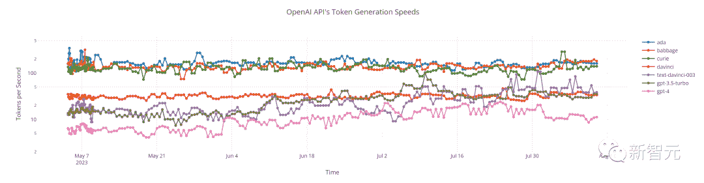

像 `Pythia-12B` 这样的小型开源模型，通过在 `A100` `GPU` 上使用开箱即用的工具，至少可以生成1350个单词 `wpm`， ，通过进一步优化，可能还会达到2倍。

因此，如果我们考虑截至4月份的 `OpenAI` 模型，它要么大约是人类速度的3倍，要么等于人类速度。因为加速推理存在强大的商业化压力，未来模型的推理速度还会更快。

事实上，根据 `Fabien Roger` 的跟踪数据，在撰写本文之前的一周，`GPT-4` 的速度已经提高到约540 `wpm`（12个 `token`/秒）；这表明空间仍然很大。

`Steinhard` 的中位数预测是，模型每分钟生成的单词数将是人类的5倍（范围：`[`0.5x`, `20x`]`），这大致是进一步增加的实际收益会递减的地方。

重要的是，机器学习模型的速度不是固定的。模型的串行推理速度可以提高 `k^2`，但代价是吞吐量降低 `k` 倍（换句话说，模型的 `k^3` 并行副本可以替换为速度快 `k^2` 倍的单个模型）

这可以通过并行平铺方案来完成，理论上该方案甚至适用于 `k^2` 这样的大值，可能至少为100，甚至更多。

因此，通过设置 `k=5`，可以将5倍人类速度的模型，加速到125倍的人类速度。

当然，速度并不一定与质量相匹配：`GPT 2030` 将具有与人类

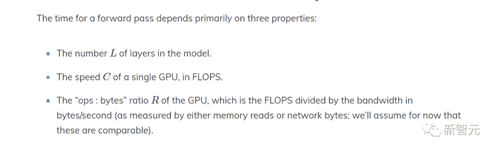

不同的技能特征，在一些我们认为容易的任务上，它会失败，而在我们认为困难的任务上，它会表现出色。

因此，我们不应将 `GPT 2030` 视为「加速的人类」，而应将其视为有潜力发展出一些违反直觉技能的「超级加速工人」。

尽管如此，加速仍然很有用。

对于提速125倍的语言模型，只要在 `GPT 2030` 的技能范围之内，我们需要一天时间的学会的认知动作，它可能在几分钟内就会完成。

运用前面提到的黑客攻击，机器学习系统可以快速生成漏洞或攻击，而人类却生成得很缓慢。

## 吞吐量和并行副本

模型可以根据可用的计算和内存任意复制，因此它们可以快速完成任何可以有效并行的工作。

此外，一旦一个模型被微调到特别有效，更改就可以立即传播到其他实例。模型还可以针对特定的任务进行蒸馏，从而运行得更快、更便宜。

一旦模型经过训练，可能会有足够的资源来运行模型的多个副本。

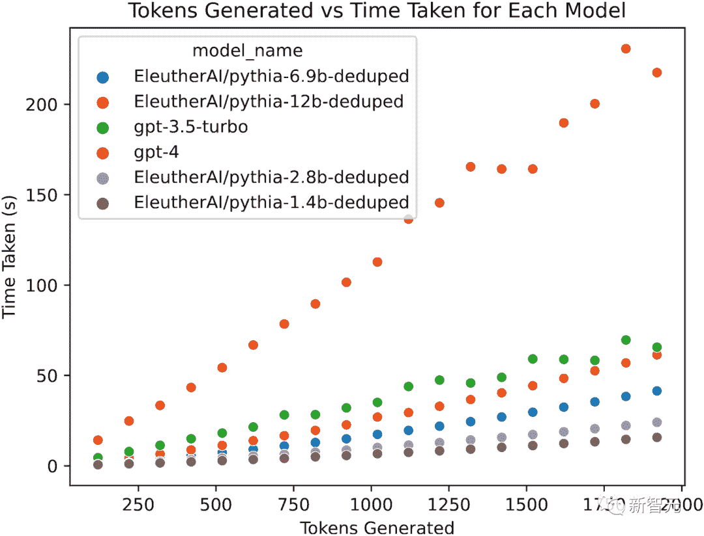

因为训练模型就需要运行它的许多并行副本，并且组织在部署时，仍然拥有这些资源。因此，我们可以通过估计训练成本，来降低副本数量。

比如，训练 `GPT-3` 的成本，足以运行 `9x10^11` 次前向传播。用人类等价的术语来说，人类以每分钟380个单词的速度思考，一个单词平均占1.33个 `token`，因此 `9x10^11` 次前向传播相当于以人类速度工作约3400年。

因此，该组织可以以人类工作速度运行3400个模型的并行副本一整年，或者以5倍人类速度运行相同数量的副本2.4个月。

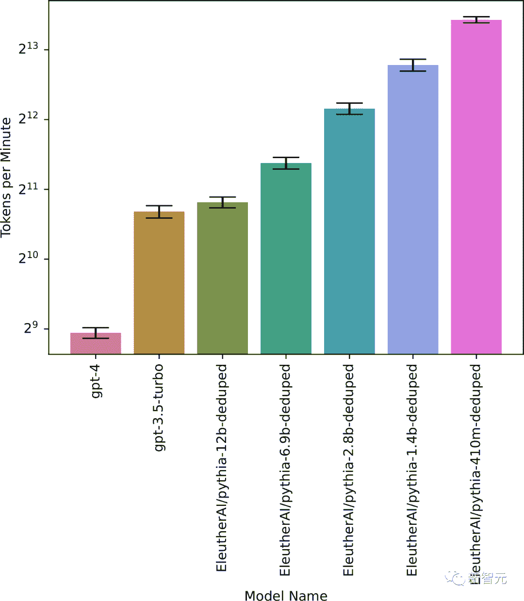

接下来，我们可以试着为未来的模型预测同样的「训练过剩」（训练与推理成本的比率）。这个数会更大，主要原因就是这个数值大致与数据集大小成正比，并且数据集会随着时间的推移而增加。

随着自然产生的语言数据被耗尽，这一趋势将会放缓，但新的模式以及合成或自我生成的数据仍将继续推动这一趋势。

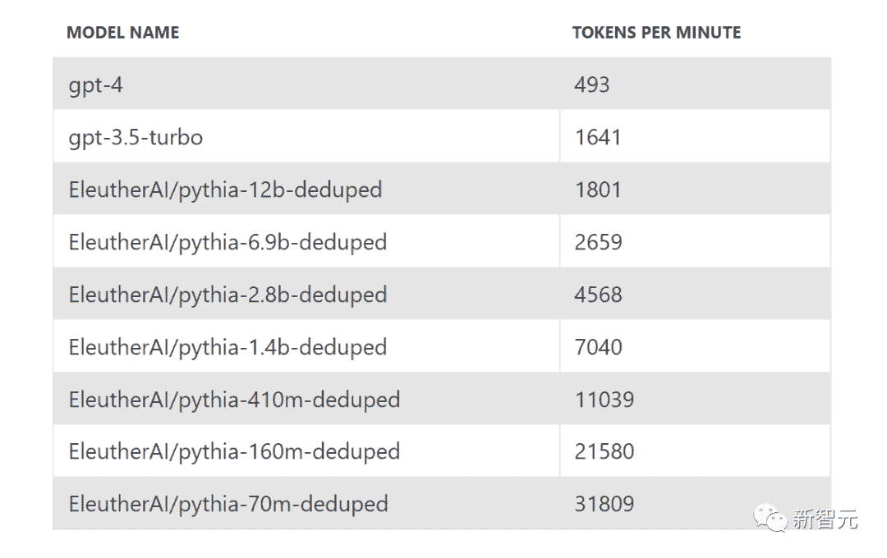

上面的预测有些保守，因为如果组织购买额外的算力，模型可能会在比训练时使用的资源更多的资源上运行。

一个大致的估计显示，`GPT-4` 的训练占用了世界上大约0.01%的计算资源，在未来它的训练和运行将占用全世界大更大比例的算力，因此在训练后进一步扩展的空间较小。

尽管如此，如果组织有充分的理由这样做，他们仍然可以将运行的副本数量增加到另一个数量级。

## 知识共享

模型的不同副本可以共享参数更新。

例如，`ChatGPT` 可以部署到数百万用户，从每次交互中学习一些东西，然后将梯度更新传播到中央服务器，随后应用于模型的所有副本。

通过这种方式，`ChatGPT` 一小时内观察到的人性就比人类一生（100万小时 = 114年）还要多。并行学习可能是模型最重要的优势之一，这意味着它们可以快速学习任何缺失的技能。

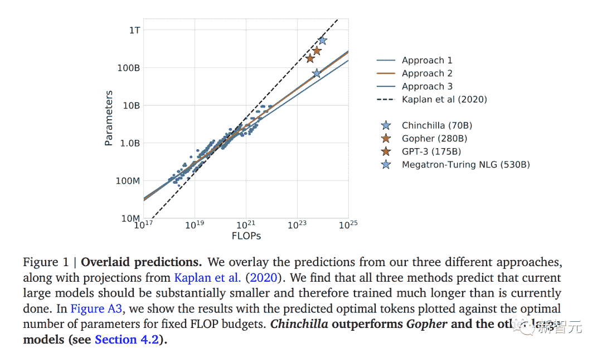

并行学习的速度取决于模型同时运行副本的数量、获取数据的速度以及数据是否可以有效地并行利用。

即使是极端的并行化，也不会对学习效率造成太大影响，因为在实践中，数以百万计的批大小是很常见的，并且梯度噪声尺度预测在某个「关键批大小」以下，学习性能的降低将是最小的。

因此，我们重点关注并行副本和数据采集。

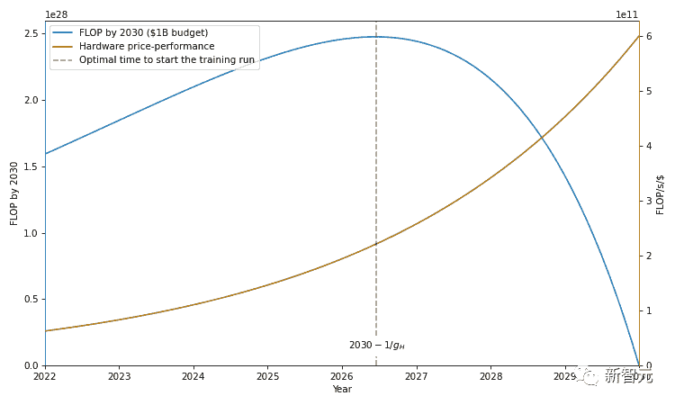

以下两个估计表明，可以让至少~100万个模型副本以人类速度并行学习。

这相当于人类每天学习2500年，因为100万天=2500年。

我们首先使用了上文第3节的数字，得出的结论是训练模型的成本足以模拟模型180万年的工作（根据人类速度进行调整）。

假设训练运行本身持续了不到1.2年，这意味着训练模型的组织拥有足够的 `GPU`，以人类速度运行150万个副本。

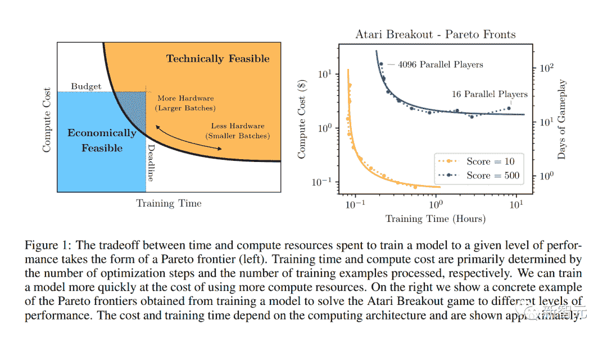

第二个估算考虑了部署该模型的组织的市场份额。

例如，如果一次有100万个用户查询模型，那么组织必然有资源来提供100万个模型副本。

截至 `2023` 年5月，`ChatGPT` 拥有1亿用户，截至 `2023` 年1月，每天有1300万活跃用户。

假设一般用户请求的是几分钟的模型生成文本，因此1月份的数字可能意味着每天大约5万人的文本。

然而，未来的 `ChatGPT` 式模型很可能会是这个数字的20倍，达到每天2.5亿活跃用户或更多，因此每天100万人的数据，是相当合理的。

作为参考，`Facebook` 每天有20亿日活用户。

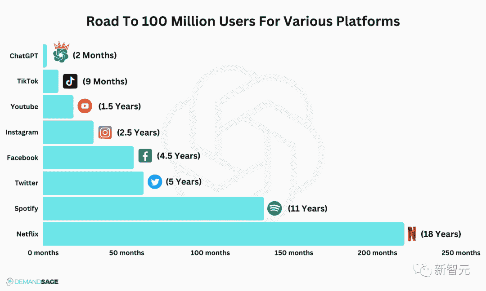

## 工具、模态和执行器

过去看，`GPT` 风格的模型主要是在文本和代码上进行训练，与外部世界的交互方面，除了通过聊天对话之外能力有限。

然而，现在情况正在迅速改变，因为模型正在接受其他模态（如图像）的训练，并且开始与物理执行器进行接口交互。

此外，模型不会局限于文本、自然图像、视频和语音等人类中心的模态，它们很可能还将接受对于我们来说陌生的模态的训练，比如网络流量、天文图像或其他大规模数据来源。

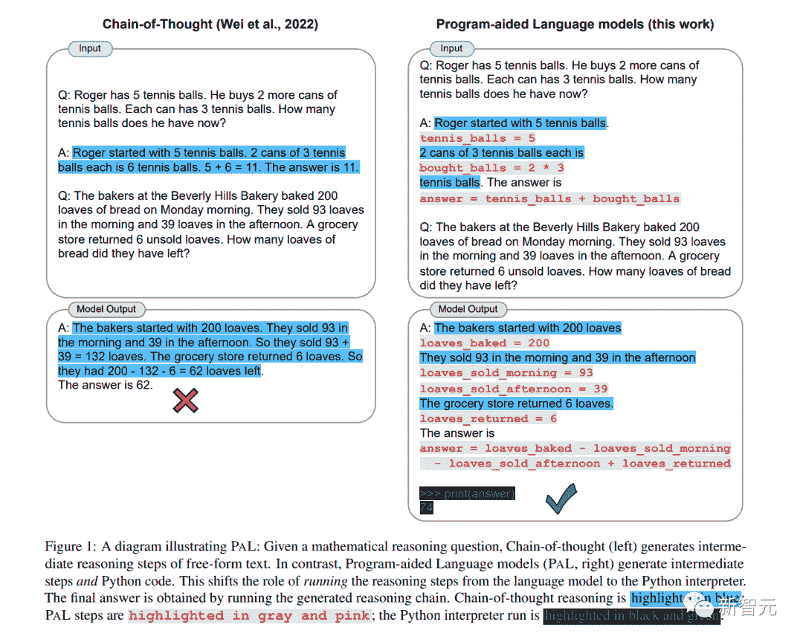

### 工具

最近发布的模型使用了很外部工具，比如 `ChatGPT` 插件。

模型已经可以编写并执行代码，说服人类采取行动，进行 `API` 调用、交易，并潜在地执行网络攻击。

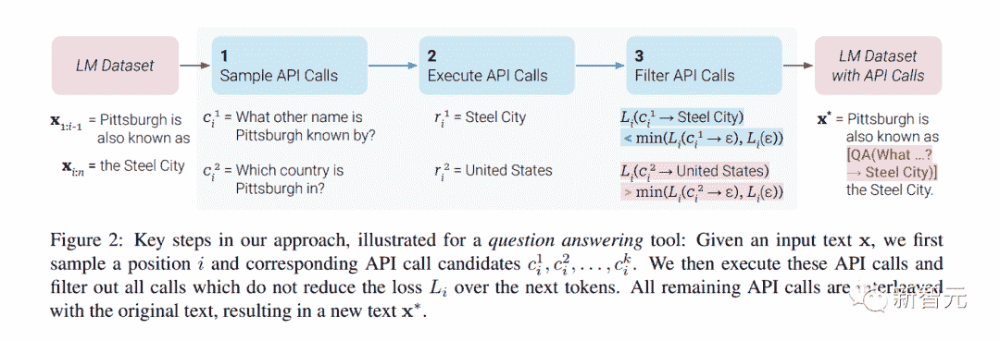

这种能力在未来还会进一步发展。

### 新模态

现在已经有了大规模的开源视觉-语言模型，比如 `OpenFlamingo`，而在商业领域，`GPT-4` 和 `Flamingo` 都是在视觉和文本数据上进行训练的。研究人员还在尝试更多非传统的模态配对，例如蛋白质和语言。

由于两个原因，我们应该预计大规模预训练模型的模态将继续扩展。

首先，从经济上讲，将语言与不太熟悉的模态（如蛋白质）配对是有用的，这样用户可以从解释中受益，并高效地进行修改。这意味着在蛋白质、生物医学数据、CAD模型以及与经济部门相关的其他模态上进行多模态训练。

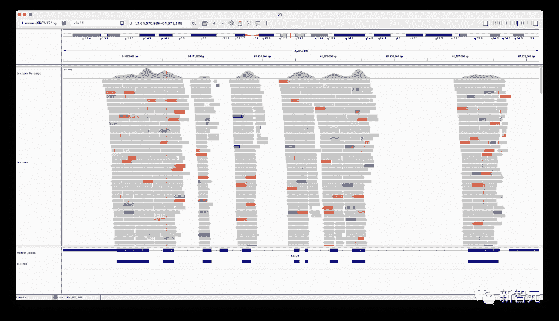

其次，随着语言数据的耗尽，模型开发者将寻找新型的数据，来继续从规模效应中受益。

除了传统的文本和视频，一些最大的现有数据来源是天文数据（每天将很快达到 `exabytes` 级）和基因组数据（每天约0.1 `exabytes`）。这些海量数据源有可能被用于训练 `GPT 2030`。

使用非传统模态，意味着 `GPT 2030` 可能会具有非直观的能力。它可能会比我们更好地理解星星和基因，即使它并不具备体力。

这可能会带来一些意外发现，例如设计新颖的蛋白质。

### 执行器

现在，大模型还开始使用物理执行器：`ChatGPT` 已经用于机器人控制了，`OpenAI` 正在投资一家人形机器人公司。

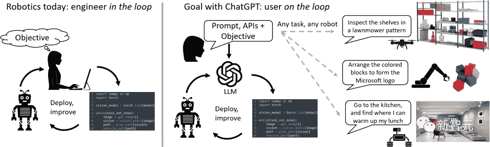

然而，与数字领域相比，物理领域的数据收集成本要高得多，而且人类在进化上更适应物理领域（因此，机器学习模型要与我们竞争的门槛更高）。

`Steinhard` 预测，在 `2030` 年，`AI` 模型能自主组织一辆法拉利的概率是40%。

## GPT-2030的影响

当像 `GPT-2030` 这样的 `AI` 出现，会对社会意味着什么？

可以推测，它会显著加速某些研究领域的发展，也有很大可能被滥用。

### 优势

`GPT-2030`，代表着一支庞大、高适应性和高吞吐量的员工队伍。

它可以在并行副本中完成180万年的工作，其中每个副本的运行速度是人类的5倍。

这意味着我们可以（在并行性约束的前提下）在2.4个月内，模拟180万个智能体工作一年的情况。

我们可以支付5倍的 `FLOP` 费用，来获得额外的25倍加速（达到人类速度的125倍），因此我们还可以在3天内，模拟14000个智能体工作一年的情况。

### 限制

限制这个数字化劳动力的，主要有三个障碍：技能要求、实验成本和自主性。

首先，`GPT-2030` 的技能要求与人类不同，使其在某些任务上表现较差）。

其次，模拟的工作者仍然需要与世界接触以收集数据，这会产生时间和计算成本。

最后，现在的模型在进行一连串思考后，只能生成几千个 `token`，之后就会「卡住」，进入一个不再产生高质量输出的状态。

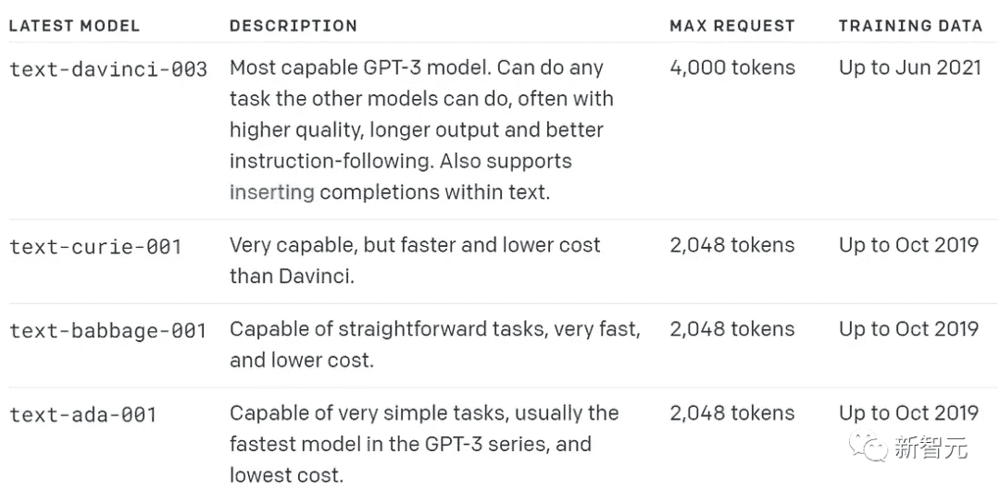

或许 `GPT-2030` 在被重置或通过外部反馈引导之前，能够连续运行数个相当于人类工作日的时间。

# GPT-2030 可能影响的任务

如果模型以5倍的加速运行，这意味着它们每隔几个小时就需要人类监督。

因此，GPT-2030最有可能影响的任务是：

1. AI相对于人类的强项
2. 只需要能够方便快速地收集外部经验数据的任务（而不是昂贵的物理实验）
3. 可以事先分解为可靠执行的子任务，或具有明确且可自动化的反馈度量，以帮助引导模型的任务

## 加速

同时满足上述三个标准的一个任务，就是是数学研究。

### 数学研究

在第一点上，GPT-2030可能具有超人的数学能力。

在第二和第三点上，数学可以纯粹通过思考和写作来完成，而且如果一个定理被证明了，我们会知道。

此外，现在全球并没有多少数学家（在美国只有3000名），因此GPT-2030可能会在在几天内，就模拟出超过所有数学家一年内产出的成果。

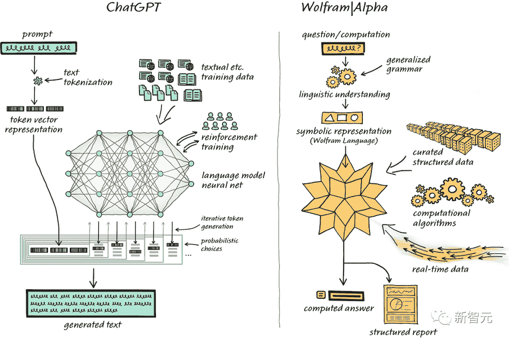

### 机器学习研究

机器学习研究也基本满足上述标准。

GPT-2030将具有超人的编程能力，包括实现和运行实验。

它在展示和解释实验结果方面也会表现相当出色，因为GPT-4能够以通俗易懂的方式解释复杂主题，同时市场也对此有很大需求。

因此，机器学习研究可能会简化为构思好要进行的实验，然后和高质量（但可能不可靠）的实验结果报告交互。

到2030年，硕博研究生可能会拥有和今天的教授相同的资源，仿佛手上带了几名优秀学生。

### 社会科学

社会科学的发展可能也会显著加速。很多论文的大部分工作是追踪、分类和标记有趣的数据来源，并提取模式。

这满足了要求3，因为分类和标记可以分解为简单的子任务；也满足了要求2，只要数据可以在互联网上获得，或者可以通过在线调查收集到。

## 参考资料

https://bounded-regret.ghost.io/what-will-gpt-2030-look-like/amp/

