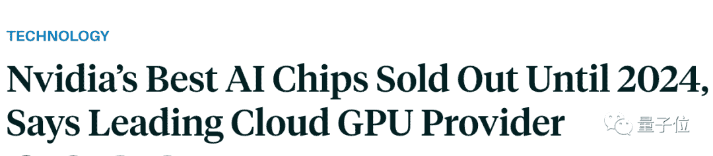
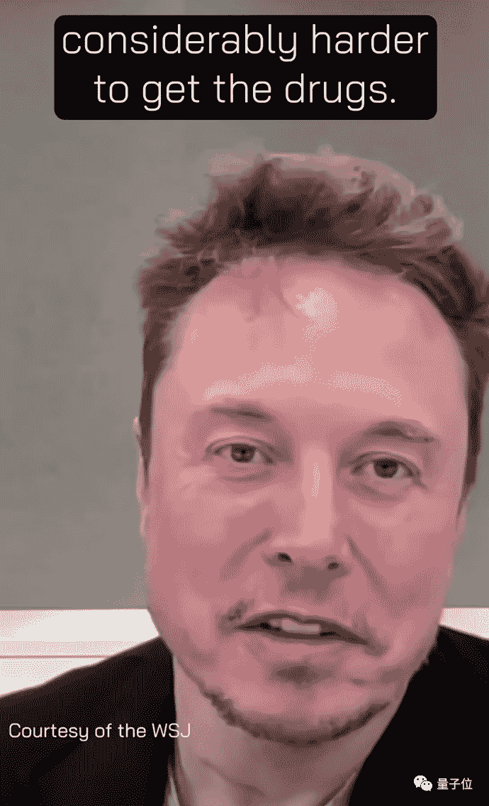
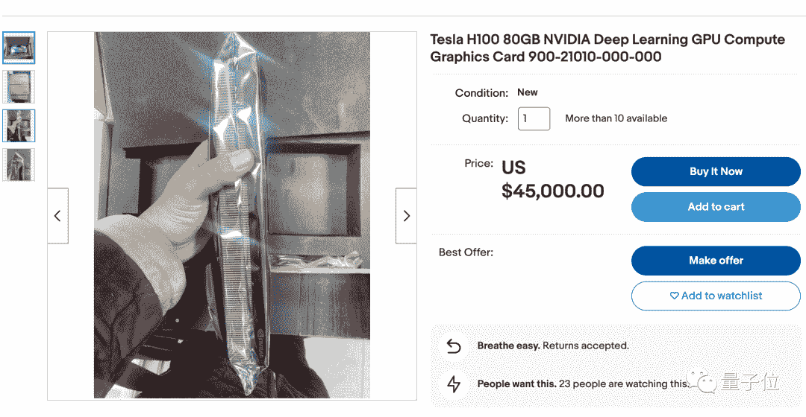
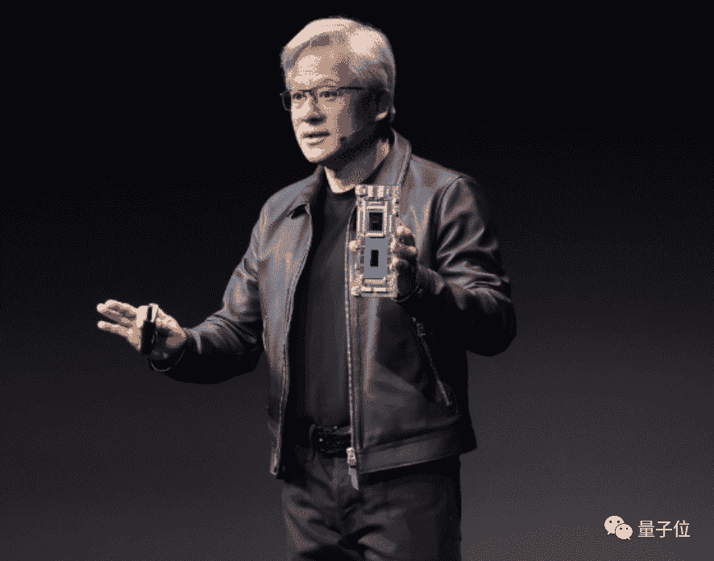
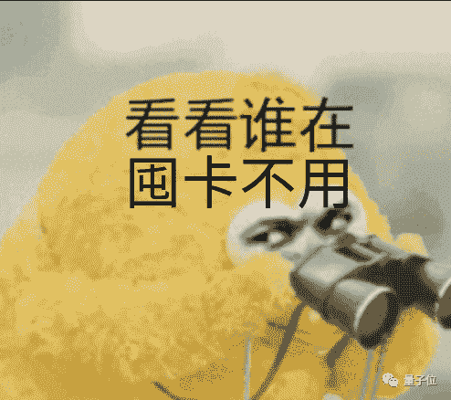
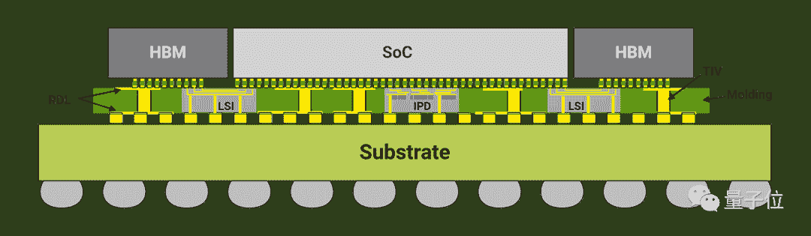
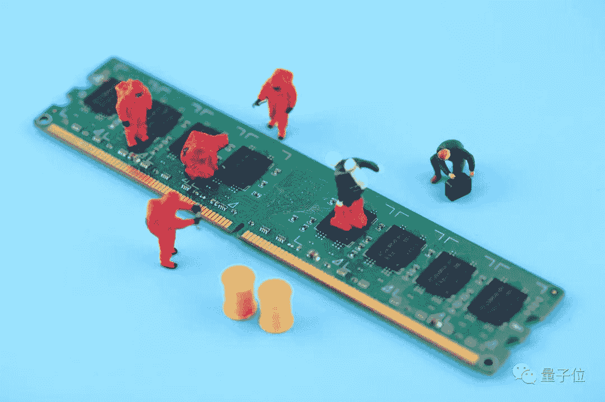
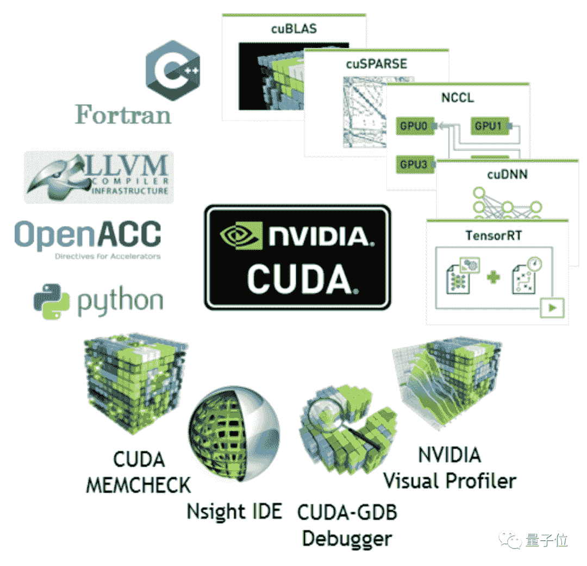
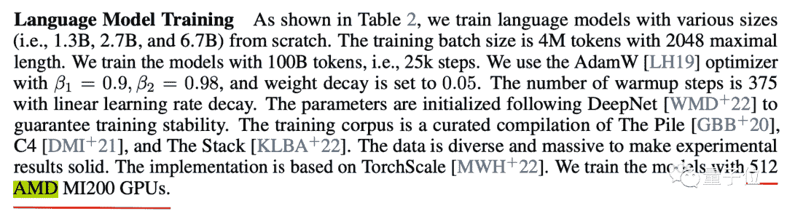
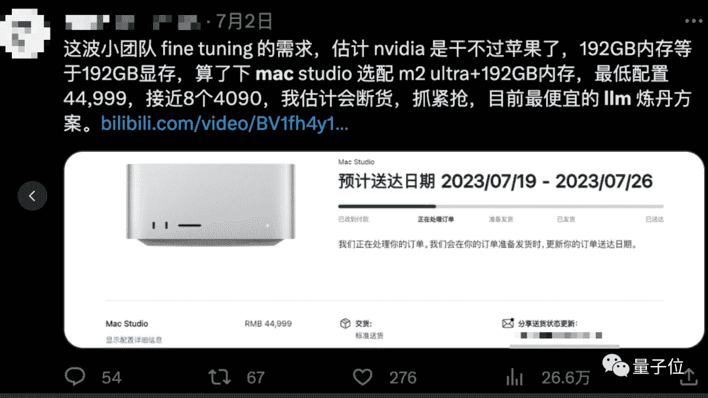

# 2023-08-13老黄赢麻了！英伟达H100订单排到24年，马斯克都坐不住了

> 来源：[https://xuqiwei1986.feishu.cn/docx/WylPdTDSPonrSzx7fHMcwpP7n2e](https://xuqiwei1986.feishu.cn/docx/WylPdTDSPonrSzx7fHMcwpP7n2e)

> 🔗 原文链接： h[ttps://mp.weixin.q](https://mp.weixin.qq.com/s/KNg-1u4wo7WWliyENk-0Fw)q.com/s/KNg-1u4w...

>

未可知 x 知识 2023-08-13 10:07 发表于 重庆

##### 梦晨 克雷西 发自 凹非寺 量子位 | 公众号 QbitAI

炼大模型最佳GPU **英伟达H100 **， **全部卖空了 **！

即使现在立即订购，也要等 **2024年Q1甚至Q2 **才能用上。

这是与英伟达关系密切的云厂商CoreWeave对华尔街日报透露的最新消息。

> **从4月初开始，**供应就变得异常紧张**。 仅仅一周之内 ，预**期交货时间就 从合理水平跳到了年底 。

全球最大云厂商亚马逊AWS也证实了这一消息，CEO Adam Selipsky近期表示：

> **A100和H100是最先进的…**… 即使对于AWS来说也很难获得 。

**更早时候，马斯克还在一场访**谈节目中也说过： GPU现在比d品还难获得 。

如果找“黄牛”买，溢价高达 **25% **。

**如Ebay上的价**格已从出厂价约36000美元涨到了 45000美元 ，而且货源稀少。

这种形势下，国内的 **百度、字节、阿里、腾讯 **等大型科技公司也向英伟达下了 **总计50亿美元 **的A800等芯片订单。

其中只有10亿美元的货能今年内交付，另外80%也要等2024年才行。

那么现有高端GPU都卖给谁了？这一波产能又是卡在了哪？

## **H100卖给谁，老黄说了算**

ChatGPT爆发以来，擅长训练大模型的英伟达A100、H100成了香饽饽。

甚至H100已经可以作为初创公司的一种资产，找投资基金获得抵押贷款。

**OpenA**I、Meta为代表的 A**I公司 ，亚****马逊、微软为代**表的 云计算公司 ，私有云Coreweave和Lambda，以及所有想炼自家大模型的 各类科技公司 ，需求量都巨大。

然而卖给谁，基本是英伟达CEO黄仁勋说了算。

**据The **Information消息，H100这么紧缺，英伟达 把大量的新卡分配给了CoreWeave ，对亚马逊微软等老牌云计算公司 限量供应 。

（英伟达还直接投资了CoreWeave。）

外界分析是因为这些老牌公司都在开发自己的AI加速芯片、希望减少对英伟达的依赖，那老黄也就成全他们。

老黄在英伟达内部还把控了公司日常运营的方方面面，甚至包括 “审查销售代表准备对小型潜在客户说什么话” 。

全公司 **约40名高管直接向老黄汇报 **，这比Meta小扎和微软小纳的直接下属加起来还多。

一位英伟达前经理透露，“在英伟达， 黄仁勋实际上是每一款产品的首席产品官 。”

前阵子，还传出老黄干了一件夸张的事： 要求一些小型云计算公司提供他们的客户名单 ，想了解GPU的最终使用者是谁。

外界分析，此举将使英伟达更了解客户对其产品的需求，也引起了对英伟达可能利用这些信息谋取额外利益的担忧。

也有人认为，还有一层原因是老黄想知道谁真的在用卡，而谁只是囤卡不用。

为什么英伟达和老黄现在有这么大的话语权？

主要是高端GPU供需太不平衡，根据**GPU Utils**网站的测算，H100 缺口高达43万张 。

作者Clay Pascal根据各种已知信息和传言估计了AI行业各参与者近期还需要的H100数量。

**AI公司方面：**

+   OpenAI可能需要5万张H100来训练GPT-5

+   Meta据说需要10万

+   InflectionAI的2.2万张卡算力集群计划已公布

+   主要AI初创公司如Anthropic、Character.ai、欧洲的MistraAI和HelsingAI需求各自在1万数量级。

**云计算公司方面：**

+   大型公有云里，亚马逊、微软、谷歌、甲骨文都按3万算，共12万

+   以CoreWeave和Lambda为代表的私有云加起来总共需要10万

加起来就是43.2万了。

这还没算一些摩根大通、Two Sigma等也开始部署自己算力集群的金融公司和其他行业参与者。

那么问题来了，这么大的供应缺口，就不能多生产点吗？

老黄也想啊，但是 **产能被卡住了 **。

## **产能这次卡在哪里？**

其实，台积电已经为英伟达调整过一次生产计划了。

不过还是没能填补上如此巨大的缺口。

**英伟达DGX系统**副总裁兼总经理C**harlie Boy**le称，这次 并不是卡在晶圆 ，而是台积电的 CoWoS封装技术 产能遇到了瓶颈。

与英伟达抢台积电产能的正是苹果，要在9月发布会之前搞定下一代iPhone要用的A17芯片。

而台积电方面近期表示，预计需要1.5年才能使封装工艺积压恢复正常。

CoWoS封装技术是台积电的看家本领，台积电之所以能击败三星成为苹果的独家芯片代工厂靠的就是它。

这项技术封装出的产品性能高、可靠性强，H100能拥有3TB/s (甚至更高) 的带宽正是得益于此。

CoWoS全名叫Chip-on-Waf**er-on-S**ubstrate，是一种 在晶圆层面上 的芯片集成技术。

这项技术可以将多个芯片封装到 **厚度仅有100μm **的硅中介层上。

据介绍，下一代中介层面积将达到6倍reticle，也就是约5000mm²。

目前为止，除了台积电，没有哪家厂商拥有这个水平的封装能力。

虽然CoWoS的确强悍，但没有它就不行吗？其他厂商能不能代工呢？

先不说老黄已经表示过“不考虑新增第二家H100代工厂”。

从现实上看，可能也真的不行。

英伟达此前曾和三星有过合作，但后者从未给英伟达生产过H100系列产品，甚至其他5nm制程的芯片。

据此有人推测，三星的技术水平可能无法满足英伟达对尖端GPU的工艺需求。

至于英特尔……他们的5nm产品好像还迟迟没有问世。

既然让老黄换生产厂家行不通，那用户直接改用AMD怎么样？

## **AMD，Yes？**

如果单论性能的话，AMD倒的确是慢慢追上来了。

AMD最新推出的MI300X，拥有192GB的HBM3内存、5.2TB/s的带宽，可运行800亿参数模型。

而英伟达刚刚发布的DGX GH200，内存为141GB的HBM3e，带宽则为5TB/s。

但这并不意味着AMD能马上填补N卡的空缺——

英伟达真正的“护城河”，在于CUDA平台。

###### CUDA已经建立起一套完整的开发生态，意味着用户要是购买AMD产品，需要更长时间来进行调试。

一名某私有云公司的高管表示，没人敢冒险花3亿美元实验部署10000个AMD GPU。

这名高管认为，开发调试的周期可能至少需要两个月。

在AI产品飞速更新换代的大背景下，两个月的空档期对任何一家厂商来说可能都是致命的。

不过微软倒是向AMD伸出了橄榄枝。

此前有传闻称 ，微软准备和AMD共同开发代号为“雅典娜”的AI芯片。

而更早之前，MI200发布时，微软第一个宣布采购，并在其云平台Azure上部署。

比如前一阵 MSRA的新大模型基础架构RetNet 就是在512张AMD MI200上训练的。

在英伟达占据几乎整个AI市场的格局下，可能需要有人带头冲锋，先整个大型AMD算力集群打样，才有人敢于跟进。

不过短时间内，英伟达H100、A100还是最主流的选择。

## **One More Thing**

**前一阵苹果发布最高支持19**2GB内存 新款M2 Ultra芯片 的时候，还有不少从业者畅享过用它来微调大模型。

毕竟苹果M系列芯片的内存显存是统一的， 192GB内存就是192GB显存 ，可是80GB H100的2.4倍，又或者24GB RTX4090的8倍。

然鹅，有人真的把这台机器买到手后，实际测试训练速度 还不如英伟达RTX3080TI ， 微调都不划算，训练就更别想了。

毕竟M系列芯片的算力部分不是专门针对AI计算优化的，光大显存也没用。

炼大模型，看来主要还是得靠H100，而H100又求之不得。

**面对这种情况，网络上甚**至流传着一首 魔性的“GPU之歌” 。

很洗脑，慎入。

GPU之歌本家

https://www.youtube.com/watch?v=YGpnXANXGUg

参考链接：

[1] https://www.barrons.com/articles/nvidia-ai-chips-coreweave-cloud-6db44825

[2] https://www.ft.com/content/9dfee156-4870-4ca4-b67d-bb5a285d855c

[3] https://www.theinformation.com/articles/in-an-unusual-move-nvidia-wants-to-know-its-customers-customers

[4] https://www.theinformation.com/articles/ceo-jensen-huang-runs-nvidia-with-a-strong-hand

[5] https://gpus.llm-utils.org/nvidia-h100-gpus-supply-and-demand/#which-gpus-do-people-need

[6] https://3dfabric.tsmc.com/english/dedicatedFoundry/technology/cowos.htm

[7] https://developer.nvidia.com/blog/cuda-10-features-revealed/

[8] https://www.theverge.com/2023/5/5/23712242/microsoft-amd-ai-processor-chip-nvidia-gpu-athena-mi300

[9] https://www.amd.com/en/press-releases/2022-05-26-amd-instinct-mi200-adopted-for-large-scale-ai-training-microsoft-azure

【风险警示】

本公众号所有文章内容仅用于信息分享，不对任何经营与投资行为进行推广与背书，请读者严格遵守所在地区法律法规，不参与任何非法金融行为。对转载、分享的内容观点保持中立，不构成任何投资建议!

【版权声明】

图文转载于网络的，版权归原作者所有，仅供分享学习参考之用。如有异议，请及时联系本公众号删除。

---

记得星标🌟我们

关注科技前沿