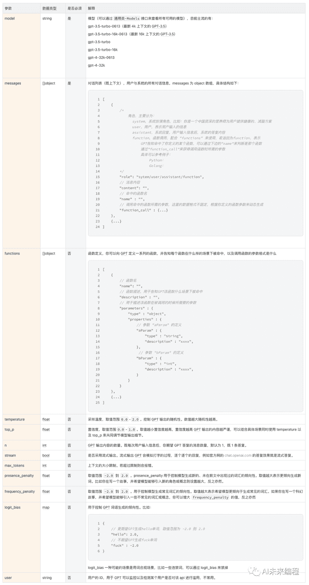
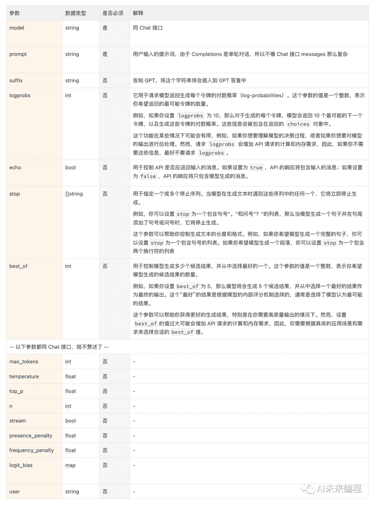
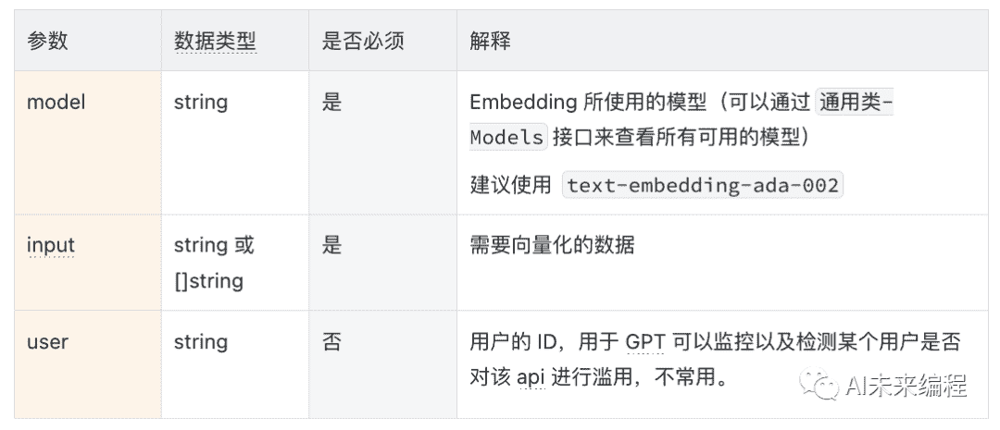
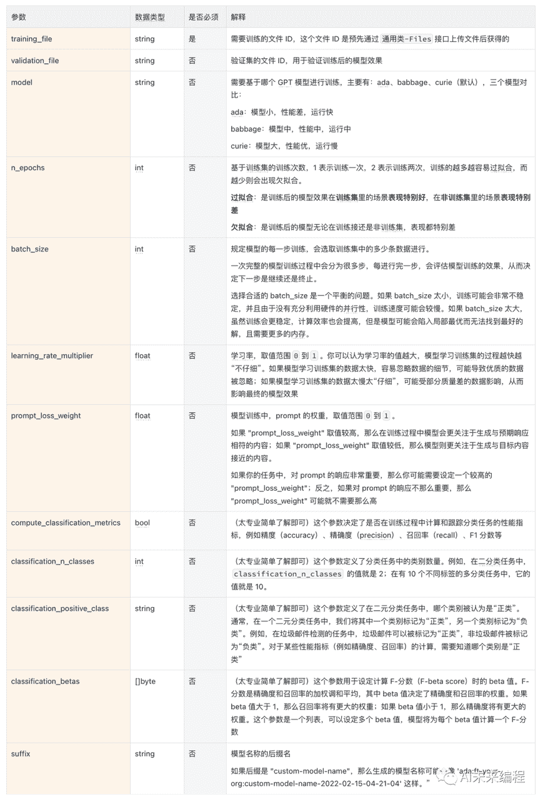
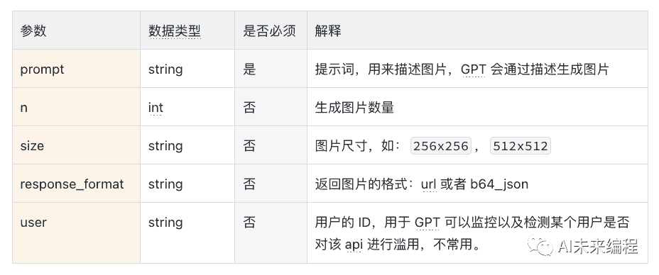
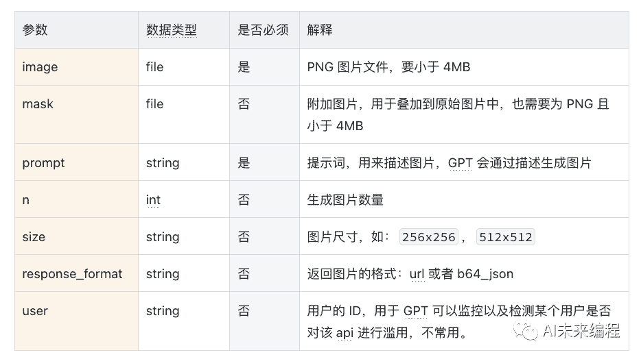
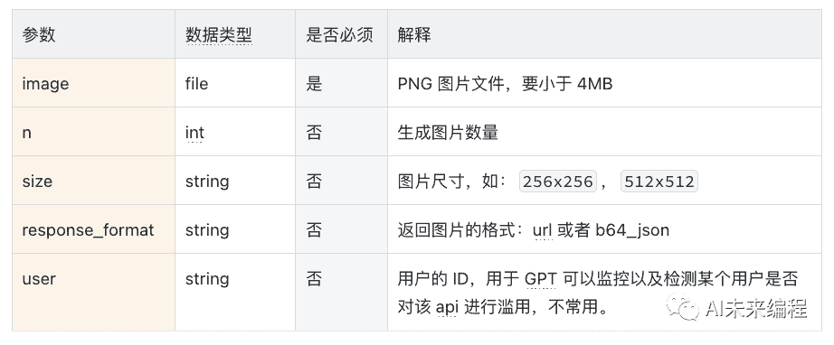
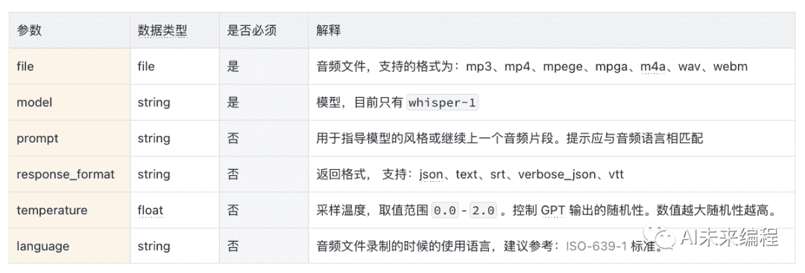

# 2023-08-10OpenAI API 详解

> 来源：[https://xuqiwei1986.feishu.cn/docx/XbwydUccyoomJ7xH7lfciHUtnmh](https://xuqiwei1986.feishu.cn/docx/XbwydUccyoomJ7xH7lfciHUtnmh)

> 🔗 原文链接： h[ttps://mp.weixin.q](https://mp.weixin.qq.com/s/EL8pZFrwV7RU8D4Xk6tXxA)q.com/s/EL8pZFrw...

> 原创 菠菜Orz AI未来编程 2023-08-10 08:30 发表于 北京

#

OpenAI Api 官方地址为：https://platform.openai.com/docs/api-reference，常用的 OpenAI Api 接口总共分为 4 类：对话类、私有化模型训练类、通用类、图片 & 音频类，其中对话类与私有化模型训练类是最常用的，接下来我们来一一讲解。

# ** 一、对话类接口**

这类是最常用也是最核心的接口，用于人机对话。对话类接口又细分**为：Cha**t、Comple**tions。 Chat **是指多轮对话； Completions 是指单轮对话，主要用于一次性生成一篇文章等，不具备多次对话交互的能力。

## ** ****Chat（多轮对话） **

### ** 1. 请求地址 **

POST https://api.openai.com/v1/chat/completions

### ** 2. 请求参数 **

请求参数整体为 JSON 格式，详细含义如下：



### ** 3. 返回参数 **

**Request **:

```
curl &quot;https://api.openai.com/v1/chat/completions&quot; \
  -H &quot;Content-Type: application/json&quot; \
  // 这里要替换成你的API Key
  -H &quot;Authorization: Bearer $OPENAI_API_KEY&quot; \
  -d &#x27;{
    &quot;model&quot;: &quot;gpt-3.5-turbo&quot;,
    &quot;messages&quot;: [{&quot;role&quot;: &quot;system&quot;, &quot;content&quot;: &quot;You are a helpful assistant.&quot;}, {&quot;role&quot;: &quot;user&quot;, &quot;content&quot;: &quot;Hello!&quot;}]
  }&#x27;
```

**Response **:

```
{
    // GPT响应的唯一表示
    &quot;id&quot;: &quot;chatcmpl-123&quot;,
    // 表示接口类型
    &quot;object&quot;: &quot;chat.completion&quot;,
    // 创建的unix时间戳
    &quot;created&quot;: 1677652288,
    // 模型生成的内容
    &quot;choices&quot;: [{
        // 序号
        &quot;index&quot;: 0,
        // 生成内容
        &quot;message&quot;: {
            &quot;role&quot;: &quot;assistant&quot;,
            &quot;content&quot;: &quot;\n\nHello there, how may I assist you today?&quot;,
        },
        /* 
          停止生成原因：
              stop，正常结束或者遇到停止序列而停止
              length，生成内容达到了最大长度限制
              function_call，需要调用函数而停止
              content_filter，内容被过滤而停止
        */
        &quot;finish_reason&quot;: &quot;stop&quot;
    }],
    // 统计数据
    &quot;usage&quot;: {
        // 传入数据消耗的token数
        &quot;prompt_tokens&quot;: 9,
        // GPT生成内容的Token数
        &quot;completion_tokens&quot;: 12,
        // 所有的Token数
        &quot;total_tokens&quot;: 21
    }
}
```

### ** 4. 代码示例 **

**Python **:

Demo 地址：python-gpt-course/course/openai_api/chat.py

运行示例：python course openai_api chat

**Golang **:

Demo 地址：golang-gpt-course/internal/openai_api/chat.go

运行示例：./start openai_api chat

## ** **Completions（单轮对话）

### ** 1. 请求地址 **

POST https://api.openai.com/v1/completions

### ** 2. 请求参数 **



### ** 3. 返回参数 **

**Request **:

```
curl &quot;https://api.openai.com/v1/completions&quot; \
  -H &quot;Content-Type: application/json&quot; \
  -H &quot;Authorization: Bearer $OPENAI_API_KEY&quot; \
  -d &#x27;{
    &quot;model&quot;: &quot;text-davinci-003&quot;,
    &quot;prompt&quot;: &quot;Say this is a test&quot;,
    &quot;max_tokens&quot;: 7,
    &quot;temperature&quot;: 0
  }&#x27;
```

**Reponse:**

```
{
    &quot;id&quot;: &quot;cmpl-uqkvlQyYK7bGYrRHQ0eXlWi7&quot;,
    &quot;object&quot;: &quot;text_completion&quot;,
    &quot;created&quot;: 1589478378,
    &quot;model&quot;: &quot;text-davinci-003&quot;,
    &quot;choices&quot;: [{
        &quot;text&quot;: &quot;\n\nThis is indeed a test&quot;,
        &quot;index&quot;: 0,
        &quot;logprobs&quot;: null,
        &quot;finish_reason&quot;: &quot;length&quot;
    }],
    &quot;usage&quot;: {
        &quot;prompt_tokens&quot;: 5,
        &quot;completion_tokens&quot;: 7,
        &quot;total_tokens&quot;: 12
    }
}
```

### ** 4. 代码示例 **

**Python **:

Demo 地址：python-gpt-course/course/openai_api/completion.py

运行示例：python course openai_api completion

**Golang **:

Demo 地址：golang-gpt-course/internal/openai_api/completion.go

运行示例：./start openai_api completion

# ** 二、私有化模型构建类**

这类是用于构建私有化模型的相关接口。私有化模型构建分为两种方式：Embeddings、Fine-tunes。两个模型这里简单的介绍下，：

**Embeddings **，以改变上下文的方式来打造私有化模型，该方式不对 GPT 本身的模型进行调整。

**Fine-tunes **，基于 GPT 的模型再进行额外的训练，会对 GPT 模型本身的参数进行微调。Fine-tunes 对模型训练的专业技能要求更高

PS：在后续的课程中还会详细讲解这两种方式，所以你可以简单看下相关接口，也可以等到学习私有化模型构建的时候再回过头来看

## ** ****Embeddings **

### ** 1. 请求地址 **

POST https://api.openai.com/v1/embeddings

### ** 2. 请求参数 **



### ** 3. 返回参数 **

**Request**

```
curl &quot;https://api.openai.com/v1/embeddings&quot; \
  -H &quot;Authorization: Bearer $OPENAI_API_KEY&quot; \
  -H &quot;Content-Type: application/json&quot; \
  -d &#x27;{
    &quot;input&quot;: &quot;The food was delicious and the waiter...&quot;,
    &quot;model&quot;: &quot;text-embedding-ada-002&quot;
  }
```

**Response**

```
{
    &quot;object&quot;: &quot;list&quot;,
    &quot;data&quot;: [
        {
            &quot;object&quot;: &quot;embedding&quot;,
            // 向量化数据
            &quot;embedding&quot;: [
                0.0023064255,
                -0.009327292,
                .... (1536 floats total for ada-002)
                -0.0028842222,
            ],
            &quot;index&quot;: 0
        }
    ],
    &quot;model&quot;: &quot;text-embedding-ada-002&quot;,
    &quot;usage&quot;: {
        &quot;prompt_tokens&quot;: 8,
        &quot;total_tokens&quot;: 8
    }
}
```

### ** 4. 代码示例 **

**Python **:

Demo 地址：python-gpt-course/course/openai_api/embedding.py

运行示例：python course openai_api embedding

**Golang **:

Demo 地址：golang-gpt-course/internal/openai_api/embedding.go

运行示例：./start openai_api embedding

## ** ****Fine-tunings **

由于 Fine-tunings 的接口比较多，这里只会详细介绍创建 Fine-tunning 的接口，其他会简要介绍。大多数场景下，都会“离线”完成模型训练，然后“在线”实时调用训练后的模型。而“离线”训练更多的是借助 OpenAI 的官方工具，具体的在后续课程中我们会进一步讲解。

另外，Fine-tunings 的使用需要有一定的模型训练的技术基础以及经验要求，比如你要懂：训练集、测试集、验证集、损失函数、梯度下降等等。其实对于大多数场景来说，Embeddings 的方式会更加容易落地。

### ** 1. 请求地址 **

POST https://api.openai.com/v1/fine-tunes

### ** 2. 请求参数 **



### ** 3. 返回参数 **

**Request**

```
curl &quot;https://api.openai.com/v1/fine-tunes&quot; \
  -H &quot;Content-Type: application/json&quot; \
  -H &quot;Authorization: Bearer $OPENAI_API_KEY&quot; \
  -d &#x27;{
    // 训练集的FileID
    &quot;training_file&quot;: &quot;file-XGinujblHPwGLSztz8cPS8XY&quot;
  }&#x27;
```

**Response**

```
{
      // 训练模型的ID
      &quot;id&quot;: &quot;ft-AF1WoRqd3aJAHsqc9NY7iL8F&quot;,
      &quot;object&quot;: &quot;fine-tune&quot;,
      &quot;model&quot;: &quot;curie&quot;,
      &quot;created_at&quot;: 1614807352,
      // 模型训练过程中的一些事件
      &quot;events&quot;: [
          {
              &quot;object&quot;: &quot;fine-tune-event&quot;,
              &quot;created_at&quot;: 1614807352,
              &quot;level&quot;: &quot;info&quot;,
              &quot;message&quot;: &quot;Job enqueued. Waiting for jobs ahead to complete. Queue number: 0.&quot;
          }
      ],
      &quot;fine_tuned_model&quot;: null,
      &quot;hyperparams&quot;: {
          &quot;batch_size&quot;: 4,
          &quot;learning_rate_multiplier&quot;: 0.1,
          &quot;n_epochs&quot;: 4,
          &quot;prompt_loss_weight&quot;: 0.1,
      },
      &quot;organization_id&quot;: &quot;org-...&quot;,
      &quot;result_files&quot;: [],
      &quot;status&quot;: &quot;pending&quot;,
      &quot;validation_files&quot;: [],
      &quot;training_files&quot;: [
          {
              &quot;id&quot;: &quot;file-XGinujblHPwGLSztz8cPS8XY&quot;,
              &quot;object&quot;: &quot;file&quot;,
              &quot;bytes&quot;: 1547276,
              &quot;created_at&quot;: 1610062281,
              &quot;filename&quot;: &quot;my-data-train.jsonl&quot;,
              &quot;purpose&quot;: &quot;fine-tune-train&quot;
          }
      ],
      &quot;updated_at&quot;: 1614807352,
}
```

### ** 4. 其他接口 **

获取 Fine-tunes 训练的模型列表

GET https://api.openai.com/v1/fine-tunes

获取某一个模型的详细信息

GET https://api.openai.com/v1/fine-tunes/{fine_tune_id}

取消正在训练的模型

POST https://api.openai.com/v1/fine-tunes/{fine_tune_id}/cancel

获取某一个模型训练过程中的事件

GET https://api.openai.com/v1/fine-tunes/{fine_tune_id}/events

删除一个模型

DELETE https://api.openai.com/v1/models/{model}

# ** 三、通用类**

Models（获取 GPT 可用模型列表）

###  1. 获取 Models 列表

**请求地址**

GET https://api.openai.com/v1/models

**Request**

```
curl &quot;https://api.openai.com/v1/models&quot; \
  -H &quot;Authorization: Bearer $OPENAI_API_KEY&quot;
```

**Repsonse**

```
{
    &quot;data&quot;: [
        {
            // GPT模型ID
            &quot;id&quot;: &quot;model-id-0&quot;,
            &quot;object&quot;: &quot;model&quot;,
            &quot;owned_by&quot;: &quot;organization-owner&quot;,
            // 权限
            &quot;permission&quot;: [...]
        },
        {
            &quot;id&quot;: &quot;model-id-1&quot;,
            &quot;object&quot;: &quot;model&quot;,
            &quot;owned_by&quot;: &quot;organization-owner&quot;,
            &quot;permission&quot;: [...]
        },
        {
            &quot;id&quot;: &quot;model-id-2&quot;,
            &quot;object&quot;: &quot;model&quot;,
            &quot;owned_by&quot;: &quot;openai&quot;,
            &quot;permission&quot;: [...]
          },
  ],
  &quot;object&quot;: &quot;list&quot;
}
```

###  2. 获取 Models 详情

**请求地址**

GET https://api.openai.com/v1/models/{model}

Request

```
curl &quot;https://api.openai.com/v1/models/text-davinci-003&quot; \
  -H &quot;Authorization: Bearer $OPENAI_API_KEY&quot;
```

Response

```
{
    &quot;id&quot;: &quot;text-davinci-003&quot;,
    &quot;object&quot;: &quot;model&quot;,
    &quot;owned_by&quot;: &quot;openai&quot;,
    &quot;permission&quot;: [...]
}
```

---

Files（上传文件到 GPT）

主要用于 Fine-tunings 的训练数据集、验证数据集的上传

### ** 1. 上传文件 **

**Request**

```
curl &quot;https://api.openai.com/v1/files&quot; \
  -H &quot;Authorization: Bearer $OPENAI_API_KEY&quot; \
  // 文件用途
  -F purpose=&quot;fine-tune&quot; \
  -F file=&quot;@mydata.jsonl&quot;
```

**Response**

```
{
    &quot;id&quot;: &quot;file-XjGxS3KTG0uNmNOK362iJua3&quot;,
    &quot;object&quot;: &quot;file&quot;,
    &quot;bytes&quot;: 140,
    &quot;created_at&quot;: 1613779121,
    &quot;filename&quot;: &quot;mydata.jsonl&quot;,
    &quot;purpose&quot;: &quot;fine-tune&quot;
}
```

### ** 2. 其他接口 **

获取文件列表

GET https://api.openai.com/v1/files

获取单个文件描述信息

GET https://api.openai.com/v1/files/{file_id}

获取单个文件内容

GET https://api.openai.com/v1/files/{file_id}/content

---

# ** 四、图片 & 音频 类**

## **Images**

### ** 1. 文生图 **

文字描述图，GPT 来生成

#### ** 1. 请求地址 **

POST https://api.openai.com/v1/images/generations

#### ** 2. 请求参数 **



#### ** 3. 返回参数 **

**Request**

```
curl &quot;https://api.openai.com/v1/images/generations&quot; \
  -H &quot;Content-Type: application/json&quot; \
  -H &quot;Authorization: Bearer $OPENAI_API_KEY&quot; \
  -d &#x27;{
    &quot;prompt&quot;: &quot;A cute baby sea otter&quot;,
    &quot;n&quot;: 2,
    &quot;size&quot;: &quot;1024x1024&quot;
  }&#x27;
```

**Response**

```
{
    &quot;created&quot;: 1589478378,
    &quot;data&quot;: [
        {
            &quot;url&quot;: &quot;https://...&quot;
        },
        {
            &quot;url&quot;: &quot;https://...&quot;
        }
    ]
}
```

### ** 2. 编辑图 **

上传图片，并描述修改方式，GPT 生成新图

#### ** 1. 请求地址 **

POST https://api.openai.com/v1/images/edits

#### ** 2. 请求参数 **



#### ** 3. 返回参数 **

**Request**

```
curl &quot;https://api.openai.com/v1/images/edits&quot; \
  -H &quot;Authorization: Bearer $OPENAI_API_KEY&quot; \
  -F image=&quot;@otter.png&quot; \
  -F mask=&quot;@mask.png&quot; \
  -F prompt=&quot;A cute baby sea otter wearing a beret&quot; \
  -F n=2 \
  -F size=&quot;1024x1024&quot;
```

**Response**

```
{
    &quot;created&quot;: 1589478378,
    &quot;data&quot;: [
        {
            &quot;url&quot;: &quot;https://...&quot;
        },
        {
            &quot;url&quot;: &quot;https://...&quot;
        }
    ]
}
```

### ** 3. 图变体 **

#### ** 4. 请求地址 **

POST https://api.openai.com/v1/images/variations

#### ** 2. 请求参数 **



#### ** 3. 返回参数 **

**Request**

```
curl &quot;https://api.openai.com/v1/images/variations&quot; \
  -H &quot;Authorization: Bearer $OPENAI_API_KEY&quot; \
  -F image=&quot;@otter.png&quot; \
  -F n=2 \
  -F size=&quot;1024x1024&quot;
```

**Response**

```
{
    &quot;created&quot;: 1589478378,
    &quot;data&quot;: [
        {
            &quot;url&quot;: &quot;https://...&quot;
        },
        {
            &quot;url&quot;: &quot;https://...&quot;
        }
    ]
}
```

## **Audio（语音转文字）**

将语音转为文字

### ** 1. 请求地址 **

POST https://api.openai.com/v1/audio/transcriptions

### ** 2. 请求参数 **



### ** 3. 返回参数 **

**Request**

```
curl &quot;https://api.openai.com/v1/audio/transcriptions&quot; \
  -H &quot;Authorization: Bearer $OPENAI_API_KEY&quot; \
  -H &quot;Content-Type: multipart/form-data&quot; \
  -F file=&quot;@/path/to/file/audio.mp3&quot; \
  -F model=&quot;whisper-1&quot;
```

**Response**

```
{
    &quot;text&quot;: &quot;Imagine the wildest idea that you&#x27;ve ever had, and you&#x27;re curious about how it might scale to something that&#x27;s a 100, a 1,000 times bigger. This is a place where you can get to do that.&quot;
}
```

---