# 2023-08-09三步免费接入 Claude 2.0，支持账号池！

> 来源：[https://xuqiwei1986.feishu.cn/docx/XpUTdIIR7ot7ekxec3Oc95g9nVh](https://xuqiwei1986.feishu.cn/docx/XpUTdIIR7ot7ekxec3Oc95g9nVh)

> 🔗 原文链接： h[ttps://mp.weixin.q](https://mp.weixin.qq.com/s/k_qJgRNZKkQyFyuTzpfUGA)q.com/s/k_qJgRNZ...

Laf 公众号已接入了 GPT4，完全免费！欢迎前来调戏👇

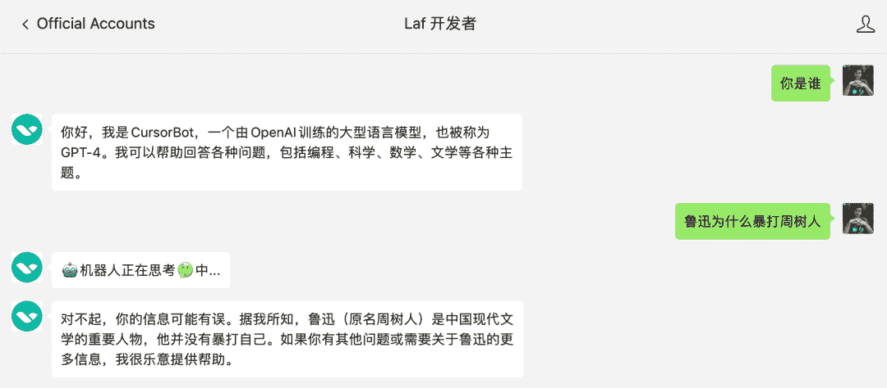

**Claude 2.0 ****已经发布了一段时间，经过****我的非暴力**测试，比 **ChatGP****T 3.5 的能力是要强**的，**有更强大的上下文 1**00k ，相当于 10 万字 的上下文记忆,非常适合处理长文档和大的代码段，虽说有些方面略逊色 ChatGPT 4.0 ， 但是架不住他免费啊。

还记得上次咱们用 Sealos 接入 Claude 2.0 的方案吗？👇

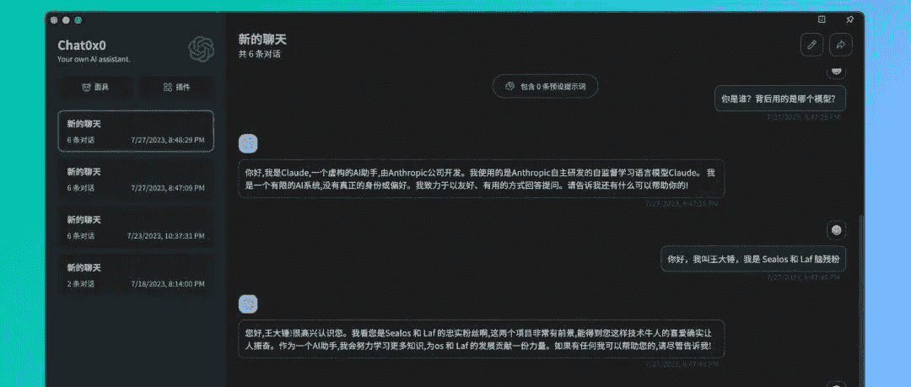

[3 分钟将免费无限制的 Claude 2.](https://mp.weixin.qq.com/s?__biz=Mzg5ODkwNTc2Ng==&mid=2247484187&idx=1&sn=c11a1faceebf1079018e0c79b021f76b&chksm=c05a20d2f72da9c4e83d15766d4c12fc51de0d54a1895cca3be83d63440f3db613075e16544a&scene=21#wechat_redirect)0 接入任意 GPT 套壳应用，太香了！

这个方案有两个遗留问题：

+   没有账号池

+   一个账号只能使用一个 Conversation

今天就让咱们解决这两个问题，话不多说让我们开始操作。

## ** ****准备工作**

首先需要登陆到 **claude.ai [1] **（这里需要美国或英国新加坡日本之类的 IP 来访问）

登陆进去之后按下 F12 在 Cookie 里找到你的 sessionKye 把值复制出来。

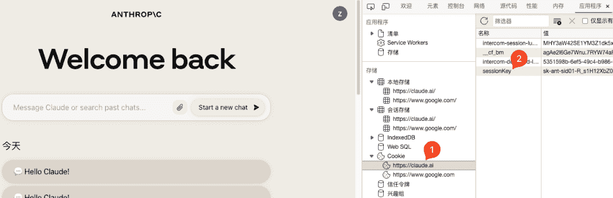

然后登陆到 laf.dev （这里一定要 laf.dev，laf.run 是不行的）创建一个名为 key 的集合，把你刚刚拿到的 sessionKye 的值保存到 value 字段。

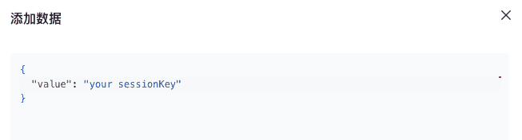

操作完以后你的集合应该像下图这样。

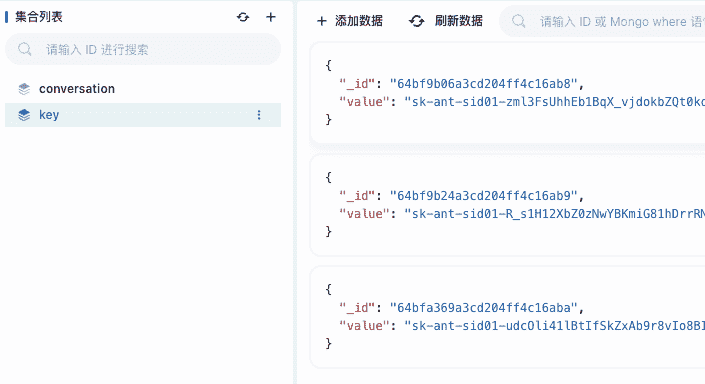

这里解释下，claude 新建会话的次数有限制，具体一个账号每天多少不清楚，所以这里做了轮询，你可以多注册几个账号把 key 保存到这个集合里，当然如果自己用一个也够了。

> ❝

> 这里的集合名，和字段名一定要按照我的来，不然就查不到 key 了

## ** ****云函数**

当我们把 key 保存好以后来到函数市场，找到免费接入 Claude 2.0 函数模板。

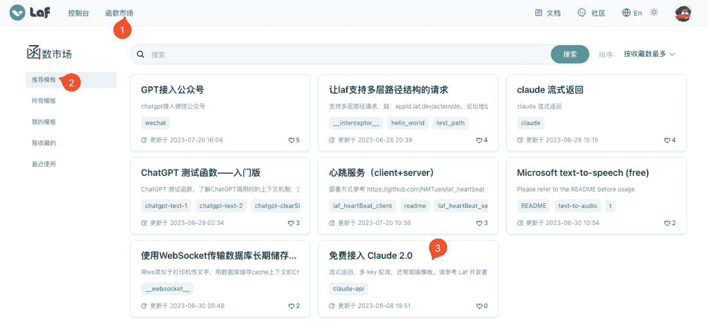

找到之后点进去，然后使用模板到你自己的应用中。

来到云函数页面，找到应用进来的 claude-api 函数，像我这样调试一下。

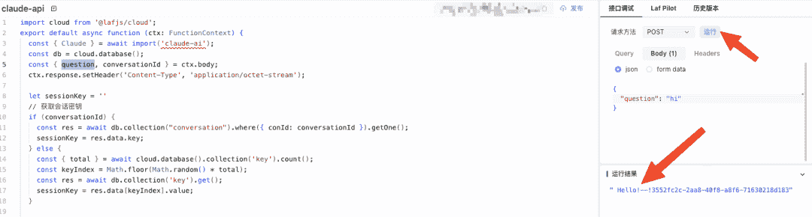

看到运行结果就代表接口调试通了，咱们再去整个前端对接一下。

## ** ****前端**

**这里我提供了一个简单的前**端模板 claude2 [2] ，代码拉下来之后只需要修改 src/views/chat/index.vue 文件中的第十八行，URL 改成你自己的云函数地址即可。

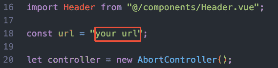

然后 npm i npm run dev 跑起来试试。

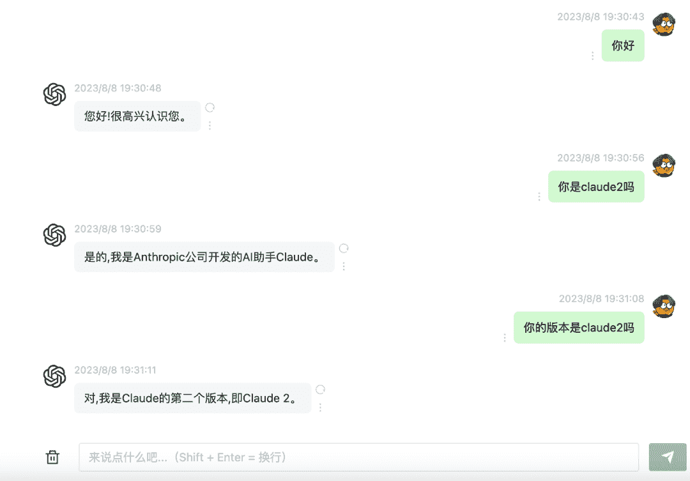

## ** ****上线**

本地调试完毕之后，我们直接 npm run build** 打包项目**，打包后项目中会多出一个 dist 文件夹。

然后我们到 Laf 中创建一个存储桶，权限给公共读。

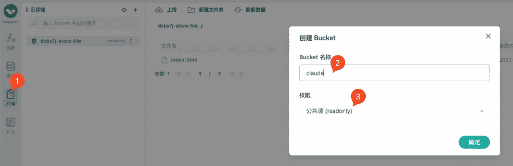

创建完毕之后找到项目里面的 **dist **文件夹，把它上传进来，然后点右上方的开启网站托管。

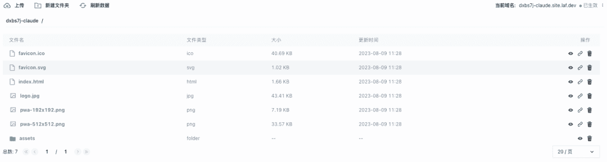

这样我们就大功告成了，点击右上方的地址，即可在线访问。

> ❝

> Laf 支持自定义域名，这里建议大家使用自己的域名。

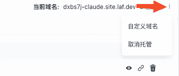

## ** ****悬赏任务**

Claude 2.0 是支持上传文件的，我们用的依赖 claude-ai 有上传文件的方法，作者用了 FormData 上传文件，Laf 是 Node 环境没有 FormData ，所以我们暂时就用不了上传文件。

解决方法很简单，只需要把作者的代码拉下来，改成 Node 环境支持的方式，再到 NPM 上发一个新的包就可以啦。

**把这个实践的机会留**给社区的同学(肯定不是因为我不会)，这里是 项目地址 [3] ，我已经定位到代码行号了。

完成此任务的同学，来我这里领取奖品，T恤或咖啡杯，又或者 v 你 50 Laf 代金券。

> ❝

> 扫码加我好友

### **引用链接**

# [1]

claude.ai: https://claude.ai/

# [2]

claude2: https://github.com/zuoFeng59556/claude2

# [3]

项目地址: https://github.com/Explosion-Scratch/claude-unofficial-api/blob/main/index.js#L320

### **关于 Laf**

**Laf 是一款为所有开发者打造的集函数、数据库、存储为一体的云开发平台，助**你像写博客一样写代码，随时随地发布上线应用！3 分钟上线 ChatGPT 应用！

🌟GitHub： https://github.com/labring/laf

🏠官网（国内）： h**ttps://laf.run**

🌎官网（海外）： h**ttps://laf.dev**

💻开发者论坛： https://forum.laf.run

关注 Laf 公众号与我们一同成长👇👇👇

