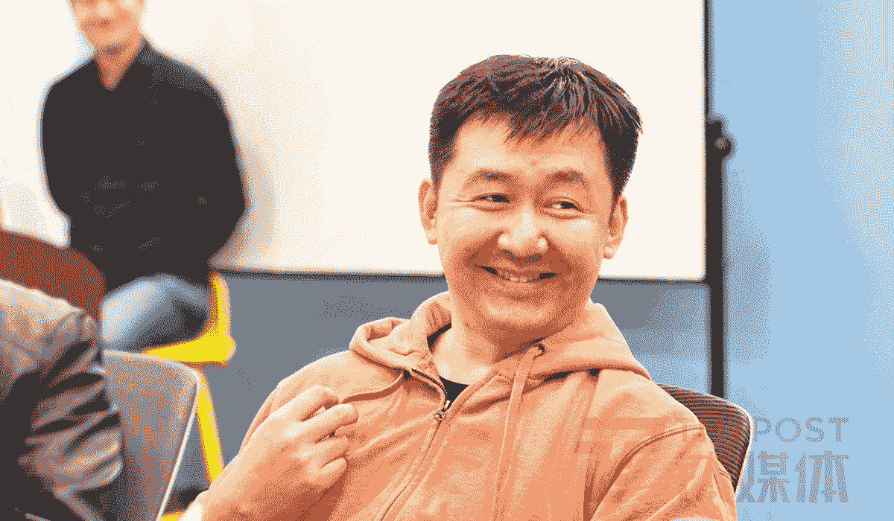
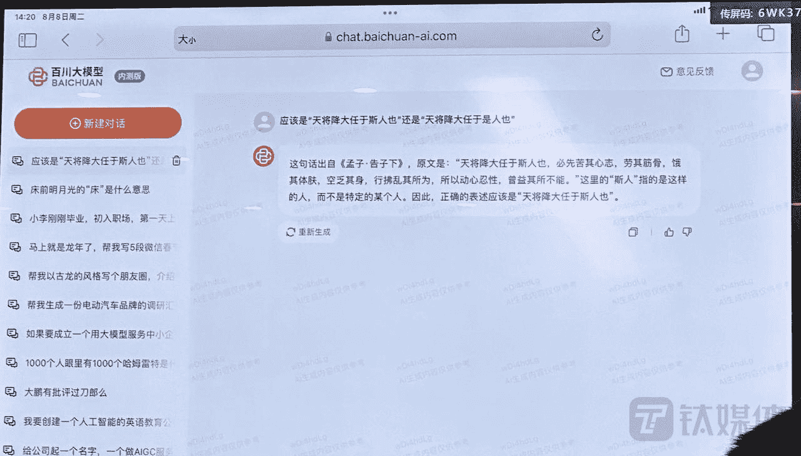
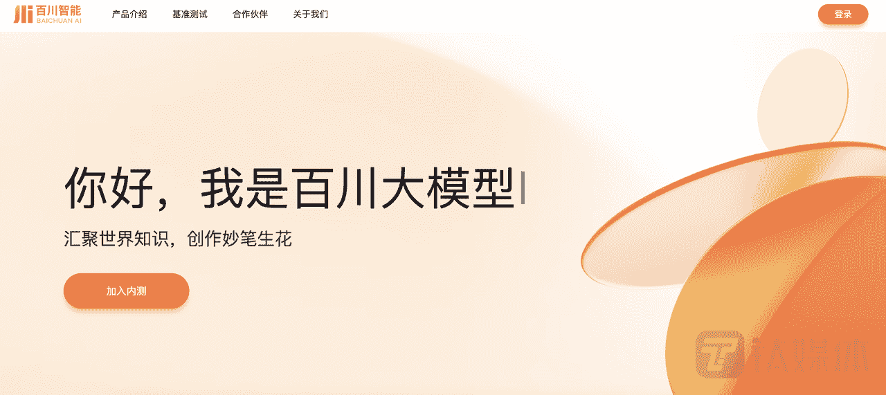
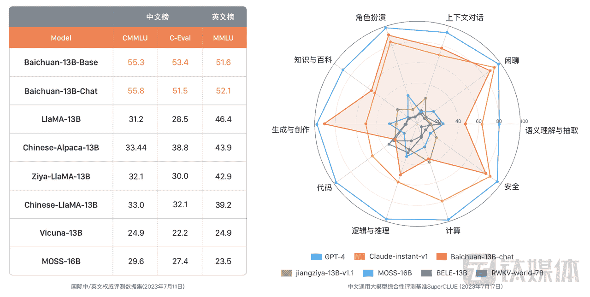
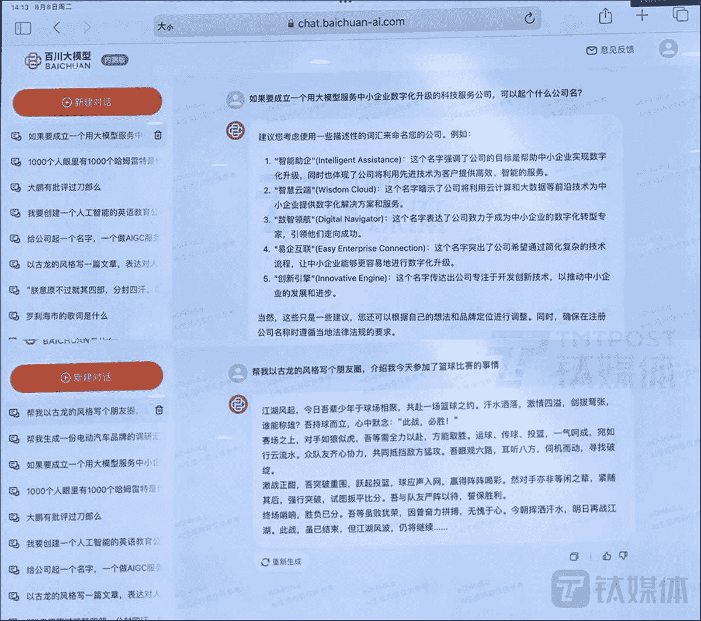
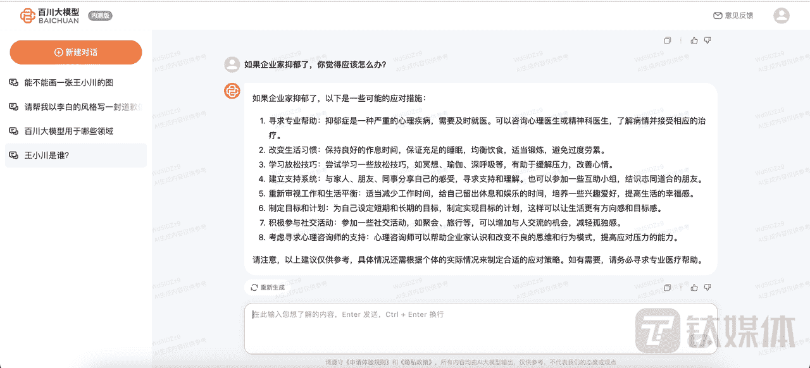

# 2023-08-09王小川公布最新530亿百川大模型，阿里腾讯等超150家企业已使用-今日头条

> 来源：[https://xuqiwei1986.feishu.cn/docx/OacBdXxDdoi0k1xTCfhc12Ownte](https://xuqiwei1986.feishu.cn/docx/OacBdXxDdoi0k1xTCfhc12Ownte)

> 🔗 原文链接： h[ttps://www.toutiao](https://www.toutiao.com/article/7265133887108530746/?log_from=7a3a609f56d4c_1691552544283).com/article/726...

>

# 王小川公布最新530亿百川大模型，阿里腾讯等超150家企业已使用

原创 2023-08-09 09:50 · 钛媒体APP

百川智能创始人兼CEO 王小川

成立120天，王小川的大模型公司百川智能又有了新动作。

钛媒体App获悉，8月8日下午， 百川智能在北京发布530亿参数通用大模型Baichuan-53B，定位闭源，主要面向B端用户提供服务，在写作、文本创作能力方面已达到行业较好水平，用于教育、医疗等领域。目前其已在官网启动内测。

**百**川智能创始人兼CEO 王小川对钛媒体App透露， 目前已有阿里云、腾讯云、火山引擎、浪潮、顺丰科技等超过150家合作伙伴使用Baichuan模型，预计下个月将会开放API等相关组件。

“这次大模型的文科能力更好。”王小川表示，其在理解古诗、生成有个性化风格的文章等方面具有较高的水平。百川认为目前闭源大模型反映一种技术能力，本质是为企业端（To B）服务，后面还会进行强化、数据库等对接工作，把企业端服务优先做起来。

王小川现场展示的百川大模型内测界面（来源：钛媒体App编辑拍摄）

**王**小川还透露，除了企业端以外，今年底之前，百川智能团队将部署有消费级（To C）端的超级应用。“ 未来不只有一款的超级应用，正在研发的路上。”

实际上，宣布成立的过去120天，百川智能已连续推出两款开源大模型：70亿、130亿参数的Baichuan-7B、Baichuan-13B系列，并登上多个评测榜单前列。

而如今，随着Baichuan-53B大模型的发布，王小川的百川智能迎来又一重要里程碑，完成开源+闭源大模型并行布局，将全面开启大模型的商业化时代。

## 成立120天完成开源+闭源大模型，中文能力已远超Llama？

时间倒回至120天前。

今年4月10日，沉寂一年多的搜狗创始人王小川正式对外宣布再度创业，选择人工智能（AI）大模型领域，他与前搜狗COO茹立云联合成立通用人工智能公司百川智能，旨在打造中国版的OpenAI。

王小川当时对钛媒体App等透露，百川智能已获得5000万美元启动资金，核心团队则包括前搜狗员工等顶尖AI人才。百川智能将借助语言AI的突破，构建中国最好的大模型底座，并在教育、医疗等领域应用落地。

钛媒体App了解到，截至目前，百川智能员工规模在113人左右，其中技术人员占70%-80%。

王小川认为，国内最好的大模型标准有三点，分别是参数量、测试集的效果，Chat产品体验。（详见钛媒体App前文：《王小川入局大模型创业，称追上GPT-4需要3年左右》、《GPT革命：百川智能与OpenAI的同与不同》）

**为了**打造国内最好的大模型，过去四个月内，首先，王小川带领百川智能团队推出了两款开源模型：70亿参数量的中英文预训练大模型baichuan-7B，以及130亿参数大模型Baichuan-13B系列 ——包括通用大语言模型Baichuan-13B-Base、对话模型Baichuan-13B-Chat和其INT4/INT8两个量化版本。

**其中， **baichuan-7B利用自研超大规模局部敏感哈希聚类系统和语义聚类系统，最终构建了包含1.2万亿token的兼顾质量和多样性的预训练数据。相较于其他同参数规模的开源中文预训练模型，数据量提高了超过50%。

而Baichuan-13B则在1.4万亿token数据集上训练，超过Meta LLaMA-13B 40%，是当前开源130亿参数下训练数据量最大的模型，上下文窗口长度为4096，百川称凭借百亿参数量已经展现出可以媲美千亿模型的能力。

上述Baichuan模型代码采用Apache-2.0协议，模型权重采用了免费商用协议，只需进行简单登记即可免费商用。目前，两款开源模型均已在Hugging Face、Github和Model Scope等平台上线。

具体到基准评测上，根据此前百川智能公布的结果显示， 在MMLU评测中，baichuan-7B综合评分达42.5分，超过了英文开源大模型LLaMA-7B的34.2分、中文开源模型ChatGLM-6B的36.9分；中文C-EVAL评测中，baichuan-7B的综合评分（42.8分）当时超过了ChatGLM-6B的38.9分。

Baichuan-13B基准（Benchmark）方面， C-EVAL中，Baichuan-13B在自然科学、医学、艺术、数学等领域大幅领先LLaMA-13B、Vicuna-13B等同尺寸的大语言模型，在社会科学、人文科学等领域超过了ChatGPT；MMLU上，Baichuan-13B超过了所有同尺寸开源模型。

百川智能强调，其Baichuan-13B系列模型未针对任何基准测试进行专项优化，保证了模型的纯净度，具有更高的效能和可定制性。

百川智能Baichuan-13B开源模型基准评测成绩比较（截至2023年7月）

截至钛媒体App发稿前，据C-Eval官网显示，百川智能的开源大模型Baichuan-13B总排名为第17位，平均分为53.6分，Baichuan-6B排名第28位。目前C-Eval平台总排行第一的是智谱AI公司于今年6月发布的ChatGLM2，平均分71.1分；排名第二是OpenAI发布的GPT-4，Meta最新发布的Llama2大模型没有参与评测。

整体来说，百川智能公开的两款开源大模型在各种测评上都有不错的表现。

王小川7月曾透露，开源大模型里面，百川智能在中文领域现在就可以替代，甚至现在已经是超越，未来其开源模型能力一定会超越Llama 2。“开源很简单，大家可以拿着自己用的，这不是你自己吹牛吹出来的。我觉得是可以做到的，我们应该有这样的自信。”

**此次，百川智能正式发布530亿参数**的新一代大模型Baichuan-53B。

具体来说，Baichuan-53B在预训练数据、搜索增强、动态响应策略、对齐能力等方面具有独特的技术特点和优势。

其中，Baichuan-53B在预训练数据方面实现全面的世界知识体系、系统的数据质量体系、多粒度的大规模聚类系统、细粒度自动化匹配算法等；搜索增强方面，百川智能将搜索技术与大语言模型能力相结合，实现创新性的模型优化与改进；动态响应策略方面，百川智能将指令任务细化为16个独立类别，涵盖逻辑推理、精准问答等场景进行设计和优化；在回答结果的搜索增强上，百川智能采用RLHF（人类反馈强化学习）技术，使得大模型能够参照搜索结果，针对用户请求生成高价值且具有实时性的回答。

王小川还在现场展示了Baichuan-53B的落地Chat内容生成能力，既可以给出大模型服务数字化升级的科技公司候选名字，又可以给古龙的风格写个朋友圈、写🛰️春节祝福语等。

钛媒体App也在百川大模型内测中测试了“如果企业家抑郁了，你觉得应该怎么办？”这种问题，百川大模型回答认为需要改变生活习惯、寻求专业帮助等。

**截至目前，百川已完成了“开源+闭源”大模型并行布局**，王小川也在现场谈及这两部分布局的原因。

王小川对钛媒体App表示，大模型的开源与闭源不同于To C市场中的安卓和iOS的选择。从企业端（2B）角度看，两者都有其需求和应用。未来，可能未来80%会用到开源模型，大部分企业可能会使用开源模型进行优化，因为它们可以更灵活地适应特定场景，并且成本较低。尽管闭源模型功能强大，但在实际应用中，开源模型在很多场景下都非常实用。例如，百川的13B和7B模型在某些应用中已超越闭源GPT。

王小川强调，总的来说，开源和闭源模型在不同场景中是互补的，而不是竞争关系。更重要的是关注To B和To C的实际应用，而不仅仅是讨论开源与闭源的问题。这个观点正逐渐形成共识。

他提到，大模型做开源主要有几层含义：第一，它是一种市场营销行为，尤其对于后发者来说，能迅速吸引关注并建立良好的声誉；例如，Llama和OpenAI都将有开源产品；第二，开源可以为未来的商业化打下基础，当用户对开源产品产生依赖并需要更高级的功能时，可以从开源转向收费。虽然这一模式在中国尚未完全成功，但可以借鉴国外的经验。此外，更高可靠性、提高大模型数据修复等情况都有很大益处。

谈及Baichuan-53B闭源大模型优势，王小川认为，闭源模型可以做得更大并提供简化的接口，使得部署和推理变得简单。这样，客户能够更方便地解决复杂问题，尽管开源模型更为广泛，但闭源模型在实际使用中更加便捷。

此前王小川已表示，他认为未来开源和闭源会像苹果和安卓系统一样并行发展。大部分服务会依赖开源模型，而闭源会提供特定的增值服务。开源模型提供80%，最后靠闭源提供剩下20%服务。尽管美国之前没有开源模型，但当Llama2发布时，美国和中国都受到了很大的冲击。相较于Llama，百川在中文领域的表现是远超Llama的品质。

“未来推动大模型有三个事很重要：一是大模型本身预训练能力，二是搜索能力，三是强化能力。”王小川提到，强化是比较创新、有难度，但百川希望做到中国最好的、对标GPT的模型，因此会持续挑战各种难点，实现创新突破。

对于大模型同质化现象，王小川强调，大模型的同质化是产业发展早期的正常阶段，而百川智能的搜索增强未来也会是其大模型发展的一大差异化优势。

## 商业化将成为大模型下半场竞争关键“防线”

近日，搜狗原CMO洪涛在朋友圈官宣即将入职百川智能，负责商业化。

王小川对钛媒体App表示，洪涛回来代表了百川智能在商业化上的探索，一方面百川智能的大模型发布速度很快，另一方面也是其在商业化的考虑以及消费端应用的布局考量。

“预计一年左右，百川智能就会跑通大模型的商业模式。”今年4月王小川说的‘豪言状语’正开始逐步落地实践，比如王小川透露，百川智能在医疗领域已经开始谈一些落地商业合作，而且未来考虑研发直达用户的产品；教育领域，百川下一步将与企业在To B教育大模型领域合作。

**当**前，国内大模型赛道进入了“下半场”，大家开始比拼 AI 大模型技术的商业化落地，预计将成为未来几个月内，国内大模型赛道竞争的关键“防线”。

目前，OpenAI和微软做了一个很好的示范：C端方面，ChatGPT采用“每月20美元”Plus会员服务，并在GPT-4 API上对外付费，OpenAI预计年收入将达数十亿元；B端方面，微软365 Copilot上定价提升每人30美元/月。根据官网定价，企业用户订阅服务最高达38美元/月，而微软云Azure OpenAI平台则提供开发服务，GPT-4 32k下每1000个token价格为0.12美元。

Wedbush分析师Dan Ives预计，未来微软将拓展AI智能云市场机会，最快可在2025年将云计算年收入提高20%。据悉，截至今年6月的过去12个月内，微软智能云收入超过1100亿美元，Azure OpenAI GPT-4云服务客户达1.1万名。

但相比之下，目前，国内暂没有企业在大模型中真正产生规模化收入，互联网大厂则大部分采用通用、垂直大模型与云计算业务相结合，通过MaaS（Model As A Service）卖云服务方案。而同时，大模型公司却集体面临算力价格持续攀升，成本高居不下，企业急需盈利等问题。

因此，王小川如今给出的答案是：利用通用大模型同步深入产业端、消费端。

今年6月，百川智能宣布，北京大学和清华大学两所顶尖大学已率先使用baichuan-7B模型推进相关研究工作，并计划在未来与百川智能深入合作，共同推动baichuan-7B模型的应用和发展。

清华大学互联网司法研究院院长、计算机系教授刘奕群认为，baichuan-7B模型在中文上的效果表现十分出色。团队计划基于baichuan-7B模型开展司法人工智能领域的相关研究；北京大学人工智能研究院助理教授杨耀东提到，baichuan-7B模型的开源对中文语言模型的生态和学术研究有积极影响，同时还将深入探讨中文大语言模型的安全和对齐问题。

王小川对钛媒体App表示，在模型端，百川认为不可能把所有赛道都做完。因此B端做开源模型，从而让企业做肠镜试用，并且希望足够开放；C端则要有超级应用的考量和研发。

“其实我们跟OpenAI的逻辑不太一样，他们目前API调用只是ChatGPT，我们在两头走得更远一点，B端更开放，C端计划做超级应用。”王小川透露，目前百川智能在同时使用阿里、腾讯的云服务。

**对于算力需求， **王小川提到，目前大模型行业算力分训练、推理两部分，合计成本占大模型总成本的40%以上。如果中国要想解决好 AI 算力需求问题，推理部分中国需要有国产算力能力，只有英伟达（垄断）是不够的，而训练部分依然需要英伟达，中国大体顶不上，现在有天花板。“这是整个（行业）都要解决的问题。”

王小川表示，B端市场需求明确、天花板不高，但面临的挑战是如何有效对接企业的私有数据，因为每家企业的数据和需求都有所不同。这涉及到数据的连接和信任问题，而且To B的研发和服务成本较高。所以，理想的结构应该是：一是真实场景的B端市场，二是为B端提供服务的中间层，三是进行模型研发和优化的后端团队。这构成了一个三层结构。

谈及大厂的排他竞争，王小川认为，目前中国大模型还比较开放，互相之间没有到二选一状态。而且，大家对大模型的理解度还不够，没有到共识的状态，未来慢慢会有更多分层，更多专注在自己的事情，现在还是在“群模乱舞”的状态。

“本轮大模型当中，可能最终只有不到5个大模型会拿到‘通行船票’。”王小川四个月前的这句话今天他改成：5个大模型里面，百川两个都在上面。

（本文首发钛媒体App，作者｜林志佳）