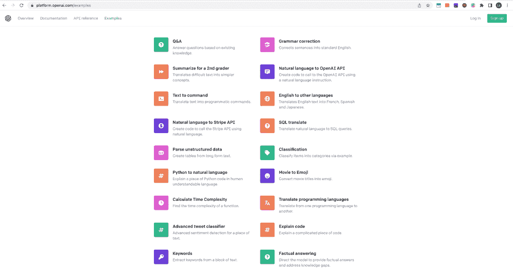
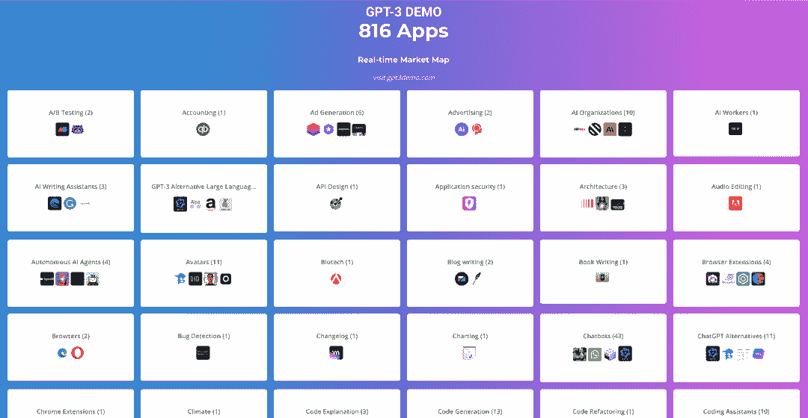
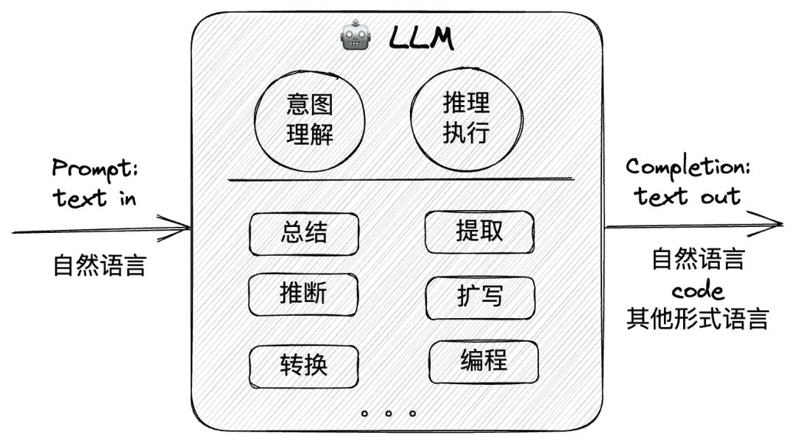
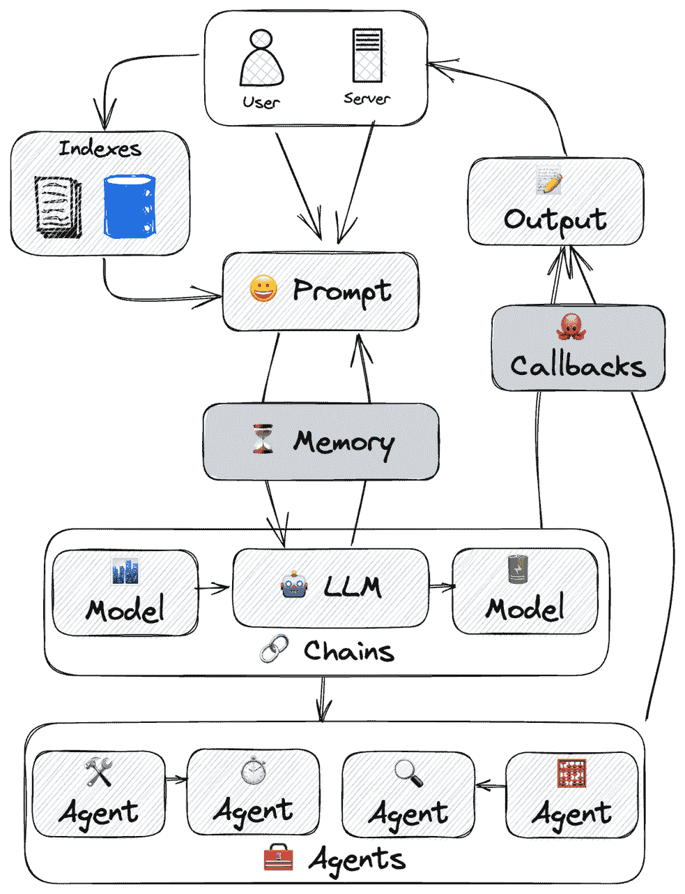

# 2023-08-08LangChain系列-01 是什么

> 来源：[https://xuqiwei1986.feishu.cn/docx/BTYEdrrs9oRdUYxF5DEcxbDMnNh](https://xuqiwei1986.feishu.cn/docx/BTYEdrrs9oRdUYxF5DEcxbDMnNh)

> 🔗 原文链接： h[ttps://mp.weixin.q](https://mp.weixin.qq.com/s/MEf0zlDgilfyvQivVfWQ3A)q.com/s/MEf0zlDg...

> ⏰ 剪存时间：2023-08-10 18:22:46 (UTC+8)

> ✂️ 本文档由 [飞书剪存 ](https://www.feishu.cn/hc/zh-CN/articles/606278856233?from=in_ccm_clip_doc)一键生成

原创 无人之路GO 无人之路 2023-08-08 08:08 发表于 浙江

收录于合集 #LangChain 1个

> 实际开发中用到LangChain，边学边用。在此记录对它的梳理，有兴趣的同学可一起进步。这个系列可能会持续很久，不断更新。

本文是LangChain的入门介绍。包括下面的内容：

+   LangChain：Why？为什么使用LangChain？ 
LangChain：为什么？为什么使用LangChain？

+   LangChain：What？LangChain是什么？ 
LangChain：What？LangChain是什么？

+   LangChain：How？通过例子快速入门。

##

## LangChain: Why  LangChain: Why

随着ChatGPT的流行，LLM（大语言）模型走入人们的视野。它以其强大的语言理解、文字生成、代码生成、多轮对话以及正在路上的多模态能力，成为新的技术底座。越来越多的工具和产品，都在LLM的基础上开发而成，比如微软的Office Copilot、GitHub Copilot、AutoGPT、ChatPDF等。用AI发明和重新发明所有的工具，已经成为业界的一个共识。

GPT提供的各种能力：https://platform.openai.com/examples

GPT提供的各种能力：https://platform.openai.com/examples

各种AI应用：https://gpt3demo.com/map

各种AI应用：https://gpt3demo.com/map

|

各种LLM都以API的方式开放自己的能力，导致基于大模型的应用出现井喷之势，堪称AI应用的“寒武纪大爆发”。

“如何在大模型的基础上方便地开发一款自己的应用？”，这成为摆在很多开发者面前的问题。于是，LangChain应运而生，横空出世。

## LangChain：What  浪链：什么

LangChain是一个基于大语言模型LLM开发应用的编程框架：

LangChain：https://docs.langchain.com/docs/

浪链：https://docs.langchain.com/docs/

基于LLM的应用，不仅仅是直接调用LLM的API接口，而且还会：一方面：访问其他数据（比如企业或者开发者自有的数据、各种开源数据集等），这是LangChain强调的第一个原则，叫 be data-aware ，数据意识；另一方面，与其他系统或者环境交互（比如搜索引擎、Python编译器、数学计算器等等），才能实现各种丰富的产品功能，这是LangChain着重的第二个原则，叫 be agentic ，代理意识（这不是一个太好的翻译）。

为什么LangChain会强调做这两个原则呢？这跟LLM的能力和它在系统中的作用有关。

尽管像GPT-3.5这样的LLM是功能强大的AI，但从概念上，我们可以将其抽象为如上面所示的"text in, text out"的系统：输入的是Prompt（提示词），输出的Completion（生成结果）。其中输入是自然语言，输出的可能是自然语言，也有可能是程序代码，还有可能是其他的形式语言，比如Markdown、diagram as text等。但本质上，还是text。这就引出两个问题：

+   作为input的Prompt如何生成？

如果只是简单的提问，比如“中国的首都在哪里？”“我为什么没有参加我父母的婚礼”等，那只需用户将自己的问题直接作为Prompt提交给LLM就行；但在实际的应用中，问题往往需要更多、更复杂的背景信息，比如“基于过去一年的营收数据，我们的增长策略可以有哪些？”“基于我们公司的知识库，总结过去一个月研发过程遇到的问题？”，这些问题都需要和外部的数据源做结合，才能生成精确的Prompt。这就是LangChain强调 Be data-aware 的原因。

+   作为output的Completion如何与环境交互？

作为text的输出，在一些情况下，是够用的。比如单纯的问答或者聊天，用户看到Completion的文本就够用了。但很多时候，输出的text还要借助其他工具才能真正执行。比如输出的Python代码要调用Python的解释器才能执行得到结果；生成的diagram as text的文本，需要调用图形引擎才能画出图来。LLM还能做为调度引擎，给它喂入外部工具的相关信息，让它去编排和调用。这就是LangChain强调 Be agentic 的原因，要和环境交互，和外部系统合作。

基于上面的认知，可以画出一个基于LangChain开发LLM应用的系统框图：

其中，包含LangChain的核心组件：

+   LLM. 大语言模型是应用的核心，是大脑

+   Prompt. 用户通过Prompt与LLM对话

+   Memory. 通过Memory让LLM能记住对话历史，实现多轮对话

+   Chains. 通过Chains可以将多个不同模型组合串联起来，实现复杂的任务

+   Agents. LLM是大脑，只有思维能力;Agents是手脚，配合LLM做行动（比如查询天气、画图等）

+   Indexes. LLM是基于公开数据做训练，且有一定的时间限制（比如ChatGPT的训练语料截止到2021年），因此无论是知识的覆盖度还是新鲜度，都有所限制。当用户想基于自有的知识库或业务数据做应用时，Indexes就提供相关的检索能力，让LLM能与它们互动。

未完待续

AI日课@20230405：基于LLM的应用开发框架LangChain

[AI日课@20230413：Prompt ](http://mp.weixin.qq.com/s?__biz=MzU5NzY0NjY1MA==&mid=2247485112&idx=1&sn=9f4911ec3031689e59a05a275500795c&chksm=fe510aedc92683fb180c754949ba475687a4021b04800644daac73168f77122e8f8c6acc55d0&scene=21#wechat_redirect)[Engineering 02 - 原则 ](http://mp.weixin.qq.com/s?__biz=MzU5NzY0NjY1MA==&mid=2247485112&idx=1&sn=9f4911ec3031689e59a05a275500795c&chksm=fe510aedc92683fb180c754949ba475687a4021b04800644daac73168f77122e8f8c6acc55d0&scene=21#wechat_redirect)

AI日课@20230413：Prompt Engineering 02 - 原则

AI日课@20230412：Prompt Engineering

AI日课@20230412：Prompt Engineering