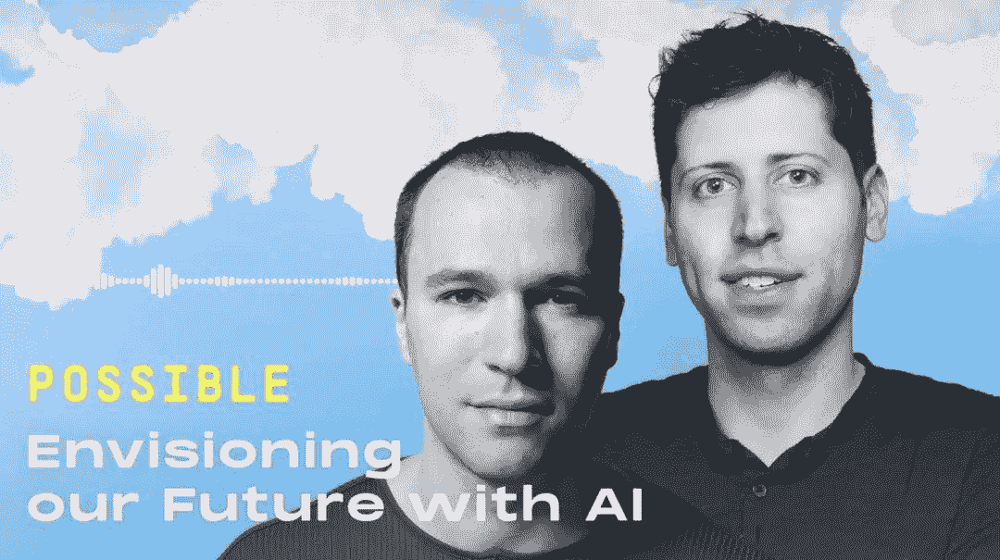

# 2023-08-07对话Sam Altman与Greg Brockman：初心和过去，信念和现在，责任和未来

> 来源：[https://xuqiwei1986.feishu.cn/docx/ZBqBdhNzNorkb3xoSMocf6mhndc](https://xuqiwei1986.feishu.cn/docx/ZBqBdhNzNorkb3xoSMocf6mhndc)

> 🔗 原文链接： h[ttps://mp.weixin.q](https://mp.weixin.qq.com/s/_S9dhLOpZdkDZiSkKFqhfw)q.com/s/_S9dhLOp...

>

原创 智源社区 智源社区 2023-08-07 17:00 发表于 北京

收录于合集 #智源深度 155个

**导读**

近日， 硅谷著名投资人 Reid Hoffman 和 Aria Finger联手对Sam Altman和Greg Brockman进行了一场访谈， 访谈涉及到主题有： OpenAI的使命，人工智能对教育、医疗等行业的变革性影响，人工智能如何面对监管，OpenAI成功的关键，未来的发展畅想。

任何成功都绝非一蹴而就。在OpenAI成立的第八个年头，他们才终于迎来曙光。 和其他创业公司一 样，公司成立初期他们始终面对着不确定的未来。 正如访谈中所言，Sam想过做在线教育公司，他们还 研究过机器手，但进展缓慢，结果也不理想 ……正是这样的不断试错，才有了今天的成就。

当谈及OpenAI核心竞争力时，Sam将他们的核心竞争力归为“极致”：“我们注重细节的企业文化，努力做到每个细节都完美；我们专注于找到最有效的方法；我们敢于将大部分资源投到看中的项目。”

而Greg认 为敢于直面残酷的现实是OpenAI的优势：我们每做一个决策，都会观察它带来的效果，调整策略、吸取教训。

他们还一起回忆了产品上线的激动时刻， 在OpenAI的餐厅里一起倒计时。 那是一个团队精神爆棚又非常有趣的时刻。

下文是访谈原文，编辑做了不改变原意的编译，请欣赏

OpenAI的使命：开发和部署有益AI，发挥技术的中心化力量

**主**持人（Reid）：关于OpenAI正在努力实现的AGI的使命，如何让80亿人中的另外70亿人受益？（在10亿用户以外）

Greg：是的，我认为AI中一个重要问题将是关于触达渠道的问题。让每个人都能够触达这项技术，以便改善他们的生活，为他们所用，同时他们的偏好和反馈也可以代表他们进入系统中，这是一个基础。我们已经看到其他技术具有这种中心化的力量，引发了潮流，最终局外人站在了中心，成为了核心力量。

这**也**是我们构建OpenAI的方式，我们希望的资本运作方式，实际上并不是由股东所拥有的一家公司，而最终通过非营利的方式分配给全世界。 因此，我认为这里有一些奇特的结果，你可以考虑一些像UBI（Universal Basic Income）这样的分配方式。 但我认为根本上给每个人提供这种低门槛的启用技术，消解创造过程中的障碍，表达你的创造力，完成新任务，推动人类前进。无论你关心和热衷于解决的问题，我认为这是真正的关键。

Sam：我深信的一件事是，真正可持续的经济增长可能来自技术进步。我认为我们有一些社会、政治制度和文化，有助于我们获得技术进步。因此，我们所做的事情如何帮助其他70亿人并没有太大的不同。虽然它的规模可能比以前的技术更大，但技术是我们提高每个人水平的方式。

**主持**人（Aria）：几年前你们刚刚起步，几乎什么都没有。但仅仅依靠几百人，你们怎么就超过了全球的科技巨头呢？这其中是不是也需要点运气呢？我很好奇，到底是什么魔法使你们达到了今天的高度？

S**a**m：我们确实做了一些事情，有些是有意为之，有些是走运。首先，感谢Greg为我们培养和建立了注重细节的企业文化。 我们努力做到每个细节都完美，并致力于找到那些和我们有相同理念的人。我们持续地进行精确的工程和科学研究，并期待它们会在长期内产生效果。

其次，我们是一个以寻求真理为导向的组织，我们专注于找到最有效的方法。与我们的专注不同，许多其他的AI研究小组可能有不同的驱动因素和优先事项。

最后，我们敢于大胆投资。我们并不分散资源，而是大胆地在某一个我们认为有前景的项目上投入大部分资源。这些都是我们的工作方法。

Greg：我补充一下， 在面对残酷的现实时，我们始终坚持从基本原理（第一性原理）出发的思考。 在项目早期，我和Ilya每天会花一个小时的时间深入讨论问题，因为我们没有空闲的会议室，我们就在服务器房间里辩论。有关我们应该雇佣的人员问题尤为复杂：是选择有经验的机器学习专家，还是从未涉及此领域的软件工程师，或者是两者之间的某种类型的人员？我们每做一个决策，都会观察它带来的效果，调整策略、吸取教训。我们始终坚信，我们不可能预知所有的事，但可以通过实际经验不断学习和进步。而这种思维模式，从OpenAI创立之时就已根深蒂固。

关于大模型规模的重要性，我想再谈谈。2017年初，我们试图让AI（OpenAI Five）玩竞技游戏Dota。作为我们首个大规模AI系统，随着每周增加的计算力，其性能也在稳步提高。尽管很多人误以为我们的初衷是为了验证“规模假设”，但实际上，我们真正的目标是找出现有算法的极限，从而开展新的算法研发。

所以，当我们朝一个方向前进时，另一个方向却不断地提醒我们，显示出它的有用性。这也让我们始终坚信，对于技术发展，及时调整策略、应对变化、并根据眼前的现实情况作出反应是至关重要的。

Sam：是的，在扩展Dota项目时，没有人能确信它会成功。我们不知道下一步该做什么，只能一步步试错，然后看看在哪一步会出现突破。

Greg：百分百同意。我们起初有三个大的想法，开始尝试第一个。之后，我们非常期待开始第二个即所谓的分层强化学习，通过一些层次结构实现长期规划和短期运动控制。但实际上这些都不是必要的。有趣的是，我们当时有很多闲置的计算资源，Jakob和Jamon两位研究员不断地说：“好的，这周要增加2倍的规模”，然后你会看到曲线变得越来越好。

Sam：我们当时可能并没有充分意识到规模效应的神奇之处，因为我们已经对此习以为常了，可能其他人也是这样。你可以根据所需的智能水平灵活投入计算能力，而这种能力似乎可以跨越极限，（规模效应，Scaling Law）这是一个惊人的科学突破。

Greg：确实很神奇。但我想强调的是，不仅仅是因为有了更强大的计算机，才让AI进步神速。 多年来，进步的三大来源：算力、数据和算法，都在不断发展。 我们还研究了算法进展的速度。实际上，GPT-4这种高级的AI系统，也是在小规模的基础上发展起来的，它的成功之处在于整合了行业中最佳的工程、系统和算法设计。

当讨论技术进步时，需要认识到这些进步的源头并不是来自于某个单独公司。从图形处理单元（GPU）到新的算法，再到数据处理，构成了一个庞大的网络，由许多人和多家公司共同参与。在某种程度上， GPT-4代表的技术进步是全人类共同的努力。

AI对教育、医疗领域的变革性影响

**主持人（Reid）：谈谈教育、医疗等方面的一些进展，你**认为这些进展可以在全世界范围内看到吗？

Greg：是的，我对教育非常感兴趣。事实上，如果当初我们没有办成AI公司，我的备选方案之一就是开办一家编程教育公司。我认为今天你们教人的方式，每个人都有一个关于那位良师益友的故事，他们花时间了解、激励他们。

想象一下，如果你能为每个学生提供这样的老师，每周7天，每天24小时，随时随地免费提供。虽然有点科幻，但现在不那么科幻了。你可以看看像可汗学院这样的机构，他们真的开始在课堂上用GPT-4，引导这项技术，让它成为一个优秀的导师。如果一个孩子要求，“哦，替我做作业吧”，它会说，“不不，我不做那个”，但会尝试探究他们的兴趣所在，并找到方法激励他们。这是我们现在开始进入的领域。

**主持人**（Aria）：问一个关于教育的问题，因为我认为你们所有人所梦想的就是让每个人都能接受教育并获得经济机会。很多人可能会说，“现在有可汗学院，有Coursera，我们有所有这些在线课程，但我们并没有看到什么改变。”如何为数以百万计、十亿计的人们带来教育的变革？

Greg：AI总体上是一个不守承诺的领域，对吧？如果你回顾70年的历史，每个人都感觉到了它的潜力，我们如何获得教育呢？是通过那些聪明能干、能够帮助我们解决问题并教给我们东西的人。想象一下，如果你有一台机器可以做到这些，可以帮助你完成这个任务。我们一直在构建很多虚拟机器人，虚拟助手，如Alexa和Siri，我们构建了很多应用程序能与学生交流，如可汗学院。

目前的问题是，如何拥有一台机器，能够实现放大的效果，能够成为技术的力量倍增器，让人们能够做更多的事情。这是我们想要尝试构建的东西。很明显，我们已经超越了许多人认为不可能的事情。毫无疑问，像GPT-4这样的东西的能力，我从来没有想过计算机可以做到这一点，但现在它们可以了。

我认为还有第二个同样重要的步骤，不仅是拥有原始知识，而且真正引导机器能够反映我们的意图并执行相应的任务，并注入社会价值观来运作。整个机器部署装置几乎只是在等待正确的“大脑”出现，这也尤为重要。未来几年将是检验的关键。

出乎意料的惊喜： 情感分析分类器

**主**持人（Reid）：如Greg所言，AI的能力远超预期，可能和OpenAI强调的“规模效应”有关，请问AI给你带来了哪些“意料之外”？

**G**reg：第一个惊喜发生在2017年，那时， 我们发表了一篇名为“无监督情感神经元（Unsupervised Sentiment Neuron）”的论文 ，虽未受业界重视，却 意味着一种新范式。 论文中，我们训练了一个模型，目的是预测亚马逊评论中的下一个字符，并期望它会学习到逗号的位置，以及名词和动词的位置。

出乎意料的是，经过训练，模型变成了一种先进的情感分析分类器。能分辨亚马逊评论的正负性。语义从句法过程中孕育而生，但我们从未告诉机器如何获得语言的“内在意思”，机器只是在执行任务时“意外”洞悉了语义理解。

之前人们认为机器不能学习复杂的任务，例如无法完成数学题，无法学习编程算法……但事情正在发生，没有编程背景的人也可以进入AI领域，“码力超强”的程序员可以更出色的完成任务。其实，这在最初的Copilot中根本无法想象，而GPT-4出现后，确实加速了编程工作流程。

主持人（Reid）：啥是“加速编程”？能否介绍Copilot？

Greg：当我们面对一个编程任务时，不会意识到背后所涉及到的所有细节和步骤，例如引入库、调用函数、确保参数正确等。编程有很多琐碎的任务，需要我们的程序员不耐其烦的敲击键盘完成重复性任务，非常耗时。

在编程里，重复性任务可以“看”成样板代码，而Copilot作为AI助手可以高效处理样板代码，GPT-4的出现更是大幅度提高了编码生产力，它不仅能提醒我们哪里出错，还能提供修复建议，例如它会说：“哦，你忘记在 Jupyter 中使用嵌套异步 IO 库了。”

GPT-4不仅局限于传统的编程任务，还能够**为代码写诗，这虽然听起来有些不可思议**， 但通过诗歌形式总结代码，不仅富有创意，还能给我们提供关于代码功能的新视角。 我之前看过一首由GPT-4创作的诗，它根据API、数据和Python编程等元素，描述了代码的逻辑、请求与响应、异步调用等概念，这种方式虽然与传统的编码方式不同，但它确实为我们提供了一种全新的理解代码的方式。我从未见过人类为代码写诗，AI创作的诗歌似乎对我有很大的吸引力。

**Sam: 这也让我想到了Noam Sha**zeer的一句名言： “我们不能完全解释为什么这些技术架构如此有效。我们只是归因于其背后的神奇力量。”

我一直都是一个坚定的经验主义者。如果某种技术或方法在实践中表现得很好，即使我们不能完全理解其背后的原因，我还是会信任并继续使用它。

当我们从Greg提到的无监督情感神经元的角度回顾整个AI领域时，会发现这一切好像是一个“谜”。AI为什么如此有效？没人能给出深入且严格的解释，同样，我也对GPT-4某些功能不解，对机器学习里的梯度下降法摸不着头脑。尽管如此，我已经接受了这个事实，它有巨大的潜力。

在创建OpenAI之前，我注意到了AlexNet表现出的成就，真像魔法一样啊！这和我读书的时候完全不一样了，那时，有人告诉我，如果你以学生的身份研究机器学习，就是死路一条。

面对监管： 建立全球 监管框架 ，鼓励更多人参与

**主持人（Aria）：几周前有人在推特上半开玩笑地猜测Sam可能支持AI监管，那么S**am如何看待AI监管？如何在AI监管框架下进 行全球合作？如何让更多的人参与？

Sam：许多人感到焦虑和害怕，他们对当前的技术变革速度感到不安。但他们或许并不明白他们具体在恐惧什么。OpenAI用了好几年来“理解”技术变革，但对世界上的其他人来说，却只有几个月的光景，因此他们的焦虑在情理之中。

我们必须十分谨慎地前进，在这个过程中需要监管发挥巨大作用。但目前“鼓吹”的全面停止AI研究，真没必要，且不明智。顺便说一下，我们花费了超过六个月的时间来对齐GPT-4并进行安全测试，自我们完成训练以来一直在进行红队测试。当然，在监管方面花费精力很重要，但我认为我们真正需要做的是找出合适的监管方法、规则、安全标准，并找出如何在全球范围内实施这些方案。

成功的关键： 关注细节，追求真相，坚持第一性原理

**主持人（Reid）：你俩很明智，知道情况往往比我们预期的来得更快、更出乎意料，**所以不轻易预测未来。但我还是想问：在未来三到十年内，哪些行业或领域会有显著变化？

Greg：我认为在法律领域引入这些服**务**非常有益，尤其是为公众提供法律服务。 我最钟爱的一个GPT-3工具是名为“Augrented”的服务，它帮助那些收到驱逐通知的租户解读法律条例。 许多这类租户可能无法请到律师，但有了这样的工具，可以助他们完成一些原本难以进行的事务。这只是我们见到的成功应用之一。

**主持人（Aria）：哪些领域不容易受到AI的冲击，或**者AI在这些领域的变革进度会比较缓慢？

Greg：目前来看，物理世界对AI的适应性可能是最低的。我们之前也曾尝试进行机器人技术的研发，但几年前决定终止这个项目。当时，尽管我们在机器人技术上取得了很好的成果，比如开发了能解魔方的机器手，但我们发现数字世界的变革速度更快。于是，我们那个机器人研发团队转型为了Copilot团队。目的是更快速地为更多的开发者提供服务。

**所以，现在的关键问题是：如何让数字技术融合到**物理世界，并真正服务于我们的日常生活？ 例如，如果你的宠物需要佩戴塑料圈避免舔伤口，你是否可以使用摄像头配合AI监控它，并在宠物尝试舔伤口时提醒你？我认为，未来我们会见证数字技术如何更好地融入到物理世界中。但与其他纯数字化的应用相比，这个融合过程可能会更为漫长。

Sam：我觉得这个观点有些出乎意料。以深蓝击败Garry Kasparov为例，虽然有人认为这是AI革命的开始，专家曾预测说，棋类游戏将会因此衰落，因为没有人会对一个机器已经征服的游戏感兴趣。确实，这场比赛改变了很多观念，但事实上，现如今，棋的受欢迎程度似乎比以往任何时候都要高。我们不太喜欢看AI之间的比赛，尽管那可能更高水平。相反，我们似乎更关心人类在这方面的能力。如果有人在比赛中依赖AI，那肯定会引起公愤。那些预测与事实背道而驰，所以，很多其他领域的预测也可能会出错。

未来的发展畅想： 在各行各业里面大放异彩

**主持**人（Aria）：对于AI，大家关心的另一个问题是能源消耗。Sam说过：未来不仅会有无限的智能，还有无限的能源。对此，Sam也投资了核聚变初创公司Helion。希望Sam能谈谈对核聚变的看法。

Sam：实际上，我不觉得智能或能源会是无限的。我认为能源的价格会持续下降，丰富度会不断上升，但这并不是无限。

对AI系统能源消耗的批评相当肤浅 ，我真心认为，如果我们能拥有真正意义上的丰富、廉价且清洁的全球能源，不仅能有效地解决气候危机，更重要的是，历史告诉我们，能源成本对生活质量的影响极大。因此，我认为支持像Helion这样致力于降低能源成本的项目是非常值得的，我期待在明年我们能听到一些好消息。

**主**持人（Reid）：你在医疗保健、药物发现、开发、初级保健等方面看到了什么新变化？你为实现这些变化做了哪些工作？

Greg：我们在OpenAI内部也有一个基金，投资于在我们技术基础上构建的创业公司。有一些像Ambiance这样的创业公司正在尝试技术落地。实际上，微软也开始通过Nuance在许多医院部署我们的技术。Nuance和微软的合作让我对我们真正能够满足患者需求充满信心。这将以一种我们无法想象的速度推进这项技术。今天我所做的一切，如果没有它们，需要花费更长的时间。这将帮助我更加高效，以便我可以花更多时间与患者交流，直视他们。能够收集和获取我们以前可能无法获得的有关患者的见解，对我来说非常令人兴奋。我认为这将改变医疗保健。

如果医生所面临的问题，会发现其中很多都是行政性质的。我的父母是医生，曾**抱**怨如何被迫在和病人交谈时使用iPad记录信息。这不是患者护理行业的“本意”。 技术推动进步，即使只考虑到瞬间转录、自动获取医生笔记等细节，ChatGPT也能让医生也能够真正专注于患者护理。 已经有一些人在使用ChatGPT解决问题，我认为这是非常有趣的用例，对吧？如果你在Twitter上看一下，会发现有人用ChatGPT救了他的狗狗的命。故事是这样的：他去找了一个兽医，但没有得到满意的答案，他后来向ChatGPT提供了狗的医疗记录并得到了建议。虽然ChatGPT强调了自己不是兽医，但给出的建议使他找到了另一位兽医，并成功救治了狗狗。

这故事反映了AI在医疗领域的潜在作用：它可以提供帮助，但也需要正确的人类监督来保证其效果。对于患者而言，他们应当是医疗过程的主人。总的来说，如果我们正确使用AI并建立合适的措施，它将为我们带来无穷的可能性。

**主持人**（Aria）：OpenAI正在投资以GPT为基础的创业公司，请问是OpenAI直接推动这些商业变化，还是公司使用OpenAI的API创造变化？未来的变革模式会是怎样的？很想听听你们关于AI赋能商业的看法。另外，到目前为止，有哪些出乎意料的惊喜？

Sam：据我们观察，人们正广泛而创新地应用OpenAI API，随着模型越来越智能，各种产品和服务的功能也在持续增强。

Greg：GPT-3滥用着实出乎我的意料，我们本来以为最可能滥用方式的是传播错误信息。我们也做了许多努力防止相应风险的发生。实际上，最常见的滥用方式是医疗垃圾广告，即各种药品的推销广告。这使我们认识到技术的实际应用与预期有所偏差。在产品开发上，API和ChatGPT的都经历了长时间的琢磨。我们曾花费数月时间列举GPT-3和GPT-4可能的应用方向，如医疗和法律领域。但每次思考都感觉好像是要放弃通用人工智能的梦想。

我们也可以成为一家专门向医院提供服务的公司，但我们没有那么做，因为这会使我们偏离初衷。所以，我们想让其他人来探索如何更好地使用这项技术。这与传统的初创公司思维是相反的，不是先有一个明确的问题要解决，我们更多地是从技术出发。考虑到每个行业，每个人都与语言紧密相关，如果我们能在现有的语言工作流程增加一点价值，那么这项技术就有很大的应用前景。

**主持人（Reid）：未来，哪些科学领域会有新的发展突破？我们已经看到了蛋白质折叠等领域的研究**成果，但在接下来的三到十年里，结合现代AI技术，哪些科学研究会更加快速地进步？

Greg： **数学。著名数学家陶哲轩（Terence Tao），最近提到GPT-4提高了他的工作效**率。 他现在不必为申请资金和其他琐碎事务而烦恼，正是因为有了GPT-4的代劳。 未来，会出现更多这样的例子，世界上最杰出的头脑不再浪费时间在那些既不有趣又无法激发思考的工作上。

Sam：确实，这也是我现在最有信心的回答。虽然AI可能在其他领域也有出色的表现，但其为每个人带来的生产力提升将使我们的顶尖科学家更加卓越，大大加速科学的进步。在未来，这些高级AI系统可能能够帮助我们掌握更多的知识，并挖掘创意。但就目前而言，进展是相当惊人的。

Greg ：我补充一点，目前ChatGPT技术还没有**无法产生新思想的能力。例如，在比赛中， AlphaGo下出了人**类棋手梦寐以求的“神之一手”，启发了很多棋手的思路，改变了他们看待围棋的方式。 在Dota游戏中也是如此，尽管那支队伍在那一年的比赛中状态不佳，但在与OpenAI对战后，他们采用了与OpenAI类似的策略再次夺冠。因此，从机器中可以学习到新的策略和思维，目前人们还未在GPT技术中体验到的。

快速问答环节

**快速问答环节**

**主持人：有没有看过某部电影、听过某首**歌或读过某本书，让你保持对未来的乐观？

Greg： **《她》 **这部电影非常有趣。在好莱坞，很难找到对AI的积极描写。

Sam： 《永恒的终结（The beginning of infinity）》 让我对未来保持乐观。

主持人：不算你现在的行业，哪个领域的进步势头让你侧目？

Greg：能源。我很喜欢关注Helion。只要有人能够带来重大的技术突破，为我们创造更加美好的未来，我都会全力支持。

Sam：如果Helion真的能行，并能为大数据中心供能，那就太棒了。

**主持人（Reid）：对于你们每个人来**说，关于GPT-4最美好的回忆是什么？

Sam：产品上线时，我们在OpenAI的餐厅里一起倒计时。我们非常激动，毕竟已经花了一年多的时间准备它。最后有很多小插曲出现，但那绝对是一个团队精神爆棚又非常有趣的时刻。

Greg：对我来说，最有趣的是上线的过程。我想到我在Stripe、OpenAI和Dota等公司工作时都参与过很多次上线，每一次都是不同的，总有新的东西可以学习。因此，在GPT-4的发布过程中，我非常享受与团队一起撰写博客文章的过程。我们需要认真思考我们做了什么，为什么要这样做，这样做是否合理。

**主持人（Reid）：最后一个问题，你认为媒体**讨论AI时有哪些需要纠正的特定问题吗？

Greg：我有两个观点。

一个是关于进步来自何处的问题。 近来，大家关注的焦点很多都在于大规模技术跃进，但我更认为这些只是进步的象征而不是原因。它们当然重要，但实际上如计算、数据和算法等都在整个行业中持续发展。技术潜在风险的一个来源是过度投入，如果你把这些东西放在一起，但你实际上并没有做到完全为社会带来巨大的进步，那就会让人感到紧张。例如，人们对ChatGPT的反应，尽管我们观察到这技术已逐步改进了好几年，但对很多人来说，它似乎是突然出现的。这提示我们有一件事情很重要，那就是我们作为一个社会、一个行业、一个世界、一个物种如何协调。同时，我们必须深入技术细节，才能真正找出应该关注的正确问题，告诉大家我们应该以某种方式共同努力。

其次，我认为人们（媒体）没充分讨论的是：在哪些地方人类真的需要帮助？ 以医学为例，我曾手腕受伤，但因为不使用手腕导致了颈部疼痛。当我问及医生颈部疼痛的原因时，他回应说他只擅长手腕问题。因此，我们需要有一种跨专业的方式，在学科之间汇集知识。这正是AGI的价值所在，能够帮助我们学习新知、探索新领域并找出问题的答案。我们目前需要的不仅仅是技术，更多的是一种跨学科的整合能力。我们应该思考如何有效地弥补这些缺口，而不是盲目地追求技术进步。

**更多内容 尽在智源社区**