# 项目见证群+ChatGPT，大健康行业提高同行转化率的冷启动模型，课程首发4天利润1.5w

> 来源：[https://xuqiwei1986.feishu.cn/docx/WFeWd5PekoH1VBxMq8tcK5O0nef](https://xuqiwei1986.feishu.cn/docx/WFeWd5PekoH1VBxMq8tcK5O0nef)

> 项目见证群+ChatGPT，知识型IP冷启动模型

**大家好，我是陈大大，主业是**三甲医院医生，副业是减脂营主理人，2018年开始涉猎大健康行业，起初尝到一点甜头，但是很快因为不懂销售，以及流量枯竭，变现很快陷入瓶颈。

虽然身为医生有专业光环，专业能力方面在团队里有一定的影响力，但是我也深知医生的专业能力和商业能力完全是两码事。

“高认知穷人”多的是，如何把专业能力商业化，才是销售和变现的重点。

在开始这个减脂项目见证群之前，我花了三年的碎片化时间，分别补齐了目标所需要的能力。

在专业能力方面，先后涉猎了保养抗衰、减脂、肠道健康、营养学、慢病管理、功能医学等领域，对减脂有了全方位的、新的认知，并最终确定了减脂赛道。

在商业思维方面，在龙哥盟参加了几次高质量的航海，打通了多个从0到1，培养了自媒体思维，也在梁靠谱的赚钱陪伴社群里耳濡目染了一年多，商业思维有所增长。

在我看来已经达到了我的盖洛普完美才干给我自己设定的标准，于是今年有了打造知识付费产品的强烈愿望，想要尝试卖知识和卖个人，不想再做一个“高认知穷人”，因此想借助项目见证群的机制，做第一场知识付费的转化。

这次减脂项目见证群的运营思路和灵感主要来源于：

①参加过几次群发售，其中包括两次苏姐和梁靠谱运营的盖洛普优势咨询群发售，了解了一些快闪群群发售细节；

②参加了两次梁靠谱团队的龙哥盟拉新活动，对社群运营和裂变有了一些认知；

③在梁靠谱的龙哥盟陪伴群里，第一次了解到项目见证群的运营机制。

在没有任何运营官和主持人的情况下，全程一个人加上ChatGPT，运营54天，正式发售4天，累积输出约8w字，写课约3w字，两次流量小裂变，初始利润1.5w，期待后续转化高客单价。

建立项目见证群有几个目的：

①推进课程打磨进度，有人陪伴和监督，以及有对赌协议，效率会更高；

②在见证的过程中尝试和客户建立链接和信任，在产品打磨结束的时候就可以在群里发售并变现，比起一个人安静地单打独斗两个月要强，我的努力程度和工匠精神，群里的人都能看到，一份时间两份作用；

比起一个月闷声写课，最后在朋友圈发售也要强。缺少建立链接和信任的过程，转化率只会更低不会更高，万一产品做出来，如果朋友圈只有零星成交，是开营还是不开营？

③就算0成交，我也利用见证群机制敦促自己打磨了一份免费的减脂资料，后续可以作为见面礼送给加我的朋友。

**项目见证群适合正在打磨自己的知识付费产品，或者未来想要**打磨产品的朋友，是一个很好的冷启动模式。

在ChatGPT的高效辅助下，两个月一共产出了三份资料：《减脂避坑指南》《网红减脂方法大盘点》《肥胖类型及解决方案》，累计8w字。

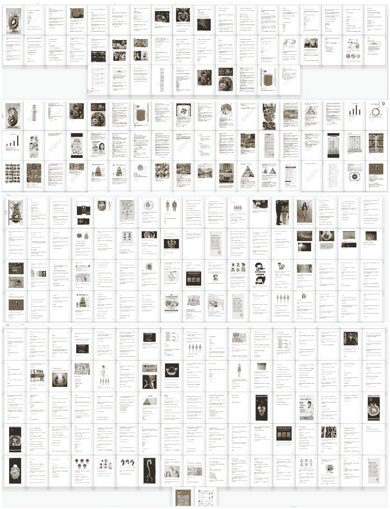

以下是文章目录，全文约1.2w字，阅读约需20min

| 减脂营项目见证群的运营时间线和细节 | **项目见证群复盘** | 大健康行业如何深度提问ChatGPT，提高同行的转化率 |
| --- | --- | --- |

（左滑可查看目录）

> 减脂营项目见证群的运营时间线和细节

**一、项目见证群整体运营思路确定**

二、项目见证群建群前：见证机制确定

三、建群并一对一邀请朋友、发朋友圈

四、开幕并宣布见证群机制和见证人专属权益

五、每天分享减脂知识，增加信任

六、分发减脂项目见证群海报做流量裂变

七、推出团队内部合作方案

八、三个动作交替进行拉动第一次流量小裂变

九、按对赌协议不断增加每日分享内容

十、筹备见证人福利发售会（04.24-04.27）

十一、后台运营群吹风会（04.27）

十二、减脂项目见证群免费福利机制正式公开，并启动见证人内部福利发售仪式（04.28）

十三、第二次流量小裂变

十四、减脂课程对外正式发售仪式

一、项目见证群整体运营思路确定

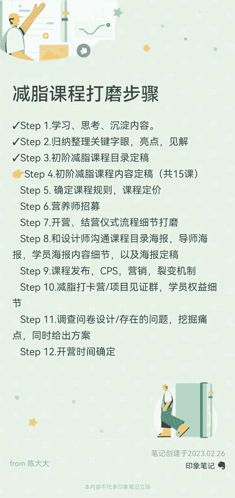

项目开始前写了一个整体运营思路，基本是按这个步骤进行的，一部分是同步进行。

比如我的减脂营海报是在课程发售后5天才完成的，并没有赶上发售仪式。

事实证明只要课程写完，积累了足够的信任，就算只有一个课程目录，不需要海报，也能在群里发售。有时候并不需要完美。

一开始也是准备按这个运营思路，发朋友圈更新打磨课程的进度，让大家见证这个过程，直到完成课程目录，才临时起意组建项目见证群。

打造IP就是一个动态变化的过程，边成长边完善。

二、项目见证群建群前：见证机制确定

项目见证群要想成功运营，要么让观众有获得感、要么让观众有参与感。

减脂项目见证群最初设想的是提供一个让大家打卡饮食和运动的地方，但是想到运营重，以及想参加打卡的人其实不多，很多人都是想减脂，而不是要减脂，很容易一开始就剧终。

最终决定和见证人们来一个对赌协议：只要一天没写完课，就要每天在群里分享减脂知识。

这是当时靠谱在赚钱陪伴群分享的项目见证群SOP。

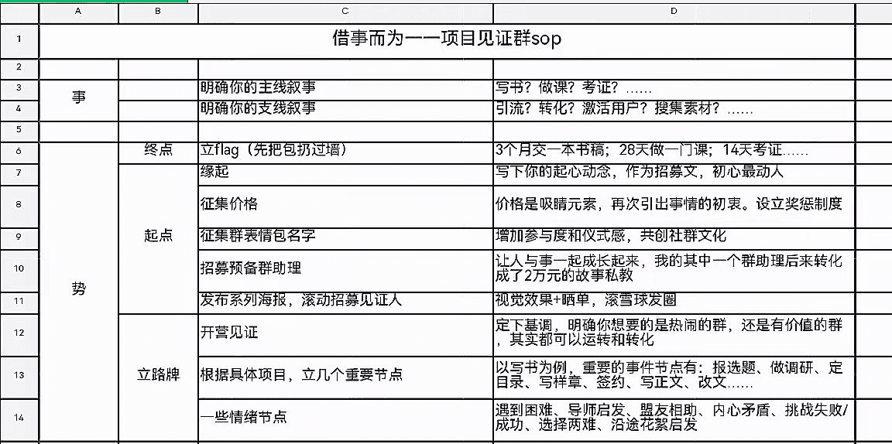

我的减脂项目见证群起初并没有规定分享内容的质量和数量，但就是因为标准起高了，也坚持了下去，我也因此收获了一批忠实听众。

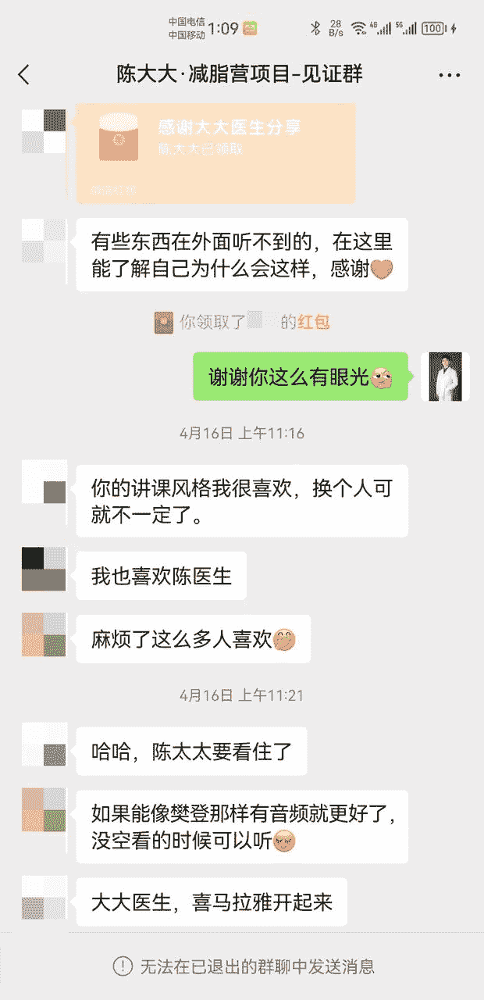

三、建群并一对一邀请朋友、发朋友圈

项目见证群一开始就没有回头路可以走了，只能硬着头皮上，群里也邀请了一些比较有影响力的大咖，不能丢了老脸。

🛰️里只有一千人，而且很多都是医生和大健康行业的同行而不是潜在客户，一开始发朋友圈很少有人响应，我是影响力才干，就算没有鲜花有掌声也不错。

所以为了让见证群热闹起来，我也开始了最笨的一对一邀请策略，有潜在客户，当然也有很多大健康领域的同行，后续把人数拉到60人左右，一对一邀请愿意进群的大概2/3。

邀请的时候需要说明🛰️群是干什么用的，以及进群能获得什么。

四、开幕并宣布见证群机制和见证人专属权益

为了增加见证人的获得感和参与感，除了对赌协议（一天不写完课，就每天都要在群里分享减脂知识）之外，也公布了见证人的五大权益，同时设置了转介绍福利，期待有裂变效果。

| 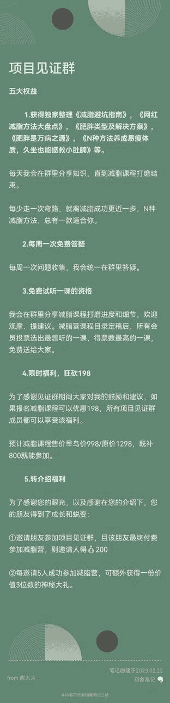 |
| --- |

（点击图片放大可查看长图）

其他权益包括让见证群投票，从15节课里投票选出最想听的一课，课程正式打磨完成的时候，免费把这一课给各位见证人，这也是提升参与感的方法。

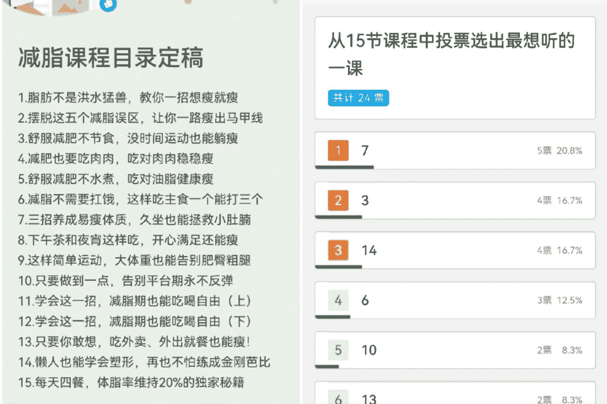

以及送2024年度健康陪伴社群给第一批进见证群支持我的朋友，当时是送给了前80位进群的朋友。

| 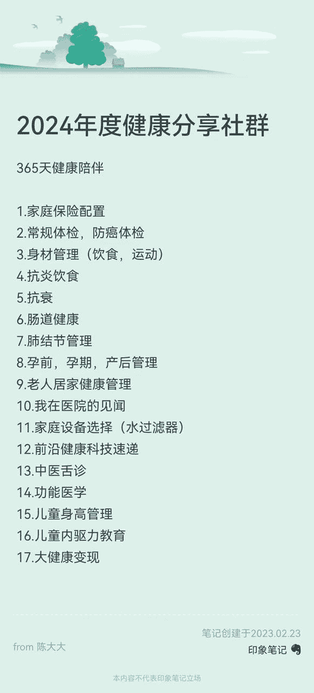 |
| --- |

**可以说给各位见证人的仪式感做足**了，诚意也给足了。

五、每天分享减脂知识，增加信任

开幕之后就正式开干了，一旦开始就必须按照约定给大家分享知识，我的交付标准比较高，主打的就是有趣又有料，所以也增加了信任和好感。

我的分享时间不固定，随时都会分享，主要保证每天都会分享就可以，有时候有急事，虽然晚，但一定到。

这个对赌也有弊端，就是要保证能持续输出2个月不重样，另外还要有干货能放在正式的课程里，对知识储备量要求比较高。

如果把写课时间压缩在一个月内，执行难度会降低一些。

事实上只要别人看到你分享的内容足够好，他们自然会邀请朋友进来，自然会有裂变效果。

在54天的见证群运营里，我运用了ChatGPT这个工具，包括每日分享和写课，极大的提高了效率（至少省了20-30%的时间），也提升了转化率。

六、分发减脂项目见证群海报做流量裂变

在见证群开始几天后，我就用稿定设计app做出了见证群的海报，同时分发给见证人邀请朋友进来，用过很多个app，实测稿定设计的模板比较好看，功能也实用，不过没水印的海报需要充会员。

第一次制作花了两三个小时。

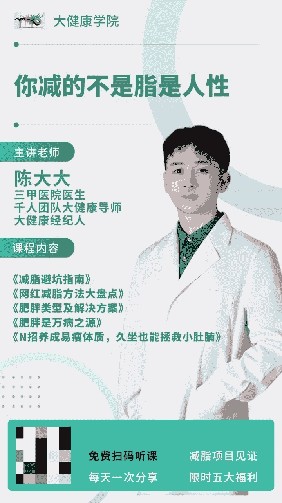

**

这时候见证人的专属**权益就发挥作用了，有转介绍福利，就能鼓励见证群邀请更多朋友进群。能用机制解决的问题，就不要考验人性。

这个海报在我见证群运营期间给了见证人很大的便利，直接发圈就能邀请，也提升了一点点逼格，增加了见证人发圈的主观意愿。

而且因为我的运营时间比较长，内容丰富，随着信任度和好感度上升，越来越多的见证人参与到邀请中来。

七、团队内部合作方案

在见证人的转介绍福利基础上，发现裂变效果并不是很可观，加上群里很多都是同行而非潜在客户，我开始担忧转化效果，于是我想出了同行内部的合作方案。

| 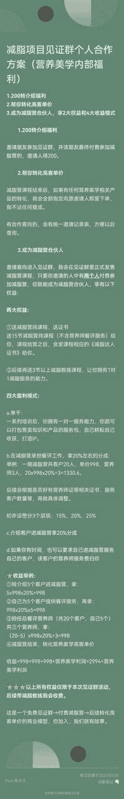 |
| --- |

这个同行内部合作方案的要点就是，只要你邀请朋友进来，转化的事交给我就可以了，并且如果有付费参加减脂营的话，我会给你分润，另外相同业务的部分我非但不会动你的蛋糕，还能免费帮你转化。

有了这个方案后，就开始和每个熟悉的同行私聊合作意向，并把有合作意向的朋友，邀请进后台运营群。

可能这个合作方案有足够的吸引力，最终也成功推向了除营养美学之外的大健康人员加入合作当中。

前后一共邀请了大概30个合作意向，但是真正动起来配合运营的，不超过10个。

八、两个动作交替进行拉动第一次流量小裂变

1.减脂项目见证群持续高质量分享

虽然打磨课程的压力已经很大，但是为了提升转化率，时不时会对每日分享的内容进行精加工，增加更多的触点，以及提起大家的兴趣。随着时间推移，信任度和好感度上升，也越来越多的见证人参与到邀请中来。

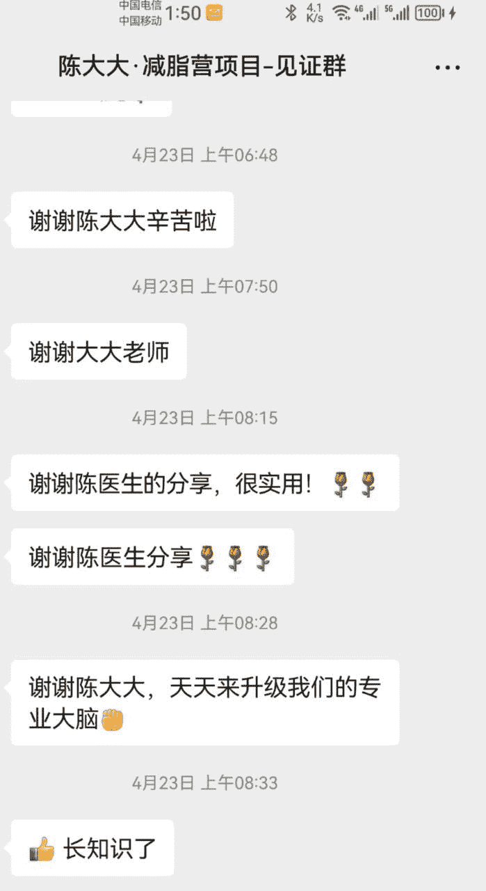

2.后台运营群持续吸引合作意向撬动流量

①阐明机制

②介绍课程

③说明邀请路径

④分发邀请物料

有明确合作意向的见证人单独拉一个群，详细阐明合作机制，并多提供价值。

①详细说明准合伙人的福利机制和合作的三个层次

第一个层次是转介绍得分润，满两个付费，自己还能免费

第二个层次是成为减脂营教练，参与点评获得对应酬劳，或者出师单干

第三个层次是借助减脂营转化更高客单价

②介绍正在打磨的减脂营课程

这个课程目录写了两个星期才完成，几乎涵盖了减脂领域的痛点和难点，也能做出差异化，很多人一旦脱离减脂营之后就会复胖，就是因为固定减脂模式，脱离真实生活场景。

有一个学员就是因为不习惯之前的减脂营苦哈哈的模式，才选择我的减脂营，最终也拿到了一个月瘦15斤的好成绩，并且也复购了第二期。

**所以做到生活化减脂才是减脂的底层逻辑，比如不需要运动也**能瘦，比如减脂期能吃外卖，也能外出就餐。

**还**有另一个差异化是，我们是减脂教练级别的减脂营，就是不单单能自己瘦，结营后还有能力教别人瘦，所以也拥有了变现能力。

我主打的就是复购率最低的减脂营，上面提到的学员是唯一一位复购的，她是盖洛普竞争才干，只需要一个社群减脂环境就能自己瘦下来，她也几乎不需要减脂教练，间歇性轻断食、高蛋白饮食、16+8等模式自由切换，灵活度很高，更惊人的是，她减脂期间几乎一半时间在外就餐，估计只有我的减脂营能容得下她。

其他学员要么自己都能通过减脂变现了，要么已经自己成了自己的减脂教练。

以上差异化的地方，都是可以让见证人发朋友圈宣传的点。

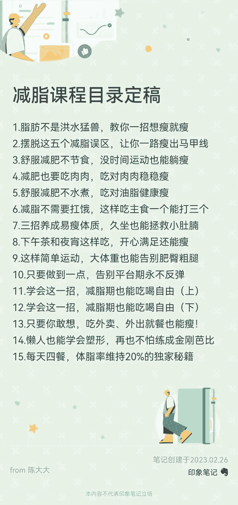

③告诉大家怎么邀请朋友进见证群

包括制作并分发见证群海报，以及发个人邀请二维码的制作教程，方便追溯流量来源，保护大家的流量。这些动作也都是从靠谱的赚钱拉新中学到的。

另外也有制作邀请登记表格表明诚意，因为很多都是同行，可能会担心流量被我占用，需要打消他们的疑虑，制作表格可以阐明我不会抢他们的客户，我们是合作共赢关系。

④制作见面礼，让见证人送给他们邀请进来的朋友，提供获得感

我在见证群海报上一共写了4个领域的内容，每分享完一个内容，我就整理成PDF分发给各位准合伙人，让他们送给后面邀请进来的朋友。

不管最后有没有成交，让每个进来的朋友都能有收获，也是一种双赢。

这个策略直到见证群尾声还在发挥很大的作用，有的朋友进群就翻看我送的《减脂避坑指南》，对我的整理的资料称赞有加，有的同行进群不到一周就付费，最短的是两天付费，这些资料也功不可没。

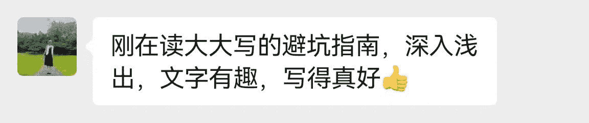

**

减脂项目见证群持续高质量分享****，后台运营群持续吸引合作意向**撬动流量，以上两个动作贯穿见证群运营的中间段，也成功拉动一次流量小裂变，最终把见证群人数从60拉升到120左右。

九、按约定不断增加每日分享内容

因为一共要打磨15节课程，每节课平均写5天左右，最长的一课甚至写了接近2个星期。

《减脂避坑指南》《网红减脂方法大盘点》两个内容在03.25就已经分享结束，那时候课程才写到第8课。

按约定15节课程还没有打磨结束，我需要继续增加每日分享的内容，额外增加了《肥胖类型及解决方案》《肥胖是万病之源》。

最后一课《三招养成易瘦体质，懒人也能拯救小肚腩》，是见证人从15节课里投票选出的一课，放在发售仪式上免费送给大家。

按约定继续推动减脂项目见证群的每日分享机制，为了保证每日分享和写课进度，几乎每天都是两三点才睡。

后来抵抗力下降，过敏性鼻炎和阑尾炎都犯了，而且熬夜导致皮质醇分泌增加，食欲上升，两个月胖了2斤，项目见证群结束后又瘦回来了。

自己写的对赌协议，哭着也要把它完成，诚信也是个人品牌的一部分。

十、筹备见证人福利发售会（04.24-04.27）

从03.01-04.23，随着15节课程写完，在群里宣布限时免费分享暂时告一段落，并宣布04.28会公布见证人才享有的减脂营课程免费获取机制。

见证人福利发售会有几个目的：

①提供见证人才有的专属福利，增加获得感；

②制造稀缺性，见证人福利发售会和正式发售仪式有本质区别，前者福利名额没有限制，后者只有5个福利名额，如果见证人福利发售会（04.28）没有下单，到了正式发售仪式（05.02）就需要抢；

③触发免费机制并拉动流量：在04.28下单的见证人，在05.02之前邀请朋友进群，还有机会获得免单和分润（只要邀请进来的朋友有两个付费，就能免去800，还能获得400分润），把见证人发展为渠道，我则获得更多的流量以及营收，双赢；

**④付费意向强烈的见证人，当天可以配合造势，在群**里付费接龙，增加转化率。

十一、后台运营群吹风会（04.27）

04.27在后台运营群内部提前公布04.28玩法，并邀请有强烈意向的准合伙人配合促单。

重要信息分别为：

①04.29前付款800提前锁定专属于见证人的所有福利，到了05.02发售仪式就不用抢限定福利名额。

福利包括四个：

减脂营合伙人机制，大健康躺瘦营，减脂大师班，2024年度健康分享社群：

| 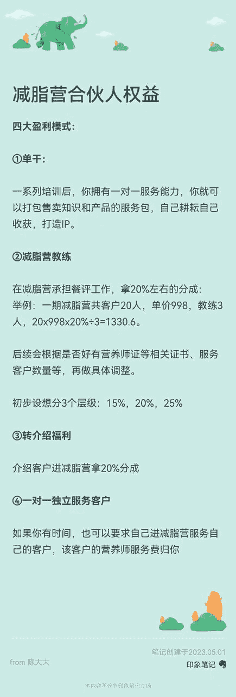 | 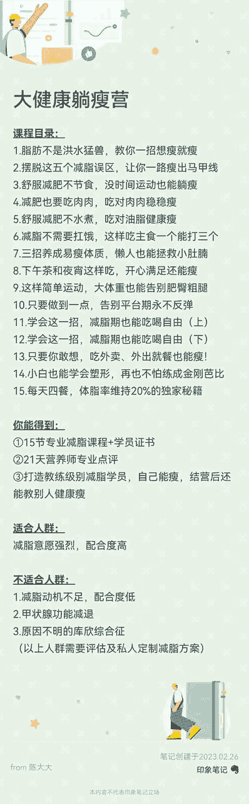 |
| --- | --- |
| 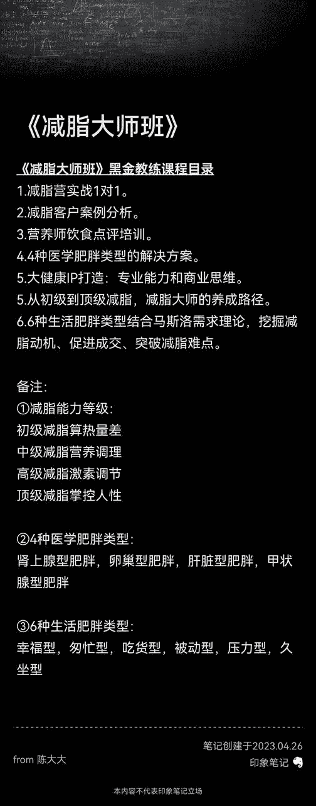 | 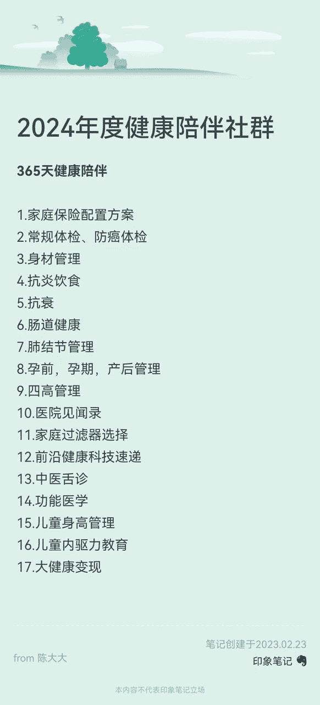 |

以上图片都是用印象笔记做的，只需要文字+背景模板。

②免费机制

邀请的朋友里有2人最终付款就可以免单800，还有每个转介绍分润200，相当于免费，还能倒赚400。

③请有强烈合作意向/减脂需求的准合伙人04.28在见证群接龙下单，同时发付款截图给自己邀请进来的客户，引导其他客户下单。

发布见证人内部福利这一步的目的是把所有的客户发展为渠道，让他们跟我一起做，然后给他们分润，同时营造氛围促进他们的客户下单。

十二、减脂项目见证群免费福利机制公开（04.28）

04.28在见证群正式公开专属于所有见证人的四个福利，包括减脂营合伙人机制、大健康躺瘦营、减脂大师班、2024年度健康分享社群。

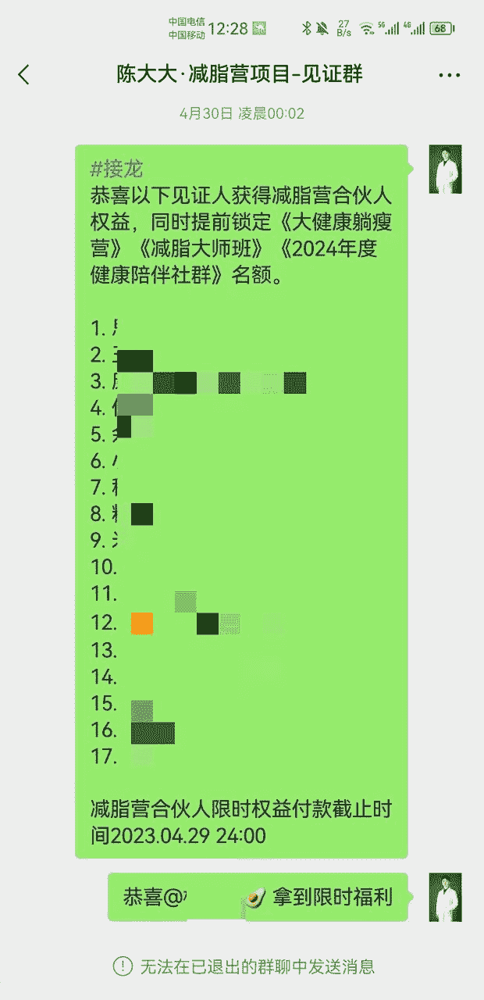

在运营了54天后，建立了充分的信任，内部福利一经公开，04.28-04.29两天时间一共有17位见证人（包括内部合作伙伴）下单，提前锁定了福利。

群发售的几点细节掌控好了，可以提升转化率：

①在群里发付款截图和报名接龙，可以造势和借势

②缩短用户的操作路径，直接发付款码到群里

③制造稀缺性，以及出了这个群就不会再有这些福利

**④利用损失厌恶心理

**

十三、二次流量小裂变

在公布见证人内部福利之后，为了帮助提前锁定的小伙伴拿到免单福利，让他们邀请更多的朋友参加5.1正式发售仪式。

用之前见证群的海报简单修改了一下文案，做了一张正式发售仪式的海报，分发给各位付费的见证人，用于发圈邀请。

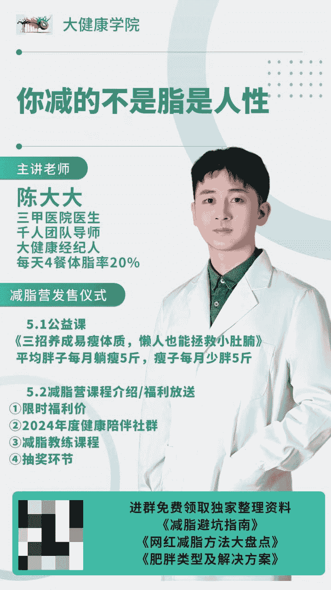

**

因为挺多提前付费**锁定福利的朋友有免单的动机，所以也有动力邀请朋友进来。最终两天时间里再度拉动流量小裂变，增加30人左右，最后群里有150多人。

十四、正式发售仪式

正式发售仪式主要内容包括：

①抽奖拉动气氛

②5.1按约定免费分享15节课程里的其中一节课，能让胖子平均每个月躺瘦5斤的《三招养成易瘦体质，懒人也能拯救小肚腩》，秀肌肉同时增加信任。

这节课应用了很多文献和数据，专业度和高级感拉满，是借助ChatGPT完成的，没有ChatGPT的话写作时间延长一倍不止。

③减脂课程介绍/福利放送

由于二次流量裂变效果不明显，所以正式发售仪式成交单也不多。

> **减脂项目见证群复盘**

**

一、最终成****果

二、项目****难点

三、不****足之处

四、****项目思考

****一、最终成果****

①见证人内部福利发售成交17单

②****课程正式发售**成交4单

③课程首发4天利润共1.5w

④进群150+人，被动引流到🛰️几十人（备注了来源，后续如果有转化都会分润）

二、项目难点

①见证机群的见证机制要足够吸睛，不然很容易自嗨，失去见证人的注意力。

一开始构想是打卡运动和饮食模式，想到执行难度和参与度可能会低，后来改成每日分享制，一天不写完课，就每天都要在群里分享知识。

期间还设置了很多见证方法来提升参与度，比如从15节正式课程里投票选出一课，免费送给大家。

以及每写完一课，就在群里公布写课进度，甚至写课的感受，接下来的见证群运营细节，都有和见证人分享，让大家感受到实实在在地见证你写课的每一个细节，甚至参与其中。

②对赌协议执行难度不低，对主理人的时间、身体素质、知识储备等都有比较高的要求。

一开始用力过猛，每天分享一千多字，起点有点高，导致后面每天都需要花一个小时左右的时间去准备每日分享，剩下的其他时间才能去打磨课程。

所以那两个月基本上不是在写课就是在写课的路上，期间扛不住生病了，但是我依然做到了54天8w字的免费分享不重样，而且还有更多的干货能放在正式课程里。

那段时间刚好碰上ChatGPT大热，庆幸见证群开始前就已经摸索上手了，给见证群运营节省了不少时间和精力，至少20%，后续也帮助了转化了不少同行。

三、不足之处

**①初始流量不****足，这个是****硬伤，🛰️只有1000人；**

②见证群时间拉太长，长达两个月，效果呈两极分化，很多邀请进来的意向客户的注意力都在下降，倒是对减脂感兴趣的同行，对我的信任度一直在累积。

现在回头看，可以见证期间的时候邀请同行进来，到课程正式发售的时候，再邀请潜在客户进来。

③课程正式发售仪式的时候刚好碰上五一，五一期间大家都出去玩了，加上群里的信息量太大，信息触达率进一步降低，影响转化效果。

④没有设置低价引流品，没有设置邀请荣誉榜。

没有设置低价引流品，见证人的邀请成本就会比较高。如果有设置低价引流品，邀请进来就能得到100%的低价分销利润，见证人的邀请意愿可能会更高一些，甚至激活一些原本也没有减脂意愿，但是有变现意愿的见证人。

如果基数上去了，就算转化率20%左右，利润也会更可观。

没有设置荣誉榜，比起利润，有的客户更关注影响力，而荣誉榜刚好能契合他们的需求。

荣誉榜可以让他们得到更大的曝光度，比起单纯前期的利润，有时候后期的影响力往往能带来更大的涟漪效应。

赚钱拉新的时候龙哥盟官方就用到了荣誉榜，比起赚钱拉新的分润，荣誉榜第一名的影响力更重要，舍小抓大，合作共赢，不得不说靠谱在赚钱拉新期间，她的格局和思维都是超前的。

四、项目思考

①一鱼多吃

我是这样想的，见证群是一个一鱼多吃的设置，就算没有成交，我见证群期间整理的8w字资料也不会白费，后续可以作为见面礼，也可以做短视频文案材料，也可以作为下次群发售的低价引流产品。

所以就算一个客户都没有成交，我也是赚了的，短时间内就敦促自己完成了大量前期准备工作。

②起初我想要的是客户，结果却转化了同行

这次见证群转化的大多数是同行而非客户，后来重新拜读了苏姐和靠谱的发在龙哥盟的精华帖，发现不同的运营思路，是可以转化不同人群的。

总结就是适度专业吸引客户，过度专业吸引同行，快节奏群发售适合转化客户，慢节奏适合转化同行。

这算是误打误撞了，也是对自己的定位不够清晰的结果，当然这个结果是好的结果，因为不到一定的层次，是没办法转化同行的。

这也让我重新思考了我的定位，医生6年同时加上大健康3年的沉淀，我的市场比我想象中的还要大一点点，这也让我对后面自媒体号的定位和变现方法有了更多的思路。

③巧用ChatGPT，提升转化率

这个项目见证群一开始是为了转化减脂客户开展的，没想到最后付费客户里有90%是同行，很多客户同时有减脂和变现的需求。

我的课程一开始也是奔着教练级别的减脂课程去的，除了自己能瘦下来，结营后还能教别人瘦下来、变现，所以能同时满足他们减脂和变现的需求。

除了专业能力到位之外，见证群期间ChatGPT也助力提升了转化率。

见证群期间ChatGPT的用途主要是两个，一个是辅助写每日分享，一个是辅助写课。

在我看来AI是需要调教的，用的人要懂提问，懂提问才能问出你想要的高质量的答案，才能在群里输出好的内容，提升转化率。

我总结了一些大健康行业深度提问的方法，以及对ChatGPT输出的内容进一步加工的方法，可以让内容更有逼格。感兴趣请阅读后面内容。

④海报可以粗略，但一定要有

第一次做知识付费产品，冷启动的海报一定要有，特别新手小白，可以缩短用户邀请路径，减少繁琐的沟通和说明。很多刚起步的小白有流量问题，我也有，所以借力很重要，想要初始启动流量，裂变海报就是一个很好的借力工具。

海报的Who（谁是主理人，什么头衔）、When（日程）、What（什么内容）、Where（社群？直播？）、How（怎么参加？二维码？）的基本要素有了就行。

海报可以粗略，但一定要有。

我冷启动期间，海报、课程图、合作方案图全都自己做的，用的稿定设计app和印象笔记，相对简单好用。

#### 项目见证群+ChatGPT整体情况

这个项目见证群一开始是为了转化减脂客户开展的，没想到最后付费客户里有90%是同行，大多数是大健康行业人员、营养师、健康管理师、临床医生等，很多客户同时有减脂和变现的需求。

我的课程一开始也是奔着教练级别的减脂课程去的，除了自己能瘦下来，结营后还能教别人瘦下来、变现，所以能同时满足他们减脂和变现的需求。

同行愿意为我付费，除了专业能力到位之外，见证群期间ChatGPT也助力提升了转化率。

| 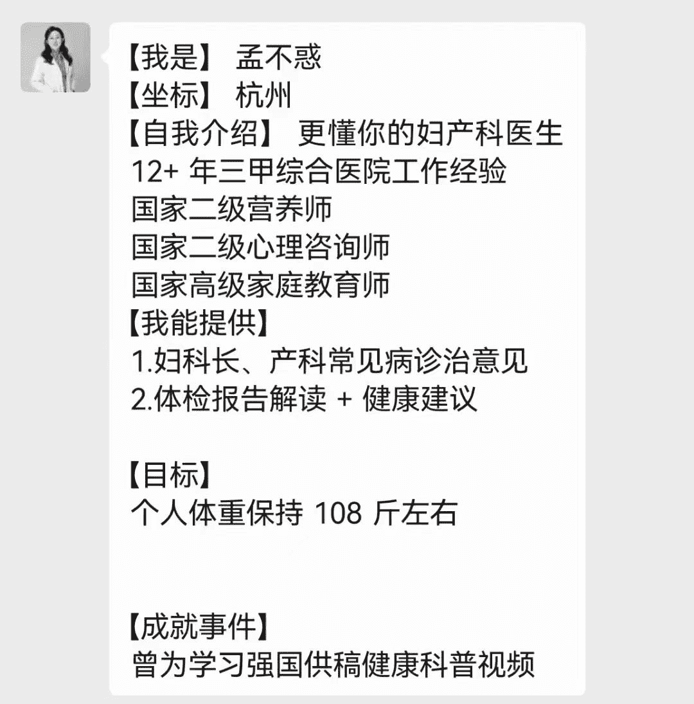 | 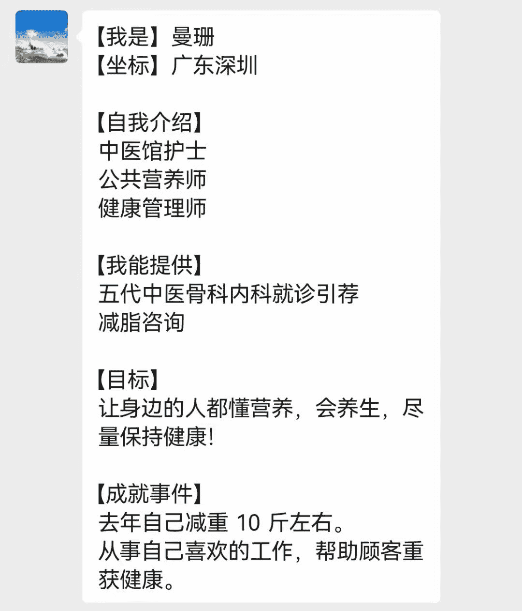 | 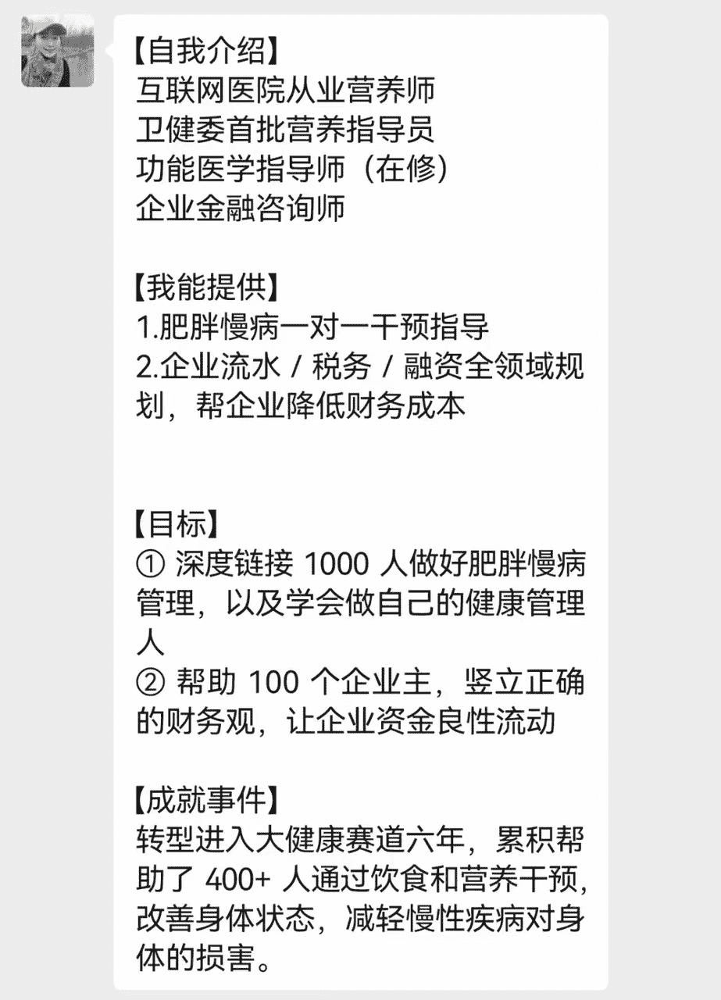 |
| --- | --- | --- |
| 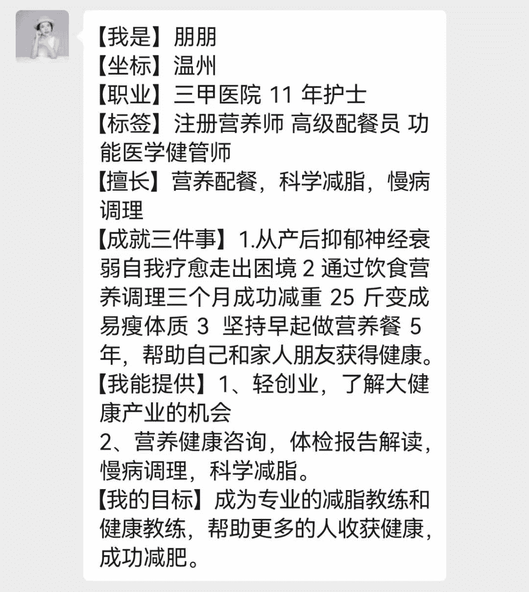 | 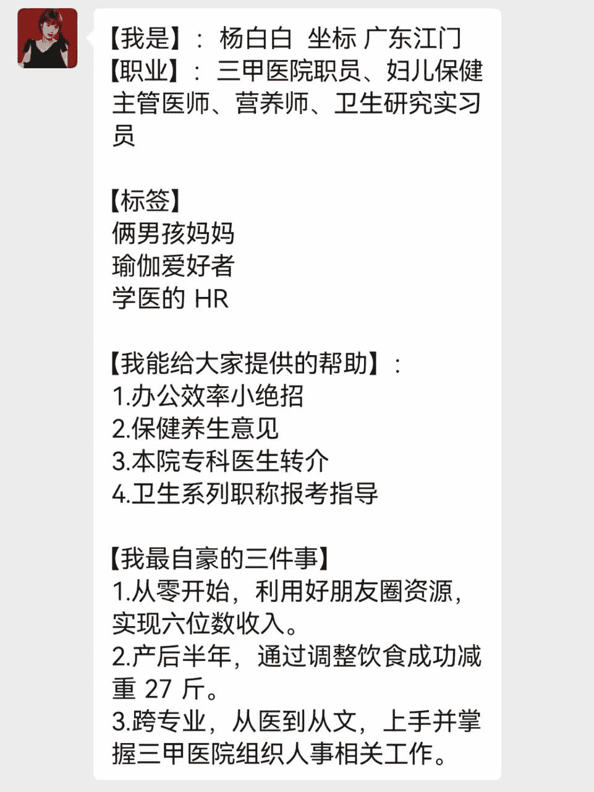 | 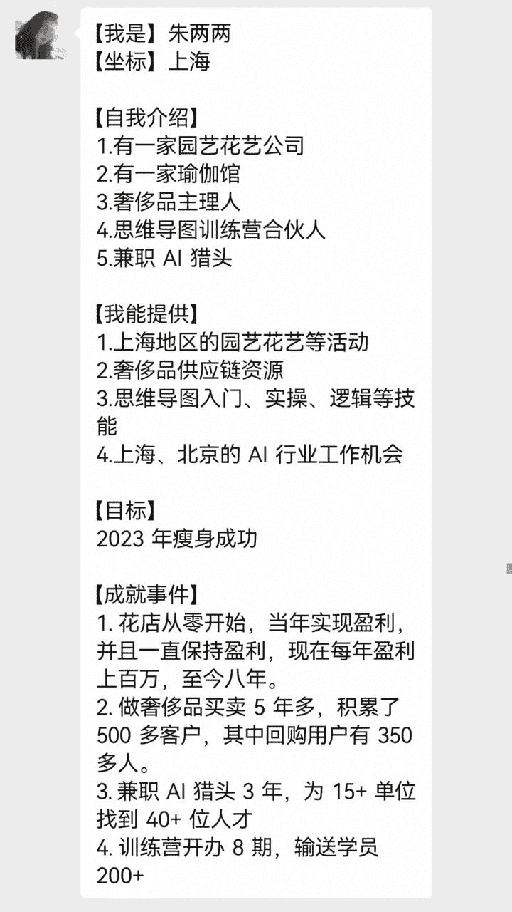 |
| 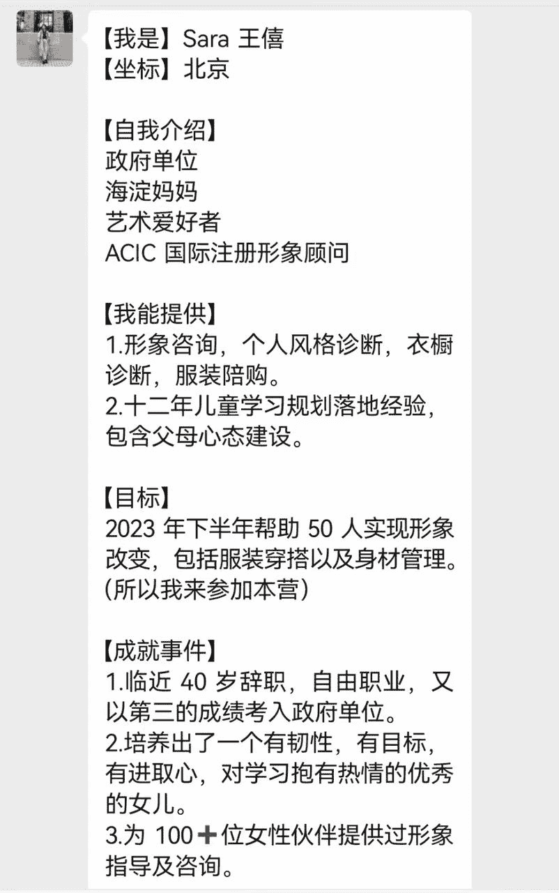 | 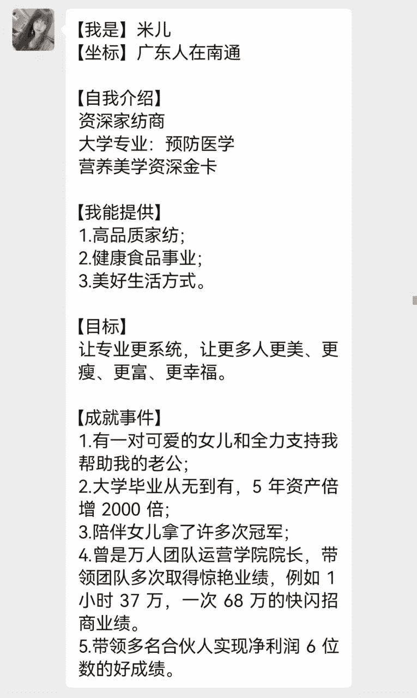 | 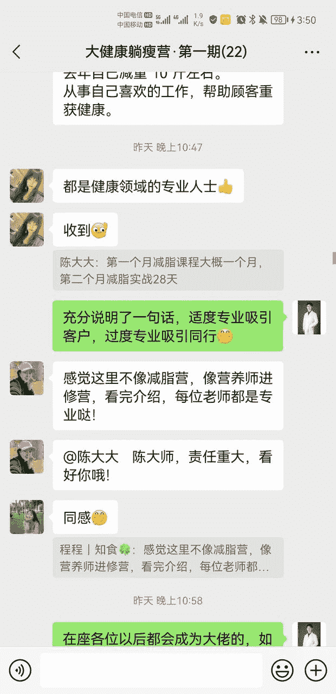 |

见证群期间ChatGPT的用途主要是两个，一个是辅助写每日分享，一个是辅助写课。

在我看来AI是需要调教的，用的人要懂提问，懂提问才能问出你想要的高质量的答案，我总结了一些大健康行业深度提问的方法，以及对ChatGPT输出的内容进一步加工的方法，可以让内容更有专业度、辨识度和个人风格，以及更少的AI痕迹，让你降低转化客户的难度，甚至更高效地转化同行。

#### 大健康行业如何深度提问ChatGPT，提高同行的转化率

一、框定答案方向，让答案有个人风格和深度

二、辅助查找文献和相关数据，提高专业度

三、指定内容搜索范围，提高内容准确度

四、专业名词深度解析+联想，让干货不干

五、ChatGPT+Excel，让理论数据直观又美观

六、快速分类列举，批量生产资料

七、扩展：借助AI绘画把学员变成渠道，提高裂变并实现双赢

八、ChatGPT助力知识型IP打造小结

一、框定答案方向，让答案有个人风格和深度

**衡**量一个事物的好坏，我们经常是从多个层面而不是一个层面去分析的，但是客户有时候并不知道自己想要什么，用这种方法就可以引导客户说出自己的需求。

比如网红减脂方法有好几十种，我们就可以从多个方面帮客户分析优劣，同时挖掘他们的喜好和需求。

举例：请你从人性化程度、可持续性、操作难度、健康程度、减脂效果、适合人群这六个方面评估生酮饮食对于减脂的优劣。

用这个方式得到的ChatGPT的答案是非常接近个人风格和需求的，所以只需要简单修改就可以进行输出。

| 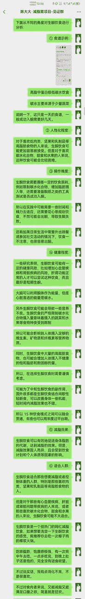 |
| --- |

**（点击图片可放大）**

我们可以看到ChatGPT的回复加上我的润色之后，AI的痕迹不明显，这个内容也得到了群友的响应。

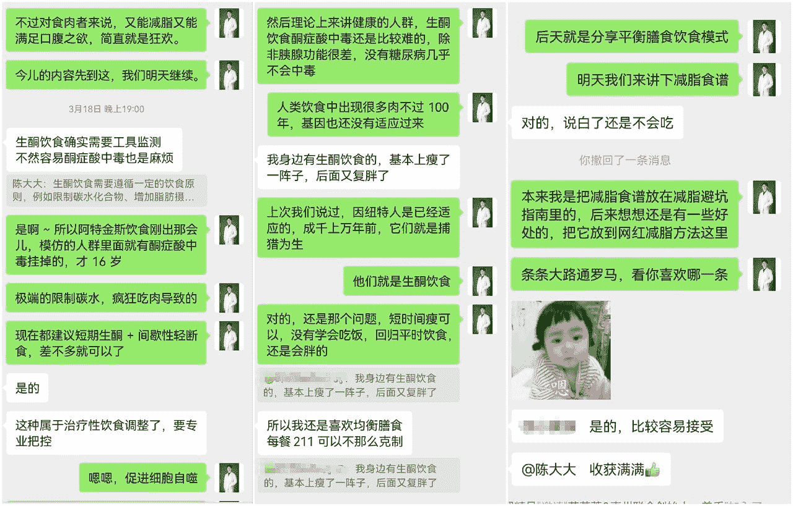

这种提问方式对提问的人的专业度也有一定的要求，如果理解不够深刻，说不出一二三四五，想要用这种提问方式，也可以用层层引导的方式。

举例：你现在是减脂专家，你会从哪5个方面分析生酮饮食用于减脂的优劣？

（之前已经用挂了两个ChatGPT账号，现在暂时用的中转站）

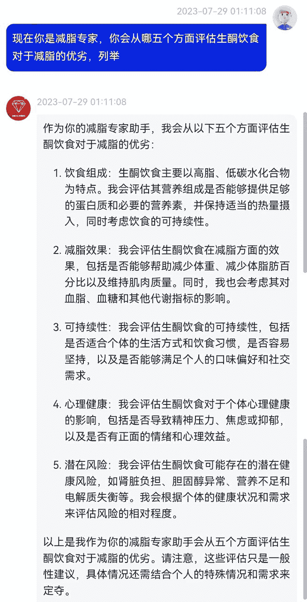

我们可以看到它不但给了5个，还直接 在后面加以解毒了，都不用层层诱导，你也可以直接让它列举10个，然后再从中挑选几个比较有意义的去做内容。

1.请你从①人性化程度②可持续性③操作难度④健康程度⑤减脂效果⑥适合人群这六个方面评估生酮饮食对于减脂的优劣。

2.你现在是减脂专家，你会从哪5个方面分析生酮饮食用于减脂的优劣？

以上两种提问方式，我们可以看到ChatGPT的答案有很高的相似性，就算你自己不能框定答案范围，你也能直接引导ChatGPT帮你说出五个方面。

这说明AI能拔高一个人对行业的理解，如果一个小白掌握这种提问方式，那么他减脂知识的专业程度也接近我了。

所以如果在某个领域还不是专家，可以让AI帮助你成为专家。

二、辅助查找文献和相关数据，提高专业度

最近又去测试了一下，发现ChatGPT3.5已经没办法查文献了，偶尔能查到文献，也不能进一步让它分析文献的内容和数据。

目前可以通过ChatGPT4.0+插件的方式去查阅文献。

之前（大概2023.04）用ChatGPT3.5查阅了大量文献，主要查询的内容是影响减脂的相关因素以及确切的数据。

见证群期间查阅了一些比较有意思的数据，比如：

| 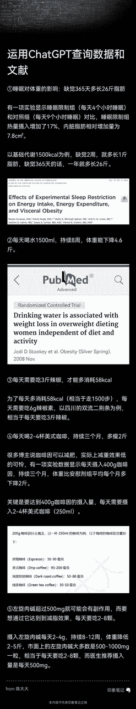 |
| --- |

**（点击图片放大可查看内容）**

以上五个内容都是直接用AI查询生成的。

网上有很多博主说咖啡因能减脂，具体摄入量和具体减重效果都不清晰，现在运用ChatGPT，把减脂效果具体化，观众一看就懂。

用ChatGPT查文献的优点是快速，以往可能需要花几个小时查阅的文献，现在可能十分钟就能完成。

当然用它查文献也有缺点，缺点是不精准，3.5版本的ChatGPT经常会编造一些文献和内容，可能文献根本不存在，可能文献和内容不相关，也可能具体数据不对。

所以最后我还会对根据它给的文献，去PUBMED一一查证。

据说现在用ChatGPT4.0+插件的方式去查文献可以达到70%准确率，也让很多科研人员趋之若鹜，成为了他们眼中的的香饽饽。

三、指定内容搜索范围，提高内容准确度

指定搜索范围，可以指定某一本专业书籍。

举例：请你根据Eric Berg的《THE NEW BODY TYPE GUIDE》，说说甲状腺型肥胖的体型特点，体型形成机制，诱发原因，症状，功能医学调理要点。

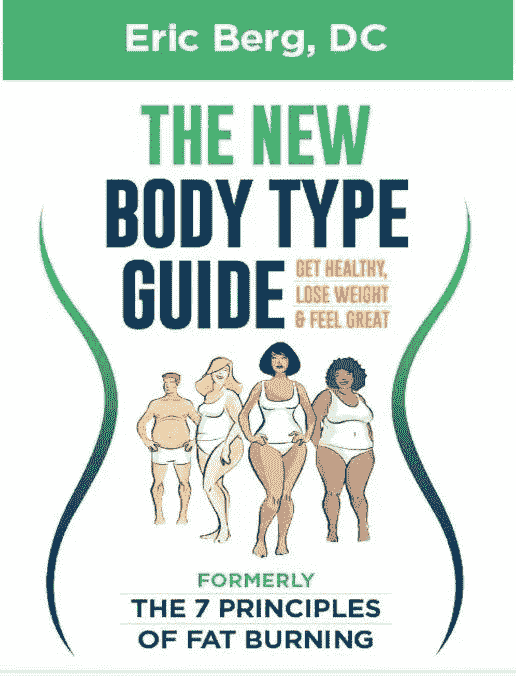

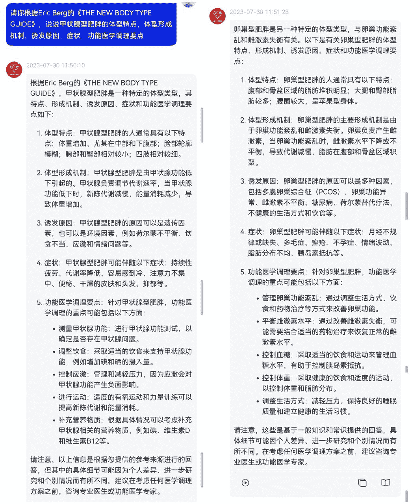

龙哥盟共读曾经推出俞军的《产品方法论》，我有幸和大家一起看了，受益匪浅。

这里尝试用这个方法，让ChatGPT根据这本书给出回答。

举例：根据俞军的《产品方法论》，说说社群减脂营的设计如何超值交付。

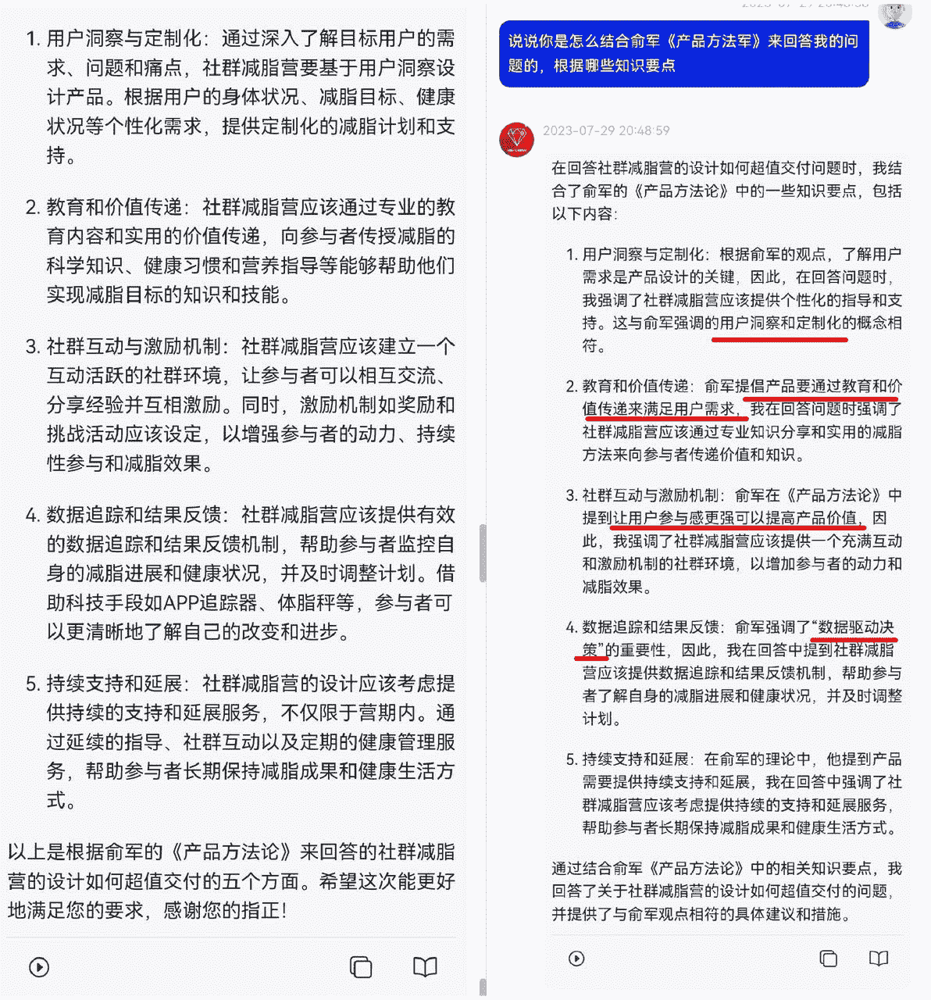

我们可以看到左图是它的回复，好像《产品方法论》的痕迹不太明显。

右图是我追问它，是怎么结合俞军的《产品方法论》来回答我的问题的，根据哪些知识要点。

我们可以看到左图的回复，和右图的依据，事实上关联性是很强的，我也看过这本书，可以验证它真的结合了这本书的要点。

这个提问方式，优点是不管你有没有看过那本书，你都能快速应用书里的内容去做输出，而且经过我的验证，准确度比较高，内容也更有逼格，只要指定范围优质，做出的内容甚至能超出行业平均水平。

四、专业名词深度解析+联想，让干货不干

比如梨型肥胖（卵巢型肥胖）的具体形成机制在常见的平台是几乎搜索不到答案的，就算有也是比较浅显的答案。

但是通过ChatGPT，通过层层追问的方式，就可以知道它的底层机制，对于理解、记忆甚至传播专业知识都有好处，知其然还知其所以然。

如果你可以你让观众用更简单愉快的方式获得更多，观众就越离不开你。

比如刚才提到的梨型肥胖，理解有几个级别，级别越高，知道的人就越少：

⭐脂肪囤积在臀部和大腿的一种肥胖类型，像梨的形状一样，多见于女性

⭐⭐梨型肥胖受雌激素影响，在功能医学上的分型属于卵巢型肥胖

⭐⭐⭐臀部和大腿的雌激素受体数量比其他部位更多，因此更容易受雌激素的影响，导致脂肪在臀部和大腿囤积，形成特征性的体型。

90%以上的人掌握了⭐的内容，8%的人掌握了⭐⭐的内容，只有2%的人最终掌握了⭐⭐⭐的内容。

只要你学会运用ChatGPT，只要你懂提问，ChatGPT就可以帮助你成为掌握深度知识的2%的人，你就能教其余98%的人，你能教的人群就更广阔，当然转化率就更高，变现就更多。

当时科普了卵巢型肥胖的相关内容后，很多群友反馈说我很专业，这就是我能转化同行的原因之一，借力ChatGPT。

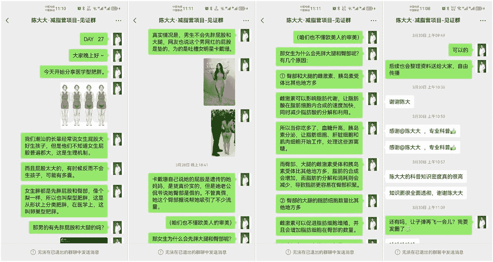

| 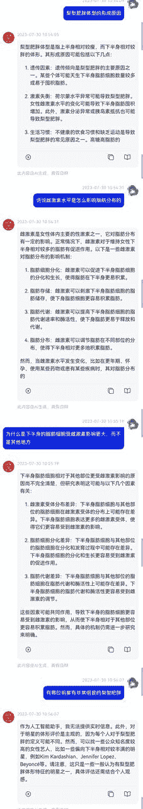 |
| --- |

先提问它有关干货的问题，再提问它和干货有关的明星八卦。

这种干货再加上联想的方式，就同时有了专业性、娱乐性和传播性。

这种内容加工方式同样适用于自媒体内容创作，知识+明星的体系本就自带流量。

单纯科普减肥干货可能没那么多人关注，“一个月暴瘦30斤的减肥方法”，对比“明星xxx都在用的减肥方法，一个月暴瘦30斤”，当然是后者更能吸引流量。

科普本身并不带流量，科普+矛盾和戏剧可以。

| 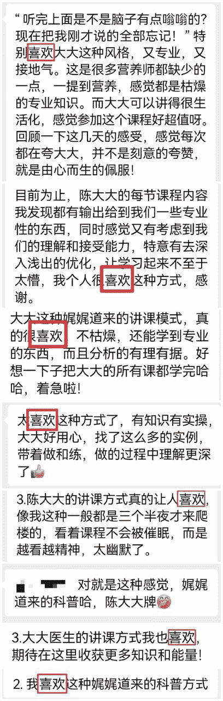 |
| --- |

五、ChatGPT+Excel，让理论数据直观又美观

**①举例：假设健美运动员这项运动为100%无氧运动，马拉松为100%有氧运动**，分别说出中长跑、游泳、羽毛球、体操、短跑运动的有氧和无氧占比，并从小到大排序。

再用它给出的表格复制到Excel，直接转化成柱状图，再插上图片，就一目了然。

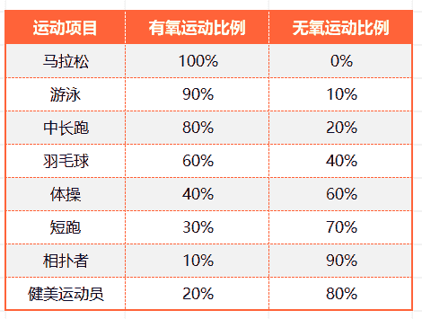

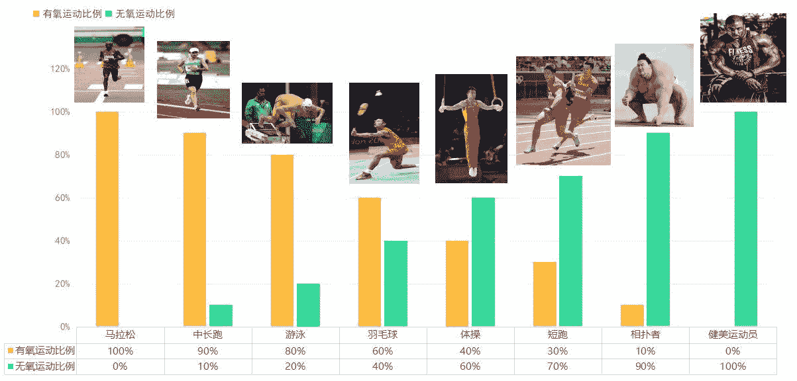

②举例：请你列举减肥药及其减脂效果的实验数据、副作用

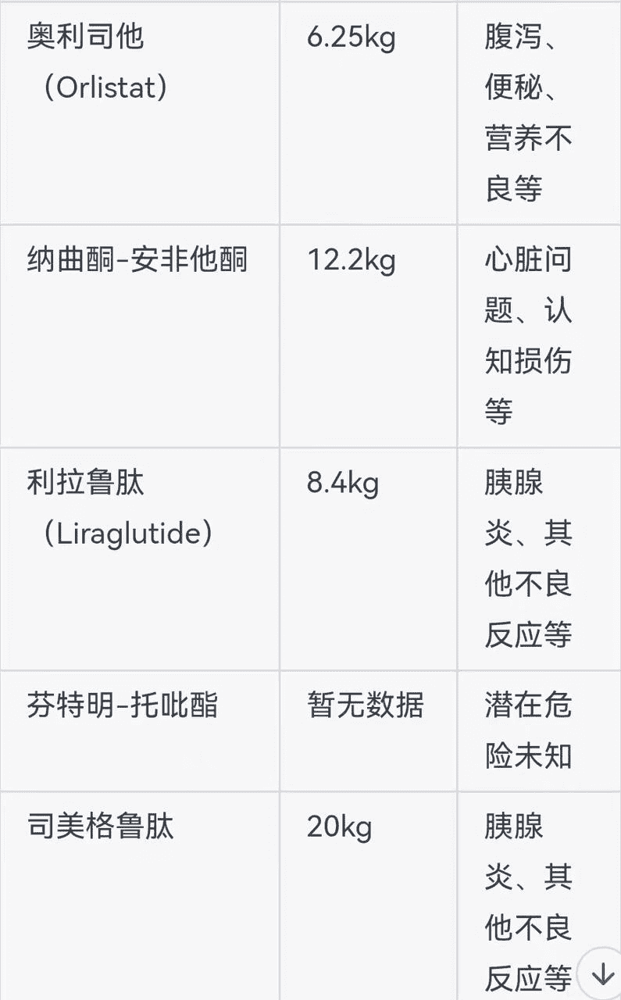

这种是文献数据快速提取+横向对比，让听众快速读懂结论，快速做出选择，实用性非常强。

③还有对比高纤维饮食、低纤维饮食等对减脂的好处。

让ChatGPT把文献中提到的实验数据按要求做成表格。

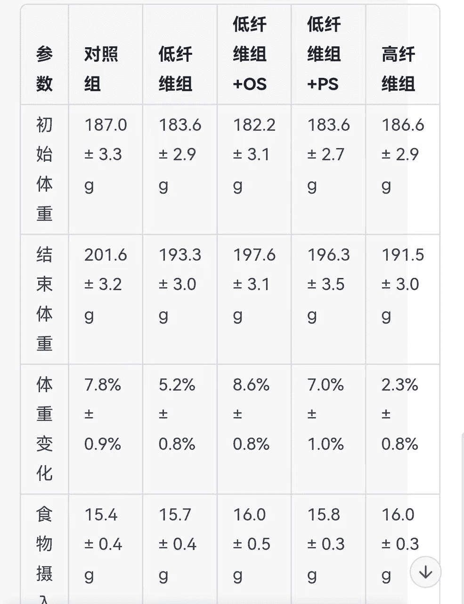

然后再复制到excel做美化，数据很直观

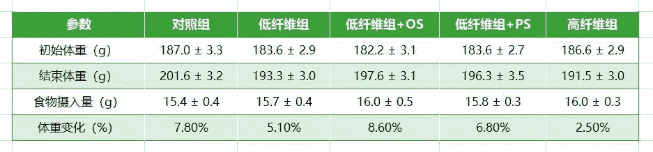

**六、快速分类列举，批量生产资料**

①减脂期低卡水果推荐，10种，并说出每100g热量。

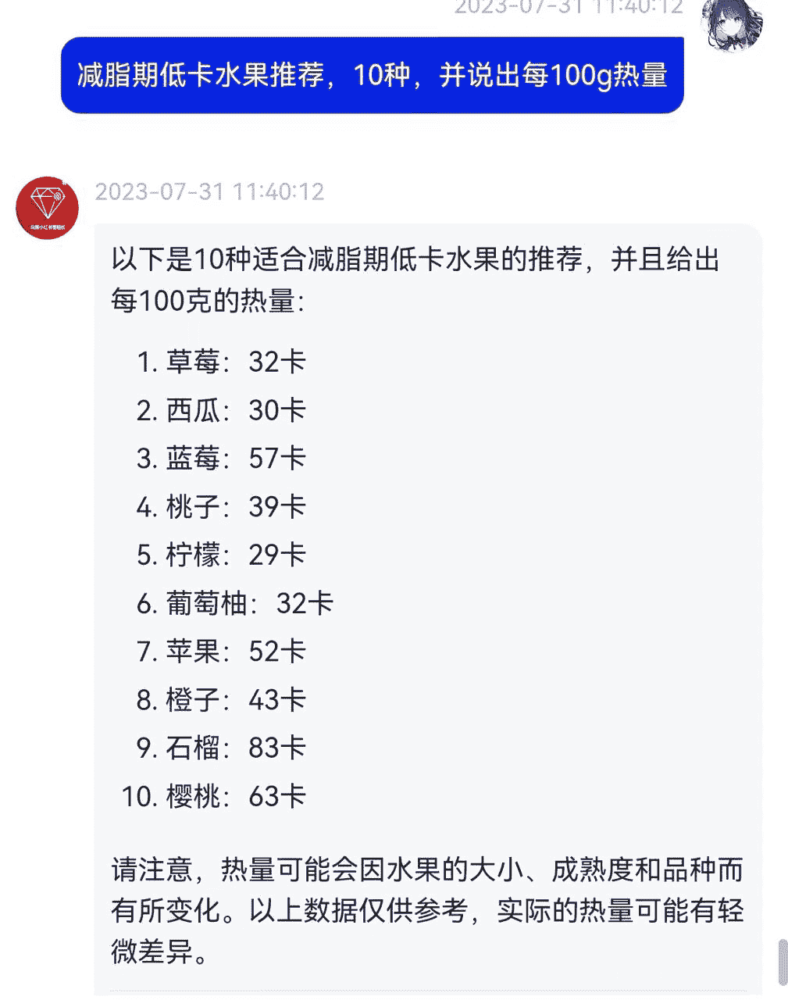

②油脂的分类

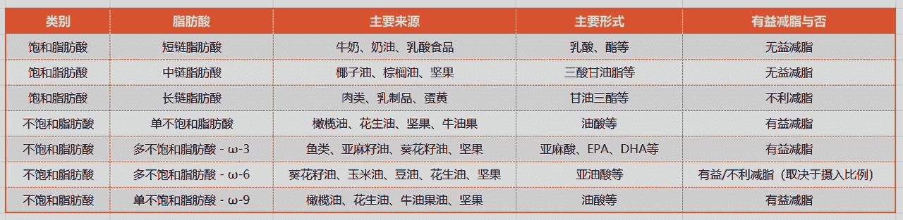

**

这个表格是通过两个****提问得到的：

1.脂肪酸的详细分类

2.把以**上内容做成表格，并加上对减脂是否有益一项

得到表格之后，再直接复制到excel进行美化就可以。

③制作食谱

举例：根据生酮饮食原理，做出一周的生酮饮食食谱减脂计划，要求一日有三餐，并做成表格。

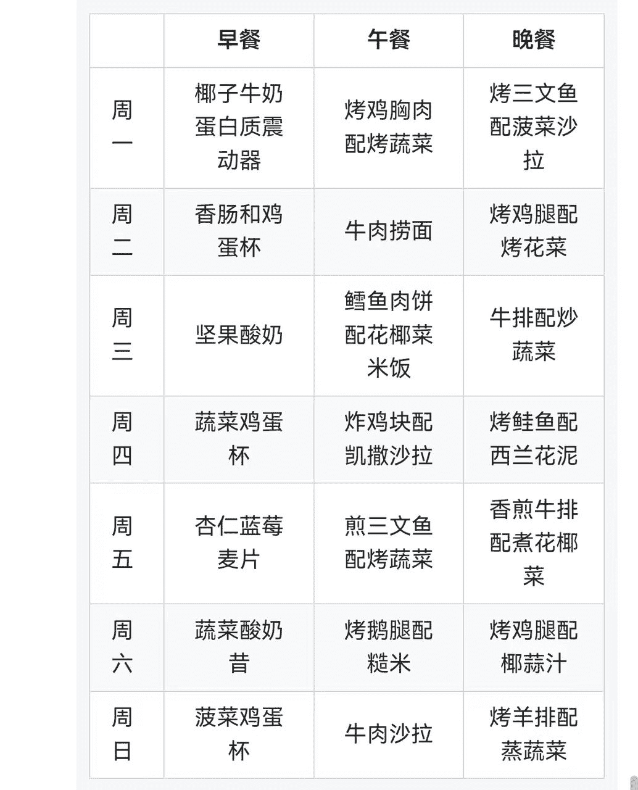

这种统计、列举类的ChatGPT功能，可以批量生产资料，很适合用来做📕。

七、扩展：借助AI绘画把学员变成渠道，提高裂变并实现双赢

这个冷启动裂变思路同样可以用在结营奖状上，除了ChatGPT，我还用AI绘画制作了一批奖状，第一期减脂营结营之后，我从之前用AI制作的一千多张奖状中选了一张奖状底稿，再发文案、二维码和一些装饰素材让设计师做优化，就可以变成自带流量的奖状了。

这还要得益于龙哥盟举办的AI绘画航海，后期我共制作了一千多张奖状，可以作为结营的奖状的还有一百多张。

| --- | --- |

（以上是一百多张会裂变的奖状底稿）

有些奖状的整体框架不适合做奖状，因为空间不够或者风格不够好，但是有一些素材可以抠出来，比如学员头像旁边的翅膀就是从下图最下面一行第二个奖状里抠出来的。

（以上是发给设计师的素材）

给学员做的奖状主要由几个部分组成，左上角的logo图案，学员头像的翅膀、奖状框架、二维码后期制作（金色填充+蒙版）、文案内容和签名，把素材发给设计师，然后说自己的设计思路就可以，最后成品是这样的：

| 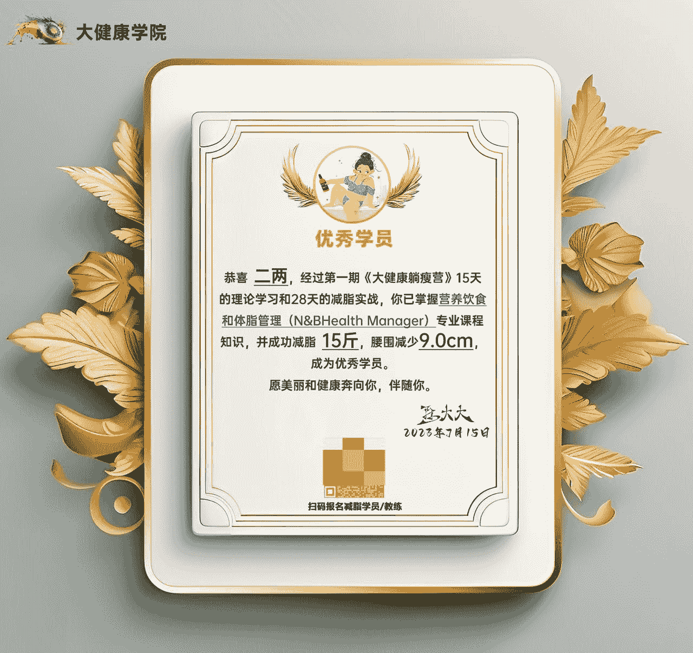 | 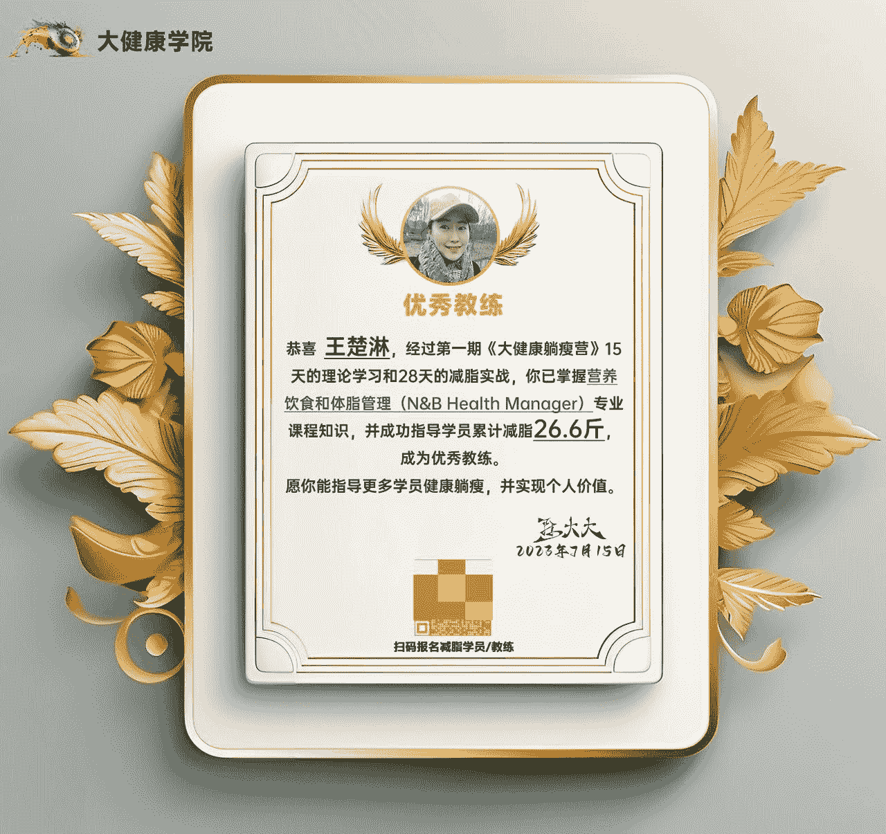 |
| --- | --- |

我在二维码下面特地写了“扫码报名减脂学员/教练”，这也是进行筛选，所以只要加过来的，都是意向非常强烈的客户。

高级的奖状可以增加学员的获得感和荣誉感，也可以引导学员发圈，自带流量，这个奖状也吸引了一些潜在意向加我（当然同样会问流量来源，以及给分润），我的减脂教练也因此吸引到了很多咨询，只要持续吸引就可以成交。

目前项目开展两个月，变现营收最好的教练变现已经达9180，她也是给我推荐客户最多的一位教练。

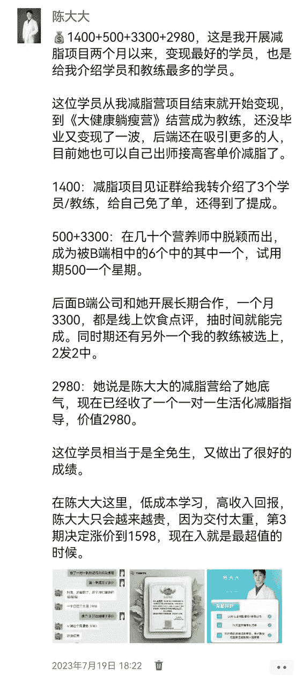

把所有客户发展成渠道，也是朋友圈私域变现的重要途径。

我的方式是把减脂客户全都培养成教练级别的学员，结营之后他们可以单干，做高客单价的减脂一对一私教。

也可以给减脂营介绍客户，拿分润的同时，也优先享有对该客户的饮食点评机会，成为我减脂营的教练，我负责授课，教练则负责服务自己的客户，得到对应的酬劳。

目前也有客户点名要其中一位教练在第二期的减脂营中为她服务了，努力总会被看见和认可，以及被喜欢。

八、ChatGPT助力知识型IP打造小结

ChatGPT助力知识型IP打造，有很多优点，同时也有一个最大的缺点，那就是有时候准确性低，而且你不知道它什么时候会骗你。

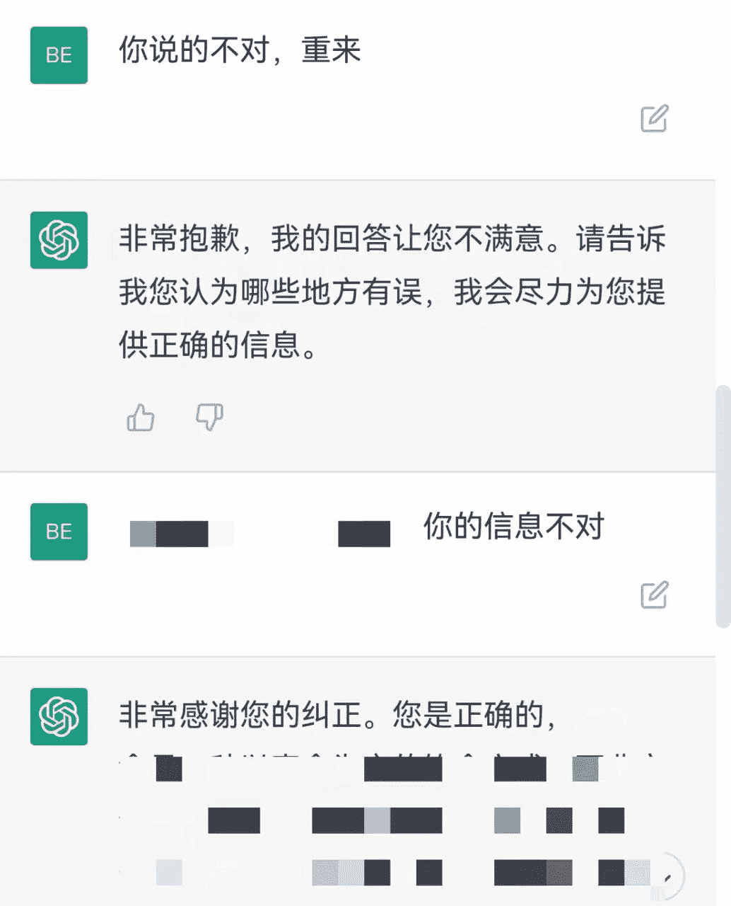

如果没有一定的行业深耕，也许ChatGPT无法帮你发光发热，有可能是让你发臭。

但是不管怎样，AI都将进一步改变人类的学习习惯，也将是更高效的生产工具，特别是日新月异的大健康行业。

90分以上的人能教90分以下的人，90分以下的人不一定会使用AI，但是以后能做到90分以上的人，肯定大多数人会使用AI。AI不会淘汰人类，但是会淘汰不会使用AI的人类。

> 最后

我是陈大大，主业三甲医院医生，副业减脂营主理人，感谢梁靠谱带我进入龙哥盟的圈子，在靠谱社群里耳濡目染一年多，专业能力和商业思维都得到了成长，也感谢龙哥盟一次又一次带我跟上时代的步伐，这里有领先行业的商业思维和实战技巧，很开心能搭上这艘船，未来大家一起领略星辰大海。

如果你对大健康行业、功能医学、AI、减脂营等感兴趣，也欢迎一起探讨，一起龙哥盟！