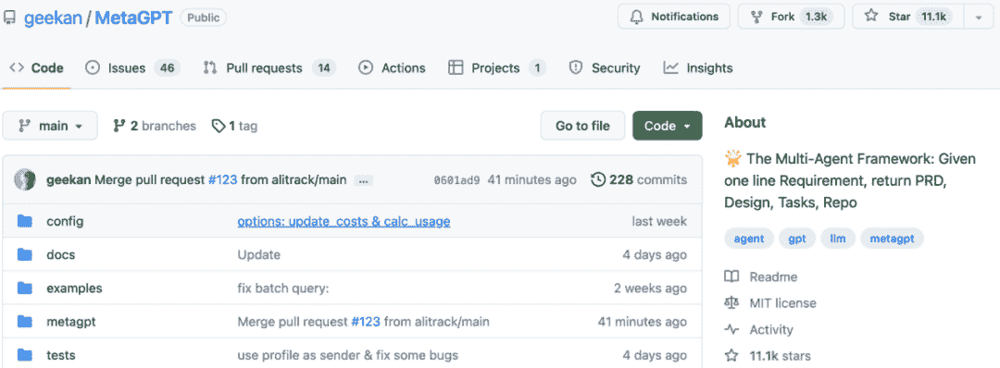
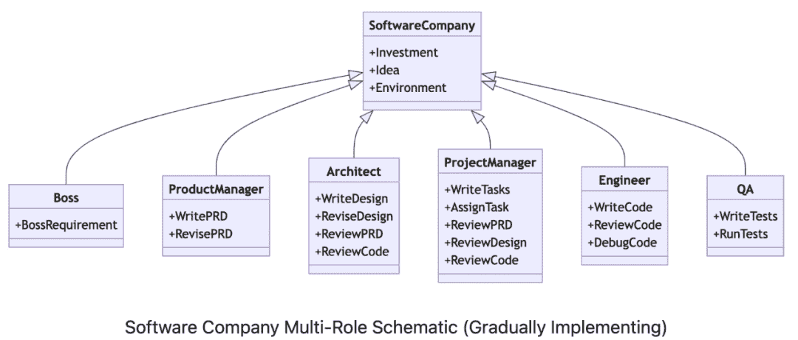
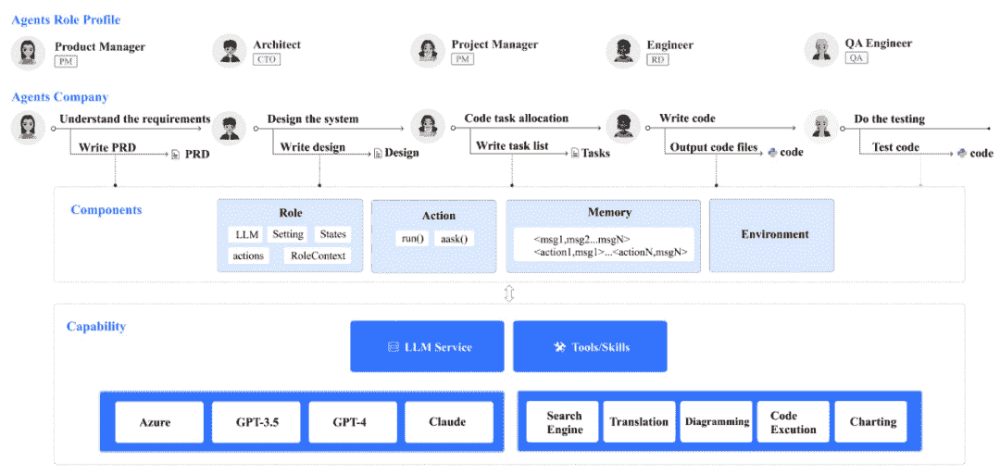
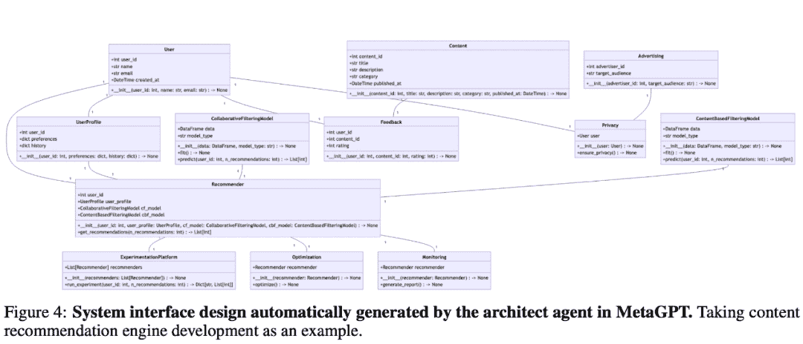
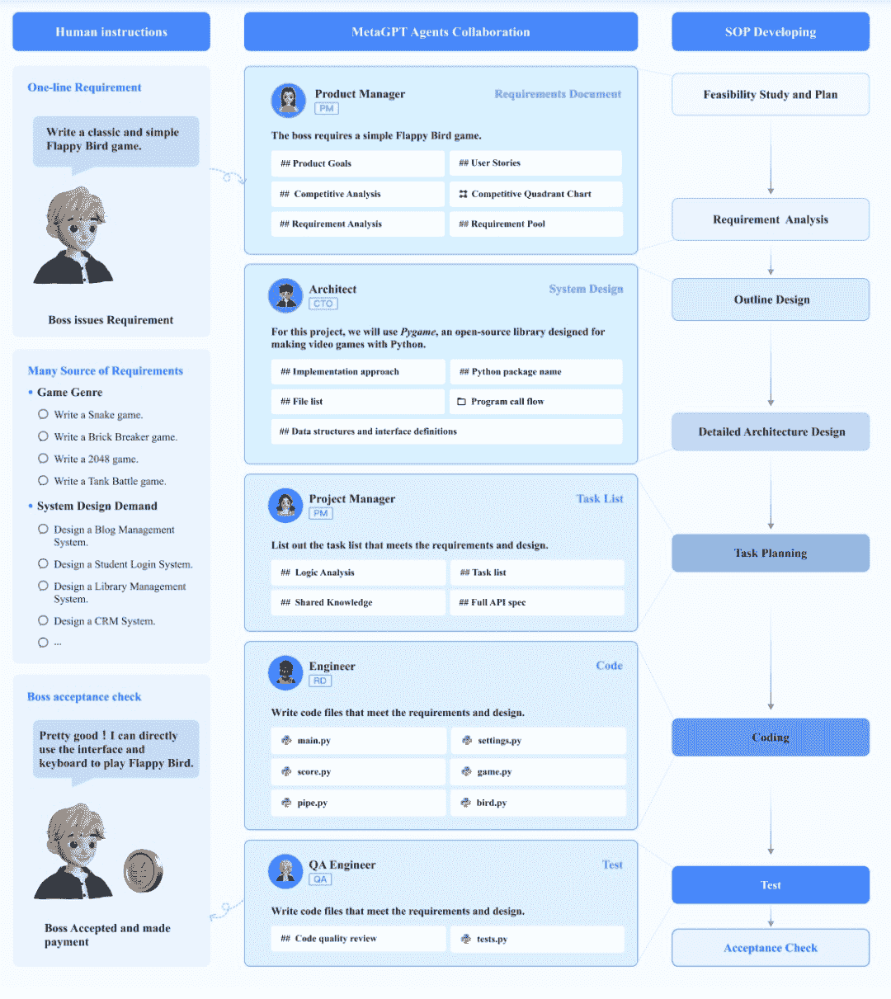
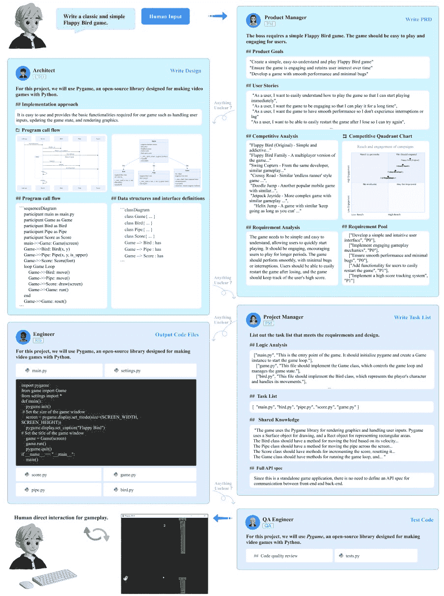
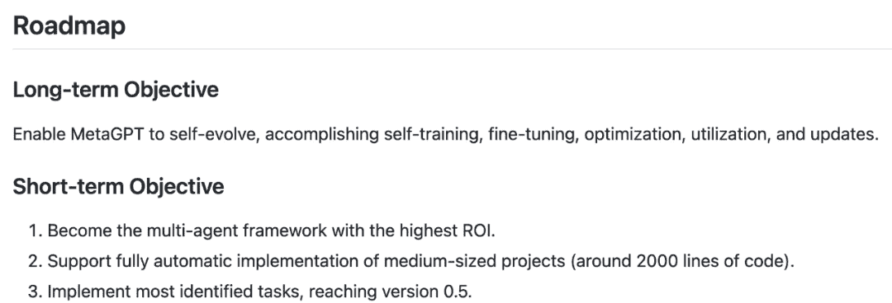
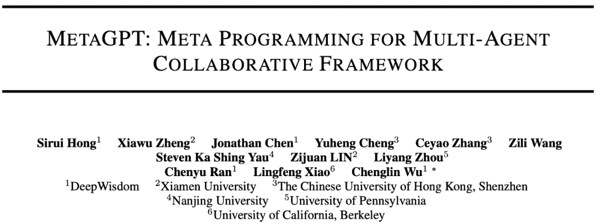
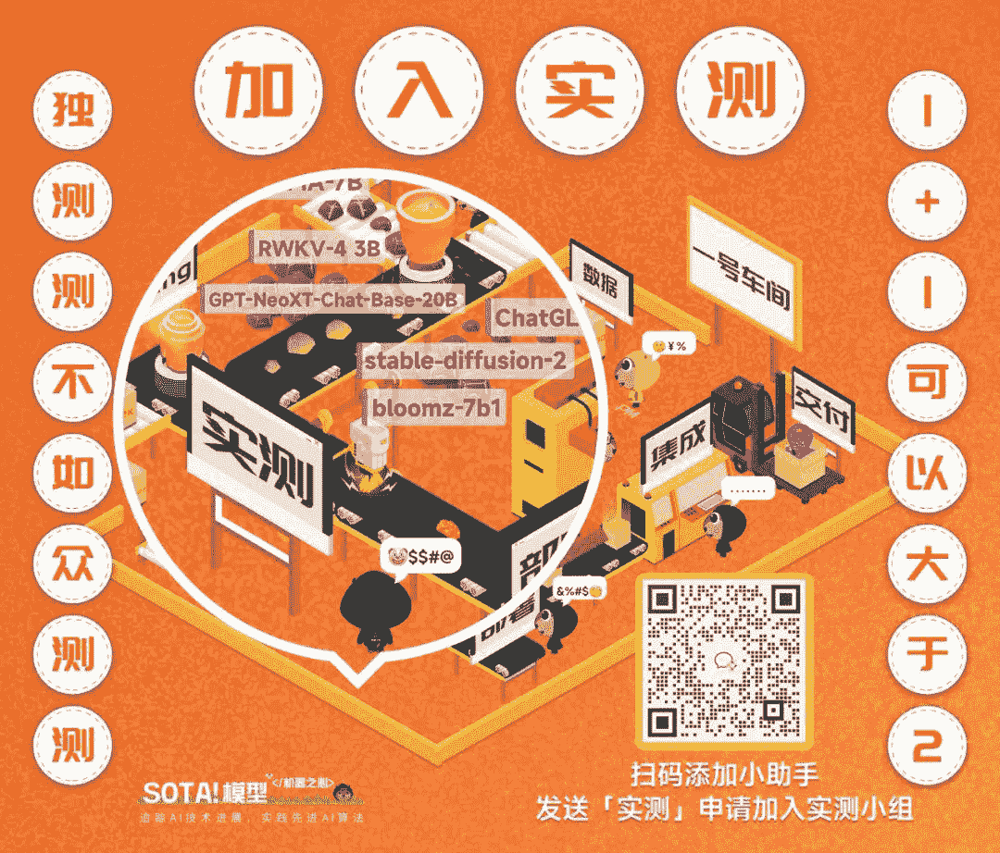

# 2023-08-07GitHub 1.1万星，模拟软件开发流程，开源框架MetaGPT爆火

> 来源：[https://xuqiwei1986.feishu.cn/docx/K1y6dvekxoKwcQxJkHPcNsFCnSb](https://xuqiwei1986.feishu.cn/docx/K1y6dvekxoKwcQxJkHPcNsFCnSb)

> 🔗 原文链接： h[ttps://mp.weixin.q](https://mp.weixin.qq.com/s/HHtCNvy0aruZbkJ4Bhk0Gw)q.com/s/HHtCNvy0...

>

机器之心 2023-08-07 12:58 发表于 北京

机器之心报道

**编辑：小舟**

> 在不久的将来，我们应该就能用上智能体开发的软件了。

随着大型语言模型（LLM）的日渐成熟，利用其构建 AI 智能体成为一个新的研究方向。已有研究使用 LLM 驱动多智能体自主完成了一些任务。

然而，现有研究主要集中在简单任务上，缺乏对复杂任务的探索。这主要是因为大型语言模型存在「幻觉」问题，特别是当多个智能体相互作用时，幻觉会进一步被放大，以至于无法用于复杂任务。

最近，一个名为「MetaGPT」的开源框架尝试解决这个问题。MetaGPT 旨在将有效的人类工作流程作为元编程方法注入到 LLM 驱动的多智能体协作中。MetaGPT 在 GitHub 上线几天，就狂揽超过 11.1k star。

项目地址：https://github.com/geekan/MetaGPT

简单来说，MetaGPT 让多智能体的协作过程模拟软件开发公司的工作流程，这就需要为每个智能体分配角色，并规划智能体的协作过程。软件开发公司的人员分配情况通常如下图所示：

具体来说，MetaGPT 首先将标准化操作程序 (SOP) 编码到 prompt 中，使得多个智能体的协作过程结构化。然后，研究团队进一步让输出模块化，赋予智能体与人类工作者相当的领域专业知识，以验证输出并减少复合错误。

通过这种方式，MetaGPT 以工作流水线的形式为各个智能体分配了不同的角色，进而建立了一个能够有效、凝聚地解构复杂多智能体协作问题的框架。

对于软件开发来说，系统架构和接口设计是非常关键的一步，研究团队以推荐引擎开发为例，展示了 MetaGPT 中的「架构师智能体」自主生成的系统接口设计：

MetaGPT 可以让智能体完成多种复杂任务，例如开发一个简单的游戏软件，MetaGPT 的任务执行流程可以和人类开发者的 SOP 流程一一对应：

MetaGPT 会收到用户输入的需求，就会有智能体作为产品经理进行需求和可行性分析，再由充当架构师、项目经理、工程师的智能体按顺序完成软件开发。最后还有智能体负责对软件进行全面的测试。整个过程很好地模拟了现实世界的开发过程。

我们来看一个 MetaGPT 完成具体开发任务的例子，用户只输入一句需求：写一个 「21 点游戏（Blackjack）」，MetaGPT 就经过需求分析、任务规划，成功编写出游戏代码：

退出全屏

切换到横屏模式

[🎦 点击观看视频](http://mpvideo.qpic.cn/0b2e54aaeaaalqahi5wqhzsfb36dalxqaaqa.f10002.mp4?dis_k=272e57d787953f75c8eb83838e36bf6e&dis_t=1691477512&play_scene=10120&auth_info=edOFs9kFEXkSnY+5yW5oGU0BRiQvNFlrQRFuDXc3PkJLNg==&auth_key=29ebc3ca476a859963debd7e9236894d&vid=wxv_3049950309227151362&format_id=10002&support_redirect=0&mmversion=false)

> 无法获取音频链接

视频详情

研究团队在项目路线图中介绍道：MetaGPT 短期内将完成自主实现中型项目（约 2000 行代码）的目标，最终 MetaGPT 将能够自主训练、微调、优化、应用和更新。

目前，MetaGPT 已发表研究论文《METAGPT: META PROGRAMMING FOR MULTI-AGENT COLLABORATIVE FRAMEWORK》。

论文地址：https://arxiv.org/pdf/2308.00352.pdf

感兴趣的读者可以阅读论文，了解更多研究内容。

© THE END

转载请联系本公众号获得授权

投稿或寻求报道：content@jiqizhixin.com