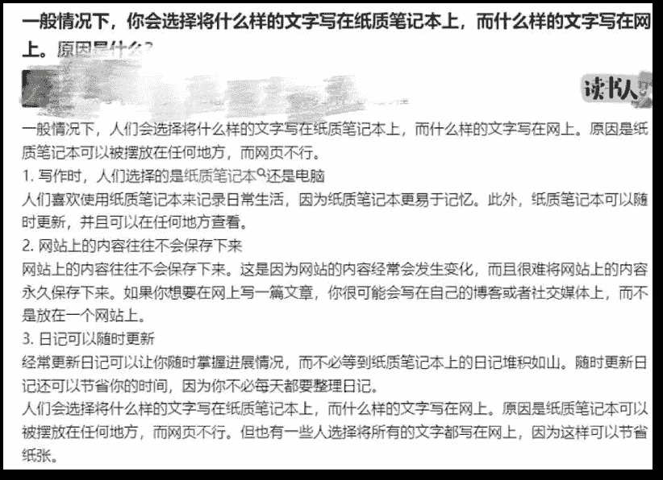
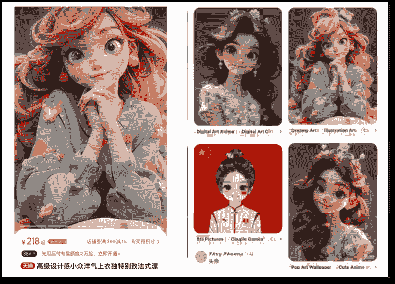
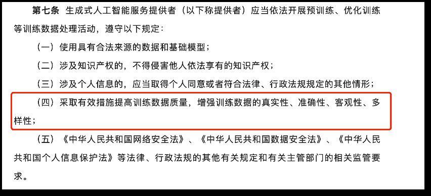
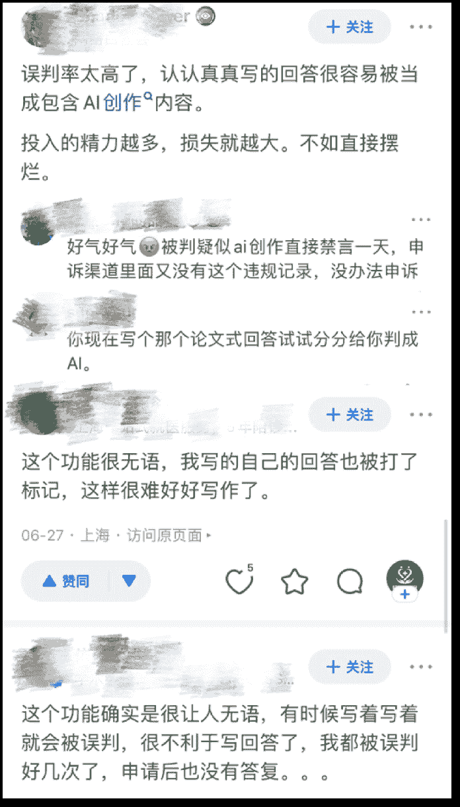

# 2023-08-04AIGC“弄脏”互联网，大模型“课本”遭污染 – 人人都是产品经理

> 来源：[https://xuqiwei1986.feishu.cn/docx/PeYBdYfw2oqmFoxKzetcb36rneh](https://xuqiwei1986.feishu.cn/docx/PeYBdYfw2oqmFoxKzetcb36rneh)

> 🔗 原文链接： h[ttps://www.woshipm](https://www.woshipm.com/ai/5880091.html).com/ai/5880091....

>

> AIGC的相关内容正在互联网上泛滥，而在这一趋势下，一些无意义、同质化的内容也开始出现，甚至对中文互联网造成了“污染”。具体如何解读这一现象？不妨一起来看看作者的分析和总结吧。

“AI制造”充斥互联网，连“真人小姐姐”也可以批量生成。随着生成式人工智能的爆发，一个可怕的现象出现：AI正在污染整个互联网。

知乎成为生成无脑答案的重灾区，这些内容描述简短、概括性十足，细看逻辑混乱、错误百出。打开今日头条，用ChatGPT生成的虚假新闻，内容耸人听闻，足够博人眼球。

AI加持下，虚假、无意义、同质化的内容呈指数级增长，获得大量曝光。莱斯大学和斯坦福大学的科学家研究发现，这些低质、同质化、未经证实的“AI语言”如果不加以甄别，进一步被抓取作为训练AI的语料，AI大模型将会走向崩溃。

## 一、AIGC“垃圾”泛滥，内容平台成重灾区

生成式AI越来越低成本化，伴生而来的是AI生成信息的“垃圾网站”。

外媒NewsGuard发布相关数据报告称,目前已经追踪到了大约277个且还在不断增加的“垃圾网站”，这些网站生产了大量标题诱饵以优化广告收入。

类似的情况也发生在国内，表现形式是AI生成的低质内容。

“中文互联网高质量的问答社区和创作者聚集的原创内容平台”知乎，如今成了AI无脑答案的重灾区，不少答主的内容呈现明显的“GPT风”，机器翻译的文字感、混乱的逻辑扑面而来，有时还会出现事实错误，特别是在金融、医学等专业领域，没有经验的人群很容易被误导。

知乎上的“片儿汤话”答案

有知乎用户使用AI每隔一两分钟就可以输出一条几百字的回答。尽管已经被禁言，但其产生的错误信息依然遗留在互联网中。如果你足够细心，你会发现，自带AI问答功能的搜索引擎Bing在中文世界经常会引用知乎的内容。一些生成后就从未过人工核查的错误答案 被Bing AI抓取，造成低质的中文信息蔓延。

AI对互联网内容的侵蚀不仅限于文字。在📕、淘宝、抖音上，越来越多的“AI真人美女”的图片和视频被批量生产，还有大批“AI摄影”类账号的出现。

AI魔法棒一挥，制作成本低、效率高的“AI美女”一时间成为电商眼中的香饽饽，AI模特、AI主播频频出现。“她们”足够吸睛，但也千篇一律，“网红脸”的队伍里又增加一类AI面孔。

如果只是用AIGC制造美图供人评鉴、学习倒也还好，但AI生图工具产生的内容开始侵犯直接与人们生活相关的领域。

淘宝上，有商家直接用AI生成图来取代商品实物图，一张由Midjourney生成的卡通少女图，被商家打上“绿色衬衫”的标签，售价218元。与之风格相似甚至完全相同的AI生成图，在网上随手就可以找到。利用Midjourney的垫图功能，任何人都可以自己生成无数仿照图，与卖家秀相差甚远的买家秀将再添槽点。

淘宝商家用AIGC网图（右）描述商品

在中文互联网，AI大有无孔不入之势，专门教人如何用“AI写文赚钱”的课程层出不穷，卖课人号称“一套教学视频跟万能模板，直接套用”。AI话题营造出的失业焦虑中，该类课程受到追捧，曾有人通过卖课月入百万。

如今，学会了使用AI工具的人，将AI生成的内容上传到知乎、今日头条或者📕上，吸引了流量，但也制造了不少低质量、同质化甚至信息虚假的内容垃圾。

那么，这种AIGC内容“垃圾”会产生危害吗？

## 二、靠AI识别真假，技术还不行

泛滥的AIGC内容加速污染互联网环境，除了影响人类获取有效信息的效率外，产出它们的工具“大语言模型”也会走向崩溃的边缘。

莱斯大学和斯坦福大学的科学家研究证明，将人工智能生成的内容输入人工智能模型，会导致输出质量下跌。

研究人员将这一现象解释为“模型自噬障碍”（MAD），即如果AI只学习其他AI生成的内容，在经过几代训练后，AI将输出无意义的垃圾信息，最终走向“模型崩溃”这一结果。 研究人员表示，对于大语言模型而言，“数据清洁”十分重要。

“世界正在奔向一个未来：生成式AI的爆发，导致了互联网上的合成数据很快就会超过真实数据。”按照研究者的说法，区分合成数据与真实数据，无论对人类本身还是大模型发展都变得势在必行。

最近，中国首个AIGC监管文件《生成式人工智能服务管理暂行办法》落地，该《办法》明确指出AIGC服务提供者要“增强训练数据的真实性、准确性、客观性和多样性”。

生成式人工智能服务者有义务保证数据质量

在《办法》的指导下，国内的内容平台也推出针对AI生成内容的管理措施，知乎、抖音、📕等平台均已发布有关AIGC内容的规定。

《抖音关于人工智能生成内容的平台规范暨行业倡议》称，针对人工智能生成的视频、图片和衍生的虚拟人直播，发布者应对人工智能生成内容进行显著标识，帮助其他用户区分虚拟与现实，特别是易混淆场景。该《倡议》提到，平台提供统一的人工智能生成内容标识能力，帮助创作者打标，方便用户区分。同时，平台提供用户反馈渠道，方便用户反馈违规的生成内容。

知乎也发布了《关于应用AIGC能力进行辅助创作的社区公告》，公告显示，如果创作者发布AIGC生成的内容时，没有主动使用“包含AI辅助创作”的标签进行声明，平台会添加相关标识并限流，同时鼓励知友对利用AIGC技术，扰乱社区秩序的内容和账号进行举报，举报类型里新增了“AI生成内容”的选项。

规则出现了，但在实操中出现了Bug。

知乎用户反馈原创内容被误判为AI生成

知乎创作者们对平台“打标签”（审核）的能力表示质疑。有用户反馈，自己原创的内容被当成了AI创作打了AI标记，甚至有人因此被禁言。

这种“误判”现象背后又隐藏了一个细思极恐的问题。假如平台采用机器来识别AI，机器对同类的“宽容度”或许会很高，让计算机还无法精准识别出AI犯的错误。

最近，OpenAI推出的AI文本识别工具AI-Text-Classifier就因准确率太低而被官方下架。DetectGPT、GPTZero等AI生成检测工具的失误率也都高得惊人。

随着AIGC技术不断迭代升级，AI生成内容将越来越具备迷惑性，想通过AI识别工具遏制AI内容垃圾的滋生，从技术成果上看成功率还不高。

看来，在充满人工智能的未来，“人工”有多强大，“智能”才有多强大。在AIGC的巨大冲击下，如何不被内容垃圾裹挟、实现人工与智能的良性共进将成为AI下一阶段发展的重要挑战。

作者：木沐，编辑：文刀

来源👸号：元宇宙日爆（ID：yuanyuzhouribao），在这里，看见未来。

本文由人人都是产品经理合作媒体 @元宇宙日爆 授权发布，未经许可，禁止转载。

题图来自Unsplash，基于 CC0 协议

该文观点仅代表作者本人，人人都是产品经理平台仅提供信息存储空间服务。