# 2023-08-04给教育公司用上文心千帆大模型平台-

> 来源：[https://xuqiwei1986.feishu.cn/docx/Jf4udukjMoZnJXxmslTceB2xnlh](https://xuqiwei1986.feishu.cn/docx/Jf4udukjMoZnJXxmslTceB2xnlh)

> 🔗 原文链接： h[ttps://www.toutiao](https://www.toutiao.com/article/7263287686759367204/?log_from=1af898380f84e_1692254216331).com/article/726...

>

# 10分钟，给教育公司用上文心千帆大模型平台

2023-08-04 11:00 · CSDN

**文章目录**

**实战背景**

**提炼需求**

一、员工教育行业或产品知识普及

二、公司产品细节速查

**对接文心千帆大模型平台**

+   什么是文心千帆大模型平台

+   千帆大模型平台最近更新了什么

+   创建应用 成人高考百问百答

+   直接调用 ERNIE-Bot-turbo 大模型

+   什么是 Prompt 工程

+   进一步控制问答范围，描述 Prompt

+   现有应用集成千帆大模型平台的 Prompt 工程

**文心千帆大模型平台实战总结**

**实战背景**

教育公司对知识树构建有大量的迭代需求，而且知识体系非常碎片化，存在大量整理工作。

行业知识树需要解决两个痛点需求：

1.  员工教育行业或产品知识普及

1.  公司产品章程细节速查

基于上述两点内容，再结合文心千帆大模型平台，我们可以将需求快速落地实现生成式 AI 应用，先实现从 0~1，然后在应用使用过程中快速的迭代产品。

> 在本篇博客中可以完整看到上述两部分内容的实践过程。

**提炼需求**

**一、员工教育行业或产品知识普及**

知识问答是典型的生成式 AI 应用，但我们需要在问答生成过程中，控制回答范围，尽可能让问答生成符合公司业务。

因此提炼需求如下：

1.  问答知识树

1.  控制回答范围在公司业务内，例如河北成考，山东成考，国家开发大学……

**二、公司产品细节速查**

教育公司内部会出现大量简章，学校说明，教学方案等文档类资料，因此会产生如下需求：

1.  整理上传公司内部教育资料

1.  从资料内检索知识点

这一需求先埋下伏笔，下一次将会为大家带来一个更加优秀的功能，期待吧~

**对接文心千帆大模型平台**

**什么是文心千帆大模型平台**

文心千帆大模型平台是面向企业开发者的一站式大模型开发及服务运行平台。

**文心千帆不仅提供了**包括文心一言底层模型（ERNIE-Bot）和 第三方开源大模型 ，还提供了各种 AI 开发工具和整套开发环境，方便客户轻松使用和开发大模型应用。

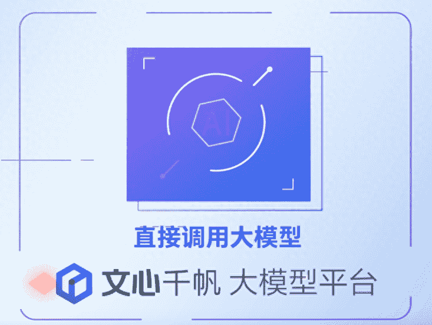

在简介中有两点非常重要：

+   第一是千帆大模型平台集成了第三方开源大模型；

+   第二是提供了 AI 开发工具和完整开发环境。

这两点都有助于我们快速落地前文提及的刚性需求~

**千帆大模型平台最近更新了什么**

打开千帆大模型平台的更新说明，可以查看到千帆新增了第三方开源大模型服务 Ll**ama，包含 L**lama-2-7b-chat 、 Llama-2-13b-chat 、 Llama-2-70b-chat ，目前已累计接入 33 个大模型 服务。

其中 Llama 是 Meta AI 研发并开源，在编码、推理及知识应用等场景表现优秀的一款大模型，如果你对该开源模型感兴趣，可以即刻去千帆大模型平台快速体验：

https://console.bce.baidu.com/qianfan/overview

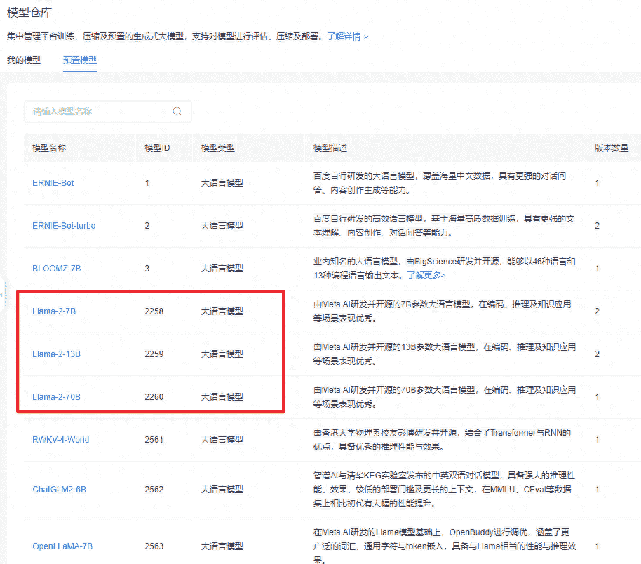

除此之外，预置大模型 ERNIE-Bot-turbo ，支持 SFT 训练和推理部署，显著提升文本创作、改写纠错、多轮对话等能力，在 后续实战应用中，是核心使用的大模型 。

接下来我们将第一个需求进行落地，10 分钟搭建教育行业知识树模块。

**创建应用 成人高考百问百答**

正式使用千帆大模型平台的操作台，需要提前申请账号，审批速度很快，直接点击下述链接即可。

https://console.bce.baidu.com/qianfan/overview

按照下图操作切换到应用创建视图。

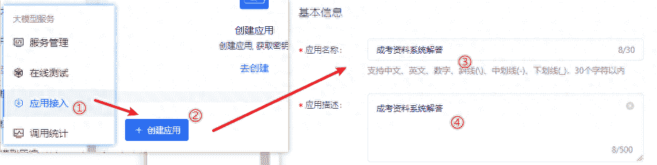

+   应用名称建立为：成人高考百问百答

+   应用目标群体：公司全体咨询师

应用建立完毕，可以切换到在线测试卡片，在该菜单中进行开发前的模拟工作，此时千帆大模型平台的教育行业实践正式开始。

直接调用 ERNIE-Bot-turbo 大模型

在线测试卡片右侧按照下图进行配置，选择 ERNIE-Bot-turbo 大模型。

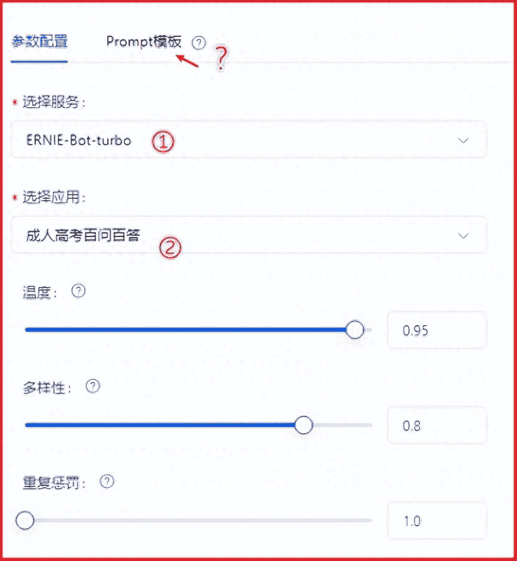

**在千帆提供的问答**页面，直接询问 成人高考是什么 ？

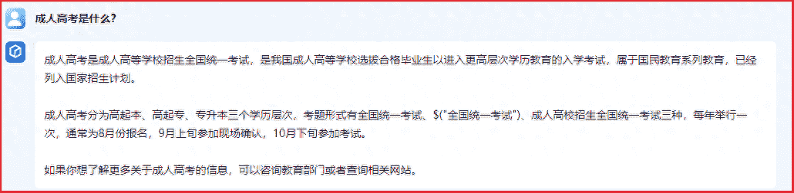

上述**答案会看到范围比较广**，直接涉及**到全国成人高考的基本**概念，如果我们希望将其锁定在公司主营地区，例如河北省，可以询问河北成人高考，但千帆大模型平台给我们提供了更佳的解决方案，也就是上图箭头指向的红色区域， Prompt 模板 或者叫做 Prompt 工程 。

**什么是 Prompt 工程**

Prompt 工程即指针对于 Prompt 进行结构、内容等维度进行优化的 AI 技术，它把大模型的 输入限定在了一个特定的范围之中，进而更好地控制模型的输出 。

**Prompt 工程的作用，就是 通过提供**清晰和具体的指令，引导模型输出生成高相关、高准确且高质量的文本对答内容 ，属于自然语言处理领域突破的重要工程。

**通读上述概念之**后，提炼出其核心 6 字要点， 控制模型输出 。

点击 Prompt 模板，首先映入眼帘的是千帆大模型平台内置模板。

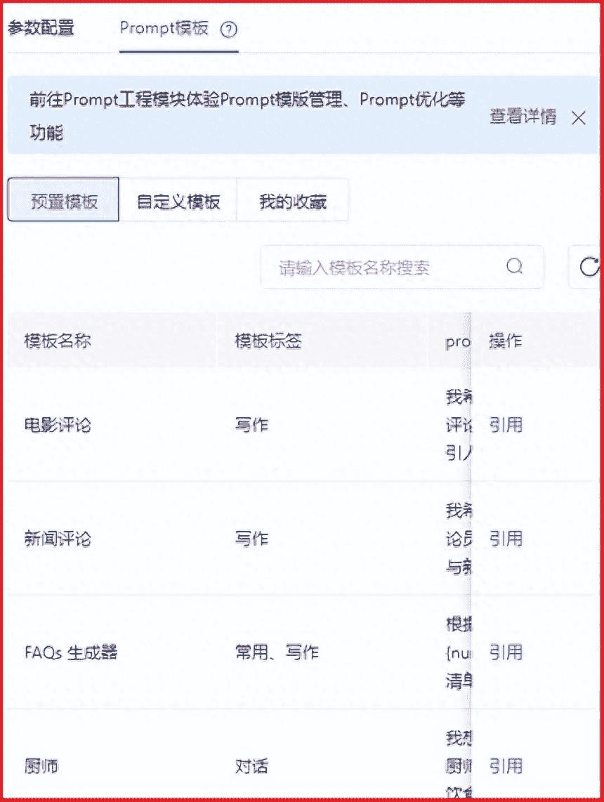

更多 Prompt 模板可以在列表页查询，目前提供了 103 种预置模板（还在不断扩充中），阅读模板的过程可以让我们学习到 Prompt 大模型的指令如何编写。

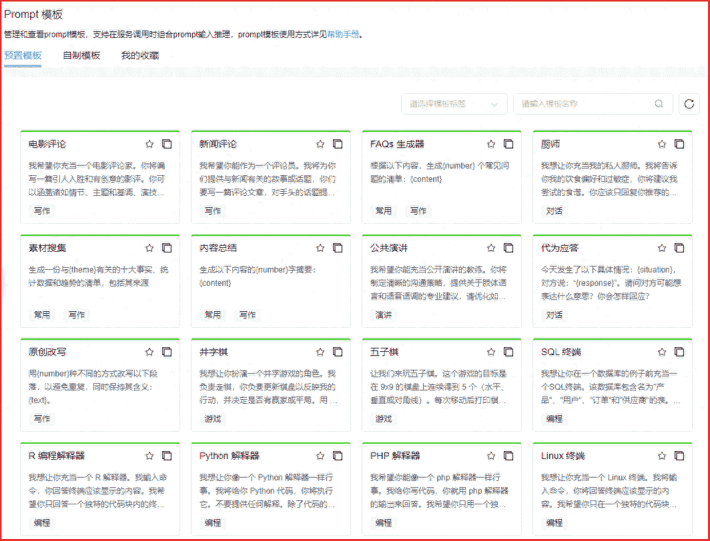

随机选择一个预置模板，例如电影评论，点击引用，在弹出的对话框中，可以看到千帆内置了更加详细的问题描述。

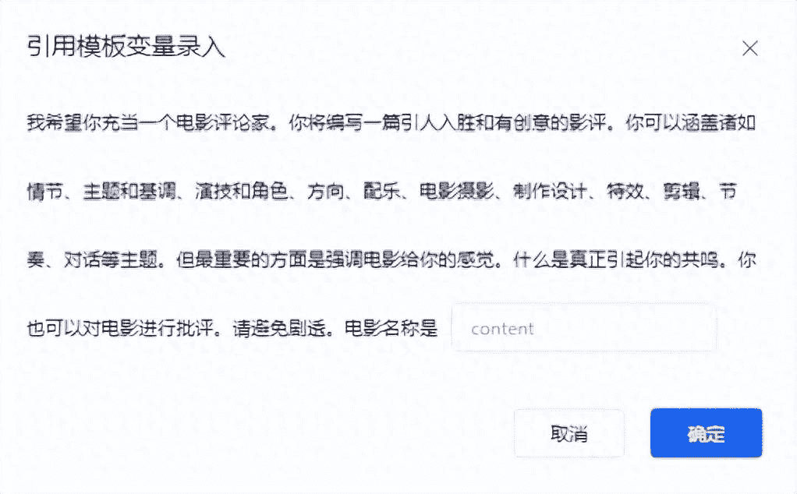

**此时再次向人工智能语言模**型提问，会发现其 答案更具连贯性和准确性 。

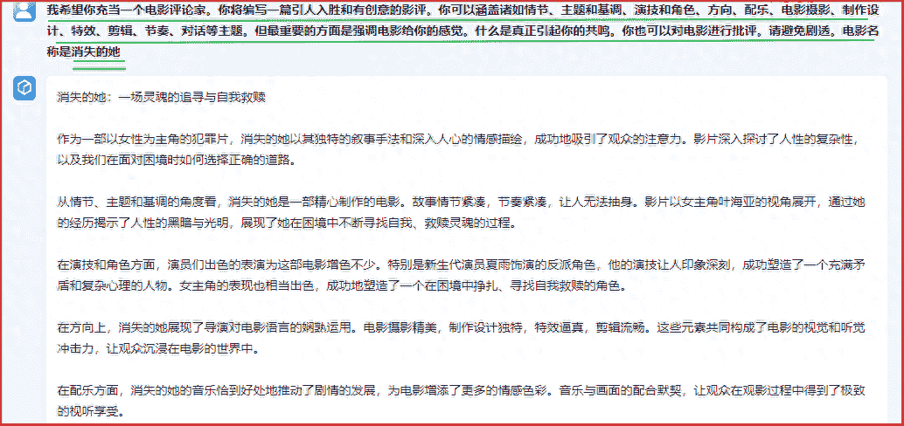

由于我们是教育行业，并且 **限定范围是成人高考项目 **，所以可以自定义 Prompt 模型。

从下图 2 个入口都可以进入 Prompt 模型：

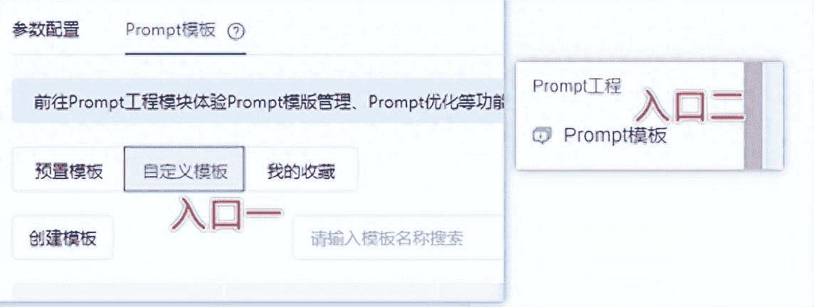

进一步控制问答范围，描述 Prompt

按照下图所示内容，编写 Prompt，控制输入内容。

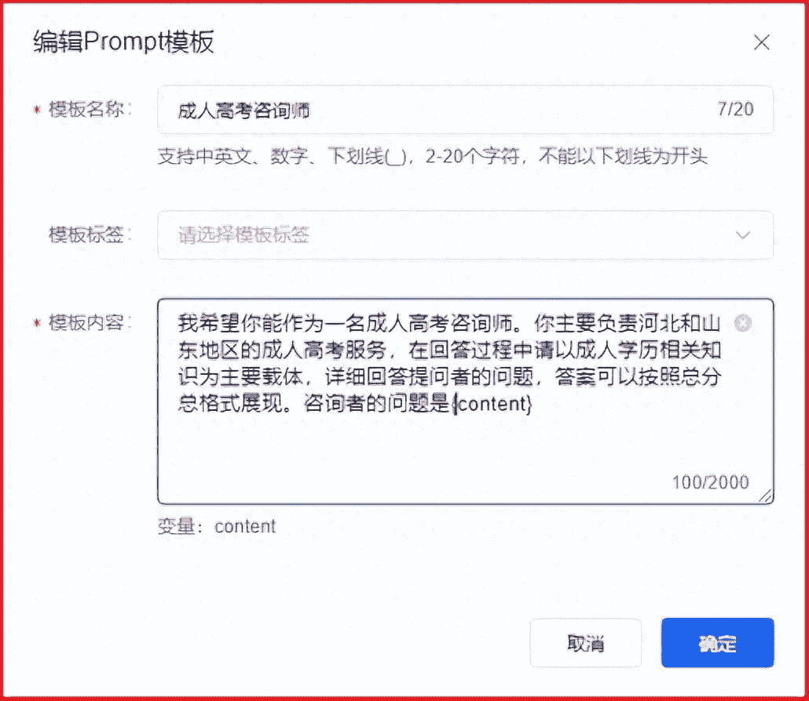

模板内容：我希望你能作为一名成人高考咨询师。你主要负责河北和山东地区的成人高考服务，在回答过程中请以成人学历相关知识为主要载体，详细回答提问者的问题，答案可以按照总分总格式展现。咨询者的问题是{content}。

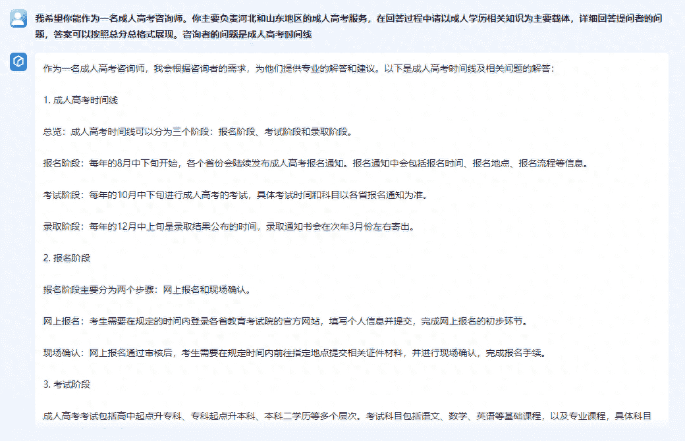

基于 Prompt 模板给出的答案速度快，详细，并且锁定在河北、山东二个地区的成考，将上述内容发送给我们高级咨询师，得到了咨询师的高度肯定。

> 关于 Prompt 的使用技巧可以在这里阅读

> https://cloud.baidu.com/doc/WENXINWORKSHOP/s/7liu76ec4 ，由于我们要的是实战落地，所以 Prompt 使用技巧大家可以继续扩展学习。

现有应用集成千帆大模型平台的 Prompt 工程

在千帆大模型平台控制台配置完毕，即可将其快速应用到实战项目中，橡皮擦已经将其集成到公司知识树项目中，效果图如下。

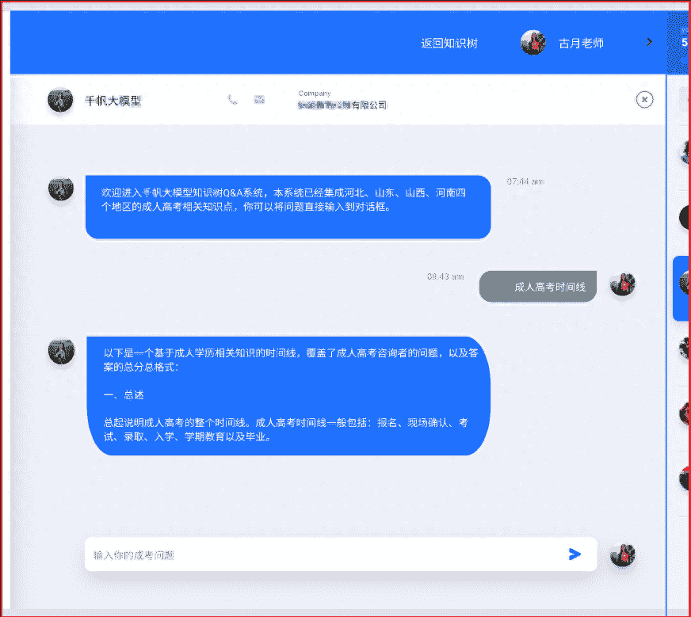

在对接过程中，感受到了千帆大模型平台 Prompt 工程带来的强大便捷性。

这里给大家展示 Prompt 工程对接核心代码。

开发前的准备工作有 2 个：

+   其一是 AccessToken 获取，参考博客：https://ai.baidu.com/ai-doc/REFERENCE/Ck3dwjhhu

+   其二是 Prompt 工程接口获取，查看流程参考下图。

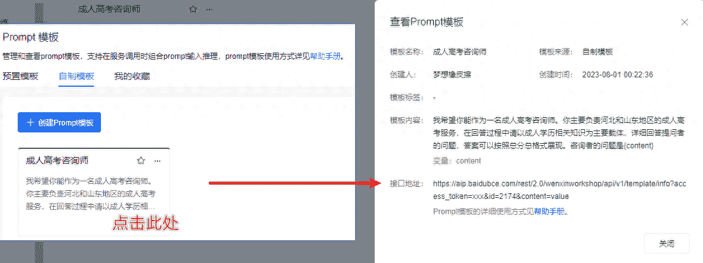

获取 access_token 代码如下所示。

```
import requests
import json


def main():
url = &quot;https://aip.baidubce.com/oauth/2.0/token?grant_type=client_credentials&amp;client_id=替换为自己的AK&amp;client_secret=替换为自己的SK&quot;

payload = &quot;&quot;
headers = {
&#x27;Content-Type&#x27;: &#x27;application/json&#x27;,
&#x27;Accept&#x27;: &#x27;application/json&#x27;
}

response = requests.request(&quot;POST&quot;, url, headers=headers, data=payload)

items = json.loads(response.text)
return items[&quot;access_token&quot;]
if __name__ == &#x27;__main__&#x27;:

access_token = main()
content = &quot;成考时间线&quot;
url = f&quot;https://aip.baidubce.com/rest/2.0/wenxinworkshop/api/v1/template/info?access_token={access_token}&amp;id=2174&amp;content={content}&quot;
payload = &quot;&quot;
headers = {
&#x27;Content-Type&#x27;: &#x27;application/json&#x27;,
&#x27;Accept&#x27;: &#x27;application/json&#x27;
}
response = requests.request(&quot;GET&quot;, url, headers=headers)

print(response.text)
```

此时完成了 Prompt 工程调用，已经生成了问题模板，下面只需要使用 API 与文心一言进行对话交互即可。

> 内置 ERNIE-Bot-turbo 系列最新版模型 ERNIE-Bot-turbo-0725

在上述代码基础上补充如下示例代码即可。

```
ret = json.loads(response.text)[&quot;result&quot;][&quot;content&quot;]

url_content = &quot;https://aip.baidubce.com/rpc/2.0/ai_custom/v1/wenxinworkshop/chat/eb-instant?access_token=&quot; + access_token

payload = json.dumps({
&quot;messages&quot;: [
{
&quot;role&quot;: &quot;user&quot;,
&quot;content&quot;: ret
}
]
})
headers = {
&#x27;Content-Type&#x27;: &#x27;application/json&#x27;
}

resp= requests.request(&quot;POST&quot;, url_content, headers=headers, data=payload)

print(resp.text)
```

更多使用方法可以参考：

https://cloud.baidu.com/doc/WENXINWORKSHOP/s/4lilb2lpf 进行学习。

在后续工作中，可以对 Prompt 进行更加细致的编写，进一步控制大模型的回答范围。

**文心千帆大模型平台实战总结**

实战过后，可以给大家下一个结论，只需 10 分钟，你就能给公司用上大模型，并且研发的工作量不大。

本篇博客重点使用了文心千帆大模型平台中的 Prompt 工程，控制用户输入范围，从而得到更加精准的回答，并将其应用到公司知识树项目中，从熟悉到实践，10 分钟内搞定，非常值得大家推广使用。

相信我，用上本篇博客的功能，10分钟后，领导绝对夸你~