# 2023-08-04接入Llama 2等33个大模型，百度智能云千帆大模型平台重磅升级-今日头条

> 来源：[https://xuqiwei1986.feishu.cn/docx/DoQydfDZgorh1ixsB5xccyDpnfg](https://xuqiwei1986.feishu.cn/docx/DoQydfDZgorh1ixsB5xccyDpnfg)

> 🔗 原文链接： h[ttps://www.toutiao](https://www.toutiao.com/article/7263352684349178405/?log_from=09e3ff04b605b_1691372180058).com/article/726...

>

# 接入Llama 2等33个大模型，百度智能云千帆大模型平台重磅升级

原创 2023-08-04 14:43 · 机器之心Pro

机器之心原创

**作者：张倩**

最近，Meta 开源的 Llama 2 系列模型引发了不小的轰动。这些模型包含 7B、13B、70B 三种版本，最大的 70B 版本性能接近 GPT-3.5，小一点的版本甚至可以在移动端运行，且整个系列都允许商用，有望成为众多大模型应用的底层支撑。很多人预言说，「大模型的安卓时代就要来了」。

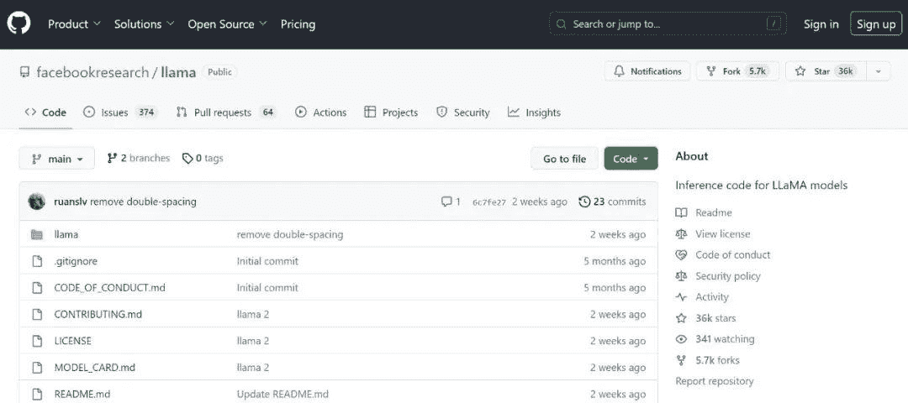

Llama 系列模型的 Github star 量已经逼近 4 万。根据官方消息，自发布以来，Llama 2 一周内就有超过 15 万次的下载请求。

不过**，基于 Llama 2 构建应**用并不只是把它从开源库里下载下来那么简单，模型的后续调优、中文增强、安全评估、与外部数据的融合、推理算力消耗等都是摆在开发者、企业面前的现实问题。这也是当前很多大模型的共性问题。 大模型和应用之间需要一座桥梁。

在国内， 百度智能云的千帆大模型平台正在努力作好这个角色。

该平台 **以百度自研的文心大模型为核心，还支持 ChatGLM2、RWKV、MPT、Dolly、OpenLlama、Falcon 等**第三方大模型。而且，刚刚发布十几天的 Llama 2 也已经在他们的模型库中上线（7B、13B、70B 三种版本都有）。

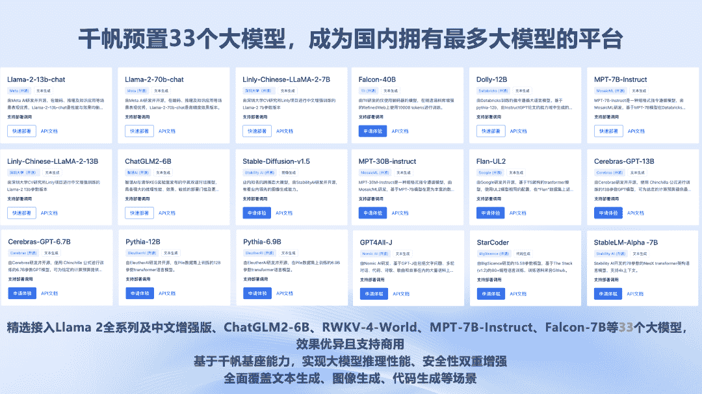

再加上，千帆本身就是一个 从数据管理、训练**调优到大模型发布的一站式工**具链平台 ，刚刚还新增了 预置 Prompt 模板 ，所以，利用这个平台构建基于 Llama 2 等大模型的应用变得非常简单、高效，其效果也将明显区别于直接调用原生开源大模型。

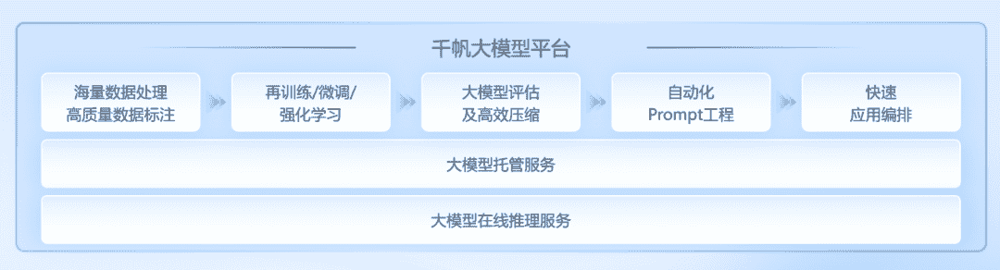

在这篇文章中，我们将走近这一平台，看看它到底有哪些功能。

千帆大模型平台：大模型落地加速器

打开千帆平台，可以看到它的左侧罗列了很多功能模块，包括 数据服务、大模型训练、大模型管理、大模型服务 以及最近新增的 Prompt 模板。这些都是为了加快大模型的落地应用而设计的。

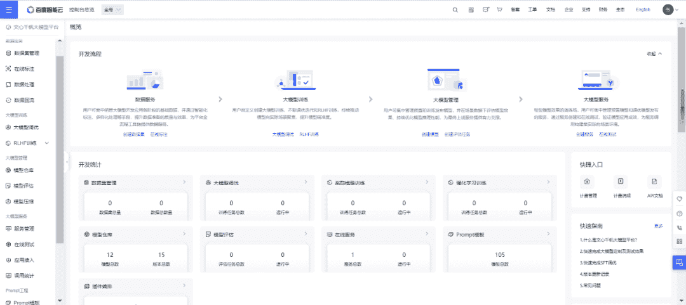

在应用端，很多人对于大模型的感知来源于 ChatGPT 等提供的一个对话框。一开始，大家会觉得这个对话框几乎是万能的，想问什么就问什么。但时间一长，人们也发现了各种问题， 有很多个性化需求无法得到满足，尤其是企业需求 。

这些企业有一部分想要用更低的成本调用效果依然不错的大模型，希望利用有限的算力获取更大的价值，最好有一个模型库可以选择，还要有配套的「说明书」；还有一部分希望基于某些强大的开源模型训练自己的行业大模型，追求高效的训练、部署方法以及更低的成本。当然，他们也有一些共同的诉求，即克服大模型的一些固有缺陷，比如可能输出有害或违反法律法规的内容，信息的时效性有所延迟，无法原生地结合企业个性化信息等。

这些问题的解决方案都藏在上面提到的那些功能模块里。

**首先，在基础模型的选择上，为了**确保模型的可靠**性，千帆以 模型**效果、模型安全性、可商用 为指标严选了 33 个大模型 。这些大模型各有所长，比如 Llama2 7B 体积较小，RWKV 擅长处理长文本。企业可以根据不同细分场景的业务需求，把这些模型组合起来使用。

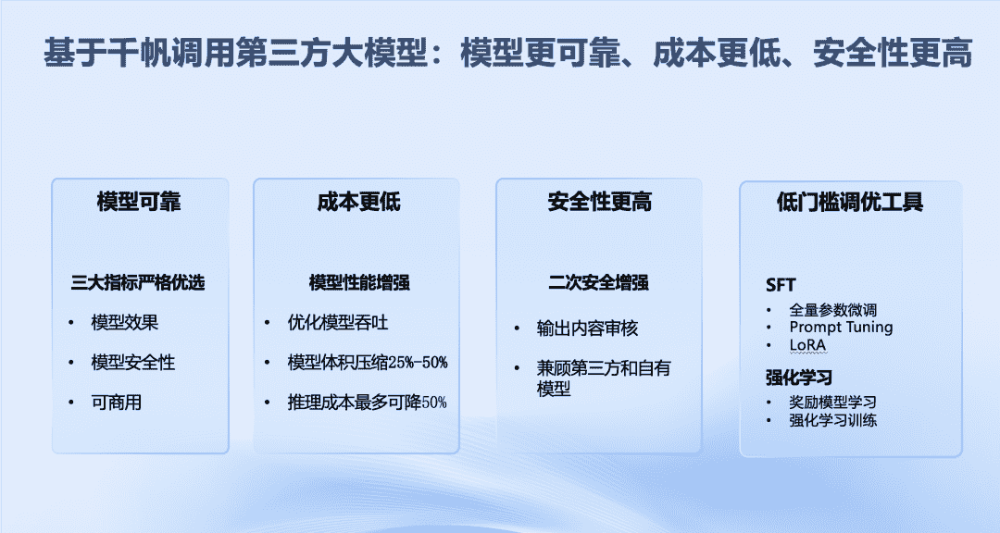

**此外，千帆还对这** 33 个大模型进行了 性能 + 安全 的双重增强。

其中，性能的增强通过优化模型吞吐、降低模型尺寸来实现，调优后模型体积可压缩至 25%-50%，推理成本最多可降低 50%，与直接调用或部署第三方开源模型相比更经济。

安全增强是指对输出的内容进行审核，确保其安全合规，这项功能兼顾第三方和自有模型，大大降低了企业直接调用、部署第三方开源模型可能面临的风险。

当**然，除了直接调**用外，企业还可以对这些模型进行训练、调优，定制自己**的专属大模型。在这一过程中，千**帆不仅支持传统的 全量参数更新 ，还支持 prompt tuning、LoRA 等只更新部分参数的高效微调方法。同时，为了让模型更好地与人类意图对齐，它还支持 人类反馈强化学习（RLHF） 训练。

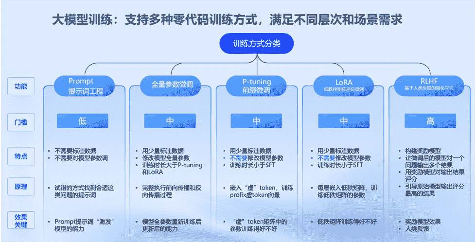

众所周知，RLHF 训练是一件费时费力的事情，就连 Meta 在第一版 Llama 模型中都没有着重进行这项训练。但在千帆大模型平台的页面上，我们能够很容易地找到一套完整的训练流程，这可能成为很多企业、开发者大幅提升开源模型性能的关键。这点在 Llama 1 到 Llama 2 的进化中已经得到了证明，Meta 的研究人员在 Llama 2 的论文中指出，RLHF 非常重要，模型的出色写作能力基本上是由 RLHF 驱动的，它不只是一种安全工具，更是一种提高模型能力上限的训练方法。

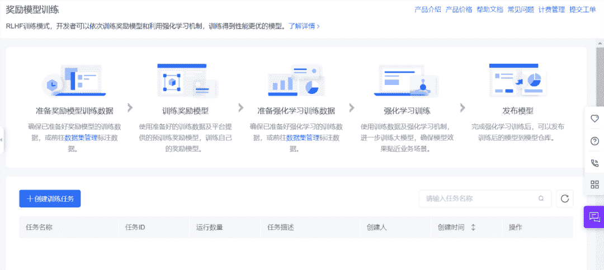

具体到每个训练步骤，千帆都配套了相应的工具，包括 13 种数据清洗及增强算子以及严密的数据回流设计 。

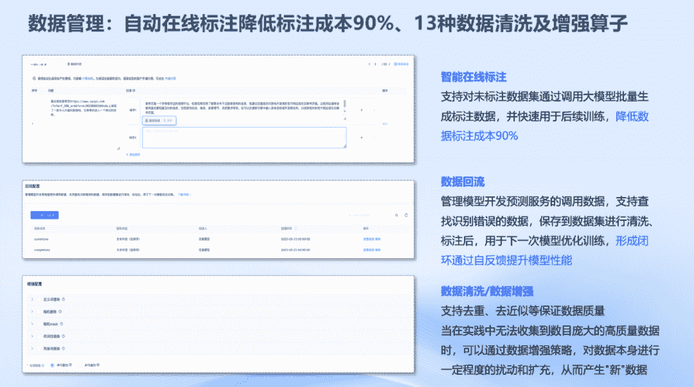

为了降低训练成本，千帆在数据服务中提供了 答案自动生成功能和智能在线标注 ，而且支持带排序的标注功能，让想要进行这项训练的开发者、企业可以借助一套自动化的工具来高效、低门槛地完成。

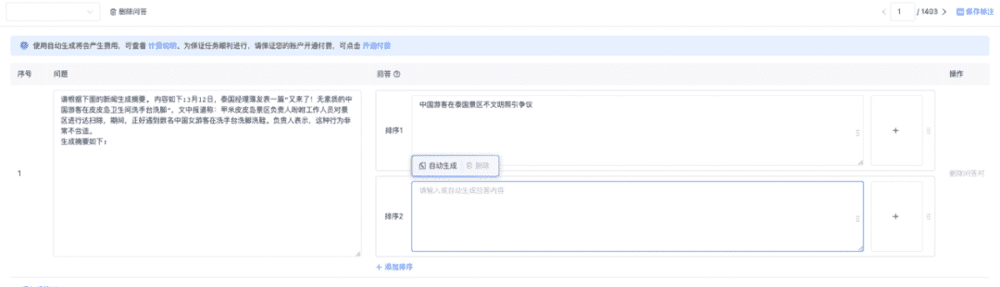

除了强大的模型库，Prompt 模板也是千帆本次更新的重点。

Prompt 有多重要？相信每个用过 ChatGPT、文心一言的人都深有体会。在工业界，Prompt 工程已经成为一个热门的就业方向。

为什么要专门招人做这件事？因为对于企业来说，大模型就像一个强大但没有说明书的机器，需要一个非常了解大模型技术特点的人来总结其使用方法。

千帆此次发布的 103 款 prompt 模板 有望在一定程度上减轻企业这方面的负担。这些模板包含 对话、编程、电商、医疗、游戏、翻译、演讲 等十余个场景，企业既可以直接调用，也可以借鉴模板思路进行改写。

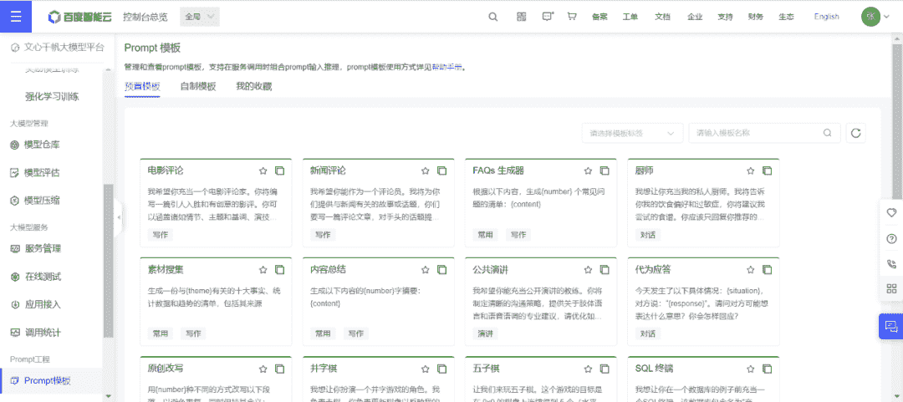

**从**这些功能模块中，我们可以看出千帆平台创建的初衷： 他们希望企业在将大模型引入业务的时候不用再到处找工具，在一个平台上就可以把所有问题都解决掉，从而加快大模型在产业界的落地速度 。平台的这次密集更新让他们离这一目标更近了一步。

目前，平台新增的 Prompt 模板已经开放内测，机器之心在千帆后台，选择平台接入的某个大型语言模型进行了测试（模型生成结果仅供参考，可能存在纰漏）。

**Prompt 模板上手体验**

打开「Prompt 模板」模块可以发现，模板列表位于对话框的右侧，找到想用的模板，选择「引用」，即可将模板复制到对话框。

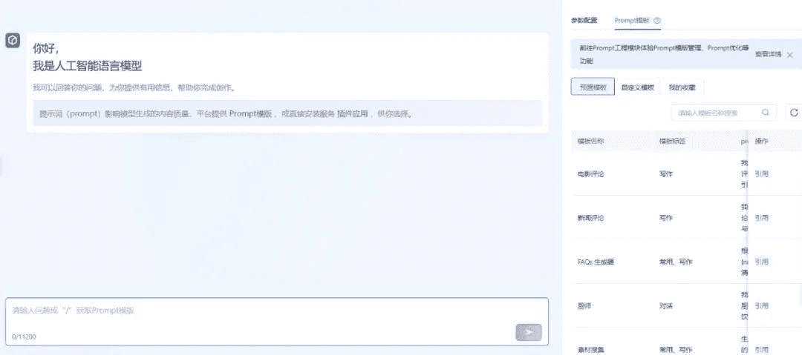

在这里，我们以机器之心高频的素材收集任务为例，看看使用模板前后的效果差异。

比如，在报道最近大火的「室温超导」话题时，我们想搜集一些有关该话题的科普素材。如果随便问一个问题，效果是这样的：

> 问：室温超导是什么？

>

> 答：室温超导是指可以在高于零摄氏度的温度下产生超导现象的材料。相比其他的超导体，室温超导体的条件是日常较容易达到的工作条件。一旦室温超导得以实现，将彻底改变电力和电子工业，使电力传输不受任何阻力影响，从而带来前所未有的效率和技术进步。

但调用了千帆提供的素材收集模板后，我们得到了更全面的信息：

> 问：生成一份与室温超导有关的十大事实、统计数据和趋势的清单

>

> 答：1. 超导材料可以在零电阻下工作，因此不会损失任何电能。这一特性使得超导材料在电力传输、电子设备和磁悬浮等领域具有巨大潜力。

> 2. 目前已经发现许多超导材料，包括元素、合金、化合物和有机物。其中一些已经在实验室中实现了高温超导，但大多数需要在极低温度下工作。

> 3. 室温超导是一种在室温下表现出超导性的材料。目前尚未找到在室温下具有超导性的纯元素，但已经发现一些合金和化合物可以在室温下表现出超导性。

> 4. 在过去几十年中，科学家一直在寻找室温超导材料，但尚未取得重大突破。尽管如此，最近的一些发现为室温超导的研究开辟了新的方向，包括使用金属氧化物和有机材料等。

> 5. 超导材料的超导性是由其电子行为所决定的。了解电子如何在材料中移动和相互作用是开发新型超导材料的关键。

> 6. 超导材料对于磁场的反应非常强烈，这使得它们在磁悬浮、核磁共振成像和磁力计等方面具有重要应用。

> 7. 超导材料在技术上的应用需要克服许多挑战，包括成本、生产技术和稳定性等。

> 8. 超导材料在能源领域的应用包括高效电力传输、发电机和电动机等。这些应用可以大大减少能源损失和碳排放。

> 9. 随着研究的不断深入，超导材料的温度限制不断提高。目前，最高的超导转变温度是约200开尔文。

> 10. 超导材料的研究已经导致了多个诺贝尔物理学奖的获得，包括1972年的迈斯纳奖、1987年的高温超导奖和2003年的高温超导奖。

借助模板，我们还可以让大模型提供写评论的参考角度：

> 问：我希望你能作为一个评论员。我将为你提供与新闻有关的故事或话题，你要写一篇评论文章，对手头的话题提供有见地的评论。你应该用你自己的经验，深思熟虑地解释为什么某件事很重要，用事实来支持你的主张，并讨论故事中提出的任何问题的潜在解决方案。主题是：韩国研究者声称发现常压室温超导新材料

> 答：韩国研究者声称发现常压室温超导新材料，这一发现引发了全球科学界的关注和热议。对于这一话题，我深感兴奋并认为这一发现具有深远的意义和影响。首先，常压室温超导新材料的重要性不言而喻。超导材料可以在无电阻状态下传输电能，从而大大提高能源传输效率。这一发现有望解决当前能源传输损耗问题，并带来能源利用的革命性变化。此外，常压室温超导新材料还可以应用于电子设备、磁悬浮系统等领域，推动相关技术的进步和发展。

> 对于这一发现的深远影响，我认为主要有以下几个方面。首先，能源传输效率的提高将有助于减少能源浪费，降低碳排放，推动绿色能源的发展。其次，新超导材料的发现将促进相关产业的发展，带动经济的增长。最后，这一发现还将推动科学技术的发展，为人类探索未知领域提供新的思路和动力。当然，这一发现也提出了一些问题。例如，新超导材料的制备和大规模应用需要克服许多技术难题。此外，超导材料的成本也是一个问题，需要研究如何降低成本，以便更广泛地应用。

> 针对这些挑战，我认为应该加强研究，探索新超导材料的制备方法和大规模应用技术。同时，还应积极开展相关技术的研发和创新，为新超导材料的广泛应用提供技术支持。总之，韩国研究者的这一发现对于人类社会的发展具有深远的影响和意义。我们应该关注这一领域的发展，并积极投入研究，为未来的科技进步做出贡献。

由于两个模板应用起来比较高频，我们选择把它们加入「我的收藏」，节省查找时间。

此外，我们发现，千帆还支持自定义模板功能。于是，我们把平时积累的一些高效 Prompt 创建成了模板，让模型更好地提供翻译建议，结果非常令人满意，大大节省了每次重新编辑 Prompt 的时间。

> 问：你是一位深度学习专家，同时精通中英翻译，我需要你帮我翻译一篇深度学习论文。Transformer、LLM、token等专业名词不需要翻译。你可以对翻译结果进行润色，使其更符合中文表达习惯。开始翻译:

> Despite the advancements of open-source large lanquage models (LLMs) and their variants, e.g, LLaMA and Vicuna, they remain significantly limited in performing higher-level tasks, such as following human instructions to use external tools (APls).

> This is because current instruction tuning largely focuses on basic language tasks instead of the tool-use domain. This is in contrast to state-of-the-art (SOTA) LLMs, e.g, ChatGPT, which have demonstrated excellent tool-use capabilities but are unfortunately closed source.

> 答：尽管开源大型语言模型（LLM）及其变体（例如Llama和Vicuna）取得了进步，但它们在执行高级任务方面仍存在显著限制，例如遵循人类指令使用外部工具（API）。这是由于当前的任务调整主要集中在基本语言任务，而不是工具使用领域。与最先进的（SOTA）的LLM，例如ChatGPT，形成对比，它已经展示了出色的工具使用能力，但不幸的是它是闭源的。

**升级背后的思考**

在媒体交流会上，千帆的工程师将千帆大模型平台的未来发展方向概括为 更易用、更全面、更安全、更高效、更开放，更扩展 ，这也是我们在这次升级中能感受到的。

「易用」的感受非常直观。整个千帆的界面看似复杂，但框架清晰，操作简单，而且每个功能模块都搭配了使用文档和操作指引。此外，模型的易用性也随着 Prompt 模板等功能的推出而逐步提升。

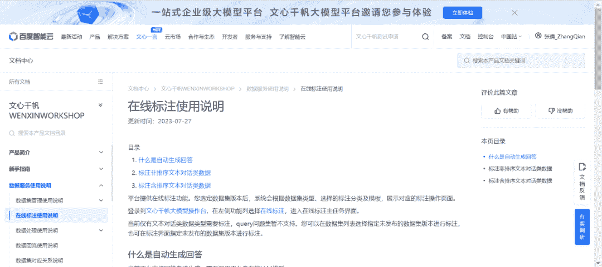

「全面」、「安全」、「高效」、「开放」、「扩展」体现在丰富的模型库和工具链上。这些模型库和工具链既满足了当前的一些「不确定性」需求，也满足了一些「确定性」需求。

不确定性需求指的是，当前大模型还处在发展初期，企业还不确定什么样的模型更适合自己的业务。所以在这个阶段，千帆想通过更加全面、开放的工具链、更多样的模型库来为企业提供更多的选择，在一个繁荣的平台上快速接受市场反馈，然后把这些反馈沉淀下来，利用平台分享出去。

确定性需求指的是企业在降本增效、模型安全性等方面的共性需求，比如在某些场景中，企业并不需要参数量巨大的通用模型，算力要求较低的小模型就能解决问题，所以千帆要为这样的需求配置全面、高效的工具链，完成模型压缩等刚需任务，同时确保模型安全。

基于这样的思考，千帆的技术团队对平台上的模型库和工具链持续打磨，在短短几个月的时间内就实现了数次迭代，将大模型的强大能力持续输送到各行各业。在未来几个月，我们还将看到这一平台带来更多的惊喜。