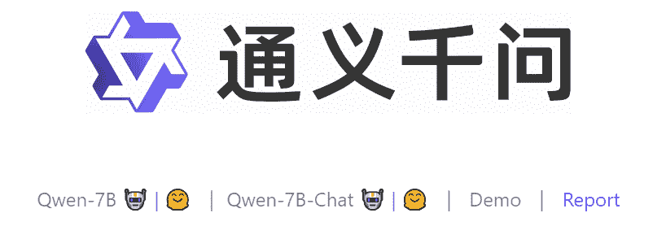
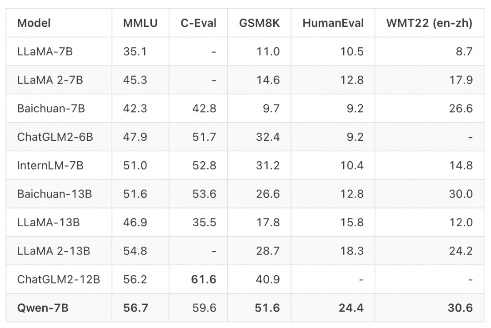

# 2023-08-04免费、可商用，阿里云开源70亿参数通义千问大模型-今日头条

> 来源：[https://xuqiwei1986.feishu.cn/docx/EERYdg6EvoZ4BpxbAHBcjlxnnAh](https://xuqiwei1986.feishu.cn/docx/EERYdg6EvoZ4BpxbAHBcjlxnnAh)

> 🔗 原文链接： h[ttps://www.toutiao](https://www.toutiao.com/article/7263400602515178040/?log_from=865c11d7dced3_1691146570040).com/article/726...

>

# 免费、可商用，阿里云开源70亿参数通义千问大模型

2023-08-04 18:00 · 机器之心Pro

机器之心报道

**机器之心编辑部**

> 同等参数最强中英文模型 Qwen-7B 开源了！

大模型的发展趋势，开始朝着开源道路前进了。

众所周知，ChatGPT、GPT-4 等这类明星大模型都是不开源的，与之相对应的，在开源领域，Meta 最近发布的 Llama 2 受到了大家的格外关注，因为这是一个免费且可商用的大模型系列。

今天，开源领域又迎来一个好消息，AI 模型社区魔搭 ModelScope 上架两款 开源模型 Qwen-7B 和 Qwen-7B-Chat ，阿里云确认其为通义千问 70 亿参数通用模型和对话模型。

最重要的是，两款模型都是 **开源、免费、可商用 **的。

+   魔搭 ModelScope：

+   https://modelscope.cn/models/qwen/Qwen-7B/summary

+   https://modelscope.cn/models/qwen/Qwen-7B-Chat/summary

+   Hugging Face 地址：https://huggingface.co/Qwen

+   GitHub地址：https://github.com/QwenLM/Qwen-7B

具体而言：

+   通义千问 - 7B（Qwen-7B） 是阿里云研发的通义千问大模型系列的 70 亿参数规模的模型。Qwen-7B 是基于 Transformer 的大语言模型，在超大规模预训练数据上训练得到。预训练数据类型多样，覆盖广泛，包括大量网络文本、专业书籍、代码等。它是支持中、英等多种语言的基座模型，在超过 2 万亿 token 数据集上训练，上下文窗口长度达到 8k；

+   Qwen-7B-Chat 是基于 Qwen-7B 基座模型的中英文对话模型，已实现与人类认知对齐。

此次开源的代码支持对 Qwen-7B 和 Qwen-7B-Chat 的量化，支持用户在消费级显卡上部署和运行模型。

想要下载模型的用户，既可从魔搭社区直接下载模型，也可通过阿里云灵积平台访问和调用 Qwen-7B 和 Qwen-7B-Chat，阿里云为用户提供包括模型训练、推理、部署、精调等在内的全方位服务。

其实，早在今年 4 月，阿里云就推出了自家自研的大模型通义千问，此次开源的两款模型，大大降低了研究者使用大模型的门槛。这一举动也让阿里云成为国内首个加入大模型开源行列的大型科技企业。

在多个权威测评中，通义千问 7B 模型取得了远超国内外同等尺寸模型的效果，成为当下业界最强的中英文 7B 开源模型。

通义千问 7B 预训练模型在多个权威基准测评中表现出色，中英文能力远超国内外同等规模开源模型，部分能力甚至超过了 12B、13B 大小的开源模型。

在英文能力测评基准 MMLU 上，通义千问 7B 模型得分超过 7B、12B、13B 主流开源模型。该基准包含 57 个学科的英文题目，考验人文、社科、理工等领域的综合知识和问题解决能力。

在中文常识能力测评基准 C-Eval 上，通义千问在验证集和测试集中都是得分最高的 7B 开源模型，展现了扎实的中文能力。

在数学解题能力评测 GSM8K、代码能力评测 HumanEval 等基准上，通义千问 7B 模型也有不俗表现，胜过所有同等尺寸开源模型和部分大尺寸开源模型。

阿里云表示，开源大模型可以帮助用户简化模型训练和部署的过程，用户不必从头训练模型，只需下载预训练好的模型并进行微调，就可快速构建高质量的模型。

随着通义千问的开源，相信会有更多的公司、机构加入到这一行列，为更多的研究者带来便利。