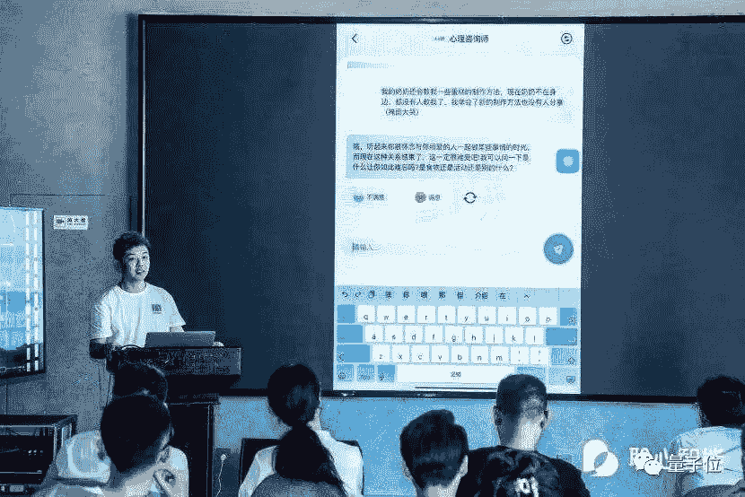
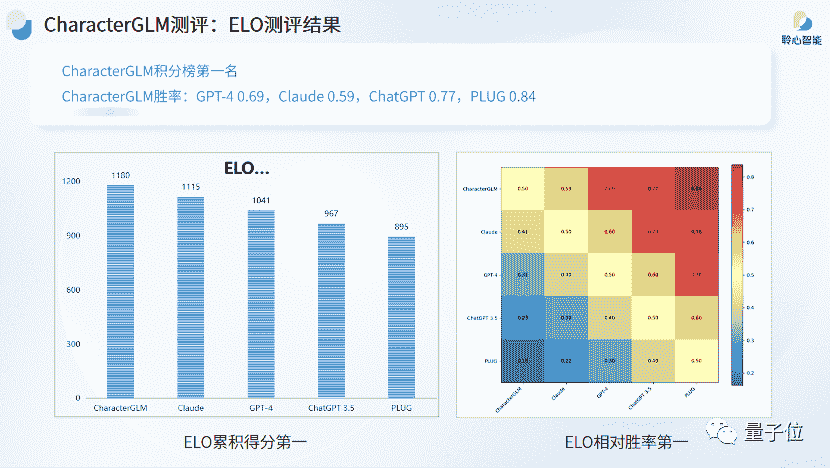
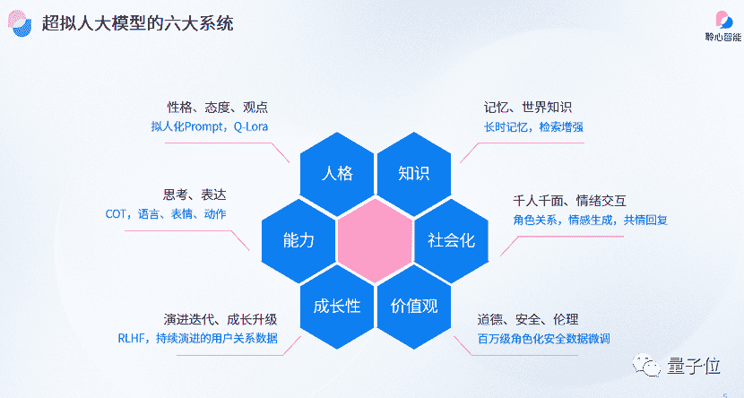
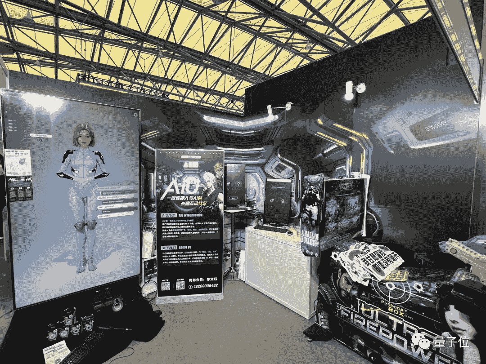
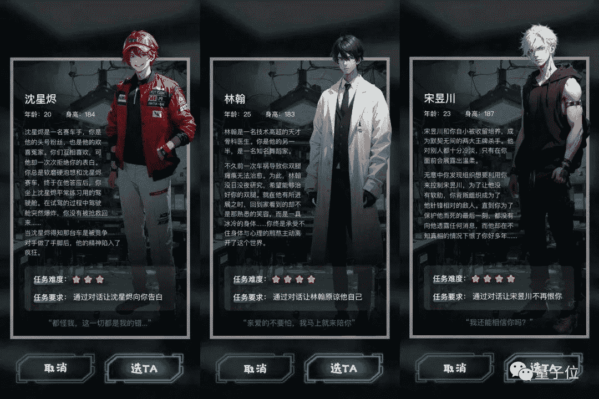

# 2023-08-03Chinajoy惊现清华系大模型公司，「超拟人大模型」驱动AI互动游戏-今日头条

> 来源：[https://xuqiwei1986.feishu.cn/docx/OQCtdRIzZotssjxylcqcxfANnFc](https://xuqiwei1986.feishu.cn/docx/OQCtdRIzZotssjxylcqcxfANnFc)

> 🔗 原文链接： h[ttps://www.toutiao](https://www.toutiao.com/article/7263011874684977683/?log_from=e6768860b4aa9_1691147587488).com/article/726...

> ⏰ 剪存时间：2023-08-04 19:13:18 (UTC+8)

> ✂️ 本文档由 [飞书剪存 ](https://www.feishu.cn/hc/zh-CN/articles/606278856233?from=in_ccm_clip_doc)一键生成

# Chinajoy惊现清华系大模型公司，「超拟人大模型」驱动AI互动游戏

2023-08-03 16:37 · 量子位

> 梦晨 发自 凹非寺

> 量子位 | 👸号 QbitAI

这家清华系AI创业公司的大模型，有点不一样。

**聆心智能 **发布最新“超拟人大模型” **CharacterGLM **。

**与ChatGPT**为代表的“功能型AI”不同， “拟人型AI” 在交流过程中能呈现丰富的立体化“人格”。

不局限表面上“机械性”话术，具有更符合人类逻辑的思考能力、动作表情等非语言信息表达能力、角色的延续性记忆 。

在现场演示中，CharacterGLM驱动的AI心理咨询师等角色也产生富有个性但不失温度的回答，改善“枯燥无味”的聊天感受。

除了现场演示，聆心智能也展示了CharacterGLM的测评结果。

测评并没有采用传统的在固定任务上“刷榜”，而是直接下场与C**hatGPT、Clau**de等顶尖大模型 “ 1v1捉对PK” 。

**数百位志愿者**参与单盲测试，并以棋类运动、电子竞技中常用的 ELO算法 匹配对手和计算成绩。

最终，CharacterGLM超拟人大模型成为积分榜第一名。

在生成质量、角色一致性、有趣性、安全性、幻觉的维度测评中，CharacterGLM超拟人大模型的角色一致性、趣味性居榜首，安全性仅次于GPT-4，生成质量与GPT-4相当。

在用户体验测评中，CharacterGLM超拟人大模型的综合评分最高，是最受用户欢迎并且分享意愿度最高的大模型。

那么这个超拟人大模型究竟有什么秘诀？

# 6大系统，让大模型有人格和情感

超拟人大模型CharacterGLM，在表现出“人格”背后有6大系统支撑。

展开来说，超拟人大模型首先能呈现出丰富的立体化“人格”，展现角色的态度、性格、观点、语言风格等。

“知识”方面，除了接入互联网知识检索外，CharacterGLM超拟人大模型还能够通过实时抽取用户和bot侧信息保存到私有化数据库形成“角色”记忆，根据过往对话内容和角色信息生成更契合角色表现的回复，避免了对话过程中的“灾难性遗忘”；

CharacterGLM超拟人大模型的“能力”包括符合人类逻辑的思考能力和非语言信息表达能力，兼顾思考深度与动作表情等多样表现，改善“枯燥无味”的聊天感受。

借助COAI（清华大学交互式人工智能课题组）多年的共情对话经验，CharacterGLM超拟人大模型还能实现“千人千面”的“社会化”，根据用户实时情绪产生恰当的共情回复。

**六大系统背后，Ch**aracterGLM基于 GLM系列大模型 基座进行了模型的构建升级，在预训练、微调和强化学习的各个阶段进行了优化，实现更优性能。

相比于聆心智能此前全自研的大模型OPD，CharacterGLM继承了GLM基座模型的优势技术，具有更高效率的编码，更长的上下文（Context Length，最大可达32K），更高效率的训练和推理速度等。

得益于聆心智能长期以来积累的海量的场景化、角色化和专业化的多轮上下文对话数据，以及高效率、全流程的大模型工程能力，CharacterGLM超拟人大模型以极短的时间和极高的效率训练出来，并经过了调优和系统化的测评。

# 瞄准大模型应用的蓝海市场

聆心智能2021年成立，孵化自清华人工智能学院的交**互式人工**智能课题组（CoAI），创始人 黄民烈 为清华大学计算机科学与技术系长聘教授。

此次聆心智能全面升级“超拟人大模型”，目的在于提升AI在拟人、个性化和“有温度”方面的能力，能够与人类实现“无障碍”交流，服务于人类需求，尤其是在情感、陪伴等方面的感性需求蓝海市场。

**基于Ch**aracterGLM，聆心智能研发了全新产品 AiU ，目前正在内测中。

AiU是一个 **连接人与AI的兴趣互动社区 **。在社区内，用户可以根据个人偏好创造不同性格与人设的 AI 角色，实现互动聊天、分享美好瞬间。

通过互动，AI角色能够记住用户的喜好和信息，实现用户对“角色”的不断“塑造”，同时，这些AI角色也在时时刻刻“学习”和“感受”外部世界，并发展成自己独特的成长轨迹。

CharacterGLM超拟人大模型已经开启了商业化探索之路，在 社交、教育、文旅、娱乐、营销、健康、直播、客服 等领域布局超拟人大模型服务。

例如提供专业的心理陪伴和咨询、快速配置上线适应多场景的“数字人”、生产游戏剧情和辅助策划等。

在 **数字人 **方面，聆心智能和数字栩生形成了长期合作，将CharacterGLM大模型与数字栩生自研的AIGC数字人智能交互系统相结合，让数字人具备更好的情绪价值，提供更多的情感交流，真正成为人类的贴心朋友。

在 **儿童益智发展 **领域，洪恩AI与聆心智能合作，基于CharacterGLM超拟人大模型联合打造洪恩AI问答2.0。该项目2023年第一季度已上线，以独特的IP角色人设实现“有温度的交流”和“准确的知识引导”，帮助小朋友收获德与智的双面成长。

# One More Thing

在刚刚结束的2023 Chinajoy上，也能找到聆心智能与AiU的身影。

在聆心智能团队设计的沉浸式AI文字对话游戏中，三位主角均以AI为基础而打造， 基于聆心智能自研的超拟人大模型，赋予他们专属性格与灵魂，拥有各自不同的人生经历，玩家则需要通过对话发掘更多线索并完成任务。

— 完 —

量子位 QbitAI · 头条号签约

关注我们，第一时间获知前沿科技动态