# 2023-08-02大模型掌握16000+真实世界API了,清华等机构ToolLLM不输ChatGPT-今日头条

> 来源：[https://xuqiwei1986.feishu.cn/docx/VZxIdIel9omHWIx4LQIcib1znqe](https://xuqiwei1986.feishu.cn/docx/VZxIdIel9omHWIx4LQIcib1znqe)

> 🔗 原文链接： h[ttps://www.toutiao](https://www.toutiao.com/article/7262605328293134860/?log_from=0048114733c43_1691373334532).com/article/726...

>

# 大模型掌握16000+真实世界API了,清华等机构ToolLLM不输ChatGPT

2023-08-02 14:39 · 机器之心Pro

机器之心报道

**编辑：陈萍、梓文**

> 本文提出了一个新的框架 ToolLLM，其增强了大型语言模型对 API 的使用。在指令调优数据集 ToolBench 上对 LLaMA 进行微调，得到的 ToolLLaMA 与 ChatGPT 性能相当。

相信大家都已经见识到了，开源大型语言模型（LLMs）及其变体（例如 LLaMA 和 Vicuna）在各种任务上取得了显著的进展。

然而，尽管 LLM 很强大，但它们在执行更高级任务方面局限性仍然很大，比如让 LLM 按照人类给出的指令使用外部工具（APIs），很多开源 LLM 就很难办到。

原因在于当前 LLM 的指令调优技术主要集中在基本语言任务上，缺乏对工具使用方面的探索。这与最先进的闭源模型如 ChatGPT 形成了鲜明的对比，后者已经展示出出色的工具使用能力。

为了让开源 LLM 更好的使用外部工具，来自清华、人大、耶鲁、腾讯、知乎等多家机构的研究者联合撰写了论文，他们引入了一个通用工具使用框架 ToolLLM，该框架包括数据构建、模型训练和评估多项功能。

值得一提的是，该研究从 RapidAPI Hub 收集了 16464 个真实世界的 RESTful API，涵盖 49 个类别。

该研究在 ToolBench（指令调优数据集）上对 LLaMA 进行微调，得到了 ToolLLaMA。ToolEval（自动评估器）评估显示，ToolLLaMA 展现出了出色的执行复杂指令和泛化到未知 API 的能力，并且在工具使用方面性能与 ChatGPT 相媲美。

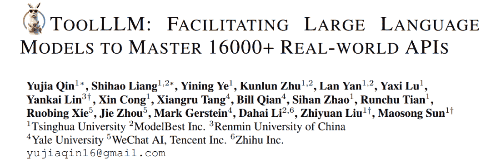

+   论文地址：https://arxiv.org/pdf/2307.16789.pdf

+   项目地址：https://github.com/OpenBMB/ToolBench

ToolLLaMA 效果展示如下：

[🎦 点击观看视频](http://v6-web.toutiaovod.com/76ea48c0f4cc061e3216cf2ef7efbe91/64d05d6e/video/tos/cn/tos-cn-ve-e5b010/oY7wbnnJSeuCl8GWTRbQegImAQMTEa0IHj6eDf/?a=24&ch=0&cr=0&dr=0&er=0&cd=0%7C0%7C0%7C0&br=460&bt=460&cs=0&ds=4&ft=7X_QHBWGUUmf.mdaz0ND1YswHAX1tG39huq9eFQ70Tvr12nz&mime_type=video_mp4&qs=0&rc=ODc3NzY2ODU2ZmU3PDY3M0BpamdwOGg6Zjd5bTUzNDs6M0BiMF5fLzQ1NV8xYS42L2BfYSNoc2hmcjQwYzFgLS1kNi9zcw%3D%3D&l=20230807095539D88B75E8CF89CD7B15DA&btag=e00028000&dy_q=1691373339)

**方法介绍**

论文首先介绍了 ToolBench，这是一个用于工具使用的指令调优数据集，由 ChatGPT 自动创建。具体而言，研究团队从 RapidAPI Hub 收集了 16464 个涵盖 49 个类别的真实世界 RESTful API，然后提示 ChatGPT 生成涉及这些 API 的多样化人类指令，涵盖单工具和多工具场景。最后，他们使用 ChatGPT 为每个指令搜索有效的解路径（一系列 API 调用）。为了使搜索过程更加高效，他们开发了一种新颖的基于深度优先搜索的决策树（DFSDT），使 LLMs 能够评估多个推理轨迹并扩展搜索空间。

在数据集方面。如图 1 所示，研究者首先收集了一些高质量的指令调优数据集 ToolBench。该数据集是通过使用最新的 ChatGPT（gpt-3.5-turbo-16k）自动构建的。

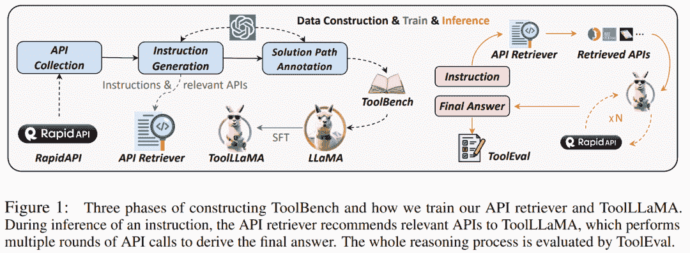

具体而言，ToolBench 的构建包含三个阶段：API 收集（API collection）、指令生成、解路径注释（solution path annotation）。

**API 收集**

研究团队从 RapidAPI 收集了 16464 个 REST（representational state transfer）API。这些 API 涵盖 49 个不同类别，如社交媒体、电子商务和天气。对于每个 API，研究团队都会从 RapidAPI 抓取详细的 API 文档，包括功能描述、所需参数、API 调用的代码片段等。他们希望 LLM 能够通过理解这些文档来学习使用 API，从而使模型能够泛化到训练过程中未见过的 API。

注：RapidAPI 是一个领先的 API 市场，它将开发者与成千上万的真实世界 API 连接起来。在这个平台上，开发者只需注册一个 RapidAPI 密钥，就可以发现、测试和连接各种 API。

RapidAPI 的层级结构 (左) 和指令生成过程 (右) 如下图所示。对于每个工具，研究者会爬取以下信息：工具的名称和描述，主机的 URL，以及属于该工具的所有可用 API；对于每个 API，研究者会记录其名称、描述、HTTP 方法、必要参数、可选参数、可执行的 API 调用代码片段等。

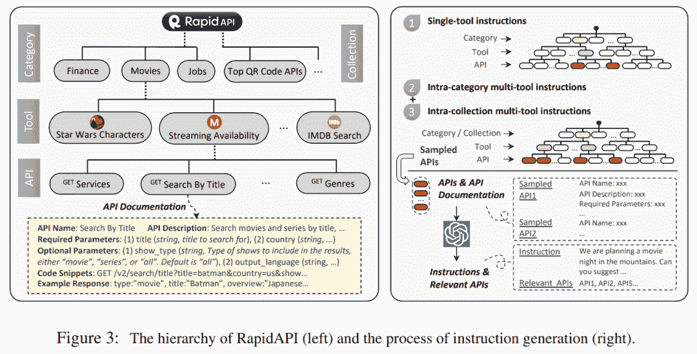

在这一过程中，还需要 API 过滤：最初，该研究从 RapidAPI 收集了 10853 个工具（53190 个 API）。然而，这些 API 的质量和可靠性可能会有很大的差异。为此，他们进行了严格的筛选过程，以确保 ToolBench 的最终工具集是可靠且功能正常的。最后只保留了 3451 个高质量的工具 (16464 个 API)。

**指令生成**

研究团队首先从整套程序中抽取 API 样本，然后使 ChatGPT 为这些 API 生成各种指令。为了涵盖实际场景，他们策划了涉及单工具和多工具场景的指令，这确保了模型不仅能学会如何与单个工具交互，还能学会如何将它们组合起来完成复杂的任务。

生成高质量的指令需要两个重要特性：多样性和多工具使用，以确保 LLM 能够处理广泛的 API 使用场景，并反映现实世界中经常需要多种工具相互作用的情况，从而提高 LLM 的实际应用性和灵活性。为此，研究团队采用了一种自下而上的指令生成方法，即从收集 API 入手，然后精心制作涉及这些 API 的各种指令。

为所有 API 及其组合的指令生成过程如下，具体过程请参阅原文。

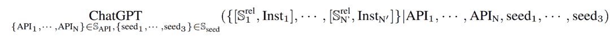

**解路径注释**

研究团队对这些指令的高质量响应进行注释。每个响应可能包含多轮模型推理和实时 API 调用，以得出最终答案。由于工具学习本身的难度，即使是最复杂的 LLM（即 GPT-4），对复杂指令的通过率也很低，从而导致数据收集效率低下。为此，研究团队开发了一种新颖的基于深度优先搜索的决策树（DFSDT），以增强 LLM 的规划和推理能力。与传统的思维链（CoT）和 ReACT 相比，DFSDT 使 LLM 能够评估多种推理路径，并慎重做出决定，以撤回步骤或沿着有希望的路径前进。在实验中，DFSDT 显著提高了注释效率，并成功完成了那些用 CoT 或 ReACT 无法回答的复杂指令。

下图为在模型推理过程中，DFSDT 与传统的 CoT 或 ReACT 的比较 (左)。

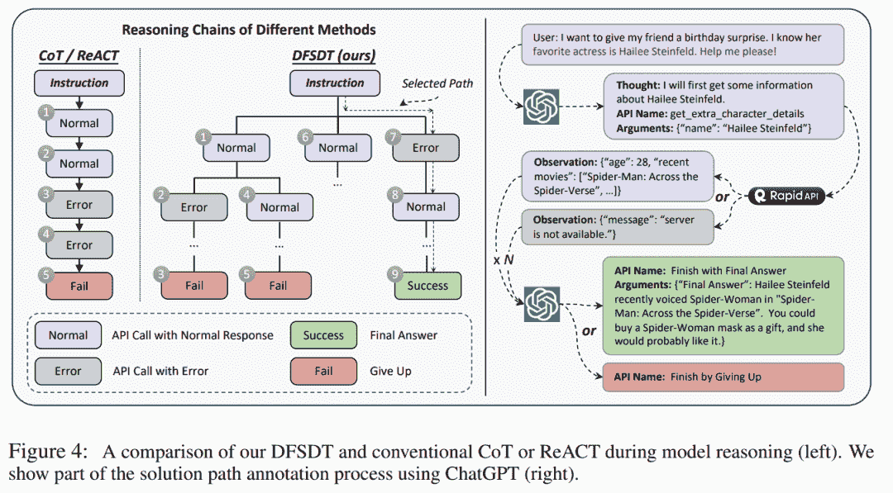

下表为 ToolBench 与其他研究的比较：

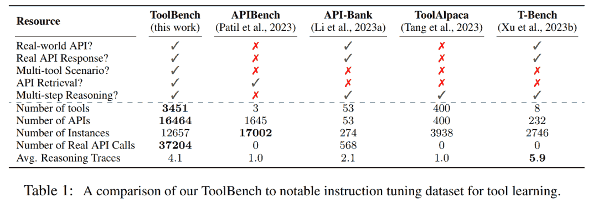

**实验及结果**

本文通过实验来研究了 ToolLLaMa 的性能，报告了 ToolLLaMa 的评估指标、API retriever 和 DFSDT 的有效性以及实验和分析结果。

考虑到 API 的时间可变性，为每条测试指令标注固定的真实解路径是不可行的。此外，确保不同模型在评估过程中使用相同版本的 API 也至关重要。考虑到人工评估可能会耗费大量时间，该研究仿效 AlpacaEval 开发了高效的机器评估工具 ToolEval，其依赖于 ChatGPT 的支持，并包含两个关键评估指标：（1）通过率，用于衡量在有限预算内成功执行指令的能力，以及（2）胜率，用于比较两条解路径的质量和有用性。本文证明 ToolEval 与人类评估有很高的相关性，并为工具学习提供了一个强大、可扩展且可靠的评估方式。

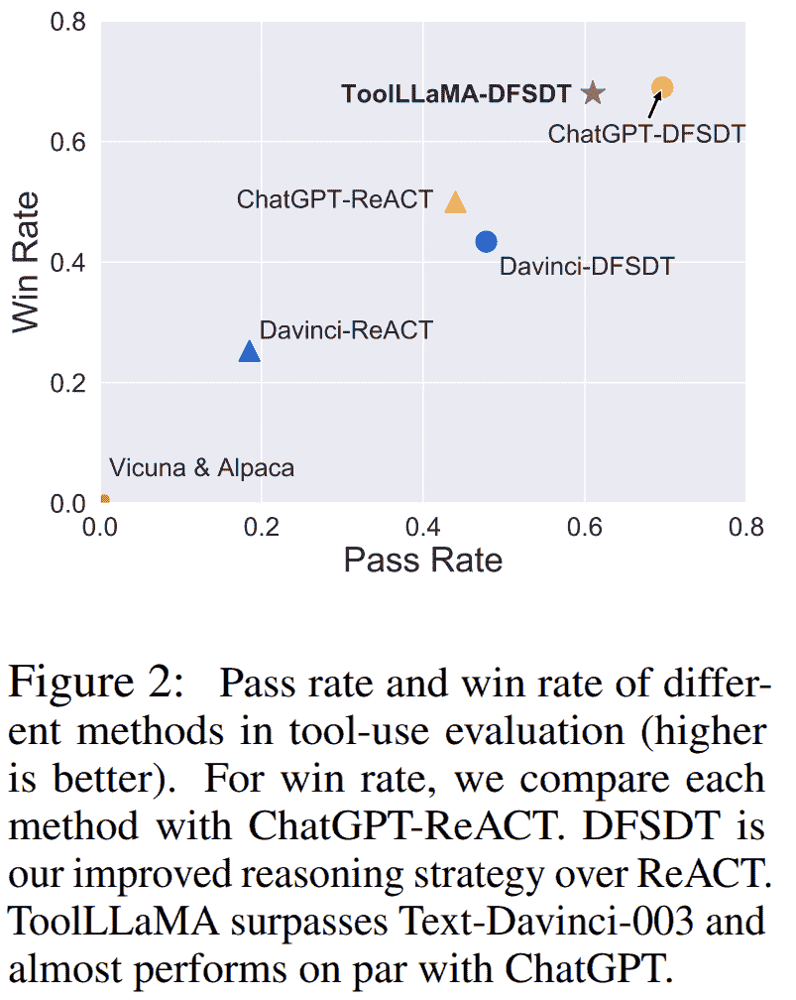

如表 2 所示，在不同类型的指令中，研究团队的 API 检索器始终优于 BM25 和 Ada Embedding。较高的 NDCG 得分表明其在 API 检索方面的有效性。此外，I1 的 NDCG 分数远高于 I2 和 I3，这意味着单工具指令在 API 检索方面比多工具指令相对简单。

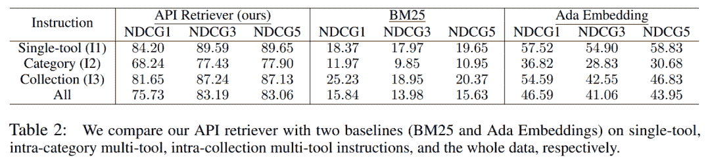

从表 3 可以看出，DFSDT 在所有情况下的性能都明显优于其余两种基线方法，这表明 DFSDT 是一种更有效的方法，可以节省解路径标注的成本。并且与较简单的指令（I1）相比，DFSDT 对较难指令（即 I2 和 I3）的性能提升更为明显。这说明，除了效率之外，DFSDT 还能解决那些困难、复杂的指令，而这些指令是普通 ReACT 无论执行多少次都无法回答的。将此类 「困难示例 」纳入数据集，可以充分激发工具在这些复杂情况下的使用能力。

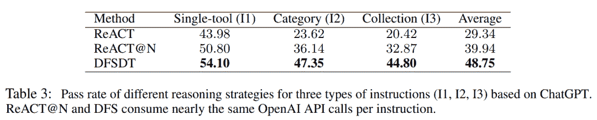

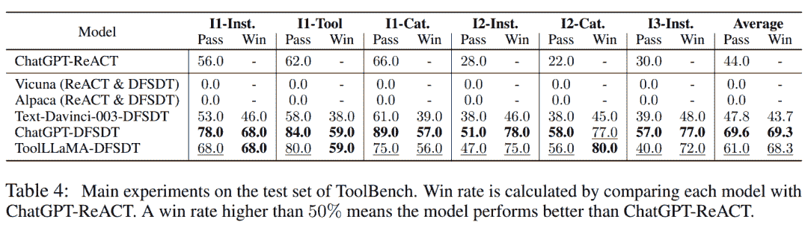

从表 4 中可以发现：

+   ToolLLaMA 在通过率和获胜率方面都明显优于传统的工具使用方法 ChatGPT-ReACT，并表现出卓越的泛化能力。此外，当 ToolLLaMA 与 DFSDT 结合使用时，其表现也优于 Text-Dainci-003。

+   虽然研究团队对 prompt 工程进行了广泛研究，但 Vicuna 和 Alpaca 都未能通过任何指令，这意味着它们的指令遵循能力并未扩展到工具使用场景。这凸显了当前主要侧重于提高语言技能的指令调优方法的不足。

总体而言，ToolLLaMA 在所有场景中都表现出了竞争力，其通过率略低于 ChatGPT+DFSDT。在获胜率方面，ToolLLaMA 与 ChatGPT+DFSDT 的能力基本相当，在 I2-Cat 设置中甚至超过了后者。

总之，这些结果表明，ToolBench 可以充分激发 LLM 的工具使用能力，使他们能够熟练掌握各种指令的未知 API。

在实验研究团队对 LLaMA 的所有参数进行了微调，得到了 ToolLLaMA。为了提高参数效率，他们进一步应用了具有代表性的参数效率调整方法 LoRA，并研究了其对性能的影响。下表 5 中的结果表明，参数效率的提高是在性能权衡的基础上实现的。他们期待未来的尝试能设计出不牺牲性能的前提下实现参数效率的方法。

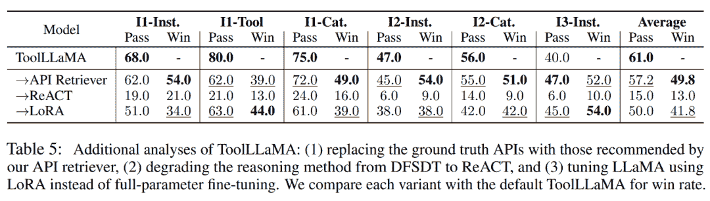

更多详细内容，请参阅原文。