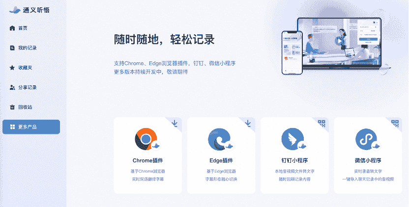

# 2023-08-02阿里云通义听悟上新，新增自动提取PPT等三大功能-今日头条

> 来源：[https://xuqiwei1986.feishu.cn/docx/VrModyAAVoYvzIx45XPcPmi9npt](https://xuqiwei1986.feishu.cn/docx/VrModyAAVoYvzIx45XPcPmi9npt)

> 🔗 原文链接： h[ttps://www.toutiao](https://www.toutiao.com/article/7262606024492728886/?log_from=e56cdd6b5263d_1691147661141).com/article/726...

>

# 阿里云通义听悟上新，新增自动提取PPT等三大功能

2023-08-02 14:21 · 量子位

阿里云大模型应用产品持续升级。8月2日，阿里云通义听悟上线了三大新功能，包括国内音视频AI领域首创的视频自动提取PPT，以及浏览器插件、钉钉和🛰️小程序，帮助用户在PC和移动端随时随地听懂、理解、阅读各类音视频内容，提升职场人士和学生的工作学习效率。

今年6月，阿里云首次宣布通义听悟开放公测，吸引了用户的广泛使用。此次升级，在原有实时记录、音视频文件转写、全文概要、章节速览等功能之上，新增“提取PPT”功能。该功能通过引入视觉AI算法，自动将PPT讲解视频分割为演示文稿，并对每页PPT进行要点总结，形成一份图文并茂的大纲，解决培训、网课学习等场景“求PPT难”的问题。

通义听悟还增加了浏览器插件和移动端的支持。用户开会、上网课、看直播、看视频时，Chrome和Edge浏览器插件功能可全程录制，并实时生成双语字幕，帮助用户更轻松地浏览视频内容。

浏览器插件可实时生成双语悬浮字幕

在移动端，通义听悟钉钉和🛰️小程序不仅支持PC端的基础功能，还可以一键转写手机和聊天记录的音视频文件，仅需一部手机即可记录、回顾和整理音视频内容。

为了让更多用户体验到这些功能，本次新功能上线期间，阿里云继续联合各大平台和社区推出定制口令码，用户根据口令码可随机抽取20h、30h、66h、88h、100h的免费转写时长。

据了解，通义听悟集成了阿里云先进的语音、语言和视觉AI技术，未来还将陆续上线适用于更多场景的新功能。通义听悟产品及研发负责人鄢志杰表示：“继语音AI与大语言模型碰撞出火花后，我们持续将视觉AI引入通义听悟这一创新产品，围绕人们工作和学习中的音视频内容，希望通过全新的体验成为大家的AI助手。”

— 完 —