# 2023-08-02ChatGPT-Next-Web 进阶教程：定制自己的AI助手 - 知乎

> 来源：[https://xuqiwei1986.feishu.cn/docx/PqfbdOMJ9oHeFLxtwDgcZk7inSh](https://xuqiwei1986.feishu.cn/docx/PqfbdOMJ9oHeFLxtwDgcZk7inSh)

> 🔗 原文链接： h[ttps://zhuanlan.zh](https://zhuanlan.zhihu.com/p/647597910)ihu.com/p/647597...

## 导语：

在上一篇文章中，我们介绍了如何在Vercel上部署ChatGPT-Next-Web项目，以搭建个人AI助手。然而，作为开源项目，我们也可以根据自己的需求进行定制化，使其更符合我们的品牌和用户体验。

[外笛：搭建自己的个人AI助手，实现国内直连使用Cha](https://zhuanlan.zhihu.com/p/647494375)tGPT 0 赞同 · 0 评论 文章

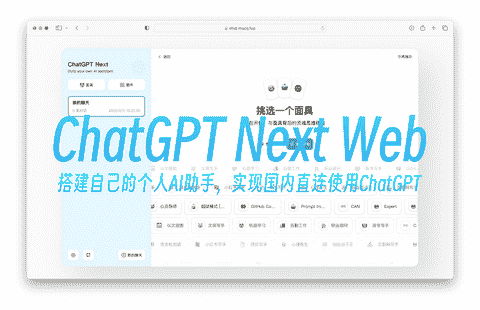

有了定制化的想法，我查阅了ChatGPT-Next-Web项目的代码结构和相关文档，找到需要修改和扩展的部分，并进行相应的定制化操作。同时，我们也可以参考其他人已经定制化的案例，从中获得灵感和指导。

### **案例展示：**

ChatGPT Next Web （B站UP主冻死企鹅）

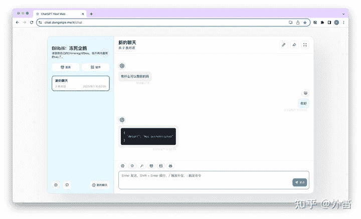

[樱花博客ChatGPT ](https://link.zhihu.com/?target=https%3A//yh.tn/)（樱花博客）

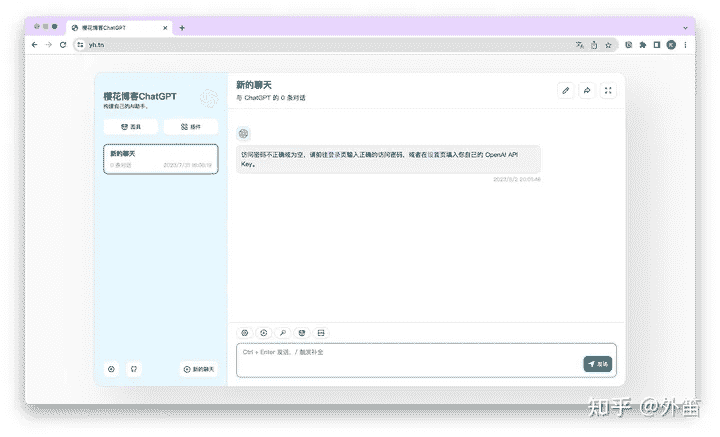

[Kami’s ChatGPT ](https://link.zhihu.com/?target=https%3A//chat.kamiyd.com/%23/chat)（本人网站）

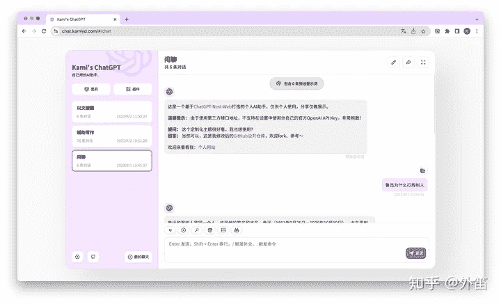

本篇文章将深入探讨如何定制化ChatGPT-Next-Web，包括修改界面样式、定制网站信息，让我们的AI助手与众不同。ChatGPT-Next-Web项目提供了默认的界面样式，但我们可以根据自己的品牌和设计需求进行修改，我们可以更改背景颜色、调整主题样式，甚至添加自定义图标（logo）； 定制新建聊天界面问候语 、导出模板、各种指令语言；修改网站标题、seo信息……，以打造与我们品牌/使用风格一致的界面。

### ⚠️注意：所以代码、文件在自己部署的分支下修改

## 定制主题（界面样式）

### **修改颜色**

①查找文件： **globals.scss **（复制粘贴到搜索框）

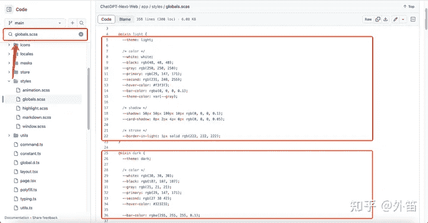

②修改颜色代码，对应的可以参考下图，有亮色、深色两个主题，深色的white和black对应的颜色和亮色的颜色是相反的。

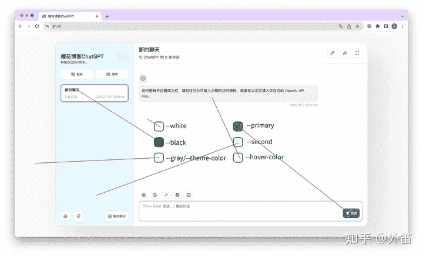

实在不行RGB数值复制到ps里对照一下就知道改动的地方了，你多改几次也就能明白。

### **修改字体**

还**是在这个文件内**修改，给你具体的代码行号可能会随着版本变更而发生变动，所以建议直接使用网页查找功能快捷键“Ctrl+F”搜索关键词 “font” 定位然后记住所在行号进行修改，应该支持谷歌字库。

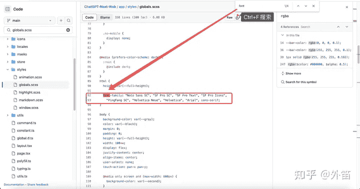

### 修改侧边栏logo

替换app/icons/chatgpt.svg，直接在app/**icons页面上传一个同**名同后缀文件（ chatgpt.svg ）进行替换。

可以在这个网站png转svg： PNG转SVG - 免费在线将PNG文件转换成SVG

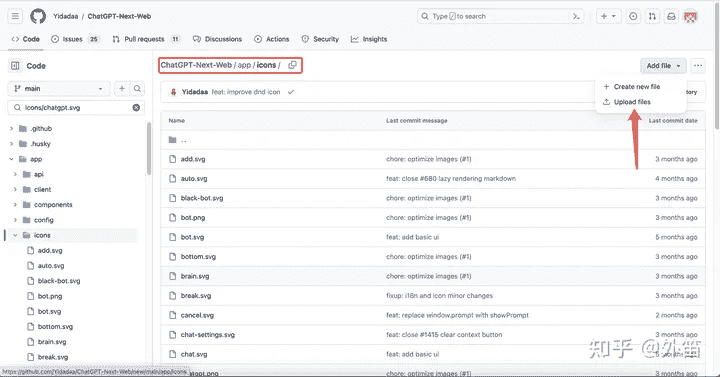

### 修改网站icon（图标）

①在这个网站上传一个图标照片生成一系列图标文件favicon.ico：

[Favicon.io - The Ultimate Favi](https://link.zhihu.com/?target=https%3A//favicon.io/favicon-converter/)con Generator (Free)

②将生成的文件下载、解压

③上传到 **public **文件夹进行替换

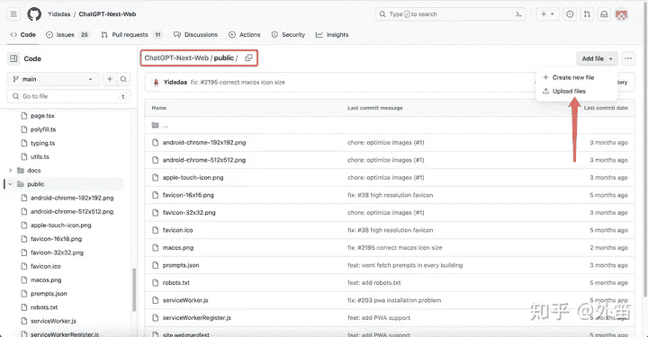

### 修改启动页图标

启动页图标有亮色、深色两个主题，需要替换两个文件

**①在app/ic**ons页面上传一个同名同后缀（ bot.svg ）文件进行替换

**②在app/icons页面上**传一个同名同后缀（ black-bot.svg ）文件进行替换

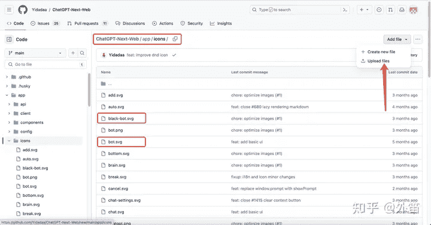

## 定制网站信息

### 修改网站标题、信息

①查找文件： **layout.tsx**

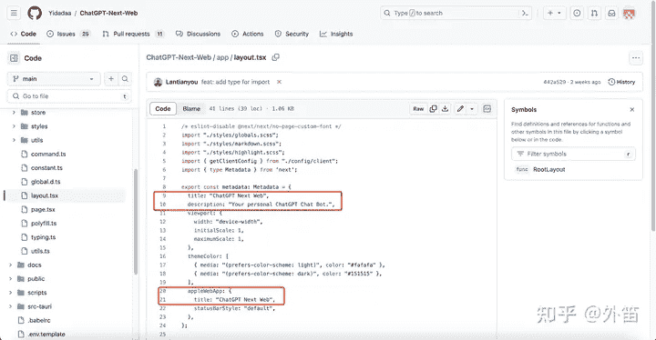

②修改网站标题title、description（描述：seo信息）

### 修改侧边栏标题、副标题

①查找文件： **sidebar.tsx**

②Ctrl+F”搜索关键词“ **sidebar-title **”

③修改侧边栏标题、副标题title

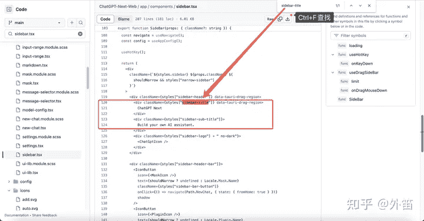

### 修改侧边栏底部的Github按钮和链接

出于对原作者的尊重，我不建议修改，出于满足教学需要讲一下办法

①查找文件： **sidebar.tsx**

②Ctrl+F”搜索关键词“ **githubicon **”

③替换“REPO_URL”为要跳转的链接

**④更换按钮图标，直接在**app/icons页面上传一个同名同后缀（ github.svg ）文件进行替换

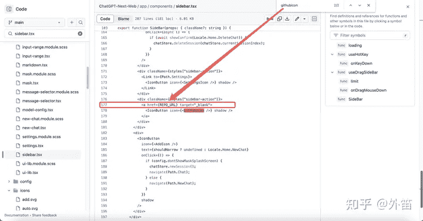

### 定制新建聊天界面问候语

①查找文件 app/locales/cn.ts

②Ctrl+F”搜索关键词“ **bothello **”，修改定制问候语，支持markdown语法（超链接就可以完成引流工作）

③在这个文件内根据需要修改其他指令所触发的话术

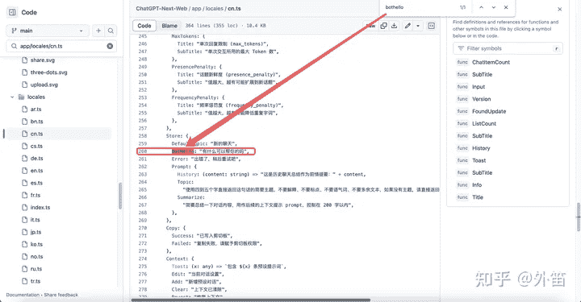

### 修改导出模板

导出模板也是网站归属信息的重要体现。

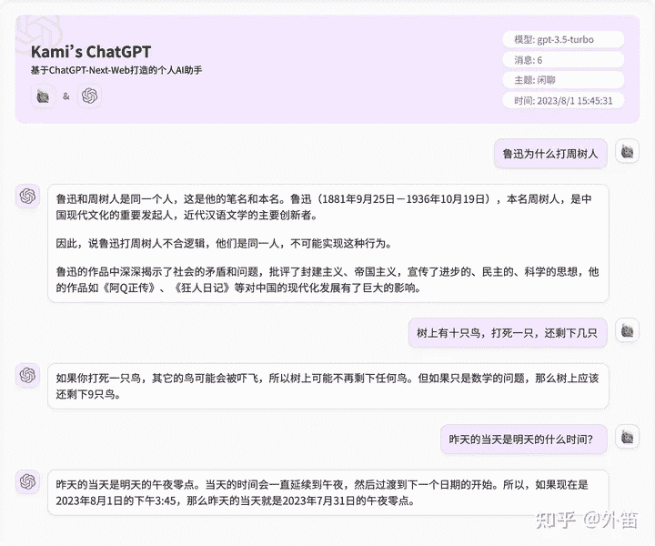

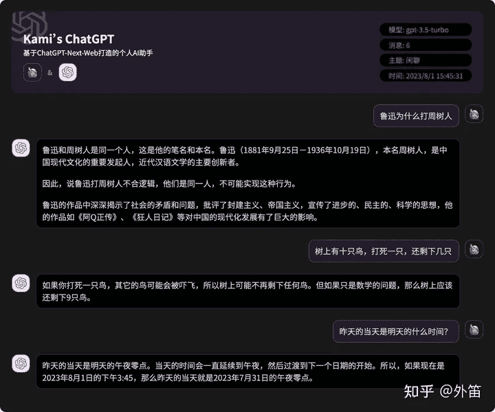

①查找文件 **exporter.tsx**

②Ctrl+F”搜索关键词 **“main-title” **，修改标题、副标题

③替换app/icons/bot.png，直接在app/**icons页面上**传一个同名同后缀文件（ bot.png ）进行替换。【这个文件是导出模板左上角的logo】

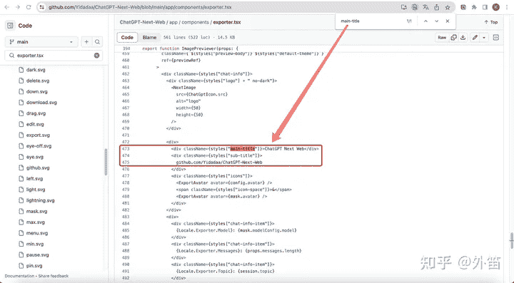

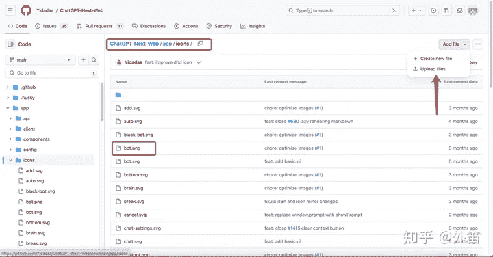

## 结语：

在本文中，我们探讨了如何进阶使用（定制化）ChatGPT-Next-Web项目，以打造符合我们品牌和用户需求的个人AI助手。通过修改界面样式、定制网站信息，我们可以为用户提供独特而有价值的体验。

然而，尽管我们对项目进行了大量修改，我们仍然要非常尊重和感谢原作者的贡献。ChatGPT-Next-Web项目为我们提供了一个强大的基础，使我们能够构建出属于自己的AI助手。原作者的努力和开源精神是我们定制化的起点，我们应该始终保持对他们的尊重和感激之情。

为了向原作者致敬，并保持项目的连贯性和可追溯性，我的网站在问候语、导出模版、网站SEO信息中强调了基于ChatGPT-Next-Web创作的事实。同时，我保留了GitHub按钮跳转链接，以便用户可以访问原项目的源代码和社区。

定制化是为了更好地满足我们的需求和提供独特的用户体验，但我们也要记住开源社区的贡献和合作精神。通过保持对原作者的尊重和感激，我们可以共同推动AI助手领域的发展，为用户带来更好的产品和体验。

## 参考资料：

[https:// github.com/Yidada](https://link.zhihu.com/?target=https%3A//github.com/Yidadaa/ChatGPT-Next-Web)a/Chat GPT-Next-Web

[ChatGPT Next Web增加 K](https://link.zhihu.com/?target=https%3A//www.iyhua.com/453.html)ey 池多 Key 轮询、定制问候语教程

ChatGPT Next Web定制化修改网页标题与图标教程

PNG转SVG - 免费在线将PNG文件转换成SVG

[Favicon.io - The Ultimate Favic](https://link.zhihu.com/?target=https%3A//favicon.io/favicon-converter/)on Generator (Free) ：

发布于 2023-08-02 22:58 ・IP 属地美国