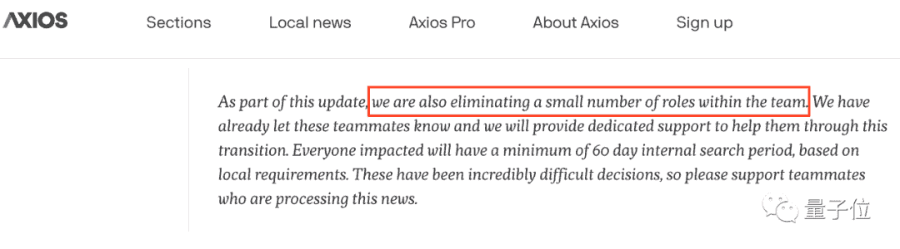
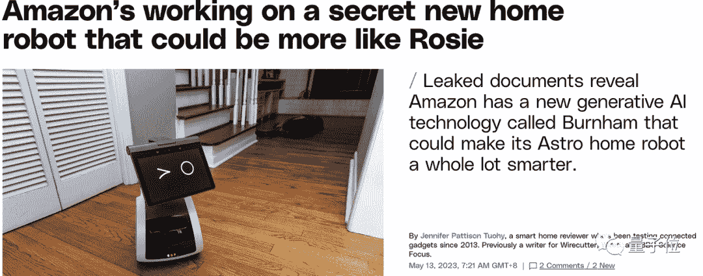

# 2023-08-01谷歌用大模型重写超级助手，为推进度先裁员重组！-今日头条

> 来源：[https://xuqiwei1986.feishu.cn/docx/Rdq8dti2aog5dcx4OfPcNB5Bneb](https://xuqiwei1986.feishu.cn/docx/Rdq8dti2aog5dcx4OfPcNB5Bneb)

> 🔗 原文链接： h[ttps://www.toutiao](https://www.toutiao.com/article/7262210639408464403/?log_from=44e0d350c0067_1691147924306).com/article/726...

>

# 谷歌用大模型重写超级助手，为推进度先裁员重组！

2023-08-01 12:48 · 量子位

> 尚恩 发自 凹非寺

> 量子位 | 公众号 QbitAI

谷歌大模型应用更进一步，智能助手**Google** Assistant将进行 生成式AI 改造！

一封公司内部邮件显示，谷歌将用最新的类似于ChatGPT、Bard等生成式AI技术来赋能Google Assistant。

**另外，为了更**快开展大模型应用，保持竞争优势，谷歌选择 重组和裁员 。

# 裁员专注开发AI

一份由谷歌副总裁Peeyush Ranjan和产品总监Duke Dukellis发出的邮件显示，Assistant团队领导们认为利用大模型技术提升Assistant潜力巨大，因此决定对Google Assistant进行改造。

目前，团队已经开始着手推进工作，首先会是移动端。

**并且，为了**更快速和专注开展研发工作，谷歌表示将会进行 内部重组 。

届时会有数十个职位被裁员，所有受影响的员工将拥有至少60天的缓冲期。

另外，也会有部分团队 **合并或组织架构调整 **。

根据邮件，移动设备应用开发组（Mobile Team）的负责人会变为两位，分别由Google Assistant的“产品管理部门负责人Minni Shahi“和“高级工程师Zaheed Sabur”来领导。

还有像自然语言处理团队、语音团队、服务团队等都会有所调整，包括不限于“合并、更换负责人”。

# 移动端最先赋能

随着大模型技术的发展，谷歌也将其应用于Google Assistant中，进一步提升了其智能对话和交互的能力。

目前，安卓版的Google Assistant已经加入了一项由AI驱动的功能，能够帮助用户快速总结当前网页的内容，便于理解内容。

谷歌表示，未来将进一步在移动版的Google Assistant中引入更多生成式功能。

通过大语言模型技术的引入，移动版将能够更好地理解用户的指令和需求，提供更加个性化和精准的答案。

谷歌发言人Jennifer Rodstrom表示：

> 亿万用户每月都在使用谷歌助理，LLM将会使谷歌助理变得更好。

此外，谷歌还计划进一步拓展Google Assistant的应用场景，使其不仅在手机上有更强大的表现，还能够在其他智能设备上得到广泛应用。

例如，未来可能会将Google Assistant集成到智能音箱、智能手表等设备中，提供全方位的智能化体验。

对此就有网友表示，做为一个智能家居爱好者，很期待！

# One More Thing

除了谷歌，像亚马逊等科技公司也在采取类似行动，加速用生成式AI改造自家产品。

**根据报道，亚**马逊就在计划为语音助理 Alexa 开发一款生成式AI，以便于让内置有Alexa的设备焕发新生。

目前，亚马逊的许多家具设备都配备有Alexa，因此主要聚焦家庭领域。

此前就已有消息表明，亚马逊正在研发家用机器人Astro的升级版，新款将拥有类似ChatGPT的功能，使其更好地理解自己观察到的东西，并更智能地对事物做出反应。

尽管如此，目前很多科技大厂还未成功将大模型应用到智能家居产品上。

另外，也有不少人对这类产品的隐私问题表示担忧。

参考链接：

[1]https://www.theverge.com/2023/7/31/23814702/google-assistant-ai-features-layoffs-bard/

[2]https://www.axios.com/2023/07/31/google-assistant-artificial-intelligence-news/

[3]https://www.axios.com/2023/07/26/amazon-alexa-ai-home/

[4]https://www.tomsguide.com/news/google-assistant-could-soon-use-ai-to-summarize-long-articles/

— 完 —

量子位 QbitAI · 头条号签约

关注我们，第一时间获知前沿科技动态