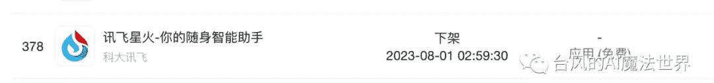
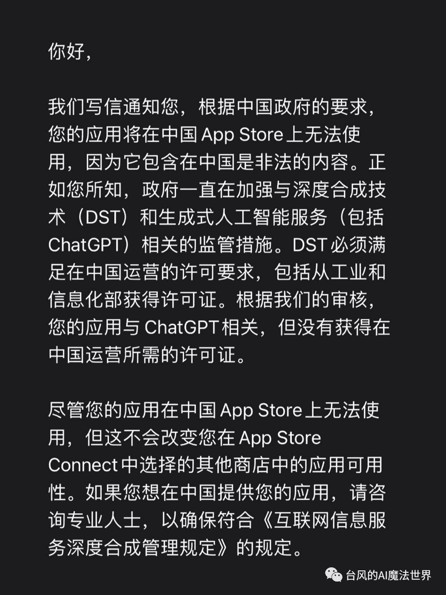
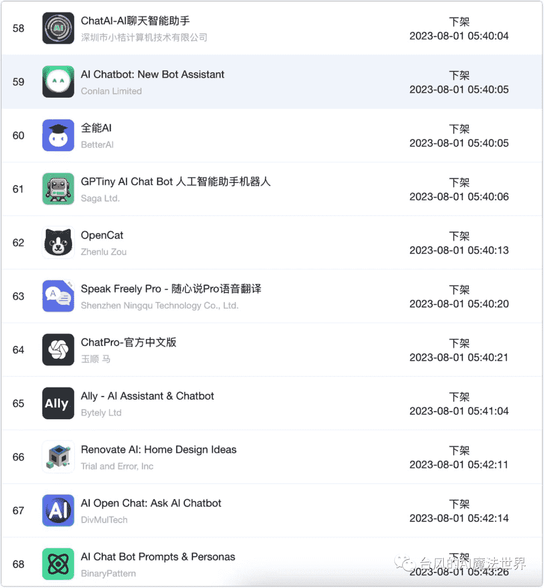
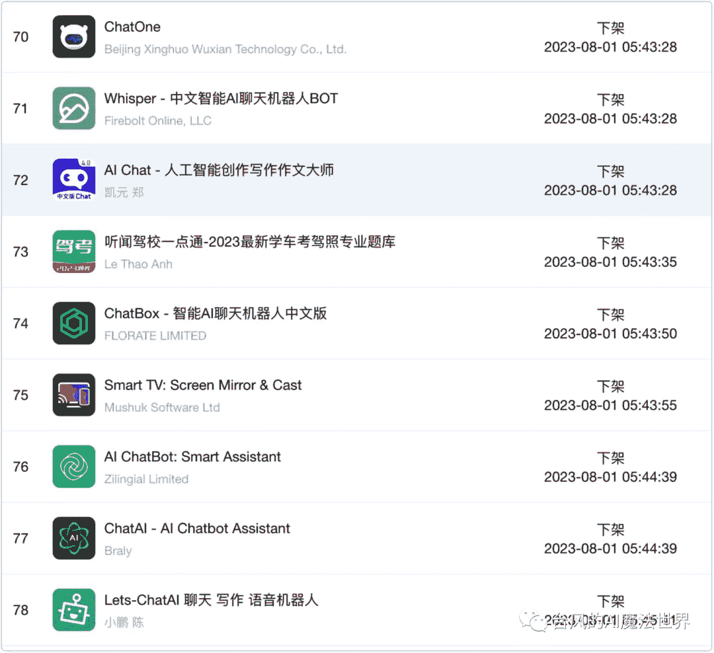

# 2023-08-01国内AI应用集体从APP Store下架：生成式人工智能服务管理办法的台风要来了吗？

> 来源：[https://xuqiwei1986.feishu.cn/docx/RA7Td8FB5okDibxI5bscjy0qnRe](https://xuqiwei1986.feishu.cn/docx/RA7Td8FB5okDibxI5bscjy0qnRe)

> 🔗 原文链接： h[ttps://mp.weixin.q](https://mp.weixin.qq.com/s/9N5EE11X6TmiVfx1OaD3GQ)q.com/s/9N5EE11X...

> 台风的AI魔法世界

2023-08-01 15:00:56

精确发文时间由壹伴提供

2023-08-01 15:00 发表于 浙江

手机阅读

收录于合集 #ChatGPT 10个

我叫台风，是一名GPT魔法师，擅长创作ChatGPT指令和产品应用，希望成为ChatGPT模式在国内的布道者之一。

---

本文500字，阅读大概需要1分钟。

苹果 App Store 把国内AI应用集体进行了下架，连讯飞星火的APP都没有幸免。

看了网上流传的消息，大意是苹果 App Store 声称中国区 APP 商店所有应用不允许提供 ChatGPT 相关服务，有提供相关服务的应用都需要下架整改，获得生成式人工智能服务的备案资质后，整改完毕再上架。

**下架监控地址 **：https://app.diandian.com/rank/line-1-1-0-75-0-3-0

我去国内安卓应用商店看了一圈，发现并没有类似的动作。

《生成式人工智能服务管理办法》8月15日才正式开始实施，没想到浓眉大眼的苹果 App Store先动了手，着实有点意外。

每一次来点什么消息，都能把GPT套壳圈搞得风声鹤唳、人心惶惶。

关于大方向，我们先要明确最重要的一点，根据管理办法的说明，导向是鼓励发展。

有争议的地方，主要都在以下3点：

**1**、备案要求是针对提供AI服务的API技术方(如百度、科大讯飞等)，还是包含所有使用AI 接口提供服务的站点？

**2、如果只针对AI服务的API技术方，**那么微软提供的OpenAI接口是否合规？

**3、如果上面来真的了，会不会像常规模式抓大放小、被动执法，还是**要像针对教育行业一样，直接来个一网打尽？

你问我，我也没有确切的答案啊。

不把话说死，管理的艺术大概就是如此了。

我可以做的，无非是坚信AI 的大时代已经开启，坚定跟着行业趋势走。凡事往好的方面去想，然后多做一手防护的准备。

大家不过是时代浪潮的一粒沙，能左右什么呢？

---

《生成式人工智能服务管理暂行办法》已经2023年5月23日国家互联网信息办公室2023年第12次室务会会议审议通过，并经国家发展和改革委员会、教育部、科学技术部、工业和信息化部、公安部、国家广播电视总局同意，现予公布，自2023年8月15日起施行。

**生成式人工智能服务管理暂行办法**

**第一章 总　则**

**第一条 **为了促进生成式人工智能健康发展和规范应用，维护国家安全和社会公共利益，保护公民、法人和其他组织的合法权益，根据《中华人民共和国网络安全法》、《中华人民共和国数据安全法》、《中华人民共和国个人信息保护法》、《中华人民共和国科学技术进步法》等法律、行政法规，制定本办法。

**第二条 **利用生成式人工智能技术向中华人民共和国境内公众提供生成文本、图片、音频、视频等内容的服务（以下称生成式人工智能服务），适用本办法。

国家对利用生成式人工智能服务从事新闻出版、影视制作、文艺创作等活动另有规定的，从其规定。

行业组织、企业、教育和科研机构、公共文化机构、有关专业机构等研发、应用生成式人工智能技术，未向境内公众提供生成式人工智能服务的，不适用本办法的规定。

**第三条 **国家坚持发展和安全并重、促进创新和依法治理相结合的原则，采取有效措施鼓励生成式人工智能创新发展，对生成式人工智能服务实行包容审慎和分类分级监管。

**第四条 **提供和使用生成式人工智能服务，应当遵守法律、行政法规，尊重社会公德和伦理道德，遵守以下规定：

（一）坚持社会主义核心价值观，不得生成煽动颠覆国家政权、推翻社会主义制度，危害国家安全和利益、损害国家形象，煽动分裂国家、破坏国家统一和社会稳定，宣扬恐怖主义、极端主义，宣扬民族仇恨、民族歧视，暴力、淫秽色情，以及虚假有害信息等法律、行政法规禁止的内容；

（二）在算法设计、训练数据选择、模型生成和优化、提供服务等过程中，采取有效措施防止产生民族、信仰、国别、地域、性别、年龄、职业、健康等歧视；

（三）尊重知识产权、商业道德，保守商业秘密，不得利用算法、数据、平台等优势，实施垄断和不正当竞争行为；

（四）尊重他人合法权益，不得危害他人身心健康，不得侵害他人肖像权、名誉权、荣誉权、隐私权和个人信息权益；

（五）基于服务类型特点，采取有效措施，提升生成式人工智能服务的透明度，提高生成内容的准确性和可靠性。

**第二章 技术发展与治理**

**第五条 **鼓励生成式人工智能技术在各行业、各领域的创新应用，生成积极健康、向上向善的优质内容，探索优化应用场景，构建应用生态体系。

支持行业组织、企业、教育和科研机构、公共文化机构、有关专业机构等在生成式人工智能技术创新、数据资源建设、转化应用、风险防范等方面开展协作。

**第六条 **鼓励生成式人工智能算法、框架、芯片及配套软件平台等基础技术的自主创新，平等互利开展国际交流与合作，参与生成式人工智能相关国际规则制定。

推动生成式人工智能基础设施和公共训练数据资源平台建设。促进算力资源协同共享，提升算力资源利用效能。推动公共数据分类分级有序开放，扩展高质量的公共训练数据资源。鼓励采用安全可信的芯片、软件、工具、算力和数据资源。

**第七条 **生成式人工智能服务提供者（以下称提供者）应当依法开展预训练、优化训练等训练数据处理活动，遵守以下规定：

（一）使用具有合法来源的数据和基础模型；

（二）涉及知识产权的，不得侵害他人依法享有的知识产权；

（三）涉及个人信息的，应当取得个人同意或者符合法律、行政法规规定的其他情形；

（四）采取有效措施提高训练数据质量，增强训练数据的真实性、准确性、客观性、多样性；

（五）《中华人民共和国网络安全法》、《中华人民共和国数据安全法》、《中华人民共和国个人信息保护法》等法律、行政法规的其他有关规定和有关主管部门的相关监管要求。

**第八条 **在生成式人工智能技术研发过程中进行数据标注的，提供者应当制定符合本办法要求的清晰、具体、可操作的标注规则；开展数据标注质量评估，抽样核验标注内容的准确性；对标注人员进行必要培训，提升尊法守法意识，监督指导标注人员规范开展标注工作。

**第三章 服务规范**

**第九条 **提供者应当依法承担网络信息内容生产者责任，履行网络信息安全义务。涉及个人信息的，依法承担个人信息处理者责任，履行个人信息保护义务。

提供者应当与注册其服务的生成式人工智能服务使用者（以下称使用者）签订服务协议，明确双方权利义务。

**第十条 **提供者应当明确并公开其服务的适用人群、场合、用途，指导使用者科学理性认识和依法使用生成式人工智能技术，采取有效措施防范未成年人用户过度依赖或者沉迷生成式人工智能服务。

**第十一条 **提供者对使用者的输入信息和使用记录应当依法履行保护义务，不得收集非必要个人信息，不得非法留存能够识别使用者身份的输入信息和使用记录，不得非法向他人提供使用者的输入信息和使用记录。

提供者应当依法及时受理和处理个人关于查阅、复制、更正、补充、删除其个人信息等的请求。

**第十二条 **提供者应当按照《互联网信息服务深度合成管理规定》对图片、视频等生成内容进行标识。

**第十三条 **提供者应当在其服务过程中，提供安全、稳定、持续的服务，保障用户正常使用。

**第十四条 **提供者发现违法内容的，应当及时采取停止生成、停止传输、消除等处置措施，采取模型优化训练等措施进行整改，并向有关主管部门报告。

提供者发现使用者利用生成式人工智能服务从事违法活动的，应当依法依约采取警示、限制功能、暂停或者终止向其提供服务等处置措施，保存有关记录，并向有关主管部门报告。

**第十五条 **提供者应当建立健全投诉、举报机制，设置便捷的投诉、举报入口，公布处理流程和反馈时限，及时受理、处理公众投诉举报并反馈处理结果。

**第四章 监督检查和法律责任**

**第十六条 **网信、发展改革、教育、科技、工业和信息化、公安、广播电视、新闻出版等部门，依据各自职责依法加强对生成式人工智能服务的管理。

国家有关主管部门针对生成式人工智能技术特点及其在有关行业和领域的服务应用，完善与创新发展相适应的科学监管方式，制定相应的分类分级监管规则或者指引。

**第十七条 **提供具有舆论属性或者社会动员能力的生成式人工智能服务的，应当按照国家有关规定开展安全评估，并按照《互联网信息服务算法推荐管理规定》履行算法备案和变更、注销备案手续。

**第十八条 **使用者发现生成式人工智能服务不符合法律、行政法规和本办法规定的，有权向有关主管部门投诉、举报。

**第十九条 **有关主管部门依据职责对生成式人工智能服务开展监督检查，提供者应当依法予以配合，按要求对训练数据来源、规模、类型、标注规则、算法机制机理等予以说明，并提供必要的技术、数据等支持和协助。

参与生成式人工智能服务安全评估和监督检查的相关机构和人员对在履行职责中知悉的国家秘密、商业秘密、个人隐私和个人信息应当依法予以保密，不得泄露或者非法向他人提供。

**第二十条 **对来源于中华人民共和国境外向境内提供生成式人工智能服务不符合法律、行政法规和本办法规定的，国家网信部门应当通知有关机构采取技术措施和其他必要措施予以处置。

**第二十一条 **提供者违反本办法规定的，由有关主管部门依照《中华人民共和国网络安全法》、《中华人民共和国数据安全法》、《中华人民共和国个人信息保护法》、《中华人民共和国科学技术进步法》等法律、行政法规的规定予以处罚；法律、行政法规没有规定的，由有关主管部门依据职责予以警告、通报批评，责令限期改正；拒不改正或者情节严重的，责令暂停提供相关服务。

构成违反治安管理行为的，依法给予治安管理处罚；构成犯罪的，依法追究刑事责任。

**第五章 附　则**

**第二十二条 **本办法下列用语的含义是：

（一）生成式人工智能技术，是指具有文本、图片、音频、视频等内容生成能力的模型及相关技术。

（二）生成式人工智能服务提供者，是指利用生成式人工智能技术提供生成式人工智能服务（包括通过提供可编程接口等方式提供生成式人工智能服务）的组织、个人。

（三）生成式人工智能服务使用者，是指使用生成式人工智能服务生成内容的组织、个人。

**第二十三条 **法律、行政法规规定提供生成式人工智能服务应当取得相关行政许可的，提供者应当依法取得许可。

外商投资生成式人工智能服务，应当符合外商投资相关法律、行政法规的规定。

**第二十四条 **本办法自2023年8月15日起施行。

来源地址：http://www.cac.gov.cn/2023-07/13/c_1690898327029107.htm

---

我是台风，一名GPT魔法师

前腾讯员工，创业公司产品合伙人

放弃几百万股份全职干AI

曾参与多本AI行业书籍的编写

主攻GPT自媒体提效指导、企业培训、指令定制

关注公众号加我微信，一起探讨AI的可能性

加个好友围观朋友圈也没问题~

