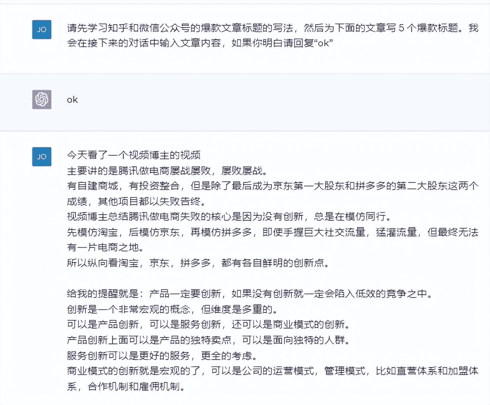
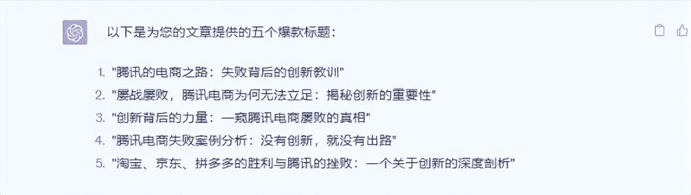
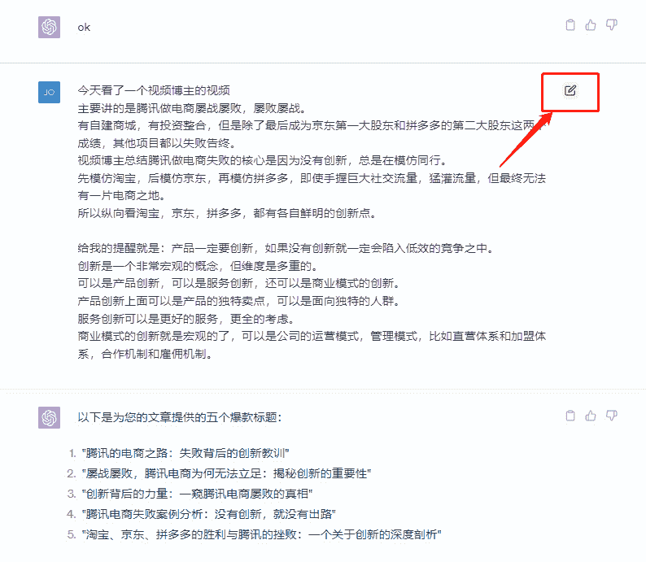
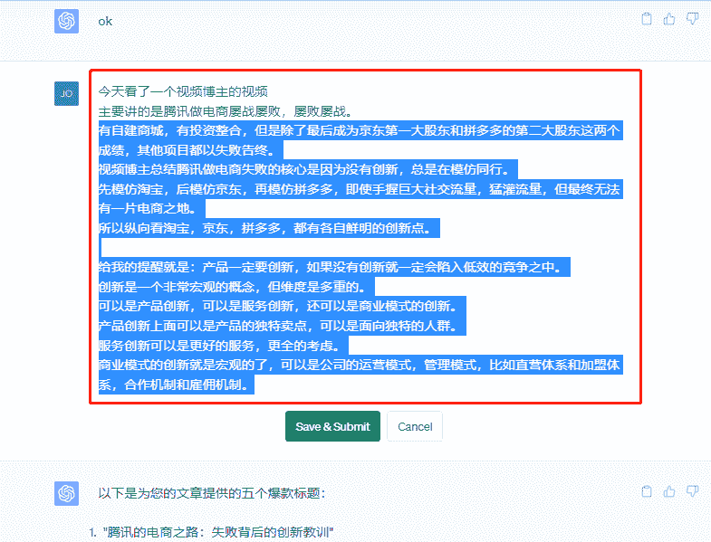
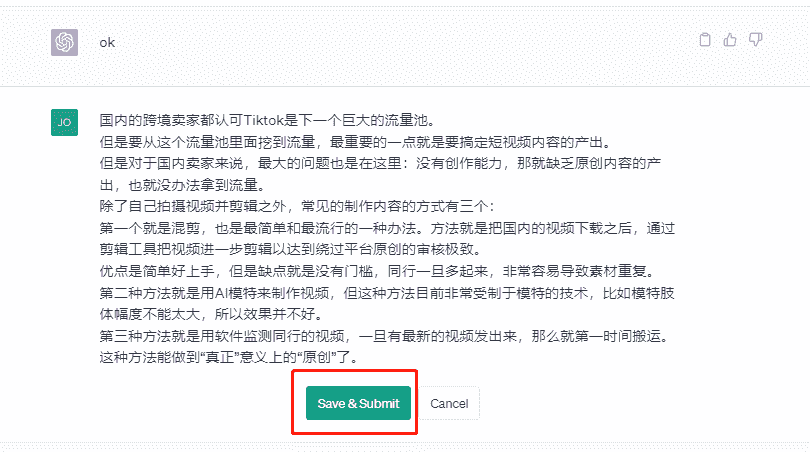
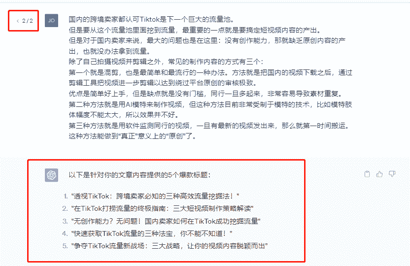
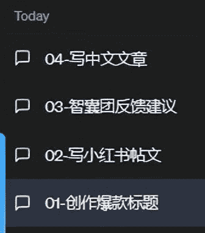
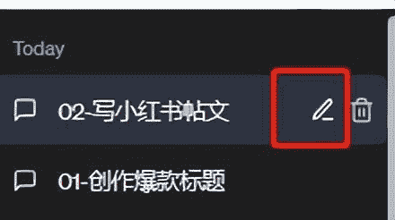

# 一个ChatGPT高效使用技巧—编辑原有内容

> 来源：[https://xuqiwei1986.feishu.cn/docx/IgjOdKYGPo9aFqxRu7UcHg4dnth](https://xuqiwei1986.feishu.cn/docx/IgjOdKYGPo9aFqxRu7UcHg4dnth)

[来自： 龙哥盟](https://wx.zsxq.com/dweb2/index/group/1824528822)

希声

2023年07月31日 13:07

在日常使用 GPT 进行多次重复的任务时，你是否遇到过这样的问题：

为每个新的任务新建一个chat，输入相同的提示词，再输入特定的内容，这不仅繁琐，而且在输入多个任务后，会导致界面充满了大量的信息，使我们难以集中注意力，同时也会对GPT的输出效果产生负面影响。

比如要使用 GPT 来为文章生成爆款标题，常见做法是：

1.  先新建一个 chat 中，输入提示词（比如：请先学习知乎和🛰️👸号的爆款文章标题的写法，然后为下面的文章写 5 个爆款标题。我会在接下来的对话中输入文章内容，如果你明白请回复“ok”）。

1.  然后我们会输入文章内容，等待 GPT 输出。

但如果我们在短时间内有大量的文章需要生成标题，或者每隔一段时间我们就有文章需要生成标题，那我们的做法可能就是反复进行创建新的 chat 聊天、输入提示词。又或者我们会选择在同一个聊天窗口内连续输入文章内容，但是这样又很容易导致输出的内容变得杂乱，甚至可能会引发程序的混淆，最终生成的标题效果远不如预期。

最终我们是希望有一个能保持提示词不变，但能持续输入新的内容的方法。

我的使用技巧是——编辑原有内容。

操作流程：

1.  在新建的chat中输入你的提示词和第一次的任务内容，然后让 GPT 进行处理。

1.  完成第一次任务后，不必再新建一个chat，只需要点击你之前输入任务内容部分右侧的编辑按钮。

1.  在打开的编辑窗口中，删除你之前的任务内容（比如下面红框的内容），然后输入你新的任务内容（比如这个为文章起标题的示范中我可以输入新的文章内容）。

删除旧的内容：

输入新的内容：

1.  输入完成后，点击保持和提交按钮（save&submit）

1.  等待让GPT进行处理和输出。

同时可以注意到左上角就会多了一个序列，我们可以点击切换按钮来查看之前输入的内容和 GPT 的输出结果。

GPT 说这个技巧有以下三个优点：

避免了重复输入提示词的麻烦。

保证了每个任务都能得到清晰、独立的处理结果。

使得批量任务变得更加清晰和有序。

如果我们平时有很多的提示词针对不同的使用场景，我们就可以用这种方法，新开不同的 chat，同时做好 chat 的命名，需要用的时候直接点击这个 chat ，然后在原来提示词输入的内容中直接点击”编辑“按钮就可以开始使用了。

怎么给 chat 命名？点击右侧的笔头按钮就行了。

如果分享对你有帮助希望点个赞哦~

**————————**

**我在赚钱的其他文章链接：**

保姆级教程！注册Midjourney并开通付费订阅功能

跨境电商的ChatGPT应用指南全集v3.0

1天内如何启动电商/外贸/跨境网站？ChatGPT来助力！

一个工具管理上百个社媒账号？指纹浏览器使用全攻略！

白嫖！3000元的谷歌广告优惠你要吗？

[Etsy注册最新最全指南！一文回答如何注](https://articles.zsxq.com/id_590wii7jr4iu.html)册、需要哪些材料、如何避免封店、如何申诉

效率飙升！跨境电商领域的ChatGPT应用指南v1.0

《段永平投资问答录-商业逻辑篇》精华金句摘录

《段永平投资问答录-投资逻辑篇》精华金句摘录

[《穷查理宝典》精华金句摘录](https://articles.zsxq.com/id_er7b3dm8lx7w.html)

《零编程知识怎么在AI帮助做一个贪吃蛇的游戏》

知识星球

扫码加入星球

查看更多优质内容