# AI绘画-海景房/卧室-实操整理分享

> 来源：[https://xuqiwei1986.feishu.cn/docx/CJMFd7CSTodUGexaciJcwqUMn4b](https://xuqiwei1986.feishu.cn/docx/CJMFd7CSTodUGexaciJcwqUMn4b)

先展示一些成品图（对卧室类不感兴趣的朋友也可以只参考思路，欢迎指正~）

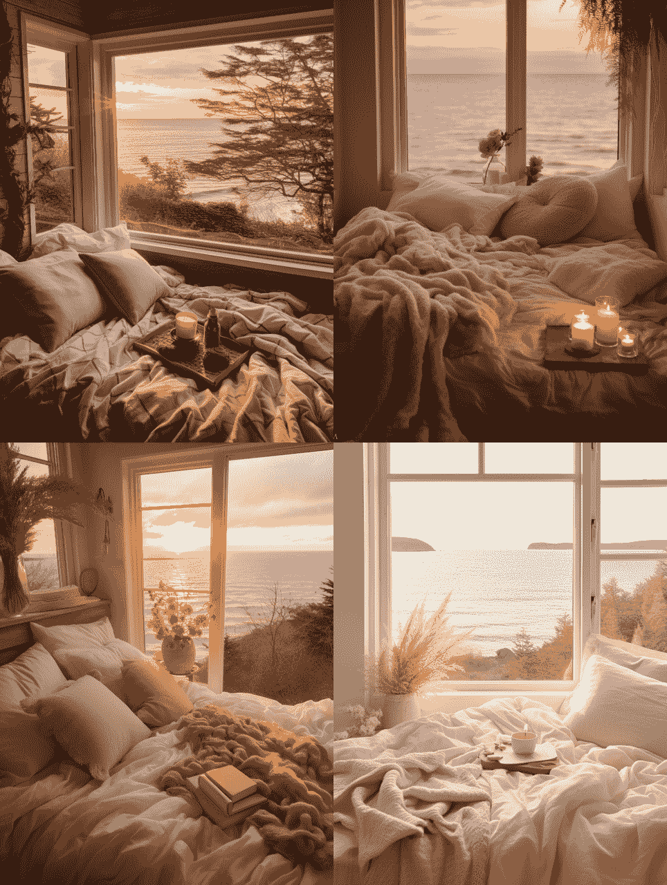

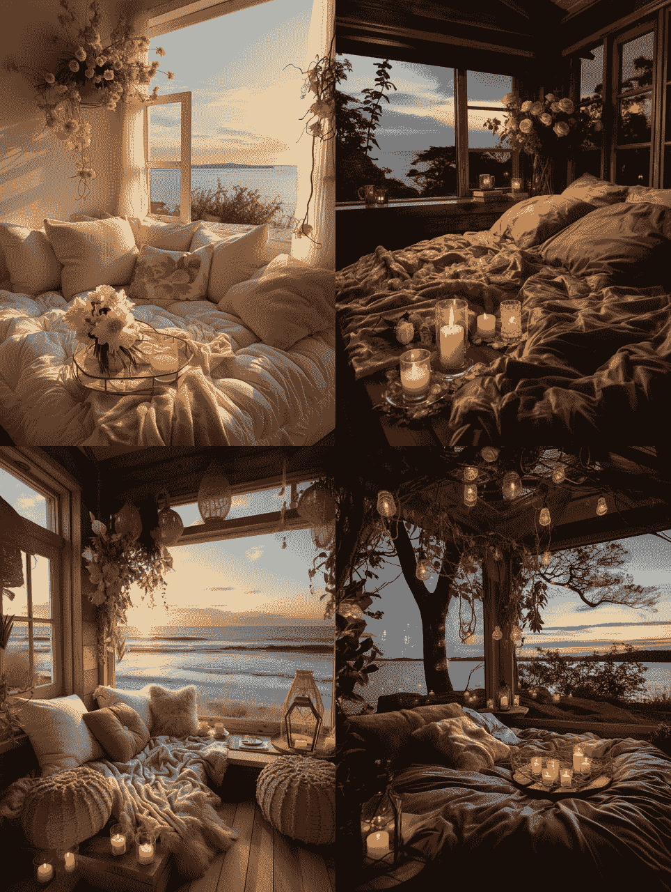

### 基本生图思路：

#### 方式一：扒图+解析+归类+重组

##### 1、📕上看到感兴趣的图，扒下来

##### 2、丢到MJ里面进行“图生文”，会得到4组提示词组合

##### 3、按照“主体描述”、“环境氛围”、“构图镜头”、“参考风格”、“图像设定”做一下归类

把出现频次比较高的词语做重点标记，一般整体的风格和调性都是由这些词语来把控的

##### 4、归类之后可以尝试一下自己重组提示词，或者增加混乱度让它随机生成图片

#### 方式二：ChatGPT扩写想法+精简咒语+归类+重组

##### 1、用特定的提示词让ChatGPT帮忙写画面描述词

##### 2、再让ChatGPT帮忙在不改变原文意思的情况下精简提示词

##### 3、按照5种画面描述词类型进行归类分组

##### 4、自己重组描述词生成图片

### 历史实操过程：

全程用到的工具：ChatGPT+Midjourney

（MJ没有用官方的，想着比较贵而且比较麻烦，目前用得是一个平替网站，15块钱一个月；

速度上时快时慢，但基本够用了，网址是这个：https://www.ai-art.com.cn/?text-to-image/）

#### 尝试1

在📕扒一组喜欢的图片

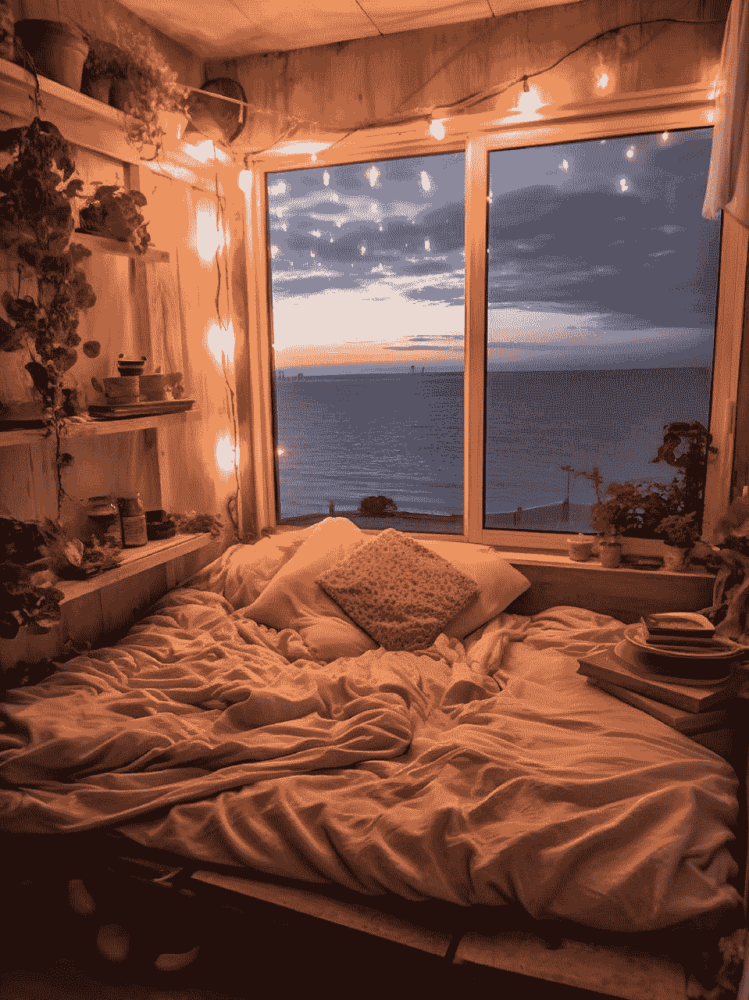

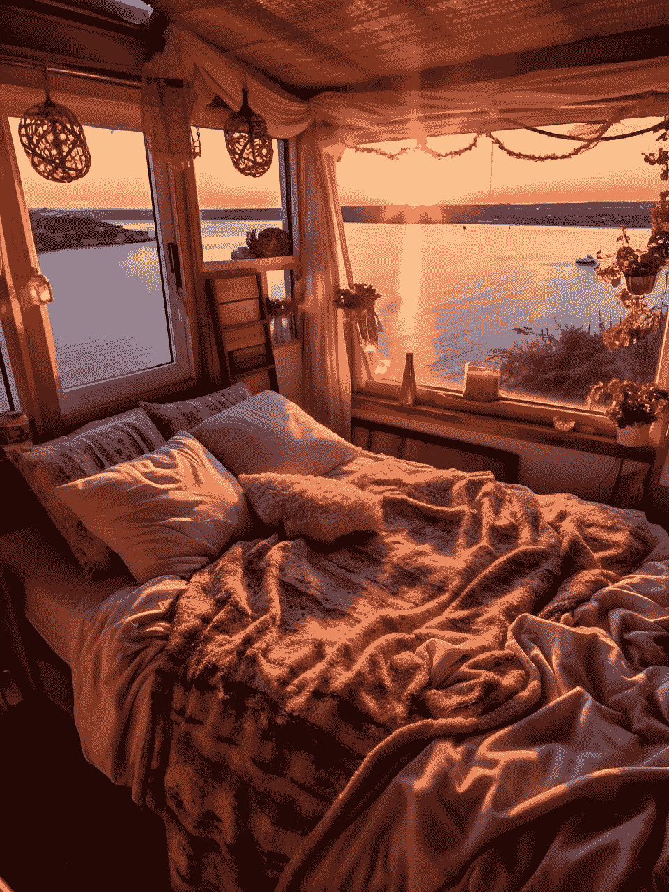

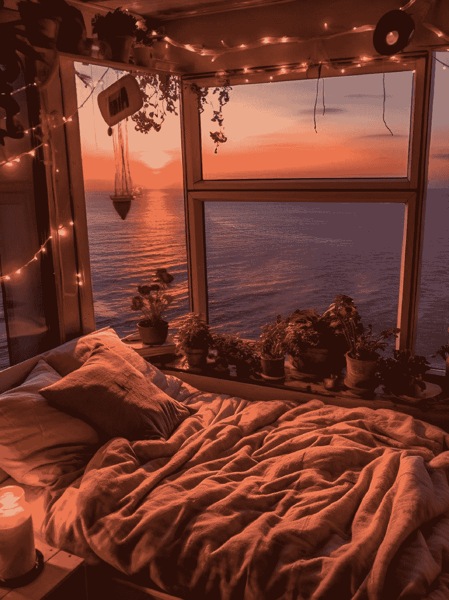

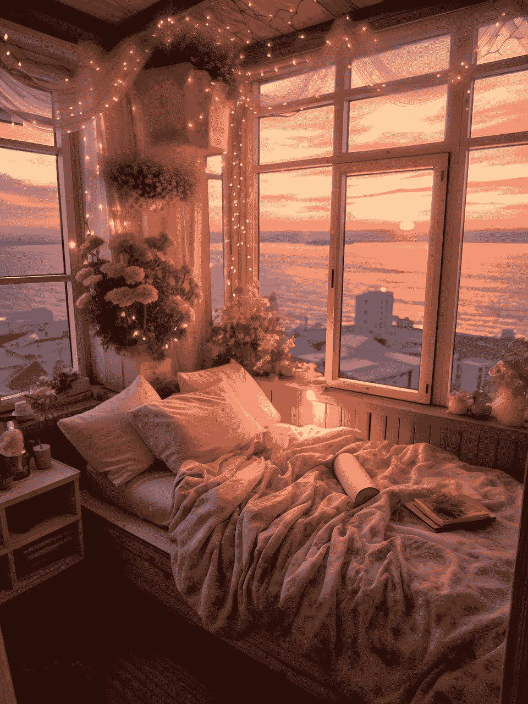

用mj对第一张进行【图生文】，得到的咒语1：（咒语就是提示词）

a bed with lights over it near the ocean, in the style of hazy atmospheres, vintage atmosphere --ar 3:4

翻译：

一张靠近海洋的床，床上有灯，朦胧的气氛，复古的气氛，图片比例3:4

其它可补充尝试的细节：

**（这些是另外三组咒语里面提取出来的，有不懂**的词我就丢给ChatGPT让它解释一下）

a bed with lights on it by a small window（窗户边的一张有灯光的小床）

in the style of y2k aesthetic （Y2K美学风格，指受到2000年前后（即公元2000年）时代风格影响的艺术风格）

in the style of seascapes（以海景画风格为灵感或参考进行创作的艺术作品）

in the style of calm seas and skies（以平静的海洋和天空为主题的艺术风格）

night photography（夜间摄影）

light amber and gray（浅琥珀色和灰色）

festive atmosphere（节日气氛）

nature-inspired（自然灵感）

romantic and nostalgic themes（浪漫与怀旧的主题）

cabincore（指一种受到田园生活、乡村居住和自然环境启发的艺术风格，通常强调与自然界的联系，追求简朴、舒适、温馨的生活方式，以及与自然和谐相处的理念。）

"lo-fi aesthetics"（低保真美学，指的是一种艺术风格，强调低分辨率、粗糙、模糊、失真等效果，常常被用于创造一种怀旧的氛围，让观众联想到过去的时代，或者在艺术中表达对旧式科技和媒体的喜爱。）

romantic landscape vistas（浪漫的景观远景）

warm tones（暖色调）

组合尝试1

a bed with lights on it by a small window near the ocean，in the style of romantic seascape，y2k aesthetic，festive atmosphere，warmcore，nature-inspired，romantic and nostalgic themes，warm tones.--ar 3:4

#### 尝试2

（忘记扒的哪一张图了，反正是同一批的）

an ocean view bedroom set up at sunset（日落时分的海景卧室）， in the style of warmcore（暖心的） ，depiction of everyday life（描绘着日常生活）

可用词组：

golden light（金色的光）

light red and violet（浅红色和紫罗兰色）

y2k aesthetic （Y2K美学风格）

use of earth tones（使用大地色调）

an ocean view bedroom set up at sunset（日落时分的海景卧室）

in the style of warmcore（暖心的）

romantic seascapes（浪漫海景）

lo-fi aesthetics（低保真美学）

20th century Scandinavian style（指的是20世纪北欧地区艺术家和设计师所创作的艺术风格，强调简洁、清晰的线条和形状，注重材料的质感和自然的颜色。它追求对形式和功能的完美结合，强调人与自然的和谐。）

cute and dreamy（可爱和梦幻）

maximalism（极致主义）-- 与之相对的是minimalism（极简主义）

travel（旅行）

组合尝试2：

an ocean view bedroom set up at sunset,romantic seascapes,in the style of warmcore,light red and violet,y2k aesthetic,20th century Scandinavian style

#### 尝试3

a bed on a balcony with a view of the ocean（在阳台上的一张床，可以看到海洋）

a bedroom with a bed and a window with an ocean and beach（一间卧室，有一张床和一扇窗户，窗外是一片海洋和沙滩）

festive atmosphere, y2k aesthetic（节日气氛，y2k美学）

warm color palette（温暖的调色板）

horizons（通常指代画面中地平线的位置，它在绘画中是一个重要的视觉元素，决定了画面中的景深和空间感.）

in the style of dreamy, romanticized cityscapes, festive atmosphere（画面采用梦幻浪漫的城市景观风格，营造出欢乐的节日氛围）

light red and light amber（主色调为淡红色和浅琥珀色）

luminous skies, cottagepunk（呈现出明亮的天空和乡村底蕴）

glowing lights, detailed marine views（照亮的灯光和细致入微的海景）

in the style of romantic charm, maximalism（采用浪漫迷人、极致主义的风格）

组合尝试3

a bed on a balcony with a view of the ocean,horizons,in the style of dreamy, romanticized cityscapes, festive atmosphere,light red and light amber,luminous skies, cottagepunk,warm color palette

### 词组归类：

##### 主体描述：

a bed with lights on it by a small window（窗户边的一张有灯光的小床）

an ocean view bedroom set up at sunset（日落时分的海景卧室）

a bed on a balcony with a view of the ocean（在阳台上的一张床，可以看到海洋）

a bedroom with a bed and a window with an ocean and beach（一间卧室，有一张床和一扇窗户，窗外是一片海洋和沙滩）

glowing lights, detailed marine views（照亮的灯光和细致入微的海景）

##### 环境氛围：

hazy atmospheres（朦胧的气氛）

vintage atmosphere（复古的气氛）

calm seas and skies（平静的海洋与天空）

romantic landscape vistas（浪漫的景观远景）

warm tones（暖色调）

light amber and gray（浅琥珀色和灰色）

golden light（金色的光）

light red and violet（浅红色和紫罗兰色）

use of earth tones（使用大地色调）

romantic seascapes（浪漫海景）

luminous skies, cottagepunk（呈现出明亮的天空和乡村底蕴）

glowing lights, detailed marine views（照亮的灯光和细致入微的海景）

richly colored skies（色彩丰富的天空）

festive atmosphere（节日气氛）

nature-inspired（自然灵感）

romantic and nostalgic themes（浪漫与怀旧的主题）

cute and dreamy（可爱和梦幻）

travel（旅行）

in the style of dreamy, romanticized cityscapes, festive atmosphere

（画面采用梦幻浪漫的城市景观风格，营造出欢乐的节日氛围）

luminous skies, cottagepunk（呈现出明亮的天空和乡村底蕴）

in the style of romantic charm, maximalism（采用浪漫迷人、极致主义的风格）

##### 构图镜头：

horizons（通常指代画面中地平线的位置，它在绘画中是一个重要的视觉元素，决定了画面中的景深和空间感.）

night photography（夜间摄影）

##### 参考风格：

in the style of y2k aesthetic （Y2K美学风格，指受到2000年前后（即公元2000年）时代风格影响的艺术风格）

in the style of seascapes（以海景画风格为灵感或参考进行创作的艺术作品）

in the style of calm seas and skies（以平静的海洋和天空为主题的艺术风格）

cabincore（指一种受到田园生活、乡村居住和自然环境启发的艺术风格，通常强调与自然界的联系，追求简朴、舒适、温馨的生活方式，以及与自然和谐相处的理念。）

"lo-fi aesthetics"（低保真美学，指的是一种艺术风格，强调低分辨率、粗糙、模糊、失真等效果，常常被用于创造一种怀旧的氛围，让观众联想到过去的时代，或者在艺术中表达对旧式科技和媒体的喜爱。）

20th century Scandinavian style（指的是20世纪北欧地区艺术家和设计师所创作的艺术风格，强调简洁、清晰的线条和形状，注重材料的质感和自然的颜色。它追求对形式和功能的完美结合，强调人与自然的和谐。）

maximalism（极致主义）-- 与之相对的是minimalism（极简主义）

seascapes（海景画风格）

##### 图像设定：

--ar 3:4（图片比例 = 3比4）

--q 2（图片质量 = 2）

--v 5.2（版本类型，v代表比较逼真的样式）

### 各种重组尝试之后生成的成品图：

### ChatGPT与MJ搭配使用技巧

#### ChatGPT生成的描述词组

A room encoding the sea, an Amazing room, covering the ocean, capturing with beauty and transparency, French window showing a vast ocean scene, the room blends into the surrounding natural beauty, Minimalism decoration, using lightweight materials for interval decoration, completing the ocean view, an optional sea villa, located on a cliff, covering the pristine beach, The waves generously lay against the shore, the salt blaze brushing against my face, with a sparse surface on the outside, allowing you to bask in warm sunlight, enjoying the ocean colors while tasting coffee, using natural materials such as wood decoration and wood textures, inviting you to stay and immerse yourself in the transparency of the sea view Feeling,y2k aesthetic，20th century Scandinavian style，warmcore。

（一个宛如海洋的令人惊叹的房间，覆盖着浩瀚的海洋，以美丽和透明感为特点。房间有着法式窗户，可以展示广阔的海洋景色，融入周围的自然美景。采用极简主义装饰，使用轻巧的材料进行间隔装饰，完美呈现海洋的景色。这是一个可选的海边别墅，坐落在悬崖上，俯瞰原始的沙滩。海浪慷慨地拍打着海岸，咸腥的海风拂过我的脸颊。外部有着稀疏的结构，让您可以沐浴在温暖的阳光下，一边品尝咖啡，一边欣赏着海洋的色彩。使用木质装饰和木纹材料等自然材料，诚挚地邀请您留下来，沉浸在透明的海景感觉中。融入Y2K美学，20世纪的斯堪的纳维亚风格和温暖的核心色调。）

成品如下：

#### 生成步骤：

##### 1、利用MJ描述词扩写器，向ChatGPT输入“可以看到海景的房间”，结果如下：（附翻译）

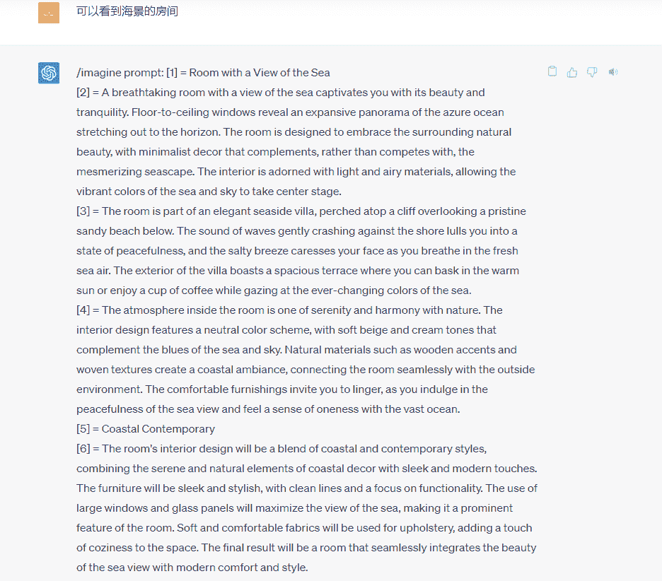

##### 2、让ChatGPT按照一定的格式将上述描述词转换成一个个词组，如下图：

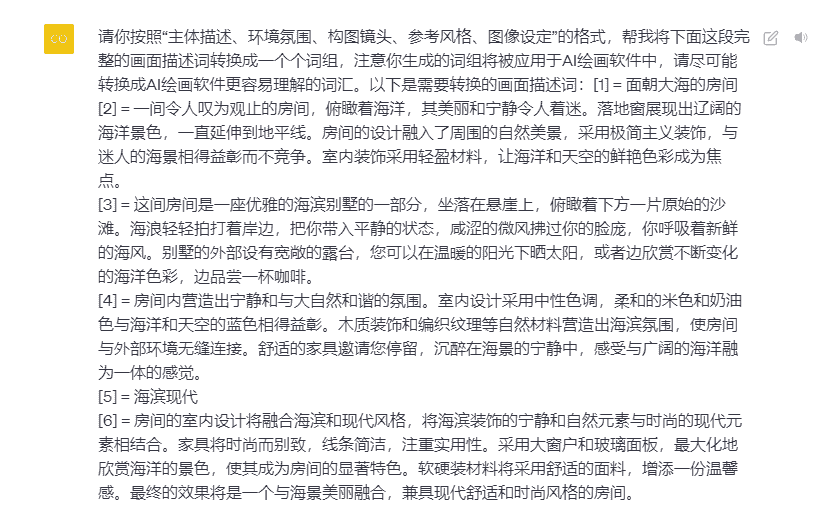

##### 3、将这些词组输入到MJ当中，再增加一些风格化的描述词控制出图调性。

咒语如下：

A room encoding the sea, an Amazing room, covering the ocean, capturing with beauty and transparency, French window showing a vast ocean scene, the room blends into the surrounding natural beauty, Minimalism decoration, using lightweight materials for interval decoration, completing the ocean view, an optional sea villa, located on a cliff, covering the pristine beach, The waves generously lay against the shore, the salt blaze brushing against my face, with a sparse surface on the outside, allowing you to bask in warm sunlight, enjoying the ocean colors while tasting coffee, using natural materials such as wood decoration and wood textures, inviting you to stay and immerse yourself in the transparency of the sea view Feeling,y2k aesthetic，20th century Scandinavian style，warmcore --ar 3:4

##### 4、成品展示

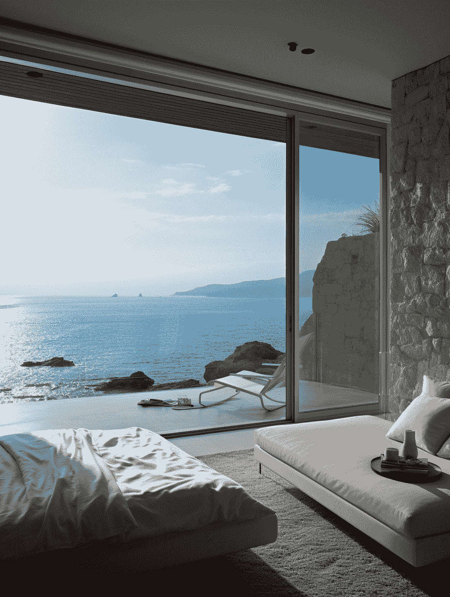

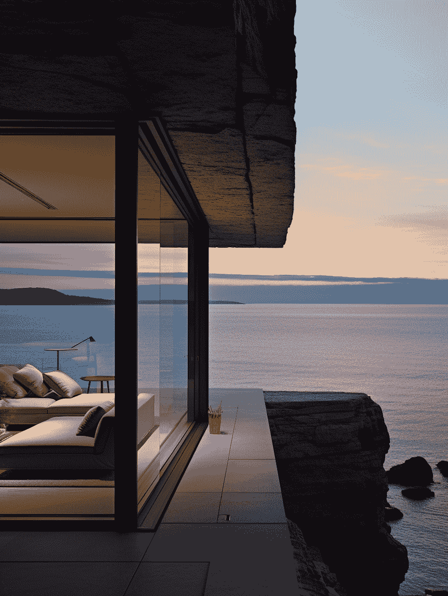

###### 让ChatGPT充当MJ扩写器指令如下：

你现在将充当名为“Midjourney”的生成式AI的提示词生成器，Midjouney 会根据你给定的提示词生成图像。我将给你提供一个概念，在我给你指令后，请你为Midjourney 提供提示词。 你必须严格遵守以下指导原则，绝不改变以下任何方式的结构和格式： 你将在一行中写出每个提示，不使用回车。提示的结构将如下：[1] = [关键词]。[2] = 对[1]的详细描述，其中包含非常具体的图像细节。[3] = 描述场景环境的详细描述。[4] = 描述场景的情绪/感觉和气氛的详细描述。[5] = 一种风格，例如：摄影、绘画、插图、雕塑、艺术品、文件、3D等。[6] = 描述如何实现[5]的描述。（例如，摄影（例如，微距，鱼眼风格，肖像）与相机型号和适当的相机设置，绘画详细描述关于材料和使用的工作材料，渲染引擎设置，数字插图，木艺烧制艺术（和其他所有可能定义为输出类型的））提示结构要求结束。格式：你写的内容将与下面结构中的格式完全相同，包括“/”和“：”。这是提示结构：“/imagine prompt: [1]、[2]、[3]、[4]、[5]、[6]”。 编写提示时要注意的重要一点，不要在[1]、[2]、[3]、[4]、[5]、[6]之间使用 /或：生成提示时不要使用[]。请注意： - 不可能是真实的概念不会被描述为“真实”或“现实”或 “照片”。例如，由纸制成的概念或与幻想相关的场景。- 你为概念生成的提示之一必须是逼真的摄影风格，你还应该为其选择镜头类型和尺寸。 不要为逼真的摄影提示选择艺术家。 - 用两条新行分隔不同的提示。 - 每次给我生成三组不同风格的提示词。 - 你只需要提供给我提示结构里的内容和翻译的内容。我现在将为你提供关键字，你准备好了吗？

###### **描述词组归类指令如下：**

请你按照“主体描述、环境氛围、构图镜头”的格式，帮我将下面这段完整的画面描述词转换成一个个词组。请注意你生成的词组将被应用于AI绘画软件中，请尽可能转换成AI绘画软件更容易理解的词汇。以下是需要转换的画面描述词:

### 整个过程中出图效果比较优质的组合

#### 1、自主控制组合

a bed with lights on it by a small window near the ocean，in the style of romantic seascape，y2k aesthetic，festive atmosphere，warmcore，nature-inspired，romantic and nostalgic themes，warm tones.

（一张床，床上点着灯，在靠近海洋的小窗旁边。画面采用浪漫海景风格，结合Y2K美学，营造出欢乐的氛围。取暖色调为主，灵感来源于大自然，呈现出浪漫怀旧的主题。）

##### **一次微调：加点欧式现代风格**

a bed with lights on it by a small window near the ocean，in the style of romantic seascape，y2k aesthetic，20th century Scandinavian style，festive atmosphere，warmcore，nature-inspired，romantic and nostalgic themes，warm tones， hyper quality --ar 3:4

##### **二****次微调（去掉“**灯”，加上暖色调） -- 出图效果非常好

a bed by a small window near the ocean，warm tones，in the style of romantic seascape，y2k aesthetic，20th century Scandinavian style，festive atmosphere，warmcore，nature-inspired，romantic and nostalgic themes，warm tones， hyper quality

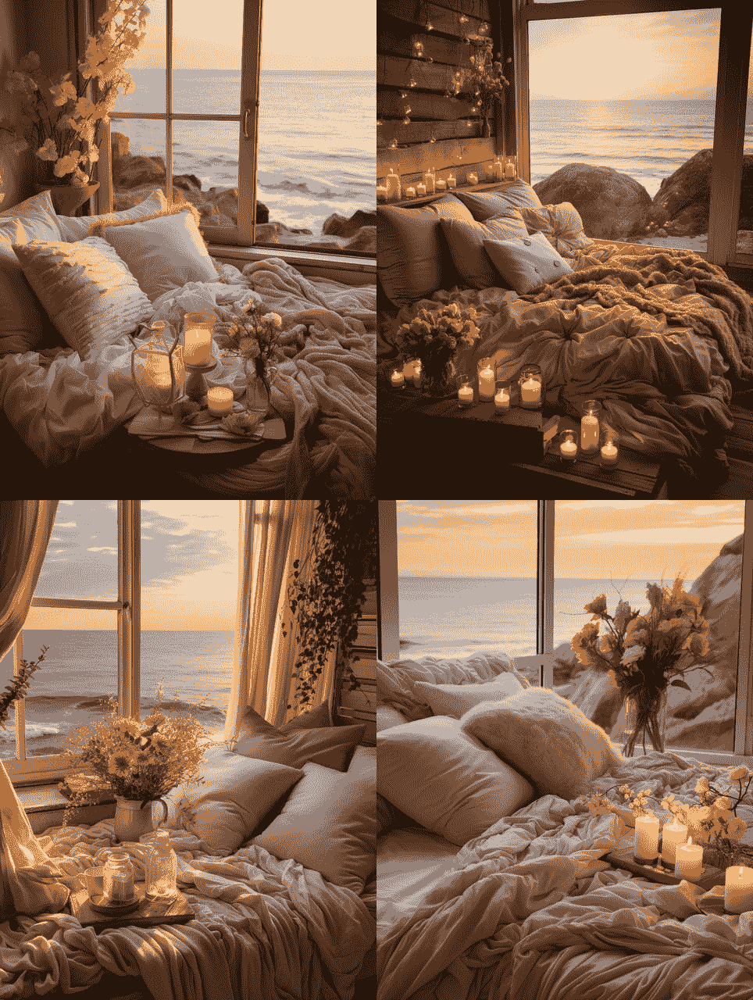

##### **三次微调（整体咒语不变，另外加上--c 50，也就是**增加混乱度，可以生成不同风格的图。如下）

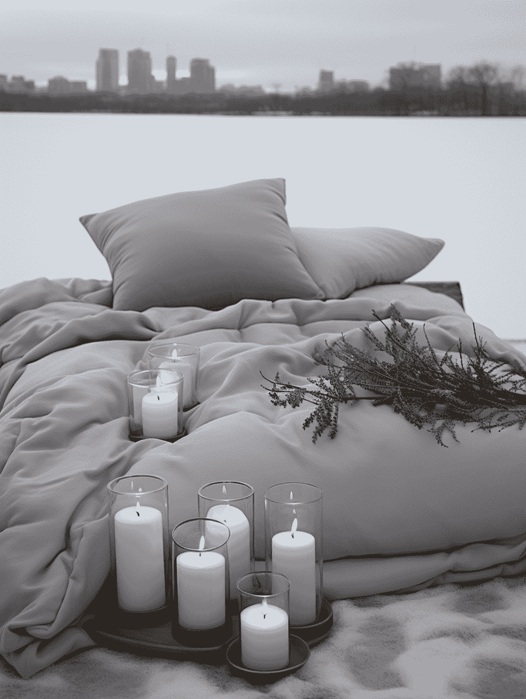

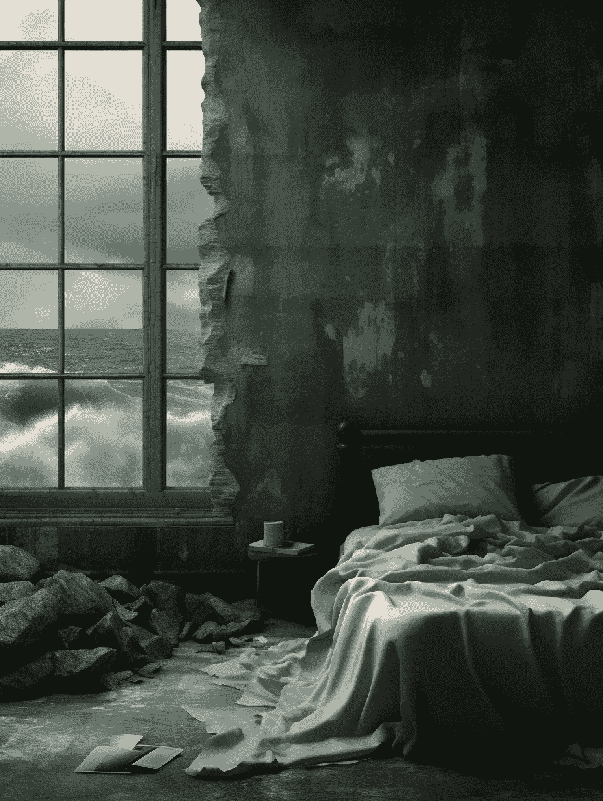

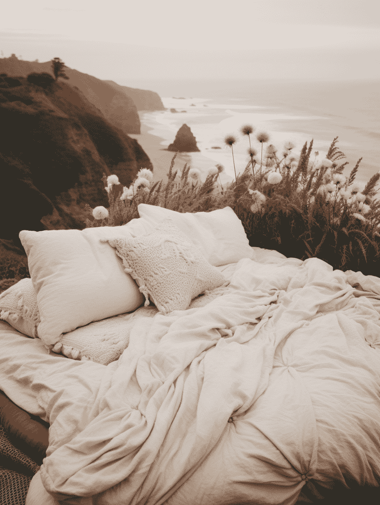

#### 2、ChatGPT 出品

A room encoding the sea, an Amazing room, covering the ocean, capturing with beauty and transparency, French window showing a vast ocean scene, the room blends into the surrounding natural beauty, Minimalism decoration, using lightweight materials for interval decoration, completing the ocean view, an optional sea villa, located on a cliff, covering the pristine beach, The waves generously lay against the shore, the salt blaze brushing against my face, with a sparse surface on the outside, allowing you to bask in warm sunlight, enjoying the ocean colors while tasting coffee, using natural materials such as wood decoration and wood textures, inviting you to stay and immerse yourself in the transparency of the sea view Feeling,y2k aesthetic，20th century Scandinavian style，warmcore --ar 3:4

（一个宛如海洋的令人惊叹的房间，覆盖着浩瀚的海洋，以美丽和透明感为特点。房间有着法式窗户，可以展示广阔的海洋景色，融入周围的自然美景。采用极简主义装饰，使用轻巧的材料进行间隔装饰，完美呈现海洋的景色。这是一个可选的海边别墅，坐落在悬崖上，俯瞰原始的沙滩。海浪慷慨地拍打着海岸，咸腥的海风拂过我的脸颊。外部有着稀疏的结构，让您可以沐浴在温暖的阳光下，一边品尝咖啡，一边欣赏着海洋的色彩。使用木质装饰和木纹材料等自然材料，诚挚地邀请您留下来，沉浸在透明的海景感觉中。融入Y2K美学，20世纪的斯堪的纳维亚风格和温暖的核心色调。）

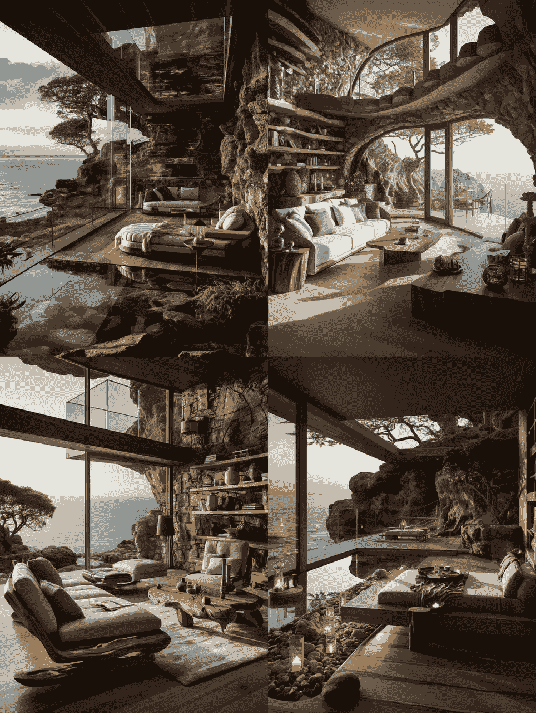

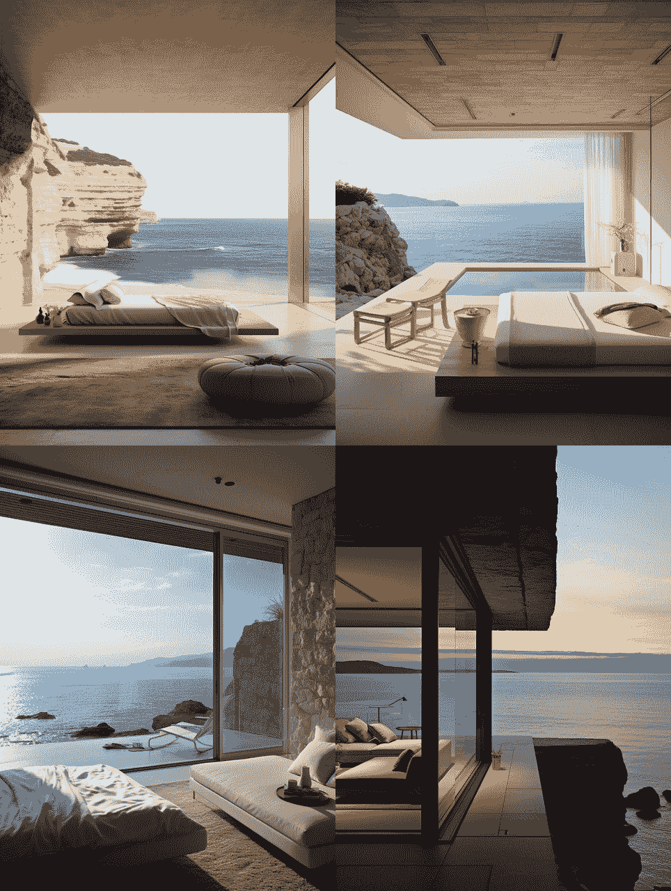