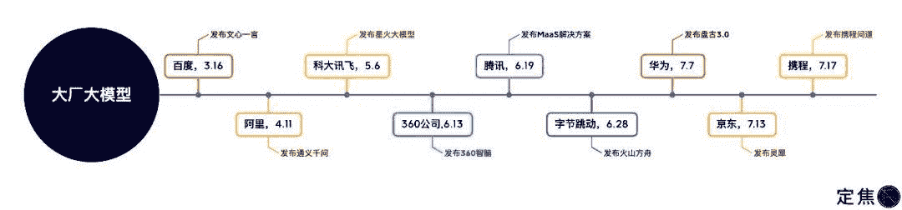
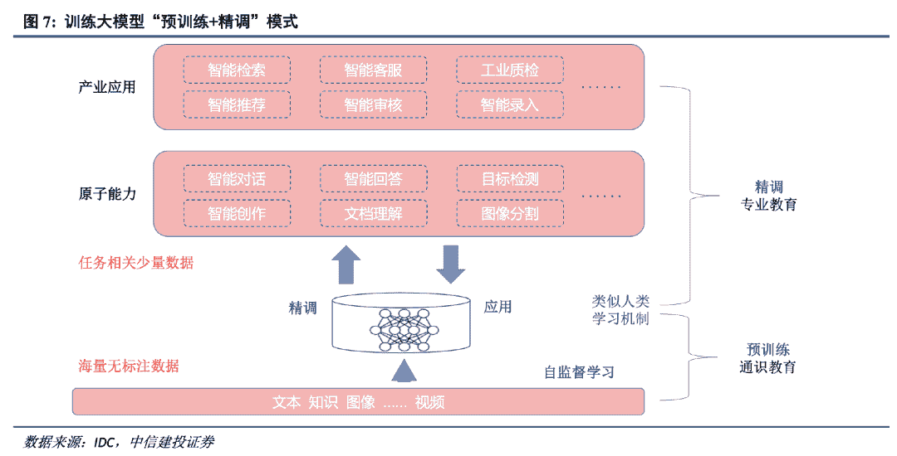
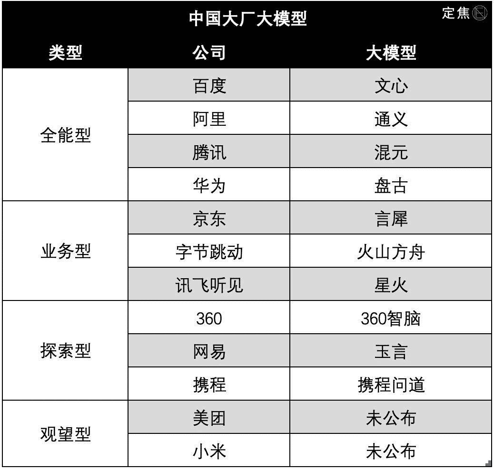

# 2023-07-24大厂混战大模型：四大流派，没有赢家 – 人人都是产品经理

> 来源：[https://xuqiwei1986.feishu.cn/docx/XsRldn8nsoLTW9xispVcElFon1f](https://xuqiwei1986.feishu.cn/docx/XsRldn8nsoLTW9xispVcElFon1f)

> 🔗 原文链接： h[ttps://www.woshipm](https://www.woshipm.com/ai/5872614.html).com/ai/5872614....

>

> 在最近几个月以来，有关大模型的消息频频出现，而就在大厂们纷纷下场之后，我们可以大概归纳出大厂大模型的不同“流派”了。本篇文章里，作者便总结了4个类型，并对大模型的能力、布局等方面进行了一定分析，不妨来看一下。

今年以来，整个科技圈最热闹的事情，是发布大模型。

从3月百度率先发布文心一言以来，阿里、科大讯飞、360、腾讯纷纷跟上。7月，华为、京东、携程也召开发布会，虽迟但到。

科技公司又卷起来了。以至于某头部互联网大厂的技术负责人，在一场发布会开场就强调：“今天不会发布预训练多模态大模型，今天也不会蹭大模型的热点。”

7月17日下午，在携程发布旅游行业垂直大模型后，除了极个别藏着掖着的互联网大厂，大厂大模型基本集结完毕。

中国大厂大模型发布时间线 制图 / 定焦

大模型越来越多，虽出自大厂，但真假难辨。大家的招数也不同，有的迷恋“作诗”，有的埋头“做事”，还有的“讲故事”。

根据资源能力、布局深度、出招套路，大厂的大模型可以分为不同的流派。「定焦」将它们总结为四大类型：

1.  全能型：百度、阿里、腾讯、华为

1.  业务型：京东、字节跳动、科大讯飞

1.  探索型：360、网易、携程

1.  观望型：美团、小米

业界普遍认为，第一梯队当属百度、阿里、腾讯、华为四家，它们的综合实力最强。京东、字节跳动、科大讯飞位列第二梯队，业务属性较重；360、携程、网易还在探索阶段；美团、小米还没有发布大模型。

当然，这个分类是动态的。行业变化太快，大厂的进展也是一日千里，格局随时可能改写。

接下来，「定焦」就带大家探讨一下，大厂的大模型都长啥样，哪家的大模型最强，以及，大厂大模型，拼什么？

## 一、两条路线，三个层级

在讨论大厂大模型之前，我们先做一个背景科普。

首先，大模型不是新鲜事物。它不是突然蹦出来的，只是被ChatGPT带火了。在去年11月底ChatGPT问世之前，百度、阿里、腾讯、华为等大厂就有自己的大模型，而且经常在一些国际测评类榜单中刷榜。

具体到大模型的类别， 有两条大的路线，一是通用，二是垂直。

所谓“通用”，可以简单理解为大模型啥都会；“垂直”，是在某个特定领域做的特别好。这其中的差别，就像一个高中生毕业了，基本的能力素养都有，但没啥专业性；另一个是职高毕业，综合能力差点，但可能工地搬砖有一手，或修车修的好。

ChatGPT，以及百度文心一言、阿里通义千问，都是通用大模型，能聊天、写诗、作画，看起来比较全能。但你要让它去做专业的在线问诊、物流规划，可能做得很一般。

与之对应，像华为推出的矿山大模型、实时预测全球海浪的大模型，以及京东金融行业大模型，主打的就是“做事”和“专业”。

这两条路线，是我们理解大模型的基础，也决定了大厂在布局大模型赛道时的战略方向。

那么，不论是通用大模型还是垂直大模型，企业具体能做什么？

百度创始人兼CEO李彦宏曾给过创业公司一个建议：没有必要再重新做基础大模型，创业者的机会是在应用层，将出现“全新的、十倍于现在🛰️和抖音的创业机遇”。

先抛开这个观点的立场，这里提到了“基础大模型”和“应用层”。这就涉及到大模型的三个层级。

**中国大模型的创业生态，玩**家都在不同层级进行站位—— 架构层、模型层、应用层。

架构层的进入门槛最高，功能有点类似基础设施，能参与进来的主要是各大云计算厂商，比如阿里、腾讯、百度、华为这四巨头。

模型层的一大重点是基础大模型，对算力、算法、数据、人才的要求非常高，一般的创业公司做不了。有一些公司选择在基础大模型之上做一些微调，针对性推出行业大模型。

应用层是基于前两类大模型，调用API开发应用，就像手机行业基于安卓和iOS开发APP，这是大部分创业公司能做的事情。大众熟知的ChatGPT，其实是OpenAI对GPT-3模型微调后开发出来的对话机器人应用。

中国的科技公司在布局时，尤其是BAT这样的超级巨头，往往会交叉覆盖三大层级。基础打法是先发布通用大模型或者行业大模型底座，其他公司再基于这些基础模型，结合自身拥有的行业数据，微调出自己的大模型应用。

因为ChatGPT的火爆，很多人将大模型理解为一个应用或一款产品，是不太准确的。大模型正在形成一个生态，这其中有修高速公路的，有盖房子的，还有搞精装修的。

有野心的头部大厂想拿下壁垒最高、赛道最宽阔的架构层和模型层，但难度和风险系数极大，很可能投入之后看不到成果。中部大厂更多选择在一些垂直行业深耕，先在具体场景落地，看到效果之后再加大投入。更多的大厂其实还在探索阶段，一边观望一边行进，摸着石头过河。

## 二、大厂的招式与武功

随着互联网大厂陆续发布大模型，大厂们的布局逐渐清晰起来。

**我们将百度、阿里、腾讯、华为归入一梯队，一是因为他们在大**模型上起步早，布局深，二是因为能力全面。

百度是国内第一个推出聊天机器人产品，开放内测，硬刚ChatGPT的公司。

再把时间往前推四年，百度在2019年3月就对标谷歌BERT模型，推出了文心大模型ERNIE 1.0，中文效果超越BERT。这个模型在2021年12月参数达千亿，跨入“智能涌现”门槛。ERNIE 3.0 Zeus也是国内首个开放API调用的千亿大模型。

阿里在今年4月11日发布对标ChatGPT的大语言模型通义千问，快速接入钉钉、天猫精灵，然后在3个月内推出了聚焦音频的大模型应用通义听悟，以及AI绘画大模型通义万相，通义大模型家族日渐成型。

如此快节奏，是因为阿里把准备工作做到位了。阿里很早就发布了语言大模型Plug和多模态大模型M6，M6在2021年10月参数规模达10万亿，是当时全球最大的AI预训练模型。这两个模型在去年9月合并，发展为今天的通义大模型。

腾讯直到今年6月下旬才召开发布会，是大厂中相对较晚的一个，而且它没有像百度、阿里一样发布通用大模型，而是面向B端客户发布了行业大模型解决方案。华为也是一样，它在7月7日发布面向行业的盘古大模型3.0，没有发布聊天机器人。

腾讯和华为的硬实力都很强。腾讯在去年4月发布了混元大模型，这是一个集计算机视觉和自然语言处理于一体的多模态大模型，已经在腾讯各大业务模块中应用。华为的盘古大模型早在2021年4月就发布了，还落地了一些具体的场景。

这波AI2.0浪潮，很多能力都是建立在云平台之上。不论是算力、模型，还是工具链，都是通过云平台对外输出。在此基础上，大公司建设大模型生态，支撑更多应用生长，是一套比较高级的打法，目前能玩转的也就这四家大厂。

**二**梯队的京东、字节跳动、科大讯飞，我们将之归入“业务型”选手，因为他们的能力侧重模型层，更看中跟业务结合。

比如京东，7月13日京东推出AI大模型“言犀”，这是一个面向产业的垂直大模型，侧重解决真实场景的实际问题。过去这些年京东除了在电商卖货，物流、金融、健康等业务也发展起来了，所以“言犀”大模型一开始主要面向零售、金融、城市、健康和物流领域。早期自用为主，后期向外部客户开放。

再比如科大讯飞。“星火认知大模型”在5月6日发布，同时发布的还有其在教育、办公、汽车、数字员工方向的落地应用，还将接入学习机、录音转写工具“讯飞听见”等产品。

字节跳动的玩法比较特别，它在6月28日发布了“火山方舟”。注意，这不是大模型，官方说法是“企业级大模型服务平台”。简言之就是一个大模型超市，字节不生产大模型，只“搬运”大模型。

这三家大厂，在做业务方面都很有一手。对他们而言，大模型更多是一个工具，先在自己内部跑通，把效率提上来，看到实实在在的效果后，再考虑加大投入推广。

三梯队的360、网易、携程，大模型还在探索阶段。

这其中360可能不服气，自从ChatGPT火了之后，低调了很久的“红衣教主”周鸿祎突然又活跃起来，频频发表言论。已经包装成“数字安全公司”的360，在6月13日发布“360智脑大模型”和一款数字人产品。

不过，虽然产品功能丰富，但外界对360大模型的技术水平存疑。360自称前期在AIGC技术一直有投入，去年还发起了计划投资总额2.23亿元的项目，半年过去了，募来的钱只投了5%。

携程和网易在大模型上的布局，目前还不是很系统。网易声称从2021年开始打造“玉知”多模态理解大模型，借助了华为昇腾AI的力量，在行业里存在感不强。携程发布旅游行业垂直大模型“携程问道”，出发点是提升内部各大业务的工作效率。

美团和小米没有发布大模型，但内部已经启动相关项目。美团最新的动态是接盘王慧文的光年之外，这对美团的大模型业务实际有多大帮助，尚待观察。

## 三、大厂大模型，拼什么？

这么多大模型，怎么评估好坏？

上半年的“百模大战”中，中国大厂们在推出自家大模型时，都喜欢拿参数量说事。ChatGPT已经证明了大模型存在“涌现”现象，大模型的参数量越大，智能程度越高。

这是一个非常粗暴的指标。阿里、百度等大厂几年前就推出过万亿参数的大模型，但参数大和能力强是两回事。

另外一个常用的评价维度是公开的评测集和榜单打分，中国的大厂非常喜欢参与。

比如腾讯，腾讯的混元大模型去年发布后，参加了很多榜单排名，在MSR-VTT，MSVD，LSMDC，DiDeMo和ActivityNet五大跨模态视频检索数据集榜单中，先后取得第一名的成绩，实现了跨模态检索领域的大满贯，分数更是打破多项纪录。

百度的文心大模型，过去几年也经常登顶全球权威的GLUE榜单，甚至超过微软、谷歌、OpenAI等公司。最近IDC发布了大模型评估报告，百度文心大模型在7项核心指标上拿下满分，综合评分第一。

这个方式的局限性在于， 会导致出现一些“应试型选手”，测评分数跟实际表现相差较远。

国内一家AI创业公司的创始人季定宇对「定焦」说，“大模型是综合能力的体现，所有的测评都不能体现全部”，“在刷榜这件事上，大厂们就没有输过”。

当一个新的风口出现时，创业者和资本一拥而上，导致信息差普遍存在。尤其是在早期阶段，外界缺乏足够的辨别力，这个时候谁的声量大，谁就能获得更高的关注度。

华为的盘古大模型推出两年来，普通人知之甚少。ChatGPT火了之后，盘古大模型迅速升级到3.0版本，并再次重磅向外界发布。

盛景嘉成董事总经理刘迪对「定焦」说：“对于大厂而言，当大家都在发布大模型时，你是不能缺席的。因为GPT的影响，大厂很被动地将原来可能计划在2-3年做的事情，压缩到三个月快速地做出来。”

这就像一场赛跑，大家都在抢跑，顾不上姿势和动作是否优雅。

对一些大厂而言，把什么产品、哪块能力拿出来发布，是一道选择题。大厂也要迎合热点、造势、包装。开发布会更多是一个宣传行为，真正的功夫是在台下，在幕后。

为了突出自身优势，很多大厂会对标GPT，用“在指标前加定语”的方式来作对比，尤其是“中文能力”这项指标。但目前，从C端用户反馈来看，用户量最大、体验最好的，依然是ChatGPT。

刘迪认为，从商业模式上，大厂很难将大模型包装成类似🛰️这种，大范围使用的付费C端产品，因为算力太稀缺。“现在的算力用来做微调和日常的B端业务处理都已经很紧，C端的量一旦上来，大厂支撑不住。

这导致的结果是， 卖算力资源的云厂商，抢先一步吃到了大模型的红利。

提前囤了超过1万张英伟达GPU的字节跳动，直到现在也没有推出自己的大模型。在大厂发布大模型最热闹的4月，它旗下的算力平台火山引擎，推出了自研DPU等系列云产品（DPU是一种定制化的加速硬件），支持万卡级大模型训练。

字节跳动选择为其他大模型公司提供算力服务，双方的关系就像微软和OpenAI、亚马逊和Bedrock。火山引擎总裁谭待称，国内大模型领域的数十家企业，超过七成已经在火山引擎云上。

综合来看，大模型赛道还处在早期阶段，大厂们虽然发布了产品，但抢跑的意味很浓。因为赛道够长，一时的抢跑无法形成长期优势。而且，行业变化迭代太快，技术、产品都可能随时重新洗牌。

短暂的声量之争过后，才会进入比拼硬实力的阶段。

## 四、谁最有可能胜出？

从年初至今，大家对大模型的认识在逐渐发生变化。

年初，行业里的共识是，通用大模型是未来。大家觉得，通用大模型在各个场景都有很好表现，可以解决一切问题。大厂中，已经发布类ChatGPT产品的有百度、阿里、科大讯飞、360。

后来，大家发现这些产品更像是玩具。它们擅长坐而论道，你跟它们聊天没问题，但要让它们干具体的活，可能不太靠谱。

大厂迅速捕捉到了市场的变化。百度就发现，文心一言发布后，一开始来交流的企业都是CEO级别的人出面，后来大多是技术负责人或业务负责人。字节跳动发现，来找火山引擎的企业，四五月份都是模型厂商，需求是训练模型，现在是一些行业客户，希望在营销、客服等场景落地。

**于是下半年，风向变了。 **行业迅速达成新的共识： 行业大模型更靠谱，要从通用面向产业 。大厂对外讲故事的口径也随之变化，纷纷开始发布行业大模型。

腾讯在6月下旬推出行业“精选模型商店”时，腾讯云与智慧产业事业群CEO汤道生说，“聊天机器人不是唯一的大模型服务方式，也不一定是满足行业需求的最优解。”

华为7月上旬发布的盘古大模型3.0是面向行业，华为常务董事、华为云CEO张平安称，华为的盘古大模型不写诗，要扎根于行业，为各个行业带来价值。

京东的“言犀”大模型定位直接就是面向产业。京东云事业部总裁曹鹏说，对话类的通用大模型不应该是大模型的全部，大模型不应该只是拿来聊天写诗作画的玩具。

在diss通用大模型的同时，这三家大厂开始在“产业”上大做文章，凸显自己的优势。他们的产品，均主要面向To B行业市场。

**刘**迪认为，对于大厂而言，大模型有两个价值， 一是内部做节流，把优化的效率转化成利润；二是对外拓客，让其他客户赚到钱，大厂从中拿走合理的利润。最终一定要商业化。“ 抛开技术指标，评价一个模型好不好用，就看用的人多不多。一看收费客户数量，二看创造的收入金额。”

MaaS模式（Models as a Service，模型即服务）开始被更多大厂搬到台面上。去年的云栖大会，以及今年的百度文心一言发布会，都提到了这一概念。腾讯则公布了MaaS能力全景图。

就像当年的云计算市场一样，底层算力和平台能力可以构建壁垒，市场需要算力强悍、模型全面的服务商。那些在算力、平台、模型、应用方面都有布局的大厂，对企业客户具备更强吸引力。

百度、阿里、华为，除了自研大模型产品，还完成了从芯片到应用的布局。百度是“昆仑芯+飞桨平台+文心大模型”，阿里是“含光800芯片+M6-OFA底座+通义大模型”，华为是“昇腾芯片+MindSpore框架+盘古大模型”，这是其他公司在短期内很难追上的优势。

**季定宇认为，在中国做通用大模型**的公司，最终只能跑出一家， 做个好的比早做出来更有价值。 “我最看好字节跳动和腾讯，一个是团队符合，一个是场景符合。”

刘迪更看好三家大厂——美团、字节跳动、华为。他对「定焦」分析：美团是基于场景去找业务，基于C端用户高频的交易数据，能快速迭代模型；华为主打生态圈，在G端资源强大，具备极强的拿行业数据的能力；字节跳动之前已经将很多AI技术应用到自家产品中，迭代能力极强。

不过，这都是基于现阶段的理论分析，行业格局具体会如何演变，还要看大厂们接下来如何出招接招。毕竟，大模型的赛道才刚刚铺开。

*应受访者要求，季定宇为化名。

作者：温故；编辑：方展博

来源👸号：定焦（ID：dingjiaoone），深度影响创新。

本文由人人都是产品经理合作媒体 @定焦One 授权发布，未经许可，禁止转载。

题图来自 Unsplash，基于 CC0 协议

该文观点仅代表作者本人，人人都是产品经理平台仅提供信息存储空间服务。