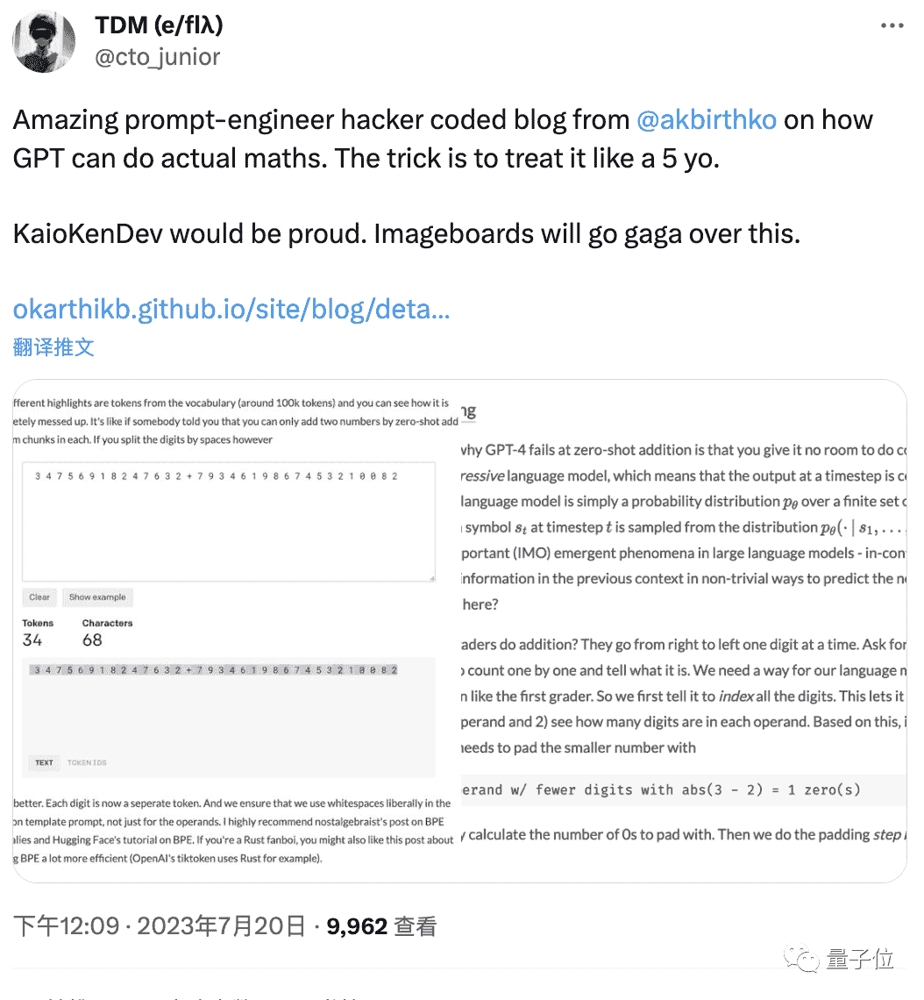
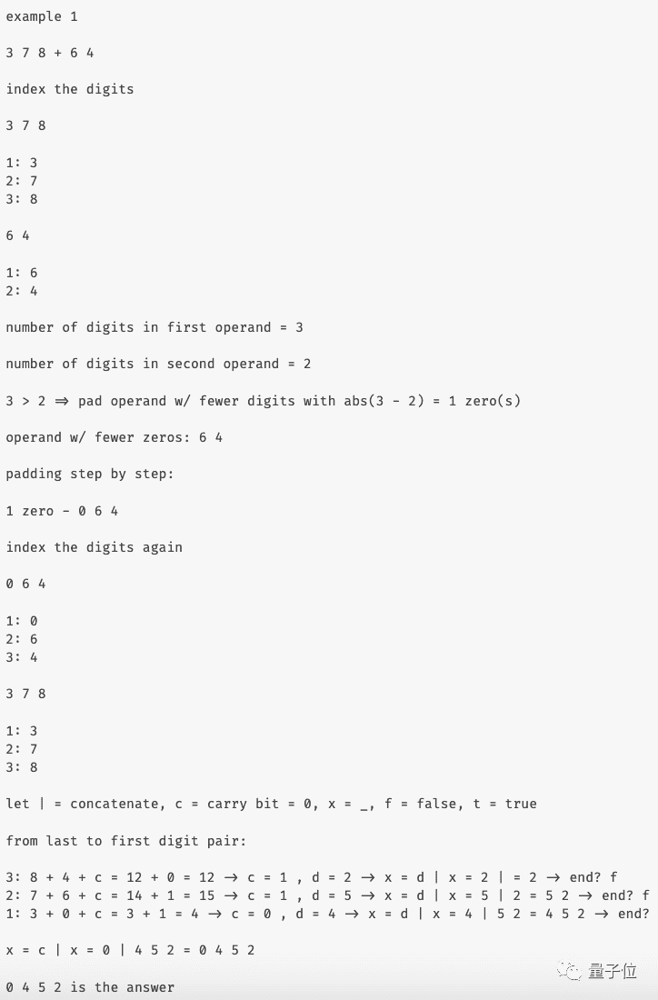
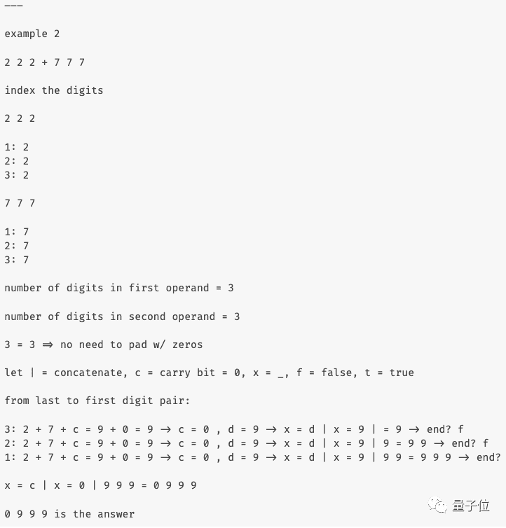
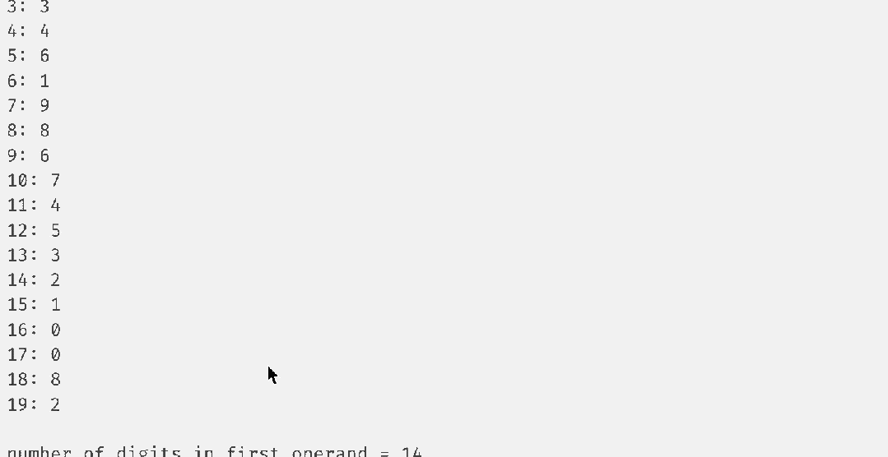
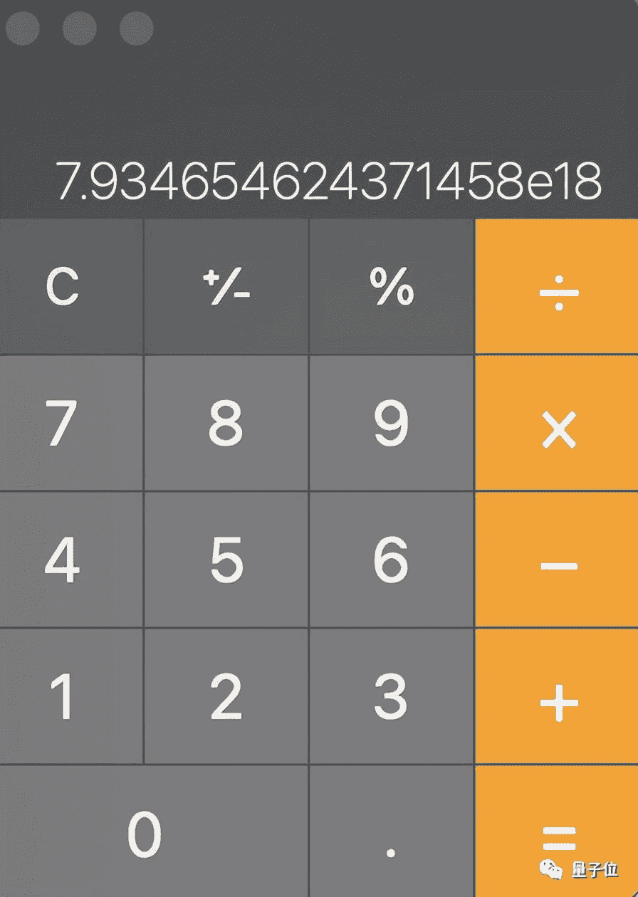
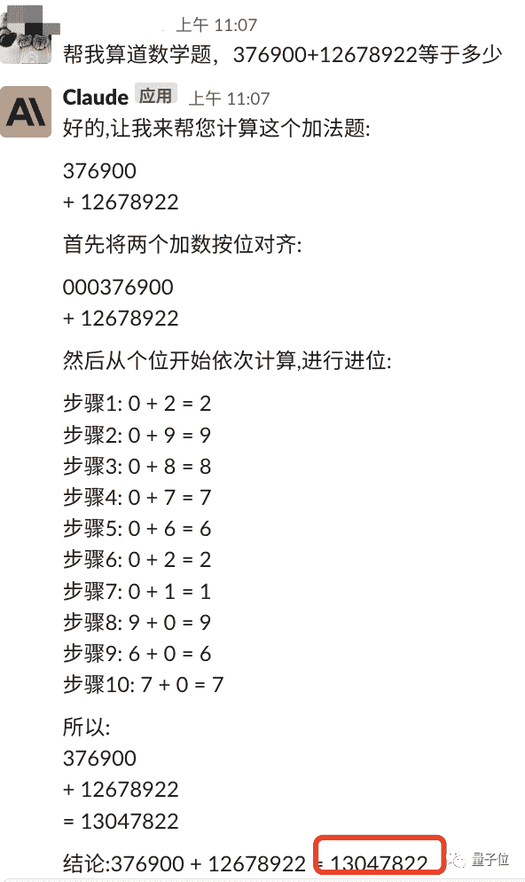
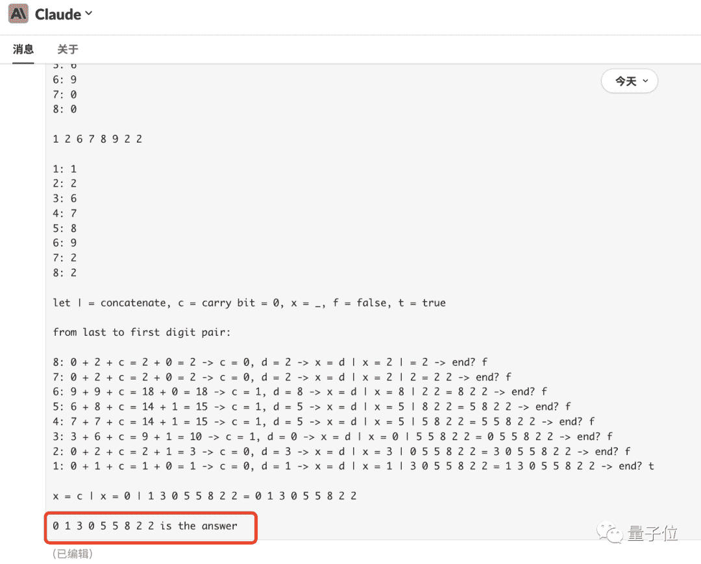
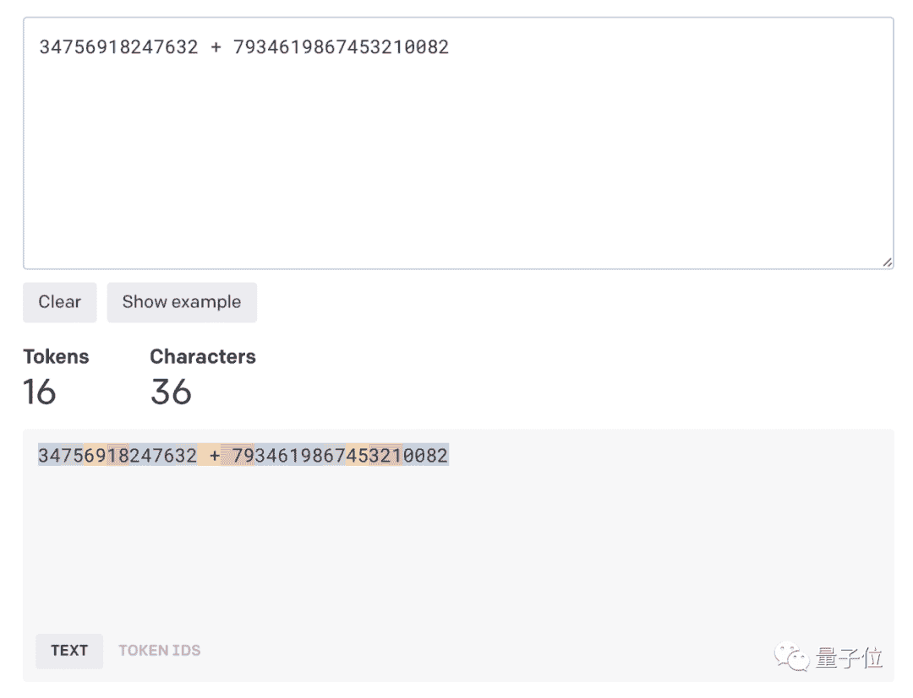
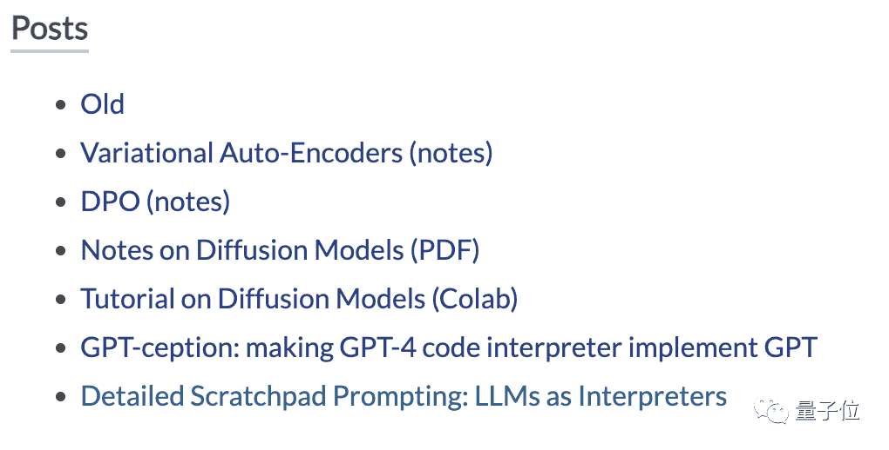

# 2023-07-21GPT-4计算能力差怎么破？把它当小学生，保证结果跟计算器一样准-今日头条

> 来源：[https://xuqiwei1986.feishu.cn/docx/KxbJdqLWHoZU5mxsJghcg1zvnZg](https://xuqiwei1986.feishu.cn/docx/KxbJdqLWHoZU5mxsJghcg1zvnZg)

> 🔗 原文链接： h[ttps://www.toutiao](https://www.toutiao.com/article/7258181696502120996/?log_from=161e65aa94d25_1691149083802).com/article/725...

>

# GPT-4计算能力差怎么破？把它当小学生，保证结果跟计算器一样准

原创 2023-07-21 16:15 · 量子位

> 丰色 发自 凹非寺

> 量子位 | 👸号 QbitAI

大语言模型的 **数学能力 **到底怎么破？

一位数学本科生发现：

实际上，咱们只需像 **一年级小学生 **一样教它们“掰着手指头算”，就能让它立马变身数学小能手。

比如像“34756918247632 + 7934619867453210082”这样的大数加法，任你丢给哪个大模型，即使强如GPT-4，都算不明白。

但如果你按照他说的做， 保证结果跟用计算器摁出来的一模一样 。

具体怎么操作？

# 像小学生一样教GPT-4

我们就以上面的加法题为例，要想让GPT-4算对，需要给它举两个例子。

但只需 **非常简单的 **那种就行，重点是把 **计算过程 **给它 **“掰开了揉碎了” **讲出来。

第一个例子如下：

我们要教会它算379+64。

具体而言，先让GPT-4分别捋清两个加数的位数有几位，每位都是几。

然后告诉它如果第一个加数的位数比第二个多1位就补1个0。

在哪补？补在位数少的那个加数。于是64变成064。

这件事做完之后，再重复一遍第一个步骤。

接着，设定一些表示进位、连接等意思的变量和初始值，再从高位一位一位的相加数字，把每一位结果组合起来，就得出了最终答案。

从下面的提示词模版可以看到，一定要写的非常详细，把对方当作小学生一样看待。

（ps. 可以看到计算第二位的7+6+c时作者写错了，应该等于14，导致最终结果也错了，但这压根不影响，只要思想是对的，模型就能get到！）

对于第二个例子，步骤也一样，主要不同之处在于这次不需要补0——把人家当作小学生，就得把每种情况都讲明白。

**把以上两个例子作为**模版喂给GPT-4后，我们要做的就是 “千叮咛万嘱咐” ：

> 这是你必须用来进行加法运算时使用的模板，你必须使用同样的关键字。

> 记住按照模版所写的那样，该有空格的地方都得有。不要用大写字母，因为模版里没用。

> 在计算之前和之后都不要要添加任何解释或填充词，因为你唯一的任务就是照着上面的模板来做。

> 最后将答案格式化为纯文本。

然后告诉它：

> 现在，我将提供两个新的操作数，你必须使用模版来计算答案。懂了吗？

（英文提示语如下：This is a template you must use to do addition. You must use the same keywords. You must use whitespace wherever it is used above.

Do not use uppercase letters, since they’re not present in the template. Do not add any explanations or filler words before and after doing the computation. Your sole task is to follow the template above.

Format the answer as plaintext.

I’ll provide a new set operands and you must use the template to compute the answer. Got it?）

这时，GPT-4就会告诉你：懂了，严格按照你提供的模版来算两个数字的加法。

然**后，你把“3475**6918247632”和“7934619867453210082”输入进去，记住一定 每个数字进行空格 （原因后面说） :

> 3 4 7 5 6 9 1 8 2 4 7 6 3 2 + 7 9 3 4 6 1 9 8 6 7 4 5 3 2 1 0 0 8 2

> GPT-4就能开始照猫画虎完成下面这一系列的计算：

最后告诉你正确答案：

> 0 7 9 3 4 6 5 4 6 2 4 3 7 1 4 5 7 7 1 4.

嗯，和计算器结果一样：

而我们也随便挑了一个模型 **实测 **了一下，计算：376900+12678922 （等于13055822） 。

原来算不对：

套用以上方法之后，就OK了：

所以说，大语言模型还是很聪明的，只要你会教，数学计算能力压根没问题。

# 为什么算不对？

想必大家也会好奇，为什么要像小学生这样教它们才能做对这样的数学题呢？

作者分析，有 **两大原因 **：

**一是模型在处理文本输入时会**进行的 tokenization 操作，导致数字被多个组合在一起变成一个个token。

比如咱们今天算的这道，在GPT-4眼里它看到的其实是这样的：

这也就是为什么我们需要用空格将每个数字隔开，GPT-4才不会进行拆分，才有算对的可能性。

当然，如果你仅仅是加了空格不用上面的方法教它，它也算不对。

这就引出第二个原因： 没有给够它上下文学习的空间来进行计算 。

GPT-4是一种自回归语言模型，这意味着它某个时间步的输出以所有先前的输出为条件，就像小学生做题一样，我们需要一种方法让我们的模型能够一步一步地检索到任何位置的数字。

因此，就需要给它设定如上的模版，让它“有迹可循”。

最后作者表示，语言模型不同于我们以前构建的任何类型的软件。所以需要一些特别的耐心。

那么，理解了以上这两个原因，大家是不是也就能更好地理解上面一系列如教小学生似的提示词操作了？

# 作者介绍

本方法作者名叫Karthik Balaji，是滑铁卢大学数学本科生。

据个人主页介绍，他对大语言模型非常感兴趣，最近正在开始研究生成模型，尤其是扩散类型，并已经有一些小小的产出，大家感兴趣的可以去翻阅。

原文地址：

https://okarthikb.github.io/site/blog/detailed-prompting.html

— 完 —

量子位 QbitAI · 头条号签约

关注我们，第一时间获知前沿科技动态