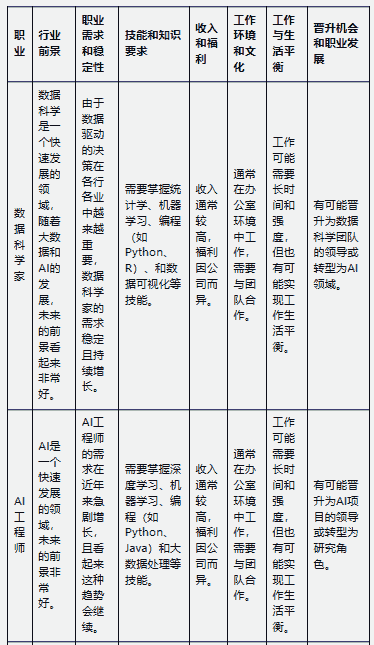
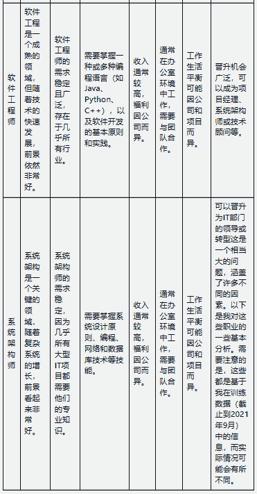
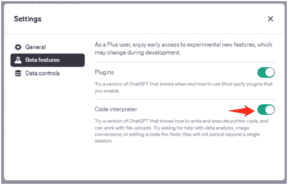
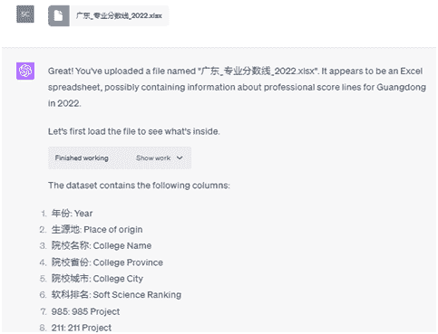
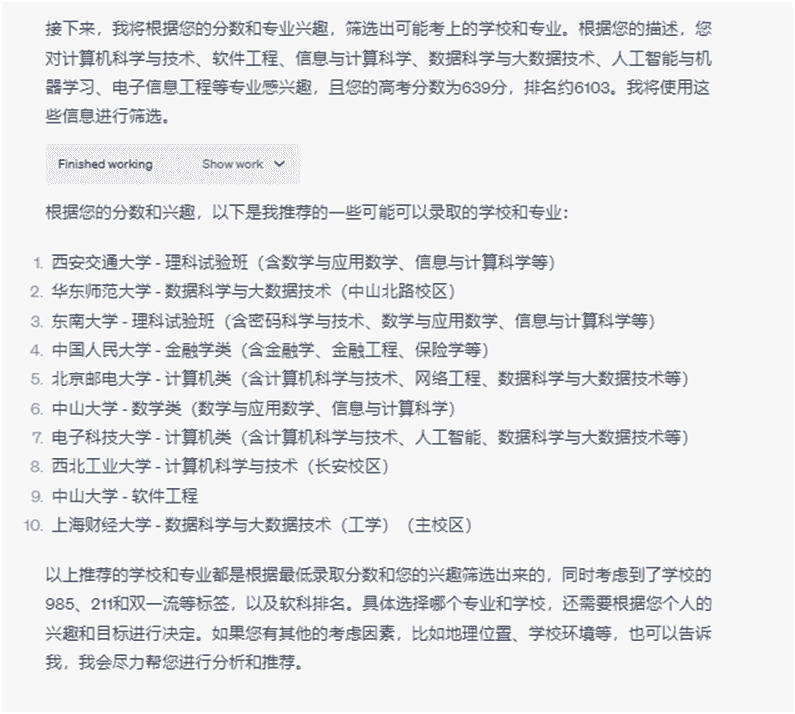

# 【给娃收藏好】如何用ChatGPT填报高考志愿，AI神助攻省你1万

> 来源：[https://xuqiwei1986.feishu.cn/docx/YdQRdqzInoIY3Jx6ygic0QO5nVb](https://xuqiwei1986.feishu.cn/docx/YdQRdqzInoIY3Jx6ygic0QO5nVb)

Hey！我是 **发愤的草莓**，投稿出版过一本书的职场二宝妈。目前正在参与 AI 之心写作训练营。

坊间都说“三分高考，七分填报”。既然 ChatGPT 能让普通人秒变数据分析师，那是不是可以用来辅助填报志愿呢？

要知道，高考志愿填报辅导将近 1 万左右，省下一笔咨询费也是香啊！

## AI 辅助职业选择：淡定填报高考志愿

《高招调查报告》显示，超过 85% 的学生盲目选择大学专业，71% 的大学生后悔选错了专业。

也难怪，每年高考新专业如雨后春笋。乡村治理、工会学、家庭教育、国家公园建设与管理、无障碍管理…… 2023 年的高考招生就新增 20 多个普本专业。

**学生不仅**要了解完近 800 个专业，还要学习平行志愿录取要点、分数优先、一次投档、多元升学等等是怎么回事。

不巧，又撞上人工智能时代悄然来袭，杀得职场世界措手不及，职业赛道卡牌面临重洗。

对于许多学生来说，选择一个“适合自己、毕业时还存活”的职业，像走进迷宫那样变得扑朔迷离。

然而，留给考生填报志愿的时间不过 3、4 天。

在这短短的时间里，

往日盘旋在题海上空的“精卫鸟”，

心中马上就有清晰的职业意向吗？

知道未来报考什么专业更适合吗？

明白为了梦想需要锤炼什么技能和本领吗？

不好说。

即便是高考卷面 100 分的学霸，人生的答卷也要经历世事才能答。

毫无准备的学生和家长往往感到无从下手。信息太杂，脑袋都要爆炸了，填得好不好，更多只能靠运气。

好在有 AI 能帮上忙，像聪明的导航指引参考的道路。

它的多问多答可以帮助学生根据兴趣、特长、趋势等规划未来，在 1 分钟内让职业建议“嗖嗖嗖”来到跟前。

帮你更大概率找准适合的学校和专业，不会在毕业之后感慨“当年要是有人告诉我这些就好”。

**后续讲解的 AI ，如无特殊说明，均使用以 ChatGPT4 作为工具版本来产生内容，名称为“ G 博士”。**

站在人生选择的十字路口，让AI成为智慧罗盘，帮助考生从“清晰认识自我”到“聚焦适合专业”，最后到入学前的“提前充分准备”。

## 一、清晰认识自我

说到填报志愿，我们第一时间想到学校、城市、专业这些外部要素，但其实，容易被忽视的不是外部，而在内部——

先让学生认识自我，知道兴趣爱好、价值观、个性特点、职业规划、生活期待、人生志向等等。

虽然，基于生涯规划的霍兰德职业兴趣等测评量表很多，有的学校也会为学生采购相关的测试卡。

但是，往往做完测试，厚厚的一沓专业报告还得细细解读，在填志愿的紧张之余还要与时间赛跑，尤为考验耐心。

在认识自我上，不妨通过以下互动链条，请 AI 快速帮个忙：

> 定位角色——梳理信息——翻转提问

### 第一步，定位角色

**草莓说：如果你不知道该用什么身份来为自己做咨询，可以先定位角色。你一问，AI 就乖乖告诉你，有什么角色可以选。**

**【学生】**

**我是高三毕业生，正在填报高考志愿，请问什么人或机构能帮助我提升填报的准确率？**

> **【G 博士】**

> 1.高考志愿填报指导师或生涯规划师：他们可以基于你的兴趣、优势和长期目标，帮助你理解哪些专业和学校可能最适合你。

> **2.学校的升学指导老师**：许多高中都有专门的升学指导老师，他们通常了解高考录取流程和各个学校的特点，可以提供有价值的建议。

> **3.线上平台和工具**：现在有很多线上平台和工具，可以提供个性化的高考志愿填报建议，以及历年录取分数线等数据参考。

> **4.专门的研讨会和讲座**：许多高等教育机构和专业组织会举办面向高中生的研讨会和讲座，专门讲解如何选择大学和专业等问题。

> **5.在校大学生或毕业生**：他们可以分享他们的经验和见解，帮助你理解某个专业或学校的实际情况。

> **6.父母和亲朋好友**：他们可能对你的个性、兴趣和能力有深入了解，他们的建议也可能非常有价值。

> **7.专业书籍和文章**：市面上有许多关于大学和专业选择的书籍，可能会对你有所帮助。

> **8.AI 工具**：一些AI工具可以根据你的成绩、兴趣和目标，以及高校的录取数据，提供一些填报志愿的建议。

> 以上资源和人员可能都能帮助你提高填报高考志愿的准确率，但最终决定应以你自己的兴趣和长期规划为基础，因为这关系到你未来的学习和生活。

### 第二步，梳理信息

**草莓说：知道让 AI 充当什么角色后，再问问这个角色会涉及的信息资料等，方便后续推进个性化咨询。**

**【学生】**

**如果是世界一流的高考志愿填报指导师或生涯规划师，要给我这个高三毕业生做咨询，会准备哪些与志愿填报相关的信息，还要具备哪些能力？**

> **【G 博士】**

> **需要准备的信息：**

> **1.学生的信息**：包括学生的成绩、兴趣、性格、价值观、职业目标等。这些信息可以帮助他们了解学生的需求和目标，然后提供个性化的建议。

> **2.高校的信息**：包括高校的录取标准、专业设置、学术声誉、就业前景等。这些信息可以帮助他们为学生选择合适的高校和专业。

> **3.行业的信息**：包括不同行业的就业前景、职业发展路径、所需的技能和知识等。这些信息可以帮助他们为学生规划职业道路。

> **需要具备的能力：**

> **1.沟通能力**：他们需要能够有效地与学生和家长沟通，了解他们的需求和目标，然后提供个性化的建议。

> **2.分析能力**：他们需要能够分析学生的信息、高校的信息和行业的信息，然后基于这些信息为学生提供建议。

> **3.决策能力**：他们需要能够帮助学生做出决定，例如选择高校和专业、确定职业目标等。

> **4.指导能力**：他们需要能够指导学生实现他们的目标，例如通过教育和培训来实现职业目标。

> **5.学习能力**：由于高校的信息和行业的信息都会不断变化，他们需要能够持续学习，以便提供最新的信息和建议。

> 职业规划师或教育顾问的工作是一个结合了数据分析和人文关怀的工作，他们需要帮助学生和家长从众多选择中做出最适合自己的决定。

### 第三步，翻转提问

草莓说：明确了 AI 咨询师会用到的信息和能力后，就可以对换问答身份，让 AI 来提问，学生来作答，通过问答探索兴趣爱好等情况。最后让 AI 总结陈词。

**【学生】**

**你是世界一流的职业规划师或教育顾问，将通过以上信息和能力帮我制定一个个性化的志愿填报方案，规划最合理的高考志愿填报方式。**

请现在开始高考志愿填报的咨询工作，向我发问。以一问一答的形式进行。

> **【G 博士】**

> 非常好，让我们开始吧。

> 问题1：你平时有什么兴趣爱好？你最喜欢做什么？

**【学生】**

经常玩计算机，对AI很感兴趣，喜欢研究新的效率工具。高中做了一个《走向太空》的网站，参加了省青少年科技创新大赛拿了奖。

> 【G 博士】

> 非常好，看起来你对科技，特别是人工智能和计算机科学有很大的兴趣。那么我们接着往下走：

> 问题2：你在学校的哪门课程中表现最好？你最喜欢哪门课程？

**【学生】**

比较喜欢理科，喜欢物理和数学

> 【G 博士】

> 非常好，对这两门学科的深入理解和兴趣对于理解和学习计算机科学和人工智能等领域非常有帮助。

> 问题3：你在课外活动中扮演什么角色？比如组织者，领导者，参与者等。

**【学生】**

组织过社团活动，喜欢一帮人共同做事的感觉

> 【G 博士】

> 非常好，这表明你具有团队合作和可能的领导能力。

> 问题4：你认为自己的哪些技能或天赋是独特的？例如，是否有特殊的艺术才能，语言能力，运动技能，解决问题的能力等？

**【学生】**

平时喜欢琢磨各种奇怪的问题，乐此不疲

> 【G 博士】

> 这很棒，你的探索精神和问题解决能力是非常宝贵的。

> 问题5：你有没有考虑过自己未来可能从事的职业？如果有，是什么？如果没有，那么你对自己未来的职业有什么期望或希望？

**【学生】**

之前还没考虑过具体的职业。**我想**问，如果站在现在看未来，哪些职业比较有发展前景，能有一技之长，越老越吃香，不容易被AI替代，并且未来可能高薪。

> 【G 博士】

> 你提出的问题非常好。在我看来，以下的几个职业领域可能符合你的期待：

> **1.数据科学家和 AI 工程师**：由于你对AI和数学的兴趣，这两个职业都可能是很好的选择。这两个职业都需要对数学、统计和编程有深入的理解，并且对解决复杂问题有独特的见解。数据科学家和AI工程师在很多行业中都有需求，包括技术、医疗、金融等。这两个职业都有很好的发展前景，并且薪酬通常都很高。

> **2.软件工程师和系统架构师**：这是一个非常广阔的领域，对计算机编程和系统设计有深入理解的人在这个领域可以找到很多机会。而且，随着科技的发展，这个领域的需求只会增加，不会减少。

> **3.研究科学家**：如果你对解决复杂问题和研究新的科技有兴趣，你可能会喜欢成为一名研究科学家。这个职业需要你对某个科学领域有深入的理解，并且对解决复杂问题有独特的方法。研究科学家在学术界和工业界都有很多机会。

> 在选择职业时，你需要考虑你的兴趣和能力，同时也要考虑市场的需求和职业的发展前景。记住，你选择的任何职业都需要你不断地学习和提升自己的技能。

**【学生】**

好的，请你将上面的咨询总结成一段话，帮我更清晰地认识自己。

> 【G 博士】

> 你是一个对科学，尤其是物理和数学有深厚兴趣的学生，并且喜欢通过这两个学科来理解世界。你对计算机科学和人工智能很感兴趣，经常在业余时间探索相关知识和技术。你具有很强的问题解决能力，喜欢挑战和研究新的问题。这种求知的热情和探索的精神将会在科研或工程领域大有所为。此外，不仅具有良好的团队合作能力，还可能有潜在的领导能力。

> 在考虑未来的职业发展，你希望选择一个有前景，能提供高薪，能让你发挥你的优势和兴趣，且不易被AI取代的职业。

## 二、聚焦适合专业

认识了自己的兴趣、爱好等特质后，将注意力聚焦在大学专业的定位上。

通过精心选择合适的专业领域，我们将更好地发挥优势，迈向成功的职业生涯。在聚焦专业上，不妨从以下几个步骤与 AI 互动，像剥洋葱那样逐步缩小范围：

> 分类评价——细化专业——分数匹配

### 第一步，分类评价

**【学生】**

**你是世界一流的职业生涯规划师，为了选择一份适合自己的职业，从客观的角度看，对一个职业要从什么样的框架去认知？**

> **【G 博士】**

> 我建议您在选择职业时从以下几个客观方面来全面认识和评估一个职业：

> **行业前景**：了解所选职业所在的行业前景，包括行业的增长趋势、市场需求以及未来的发展潜力。选择一个具有良好发展前景的行业将有助于您在职业生涯中取得更好的成就。

> **职业需求和稳定性**：评估所选职业的市场需求和稳定性。高需求和稳定的职业将为您提供更多的就业机会，降低失业风险。

> **技能和知识要求**：了解所选职业所需的专业技能和知识。这将帮助您评估自己是否具备从事该职业所需的能力，以及需要投入多少时间和精力进行培训和提升。

> **收入和福利**：了解所选职业的平均收入水平和福利待遇。尽管金钱不是唯一的衡量标准，但它在一定程度上反映了职业的价值和您的生活质量。

> **工作环境和文化**：了解所选职业的典型工作环境和企业文化。一个舒适的工作环境和积极的企业文化将有助于您保持工作热情和提高工作效率。

> **工作与生活平衡**：了解所选职业对工作时间和生活平衡的要求。选择一个能平衡工作与生活的职业有助于维持身心健康。

> **晋升机会和职业发展**：评估所选职业的晋升机会和职业发展路径。选择一个具有良好发展空间的职业将有助于您在职业生涯中不断成长和提升。

> 这些因素可能会因个人情况和需求而有所权衡，所以在做决策时，请根据自己的实际情况综合考虑。

**【学生】**

**您之前推荐的职业领域，我还不太了解。请再将那几个职业按照你说的框架“行业前景、职业需求和稳定性、技能和知识要求、收入和福利、工作环境和文化、工作与生活平衡、晋升机会和职业发展”进行分析。用表格展示。**

**【学生】**

**我对你讲的“AI 工程师”比较感兴趣，能介绍一下这种职业典型的一天是如何度过的吗？**

> **【G 博士】**

> 当然，AI 工程师的一天会因项目、组织以及个人职责的不同而有所不同。以下是一个典型的例子：

> 早晨：开始一天的工作前，AI 工程师可能会先查看自己的电子邮件，看看有没有新的项目更新或者团队通信。他们可能会参加一个团队会议，讨论当天和未来几天的任务。他们也会花一些时间查阅最新的 AI 研究和趋势，以保持知识的更新。

> 上午：早上的工作可能包括编写、测试或者优化AI模型，这可能需要他们用到 `Python`、`TensorFlow`、`PyTorch` 等工具。他们可能需要设计新的模型，以解决特定的问题，或者调整现有模型以改进其性能。

> 午餐：AI工程师可能会利用午餐时间和同事一起吃饭，讨论项目或者分享新的想法。

> 下午：下午的工作可能更多的是处理数据，比如清洗数据、特征工程等。这也是AI工程师的一个重要任务，因为AI模型的性能在很大程度上取决于数据的质量。他们也可能需要向其他团队或者利益相关者解释他们的工作，这需要他们有良好的沟通能力。

> 傍晚：在一天快结束的时候，AI 工程师可能会规划第二天的工作，或者总结他们在当天完成的工作。他们可能会再次查看电子邮件，确认没有遗漏任何重要信息。

> 晚上：工作结束后，AI 工程师可能会参加一些课程或者研讨会，以提升自己的技能。他们也可能会阅读一些技术文章或者研究论文，以了解AI的最新进展。

> 这只是一个大概的例子，每个 AI 工程师的日常工作都会有所不同，取决于他们的具体职责、项目的需求、以及他们所在的组织。

### 第二步，细化专业

**【学生】**

**如果看中“AI 工程师”岗位，你推荐我报考哪些本科专业？**

**【G博士】**

您可以选择以下专业作为首选，这些专业通常与 AI 工程师岗位的要求较为匹配：

**计算机科学与技术**：这个专业涵盖了计算机系统、计算机软件、计算机网络等方面的知识，为 AI 工程师提供了扎实的计算机基础。

**软件工程**：这个专业侧重于软件开发的方法和技术，包括软件需求分析、设计、编程、测试和维护等方面，为AI工程师提供了软件开发方面的专业技能。

**信息与计算科学**：这个专业涵盖了数学、计算机科学等方面的知识，为 AI 工程师提供了理论和算法方面的支持。

**数据科学与大数据技术**：该专业专注于数据收集、处理、分析和应用等方面的技能培训，为AI工程师提供了数据处理和分析的能力。

**人工智能与机器学习**：这个专业专注于人工智能领域的基本理论、技术和应用，为AI工程师提供了直接的知识体系。

**电子信息工程**：这个专业涵盖了电子信息技术、通信技术、计算机技术等方面的知识，为AI工程师提供了硬件和底层技术方面的支持。

请注意，不同高校的专业设置可能有所不同，具体的专业名称可能略有出入。在报考时，请关注各个高校的招生简章和专业介绍，了解专业课程设置，选择与 AI 工程师岗位要求更接近的专业。

**【学生】**

**“计算机科学与技术”和“信息与计算科学”两个专业有什么异同？**

> **【G 博士】**

> 计算机科学与技术和信息与计算科学两个专业在某些方面有一定的相似性，但它们的侧重点和课程设置有所不同。下面是这两个专业的主要异同：

> **相似点：**

> 两者都是计算机领域的专业，涉及计算机科学的基本知识和技能。

> 两者在基础课程上有一定的重叠，如高等数学、线性代数、概率论与数理统计、离散数学、数据结构、计算机组成原理等。

> 两者都需要具备一定的编程能力，学习常见的编程语言如 `C`、`C++`、`Java`、`Python` 等。

> **不同点：**

> **侧重点**：计算机科学与技术专业侧重于计算机软硬件系统的设计、开发和应用，包括计算机系统结构、计算机网络、操作系统、数据库等方面。而信息与计算科学专业更注重数学和计算理论在计算机科学中的应用，如数值分析、最优化理论、图论、算法设计与分析等。

> **课程设置**：计算机科学与技术专业的课程更偏向于计算机工程和技术方面，如计算机组成原理、操作系统、计算机网络、数据库系统、软件工程等。信息与计算科学专业的课程更偏向于数学和理论计算，如高等代数、实变函数与泛函分析、偏微分方程、最优化方法、组合数学、图论等。

> **毕业方向**：计算机科学与技术专业的毕业生更容易从事软硬件开发、系统集成、网络安全等职位。信息与计算科学专业的毕业生则更适合从事数据分析、算法设计、运筹优化等领域的工作。

> 在选择这两个专业时，您可以根据自己的兴趣和职业规划来决策。如果您对计算机系统和技术方面感兴趣，可以选择计算机科学与技术专业；如果您对数学和计算理论更感兴趣，可以选择信息与计算科学专业。

### 第三步，分数匹配

对专业的方向有大致了解后，就是用高考分数去匹配学校。

**为了让推荐更精准，先获取高考志愿相关的数据库：当年的某省《高考普通类分数段统计表》（即“一分一段表”）、《招生计划》以及上一年的《各高校录取专业分数线》。**

这些数据能在中国教育在线网站上查询，也可登录各省招生考试院官网找到。

如需2023年高考数据，可在👸号“AI圆梦火箭”（`gerenguanli`）回复“志愿”获取。

接着，再向AI投喂填报相关的数据库，需要用到2023年7月8日全面放开的插件——`Code Interpreter`。

注意，完成这项工作需要 ChatGPT plus 的 4.0 版本。

如果只是 3.5 的版本，那么会得到回复“对不起，由于我的训练数据截止到 2021 年 9 月，并且无法访问实时网络，所以我无法提供你所需的精确的 2023 年的高考信息。然而，基于我训练时的数据，我可以给你一些可能适合你的一线城市高校的推荐。我建议你还是需要查询最新的高考招生信息，以获取最准确的数据”。

# 开启并使用 Code Interpreter

有了 4.0 版本，点击页面左下方的账号名，选择“`settings`”，将“Code Interpreter”打开，如图 2-1 所示。

图 2-1 CodeInterpreter

使用插件时，在下拉菜单选中“ Code Interpreter (Beta) ”。下面的提示词输入框自动出现“+”钮。点击后，即可将你手上高考填报志愿的数据文件上传。一次可上传一个，多个文件则分次上传，如图 2-2 所示。

图 2-2 上传操作

文件上传成功后，会得到如图回复，如图 2-3 所示：

图 2-3 回复界面

可在数据上传后，进行提问。

## 高考填报志愿咨询

> **【学生】**

> 经过前期的咨询，你鉴于我对理科的兴趣和才能，以及对 AI 的热情，建议考虑计算机科学与技术、软件工程、信息与计算科学、数据科学与大数据技术、人工智能与机器学习、电子信息工程等专业。

> 我是一名广东的理科高考生，2023 年的高考成绩是 639 分，排名约 6103 ，科目为物理、生物、政治。

> 以上文件是参考数据，请你结合数据给出一个个性化的高考填报方案，帮我推荐可能考上的学校。

> **【G博士】**

> 了解了。我们可以根据你的成绩和排名，以及你的兴趣和才能，从数据中找出适合你的专业和学校。具体来说，我们可以找出那些在 2022 年，你的成绩和排名能够达到最低录取标准的学校和专业。

> 我们会考虑以下专业：

> 计算机科学与技术

> 软件工程

> 信息与计算科学

> 数据科学与大数据技术

> 人工智能与机器学习

> 电子信息工程

> 首先，让我们从数据中筛选出这些专业，并查看你有可能被录取的学校，如图 2-4 所示。

图 2-4 筛选专业

> **【学生】**

> 考生和家长倾向在广东就读大学，填报哪些院校的具体哪些专业更适合？

> **【G博士】**

> 如果您希望在广东省内的大学就读，以下是我推荐的一些可能可以录取的学校和专业:

> 1. 中山大学 - 数学类(数学与应用数学、信息与计算科学)

> 2. 中山大学 - 软件工程

> 3. 华南理工大学 - 软件工程

> 4. 华南理工大学 - 软件工程(3+2中澳班)(中外合作办学)

> 5. 深圳大学 - 软件工程(腾班)(粤海校区)

> 6. 深圳大学 - 计算机科学与技术(数学与计算机实验班)(粤海校区)

> 7. 深圳大学 - 计算机科学与技术(卓越班)(粤海校区)

> 8. 暨南大学 - 计算机科学与技术(番禺校区)

> 9. 暨南大学 - 软件工程(番禺校区)

> 10. 暨南大学 - 电子信息工程(番禺校区)

> **【学生】**

> 请上述所有的查询结果，按照有把握程度（可冲击、较稳妥、可保底），每一项分别推荐学校和专业，至少 10 项。

> 先理解可冲击、较稳妥、可保底各自的含义。

> 再以表格形式输出志愿填报方案，包括序号、有把握程度、学校名称、学校性质、专业名称、往年录取分数。

> **【G博士】**

> 明白了，你希望我将建议分为三类：

> 可冲击：这些是你的理想选择，虽然可能比较难以达成，但你有可能被这些学校录取，因此值得一试。

> 较稳妥：这些学校和专业的录取分数线接近你的高考分数，因此你有较高的可能性被录取。

> 可保底：这些学校和专业的录取分数线低于你的高考分数，因此你有非常高的可能性被录取。

> 我将根据这些标准和你的成绩，以及你提供的录取分数线数据，来为你提供建议。我将使用Python来读取和处理你提供的Excel文件。接下来，我会读取你提供的文件并进行分析，分析结果见表所示。

分析结果

有一点需要提醒，AI 提供的信息，要进行常规校验，比如查阅权威的官方网站、咨询高校招生部门等，确保准确性和权威性。在做出最终决策之前，还要结合考生的实际情况，多方考虑，谨慎决定。

# 三、提前充分准备

高考填报志愿只是整个升学过程的一个重要环节，学生们在填报志愿后还需要做其他准备工作。

比如准备强基计划的面试，或者提前为大学专业学习做准备，领跑一步，提高竞争力和适应能力，更好地迎接大学学习的挑战。

## 强基面试准备建议

> **【学生】**

> 我之后要参加某大学的强基面试，应该如何准备？请提供建议清单。

> **【G博士】**

> 恭喜您高考考出好成绩，并有机会参加某大学的强基面试！

> 以下是一些准备建议清单，希望对您有所帮助：

> 1. 了解面试流程和形式：在面试前，了解面试的流程和形式，以便更好地准备。您可以询问学校或老师，或搜索网络上的相关信息。

> 2. 复习相关的知识和技能：面试通常会涉及您所报考的专业的相关知识和技能。因此，请确保您对这些知识和技能进行了全面的复习和准备。您可以参考相关教材或课程资料，或者参加相关的培训班。

> 3. 准备面试所需的资料：面试可能需要您提供一些资料，如个人简历、成绩单、证书等。请提前准备好这些资料，并确保它们的真实性和准确性。

> 4. 提前进行模拟面试：模拟面试可以帮助您更好地了解面试的形式和流程，并且可以帮助您发现自己在哪些方面需要改进。您可以找一些朋友或老师帮助您进行模拟面试。

> 5. 积极参加课外活动：在面试中，您的综合素质和能力也会得到考察。因此，在平时，您可以积极参加各种课外活动，如社团、志愿者、比赛等，以提升自己的综合素质和能力。

> 6. 保持良好的心态和形象：在面试过程中，保持良好的心态和形象也非常重要。请注意自己的言行举止，保持自信、积极的态度，并且尽量展现出自己的优势和特点。

> 希望以上建议对您有所帮助，祝您面试顺利！

> **【学生】**

> 请结合往年情况，罗列可能会提出的面试问题清单。

> **【G 博士】**

> 强基面试题目可能因年份和专业而异，以下是一些可能的面试问题清单，供您参考：

> 介绍一下自己，包括自己的家庭、教育背景、兴趣爱好等。

> 您选择这个专业的原因是什么？您对这个专业有哪些了解？

> 您在学习和生活中遇到的最大的困难是什么？

> 您是如何克服这些困难的？

> 您参加过哪些课外活动？您在这些活动中扮演的角色是什么？

> 您从这些活动中学到了什么？

> 您认为自己的最大优点和最大缺点是什么？

> 您是如何改进自己的缺点的？

> 您的职业规划是什么？您未来的目标是什么？

> 您有哪些计划和准备来实现这些目标？

> 如果您有机会改变世界，您会做些什么？为什么？

> 您对当前社会热点问题的看法是什么？

> 您认为应该采取什么样的措施来解决这些问题？

> 您认为您在团队中扮演的角色是什么？您是如何与他人合作的？

> 您在学习中遇到的最大的挑战是什么？您是如何应对的？

## 面试回答技巧

> **【学生】**

> 如果在强基面试中被问“请谈谈你对未来社会和科技发展的看法，以及你认为自己能在其中发挥什么作用”，如何回答能提升录取的概率？

> **【G 博士】**

> 首先，您可以表达对未来社会和科技发展的看法，例如您认为随着人工智能和大数据技术的发展，未来社会将更加智能化和高效化，人类生活的便利程度也将大大提高。

> 其次，您可以结合自己的专业和兴趣，谈谈自己在未来社会和科技发展中可以发挥什么作用。例如，如果您是计算机专业的学生，您可以提到自己可以通过开发智能软件和应用程序，为人们提供更加便利和高效的服务；如果您对环境保护有着浓厚的兴趣，您可以提到自己可以通过研究和开发环保技术，为保护地球环境做出贡献。

> 另外，您可以强调自己的学习能力和适应能力，表达出自己可以在未来社会和科技发展中不断学习和成长的信心和决心。

> 最后，您可以结合自己的实际情况，例如自己的经历、成就和志向等，展示出自己的独特性和潜力，让面试官感受到您的价值和潜力。

> 总之，回答这个问题时，您需要展现出对未来社会和科技发展的深刻理解和洞察力，并结合自己的专业、兴趣和实际情况，表达出自己在未来社会和科技发展中的价值和潜力。同时，您还需要保持积极的态度和自信心，让面试官感受到您的热情和自信。

## AI 工程师暑期学前准备

> **【学生】**

> 如果我被 “AI 工程师”专业录取，在进入大学前的暑假应该做哪些学前准备？

> **【G 博士】**

> **学习编程基础**：作为AI工程师，编程是必不可少的技能。您可以在暑假期间学习编程语言，如Python、Java等，熟悉基本的编程概念和语法，为以后的学习打下基础。如果你想学习Python，推荐你学习鱼C小甲鱼的免费课程《0基础入门Python》。

> **学习数学基础知识**：在AI领域，数学是非常重要的基础。您可以在暑假期间复习数学基础知识，如线性代数、微积分等，以便更好地理解和应用AI算法。

> **学习机器学习和深度学习基础**：作为AI工程师，您需要掌握机器学习和深度学习的基础知识和算法。您可以在暑假期间学习相关的课程或者阅读相关的书籍，如《机器学习》、《深度学习》等。

> **参加相关的学习和实践活动**：在暑假期间，您可以参加一些AI相关的学习和实践活动，如参加线上课程、参加AI竞赛、参加AI社区等，以便更好地了解和实践AI技术。

> **建立良好的学习习惯**：良好的学习习惯是成功的关键。在暑假期间，您可以建立良好的学习习惯，如制定学习计划、定时复习、积极参与讨论等，以便更好地适应大学学习的要求。

> 除了以上几点，您还可以向学长学姐请教，了解专业的学习和生活情况，做好心理准备，积极适应大学生活。祝您在大学里取得优异的成绩！

## 后记

有小伙伴问，发愤的草莓明明可以在前阵子用这个内容蹭热点，为什么迟来？

说来也神奇，之前带着「爱迪生找钨丝」的信仰，试了千百个方法，差点找人借 API 32k 来实验。

正要放弃的那一天，Code Interpreter 就全面放开。一看到这个无敌插件，当刻我猛拍大腿，踏破铁鞋无觅处，这不正是我要找的。

**期待这份内容能给各位启发，职场二宝妈 发愤的草莓 在孩子睡下后熬夜码的字。**

让我们一起拥抱 AI 时代，冲呀！（Neverstop3721)
