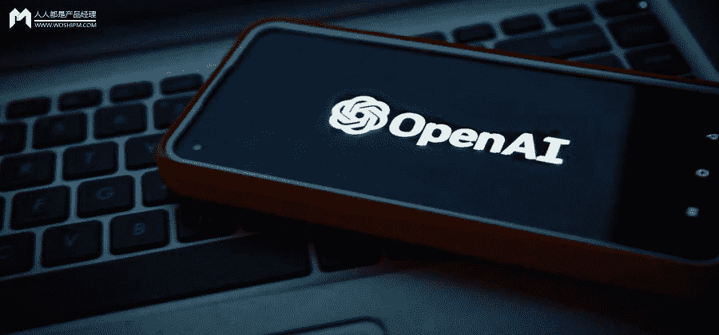

# 2023-07-14关于GPT-5目前所知道的一切 – 人人都是产品经理

> 来源：[https://xuqiwei1986.feishu.cn/docx/O3qMdaxJWoGTTwxdAKkckTJnnJg](https://xuqiwei1986.feishu.cn/docx/O3qMdaxJWoGTTwxdAKkckTJnnJg)

> 🔗 原文链接： h[ttps://www.woshipm](https://www.woshipm.com/ai/5862260.html).com/ai/5862260....

>

> 最近这段时间，有关大语言模型、AI 人工智能技术发展的动态频频出现。那么在 GPT-4 出现之后，OpenAI 何时会推出下一代版本 GPT-5？有关 GPT-5，我们目前可以掌握哪些信息？一起来看看本文的解读和分析。

自 OpenAI 2022 年 11 月发布 ChatGPT 已经超过半年，各大 AI 爱好者积极拥抱 LLMs 涌向出的强大能力同时，而对其所引发的一系列安全伦理问题的担忧同时存在。担忧与期待共存之下，OpenAI 何时发布下一代版本 GPT-5，会有哪些新突破？本期我们带给大家目前关于 GPT-5 的最新动态，并对 GPT 背后的 AGI 提出思考与展望。

### 思考

我们尝试基于文章内容，提出更多发散性的推演和深思，欢迎交流。

+   **减速慢行，缓步生深浅。 **LLMs 的强大生成能力已经基本涌现，安全伦理问题的担忧之下，OpenAI 的脚步放慢给国内大模型的发展带来一定的追赶期，我们同样相信应用层有望在这段空窗期涌现出定义未来的应用创新。

+   更强的输入与记忆、更合理的定价、更高的事实准确性和多模态处理能力 是对下一代 GPT-5 以及其他大模型的期待所在。

+   GPT-5 或是一次巨大的震撼，也是无限延展星河里的沧海一粟。

2023年，“AI”这个热门词汇的使用量大幅度上升，各大公司都在积极展示自身实力，实施那些可以立即对用户的简单文本提示做出惊人反应的工具。喧嚣之中，有一个叫 ChatGPT 的 AI 聊天工具，它能够进行类人的对话。

当前免费使用的 ChatGPT 版本是基于 OpenAI 的 GPT-3.5，这是一个大型的语言模型（LLM），采用自然语言处理（NLP）和机器学习技术。它在 2022 年 11 月发布后，引发了一阵关于 AI 强化工作流程能力的讨论热潮。在此过程中，它也引发了人们对技术可能会夺走人类工作机会——或者从长远看来对人类构成威胁的担忧。

GPT-3.5 在 2023 年 3 月被 GPT-4 取代，这为聊天机器人带来了大量的改进，包括能够将图像作为提示输入，以及通过插件支持第三方应用程序。但是，就在 GPT-4 发布几个月后，AI 爱好者们就开始期待下一版语言模型—— GPT-5 的发布，并对其智能升级有着巨大的期望。

## 一、GPT-5 何时发布？

OpenAI 在 2020 年 6 月发布了 GPT-3，并在 2022 年 3 月推出了更新版本，内部称之为 “davinci-002″。然后是广为人知的 GPT-3.5，也就是 “davinci-003″，伴随着 ChatGPT 在 2022 年 11 月的发布，紧随其后的是 2023 年 3 月 GPT-4 的发布。

根据之前发布的轨迹，OpenAI 可**能在未来几个月都不会发布 GPT-5。 由于 ChatGPT** 这样的 AI 工具在全球范围内引发的普遍恐慌感，这个发布时间可能会进一步推迟。

GPT-4 引发了关于 AI 的伦理使用以及它可能对人类造成伤害的多次辩论。不久后，包括 Elon Musk 和 Steve Wozniak 在内的数百位科技领导者、教育家和知名人士签署了一封公开信，呼吁暂停训练“比 GPT-4 更先进”的系统。

从那时起，**OpenAI 的 CEO Sam A**ltman 至少两次声称 OpenAI 并未在研发 GPT-5。在 2023 年 6 月，Altman 在印度新德里由《经济时报》举办的一次新闻发布会上表示：“我们在开发 GPT5 之前还有很多工作要做。这需要很多时间。我们离它还很远。”此前，在 4 月份的一次 MIT 活动上，Altman 确认 OpenAI“在一段时间内不会研发 GPT-5。”他补充道：“ 我们正在 GPT-4 的基础上做其他的事情，我认为有各种安全问题需要解决。”

## 二、更强、更惠

目前，**G**PT-4 只能处理最多 8192 个 token 的请求，这大致相当于 6144 个单词。OpenAI 曾短暂允许初步测试者运行最多 32768 个 token（大约 25000 个单词或 50 页的内容）的命令，这在即将发布的版本中将被广泛应用。 GPT-4 目前的查询长度是 GPT-3.5 免费版本支持的两倍，我们可以期待 GPT-5 会支持更大的输入。

值得注意的是，这些更大的查询也需要付出相应的价格。虽然通过 ChatGPT 使用 GPT-3.5 是免费的，**但 GPT-4 只对 ChatGPT Plus** 付费层次的用户开放。价格从每月 20 美元开始，这可能会成为一种阻碍。 随着计算需求和聊天机器人熟练程度的提高，我们也可能会看到 GPT- 5的价格会上涨。 目前，人们可以选择使用基于 GPT-4 的 Microsoft 的 Bing AI Chat，它也是免费的。然而，你将被绑定到 Microsoft 的 Edge 浏览器，在那里，AI 聊天机器人会在你在网上旅程中作为一名“副驾驶员”一直陪伴着你。

## 三、少幻觉

除了**在快速产生结果方面表现更优外，GPT-**5 还有望在事实准确性上更胜一筹。近几个月来，我们已经见证了 ChatGPT、Bing AI Chat 或 Google Bard 在多次的输出中胡说八道—— 在技术上通常被称为“幻觉”，因为这些模型是使用有限和过时的数据集进行训练的。 例如，基于 GPT-3.5 的 ChatGPT 免费版本只包含到 2021 年 6 月的信息，因此在被问及该日期之后的事件时，可能会给出不准确的回答。

相比之下，GPT-4 的训练数据集更加广泛，虽然这些数据还是只到 2021 年 9 月为止。OpenAI 指出了 GPT-4 和 GPT-3.5 在日常对话中的微妙差异。GPT-4 在包括一致性法学考试（UBE）、法学入学考试（LSAT）、大学预修微积分等众多测试中也表现得更为出色。此外，它在机器学习基准测试中不仅在英语，还在其他 23 种语言上超越了 GPT-3.5。

OpenAI 声称 GPT-4 的“幻觉”现象少了很多，并在其“内部对抗事实性评估”中比 GPT-3.5 表现提高了 40%。此外，GPT-4 对“敏感请求”或“禁止内容”（如自我伤害或医疗询问）的回应倾向性减少了 82%。尽管如此，GPT-4 表现出各种偏见，但 OpenAI 表示它正在改进现有系统以反映常见的人类价值观并从人类的输入和反馈中学习。

消除 GPT-5 的错误回应将是它未来更广泛应用的关键，尤其是在医学和教育等关键领域。

## 四、多模态能力

GPT-4 对 2021 年 9 月之后的事知之甚少，但最近已经通过一个专用的网页浏览插件更新，获得了连接互联网的测试版能力。基于 OpenAI 的 GPT 并最近更新到 GPT-4 的 Microsoft Bing AI chat，已经允许用户从互联网获取结果。

虽然这意味着可以获取更多最新的数据，但你可能会收到来自排名靠前的不可靠网站的结果，这些网站使用非法的 SEO 技巧获取高排名。这些 AI 模型如何反击这种情况，并且快速获取可靠的结果，仍有待观察。这可能也是 OpenAI 未来推出的模型，特别是 GPT-5，需要改进的领域之一。

除**了网络搜索，GPT-4 也可以使用图像作为输入以获得更好**的上下文。然而，这目前仅限于研究预览，并将在该模型的后续升级中推出。 我们可以期待未来的版本，尤其是 GPT-5，将获得更大的处理各种形式数据的能力，如音频、视频等。

Meta 最近公布了关于其多模态 AI 模型 ImageBind 的详情，它可以处理六种不同类型的数据：文本、图像、视频、音频、深度和热图。不难预测，到 OpenAI 发布 GPT-5 的时候，它也将在这个领域取得进步，使其在各种工作领域更加有用，而不仅限于作为一个聊天机器人或 AI 图像生成器。

## 五、对通用人工智能（AGI）的期待与担忧

人工通用智能（Artificial General Intelligence，AGI）是指机器能够理解、学习和应用其它任何人类能够做到的智能任务的能力。这意味着，与现有专门的 AI（如面部识别或聊天机器人）相比，AGI 能够跨领域进行学习和决策。AGI 的到来对科技领域产生了巨大的期待，但也引发了许多担忧。

期待的一部分源于 AGI 的潜力。如果机器能够执行任何人类能够做到的工作，那么这可能会对社会产生重大的积极影响，包括自动化繁重的劳动、解决复杂的问题，甚至可能会开辟全新的创新领域。

然而，对 AGI 的担忧同样强烈。首先，如果 AI 能够做任何人**类能**做的事情，那么许多人的工作可能会被自动化取代，从而导致大规模的失业。此外， 如果 AI 决策比人类更有效，那么它们可能会在许多关键领域取代人类的角色，包括政府决策、医疗和军事。这可能会带来重大的社会和伦理问题，特别是如果 AI 的决策与人类的价值观不一致时。

这些问题的复杂性已经引发了大量的辩论，包括 AI 的道德和伦理责任，以及我们如何制定适当的规则来监管这种强大的新技术。在未来的几年里，随着 AGI 技术的进步，这些问题可能会变得更加紧迫。

参考材料：

https://www.slashgear.com/1322736/chat-gpt-5-release-open-ai-details/

https://medium.com/cowboy-ventures/the-new-infra-stack-for-generative-ai-9db8f294dc3f

作者：Vela，Yihao，Leo

来源公众号：深思SenseAI（ID：gh_a54fc6d3826c）；关注全球 AI 前沿，走进科技创业公司，提供产业多维深思。

本文由人人都是产品经理合作媒体 @深思SenseAI 授权发布，未经许可，禁止转载。

题图来自 Unsplash，基于CC0协议

该文观点仅代表作者本人，人人都是产品经理平台仅提供信息存储空间服务。