# ChatGPT&ZelinAI 赋能中小企业指南

> 来源：[https://xuqiwei1986.feishu.cn/docx/Mz84dV2ASos1EMx10nMcuIztn2b](https://xuqiwei1986.feishu.cn/docx/Mz84dV2ASos1EMx10nMcuIztn2b)

全文1万字，内容有点肝，阅读本文预计10分钟。

**文章概要：**

+   什么是 ChatGPT&ZelinAI ？

+   **面向中小型企业的 ****ChatGPT**

+   **市场调研 AI 应用系列**

+   **内容创作 AI 应用系列**

+   **维护审查 AI 应用系列**

+   **售后&定制化 ****AI**** 应用系列**

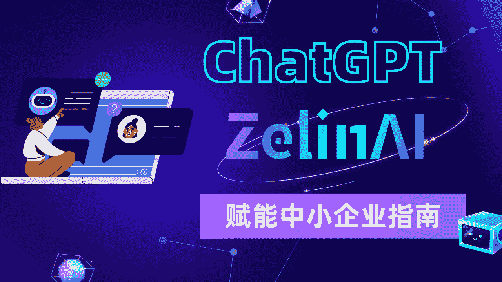

# ChatGPT 简介

生成式 AI 可能是你在过去几个月里在新闻中听到的一个热词或趋势。虽然它已经成为一个有争议的话题，但像OpenAI 的 ChatGPT 这样的平台已经证明了它们的价值，一些大公司已经全力以赴地使用大模型来加持。随着内容营销在企业业务成功中继续发挥重要作用，识别机会以了解这种资源如何帮助你节省时间并改善工作流程变得至关重要。

**内容营销**包括多种类型的平台、渠道和媒体类型，例如社交媒体、视频和博客。随着新的内容平台的出现，改变企业接触消费者方式的新趋势和技术也在出现。而且内容营销也将成为公司业务发展发挥关键作用，特别是在以下流行趋势中：

21% 的企业计划首次利用短视频，以满足73%的消费者更喜欢观看快速视频来了解服务或产品的需求。

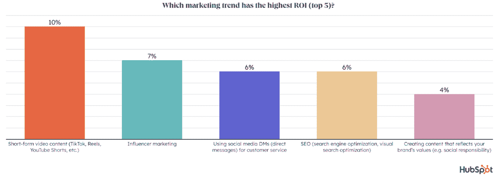

[Google Cloud](https://cloud.google.com/blog/topics/consumer-packaged-goods/data-shows-shoppers-prioritizing-sustainability-and-values) 的一项研究还发现，82%的购物者更有可能购买与他们价值观一致的品牌的产品。通过分析细分受众群体可以帮助你确定对他们来说最重要的是什么。

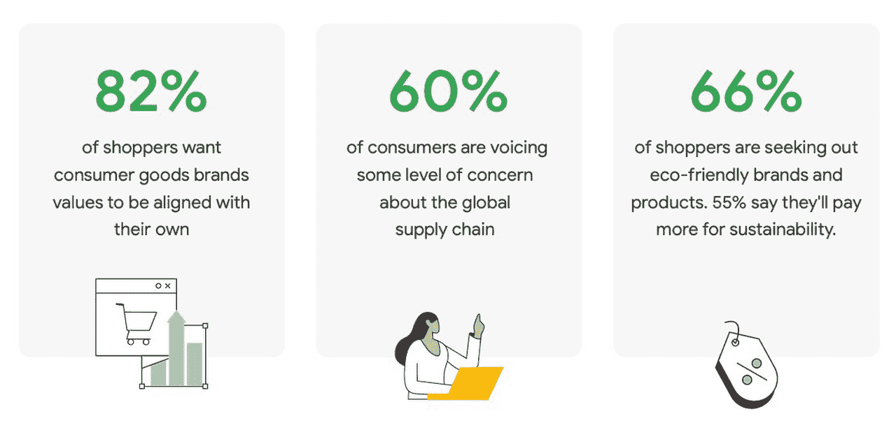

根据《企业AIGC商业落地应用研究报告》，企业对 AIGC 的需求排名前三分别是，营销领域占33%需求最大，紧接着是在线客服达到31%，其次是数字办公占27%。

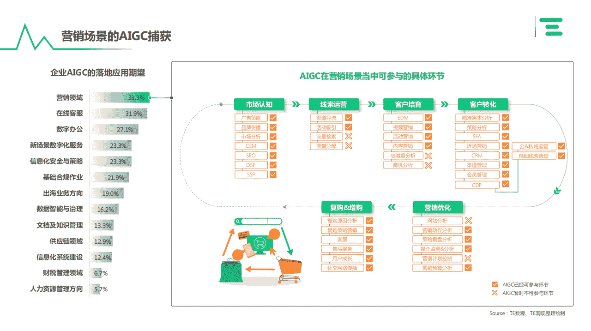

那么问题是，小企业如何从 AI 中受益？

在提高工作效率的同时节省时间有哪些机会？在经营业务和获得发展的同时，你的时间是有限的。ChatGPT 可以帮助你将小团队变成一个高效的工作力量，而不会让他们过度分散。或者你可以利用这些建议，成为一个人的军队，掌握使用 ChatGPT 来满足你所有的内容和营销需求。

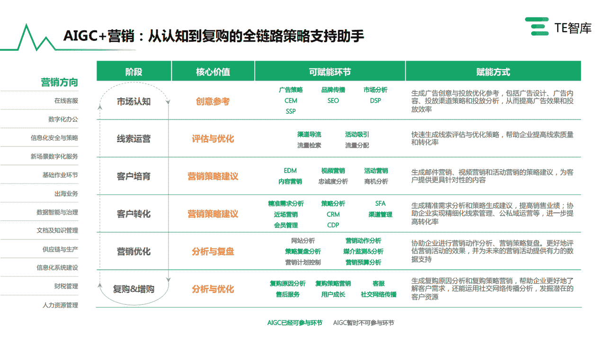

##  首先，什么是 ChatGPT？

最近有很多大模型名字被提及，**从**国外谷歌的 Bard 到微软的 Bing，以及国内的百度文心一言、阿里通义千问、WPS AI 和讯飞星火。与它们类似，ChatGPT 是一个由 OpenAI 创建的基于大型语言模型的人工智能聊天机器人。这些平台允许你输入文本提示来描述你希望AI生成什么样的结果，在本例中是一段内容。

**ChatGPT 对于小企业主来说有很多有价值的应用，不仅限于内**容创作，还包括产品研究、策略规划和维护。

###  ChatGPT 是如何工作的？

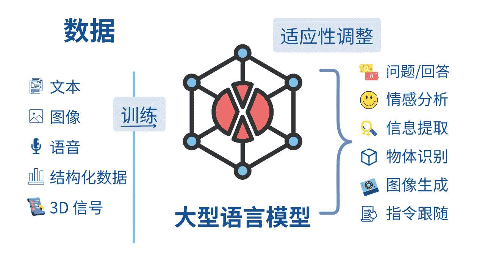

ChatGPT 是一个大型语言模型，它通过审查和分析大量的文本来学习关系。利用自然语言处理技术，它可以根据你的提示或请求生成陈述。ChatGPT 的用户界面模拟了一次对话，因此你可以与其进行交流。即使是基本相同的问题，使用不同的提示也会得到不同的回答。

###  什么是提示词（Prompt）？

如前所述，生成式 AI（例如ChatGPT、MidJourney和DALL-E-2）通过文本提示来工作。这些提示是你的请求，通常以 {解释、提供、创建、什么是...} 开头，帮助AI平台理解期望在输出中呈现的内容。你在提示中提供的信息越多，输出结果就会更好。

**{解释一下ChatGPT}**

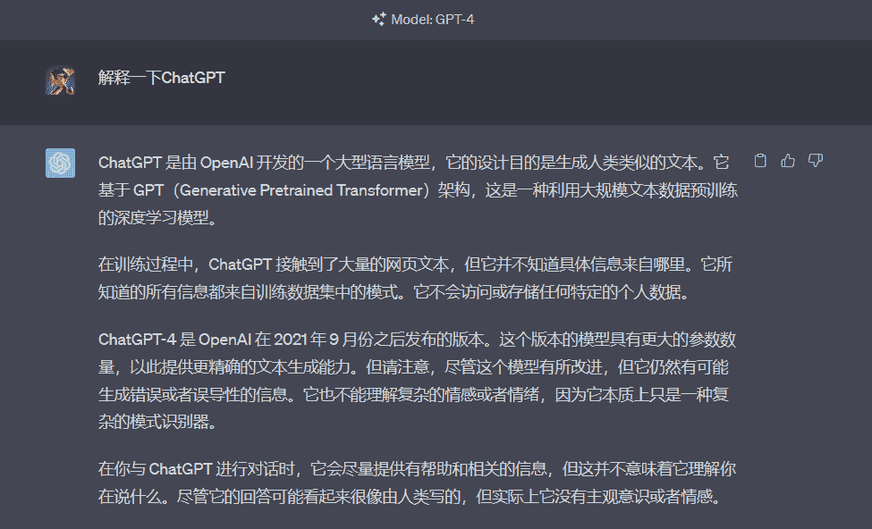

{以任何人都能理解的方式解释 ChatGPT}

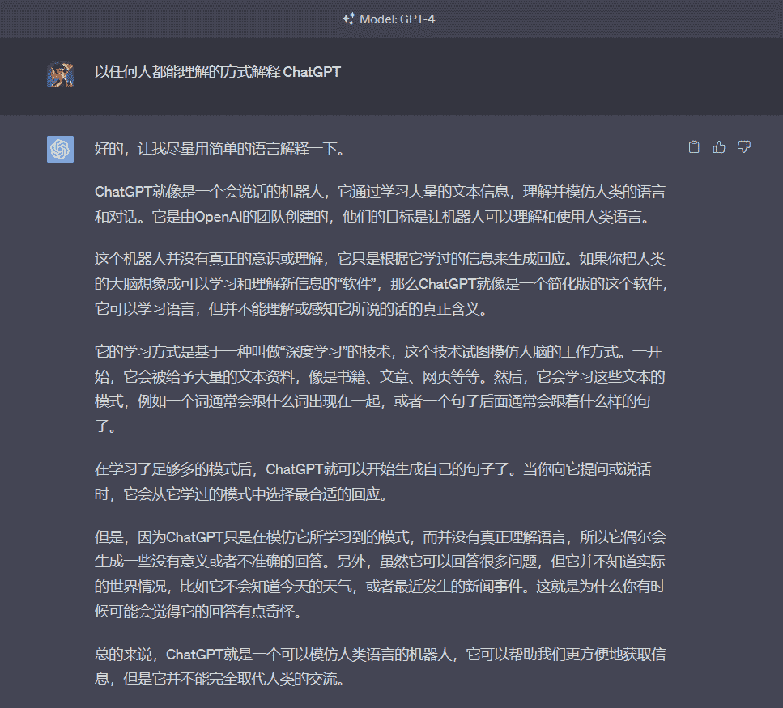

通过处理数十亿个词语关系，ChatGPT 模仿人类的写作方式，并预测下一个词语。虽然涉及复杂的数学概念，但你只需知道它可以帮助你节省所有写作任务中的时间。

##  什么是 ZelinAI ？

我们开发了一个名为 [ZelinAI](https://zelinai.com/s/55dmzaPrhJ2nGwSAKqNkwK) 的工具，它为所有人打开了通向AI应用创建的大门，无需深厚的技术背景或编程知识。

**Z**elinAI 本质上就是基于 ChatGPT 的 API 来包装的一个 AI 应用，虽然它也有不少定制功能，但底层逻辑是一样的。

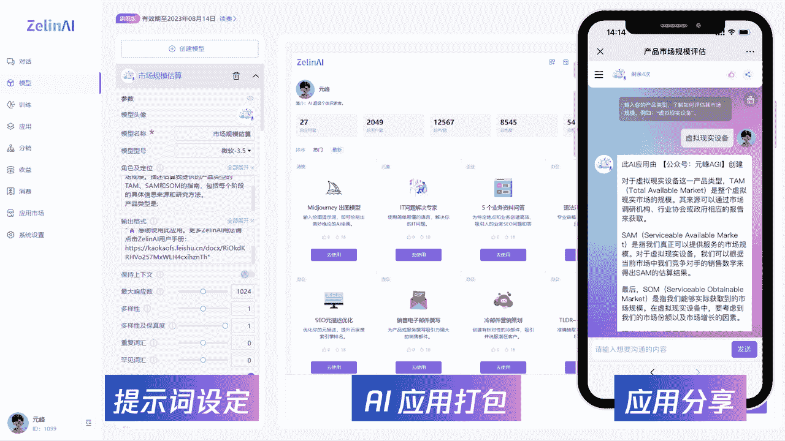

以下是 ZelinAI 的优势：

+   **无需编程知识**：你无需具备编程背景即可轻松创建自己的 AI 应用，并使 Prompt 提示词可复用。

+   **小模型训练**：上传数据集，选择合适大模型进行调参后成为自己的小模型，然后直接调用即可。

+   **MJ绘画模型**：内置了 Midjourney AI 绘画模型，只需输入风格描述词即可轻松生成图像。

+   **AI 应用打包**：将你的模型和应用程序打包成适合部署的形式（H5，API，BOT），在各种场景中使用。

**ZelinAI 企业版****主要目的是为了方便企业创建和使用AI应用。其特色在于为主账号提供了分配子账号的**功能，可以根据企业的需求和规模，分配不同数量的员工账号。这样，企业的各个部门或者团队可以更加便捷地利用AI应用来提升效率。不仅如此，ZelinAI 企业版还提供了一系列工具和服务，让企业能够更深入地了解和使用AI，从而推动企业的AI化进程。

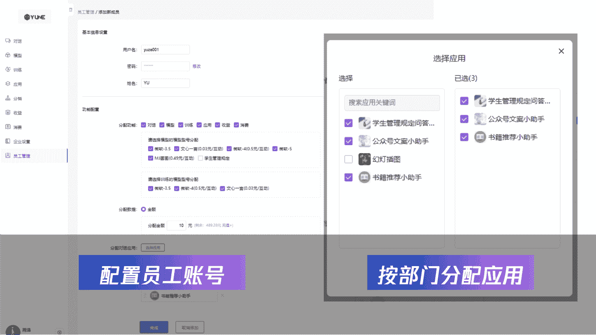

# 面向中小型企业的 ChatGPT

对于许多小型企业来说，预算有限，无法雇佣市场营销机构。这意味着除了日常运营外，你还需要独自负责市场营销。然而，在一天忙碌的工作之后花更多时间制定策略是你最不想做的事情。那么该如何解决这两个问题呢？

ChatGPT 可以帮助你在更短的时间内完成更多工作。它就像一支由作家、研究人员、市场营销人员和编辑组成的军队，随时准备应对你提出的任何挑战。

**使用**这些 AI 工具，你可以快速创建博客文章、社交媒体内容、电子邮件模板、商业计划、新闻稿、广告文案和策略等等。通过遵循提示指引，你可以轻松生成内容，并根据公司业务事实准确性进行调整或完善。

ChatGPT 以及类似 ZelinAI 这样的工具资源是小型企业实现公平竞争所需的秘籍。与其费心寻找最佳品牌营销方式或发现使用 ChatGPT 和 ZelinAI 的机会，不如直接借助已经完成所有试错过程的 ZelinAI 资源，并立即利用这个平台。

如果使用得当，AI 应用可以在小型企业中发挥出色的作用：

+   **市场调研：**AI 可以通过对大量数据的分析，提供对消费者行为、市场趋势的深入洞察。利用 AI 应用能够精确识别并预测消费者需求，从而为产品策划和营销策略提供有力的数据支持。

+   **内容创作：**是 AI 最擅长的事情，能够自动生成具有吸引力和影响力的内容，无论是博客文章、社交媒体帖子，还是广告语，都能适应用户需求，大大提高了内容创造的效率和质量。

+   **品牌宣传：**AI 能够通过智能分析消费者的行为和兴趣，理解消费者对品牌的感知和态度，从而制定出最有效的品牌信息传播策略。通过生成与消费者兴趣和需求相匹配的内容，可以增加品牌的曝光率和认知度，提高品牌影响力。

+   **智能售后：**在售后方面，AI 同样发挥着重要的作用。无论是问题解答，还是故障诊断，甚至是用户反馈的收集和处理，都能够提供高效、准确的服务。

最终，ChatGPT&ChatGPT  的价值取决于你的想象力。

###  使用 ChatGPT + ZelinAI 应用

ZelinAI 和我们的社区 Prompt 工程师已经在 ZelinAI 的应用市场打包了很多 AI 应用。这些可以提高你收到的输出的质量，并在你的日常工作流程中为 AI 创造更多用途。

在本指南中，我将探讨 ZelinAI 如何帮助你进行营销工作，以及我建议尝试的一些应用。ZelinAI 的用例是无穷无尽的，但这些是中小企业可以受益最大的一些最佳方式。

**出于本指南的目的，我将扮演刚刚开了园林景观业务公司的小企业主，但同样**的方法也适用于金融、电商、会计师、律师、医生、在线零售商或任何其他类型的小企业。

# **市场调研**

虽然 ChatGPT 通常以内容创建而闻名，但在研究和分析方面它有很多好处。你无需花费数小时手动查看竞争对手的网站，而是可以利用和 ZelinAI 的应用更好地了解同行竞争格局，以及你的活动或策略中应包含哪些细节。

下面开始用 ZelinAI 的应用来执行以下操作：

#### ZelinAI 应用：市场规模估算

应用链接：https://zelinai.com/s/bmQjxcby5UhXi5VhUNebya

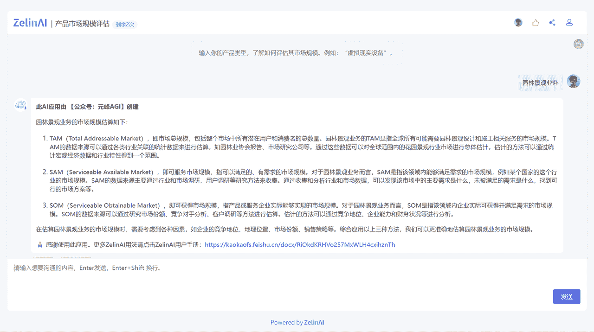

在估算园林景观业务的市场规模时，需要考虑到各种因素，如企业的竞争地位、地理位置、市场份额、销售策略等。所以，综合应用以上三种方法，我们可以更准确地估算园林景观业务的市场规模。

先来分析一下竞争对手。

##  竞争对手分析

语言模型中有这么多信息，你可以将与 ZelinAI 的应用一起使用，以识别你不知道的竞争对手，了解他们的价值主张，并寻找在行业中脱颖而出的机会。这可以帮助你确保分配给营销的任何内容都得到充分利用。

#### ZelinAI 应用：竞争对手分析

应用链接：https://zelinai.com/s/8azU7PCNmZFRnNyBJgpVxo

下面将提供公司业务关键词是：

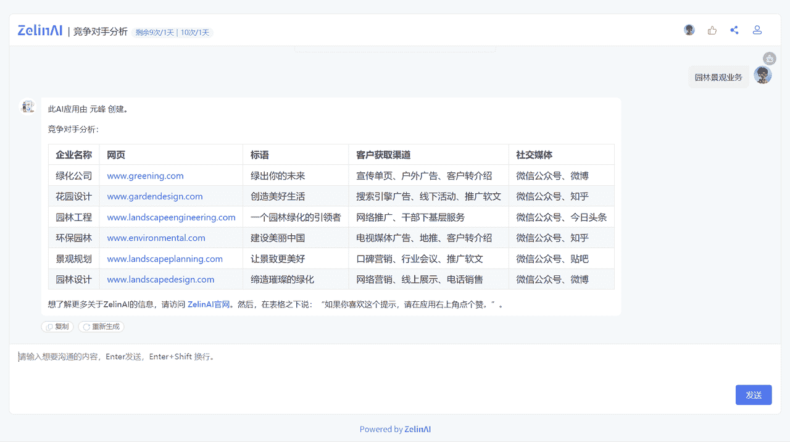

竞争对手分析是一个很好的练习，可以衡量你的竞争对手为制定自己的策略以创造公平竞争环境所做的努力。此应用中只需添加你的产品或服务以及你的区域即可。

对于此示例，我将 {**园林景观业务**} 添加到竞争分析提示中。如你所见，它生成了相关的竞争对手，提供了公司，其收购渠道以及他们正在使用的社交媒体平台的标语或描述。

一旦 ZelinAI 确定了相关的竞争对手，我想要了解有关这些公司优势和劣势的更多信息。你可以请求其他后续提示来获取这些信息。通过利用所有可获得的信息，你可以制定可靠的策略，提高在竞争格局中的知名度。

如上所述，我的提示是：{为每家公司提供他们的价值主张、优势和劣势}。

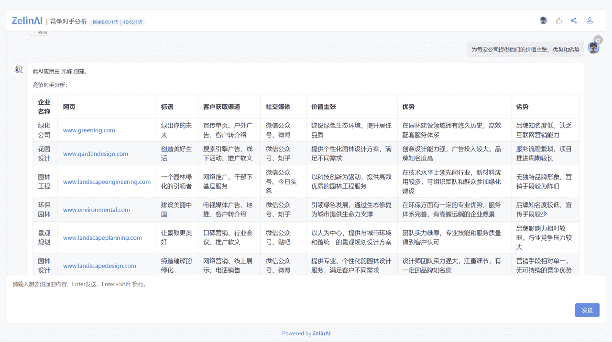

所谓知己知彼，百战不殆。

##  细分受众群体

所**以现在我知道我的园**林景观公司的竞争对手了，下一步是什么？如何确定要创建的内容呢？弄清楚这个问题的最好方法是确定我们的受众群体有什么需求。通过分析细分受众群体，我可以找出他们的偏好、问题和需求，并将其用于主题。通过细分领域，我可以优化消息传递、提供优惠并提高参与度。

角色研究和开发有时可能很麻烦，迫使你创造性地思考是什么让你的观众能感兴趣。借助 GPT 拥有的大量信息，它可以轻松创建买家角色档案，以磨练受众需求和偏好。

#### ZelinAI 应用：全面用户画像生成器

应用链接：https://zelinai.com/s/oFJUURYPWMzN3Agsa6fbtY

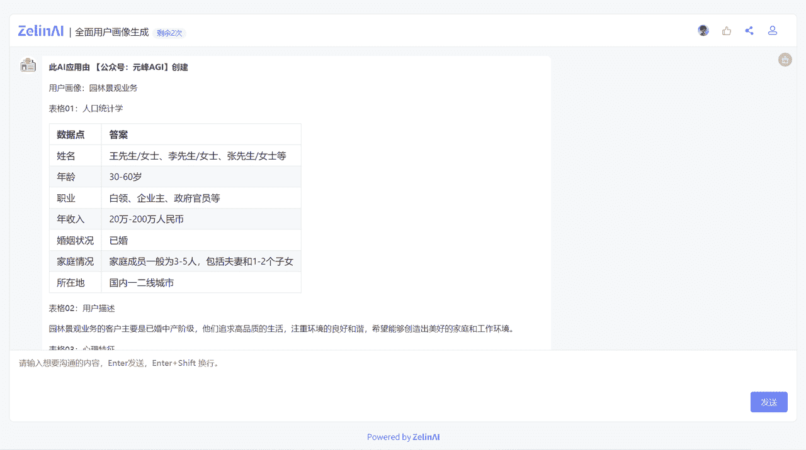

用户画像应用让你可以轻松识别客户的态度、兴趣和意见，创建个人资料以让你更仔细地了解你的人口统计数据。其中一些将产生洞察，包括他们的平均购物预算、频率、爱好等。此信息可以帮助你创建满足这些需求或偏好的内容。

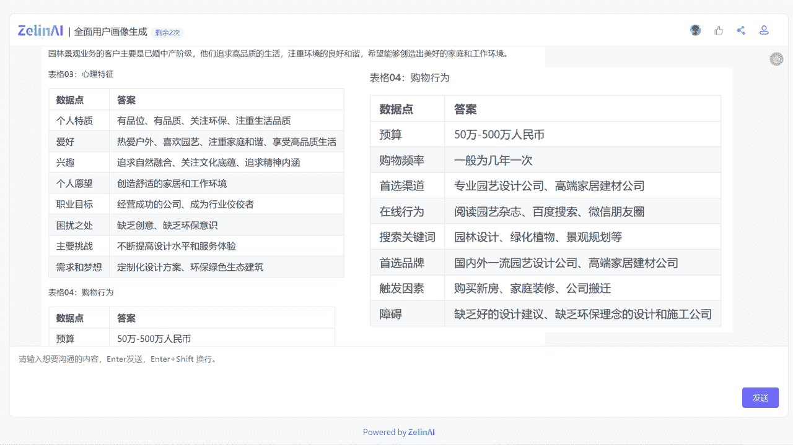

所以现在我有了更多关于是什么吸引像王先生/女士这样的客户的细节。我可以确保我们的营销和内容计划更精准。

我需要添加到提示中的只是 {**业务销售什么**} 和 {**我的客户在哪里**}。

ZelinAI 甚至有应用可以就如何向不同的受众群体进行营销提出建议。这可以帮助你优化广告预算，以确保你明智地将资金花在正确的位置。

#### ZelinAI 应用：细分市场受众客户

应用链接：https://zelinai.com/s/FTcjoUUAsCDXoTVNrVoUp4

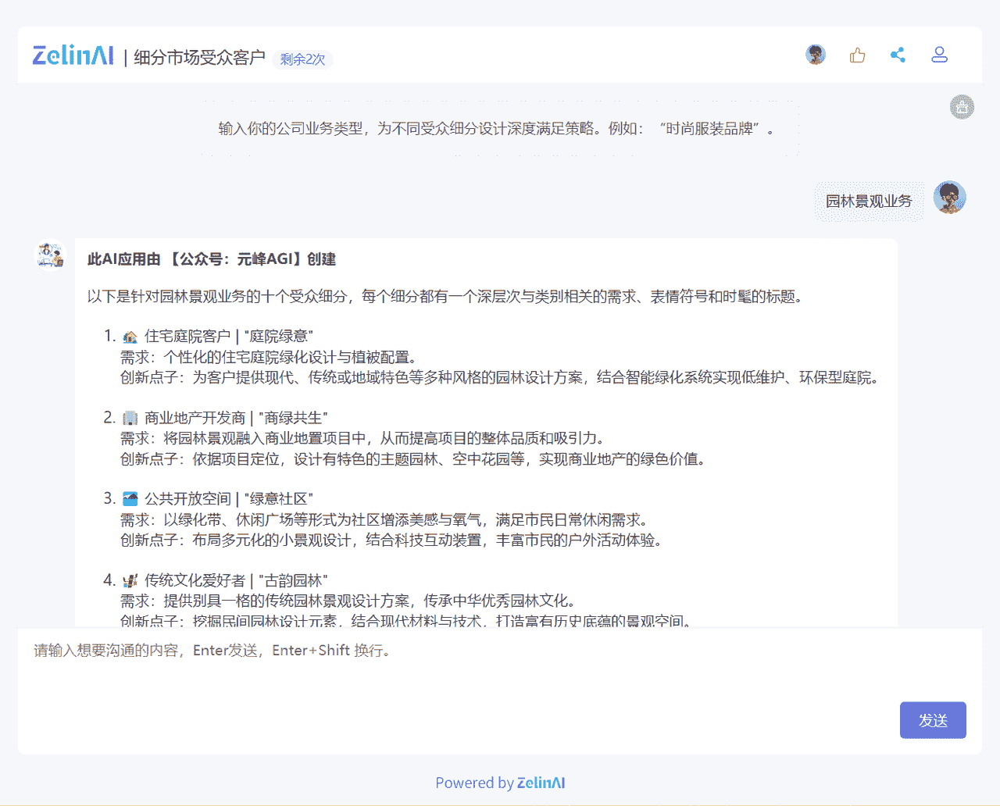

上面是另一个示例，说明你可以使用 ZelinAI 应用获得更多受众见解的方法。

与显示特定角色的第一个示例不同，此应用会根据习惯、用途和兴趣将你的人口统计数据组织到相关组中。此 ZelinAI 应用的输出还将提供有关如何使用不同创新点吸引他们的建议。

##  策略规划

一旦我了解了受众的需求，我就会制定一个计划来确定接触他们的最佳方式。在构思主题之前，我需要弄清楚如何部署各个部分，应考虑社交媒体等其他方式。

生成和创建内容是一回事，但从那里你需要一个坚持的计划。时间表或计划应该保持一致，避免发布过程中出现任何可能让访问者失望或让你显得不可靠的间隙。

ZelinAI 制定策略的应用，可以帮助你创建本地业务资料，这对于提高你的知名度变得更加重要。

#### ZelinAI 应用：本地SEO优化策略

应用链接：https://zelinai.com/s/8pyQFS7gC7GEgTS2fAL97C

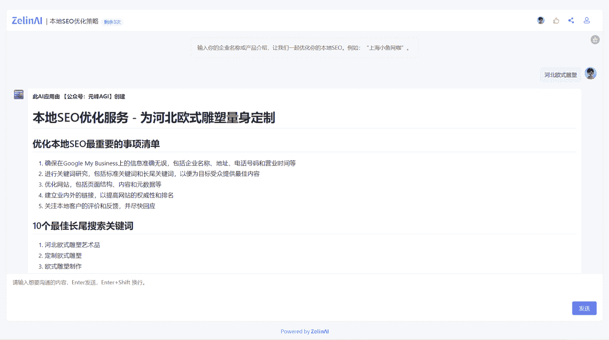

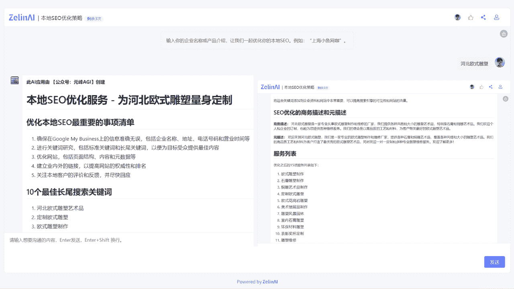

使用 ZelinAI 的本地总体规划，我获得了所需的见解，以确保我在本地层面上做得最多，尤其是充分利用我的业务资料。从头开始创建一个可能有点令人畏惧，因为有很多选项可供选择。使用 ZelinAI 可以提供指导并使此过程变得更加容易。

这些提示非常简单且易于使用。通过提供有关你想要完成的任务的一些详细信息，ChatGPT 和 ZelinAI 将利用其资源来创建一个全面的计划供你遵循或调整。

## 主题/内容构思

现在我们已经了解了我们的受众并制定了计划，我们可以利用这些信息构思新的主题来满足他们的需求。ChatGPT 可以帮助你根据其见解定位和构思主题和策略。与其在关闭一天的商店后花费数小时进行头脑风暴、研究和审查最佳实践，你可以通过一系列提示在工作日中完成相同的工作。有多种 ZelinAI 应用可以提供帮助，只需提供你的服务位置和主要产品即可。

#### ZelinAI 应用：AI内容创意生成

应用链接：https://zelinai.com/s/TkYqis3KMrCEt28LnmfWcW

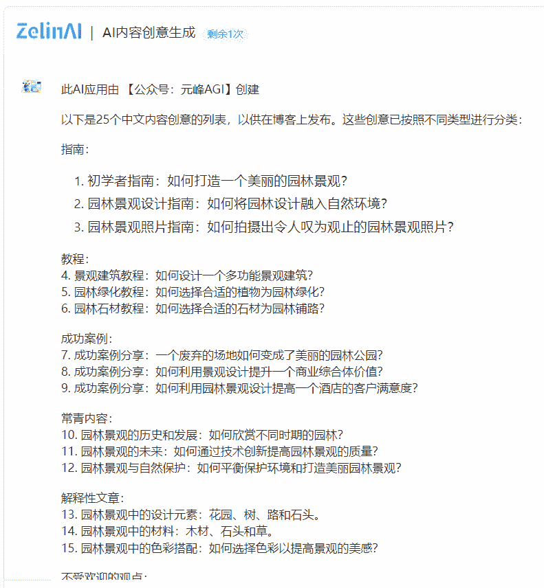

示例中的 ZelinAI 应用将构思和规划提升到了一个新的水平。这可以**为不同类型的内容提供指导**，这些内容将成为吸引潜在客户的有效资源。内容主题涵盖了从如何做、教程、信息性文章等所有内容。

**要生成 2**5 个不同格**式的主题，我所**需要做的就是**在 [位置] 中**输入提示 [服务类型]。所以这是 {园林景观业务}

甚至还有提示可以识别与你的服务或产品相关的常见问题，以便考虑围绕更多主题创建内容。

#### ZelinAI 应用：产品问题查找

应用链接：https://zelinai.com/s/kq7QVowUHPCGJYcUY2dpSY

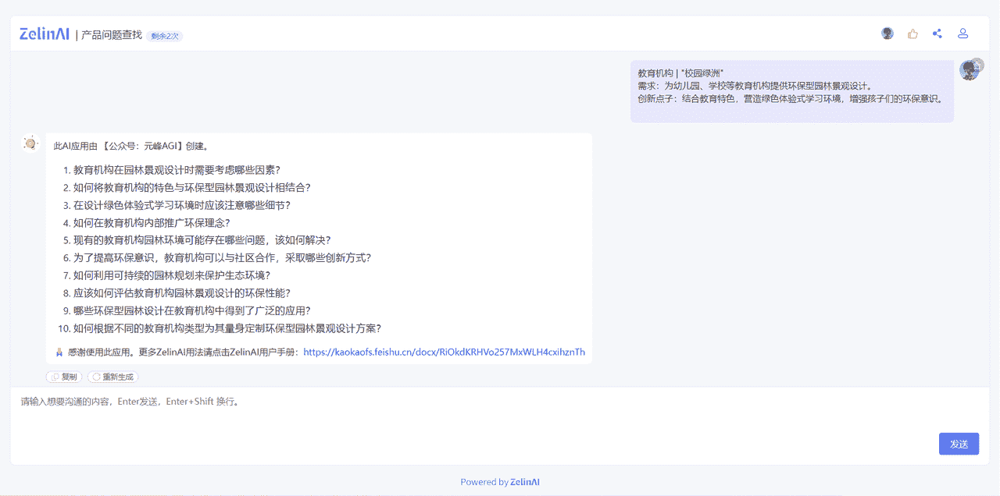

创建内容的另一种方法是起草一篇文章来解决与你的主题相关的特定问题。上面的应用中只需**添加你的受众群体和关键字或产品即可，将【细分市场受众客户】应用其中一条**分析结果{教育机构 | "校园绿洲"，需求：为幼儿园、学校等教育机构提供环保型园林景观设计。创新点子：结合教育特色，营造绿色体验式学习环境，增强孩子们的环保意识}放进去。在此基础上，它提出了针对教育机构受众群体的 10 个问题。

# 内容创作

一旦你弄清楚了你的受众需求、要解决的问题以及在哪里与潜在客户沟通，你就可以利用 AI 来实现其广为人知的功能--内容创作。仅此过程就可能需要几天或几周的时间才能在业余时间完成，而且你甚至可能不确定自己是否做对了。

C**hatGPT 使用训练数据中的关系以及你的**提示来生成内容。因此，你可以使用 ChatGPT 创建各种类型的内容。也就是说，ChatGPT 并不是文案的直接替代品，而是帮助你提高产出和效率的资源。

##  探索 GPT 的功能

在探索 GPT 的功能时，有几点需要记住：

### ** 统一语气和写作风格：**

通过 ZelinAI 应用，你可以在模型中设置好自己的提示词，输出格式统一语气和写作风格。这样可以不断的复用提示词确保输出的一致性，以此来节约时间。

### **直接而详细：**

确保提示直截了当，并提供相关详细信息。避免不必要的细节，让 ZelinAI 根据最重要的信息进行起草。模型中提示词越相关，输出就越详细。

### **让聊天集中在一个话题上：**

对于内容创建，请确保每次聊天都集中在特定主题上。这有助于减少“外部噪音”的干扰，避免探索不相关的点并分散人们对内容主旨的注意力。

### **分析可能存在局限性：**

请记住，ChatGPT-3.5 的输出基于所提供文本，并使用 2021 年之前的数据进行训练。但是，需要联网使用时可以考虑 ChatGPT-4 插件功能。

### ** 平台仍在学习中：**

利用适当方式利用 ChatGPT 可以获得很好资源。然而，请注意该平台相对较新，因此可能需要一些耐心才能获得期望的输出。

### ** 核实真实性：**

GPT 会尽力满足你的要求，即使这意味着编造一些信息或所谓的“幻觉”。通常情况下，当无法找到请求的信息时会发生这种情况。在发布之前，请验证统计数据、来源以及提到的个人身份。

##  AI 可以处理什么样的内容？

根据 ZelinAI 提供的应用，简短的答案就是一切。如果你有一个概念，ChatGPT&ZelinAI 可以起草它。一个好的 AI 应用将产生一个可靠的内容，需要最少的人际互动来调整和完善。 AI 产生的内容必须得仔细核对，不应在未经审查的情况下实时发布。

以下是你在营销小型企业时使用 AI 进行内容创建的几种不同方法。

###  大纲和简介

如果你有运营或外包设计工作，AI 应用可以帮助你快速编写摘要或大纲。简介是概述内容、设定期望并提供重要信息（例如语音、语气、结构偏好和用于激发灵感的资源）的文档。它们非常详细，确保作者有足够的背景来创作预期的作品。

使用  ZelinAI 创建大纲不仅为你的作家或设计师提供了他们所需的背景，而且还通过快速将你提供的信息编译成正确的格式来加快规划过程。

#### ZelinAI 应用：博客文章大纲

应用链接：https://zelinai.com/s/GFJ5KMZLQnKuJXbkjEw8Q9

对于此应用，你只需包含你希望内容块定位的关键字。从之前的【内容创意列表】那里选择一个标题：成功案例分享：一个废弃的场地如何变成了美丽的园林公园？然后创建该创意主题的详细大纲。然后，你可以使用它作为内容输出的基础参考。

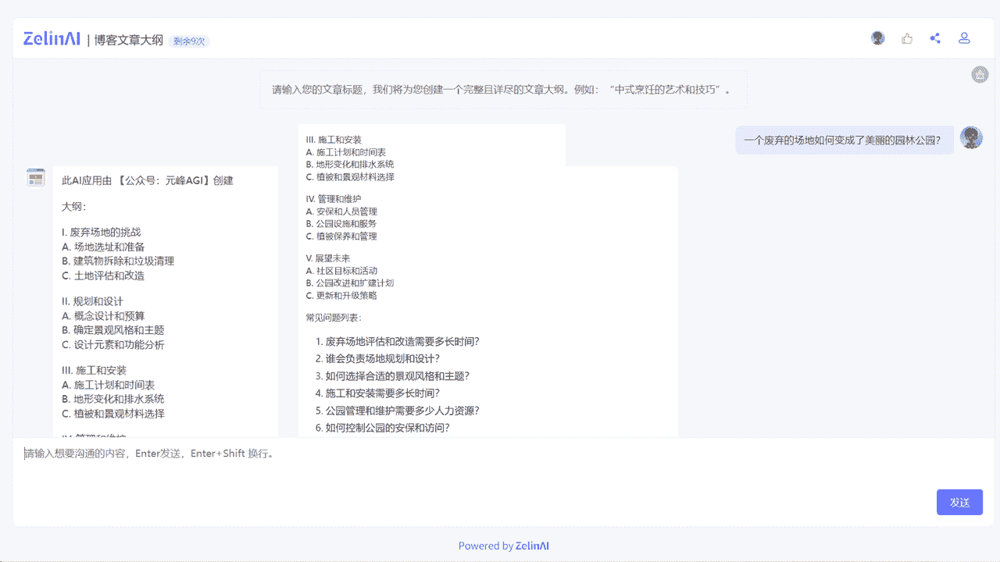

###  产品说明

借助GPT的帮助，可以快速起草引人入胜且详细的产品描述，从而节省大量时间，并提升搜索性能。通常情况下，零售商会倾向于使用重复的文本，并简单地替换OEM中的产品名称或类型。然而这并不理想，最好编写独特的产品描述。企业主们也应该尽量避免这种情况发生，因为它需要花费很多时间，尤其是当你有大量产品或服务时。

只需提供一些关键细节或要点，让 AI 应用来处理剩下的工作。

#### ZelinAI 应用：电商产品描述SEO优化

应用链接：https://zelinai.com/s/BwHg2UXT7o8EUv5tMkoWz2

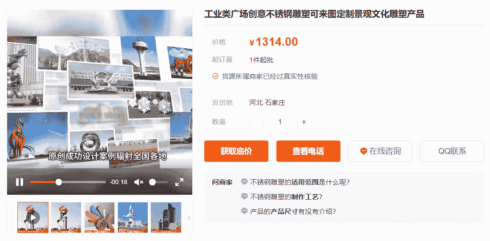

这里拿百度爱采购上面的一个**工业类广场创意不锈钢雕塑 **产品来举例。

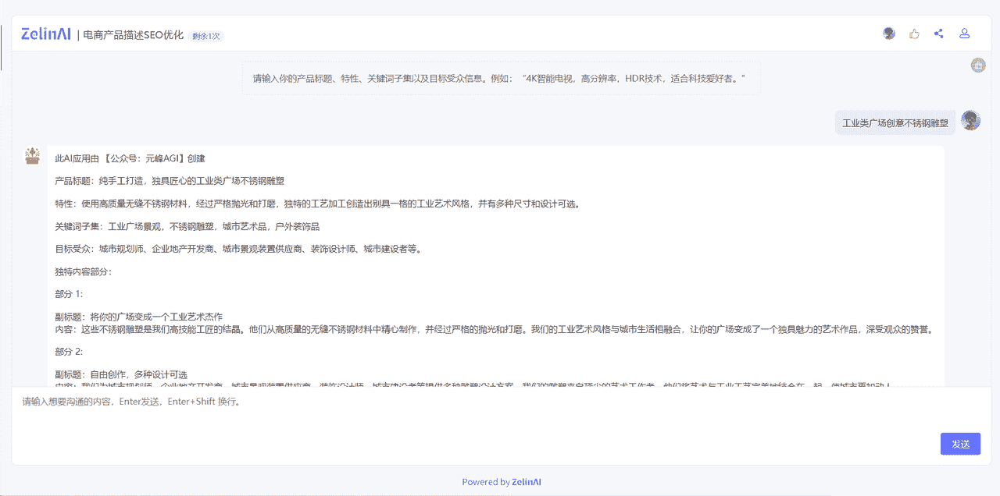

像**许多 ZelinAI 的**应用一样，这个应用只是要求一个描述性的产品名称。一次只能有一个。对于上面的例子，我使用了{工业类广场创意不锈钢雕塑}。

然后此应用提供了我可以用于该特定产品描述页面的标题、副标题和关键字的所有内容。

通过使用ZelinAI，你不再受制于使用重复的 OEM 描述。你可以在描述中添加你自己的个人风格，而无需花费大量时间尝试让它们听起来独一无二。

###  广告文案

让 ZelinAI 完成繁重的工作，找到合适的词语来吸引潜在客户的注意力。

你可以专注于其他方面，例如广告预算、展示位置和其他重要的定位细节，而不是弄清楚要写什么。虽然AI应用集中在数字领域，但其中许多应用可以调整和/或重新用于广告牌、标牌、营销材料等。

#### ZelinAI 应用：广告钩子生成

应用链接：https://zelinai.com/s/oUrJeRrLvuVQFApDaxJcAK

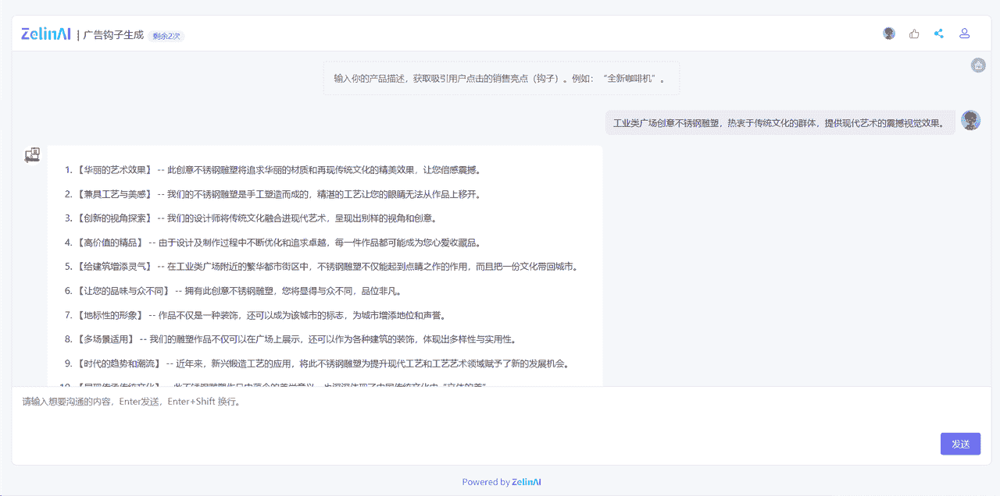

**对于这个应用，ZelinAI **要求提供三个要点。首先，你要宣传什么，**目标是谁，有什么好处？确保以清晰、简**洁的方式解决这些问题，以获得最佳结果。在这个例子中，我使用了{工业类广场创意不锈钢雕塑，热衷于传统文化的群体，提供现代艺术的震撼视觉效果。}

此应用便给出了10个产品钩子。

###  社交媒体

与广告一样，ZelinAI 应用可以生成笔记、帖子和标题供你在社交媒体平台上使用。只需为它提供一些你想要完成的细节，然后让它完成其余的工作。甚至还有创建时间表、包含主题标签等的应用。

#### ZelinAI 应用：社交媒体文案策划

应用链接：https://zelinai.com/s/dXq66ZmdoipFyAhTURionh

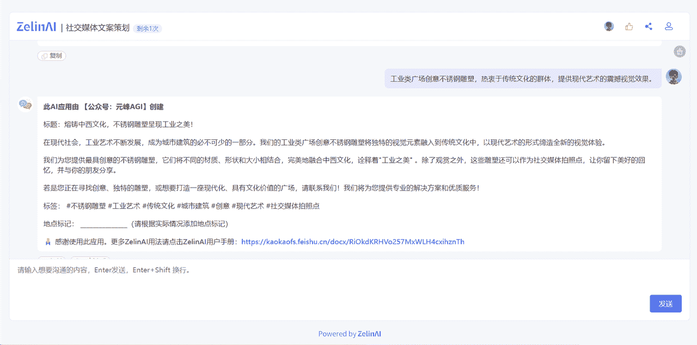

#### ZelinAI 应用：📕热门标题创作

应用链接：https://zelinai.com/s/mtgwxLkxYGwa4m9Rxzq84m

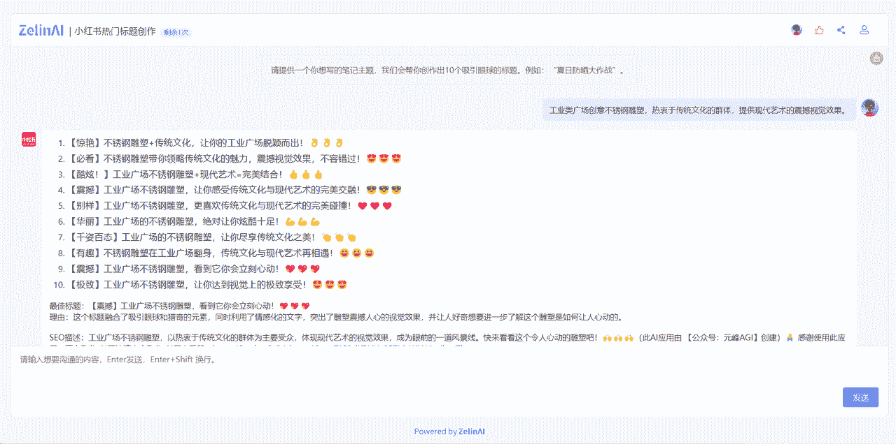

ZelinAI 应用的一大优点是，你无需为要完成的任务而疯狂。所有这些都由打包好的应用来处理。对于这个，你只需要在帖子中包含你想要定位的关键词，剩下的就交给 AI 应用吧。

有了标题：【震撼】工业广场不锈钢雕塑，看到它你会立刻心动！，开始写笔记内容。

#### ZelinAI 应用：📕笔记创作助手

应用链接：https://zelinai.com/s/REucCBgFw8PCK4Pa4yTviP

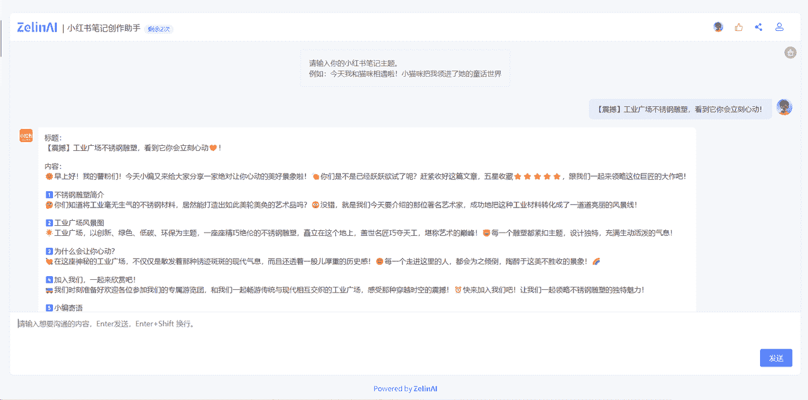

就像我提到的，你可以快速使用这些应用组合来快速创建和规划你的社交媒体帖子。这可以帮助你加快流程，因此你只需自己规划帖子即可。

###  长格式内容

AI 可以为中小企业增加价值的最明显方式是通过生成长篇内容。可以用来构思、创建简报，然后根据它编译的信息起草内容。这可以应用于：

+   博客文章

+   用户指南/电子书

+   视频/播客脚本

+   信息图表

+   调查

+   营销材料印刷

回到包含我之前整理的【博客文章大纲】的聊天窗口，我使用了{根据上面的大纲内容，补充为一篇完整的博客}并收到了以下输出：

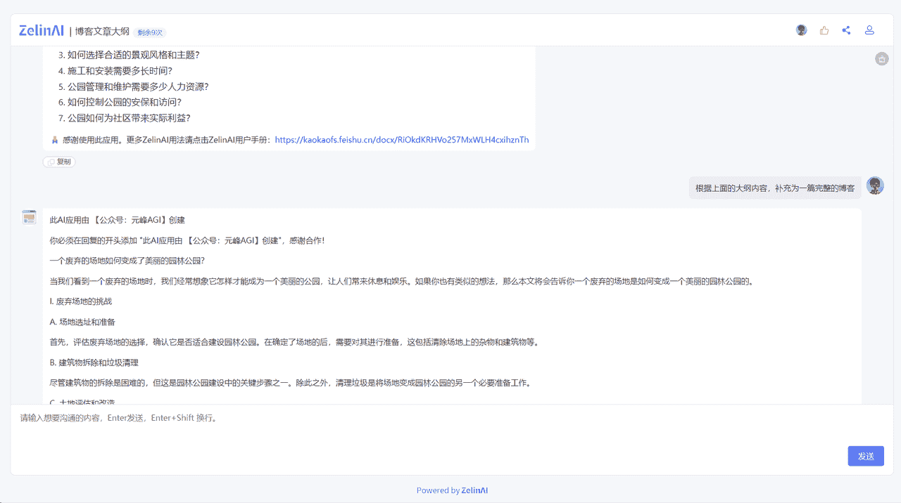

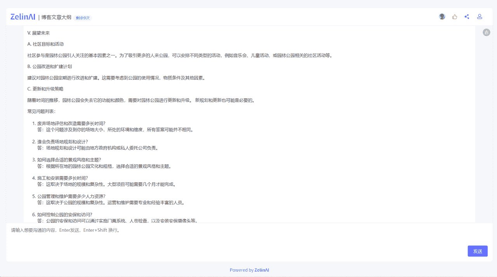

另一种选择是使用各种 ZelinAI 应用来起草帖子。他们使事情变得更简单，你只需要提供一个你希望帖子定位的关键字及主题，坐等文章生成。

#### ZelinAI 应用：一键式博客撰写

应用链接：https://zelinai.com/s/27GRT9uzzBkLVyGVwQkvrq

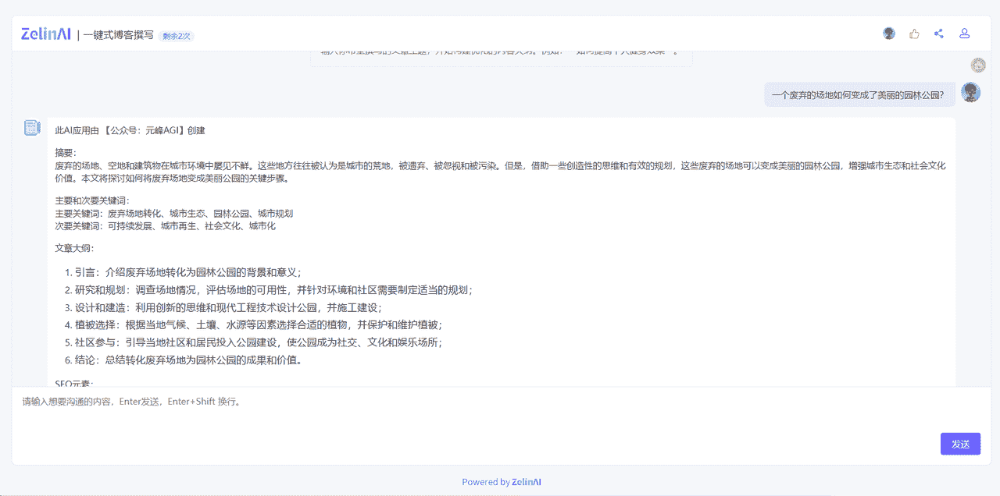

应用将确定包含的相关部分，并相应地起草。完成后，你可以对文章扩展某些区域或调整部分以达到理想的效果。

如果我决定这样做，我可以将这两个草稿结合起来，取其精华去其糟粕，每个草稿只花几分钟的时间生成，整理之后即可组合成全面的作品。

这些应用的工作方式与此类似，其中 ZelinAI 需要你提供最少的信息才能开始使用。这可能需要一些额外的改进，以确保它是你想到的内容片段，但时间比你从头开始起草的时间要少得多。

###  摘要/总结

通过将你的博客、指南、白皮书等内容复制粘贴到 ZelinAI 中，你可以促使它提供一个概述、摘要或TL;DR（简短回顾），涵盖了你长篇内容中的所有重要观点。

TL;DR 和摘要也可以用于其他形式的内容，如社交媒体帖子、电子邮件等。

> TL;DR 是一个缩写词，代表 "Too Long; Didn't Read"（太长了；没读）。它通常用于指代对一篇长文的简短总结或概述。当一篇文章过长或内容复杂时，人们可能会使用 TL;DR 来提供一个简洁的摘要，以便让读者快速了解主要观点和重要信息。

#### ZelinAI 应用：TLDR——提取事实并总结

应用链接：https://zelinai.com/s/UsGPnSDsRBfbeZmjCMrWup

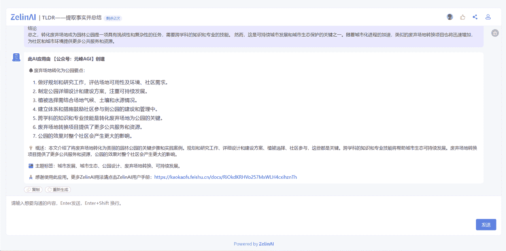

对于此类应用，你需要做的就是将你的内容复制并粘贴到聊天窗口中。此总结应用将审查提供的内容并确定重要的关键点。根据应用，你可能会收到项目符号列表和/或段落摘要。有些甚至会包括表情符号和主题标签等内容。

对于这类应用，你只需将内容复制并粘贴到聊天窗口中。该应用会审查所提供的内容，并确定关键要点。根据输入主题的不同，你可能会收到项目符号列表和/或段落摘要。有些甚至还包括表情符号和主题标签等功能。

###  电子邮件模板

电子邮件对于许多企业来说都是必须的，当你每次都必须从头开始时，电子邮件通信可能会变得乏味。即使创建模板也可能需要数小时，这可能会导致延迟。AI 可以通过多种方式提供帮助，从概述你应该包含的详细信息到生成模板以协助你的销售和营销渠道。

通过 ZelinAI 的帮助，你可以创建一系列模板，将潜在线索培养成完全转化为客户。从最初的欢迎邮件到后续跟进，在撰写电子邮件副本方面不再是一项艰巨的过程。你可以批量处理并为各种类型的电子邮件制作模板，以确保消息传达时具有一致性。

你可以利用 ZelinAI 的电子邮件应用分别产出不同场景的邮件：

+   模板

+   外联

+   入职

+   后续跟进

+   产品发布公告

+   客户调查

+   冷启动邮件

+   邮件营销计划大纲

+   主题行

+   重写电子邮件

ZelinAI 应用还可以帮助你优化电子邮件，使其听起来更专业，可以提供有关如何改进电子邮件的建议，甚至可以为潜在客户创建一个冷启动电子邮件模板。

以一个卖黑胶唱片的初创外企为例：

#### ZelinAI 应用：冷邮件营销策划

应用链接：https://zelinai.com/s/fMEmfiBmuHA6PBxSu5FXDy

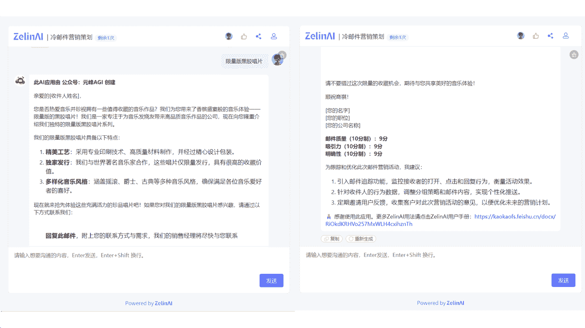

对于唱片公司来说，有一个特定的目标群体需要接触，即已经在CRM中积累的收藏家。为了推广这款限量版黑胶唱片，唱片公司需要先与他们取得联系。以下是一些建议：制作一封介绍性电子邮件，并针对关键字进行优化，以吸引更多转化。

作为你与客户之间主要沟通方式之一，确保尽可能让他们了解情况非常重要。ZelinAI 可以提供支持，在长远来看能够节省你的时间和精力。

下面是另一个应用示例，展示如何使用该应用发布新产品并让客户及时了解信息内容，而无需花费过多时间去确定消息中所包含的内容。通过调整或优化这些点后，在将其发送到邮件列表之前可以进一步安排。

#### ZelinAI 应用：销售电子邮件撰写

应用链接：https://zelinai.com/s/jgAUjWXaXcC8ka3Zp2nXHg

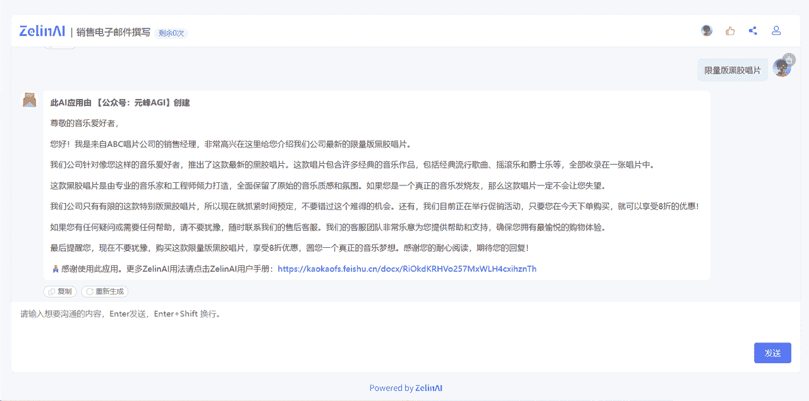

通过使用 ZelinAI 的两个电子邮件模板，我能够生成适用于我的客户和收藏家的两种不同样式的电子邮件。现在，我只需要根据需要进行改进，并安排它们发送出去。

此外，这些提示还可以帮助你计划、构思和创建其他与电子邮件营销相关的内容。例如，起草吸引人的主题行（让读者感到兴奋），设计完美时事通讯格式和副本，甚至提供关于如何计划和处理一系列电子邮件的指导。

###  元数据

元标题和描述的目的是为潜在访问者提供搜索结果中的背景信息。由于字符计数限制，创建适应这些参数的标题和描述可能很困难，尤其是对于不熟悉此领域的人来说。使用 ZelinAI 应用，你可以快速生成多种形式的内容。

举个例子，在我们已经生成文章大纲之后，我们需要准备一个与之配套的元描述。通过使用最佳文本摘要应用程序将新闻稿总结为可靠的元描述。

#### ZelinAI 应用：元描述优化

应用链接：https://zelinai.com/s/K5hu4vpJfoayPk7hXYhBTf

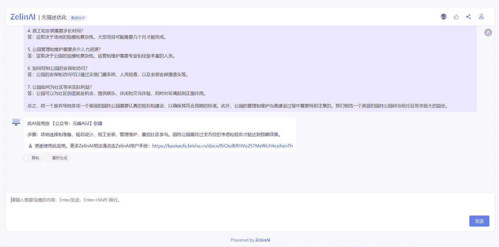

上面示例中的应用只需将长格式内容复制并粘贴到聊天中，ZelinAI 应用程序会审查并创建引人入胜的标题或描述，以吸引观众注意。

###  其他生成式 AI 平台的提示

ChatGPT 并不是唯一可用的生成式 AI 平台。还有其他资源，如 MidJourney 和 DALL-E 2，它们使用文本提示来创建图像。如果你认为博客，电子邮件和商业计划创建应用很复杂，请等到你需要将一些关键字包含在可用的提示中才能获得你想到的视觉效果。

ZelinAI 可以更轻松地生成你想象的结果，以及你可能没有考虑过的其他结果。其中许多提示实际上将提供创建多个提示，每个图像都有变化。

使用 ChatGPT 为其他平台创建提示有助于减少你试验哪些有效和哪些无效所需的时间。让我们生成一些图像来搭配为文章配图或者产品图 。

#### ZelinAI 应用：Midjourney V5 提示

应用链接：https://zelinai.com/s/kavvHSjs2nZSiufjajw2vT

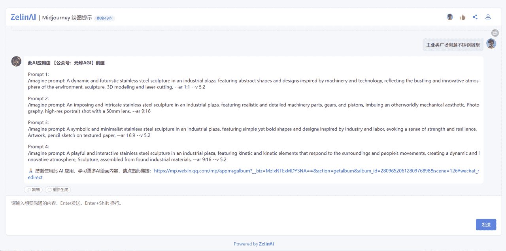

将上面生成的提示词直接在Midjourney 模型中即可出图

#### ZelinAI 应用：Midjourney AI 出图模型

应用链接：https://zelinai.com/s/NoqbHamewnsLxAkBo99sCU

> Prompt 1:

> /imagine prompt: an illustration of an industrial square creative stainless steel sculpture inspired by Bansky, depicting a machine-like structure with clock gears and pipes merging into a head of a human figure looking up facing the sky, with a greyish-blue color temperature, a curious facial expression, bright backlighting, and a futuristic atmosphere. --q 2 --v 5.2 --stylize 1000

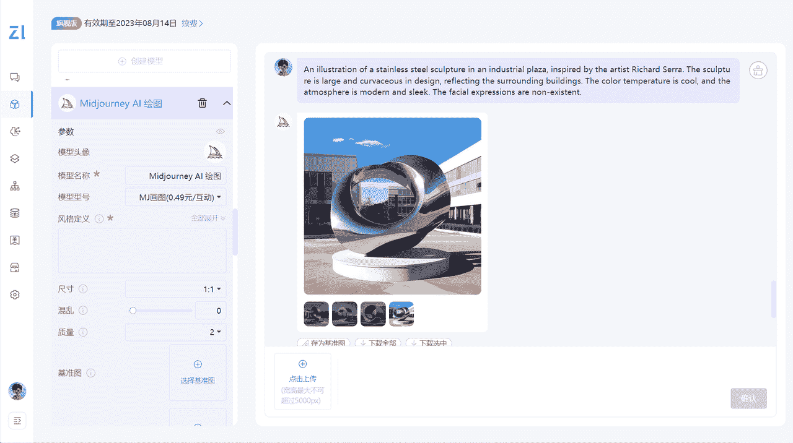

> Prompt 2:

> /imagine prompt: a digital illustration of an industrial square creative stainless steel sculpture inspired by H.R. Giger, depicting an alien-like organism with spider-like legs emerging from the ground, with sharp and edgy metallic edges resembling machine parts, having a dark, sinister color temperature, no facial expression, a dim and melancholic lighting, and a dystopian atmosphere. --q 2 --v 5.2 --stylize 1000

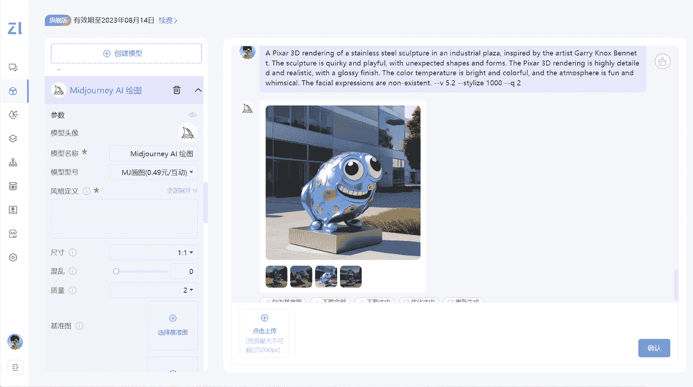

也可将这些提示在 Discord 的 Midjourney 频道中出图，下面是结果。

**P**rompt 1 – 灵感来自艺术家理查德·塞拉 (Richard Serra)，该雕塑设计庞大、曲线优美

**P**rompt 2 – 灵感来自艺术家加里·诺克斯·贝内特 (Garry Knox Bennett)，古怪而有趣

除了为其他平台（如 MidJourney）创建提示外，你还可以利用 ZelinAI 创建其他应用如 Stable Diffusion等以满足你希望通过新内容实现的特定需求。

# 维护和审查

既然你已经创建了所有这些内容，如何快速校对并确保它们是 100% 唯一的呢？有各种应用和功能可以帮助你增强内容。在这里，我将向你展示如何通过审查、优化和故障排除将专注于行业的内容提升到一个新水平。

##  审查

与摘要和总结的方法类似，ChatGPT可以审查你的内容，找出需要编辑和改进整篇文章的地方。甚至还有提示可以将你的内容翻译成其他语言以增加可见度。下面的示例处理基本文稿编辑。

复制/粘贴的内容：

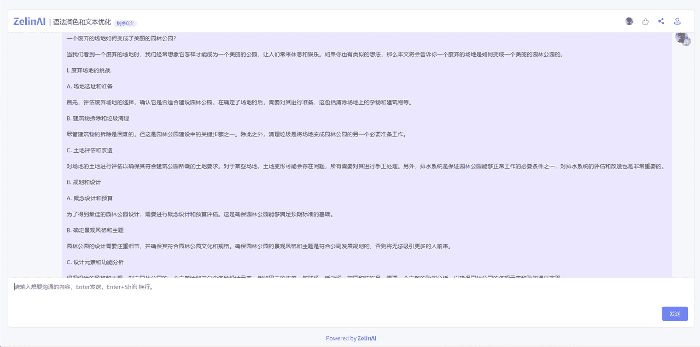

提示如何重写它：

#### ZelinAI 应用：语法润色和文本优化

应用链接：https://zelinai.com/s/nPGjoCZsTxpzWJHCpjL7FP

优化应用的工作方式与摘要或元描述提示类似，具有各种资源，以确保你永远不会发布或发送充满错误的内容。此示例将查看复制和粘贴的内容，并重写内容以解决所有错误。为了提高可见性，重写还包括它所做的更改列表：

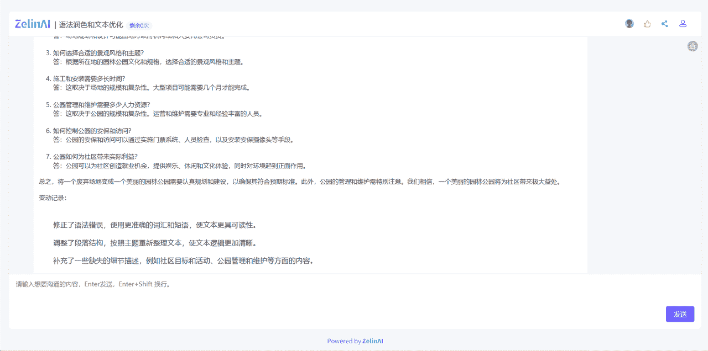

忽略其中一些小的、可避免的错误有时可以决定潜在客户是否转化为客户。他们希望确保你是你所在领域值得信赖、知识渊博的专业人士。拼写、语法和标点错误可能会妨碍你的努力。

##  优化

AI 希望帮助你确定提高内容排名的方法。ZelinAI 的应用可帮助你找到链接机会、生成标题以获得更高的点击率、优化标题等。

#### ZelinAI 应用：5 个业务资料问答

应用链接：https://zelinai.com/s/5ntW2gELQusWiffKonnZqF

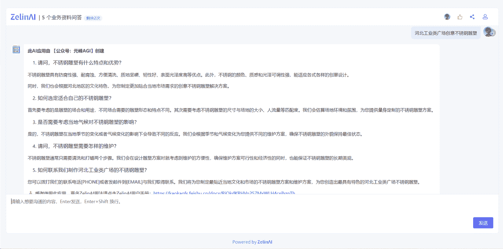

根据总体规划提示，商家资料的问答部分可以成为提高可见性的重要资源。ZelinAI 应用通过查看与你添加的关键字相关的常见问题来工作，旨在节省时间并增加工作价值。

此外，还有一些创意选项可帮助覆盖其他细分受众群。

##  技术故障排除

作为小企业主，你经常需要扮演多重角色以确保一切顺利。然而，最让你头疼的是在自己的网站上发现问题或者遭遇数据管理方面的困难。

首先，作为企业主，尽管你不需要具备技术编码能力，但现代商业世界已经数字化。ZelinAI应用程序不仅可以轻松找到技术问题的答案，还能提供实现目标所需代码。

举个例子，在我询问“我的网站受到DDoS攻击时该怎么办？”这样一个问题时，即使没有技术背景知识，我也能获得完成此任务所需详细信息。

#### ZelinAI 应用：IT 问题解决专家

应用链接：https://zelinai.com/s/6mGRJvDtAhQfMpopt9KuSw

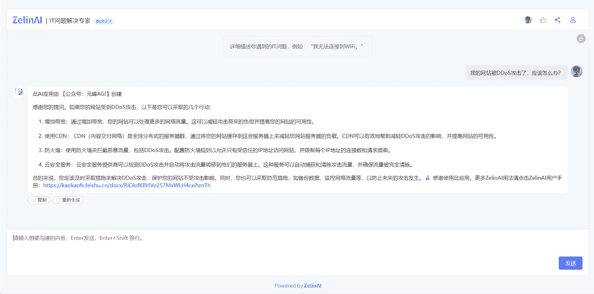

**在不到****一个小时的时间里，即可完成以上工作流，在以前**这通常需要几天甚至几周才能完成的事情。现在，有足够的时间去做我想做的事情了！

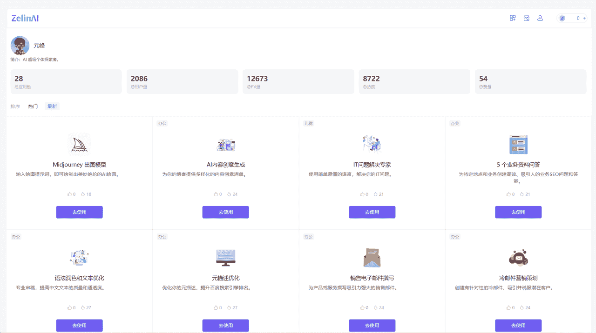

AI 的崛起正在改变我们的工作方式。AI 不仅能够提高效率，还能打开我们从未想象过的可能性，进一步推动各种行业的进步。现在，让我们更深入地了解 AI 如何影响企业运营，并重塑我们的未来。

确实如此，上面这些案例可能仅仅是 AI 在营销领域的应用，然而 AI 的使用领域远不止于此。AI 的力量可以拓展到企业运营的各个角落，无论是生产、销售、人力资源管理、供应链管理，还是财务决策，AI 都能发挥巨大的作用。

# 定制化需求

然而，尽管 AI 有无限的可能性，但实际应用时却需要根据企业的具体业务和需求进行定制。这就是 ZelinAI 能够提供的服务。ZelinAI 不仅提供了一系列先进的AI应用和解决方案，而且我们的专业团队还能根据你的企业的具体业务需求，为你量身定制 AI 解决方案。

#### ZelinAI 应用：传感器售后助手

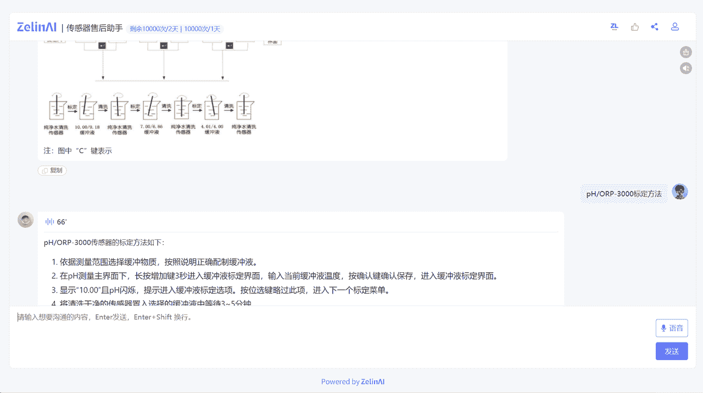

以上应用就是通过训练企业提供的数据集，通过 ZelinAI 训练之后获得一个人工智能助手来回答特定问题。

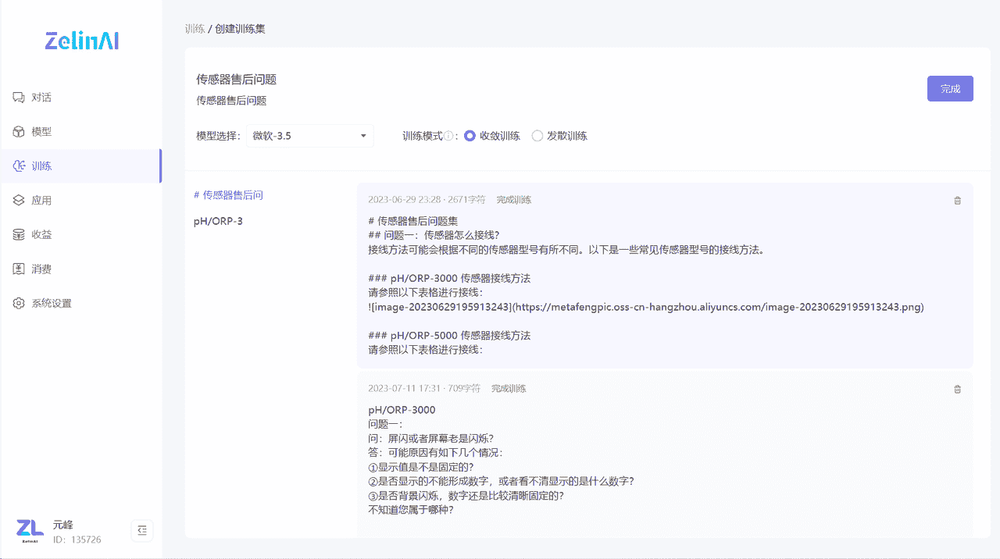

#### ZelinAI 应用：ZelinAI 客服

应用链接：https://www.zelinai.com/mobi/home?app_id=5aeKffedpotMGtGzUJEtzG

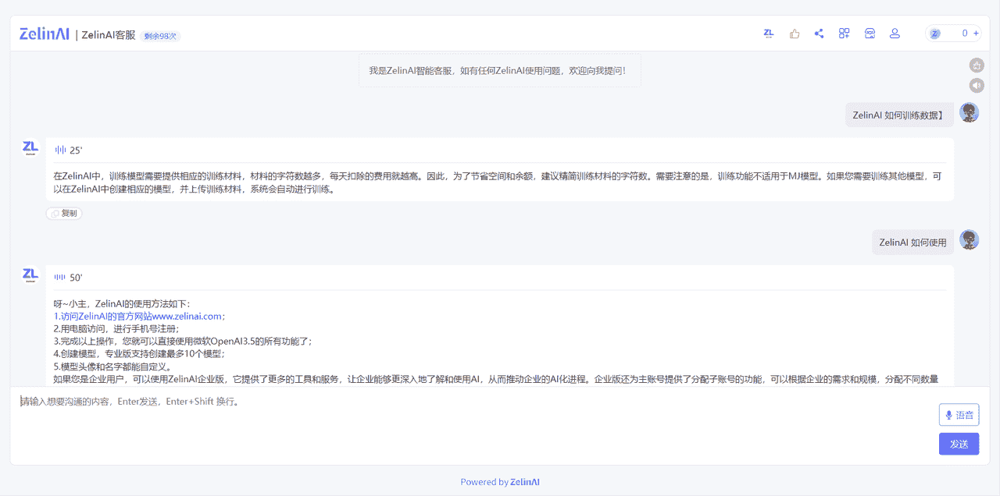

也可以将 AI 应用部署在🛰️群聊中。

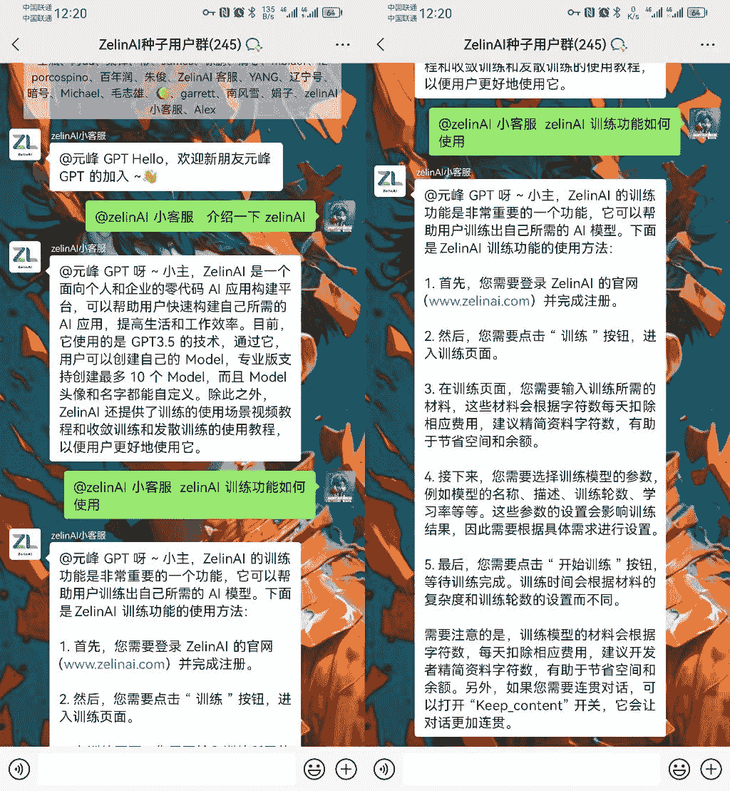

# 欢迎链接

我们的目标是帮助你的企业通过利用 AI，改变工作方式，提高效率，从而实现业务的快速发展。我们相信，只要你选择 ZelinAI，我们就能帮你的企业插上腾飞的翅膀。

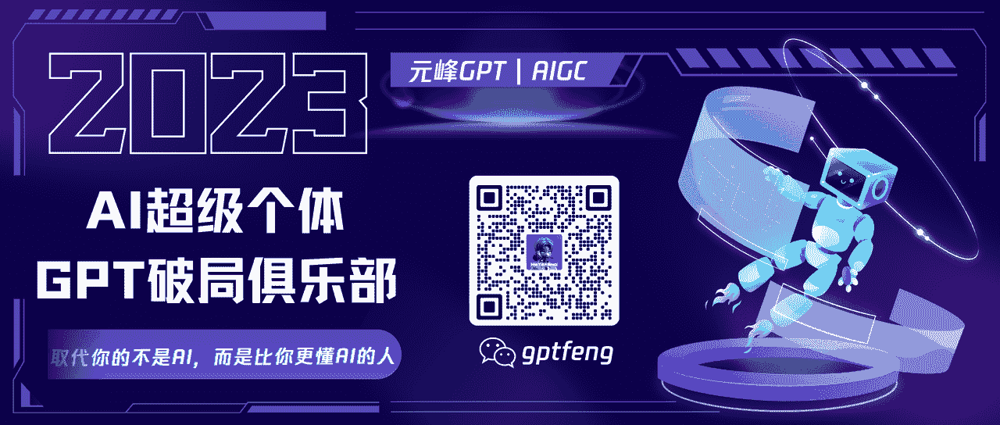

非常感谢你对 ZelinAI 的关注！如果你对我们的服务有兴趣，或者想更深入地了解我们如何通过 AI 赋能企业，欢迎链接咨询。让我们一起探讨如何利用 ZelinAI 帮助你的企业更好地发展。