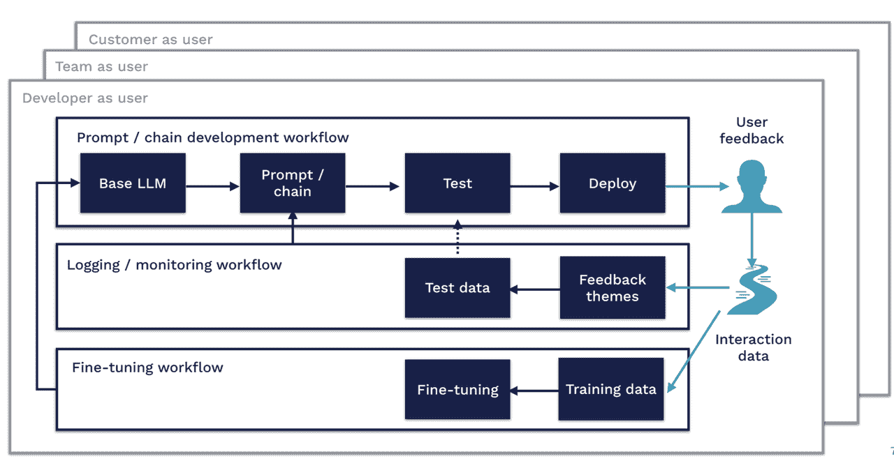
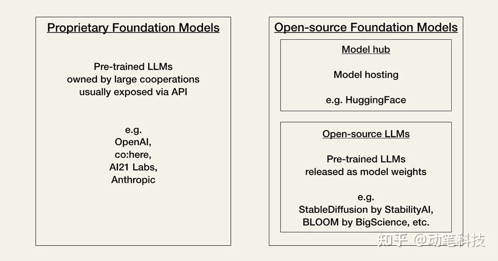
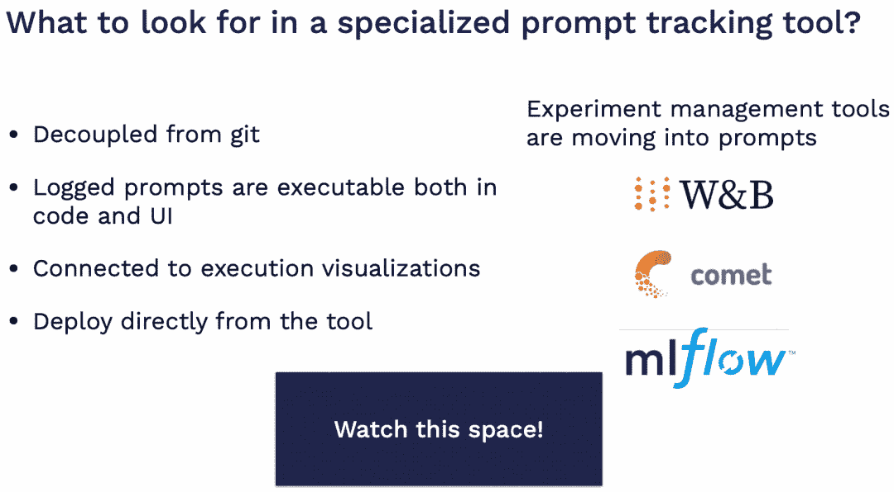
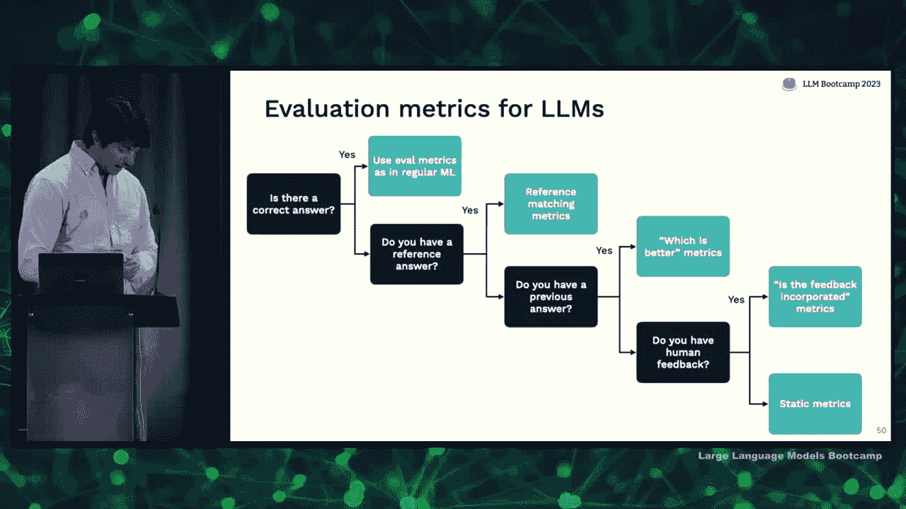
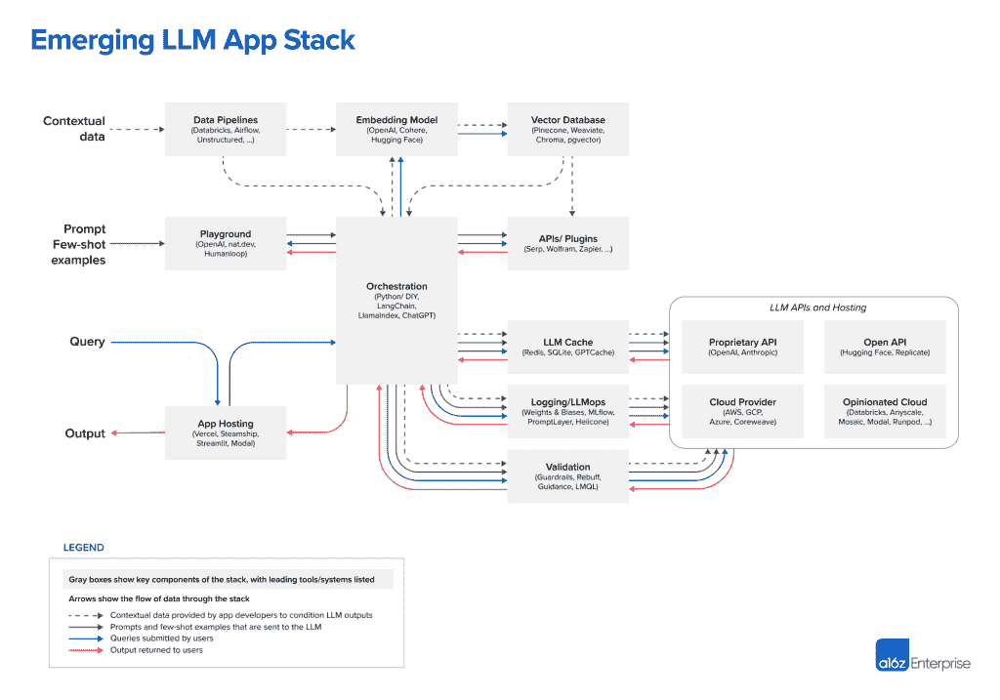
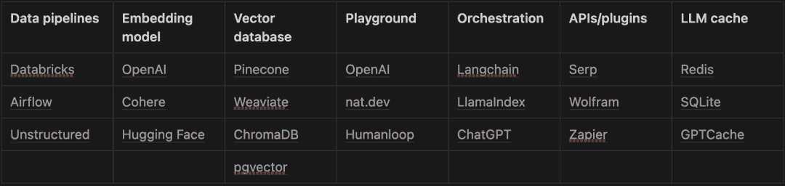
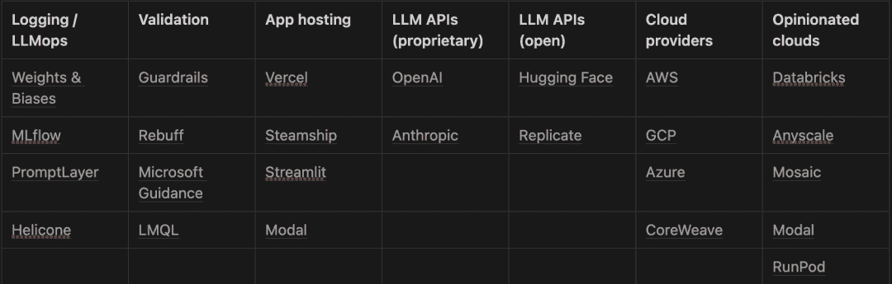

# 2023-07-12大模型时代的模型运维与部署：LLMops_悟乙己的博客-CSDN博客

> 来源：[https://xuqiwei1986.feishu.cn/docx/N06odxqFooAN1ixM55ac9Xkpnrc](https://xuqiwei1986.feishu.cn/docx/N06odxqFooAN1ixM55ac9Xkpnrc)

> 🔗 原文链接： h[ttps://blog.csdn.n](https://blog.csdn.net/sinat_26917383/article/details/131538334)et/sinat_2691738...

>

# 大模型时代的模型运维与部署：LLMops

###  文章目录

+   1 LLMOps介绍

+   1.1 关联定义

+   1.2 LLMOps 与 MLOps

+   2 LLMOps实现步骤

+   2.1 数据管理

+   2.1.1 数据清洗和预处理技术

+   2.1.2 数据标记和注释

+   2.1.3 数据存储、组织和版本控制

+   2.1.4 数据合规性检验

+   2.2 基础模型的选择

+   2.3 迭代和提示管理

+   2.4 测试+评估

+   2.5 部署

+   2.6 监控

+   3 一些案例应用

+   4 参考文献

---

#   1 LLMOps介绍

##   1.1 关联定义

术语 LLMOps 代表大型 [语言模型 ](https://so.csdn.net/so/search?q=%E8%AF%AD%E8%A8%80%E6%A8%A1%E5%9E%8B&spm=1001.2101.3001.7020)运维。它的简短定义是 LLMOps 是 LLM 的 MLOps。这意味着 LLMOps 是一组工具和最佳实践，用于管理 LLM 支持的应用程序的生命周期，包括开发、部署和维护。

+   LLM（大型语言模型）是可以生成人类语言输出的深度学习模型（因此称为语言模型）。这些模型有数十亿个参数，并接受了数十亿个单词的训练（因此被称为大型语言模型）。

+   MLOps（机器学习运维）是一组工具和最佳实践，用于管理 ML 驱动的应用程序的生命周期。

因[此，L](https://so.csdn.net/so/search?q=ML&spm=1001.2101.3001.7020)LMOps 是一组工具和最佳实践，用于管理 LLM 支持的应用程序的生命周期。它可以被视为 MLOps 的子类别，因为 LLM 也是 ML 模型。

##   1.2 LLMOps 与 MLOps

首先MLOps 包含LLMOps，

但是，MLOps 和 LLMOps 之间的差异是由我们使用经典 ML 模型与 LLM 构建 AI 产品的方式不同造成的。差异主要影响数据管理、实验、评估、成本和延迟。

#   2 LLMOps实现步骤

几个LLMops的步骤：

+   基础模型的选择

+   迭代和提示Prompt管理

+   测试

+   部署

+   监控

+   持续改进和微调

##   2.1 数据管理

###   2.1.1 数据清洗和预处理技术

原始数据可能存在噪声和结构混乱，因此在输入LLM之前需要[进行清洗](https://so.csdn.net/so/search?q=%E5%81%9C%E7%94%A8%E8%AF%8D&spm=1001.2101.3001.7020)和预处理。诸如标记化、小写化和 停用词 去除等技术可以标准化和简化文本。此外，拼写检查、去重和异常值移除进一步完善数据集，确保LLM的高质量输入。

###   2.1.2 数据标记和注释

在监督学习任务中，准确和一致的标记数据至关重要。将人类专家参与到注释过程中有助于确保高质量的标记数据。人在循环（human-in-the-loop）方法特别适用于需要专家判断的复杂、领域特定或模糊的案例。Amazon Mechanical Turk等平台可以帮助AI团队快速、经济高效地收集大规模标注数据。这些平台可以将标注任务分配给许多来自不同背景的工作者，提高标注质量和覆盖范围。

###   2.1.3 数据存储、组织和版本控制

在LLMOps中，有效管理大量数据至关重要。选择合适的数据库和存储解决方案有助于在LLM的整个生命周期中进行数据存储、检索和操作。

版本控制对于管理数据变更和跟踪其演变至关重要。数据版本控制系统允许AI团队跟踪数据集版本，促进协作，确保实验的可重复性。清晰而有组织的数据历史有助于团队高效地迭代他们的LLMs，并随时间提高性能。

###   2.1.4 数据合规性检验

合规性和法规要求

在处理敏感数据时，合规性和法规要求是不可忽视的。根据不同国家和行业的要求，必须采取适当的安全措施来保护用户数据。例如，欧洲的通用数据保护条例（GDPR）对个人数据的处理有明确的规定，违反规定可能面临严重的罚款。

数据匿名化和去标识化

为了保护用户隐私，必须对数据进行匿名化和去标识化处理。这涉及删除或脱敏个人身份信息，以确保数据无法与特定个体关联。

模型隐私和安全性

确保模型的安全性对于防止未经授权的访问和潜在的攻击非常重要。对模型进行加密、访问控制和审计跟踪是维护模型安全的关键措施。

伦理和公平性

伦理框架和指南 开发和使用LLM应该遵守伦理框架和指南。例如，美国人工智能行业协会（Partnership on AI）提供了《人工智能发展与实施指南》，其中包括对透明度、责任、公平性和隐私的建议。

公平性和偏见管理

LLM的训练数据和模型输出可能存在偏见，这可能会导致不公平的结果。应该采取措施来监测和减轻这些偏见，例如通过数据重新采样、后处理或使用公平性指标进行评估。

##   2.2 基础模型的选择

开发人员必须根据性能、成本、易用性和灵活性之间的权衡，在两种类型的基础模型之间做出选择：专有模型或开源模型。

专有模型是拥有大量专家团队和大量 AI 预算的公司所拥有的闭源基础模型。它们通常比开源模型更大，因此性能更好。它们也是现成的，因此易于使用。

专有模型的主要缺点是它们昂贵的 API（应用程序编程接口）。此外，闭源基础模型为开发人员提供的适应灵活性较低或没有。

专有模型提供商的示例是：

+   OpenAI (GPT-3, GPT-4)

+   AI21 Labs (Jurassic-2)

+   Anthropic (Claude)

开源模型通常在作为社区中心的Hugging Face上进行组织和托管。通常，它们是比专有模型功能更小的模型。但从好的方面来说，它们比专有模型更具成本效益，并为开发人员提供了更大的灵活性。

开源模型的例子是：

+   Stable Diffusion by Stability AI

+   BLOOM by BigScience

+   LLaMA or OPT by Meta AI

其中开源模型需要留意是否商用

##   2.3 迭代和提示管理

LLM 在生产调查[4]中提到的一个问题是模型准确性和幻觉。

这意味着以您想要的格式从 LLM API 获取输出可能需要一些迭代，而且，如果 LLM 不具备所需的特定知识，他们可能会产生幻觉。为了解决这些问题， 您可以通过以下方式使基础模型适应下游任务 ：

+   Prompt Engineering ：是一种调整输入以使输出符合您的期望的技术。您可以使用不同的技巧来改进您的 Prompt。一种方法是提供一些预期输出格式的示例。这类似于零样本或少样本学习设置。LangChain或HoneyHive等工具已经出现，可帮助您管理提示模板并对其进行版本控制。

+   微调预训练模型是 ML 中的一项已知技术。它可以帮助提高模型在特定任务上的性能。虽然，这会增加训练工作量，但可以降低推理成本。LLM API 的成本取决于输入和输出序列长度。因此，减少输入 tokens 的数量会降低 API 成本，因为您不必再在提示中提供示例 。

+   外部数据(External Data)：基础模型通常缺乏上下文信息（例如，访问某些特定文档或电子邮件），并且可能很快就会过时（例如，GPT-4在 2021 年 9 月之前接受了数据训练）。因为如果 LLM 没有足够的信息，他们可能会产生幻觉，所以我们需要能够让他们访问相关的外部数据。已经有可用的工具，例如LlamaIndex (GPT Index)、LangChain或DUST，它们可以充当中央接口以将（“链接”）LLM 连接到其他代理和外部数据 。

+   嵌入(Embeddings)：另一种方法是以嵌入的形式从 LLM API 中提取信息（例如，电影摘要或产品描述），并在它们之上构建应用程序（例如，搜索、比较或推荐）。如果np.array不足以存储您的长期记忆嵌入，您可以使用矢量数据库，例如Pinecone、Weaviate或Milvus 。

传统深度学习里对于实验追踪与记录有着非常完善的支持，但目前的 prompt 开发与迭代还在很早期的阶段，主要还是因为不同 prompt 产生的效果并不好自动化评估。

因此现阶段比较常见的做法就是通过 git 来管理 prompt 版本。如果有更复杂的需求，例如希望把 prompt 的应用逻辑解耦，或者引入业务人员来优化 prompt，以及通过单独的产品工具来快速评估管理不同的 prompt 甚至模型接口，那么就需要引入更加复杂的产品。这方面可以持续关注之前的 experiment tracking 产品，包括 WandB，MLFlow 等。

##   2.4 测试+评估

评价的必要性

+   为确保对模型或提示的更改有效

+   AI 驱动的应用程序的用户保留取决于信任和可靠的输出

评价的难点

+   训练数据未知：你不知道像 OpenAI 这样的 API 提供商使用的训练数据。

+   测试和训练数据分布差异大：实际使用的数据分布总是不同于训练数据的分布。

+   难以用一个核心指标去衡量：指标不那么直接，可能无法捕捉模型的不同行为。语言模型需要对行为和定性输出测量有更多样化的理解。

两个关键要素：测试数据、评价指标：

**测试数据构建的建议**

+   Start incrementally：从构建产品原型开始就逐步构建测试数据集

+   Use your LLM to help ： 通过为您尝试解决的任务创建提示，利用语言模型来帮助生成不同的测试用例

+   Add more data as you roll out ：向数据集中添加有趣的示例，重点关注模型遇到困难的困难示例以及数据集中不常见的不同示例；随着模型向更多用户推出，不断向数据集添加数据，同时考虑用户不喜欢和代表性不足的主题以包含在内

+   Toward “test coverage” for AI?：考虑测试覆盖率的概念，目标是评估集涵盖用户将在系统中实际执行的任务类型；测试覆盖率和分布转移是类似的，但衡量数据关系的不同方面；为了有效，测试可靠性应该衡量在线和离线性能之间的差异，确保指标与真实世界的用户体验相关。

**指标选择建议**

通过 LLM 来做评估的具体方法包括：

+   如果有完全精确的答案判定，可以用传统指标，不需要借助 LLM。

+   如果你有标准答案，可以测试语义相似度，或者询问 LLM：两个回答是否一致？

+   如果有上一个版本的回答，可以询问 LLM：哪一个回答更好？

+   如果有用户填写的反馈信息，可以询问 LLM：用户的反馈是否已经包含在回答中了？

+   其它情况，可以通过外部工具来检查是否是个合法的格式，或者让 LLM 给回答做个打分。

##   2.5 部署

部署LLM（语言模型）API可能很简单，但是如果API调用背后有很多逻辑，则会变得更加复杂。

提高LLM输出质量的技术包括自我评价、采样多个输出和集成技术。

##   2.6 监控

监视LLM涉及查看用户满意度和定义性能指标，例如响应长度或生产中的常见问题。

通过低摩擦方法收集用户反馈，例如向上/向下或简短消息收集用户反馈。

生产中LLMS的常见问题包括UI问题，延迟，错误答案，漫长的答案和迅速的注射攻击。

使用用户反馈通过查找和解决主题或问题来改善提示。

---

#   3 一些案例应用

[a16z报告翻译] LLM应用架构/技术栈

一个比较完整的LLM的商用案例：

这里是每个项目的链接列表，以供快速参考，这是不同环节的技术选型，可以供参考：

---

#   4 参考文献

[LLMOps（Large Language](https://zhuanlan.zhihu.com/p/631732317)[Model Operations）简介](https://zhuanlan.zhihu.com/p/640725385)

了解一下新领域 LLMOps: 大模型运维

LLM训练营课程笔记之 LLMOps: Deployment and Learning in Production

生成式AI时代的AI Infra—从DevOps->MLOps->LLMOps