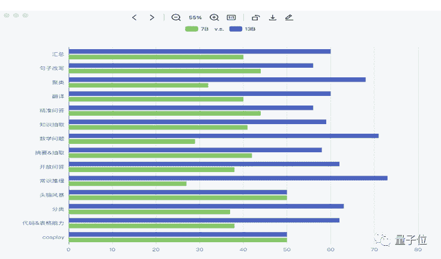
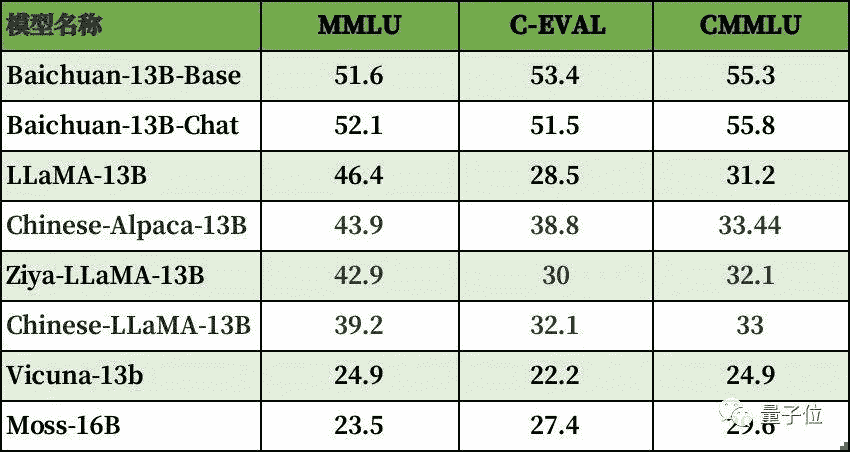
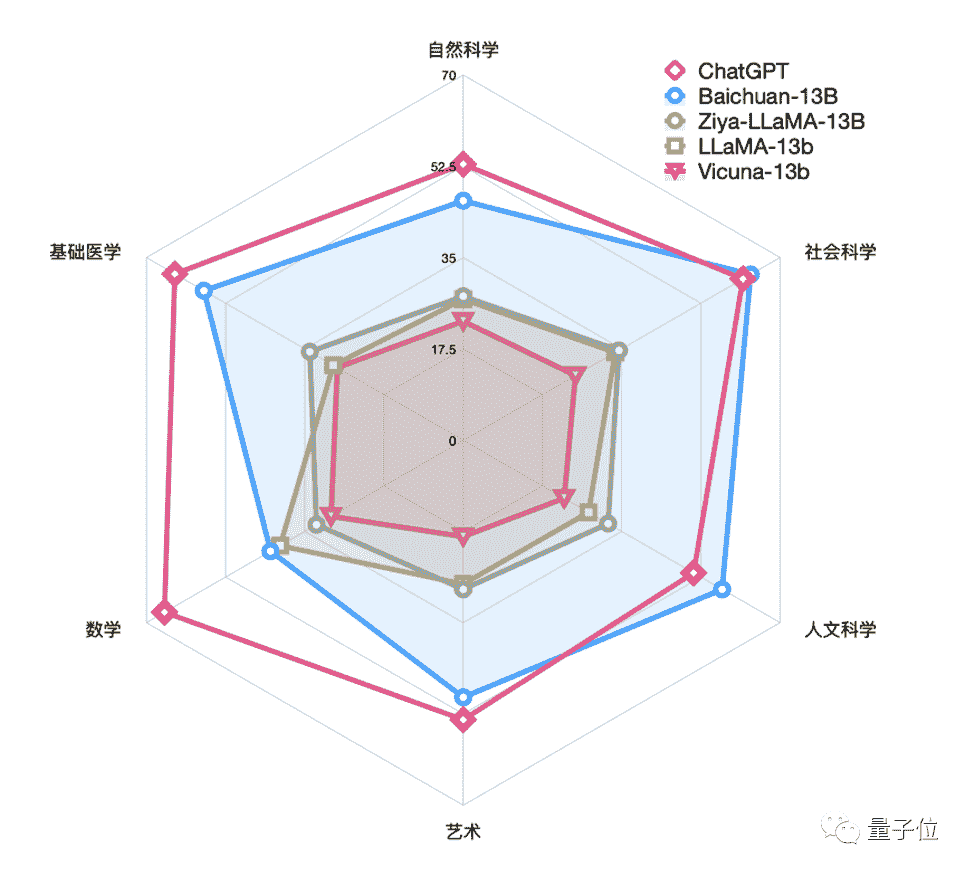
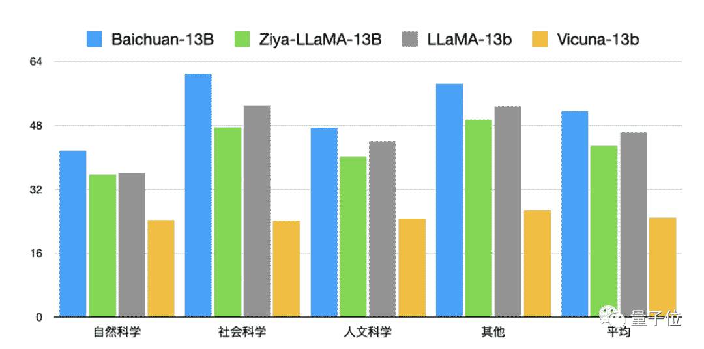
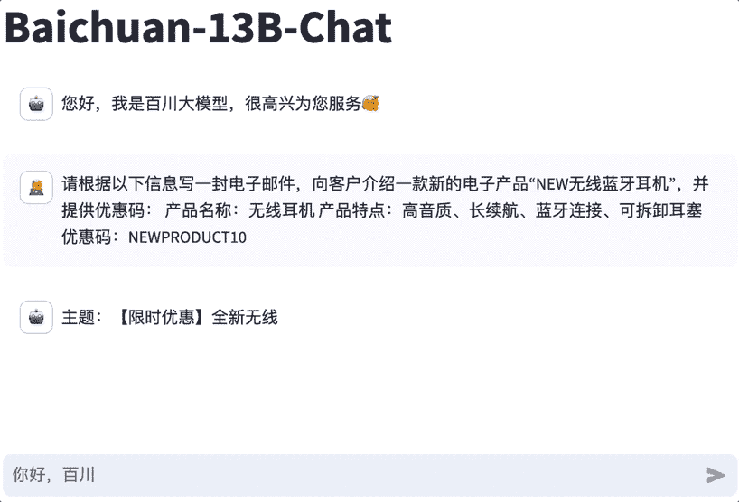
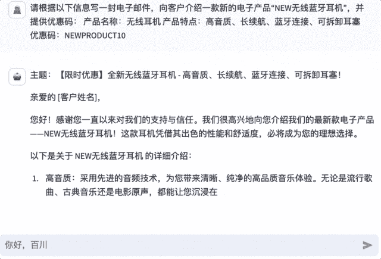
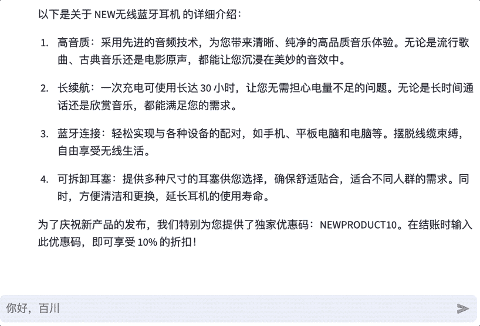
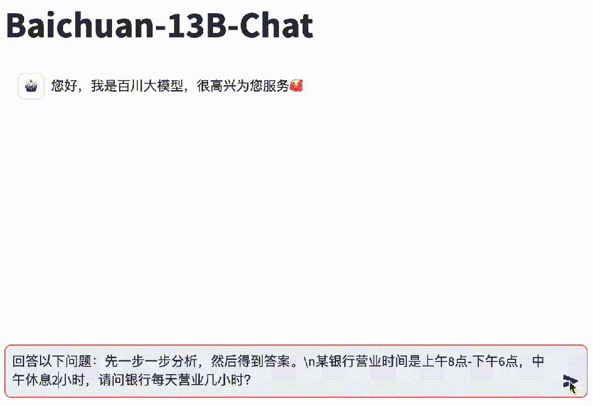
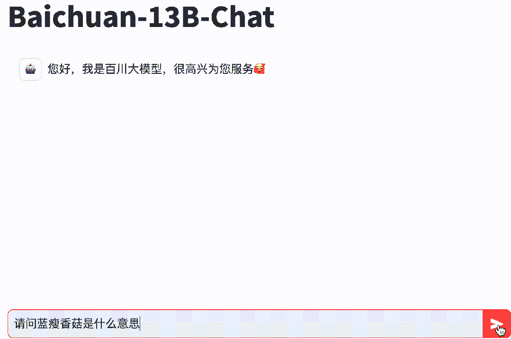

# 2023-07-11王小川大模型25天再升级！13B版本开源免费可商用，3090即可部署-今日头条

> 来源：[https://xuqiwei1986.feishu.cn/docx/ESyidBGh9oPAFjxrPu7cjsmzneg](https://xuqiwei1986.feishu.cn/docx/ESyidBGh9oPAFjxrPu7cjsmzneg)

> 🔗 原文链接： h[ttps://www.toutiao](https://www.toutiao.com/article/7254421537095451188/?log_from=e9f196bd44b01_1691396860797).com/article/725...

>

# 王小川大模型25天再升级！13B版本开源免费可商用，3090即可部署

2023-07-11 13:02 · 量子位

> 衡宇 金磊 发自 凹非寺

> 量子位 | 公众号 QbitAI

就在刚刚， **王小川 **的开源大模型又有了新动作——

百川智能，正式发布130亿参数通用大语言模型 （Baichuan-13B-Base） 。

并且官方对此的评价是：

> **性能最强 **的中英文百亿参数量开源模型。

与此一同出道的，还有一个对话模型Baichuan-13B-Chat，以及它的INT4/INT8两个量化版本。

但更重要的一点是 （划重点） ， **完全开源！免费可商用！**

就在不久前的6月15日，百川智能才刚刚发布其第一款70亿参数量的中英文语言模型Baichuan-7B。

当时的版本便已经拿下多个世界权威Benchmark榜单同量级测试榜首；同样作为开源大模型，据说清华北大都已经用上了。

仅仅时隔25天，更大、更强的版本再次袭来，不得不说，王小川在技术上的动作是有够紧锣密鼓的了。

那么这次号称的“最强开源大模型”，具体表现又是怎样呢？

# 多领域超越ChatGPT

老规矩，先提纲挈领地说一下Baichuan-13B的基本个“模”资料：

**中英双语大模型，130亿参数，在1.4万亿tok**en数据集上训练，完全开源、免费可商用。

1.4万亿ztoken这个训练数据量，超过LLaMA-13B训练数据量的40%，是当前开源的13B尺寸模型世界里，训练数据量最大的模型。

此外，Baichuan-13B上下文窗口长度为4096——这就不得不提到其与7B版本完全不同的编码方式。

7B版本采用RoPE编码方式，而13B使用了ALiBi位置编码技术，后者能够处理长上下文窗口，甚至可以推断超出训练期间读取数据的上下文长度，从而更好地捕捉文本中上下文的相关性，让预测或生成更准确。

作为一款中英文双语大模型，Baichuan-13B采用了相对平衡的中英文语料配比和多语言对齐语料，从而在中英两种语言上都有不俗表现。

**△ **主流百亿参数13B开源模型benchmark成绩

**来看看Baichua**n-13B在 中文领域的测评成绩 。

在评测集C-EVAl上，Baichuan-13B在自然科学、医学、艺术、数学等领域领先LLaMA-13B、Vicuna-13B等同尺寸的大语言模型。

社会科学和人文科学领域，水平比ChatGPT还要好上一点。

**英文领域 **的表现也算不错，能比同尺寸的其他开源模型，如LLaMA-13B、Vicuna-13B都有更好的表现。

通常而言，非专业用户和有具体需求的企业，对有对话功能的对齐模型有更重的好奇心。

鉴于这个情况，百川智能此次在发布与训练模型底座Baichuan-13B-Base的同时，还发布了其对话模型Baichuan-13B-Chat及其INT4/INT8两个量化版本。

来看看对话模型的实际表现效果——

让它写个商品介绍邮件，它能写出酱婶儿的：

数据推理能力如何？

也浅测了一番：

至于互联网上远古或新近流行的各种梗，Baichuan-13B-Chat好像也没在怕的：

官方介绍，为了保证模型的纯净度，Baichuan-13B-Base和Baichuan-13B-Chat没有针对任何benchmark测试进行专项优化，具有更高的效能和可定制性。

# 为什么要完全开源、可商用？

正如我们刚才提到的，这次百川智能推出**的Baichuan-**13B-Base是 对学术研究完全开放 。

不仅如此， 所有开发者均可通过邮件向百川智能申请授权 ，在获得官方商用许可后即可免费商用。

而且据官方的说法，百川智能是为了降低使用的门槛，才同时开源了Baichuan-13B-Chat的INT8和INT4两个量化版本。

这样一来，在近乎无损的情况下，便可以将模型 部署在如3090等消费级显卡上 。

想必很多小伙伴就要问了，百川智能为什么要走这么一条路？

其实如果看下Meta在大模型上的开源之路，便可窥知一二。

我们都知道大模型在训练的成本极高，因此像OpenAI和谷歌两大科技巨头最初选择的是闭源的“路数”，它们为的就是以此保证自己的优势。

而Meta后来所推出的LLaMa则与之“背道而驰”，但所迸发出来的潜力却是有目共睹——

迅速吸引大批开发者，在LLaMa基础上迭代出了各种ChatGPT的替代品，甚至在性能的表现上是可以匹敌GPT-3.5的那种。

加之业界对大模型未来发展态势已经达成了一个共识：

类似安卓和iOS，将会是开源和闭源共存的状态。

因此，开源在大模型的发展中已然成为一股不可或缺的中坚力量。

……

那么你对于王小川的新大模型，有何看法呢？

【HuggingFace】

预训练模型：https://huggingface.co/baichuan-inc/Baichuan-13B-Base

对话模型：https://huggingface.co/baichuan-inc/Baichuan-13B-Chat

【GitHub】

https://githuB.com/Baichuan-inc/Baichuan-13B

【Model Scope】

预训练模型：https://modelscope.cn/models/Baichuan-inc/Baichuan-13B-Base/

对话模型：https://modelscope.cn/models/Baichuan-inc/Baichuan-13B-Chat/

— 完 —

量子位 QbitAI · 头条号签约

关注我们，第一时间获知前沿科技动态