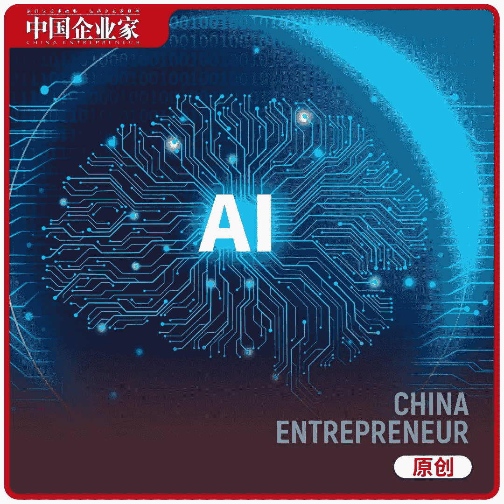

# 2023-07-11租2000张芯片做大模型：一家创业公司的生死抉择-今日头条

> 来源：[https://xuqiwei1986.feishu.cn/docx/LZQBdY2GRodKG1xZlzMcF9C3nvc](https://xuqiwei1986.feishu.cn/docx/LZQBdY2GRodKG1xZlzMcF9C3nvc)

> 🔗 原文链接： h[ttps://www.toutiao](https://www.toutiao.com/article/7254461498955940367/?log_from=2f87ac616f6d6_1691461922734).com/article/725...

> 租2000张芯片做大模型：一家创业公司的生死抉择

原创 2023-07-11 15:40 · 中国企业家杂志

> “野蛮人”已来，创业者打响反击战。

**文 ****｜《中国企业家》记者 闫俊文**

**编辑 ****｜李薇**

**头图来源 ****｜视觉中国**

一项新技术兴起时，创业公司是等着大公司做出来，还是自己投真金白银做？

一家名叫中科深智的虚拟人创业公司选择了后者。近期，中科深智发布了一款大模型，包含20亿和200亿参数两个版本。为此，他们租用了2000张英伟达A100显卡，十几个人的团队没日没夜忙了两个月，花费了数百万元现金。

中科深智创始人、CEO成维忠说，当下，接入API响应速**度太慢，不适应虚拟人的实时要求。并且， 大**厂的大模型并不会公布核心算法，这让创业公司无法迭代基础算法，鼻子被大公司牵着走。

中科深智成立于2016年，最近获得的一次融资在2021年11月，由晨山资本领投的B轮千万美元融资，老股东马来西亚MYEG Capital持续跟投。虽然成立已7年，但中科深智目前也只有100多人，以研发人员为主，公司年营收数千万元。

当技术浪潮到来时，巨头公司有更多资源来应对，也有更多试错成本。但是创业公司完全不同，他们力量单薄， 既不能放手错过时机，更不能盲目追风，这让他们如履薄冰。

# 不做，就会死

**大模型火热，但成维忠他们发现**， 能用的开源大模型一个也没有 。

中科深智CTO宋健说，一个可用的开源模型，有三重定义：第一，训练的数据开源，比如数据是怎么处理的，用什么数据训练，如何去重；第二，训练过程开源，比如算法；第三，训练的模型开源，比如参数。

“这三点基本上就决定了目前市面上的开源大模型很少。中文大模型没有一家，英文大模型大概有两三家，但他们的license（许可）限制很多，比如不能商用等等。”宋健说。他预计，在2024年就可以看到更多可用的性能很好的开源大模型，可以快速切换。

大**模型最流行的商业模式是调用**API接口，具体到中科深智的赛道虚拟人业务场景，因为算力限制以及需求的庞大，ChatGPT4.0五六秒回答一次， 延时对虚拟人场景足以致命 ，消费者不会多等一秒钟。

就算接入了API接口，创业公司的算法也不能迭代。成维忠说，中科深智的产品是基于NLP（自然语言处理）来输出语言，用的是CLAP算法，如果用大模型来提升算法，那么就需要大模型的源代码，尤其是做多模态的训练，必须有源代码。

“大公司当下不可能开放源代码，未来不好说。另外，我们的客户也很担心数据安全问题。”成维忠说。

中科深智创始人、CEO成维忠。来源：受访者

大公司如何看创业公司在大模型创业潮中的机会？

“云**计算发展到现在，很重要的环**节就是通过开源一系列模型，降低学习成本，能够去尝试自己的一些突破。”阿里云CTO周靖人说。谁能够更加敏捷，快速探索出一条业务发展创新的道路，谁就会占据有利的地位。 今天大家都是跟时间在赛跑。

目前，中科深智还没有盈利，但成维忠没有退路： “如果不自己做大模型，半年后，公司业务的赛道就跟自己没有关系了。”

据IT桔子数据统计，2022年虚拟人领域的融资数达51起，融资总额40.96亿元。截至2023年5月，该领域也有数十起融资，比如成立于2019年的万像科技在4月宣布完成数千万人民币A2轮融资。

大公司也在竞逐这个领域。7月，阿里云通义大模型家族迎来新成员。AI绘画创作大模型通义万相开启定向邀测，该模型可辅助人类进行图片创作，未来可应用于艺术设计、电商、游戏和文创等应用场景。

4月，商汤发布了大模型体系商汤日日新大模型。发布会上，商汤演示了2D数字人视频生成平台“如影SenseAvatar”——仅需一段5分钟的真人视频素材，就可以生成声音动作自然、口型准确、多语种精通的数字人分身。

大模型的“推理”能力，突破了NLP的局限，让人机对话变得更流畅，更智能。技术的变化带来了创业者与投资人的涌入。 虚拟人赛道成为目前大模型可落地应用的最大场景之一。

# 租算力做大模型

中科深智通过自己的途径，以小时付费的方式租用算力来开发大模型， 一小时十几元，和往年相比，单价涨了3倍 。算力主要用在数据训练以及微调上，折合算下来，他们估算用了2000张英伟达A100显卡。

中科深智推出的20亿和200亿参数大模型，主要应对垂直场景落地，比如电商卖货，不需要考虑通用性。以虚拟主播带货为例，将积累数年的场景数据做训练，最重要的是响应速度。

“从三五秒钟提升到0.5秒，这就够了，不用去关心作文或者摘要写的怎么样。”成维忠说。

20亿和200亿参数的大模型，在数千亿参数的ChatGPT以及文心一言面前，就是“小弟弟”。但 小有小的好处，那就是胜在速度快 。大公司致力于打造出千亿参数级别的通用人工智能大模型，他们是“既要又要还要”，但对于创业公司而言，他们是“只要”。

成维忠反馈说，一些电商客户接入通用大模型后，发现不仅API响应速度慢，有些回答还不专业，影响C端用户留存转化。客户反过来寻求中科深智的SDK（软件开发工具包），运用中科深智的大模型。

中科深智开发了一个名为“虚拟助播”的技术，让真人与虚拟人互动，此前，基于传统的NLP技术做不到产品的需求。现在，在虚拟人背后接入大模型，就可以支撑虚拟人，真人可以让虚拟人唱歌、跳舞、回答问题以及自主卖货。

来源：受访者

大模型似乎正在变成 大公司的“坏生意”，创业公司的“好生意” 。

“坏”在它目标设定高，建立通用人工智能技术底座，投入无底洞，变成了一项长周期的投入；而创业公司只需要迭代算法和技术，就可以局部建立优势，实用为主，一边用一边学。

不管是腾讯云的行业大模型还是百度的文心一言，都在从通用人工智能转向场景落地，但这恰好是行业公司的硬核优势。 行业头部企业下场做行业模型，更容易推广和落地。 从这个角度上说，垂类大模型的确更有优势。

但一些技术问题仍然晦暗不明。

不同于文生图以及图生文等场景，虚拟人直接将大模型能力推进到多模态领域，但没人告诉创业公司这条路是否能走得通。以前是动作捕捉生成技术，现在是否要切换到大模型的definition（定义），生成端依然有很多技术不确定性。

# 高风险时代，创业公司如何扩张

大公司扩张新业务，上线新产品，不管是百度还是阿里巴巴都上线了基于大模型功能的新产品，比如阿里巴巴的通义听悟、通义万相，它还用大模型改造了钉钉等产品，上线了会议摘要及总结等功能。

一些人将此次AI革命的爆发周期定义为10年，但技术革命爆发初期，技术路线和落地路径还不是很清晰， 噪音和泡沫横飞，对于创业公司而言，扩张新业务要尤其谨慎。

在技术变革期，每个创业者似乎都能看到机会。以此次大模型为例，机器人公司会觉得交互革命到了，社交软件创业者会觉得做出下一个🛰️的机会出现了，3D虚拟人创业者会说，未来需要1000亿个虚拟人。

这种“机会错觉”会激发创始人的野心，甚至蒙蔽他们的双眼。但有的创业者也容易被风险所恫吓，变得畏首畏尾。

中科深智是研发型的公司，算法是他们的核心竞争力，长周期投入研发，业绩又受到宏观经济影响。中科深智的投资人，包括自己的团队，对大模型没底，又花不少钱去训练，大家都会有疑虑。

成维忠是这样说服自己的： 不把大模型这事儿神化，用平常心去看待它， 平常做业务的时候，你会去想我应该不应该做这件事吗？我觉得它能赚钱，对我公司长期有帮助，我就去做了大模型。

他预测， 未来10年和20年其实就是XR加AI，不能单纯地讲AI ，AI大模型带来的是工具AI化、应用AI化、服务3D化，这意味着未来虚拟空间需要越来越多的虚拟人。

想好了就去做，但要紧密结合自己的场景和业务去做。

上一次移动互联网浪潮时，成维忠错过了一次技术浪潮。2008年，他创办了互联网营销公司。等到移动互联网起来的时候，成维忠是谨慎派，觉得技术不成熟、终端差、网络不行，他觉得需要等等再入局。

“现在回头再看，这是一个非常错误的决定。”成维忠反思。移动互联网的创业浪潮在2007年、2008年和2010年就已划定。

像成维忠这样的移动互联网创业者，在守成之余，开始在新技术浪潮中主动出击，但是成是败，还需时间检验。