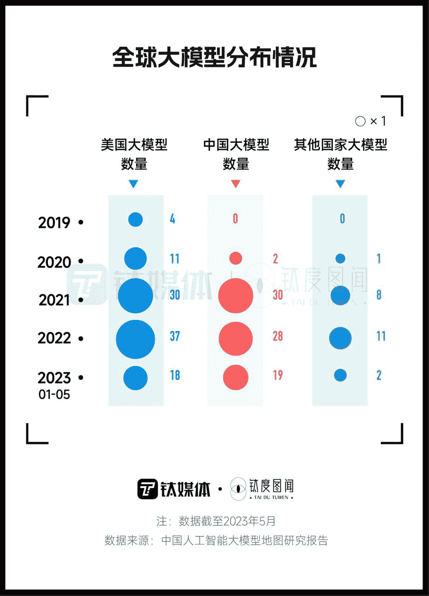
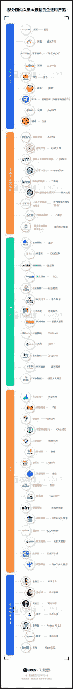
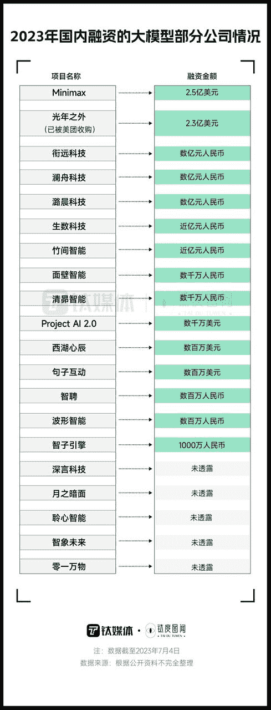
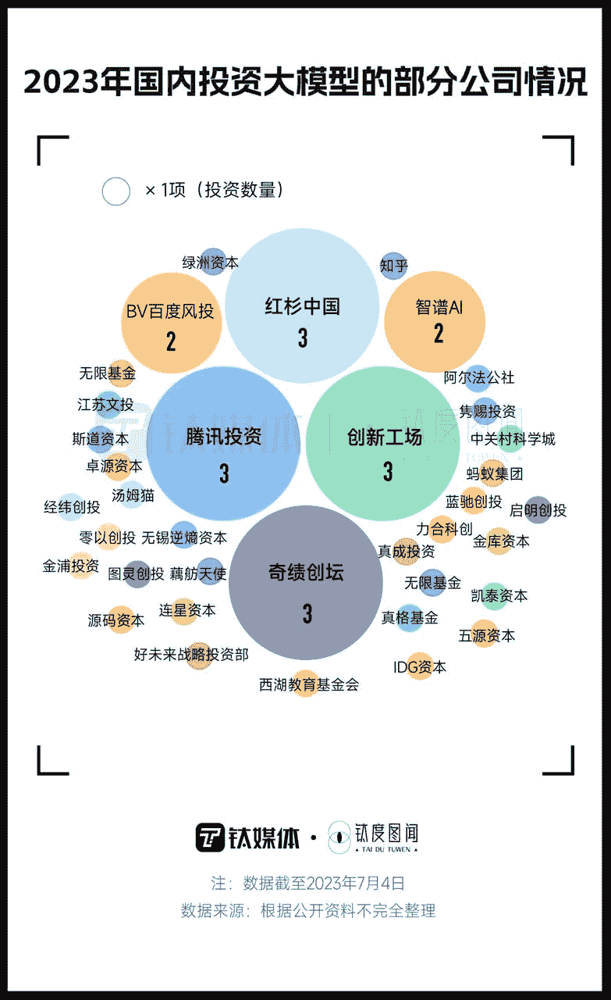
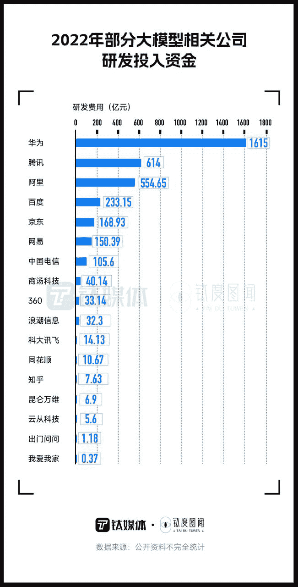
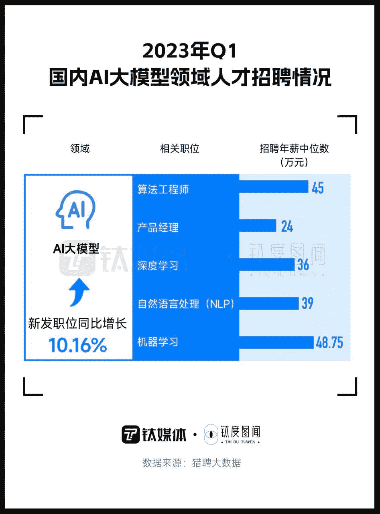
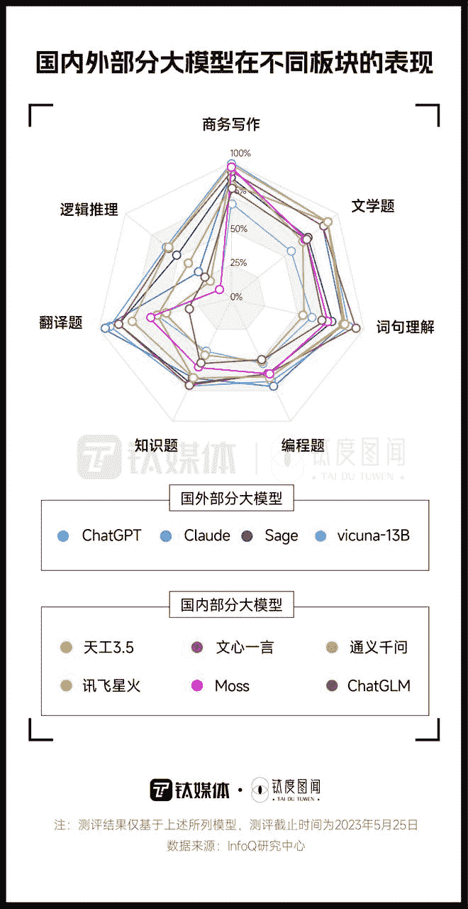
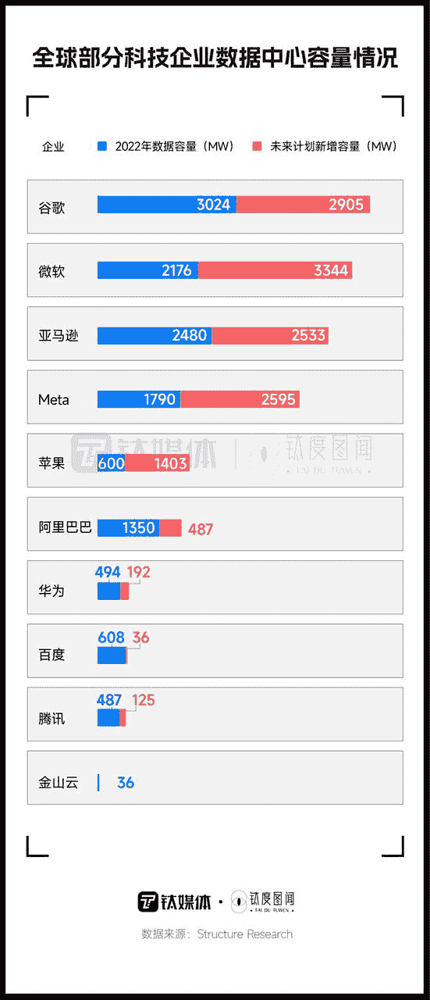

# 2023-07-08“卷”资金抢人才，一文看懂国产AI大模型竞争格局

> 来源：[https://xuqiwei1986.feishu.cn/docx/QTCkd5Xciovx89xNJxScHwGRnSb](https://xuqiwei1986.feishu.cn/docx/QTCkd5Xciovx89xNJxScHwGRnSb)

> 🔗 原文链接： h[ttps://www.tmtpo](https://www.tmtpost.com/6605035.html)st.com/6605035.html

> “卷”资金抢人才，一文看懂国产AI大模型竞争格局｜钛度图闻

“神仙打架”，“大佬”下凡。

钛度图闻·第一百零三期

> 策划制作｜钛媒体视觉中心，编辑｜刘亚宁，作图｜初彦墨

6月29日，美团在港交所发布公告，宣布收购王慧文创办的大模型公司“光年之外”，这也给AI大模型市场留下了猜测。不只在国内，ChatGPT的访问量在近期增速下滑，数据显示，ChatGPT6月份的全球访问量环比降幅9.7%，独立访客数量环比下滑了5.7%。此外，用户使用ChatGPT的时长也在下降，5月份的每次访问时长下降了8.5%，AIGC似乎迎来了冷静期。

但另一方面，7月4日，李开复亲自筹组的大模型公司“零一造物”正式上线、百度开发的大语言模型“文心一言”APP上架苹果应用市场、企查查发布商查大模型——“知彼阿尔法”......各家公司在大模型领域动作频频，热火朝天。

AI大模型的创业有多火？资本市场对于这一风口的投资布[局如何？如今的国产](https://www.tmtpost.com/column/5750087)大模型表现如何？本期 钛媒体·钛度图闻 试图从数据层面梳理目前国产大模型的发展现状。

## 国内AI大模型“神仙打架”，科技巨头竞相出手

从今年3月开始，国内的AI大模型如雨后春笋般涌现。《中国人工智能大模型地图研究报告》显示，截至2023年5月底，国内10亿级参数规模以上基础大模型至少已发布79个。

从全球来看，美国在大模型数量方面居全球之首，早在2020年，美国就已推出了15款大模型，其中包括GPT-3。而中国从2020年开始，大模型也进入高速发展阶段，2021年推出了30款大模型，2022年推出了28款大模型，2023年前5个月推出了19款大模型，超过美国的18款大模型。如今，中美两国大模型的数量占全球大模型数量的近90%，中国大模型数量已进入第一梯队。

国内大模型赛道热闹非凡，涉足AI大模型赛道的“玩家”有以阿里、腾讯、百度等为代表的互联网大厂，3月16日，百度领跑，推出中国版ChatGPT“文心一言”，随后，阿里、华为、腾讯、360等大模型陆续浮出水面。

此外，还有以商汤科技、科大讯飞等为代表的AI科技公司和教育类企业孩子王、金融类企业同花顺、房地产类企业我爱我家等为代表的各行业公司。另外，大模型在学术界也很火热，早在今年2月，复旦大学就已发布国内首个类ChatGPT模型MOSS。

值得注意的是，随着ChatGPT的火爆，国内还火速兴起了AI大模型的创业风潮，诸多科技大佬以及大厂高管等投身大模型，开启再创业。2023年2月，原美团联合创始人王慧文发布“AI英雄榜”，高调入局AI大模型；同样高调入场的还有创新工场CEO李开复，3月19日，李开复在朋友圈宣布成立Project AI 2.0公司，进军AI大模型；随后，搜狗创始人王小川、前京东AI业务开路人周伯文、出门问问CEO李志飞等也都加入了AI大模型创业热潮。

除了这些科技大佬，很多互联网大厂高管也加入竞争。比如，快手前 AI核心人物李岩，成立了AI公司元石科技，进行多模态大模型的研发；李开复的“关门弟子”、依图科技10号员工周健成立了澜码科技，致力于重塑人机互动的模型。如今，国内AI大模型“神仙打架”，行业赛道十分热闹。

## 投资机构出手谨慎，市场高薪招聘大模型领域人才

入局大模型，首先要备好钱，毕竟大模型创业公司发布一个较为成熟的模型，需要投入大语言模型基础设施、训练和研发人才的成本。对于初创企业来说，融到钱才能活下去。

据 [钛媒体·钛度图闻 ](https://www.tmtpost.com/column/5750087)不完全统计，截至2023年7月4日，今年获得融资的AI大模型创业公司融资金额普遍在千万到数亿元之间。其中，获得融资金额最多的是大模型初创公司MiniMax，其在6月1日完成了超2.5亿美元的新一轮融资，目前该公司估值超12亿美元，被冠以“腾讯首次投资的创企”称号。此外，刚刚被美团收购的光年之外在6月5日完成A轮2.3亿美元融资，只不过在美团出手收购完成后，此轮融资也已被悉数退回。值得一提的是，成立于2021年的西湖心辰分别在今年3月、4月接连完成了两笔融资，融资速度很快。

而在AI大模型投资中，IDG资本、经纬[创投、真格基金等头](https://www.tmtpost.com/column/5750087)部VC的出手较少。据 钛媒体·钛度图闻 不完全统计，腾讯投资、创新工场、奇绩创坛、红杉中国是较活跃的投资机构，投资企业均达到3家，其次是BV百度风投和智谱AI，投资企业分别为2家，大多数机构投资的企业仅为1家，而一向活跃的高瓴创投、深创投没有公开数据显示其进行过AI大模型赛道的投资，可见投资人对大模型创业这一赛道出手较为谨慎。

除了[融资以外，技术能力](https://www.tmtpost.com/column/5750087)也是影响大模型竞争的核心。大模型对于算法、算力和数据都有很高的要求，AI大模型需要高昂的训练费用和研发投入，一些互联网大厂和科技公司拥有更为深厚的资金和技术储备。据 钛媒体·钛度图闻 不完全统计，2022年，华为在研发费用上投入1615亿元，成为研发投资资金最多的企业；其次，腾讯以614亿元排名第二，阿里以555亿元排名第三。互联网大厂每年研发投入资金就高达百亿元，另外还拥有实力雄厚的研发团队，在大模型赛道上是当之无愧的“第一梯队”玩家。

除了资金和技术，人才也是大模型竞争中不可或缺的一环。在今年第一季度，各家公司对顶级AI人才展开了抢人大战。王慧文表示要拿出75%的股份邀请顶级研发人才，李开复喊话在全球范围内招募世界级人才，百度以25-40k/月薪资招聘AI大模型算法工程师、20-40k/月薪资招聘模型构架工程师；阿里以40-70k/月薪资招聘大模型训练及算法工程师，各大公司求贤若渴。

相关数据显示，今年一季度AI大模型相关职位的发布量同比增长10.16%，是与ChatGPT相关增长最多的领域，其中机器学习和算法工程师两个职位的招聘年薪中位数均达到40万元以上。

## 国产大模型发展挑战仍存，部分领域表现优于国际模型

过去半年，大模型陆续发布，它们目前实力如何？据相关机构对国内外10款AI大模型的测评，整体来看ChatGPT领先优势较为明显，综合数据位居第一。分板块来看，国内大模型在词句理解和知识题方面超越国外模型，即国产AI大模型对⽂字的基础认知和学习能⼒较强。

而在6个国产大模型中，“文心一言”的综合数据表现较为优异，尤其是在词句理解、编程、知识题以及翻译方面领跑国产大语言模型；在商务写作方面，国内产品表现最好的为“讯⻜星⽕”；在文学题方面，国内产品“天⼯3.5”得分率最高，为88.33%，与ChatGPT得分持平；在逻辑推理方面，“文心一言”和“讯飞星火”表现相当。

国内大模型在一些细分领域其表现是十分优异的，但与国外同类型产品还存在一定差距，在数据等核心技术以及落地场景方面还有很大的进步空间。

在数据层面，大模型的发展需要高质量的训练数据集。目前国内基于中文语义的大模型训练所需要的中文数据总量不够，而且质量不高，优质中文大模型训练语料的稀缺也加大了差距。

在算力层面，按数据中心容量来统计，2022年在这一领域领先的公司是谷歌、微软、亚马逊和Meta，这四个数据中心平台占全球自建数据中心总容量的7成以上；而目前国内虽已有像阿里、百度、腾讯等的一些头部科技企业完成数据中心建设，但在容量上和国外相比还有一定的差距。

在落地场景方面，不同细分场景落地的成本也是个问题。要想得到一个足够有效且好用的大模型，需要投入足够多且有针对性的语料，这意味着不同细分场景的落地需要大量的成本投入。据估算，大模型训练一次的成本介于200万美元-1200万美元之间。由于训练成本过高，人工智能开发公司Open AI 2022年亏损达到5.4亿美元左右。所以AI大模型的商业变现还需要时间。

在这个竞争激烈的赛道上，即使困难重重，国内大模型都在朝着更完善的技术方向走去。而且赛道内的竞争也将加速国产大模型技术的发展步伐，推动中国AI产业的整体技术升级。

数据来源：Structure Research、InfoQ研究中心、猎聘大数据、《中国人工智能大模型地图研究报告》等公开资料不完全整理。