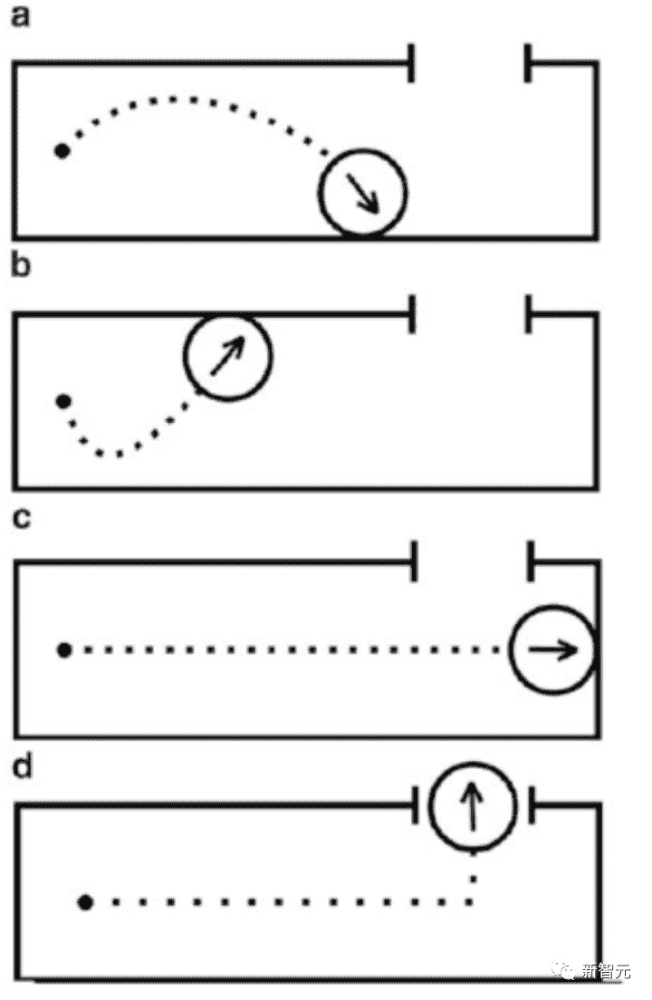
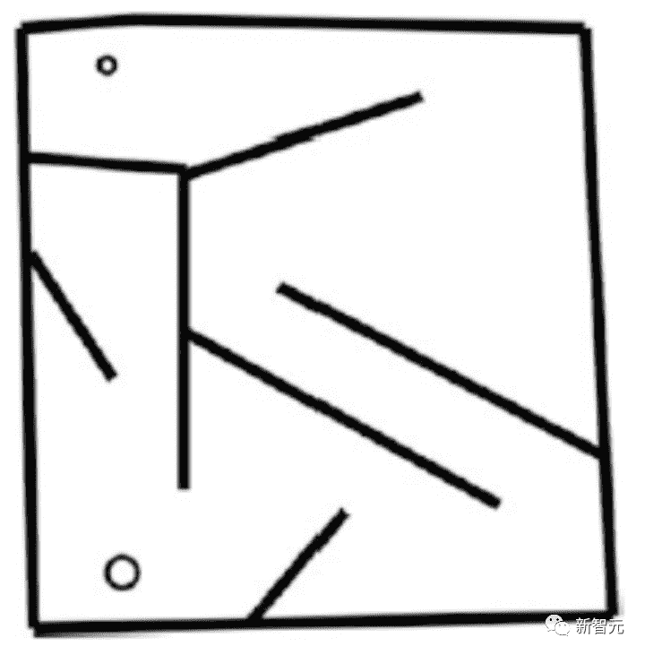
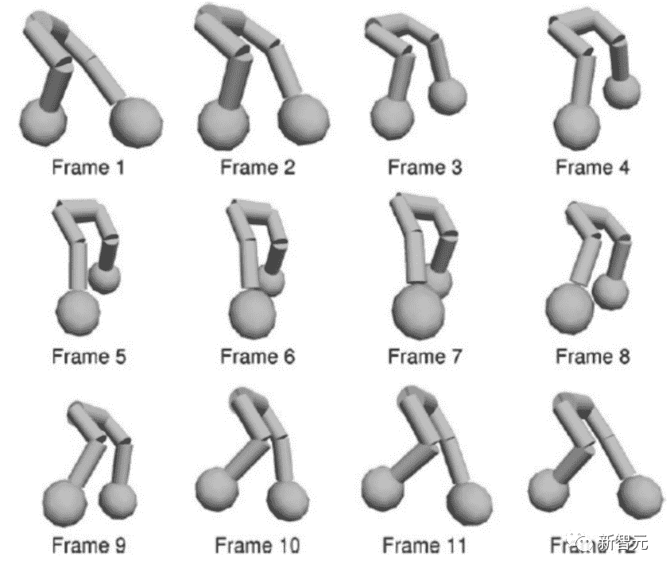
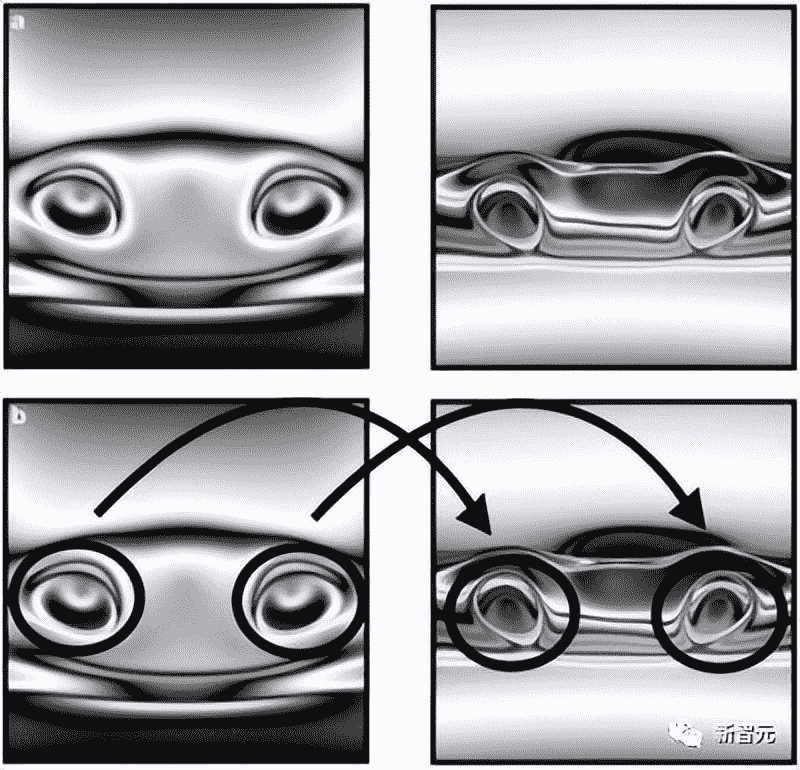

# 2023-07-06破解大模型“涌现”之谜：新奇性搜索是AI腾飞的踏脚石-今日头条

> 来源：[https://xuqiwei1986.feishu.cn/docx/NxxldiaSpoaYpnx0b5gc8BMUnjb](https://xuqiwei1986.feishu.cn/docx/NxxldiaSpoaYpnx0b5gc8BMUnjb)

> 🔗 原文链接： h[ttps://www.toutiao](https://www.toutiao.com/article/7252602002406933003/?log_from=536e6acbfd006_1691397588391).com/article/725...

>

# 破解大模型“涌现”之谜：新奇性搜索是AI腾飞的踏脚石

2023-07-06 15:21 · 新智元

作者：肯尼斯·斯坦利

# 【新智元导读】OpenAI科学家Kenneth Stanley和Joel Lehman的畅销新书《为什么伟大不能被计划》中，提出了一种「新奇性搜索算法」，可能是大模型「涌现」能力的答案。

肯尼斯·斯坦利和乔尔·雷曼是人工智能神经进化领域的顶尖专家。

早在2008年他们在中佛罗里达大学计算机系做科研时，他就和乔尔·雷曼一起发明了一种新的算法叫做新奇性搜索算法，这个故事被写入了最近畅销的《为什么伟大不能被计划》一书中。

肯尼斯还发明了几种流行的人工智能算法，包括增强拓扑的神经进化(NEAT)、HyperNEAT等。

从大学教授到后来领导OpenAI的Open-endedness（无限开放）研究团队，成为「OpenAI科创黑帮」中的重要一员，（这一说法源自此前硅谷大火的「Paypal黑帮」），肯尼斯一直以对开放式创新的极度热情，开启其个人新的时代。

肯尼斯·斯坦利

他目前正在建立一个开放式的、专注于偶然性的社交网络，名为Maven，这个初创公司会成为AI时代的Facebook吗？我们拭目以待。

本文从新奇性搜索这一起点开始，为您呈现肯尼斯·斯坦利带来的这场关于新奇性搜索算法——可能是大模型「涌现」能力之所以能发生的溯源之旅。

**为什么伟大不能被计划？**

乍看之下，一个没有设定目标的计算机算法，似乎是一个自相矛盾的存在。

「算法」这个词会直接让人联想到一些有既定方向的、机械化的东西，并且算法通常被视为解决某些特定问题的良方。

人们已经设计出各种不同的目标驱动型算法，机械性地完成诸如求解微分方程、对大型列表进行排序和数据加密等任务。

但本质上，算法是一种宽泛的概念。作为一种明确地描述一个过程的方式，算法是一个不存在任何模糊性的、解决问题的方法，从而确保计算机可以精确地遵循其指令。

因此，虽然大多数算法都有目标，但它们也可以被用于描述没有目标的过程，比如寻找新奇的东西。由于算法能被具体地编写成可被分析和研究的计算机程序，它就可以帮助我们检测科学假设是否成立。

新奇性可以让我们判断我们在多大程度上摆脱了过时事物的束缚。有趣的是，这种比较将问题从「我们正在接近什么」变成「我们正在逃离什么」，而逃离过去的有趣之处在于，它能够开启全新的可能性。

简而言之，设定目标意味着遵循一条未知的路径，朝着遥远的目的地前行，而新奇性只要求我们远离已经到过的地方。离开一个已经到过的地方，不仅更简单轻松，还蕴含了更丰富的信息。因为我们可以回顾过去的整个历史发现，将其作为判断当前新奇性的参考。

因此，相信新奇性是推动进步的一台有意义的引擎。编写未设定具体目标的算法有一大优点，即我们可以说到做到，将资金花在刀刃上。

如果仅靠寻找新奇的事物就能有效地帮助人们发现有用的东西，那么我们就应该可以真正地将这个过程，以算法的形式正式呈现出来。在算法设计出来之后，它就可以被投入测试。

这种通过构建算法来测试理论的理念，在人工智能领域（与心理学领域不同）已被普遍接受。事实上，在人工智能研究中，关于任何事物的解释，只有在被构建成一个计算机程序并在计算机上运行和测试之后，才会得到普遍认可。这样一来，人工智能领域成功的门槛就变得相当苛刻，因为人工智能的研究人员不能只是简单地提供文字解释，而是必须真正建立起一项理论的原型，并通过测试证明它是有效的。

因此，在这种情况下，我们可以借用人工智能领域的这一准则，并将其应用于非目标发现的论证。让我们看看，当我们给计算机编程，让它只搜索新奇的东西而没有设计特定的目标时会发生什么。

试图发现新奇事物的行为可以帮助说明，即使没有特定的目标，寻找新奇事物的行为也会产生有趣的结果。想象一下这个场景：一个机器人被放在走廊的一端，另一端的门是开着的。这类实验在机器学习领域很常见，即试图让计算机具备从经验中学习的能力。在实验中，机器人会通过越来越熟练地探索走廊来学习如何接近走廊另一端的门口。

例如，在一系列实验中，机器人总是被放回其起始位置，它可能会具备更强的、穿越整个走廊的能力，并越来越接近敞开的门——这就是目标。在这种目标驱动的方法中，无论哪种行为会使机器人最接近敞开的大门，它都会成为尝试新行为的踏脚石。这种将进步视为一系列逐渐接近目标的渐进式改进的观点，也反映了在我们的文化中追求成就的常见方式。

图注：机器人的一系列新奇行为

通过穷尽各种撞墙的方式，新奇性搜索可以增加机器人对探索和穿越走廊的理解，并最终使它发现出门的方法，尽管成功地出门并不是新奇性搜索的目标。

但我们也可以用一种基于新奇性搜索的、截然不同的方式来处理这个任务。例如，机器人可以无需尝试走到走廊的另一端，只是纯粹地尝试做一些与以往不同的事情。机器人可能会先撞上一堵墙，因为它一开始并不具备探索和穿越走廊的经验。

然而，与追求特定目标（即抵达敞开的大门）时不同，在新奇性搜索中，机器人撞墙的行为被认为是好事，因为我们以前从未见过它这样做。换句话说，撞墙的行为是新奇的，而这正是我们在探索新奇性时想要看到的东西。但如果撞墙被视为好事，那么机器人接下来可能会做什么？

答案是，它可能会撞上另一堵墙，但只要第二次撞墙与第一次不同，也会被认为是好事。即使第二次撞墙比第一次离目标更远，这仍然被认为是新奇性搜索的一个好的迹象，因为这一次与以往不同。如你所见，这种欣赏新奇情况而不加评判的态度，就已经使新奇性搜索有别于目标驱动型搜索了。

事实上，寻求新奇行为的机器人，最终甚至不得不进入另一端的大门，因为它将再次穷尽在同一走廊内的所有新奇行为的可能性。这个新奇行为实验的结果令人费解：一个只被告知要寻求新奇行为的机器人，却学会了如何避开墙壁在走廊里自如地穿梭，最终走向敞开的大门，而且这些动作都没被当成指令、奖励这样的目标。按照这个逻辑，追求新奇性过程中所产生的行为的复杂性，似乎比预期更多。

指头逃离指筒的方法

同时，这种显而易见的成功似乎只是「穷尽一切可能性」（计算机科学家称之为穷举法）后出现的结果。如果你真的有时间去尝试世界上每一种可能的行为，最终也可能办成一些「聪明事」，但你可能要花上几乎一辈子的时间才能得到这个结果。这个方法听起来有点愚蠢，但事实证明，新奇性搜索中的发现比简单地尝试每一个你能想到的行为都要更深入。新奇性搜索比穷尽可能性更有趣的原因是，它倾向于以某种特定顺序来产生行为。

顺序是探索和发现的一个关键因素。事实上，我们对任何一种搜索都充满信心的主要原因是，我们期望它能指导人们以某种合理的顺序发现通往成功的踏脚石。在目标驱动型搜索中，我们通常期望坏的行为出现在好的行为之前。换句话说，我们期望搜索行为的质量，在搜索的过程中不断得到提升。这样一来，目标将带来一连串的发现这一结论似乎就合乎逻辑了。

虽然大多数人都熟悉这样一个概念，即将进步视为一个从坏到好的过程。从简单到复杂的变化，由于没有设定明确的目标，很容易令人觉得陌生。但在某种程度上，后者更为合理，因为它不会受到目标的欺骗性的影响（因为你并未试图从中获取任何特定的东西）。

寻找新奇事物的过程，将导致行为从简单变得复杂，其原因本身就非常直接。当所有简单的行为方式都耗尽后，剩下的唯一可以被发现的新行为，自然就会变得更复杂。例如，我们再回顾一下前文那个试图穿越走廊的机器人。一开始，几乎所有类型的行为都是新奇的，因为它之前从未尝试过任何行为。而在绝大多数情况下，这些最初的行为往往是简单的，就像很多简单的发明往往是通往更复杂发明的踏脚石那样。

归根结底，我们必须获得某种知识，才能继续创造新奇事物，这就意味着新奇性搜索是一种信息收集器，用于不断积累关于世界的知识。搜索的时间越长，它最终积累的关于世界的信息就越多。当然，信息量和复杂性是相辅相成的，更复杂的行为必然需要更多的信息。

并且，我们有充分的理由相信，我们不需要目标的约束来避免无意义的浪费。物理世界自身就提供了很多约束。在搜索新奇事物时，实际尝试的行为空间变成人类可以想象的所有行为空间。这个空间虽然看似更大，但新奇性搜索的空间，仅是其中的一小部分，这也是新奇性搜索变得实际可行的前提。世界的物理特性限制了新奇性搜索能考虑的所有行为，这一想法也解释了新奇性搜索积累世界信息的趋势：真正成为下一步行为的踏脚石的那些行为，必须尊重现实世界运作的方式和规律。

正如前文所述，从科学的角度来看，新奇性搜索概念的一大吸引力是，它实际上可以被编成一种计算机算法，并进行可衡量的测试，这正是我们所做的。事实上，到目前为止，我们已经将新奇性搜索置于大量不同的场景中进行了测试，第一项就是机器人在迷宫中的模拟实验。换句话说，我们对计算机进行编程，模拟机器人在围墙式迷宫中的行为，类似于驾驶模拟器模仿汽车上路的状况。这就好像电脑自己玩的一个简单的视频游戏。机器人模拟实验在人工智能领域很常见，因为模拟的机器人可以非常迅速地反复尝试新的行为，而且不存在器材损毁风险。下图是其中一个迷宫的示意图。

机器人迷宫

图注：大圈代表机器人的起始位置，小圈代表目标位置。地图中看似通往目标位置的死胡同具有欺骗性。

所以想象一下，一个带轮子的机器人在迷宫中尝试新奇性搜索，总是试图做出一些新举动，实验将如何开展？基本的想法是，计算机程序可以先产生新的「想法」，然后机器人尝试做出相应的行为。如果该行为在机器人尝试时被证明是新奇的，那么该行为可能是有趣的，所以程序可以将其认作一个好主意。请注意，这种判断想法质量的方式，与设定了具体目标的情况不同。例如，如果设定的目标是让机器人从起点位置走到迷宫的终点，那么「好」的行为，就应该是那些让机器人最终会比之前更接近迷宫终点的行为。

什么行为是好的或坏的是一个很重要的问题，因为程序将只会继续探索被认定为「好」的想法。换句话说，新奇性搜索的希望在于，好的想法可能是通往有趣事物的踏脚石。因此，在尝试了一系列的行为之后，程序决定专注于测试那些看起来有趣的行为。

为了做到这一点，程序将采用这些新奇的想法并进行微调，继而观察是否会出现更有趣、更新奇的东西。如果机器人绕过一堵从未绕过的墙，那么对该行为的微调就有可能让机器人走得更远。另一方面，如果机器人做了以前做过很多次的事情（比如撞墙），那么这个行为就会被忽略，不会被进一步探索。这种专注于如何在迷宫中实践更新奇的想法的方式，与任何其他类型的创造性思维相同，即你可能有一个有趣的想法，然后在思考一段时间后，发现它启发了其他有趣的想法。

这将是实验变得更耐人寻味的地方。想象一下，如果机器人不断尝试新的行为并进一步探索最新奇的行为，它就与我们在本章前文描述的那个机器人有点像：一开始总撞墙，然后知道了如何避免撞墙，最后学会穿过门洞。问题是，如果我们持续这样的新奇性搜索过程，机器人最终会不会发现一个能破除整个迷宫的行为（换句话说，一个能驱动机器人从起点顺利走到终点的行为），哪怕走出迷宫并不是它的目标？

实验结果表明，答案是肯定的——如果我们运行一段时间的新奇性搜索算法，计算机将持续产生驱动机器人通过整个迷宫的行为。这个实验结果很有趣，因为没有人编写让机器人顺利通过迷宫的程序。更重要的是，穿越迷宫从来都不是一个既定目标，该程序甚至不知道目标的存在。因此，有趣的是，新奇性搜索最终发现了一个看起来相当智能的行为，尽管从来没有人告诉计算机它应该做什么。

有些人认为，迷宫中的欺骗行为太明显了，它被故意设置成一个迷惑机器人的问题。但实际上，它并不比任何其他欺骗性问题更具迷惑性——这意味着几乎所有有趣的问题都是如此。不过，为了说服那些仍持有怀疑态度的人，我们确实在一个更自然的场景中尝试了新奇性搜索实验——双足机器人。换句话说，我们试图为一个拥有双腿的模拟机器人寻找新奇的行为。

如果你的第一反应是，「双足机器人想做什么？」那么你就忘了，新奇性搜索并不试图做任何特殊的事情。它只是观察双足机器人正在做什么，正在尝试什么新行为，而这些行为在被发现时，都是新奇的。因此，如果双足机器人摔倒了，只要它此前从未以同样的方式摔倒过，这就是一个好的行为。你认为一个寻找新奇性的双足机器人，最终会做出什么行为？

答案是，双足机器人学会了行走。并且新奇性搜索中的双足机器人学会行走的方式，比设定了以行走为目标进行学习的情况更好。换句话说，一个尝试越走越远的双足机器人，行走的距离反而不如一个试图一次又一次地尝试一些新奇动作的双足机器人。不出所料，背后的原因依然是目标的欺骗性。因为通往行走这一发现的踏脚石不一定是走得好，甚至不一定是平衡感。摔倒或踢腿可能反而是比迈步更好的踏脚石（因为踢腿是摆动的基础，而摆动是行走的基本方式）。但如果行走被设定为目标，那么摔倒就会被认定为最糟糕的一件事情。因此，新奇性搜索在这个实验中的表现，再次将目标驱动型搜索的表现远远甩在身后。

图注：通过新奇性搜索发现的双足机器人行走步态的一个周期

有趣的是，我们进行的机器人走迷宫和双足机器人的新奇性搜索实验结果，并没有「独领风骚」太长时间，因为来自世界各地的研究人员，也开始关注新奇性搜索。由让·巴蒂斯特·穆莱（Jean Baptiste Mouret）领导的法国科学家团队，复制了迷宫实验的结果。在加拿大，约翰·杜塞特（John Doucette）将新奇性搜索应用于计算机程序的进化，这些程序用于控制试图追踪食物的人造蚂蚁的行为。在捷克，彼得·克拉荷（Peter Krcah）发现新奇性搜索不仅有助于解决搜索行为的欺骗性问题，还有助于设计模拟机器人的身体。

在美国，希瑟·格斯伯（Heather Goldsby）用新奇性搜索来发现计算机程序中的错误。而在我们位于佛罗里达州的实验室里，我们的同事塞巴斯蒂安·里西（Sebastian Risi）发现，终生学习并适应其环境的机器人也可以从新奇性搜索中获益。从其广泛的应用可以看出，机器人迷宫和双足机器人实验的结果并不是空穴来风，反而证明在一般情况下，新奇性搜索有时可能比寻找一个特定的目标产生更好的结果。因此，通过不试图实现任何目标的做法，我们往往能够获得更多发现——现在我们还拥有一系列实验证据来支持这个结论。

当然，也有人证明了新奇性搜索的局限性，说它不能「一招鲜，吃遍天」。在进一步的迷宫实验中，我们生成了数百个不同难度的随机迷宫，并分别用新奇性搜索和目标驱动型搜索的方法来破解这些迷宫。数据显示的趋势是，随着迷宫变得越来越复杂，新奇性搜索和目标驱动型搜索都无法破解迷宫，但目标驱动型搜索解决问题的能力衰减得更快。换句话说，新奇性搜索的能力维度更大，但也不是无限的。这个结果提出了一个深刻的问题：对于最复杂的问题，还有什么方法可以确保持续性地解决它们呢？

关于这个问题，或许不存在一个真正令人满意的答案。许多人都幻想过这个世界上存在一个万能的公式，能够让我们解决所有问题。这种想法是如此诱人，甚至吸引了很多人投入毕生的激情和时间。但这就好像历史上的探险家对青春不老之泉的虚幻追求。

我们可能一直从错误的角度来看待整个问题，也许我们根本不可能总是在想要满足愿望的时候就能够得偿所愿。也许并不存在什么神奇的方法，让我们总是可以达成每一个可以想象的目标。最终，人类所有探索和发现的行为都可能是徒劳的。但是，即使没有万能的方法，也不能阻止我们发现有趣的事物。哪怕我们的探索漫无目的，在前方未知的道路上依然埋藏着无数的宝藏。

我们可以将它们都挖掘出来，享受它们带来的意外之喜，即使我们无法预知「能发现什么」或「何时发现」。这就是趣味性和新奇性搜索教给我们的经验。

但是，为了最清楚地理解这一点，我们需要理解潜伏在所有发现方法背后的徒劳本质，这样我们才能从目标的「一招鲜，吃遍天」的虚妄幻想中解放出来，继而拥抱现实，让自己成为一名拥有「即便没有目标，也能发现意外之喜」这种强大能力的「寻宝者」。