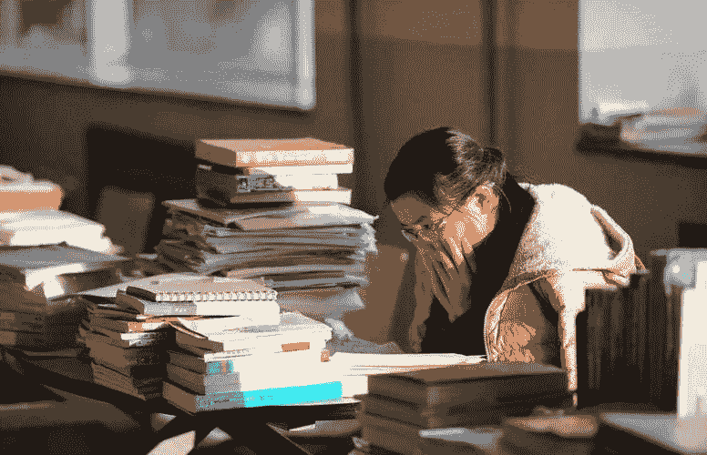
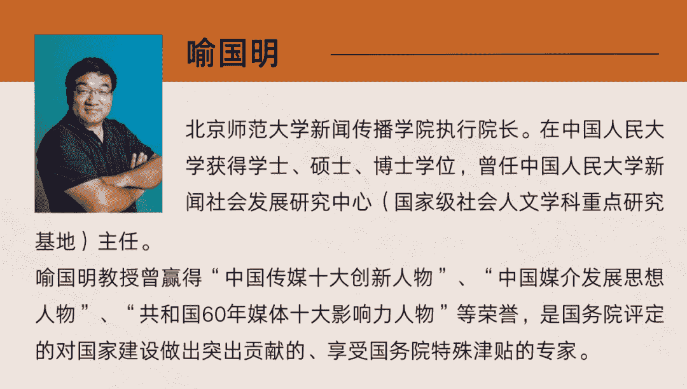
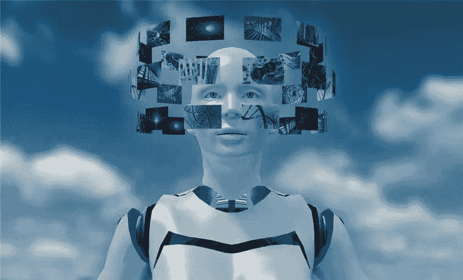

# 2023-07-05文科生，如何在AIGC时代找到价值 - 对话喻国明-今日头条

> 来源：[https://xuqiwei1986.feishu.cn/docx/Qtm5d2ZLGojtADxELVKc4U8On2b](https://xuqiwei1986.feishu.cn/docx/Qtm5d2ZLGojtADxELVKc4U8On2b)

> 🔗 原文链接： h[ttps://www.toutiao](https://www.toutiao.com/article/7252173240498438694/).com/article/725...

>

# 文科生，如何在AIGC时代找到价值 | 对话喻国明

2023-07-05 12:00 · 量子位

> 转载自 真故研究室

> 量子位 | 公众号 QbitAI

> AIGC来了，文科生和理科生如何协同、共筑时代？

**撰文 | 林秋艺**

**编辑 | 龚 正**

在AIGC时代，大量的文字工作者、绘画师、策划人等文科岗，面临被AI取代的风险。同时，生成式AI的“智能涌现”（指人类没教给AI的，AI自己也能学会），也让人们开始焦虑起该如何管理AI。

《真故研究室》对话了北京师范大学新闻传播学院学术委员会主任喻国明教授，请他分享了在AI浪潮下，文科生（尤其新闻或内容人）的前路以及未来人类的新生活方式。

# 喻国明的核心观点如下：

1**、在AIGC时代，懂技术也懂社会、懂**市场也懂设计原理，这是未来新传学生甚至文科生提升自己的社会价值和市场价值很重要的一个方向。 文科生与理科生是社会发展的“鸟之两翼”，未来的关键是实现“人机协同与融合”。

2、 **生成式AI最重要的功能是“人类增强”，极大地缩小了**所谓精英与一般外行小白之间能力的区别。 这种人类增强消弭了人类的天赋异禀之间所造成的差距，将构造起未来社会的交互关系和相应模式。

3、AIGC时代，机器越来越像人一样思考并**不可怕，可怕的是人会像机器那样去思考。 算法的平均化打**破了疆界，打破人们之间智力的围墙，但也会形成对人的个体价值的蔑视、贬低与驯化。 人们如何去形成自己个性的生存之地是首要问题。

# 以下为对话实录：

**Q1：ChatGPT出现后，媒体人的**危机感更强，担心自己不再有用。您怎么看？

**A1： **其实我认为新闻媒体是一个社会生活中不可或缺的角色，没有这个角色，整个社会的运行系统、决策系统会出现重大问题。

**但**是这个角色的价值不在于它自身，而在于社会给它的位置，如果失去了这个角色价值，社会的正常运作层级就会坍塌，而这种坍塌会让社会付出沉重的代价。

这也是社会对媒体的角色价值的一种维护。

另一方面，传媒这个专业本身是从传播、媒介、新闻这样的角度去看待社会，媒介的角色、媒介的价值、媒介的逻辑和媒介呈现出来的对待某一事物看法的依据所在，这是媒介看待世界、评价世界的专业和底色。

媒介的角色价值是在社会生活中的价值，而不是它自诩得来的。

**Q2：AIGC时代，文科生（比如新闻与文化传播专业）如何**提高自己的职业吸引力/如何获得高薪工作？

**A2： **我们曾经做过一个研究。

**国内一线高校毕业后进入互联网公司的毕业生中， 新传专业的毕业生，月薪大约在5000-8000元左右，正常工作的话，一年后能涨**到1万-1.2万元；但是计算机专业的毕业生月薪就能达到3万元起，一年后能够按照平均薪资涨15%左右，五年后薪资大概能涨到50万元/年的水平，这其中还伴随着职级的提升。

在这样的情况下，我们许下了一个宏愿： 让新传专业的毕业生薪资待遇不逊于计算机专业毕业生。

传统的新闻传播教育毕业生，在互联网公司中，一般只能从事与宣传、策划或是品牌传播相关的工作，互联网公司如阿里、腾讯、百度、字节这些头部的企业对社会传播层面比较关注，给的薪资也会比较高，但大部分的公司会更关注技术层面，给社会传播层面的薪资就会比较低。

所以我们在课程方面做了很大的一个改变，学生需要有互联网的技术激励，需要知道技术是干什么的、如何适用于市场、怎么进行技术的产品化，我们要培养他们这样的一个设计思路。

**2019年，我们在北**师大开设了一个新的专业叫 「互联网产品经理」 ，教学生如何用市场洞察、用户洞察以及自身对技术的了解来为市场设计产品或服务。这些的人才到了互联网公司，起薪就不止技术岗位的3万元了。

**懂**技术也懂社会、懂市场也懂设计原理，这是未来新传学生甚至文科生提升自己的社会价值和市场价值很重要的一个方向， 所以交叉学科在现在的学术研究和人才培养方面都是一个重要的转型方向。

Q3：为什么社会上会有这么多担心自己的工作被AI取代的声音出现？

**A3： **为什么大家对于这次生成式AI的出现反应比较重，在这要反问一个问题：普通工人、农民对这件事情的反应大吗？

**其**实他们没什么反应，该做什么还是继续做， 反而是过去认为自己是社会生活中属于中上层的脑力劳动者（精英阶层）感受到了威胁，这是他们对不了解的新技术自然而然产生的肌肉反应。

前几次工业革命时期，那时候工业化的革命更多体现在人的体力劳动上，大量肩挑手提、分林伐木的体力活被机器取代，所以普通劳工大众对机器充满了仇恨，纷纷去打砸机器。

但是最后还是不成器，一是无法改变历史发展的潮流，二是体力劳动者在社会管理中的声量极小，自然影响力也不会太大。

而这一次，AI能代替人的大部分劳动，比如机械的、重复的、计算性的、采集性的，凡是程序化能够进行的、用算法来描述的、需要数据支持的一些工作就会被AI所取代。

这样的工作恰好是大部分脑力工作者所从事的，因此他们感到恐慌。也正是因为脑力劳动者们拥有许多发声途径，所以他们的声音能被听到，能成规模体系。

但是技术和社会的发展依然不会因为这些声音就停滞不前，对于这部分劳动者来说，当前要务其实是学会如何使用AI来提升自己的工作效率，为自己增加筹码。

**Q4：媒体人、创作者与AIGC这**类技术的关系应该是怎样的？融合或是博弈？

**A4： **如果用博弈去理解我们与技术的关系，方向就错了。

在大众传播时期，大家被灌输的观点就是竞争，以广播和电视为例，选择了一个频道就无法同时观看另一个频道，报纸也是一样，多数人不会选择两份同样类型的日报，这是一种竞争型的、排他型的的竞争。

而今天其实是数字文明时代，它跟工业文明不一样， 工业文明是裂变式的发展，而数字文明是一个聚变式的发展。

为什么要有互联网？就是要通过连接再连接形成新的功能、新的价值。在互联网中创造属于自己的价值时，并不是在竞争当中获得的，更大程度上是在合作当中、融合当中、互相匹配中来形成和构建起来的。

我们始终讲技术背后还是掌握技术的人，所谓跟技术博弈的人实际上是传统规则、权利和利益的获得者，就是这些人在与掌握技术的人互相博弈，所以说到底是人与人之间的博弈，而不是人与技术之间。

Q5：生成式AI会对新闻传播领域产生怎样的影响？

**A5： **从传播自身的表现形式来看，传统大众传播时期所形成的一套法则、理念、规矩、要求以及角色的扮演等等，就是我们常说的“新闻专业主义”。

但是新闻专业主义在互联网发展的过程当中，随着能够执行传播决策的人越来越多、越来越泛众化，传播的权利、发声的权利在逻辑上已经赋予了每一个人，只要他是愿意发声的。

有一本书叫《主编死了》（作者陈序，美国《新闻周刊》（Newsweek）中文刊前执行主编、政经专栏作家），作者用主编来替代过去媒介所扮演的把关人的角色，现在这个把关角色已经被技术突破，几乎让每个人可以不通过主编的特定的把关就向社会进行传播分享，所以作者认为传统媒介的这样一个核心角色逐渐被瓦解、被分散了。

**“把关”实际上是在大众传媒时期所建立起来的一整套规矩，到了互联网传播时期，随着社交媒介的崛起，社交平台和短视频技术的**普及突破了话语表达的精英霸权，极大降低了内容生产和社会表达的“门槛”，使“人人皆可成为传播者”的泛众化传播时代成为现实。

社交媒介赋予了每个人平等的发言权，至少在形式上，每个人都可以向社会传话，不用经过别人的筛选。

但像今天智能化媒介、AIGC这样的生产方式的变革，已经又让传播呈现一种完全不同的样子。

**生**成式AI突破了不同人群在资源使用与整合方面的能力差异，使人在资源调动能力和表达能力方面有更大的提升。 至少在理论上每个人可以用一种社会平均线之上的语义表达和资源动员能力进行社会性的内容生产和对话，这是又一次重大的边界突破和对于“弱势群体”的巨大赋能。

Q6：生成式AI在传播领域中，最重要的功能是什么？

**A6： **生成式AI的一个最重要的功能，我把它表述为人类增强。

什么叫人类增强？就是过去由于天赋异禀或是后天的努力的不同，社会大众被分成普罗大众跟精英阶层。过去都是精英阶层掌握话语权和发声渠道，而现在是一个什么样的状态？

现在由于生成式AI的赋能赋权，比如说在翻译能力方面，你通过ChatGPT这样的应用翻译出来的结果，一点都不比外语专业的人翻译出来的东西差，甚至有的时候还更好。

在这种情况之下，我哪怕是一个外语盲，我也可以通过ChatGPT翻译出信达雅的文字，那么我就可以跟世界上任何一个不同母语的人进行无碍的交流。

这就极大地缩短了专业人士和普罗大众之间的专业距离。 虽然这种距离未必能够完全消除，可能在某些方面还有差距，但是至少在基本面方面，他们的距离接近了，甚至可以到忽略不计的程度。

**这**种人类增强消弭了人类的天赋异禀之间所造成的差距，这一点特别重要，它将构造起未来社会的交互关系和相应模式。

Q7：国内企业与海外企业在研发生成式AI的方向上，有何差异？

**A7： **Open AI为什么能做出ChatGPT，主要是在于他们宣告了自己是一个公益投入的项目，没有太多利润的追求，对项目中的科学家和工程师们没有利润压力，所以他们可以集中精力去解决技术方面的关键性问题。在这基础上，他们再进行商业变现。

**而国**内的企业在做AI方面的研究、研发时，会更注重价值的变现和产出，百度文心一言还没发布的时候，就已经有几百家企业宣布合作、排队签约，这里就已经透露出来，百度在研发的时候对于资本变现、价值产出是有明确的意识和要求的。

所以我们会看到国内的大模型应用在处理基本面的问题上显得比较弱，反而在专业领域能力是极强的，但是一般大众很少体验专业能力的方面，只能看到它们在一般性的问题中，回答显得很弱智。

Q8：目前海内外的生成式AI产品/大模型水平差别大吗？

**A8： **事实上Open AI做的ChatGPT，并不是所谓AI的深度学习或者发展逻辑方面的重大技术突破，它只是把诸如大模型、预训练、海量资料的投喂等等匹配在一起，把这些方面做到了临界点，就产生了化学变化而不仅仅是物理层面的叠加。

过去大家研究得更多的是以“识别—分析”为代表的判别式AI，现在我们在以“合成—重建”为代表的生成式AI进行了探索并做出一定的成就。

就像碳元素一样，可以呈现出煤炭的形式，也可以呈现出钻石的形式。AI从判别式转向生成式也是一样的，是一种相变（物质从一种相转变为另一种相的过程，常用于描述物质在固态、液态和气态之间的转变），而不是技术本身在垂直领域的纵深的突破性。

我们国内在AI方面的人才、专家也很多，虽然在芯片算力上有一定的阻碍，但别人用20个芯片能完成的事，我们用50个也可以完成，只是成本会高一些，并不会成为研发的瓶颈。

**但在数据量方面，由于我们很多平台不开放、互通数据，互相不能使用对方的文本材**料，而海外大量的学术数据库、资源库都是开放的，所以英文语料库会比中文语料库更大。

这样就会导致一个结果，用英文搜索比用中文搜索得到的回答质量更高， 不管是海外还是国内的应用都是一样的道理。

Q9：AIGC会让未来社会生活产生怎样的新变化？

**A9： **马克思在100多年以前就将未来社会概括为“自由人的联合体”。

也就是说未来社会的组织方式，人和人之间的连接方式不是在一个组织系统的控制之下，毫无自己选择权利的工作者、工具，而是作为一个主体，它在平等的基础上跟人合则相聚，不合则散。

互联网界有一个新名词叫“DAO”（Decentralized Autonomous Organization，一种全新的人类组织协同方式），这种社会自治的方式有点像我们说的圈层，但圈层和DAO之间还是有差距。

圈层里面的每一个成员是没有自己的权利确认自己创造的数据、创造的价值、创造的内容，这些都是属于平台的。

所以有web 1.0、web 2.0、web 3.0的逐渐升级，web 1.0是你能看到的、你能接受到的，web 2.0是你能使用的，web 3.0就是你能够使用并且拥有的。等到web 3.0确权之后，社会就会变成DAO这样的未来社会基本组织状态。

在这样的一个背景之下，其实我们并非需要依附于什么，只是要在完成某一个特定功能，实现某个特定价值的时候，跟不同的人去做不同的这种功能性、价值性的组合。

**这就是未来社会的一个样式，因此在这样的社会里面，我们需要**的不是竞争，而是合作、融合的设计和创意。

因为有了一个良好的合作，我们就能把这件事情做成；没有这良好的设计，我们哪怕再有能力，也做不到这种事情。因为今天这种长链条、多元素的事情越来越多，缺少任何一方这件事情都做不成。

未来社会的第一法则就是整合、协合、融合。

Q10：AIGC能给人们的生活方式带来什么改变？

**A10： **第一，它会让人们的工作时间缩短。

现在它能代替的工作主要是那些重复性的、规范性的和机械性的脑力劳动工作，这是第一波的替代，即将成为现实。

再过5年、10年，当把脑力劳动者全部工作量当中的50%-60%，甚至70%-80%都用AI替代的时候，人类的工作时间就会大大地缩短。

或许在不远的将来，我们不再是8小时工作制，而是4小时，一周也不用工作5天，4天就够了。这就给我们空出了大量的可自由支配的、非功利目的的闲暇时间。

第二，它可能会让数字鸿沟继续扩大。

比如说老年人本身在学习新技术方面就会有巨大的学习障碍，因为年纪大了，接受度的确会差一些。

但同时对年轻人来说它反而是个机会。没有过去惯性的、结构性的困扰，学习新事物的敏感程度要高得多。

因此对年轻人来说是一种机会，对老年人来说却是一种压迫。

第三，有些工作岗位会被取代，但也会产生新的工作岗位需求。

比如现在海外一个很热门的岗位叫“提示词工程师”，就是帮助用户向AI提问题，让用户得到高质量的回答。这个岗位主要看个人的能力，有的人擅长于提问，有的人不具备这样的能力，在这样的差别和需求下催生了出这个工作岗位。

还有一类岗位就是做AI做不到的事情。AI必须在足够的算力和数据之下才能给到准确答案，这个推算的时间可能会很长，几十年也说不定。但人类拥有直觉和悟性，不需要复杂的计算也能给出大致正确的方向。

比如让AI画一个美人，它可以把全世界的美女，合成一个平均数的美女。但是这样的图像，虽然看起来的确美，但就是觉得有一些生动性是严重缺乏的。为什么呢？没有缺陷。

它没有这种起伏的比例，因为人是需要在多少有点缺憾的那种背景之下来看，才会衬托出她的美和生动，AI生成的都是中规中矩、平淡的，这种需要感觉性的工作AI就做不来。

**以**后大概就会有两类职业，一类是基于新的AI平台所产生的新工作，主要是服务型工作；另一类是AI做不了的工作。

Q11：除了新兴的工作岗位，未来工作场景还会有什么不同吗？

**A11： **过去人为劳动基本上都是在田间、在工厂里边，这是以底层劳动作为最基础性的社会价值生产方式。只有少数人是在管理阶层，大部分劳动者要么种地，要么养鱼捕鱼等等，都是在一线这种最基础性的单位。

到了工业化革命时期，就形成了社会分工。有些人借助于机器能够相对比较轻松地去生产，有些人去做科研，有些人去做管理，有些人做环境的管理者。实际上这个社会人性化程度更强了，人不必被那种体力劳动折磨得精疲力尽。

**未**来也是一样，人可以用自己的才智去完成AI不能做到的事情，在这个过程中人的创意不断地被激发，甚至可能像在做游戏一样。

因为AI对于游戏来说是一个特别好的助力服务。以往我们在游戏里边只能按照规则完成特定的任务，获得某种反馈或者成效，使我们的身心得到某种释放、变得清爽。

**而现在有了生成式AI之后，实际上可以把游戏视为是一个社交场**所，社会合作的场所，社会探讨创新的场所。

在游戏的具体场景当中，彼此之间可以交流，大家可以合作，然后在一起创新创造，它就会成为一个全新的社会组合的执行平台。

在游戏创作场景当中，比社会的现实场景要丰富得多，我们可以在不同场景当中把自己未曾发现的某些潜能释放出来，而且在这个能力上做延伸的话，就能萌发出创意，这种创意或许能够对整个社会、对他人都有好处。

Q12：在与AIGC共生的社会生活中，会有潜藏的问题和危险吗？

**A12： ****算法**最大的特点就是平均化，这种平均化打破了疆界，打破人们之间智力的围墙，看起来对普罗大众是好事，但对于人类文明的发展来，这种平衡态的重新回归，会形成对人的个体价值的一种所谓的蔑视、贬低与驯化。

那么这就会衍生出一个问题： **人如何发展自己的个性？**

人并不是纯粹计算得出的结果，不是绝对理性化的，人有自己的偏好和热情。就像哲学家们，好的理论哲学家都以偏执的方式坚持自己的观点，并不是八面玲珑、四处逢源的。

所以一个真正的人，他的发展其实是跟这种平均化趋势相反的，他要强调自己的偏好，要强调自己的个性，要强调非理性的热情感和情绪。

在算法已经充斥了整个世界的这种背景下，人如何去形成自己个性的生存之地，这是一个大问题。

**机器越来越像人一样思考其实反而不用过度担**心，更应该担心的是人会像机器那样去思考。

Q13：如何解决上述这种由AI带来的困境？

**A13： ****在**未来人工智能的环境当中或许产生一种新的修养方式， 人类要脱离开所有的人工智能的这种服务的背景环境，去一个相对蛮荒的、自然的场景中去待几个月，然后再回到人工智能环境里面，可以称作场景修养和修复。

在自然场景当中你需要自己的思考应该怎么做，怎么改善自己的环境。至少让人们从这种充满了算法和智能化自动服务的环境中走出，进入没有自动化和算法的自然世界里边，去形成对人的基础性的知觉功能和生存能力的恢复。

**未来**或许还会有更强大的反智能的技术、反智能的生活场景出现，我们可能只需要一个星期或者半天，在里边待一待，就能对你这一段时间以来的被AI施加的影响进行反弹，使人保持一种既有理性又有个性和激情的平衡状态。

Q14：由生成式AI带来的大数据侵权问题应该如何解决？

**A14： **相对于传统的抄袭来说，AI的数据侵权是很难被确认的，因为它会把要素拆解之后再进行整合，可能思想是你的，但从语言表达的成分上却很难看出来。

要判别AI作品的设计者和贡献者之间知识产权的归属问题，需要面临技术上的复杂性，这也是未来亟需解决的问题。

目前较为主流的方式是通过“数字水印”来判别。

在用AI生成作品的每一步都会留下水印的痕迹，比如在材料采集的阶段是否用AI采集，创意阶段借鉴了哪些作品，加工阶段用了怎样的技术，都会生成相对应的水印。

这样一个作品到最后呈现在大众面前，就会附带有各种各样的水印，通过水印带有的后台信息，就能追溯到各个生产环节。

而这样的判别方式需要平台的协助，对平台来说，利用算法数据和技术，判断这个产品是合成的还是原创的，是一件很简单的事，因为原版的作品携带的信号与合成作品的信号是完全不同的。

这也是平台应该做的。比如，大众传播时代，我们在报纸上登一个广告，必须提醒这是广告而不能让读者误认为是新闻报道，AIGC时代，刊载AI作品的平台也应该做出这样的明示。

但这是理论上的情况，放到现实环境中，版权归属还是要面临复杂的情况。我们通过AI生成一幅画作，可能我们做出了一些想象中的文字描述才让它生成这样的作品，但实际上我们真正的创意部分占比有多大？这个问题很难判断。

一幅绝妙的作品离不开高级的软件、准确的描述和人的创意，那么画作制作者和生成这幅画作的AI平台所有者之间，版权的归属各占多大的比例，如何计算？这又是一个复杂的问题。

侵权的确认和版权的归属，这是一个需要社会各方互相博弈才能得出的答案，并不是坐在办公室里，在没有实践的基础上，就能做出AI作品版权份额问题的把关。

制定版权问题的规则，需要平衡各方的利益，因此也需要经历一个相对混乱的时期，这是探索新事物所必须要付出的成本。

**Q15：面对生成式AI带来的“智能涌现（指人类没教给AI的，**AI自己也能学会）”，我们应该如何应对？

**A15： **在ChatGPT刚掀起AI热潮之时，网信部门随即就发布了《生成式人工智能服务管理办法（征求意见稿）》。

虽然目前还没有立场，也没有立法实施，但是动作如此快地发布管理征求意见，这本身就说明网信部门对生成式AI的敏感程度和对它的影响评估是很高的，希望能够在比较早的情况下就对它可能产生的问题进行预防式的限制。

**对生成式AI的管理问题，解决办法是在信息传播的环节、加工的环节和社会场景的构建的过程**中，在它的发展方向上，分辨哪些东西应该得到提倡和助推，哪些东西应该被平衡和博弈。

这需要一些权威的专业人士来做解读，也需要政府部门做规定，同时也需要民众素养的提升。

当大众看到AI生成的负面的产品时，自觉地不接受甚至反感它们时，这就是民众素养的提升。

对生成式AI的管理，应该是各环节共同形成的综合结果，对这样的综合结果，不能要求一个平台、一个群体或者一个机构就来完成。

— 完 —

*本文系量子位获授权刊载，观点仅为作者所有。

量子位 QbitAI · 头条号签约

关注我们，第一时间获知前沿科技动态