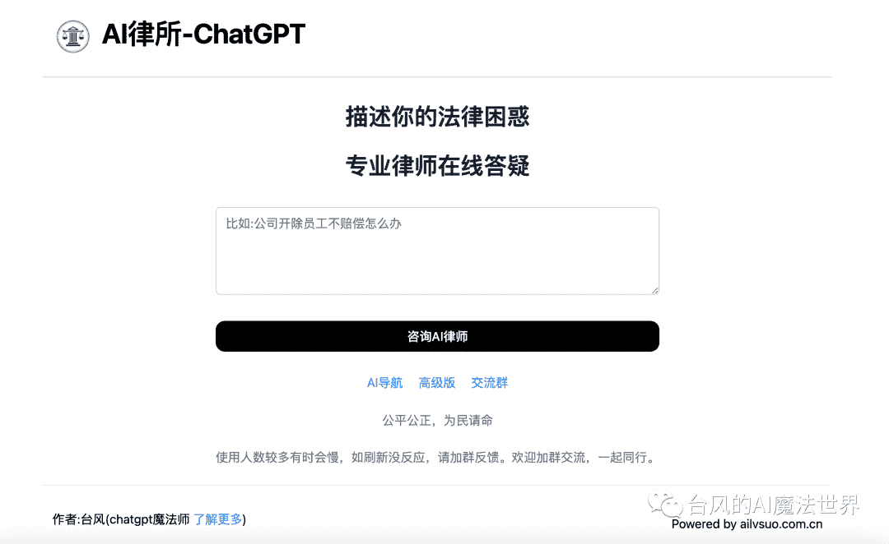
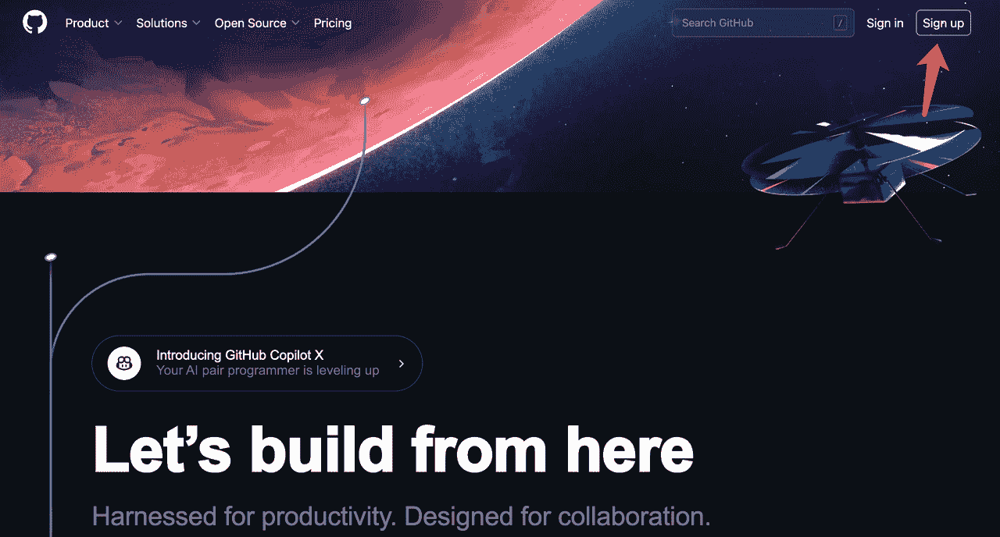
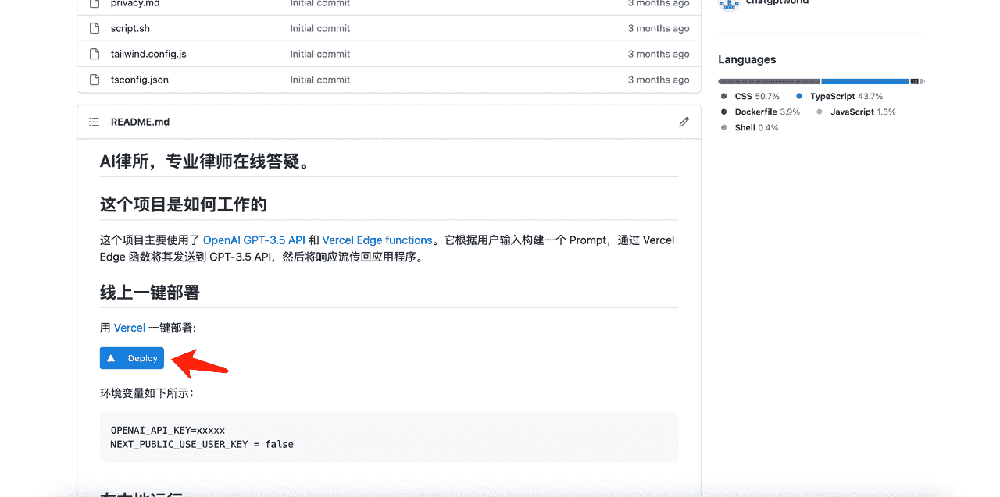
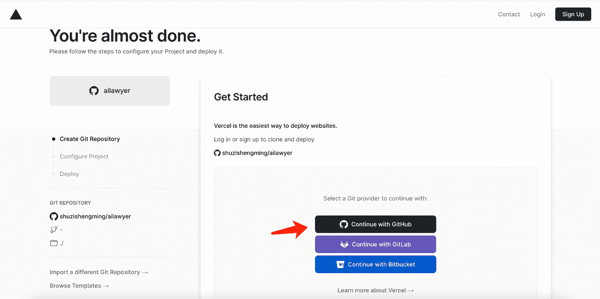
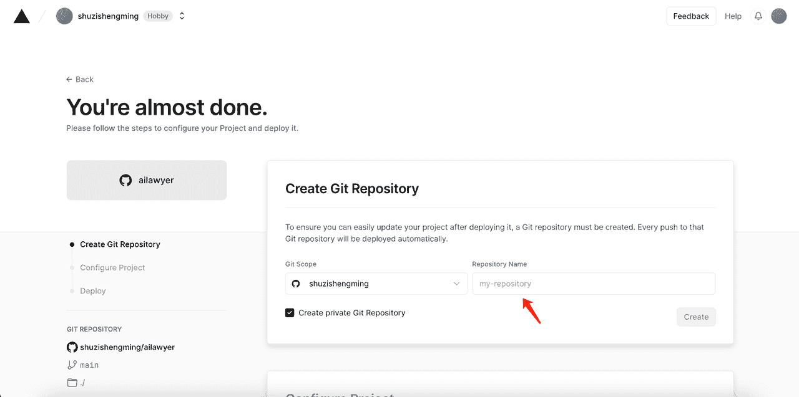
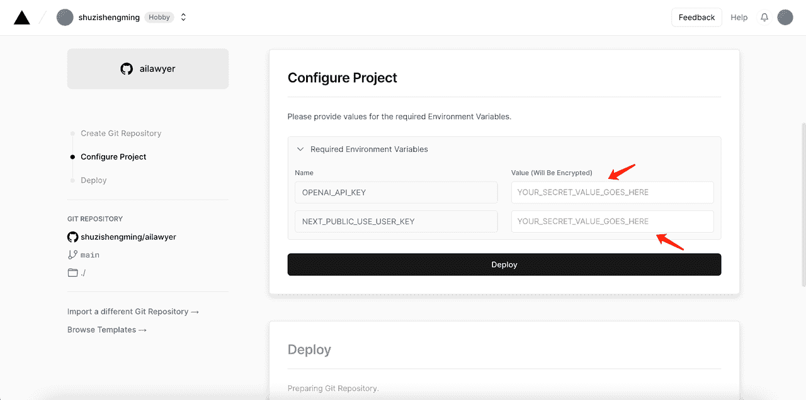
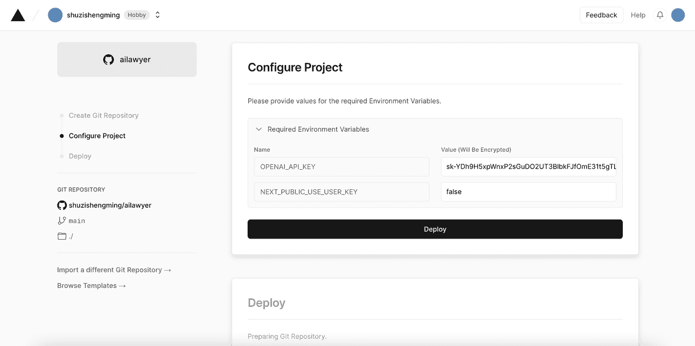
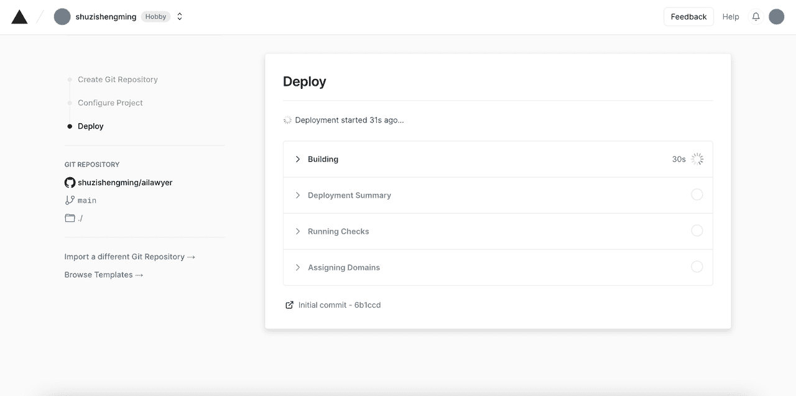
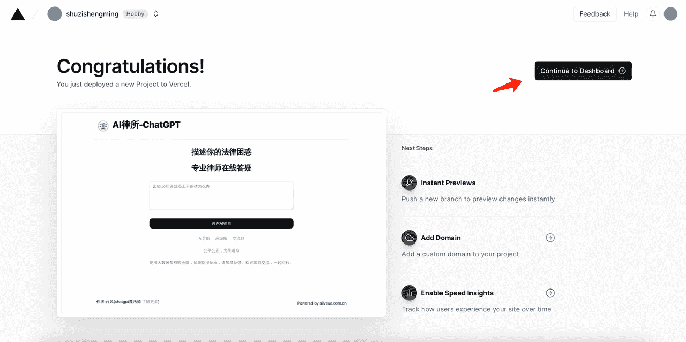
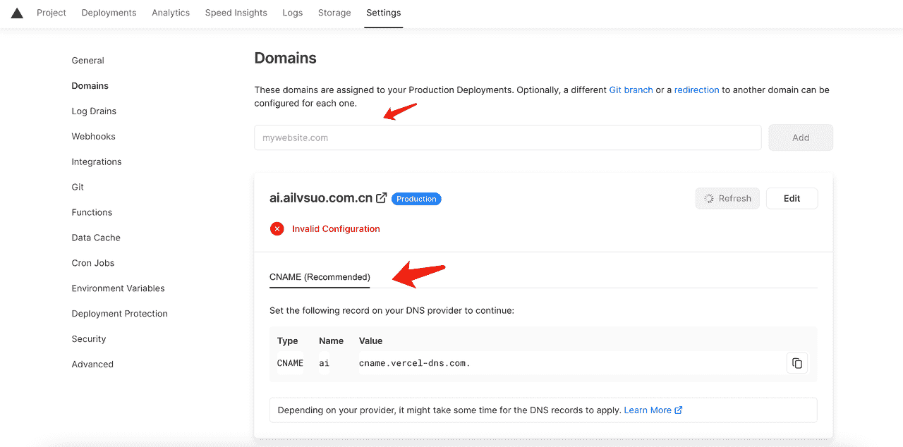

# Github开源：10分钟搭建你自己的ChatGPT应用“AI 律所”

> 来源：[https://xuqiwei1986.feishu.cn/docx/T7bFd69icofaCOxQ3QUcIzfrnhg](https://xuqiwei1986.feishu.cn/docx/T7bFd69icofaCOxQ3QUcIzfrnhg)

> 大家好，我是台风，一名GPT魔法师，《ChatGPT产品商业俱乐部》创始人，公众号矩阵粉丝近2万，希望能成为国内ChatGPT模式的布道者之一。

> 我擅长创作chatgpt指令和产品应用，曾创作过创作过Ai佛祖、Ai律所等多款火出圈的应用(日访客过万)，参与过等多本AI行业书籍的案例编写。

体验地址：https://ask.ailvsuo.com.cn/

我3月底发布的ChatGPT应用“AI 律所”，没想到意外火了，得到了很多律师朋友的认可，还引起了一些大佬和投资人的关注，该案例也被收录到了「AI 破局俱乐部」即将出版的 AI 新书里。

经常有朋友加我微信，来咨询怎么才能搭建一个类似“AI 律所” 这样的小应用？是不是需要有技术基础？

我相信你也会有同样的疑问。

其实我当初制作“AI 律所”也就是花了2、3个小时，我是产品出身，只懂一点HTML而已。

可见创造一个ChatGPT应用的门槛，远比大家想象的要低。

**我**一直有个想法，帮助1000人搭建自己的ChatGPT产品应用，轻松迈出探索ChatGPT产品化各种可能性的第一步。

**所以我决定把“****AI**** ****律所**”这个项目开源了，技术小白花个10分钟就搭建出自己的“AI 律所”。

代码托管在Github、部署到Vercel平台，都是免费的，成本几乎为0。绑定一个域名，就可以对外运营。

如果你懂一点点技术，还可以修改成任意的ChatGPT产品应用，AI佛祖、周报生成器、小红书生成器等等都没有问题，简单修改下系统前置指令(角色Prompt)、页面样式就可以。

以下是搭建发布“AI律所”的步骤，你只需要按着教程操作即可。

【准备材料】

Github账号、Vercel账号、API KEY、域名。

【项目地址】

https://github.com/shuzishengming/ailawyer

# 一、注册/登陆 Github

Github是全球知名的代码托管平台，我们需要将应用的代码仓库托管在Github上。

如果你还没有Github**账号，那么需要**先创建一个：点击 sign up 进入注册流程。已经有账户的话登录即可。

官网地址：https://github.com/

# 二、访问项目代码库

访问「ChatGPT产品商业俱乐部」提供的的“AI律所”代码库，点击按钮**“Deploy”，**安装部署到Vercel

项目地址：https://github.com/shuzishengming/ailawyer

# 三、部署到 Vercel平台

Vercel是一个国外的应用部署平台，提供了免费的服务器、域名、统计分析等资源，支持快速部署自己的应用项目，小白也能轻松上手。

官方网站：https://vercel.com/

跳到Vercel界面后，如果没有账户，则先授权使用Github进行登录。

绑定授权完毕后，就会回到创建项目的界面。

## （一）创建代码项目

输入新项目名称：如ailaw，点击“Create”创建

## （二）**填写配置参数**

1、OPENAI_API_KEY

填入**OpenAI的****API**** KEY**，格式为sk-xxxxxxxxx 的代码字符串。

2、NEXT_PUBLIC_USE_USER_KEY

**让用户自己**输入KEY才能用的设置，填入  false

## **（三）提交部署上线**

**输入参数后，点击“Deploy”即可开始部**署，一般等待30秒-1分钟，就会自动成功

**以下为恭喜的界面，那就是部署成功**啦。点击 右上角按钮可进入项目管理界面。

# 四、修改站点域名

Vercel默认分配的域名xxxx.vercel.app，在国内是无法直接访问的，需要借助网络工具，或者配置自己的域名才可以。

以下是管理域名网址的方法。

管理路径：Settings——Domains

添加域名后，Vercel会提醒你去域名管理平台绑定CNAME记录。

解析后，回来刷新，就可以用自己的域名进行访问了。

# **五、修改页面样式**

如果你有技术基础，希望修改代码实现自己想要的应用，以下是文件目录说明。

1.  指令&API参数：目录 pages-子目录 api ，文件 generate.tsx

1.  页面描述信息：目录messages，文件 en.json、zh.json

1.  页面中间信息：目录 pages  ， index.tsx

1.  页面头部信息：目录 components，Header.tsx

1.  页面底部信息：目录 components，Footer.tsx

# **六、最后的最后**

制作一个简单的入门级ChatGPT产品应用，本身不复杂也不难，太多开源项目值得你去尝试。

如果你希望创造一款受用户欢迎甚至能进行商业化运作的ChatGPT产品，那将会是一个任重而道远的故事。

AI的浪潮是如此之大，每个互联网人都有一股焦虑，生怕自己被抛在 AI 时代的后面。

但与其在岸边观望，不如亲自下场试试水温。

# 七、个人简介

> 【名字昵称】台风(GPT魔法师)

> 【城市坐标】杭州

> 【职业背景】腾讯前员工，电商创业公司前产品合伙人，放弃几百万股份全职干AI

> 【专业技能】擅长创作chatgpt指令和产品应用；互联网全能选手

> 【项目经历】

> 1、2月入局ChatGPT，搭建新媒体矩阵，公众号粉丝近2万

> 2、创作过Ai佛祖、Ai律所等多款火出圈的小应用，日访客过万，吸引了王小川等多位大佬和投资人的关注

> 3、参与过等多本AI行业书籍的案例编写

> 4、《ChatGPT产品商业俱乐部》创始人、生财有术GPT航海教练、肖厂长AI提示词高手联盟成员

> 【资源服务】

> 1、《ChatGPT产品应用实战课》

> 2、ChatGPT商用级系统部署服务、企业培训服务

> 3、微软中国OpenAI合规资源