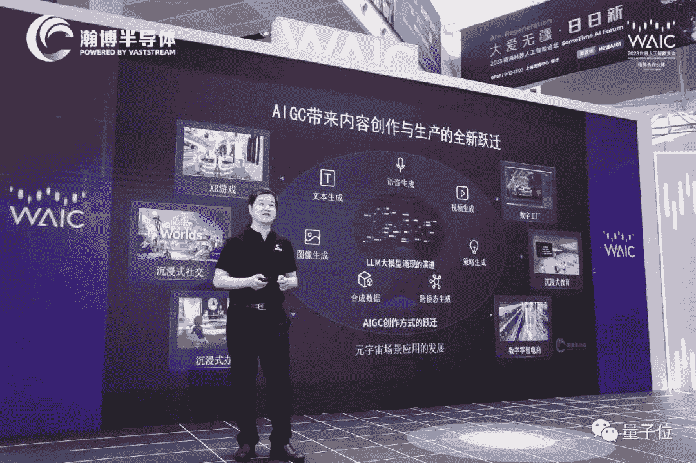
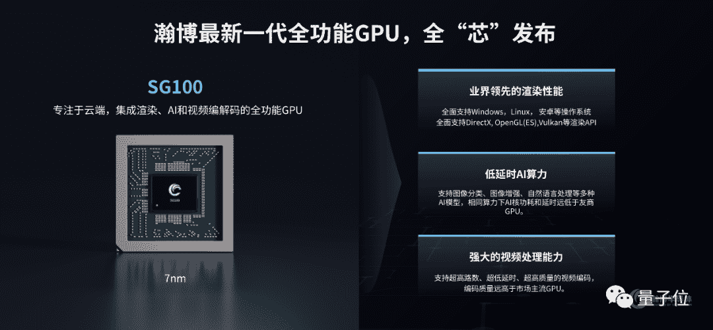
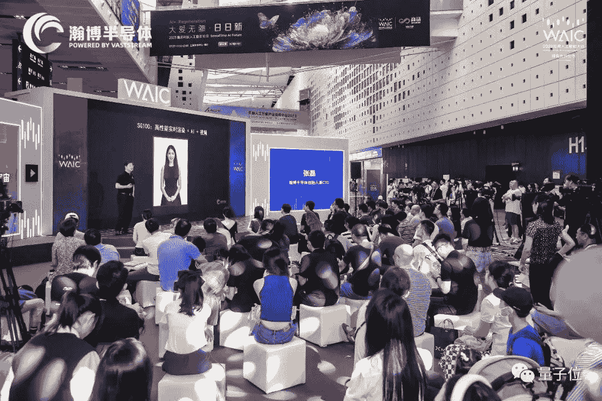
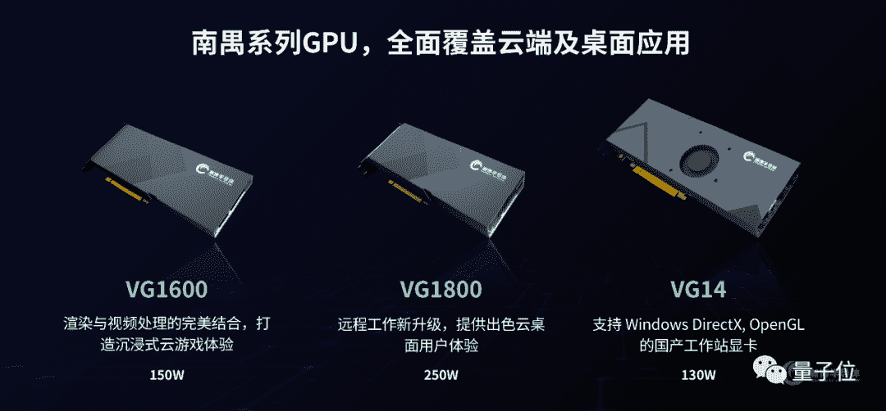
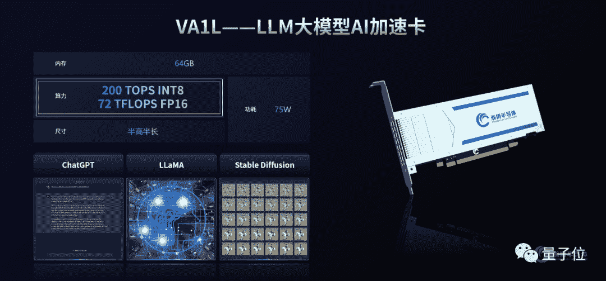
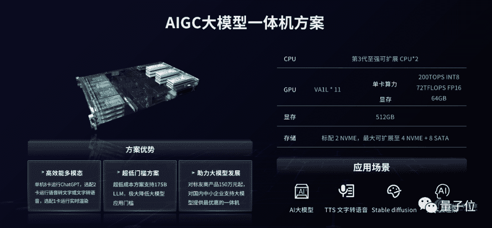
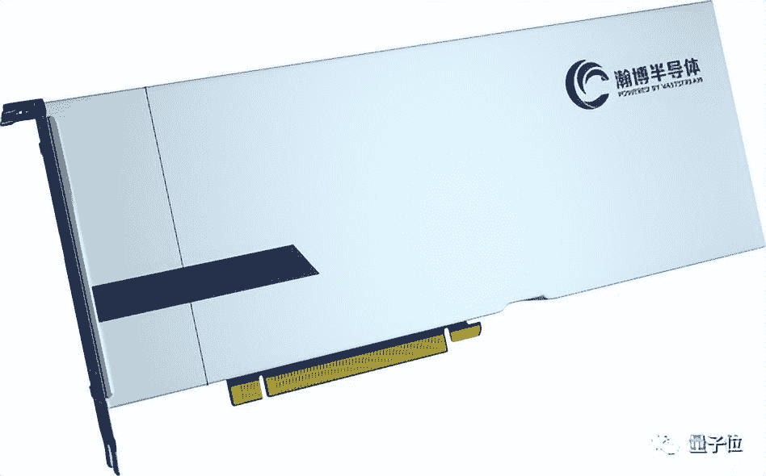
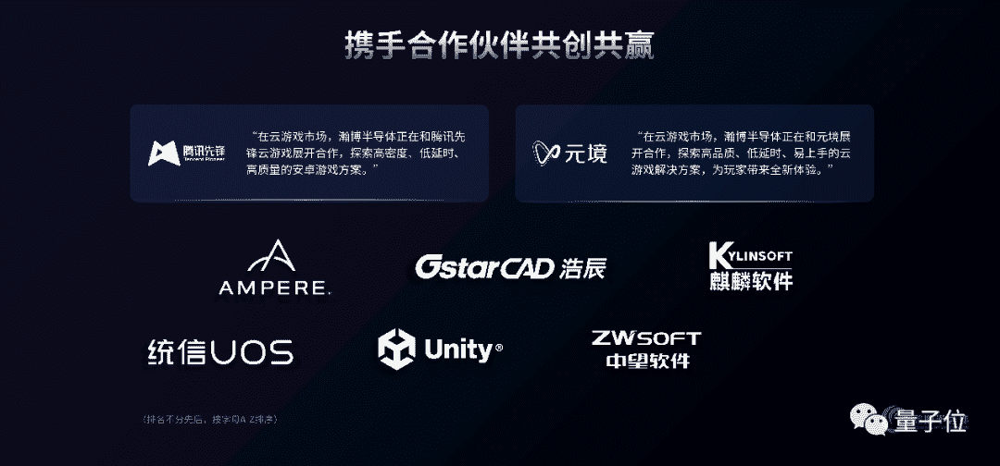

# 2023-07-07国产7nm全功能GPU上海发布！还有大模型加速卡、AIGC一体机等新品-今日头条

> 来源：[https://xuqiwei1986.feishu.cn/docx/KgyFdq0Bao5kUixKLXScEPIPnHd](https://xuqiwei1986.feishu.cn/docx/KgyFdq0Bao5kUixKLXScEPIPnHd)

> 🔗 原文链接： h[ttps://www.toutiao](https://www.toutiao.com/article/7253037917323641359/).com/article/725...

>

# 国产7nm全功能GPU上海发布！还有大模型加速卡、AIGC一体机等新品

2023-07-07 19:35 · 量子位

# 允中 发自 凹非寺 量子位 | 公众号 QbitAI

7月6日下午，瀚博半导体在2023世界人工智能大会上正式发布第二代GPU SG 100。

一并推出的还有南禺系列GPU加速卡 VG1600、VG1800、VG14以及LLM大模型AI加速卡VA1L、AIGC大模型一体机、VA12高性能生成式AI加速卡等6款新品，为AI大模型、图形渲染和高质量内容生产提供完整解决方案。

本次发布会以“智渲同芯，共生未来”为主题，瀚博半导体创始人兼CTO张磊在发布会上发表了《从像素到杰作：国产芯片加速AI大模型和元宇宙》主题演讲，吸引众多行业伙伴、知名媒体以及投资机构到场。

张磊以AGI时代的算力需求与挑战为引，全面展示了瀚博针对人工智能与元宇宙行业的最新产品研发成果，此次瀚博半导体新品发布会赋能大模型创新应用，联合上下游企业共同打造国产大模型生态圈，以全新姿态把握时代机遇，开启人工智能+元宇宙的瀚博算力序章。

# 第二代GPU SG100: 集渲染、AI、视频于一体的7nm全功能GPU

瀚博此次重磅推出了集成高性能渲染、超低延时AI和强视频处理能力的7nm全功能GPU芯片产品SG100。

**△ **瀚博第二代全功能GPU芯片 SG100

瀚博SG100芯片采用7nm先进制程，具备业界领先的渲染性能，同时兼具低延时高吞吐的AI算力和强大的视频处理能力。

搭载瀚博自研GPU软件栈，业界一流的SR-IOV硬件虚拟化技术，支持Windows/Linux下的DirectX 11、OpenGL、Vulkan等API接口，支持H.264、H.265、AV1等多种视频编解码格式，可广泛支持数字孪生、数字人、云桌面、云手机、云游戏、云渲染、工业软件等多领域应用，助力打造元宇宙产业算力底座。

演讲中，张磊也通过实际案例展示了瀚博产品基于Windows/Linux下的渲染实例效果、教育云电脑、工业软件、多路高画质云游戏以及超写实数字人等应用场景，为现场观众直观展示了瀚博第二代全功能GPU SG100的强大算力。

# 南禺系列加速卡：智渲一体 全面覆盖云端及桌面应用

发布会上，瀚博也针对不同的应用场景推出了三款南禺系列全新GPU加速卡产品。

三款新品分别针对云游戏、云桌面与工作站提供相应算力支持，也为高质量内容生产提供了高效的算力支撑。

此次最新发布的南禺系列GPU加速卡 VG1600完美结合渲染与视频处理，打造出沉浸式云游戏体验，为玩家创造更真实的游玩场景。

其次，VG1800 也为远程工作带来全面升级，可流畅支持各类办公软件、教育APP和工业设计软件等，提供出色的云桌面用户体验。

更有支持Windows 操作系统下DirectX与 OpenGL等API接口的国产工作站显卡VG14，能够胜任多任务处理、大型专业软件运行等多元办公场景。

**△ **瀚博南禺系列GPU加速卡

# LLM大模型AI加速卡及一体机方案：大模型应用最低门槛

今年，以大模型等应用为典型代表打开了人工智能的广阔前景。未来，具有并行计算能力的GPU芯片作为大模型计算的“大脑”将为大模型生成学习提供源源不断的算力支撑。

针对大模型时代算力需求，瀚博本次首发了LLM大模型AI加速卡VA1L，具备200 TOPS INT8/72 TFLOPS FP16算力，并支持ChatGPT、LLaMA、Stable Diffusion等主流AIGC网络模型。

**△ **瀚博LLM大模型AI加速卡VA1L

与此同时，瀚博更重磅推出AIGC大模型一体机，共使用8张LLM大模型AI加速卡VA1L，支持512GB显存，进而支持1750亿参数的大模型。

本次大模型一体机解决方案拥有业内最低门槛，也是目前针对AI大语言模型最低价格的大模型一体机方案。

此外，新品还提供两个特殊选配：具有对话功能的2卡单独运行语音转文字或者文字转语音版本以及使用SG 100做云端实时渲染的2U 11卡版本，提供大模型会话数字人实时渲染，使大模型推理更高效，服务于大模型行业发展。

**△ **瀚博AIGC大模型一体机方案

发布会上，张磊也为观众展示了AI大模型“智能对话”、“文生图”等应用示例，生动展现了瀚博大模型新品支撑的广泛应用场景。

# VA12: 高性能生成式AI加速卡

针对生成式AI应用和其他通用AI应用，瀚博本次也推出全新高性能智能加速卡VA12。

作为250W板卡，VA12有512 TOPS的INT 8的算力和160 TFLOPS的FP16算力，更高效支持StableDiffusion。

与此同时，作为瀚博VA1和VA10的升级版，VA12也是一块通用AI加速卡，支持检测、分类、分割、视频增强、语义理解、BERT、Transfomer和视频编解码等应用。

VA 12的发布将为未来AIGC平台的发展构筑算力底座，让未来的数字内容生产拥有更高效的计算能力与更多元的可能性。

**△ **瀚博VA 12高性能生成式AI加速卡

# 集结生态伙伴 携手生成未来

生态构建一直是瀚博持续发展与进步的重要推力。发布会上，瀚博也公开了目前与业界多家行业资深企业的合作情况。

目前，瀚博已与多家行业头部合作伙伴在云游戏、云桌面等领域开展深度合作。

在云游戏市场，瀚博半导体正在和腾讯先锋云游戏展开合作，探索高密度、低延时、高质量的安卓游戏方案。

瀚博也正在与元境探索安卓游戏解决方案，探索高品质、低延时、易上手的云游戏解决方案，为玩家带来全新体验。

此外，瀚博半导体也正在与Ampere、浩辰、麒麟软件、统信、Unity、中望软件等合作伙伴开展深入合作，共建GPU产业生态。

随着大模型技术的不断发展和应用，GPU行业也将迎来更多的机遇和挑战。

瀚博半导体本次新品发布将持续助力更多AIGC应用，进一步拉低文字、图像、视频等创作优质内容的生产门槛，让更多人享受大模型时代的科技进步成果。

秉承着“为数字与像素世界提供浩瀚算力”的愿景，瀚博未来也将基于两代GPU芯片系列，以 AI、渲染、视频三大产品线为核心，持续与各领域开展深度合作，提供丰富的算力支持与解决方案，以智渲一芯的瀚博算力，与业界伙伴共创浩瀚未来。

# 关于瀚博

瀚博半导体是一家自研高端GPU芯片及解决方案提供商，成立于2018年12月，注册地在中国上海。

公司秉持“为数字和像素世界提供浩瀚算力”的使命和愿景，潜心研发核心技术，励志成为扎根中国、服务世界的高端GPU芯片公司。瀚博目前拥有两代GPU芯片系列，并衍生AI、渲染、视频三大产品线。

基于VUCA统一计算架构，瀚博在2022年量产了基于第一代芯片的云端通用AI及视频加速卡系列产品，并已于2023年4月量产基于第二代7nm全功能GPU 芯片的产品系列。

瀚博凭借前沿的自主原创架构、强大的软硬件融合开发能力以及丰富的设计研发经验创造出高质量的GPU产品，赋能人工智能与元宇宙两大产业，助力大模型与生成式人工智能、智算数据中心、智慧工业、车路协同、数字孪生、渲染工作站、工业软件、云手机、云电脑、云渲染等应用场景落地。

— 完 —

量子位 QbitAI · 头条号签约

关注我们，第一时间获知前沿科技动态