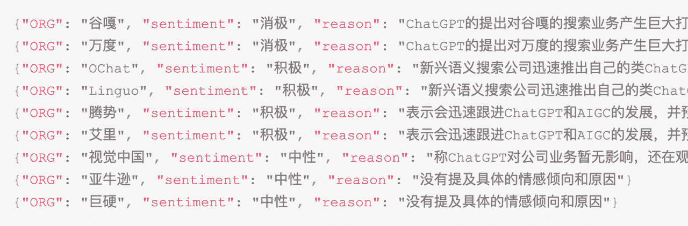
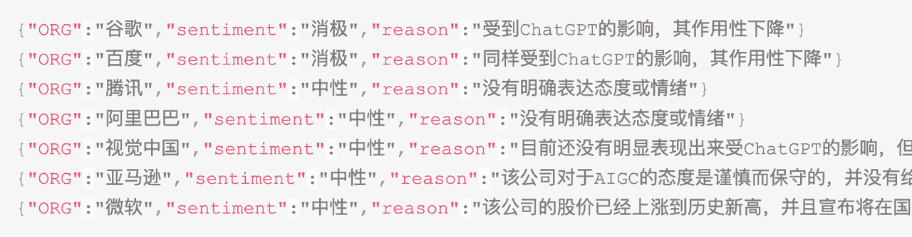
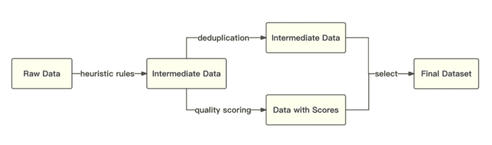
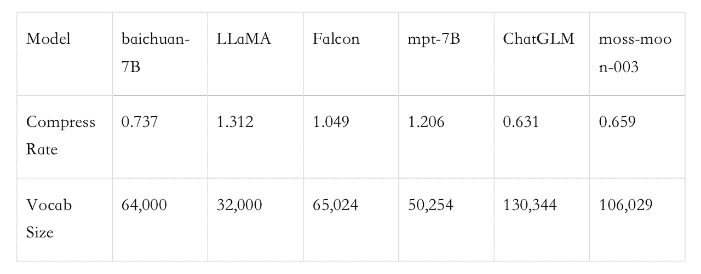
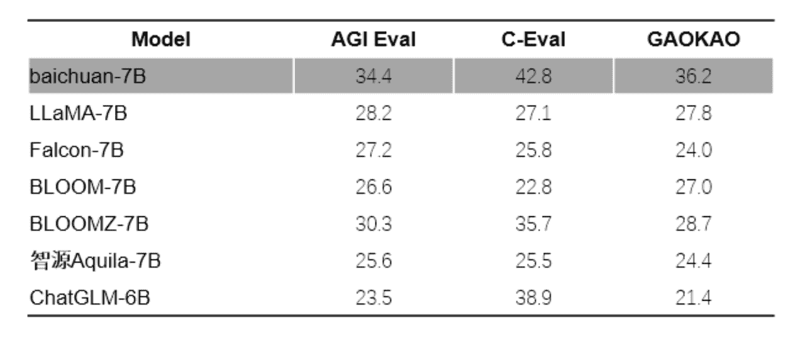
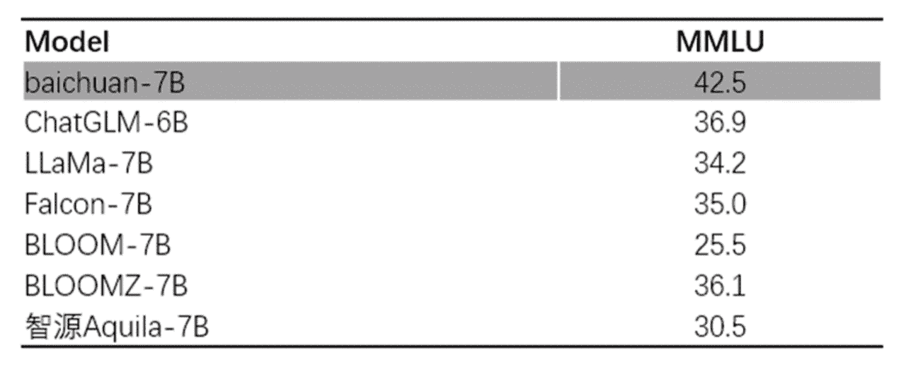

# 2023-07-05王小川的大模型打造秘籍首次曝光：五步走，两个月炼成-今日头条

> 来源：[https://xuqiwei1986.feishu.cn/docx/Awd9dnLAEouFOkxhLjmcbWqhneg](https://xuqiwei1986.feishu.cn/docx/Awd9dnLAEouFOkxhLjmcbWqhneg)

> 🔗 原文链接： h[ttps://www.toutiao](https://www.toutiao.com/article/7252216520560935457/?log_from=83a4b0c0c8766_1691397178180).com/article/725...

>

# 王小川的大模型打造秘籍首次曝光：五步走，两个月炼成

2023-07-05 14:43 · 量子位

> 允中 发自 凹非寺

> 量子位 | 👸号 QbitAI

王小川两个月交卷的大模型，是怎么炼成的？

现在，这个问题有了更为详细的解。

70亿参数、一经发布就开源可商用，百川智能的中英文大模型baichuan-7B，近期在圈内备受瞩目。

从公开的benchmark测试效果以及社区的使用反馈来看，baichuan-7B的表现非常优秀，据说清北也已经用上了。

其源代码也已在Github、Huggingface等平台发布。

有趣的是，开源社区在围绕baichuan-7B进行实验和应用构建时，GitHub项目LLM-Tuning的作者郭必扬（beyondguo）发现了baichuan-7B的一个特殊能力。

他在做信息抽取实验的时候，自己胡编乱造了一段“新闻”，然后故意将“微软”写成“巨硬”，“亚马逊”写成“亚牛逊”，“谷歌”改为“谷嘎”……

然后使用下面的的instruction：

ChatGPT（3.5）的表现是这样婶儿的：

接下来就是鹅妹子嘤的时刻了：

特殊微调之后的 baichuan-7B把作者胡编乱造的公司名字，全都掰了回来！！！

看到这，直接给郭必扬（beyondguo）惊喜（惊吓）住：

> 本来是乱编的新闻，这这这就说不清了啊！

baichuan-7B的能力我们是看到了，但它开源也并不意味着人人都可以轻易复刻一个大模型出来。

源代码只是算法的核心，也就是能够看到模型结构而已。

“一开源就能人手一份，进行各种换皮魔改，同人逼死官方”这事儿，在大模型这儿行不通。

**要得到一款和Cha**tGPT效果相仿的大模型， 算法、算力和数据 缺一不可。

抛开算力不讲，从0到1构建一款大模型，都需要哪些步骤？

这不，baichuan-7B给出了一份“高分案例”。

# 训练大模型五步走

官方透露，baichuan-7B的“炼化”过程可以归纳为五步。

# 第一步，构建优质的数据集

数据是大模型的三要素之一。

语言模型是一种用于计算“一段文本”出现可能性的统计模型，其本质是建模字、词之间的关联性。

这种字、词之间的关联性必须通过大量数据的分析和学习才**能得到，因此数**据对于大模型而言可以说是 最重要的元素 ，预训练数据的质量、多样性、规模、代表性以及公平性和偏见等因素对模型性能有着决定性影响。

baichuan-7B模型在数据方面作了以下处理：

+   **数据规模和多样性： **baichuan-7B的原始数据包括开源的中英文数据和自行抓取的中文互联网数据，以及部分高质量知识性数据。这种构建方式使其原始数据集包含了大量source的数据，在过滤后也能有1.2T的量级，同时也保证了数据的多样性。

+   **数据的公平性和偏见： **为避免模型输出有害性内容，提升模型效果，baichuan-7B通过人工规则等方式过滤脏数据，去掉了数据中的噪声和有害数据。

+   **数据质量和代表性： **经过低质过滤之后，baichuan-7B对得到的数据还进行了去重处理和有代表性数据的选取。具体表现为，基于启发式规则和质量模型打分，对原始数据集进行篇章和句子粒度的过滤；在全量数据上，利用局部敏感哈希方法，对篇章和句子粒度做滤重，从而减少数据中的重复pattern和不具备代表性的数据，进一步提升数据质量。

整体流程如下图所示：

此外，为了实现模型在多语言上的良好表现，得到高质量的数据集之后，baichuan-7B又采用了自动化的数据采样策略，最终确认了一个在下游任务上表现最好的中英文配比。

# 第二步，制定合理的分词策略

拥有了一个优质的数据集之后，需要思考的便是：

如何将数据集里面的语料充分利用起来？

目前大部分开源模型主要基于英文优化，因此对中文语料存在效率较低的问题，这也是一些国外的大模型在中文生成方面表现相比英文较差的原因。

baichuan-7B采用了SentencePiece中的Byte-Pair Encoding(BPE)作为分词算法，并且进行了以下的优化：

+   首先，使用2000万条以中英为主的多语言语料训练分词模型，显著提升对于中文的压缩率。

+   其次，在数学领域参考了LLaMA和Galactica中的方案，对数字的每一位单独分开，避免出现数字不一致的问题。

+   再次，针对罕见字词（如特殊符号等），支持UTF-8 characters的byte编码，做到了未知字词的全覆盖。

对比不同分词器对语料的压缩率，可见其分词器明显优于LLaMA、Falcon等开源模型，在压缩率相当的情况下，训练和推理效率更高。

# 第三步，打造良好的模型结构

提到大模型，“大力出奇迹”是我们经常挂在嘴边的一句话，“力大砖飞”隐藏的含义是大模型并未在技术路线上取得革命性的突破，其底层技术基础依旧是Transformer。

换言之，当下的绝大部分大语言模型依旧是Transformer模型，只不过模型全部由Transformer的Decoder层构成，具体分为以下几个部分：

1、Position Embedding，即位置编码。

在Transformer中所有token都被同样的对待，没有前后顺序之分，因此需要加入一个Position Embedding用于表征词之间的位置关系。

目前的位置编码有 **绝对位置编码 **和 **相对位置编码 **两种形式：

绝对位置编码指的是直接将位置信息通过向量的形式融合到模型输入中。

常用的两种绝对位置编码方法主要是在Transformers中使用的Sinusoidal Positional Encoding以及Convolutional Sequence-to-Sequence模型中使用的Learned Position Embeddings。

其中，Sinusoidal Positional Encoding在原始的Transformer模型（Vaswani等人，2017）中，引入了一种预定义的正弦函数作为位置编码。这种方法会为每个位置生成一个固定向量，该向量的维度跟词嵌入向量相同。

其优点在于，它可以处理任意长度的序列，不需要额外的学习过程，并且对于相对位置关系有一定的编码能力。

Learned Position Embeddings由Gehring等人于2017年在Convolutional Sequence-to-Sequence模型中首次提出。

对于每个位置，模型都有一个对应的嵌入向量，这个向量会在模型训练的过程中学习和优化。

该方法的优点在于，它可以根据具体的任务和数据集学习位置信息。然而，它的一大缺点是，由于位置嵌入数量固定，因此模型可能无法处理超过预先设定数量位置的序列。

相对位置编码指的是在自注意力机制中引入两个Token的相对位置信息。

**目前，相对****位置编码主要**有两种常用方法： ROPE (Rotary Positional Embedding)和 ALiBi (Attention with Linear Biases)。

ROPE可以不受固定长度限制处理任意长度的序列。其工作原理是，通过一个基于位置的旋转矩阵将每个位置的嵌入旋转到一个新的位置。

这种方法的优点是，可以保持相对位置信息的一致性，在旋转后，相邻的位置仍然会有相似的嵌入。

ALiBi能够让Transformer语言模型在推理时可以处理比训练时更长的序列。

它在处理文本序列时不使用实际的位置嵌入，而是在计算某个键和查询之间的注意力时，根据键和查询之间的距离对查询可以分配给键的注意力值进行惩罚。当键和查询靠近时，惩罚非常低，当它们远离时，惩罚非常高。

这种方法的动机是， **靠近的词比远离的词更重要 **。

2、Attention Layer，即注意力层。

其原理是通过加入注意力层使得不同Token之间能够交互信息，进而获得整句话的表征。

目前大模型使用的Attention Layer分为多头自注意力（Multi-Head Self-Attention）和稀疏自注意力（Sparse Self-Attention）两种。

Multi-Head Self-Attention机制最早出现在”Attention is All You Need”（Vaswani et al., 2017）论文中，是Transformer模型的核心组成部分。

在多头自注意力中，模型首先将输入的嵌入向量分割成多个“头”，每个头都会独立地进行自注意力计算，最后所有头的输出会被连接起来并通过一个线性变换，形成最终的输出。

其优点是，每个头都可以学习并关注输入的不同方面，模型能够同时关注来自不同位置的信息，从而捕获更丰富的上下文信息。

Sparse Self-Attention是一种改进的自注意力机制，它只关注输入中的一部分元素。

这种方法的优点是，可以显著减少计算复杂性，使得模型能够处理更长的序列。

3、FFN Layer，即前馈神经网络。

其主要任务是处理来自Attention层的信息。

Attention机制能够处理词语之间的相互关系，但是它无法进行更为复杂的、非线性的数据处理。

而FFN层可以在每个Transformer模块中增加非线性处理能力，增强模型的整体表达能力。

在原始的Transformer模型中，FFN层通常由两个线性变换和一个非线性激活函数（如ReLU或GELU）组成。

以下是一些FFN层的变种：

+   标准的FFN层：在”Attention is All You Need”（Vaswani et al., 2017）中，FFN层由两个线性变换和一个非线性激活函数组成。具体来说，给定输入x，FFN层的计算过程为：FFN(x) = max(0, xW1)W2，其中W1，b1，W2，b2是模型参数，max(0, *)表示ReLU激活函数。

+   Gated Linear Units(GLU)变种：在”Language Modeling with Gated Convolutional Networks”（Dauphin et al., 2017）中提出，GLU是一种特殊的激活函数，它通过引入一个门控机制来控制信息的流动。在FFN层中使用GLU可以帮助模型更好地捕捉输入数据的复杂模式。GLU的计算公式为：GLU(x) = (xV + c) ⊗ sigmoid(xW + b)，其中⊗表示元素级别的乘法，sigmoid是sigmoid激活函数。

+   Swish变种：在”Searching for Activation Functions”（Ramachandran et al., 2017）中提出，Swish是一种自门控的激活函数，它的计算公式为：Swish(x) = Swish1(xW1)W2。在FFN层中使用Swish可以帮助模型更好地捕捉输入数据的复杂模式。

+   SwiGLU变种：在GLU Variants Improve Transformer中，作者提出了一种新的激活函数SwiGLU，它结合了Swish和GLU的优点。SwiGLU的计算公式为：SwiGLU(x) = (xV + c) ⊗ Swish1(xW + b)，其中⊗表示元素级别的乘法，sigmoid是sigmoid激活函数。

**baichuan-7B的**模型结构同样基于 Transformer 。

在模型研发过程中，为了能够让模型在4096的窗口长度内拥有最好效果，同时在4096长度外也具备较好的外推性能，baichuan-7B采取了和LLaMA相同的结构设计，而这些关键要素上的设计也和很多其他模型选择的设计相类似。

社区中Saleforces所提出的XGen-7B和由Berkeley所提出的OpenLLaMA也是同样的选择，具体而言：

**Position Em**bedding采用 ROPE相对位置编码 ，相对编码能够让模型获得较好的外推能力。Meta的LLaMA、Google的PaLM、清华团队的ChatGLM2都使用了ROPE相对位置编码。

Attention Layer采用标准的 Multi-Head Self-Attention ，虽然目前很多稀疏自注意力层能够在超长文本中获得较好的效果，但是这些方案由于使用了稀疏计算，对于4096长度内的效果会有一定的牺牲，使用标准的Multi-Head Self-Attention能够让大部分结果拥有更好的效果。

FFN Layer采用 **SwiGLU **，目前大部分SOTA模型都选择使用SwiGLU作为FFN层，如2022年Google提出的PaLM模型，2023年META提出的LLaMA，最近清华团队发布的ChatGLM2等。

# 第四步，采用恰当的优化训练策略

训练策略也是模型取得较好结果的重要组成部分。

例如，初代GPT-3在当时的训练框架下，基于V100训练1750亿参数模型的整体机器利用率大概只有21.3%。这种极低的利用率会拉长模型训练周期，影响模型迭代进度。

为更好提升模型训练过程中的机器利用率，baichuan-7B针对训练策略也提出了很多优化手段，具体包括：

首先，优化了算子技术，通过应用更有效率的算子提高运算效率，例如Flash-Attention和NVIDIA apex的RMSNorm，优化后的Attention方法在非近似的基础上可以显著降低模型的显存消耗。

其次，baichuan-7B利用算子切分技术，对部分计算算子进行切分，这样在通信的时候会以更高效的nccl操作进行通信，同时降低内存峰值使用，以进一步提升处理速度。

同时，baichuan-7B还使用了混合精度技术，在不牺牲模型准确性的前提下，加速了计算过程。

此外，为了进一步提高效率，baichuan-7B还采用了通信优化技术，具体包括：利用拓扑感知的集合通信算法避免网络拥堵问题，提高通信效率；根据卡数自适应设置bucket size，提高带宽利用率；根据模型和集群环境，调优通信原语的触发时机，从而实现计算和通信的有效重叠。

最后，baichuan-7B还自研了一种名为训练容灾的技术。

训练大模型，需要的时间通常很长，很难保证GPU在训练过程中不出问题，特别是集群训练的时候，单卡硬件或者网络错误会导致整个集群停摆。因此在训练中断后快速、自动化定位故障、恢复服务非常重要。

通过训练平台和训练框架的联合优化以及IaaS+PaaS的应用，baichuan-7B实现了分钟级的故障定位和任务恢复，从而保证了训练的稳定性和效率。

# 第五步，选择合适的模型评价方法

完成数据集构建，对数据集中的语料进行分词并在构建好的模型中进行预训练之后，为了解模型的各方面能力，还需要对模型进行测试和评价。

不同于微调后的模型直接采用zero-shot（直接给prompt）的评估方式，预训练基座模型通常采取few-shot（给一些示例prompt）的评价方式来评估效果。

目前，比较权威的几个评估数据集主要有中文数据集C-Eval数据集、Gaokao、AGIEval，英文数据集MMLU，代码能力评估集Human Eval和数学能力评估集GSM8K、MATH等。

其中，C-Eval数据集是最全面的中文基础模型评测数据集，涵盖了52个学科和四个难度的级别；

Gaokao是以中国高考题作为评测大语言模型能力的数据集，用以评估模型的语言能力和逻辑推理能力；

AGIEval旨在评估模型在中文环境下，认知和解决问题等相关的任务的能力；

MMLU是一个包含57个多选任务的英文评测数据集，涵盖了初等数学、美国历史、计算机科学、法律等，难度覆盖高中水平到专家水平，是目前主流的LLM评测数据集。

中文评测方面，baichuan-7B在C-Eval、Gaokao和AGIEval的综合评估中均获得了优异成绩，不仅远超其他同规模参数的大模型，甚至比某些参数规模更大的模型还要出色。

在英文能力上，选择MMLU数据集进行评测，baichuan-7b的表现在同尺寸上也大幅领先。

值得一提的是，根据官方的github开源协议说明上，baichuan-7B开源的推理代码采用了Apache2.0协议。

不同于其他基于LLaMA继续训练（比如IDEA的ziya、链家的BELLE等）无法商用的模型，baichuan-7是原生训练的模型，可以自主定义模型权重的开源协议。

值得称赞的是百川智能采用的是免费可商用协议，比其他需要付费商用有更大的自由度，开发者们可以直接使用预训练模型进行各种实验研究，并完成部署和应用。

# 开源VS闭源，哪一种模式最有效？

说完了大模型的训练步骤，最后来谈一谈开源的问题。

五月初，谷歌曾泄露出一份内部文件，这份文件声称：“我们没有护城河，OpenAI也没有。当我们还在争吵时，开源第三方已经悄悄地抢了我们的饭碗”。

谷歌显然已经意识到了开源的影响，那么开源和闭源究竟哪一种模式更有效？

百川智能给出了他们的回答：

众所周知大模型的训练成本极高，因此以闭源保证商业投入是比较有效的方式。

不过，开源创新早就已经成为了软件发展乃至于IT技术发展的一种主流技术形态，超级计算机的操作系统几乎都是用Linux这样的开源软件操作系统进行构建，智能手机的操作系统80%以上都由开源的安卓系统支持。

在大模型出现之前，深度神经网络的学习框架也几乎都是开源的。

虽然目前OpenAI和谷歌都选择了“闭门造车”，但是Meta却走上了开源的道路，LLaMA开源之后迅速地吸引了大量开发者，这和互联网时代Linux，移动互联网时代的安卓十分相似。

就像Linux和安卓都会在社区上开源出一个核心的版本，然后更多人在这个核心版本上根据他对需求和领域的理解进行不断地修改，低成本产生更多适应未来发展的新版本，由环境来评价，然后再迭代回来不断地开发。

这种众人拾柴的研发路径在大模型时代无疑还将发挥巨大作用，开源和闭源究竟哪一个更有效现在还很难说，就像我们无法说iOS要安卓更有效一样。

但是，未来的大模型生态一定会是垄断与开源并存。

参考链接：

[1]https://mp.weixin.qq.com/s/kxnIB62uZk52IGQnjlP3Ew（郭必扬的实验）

— 完 —

量子位 QbitAI · 头条号签约

关注我们，第一时间获知前沿科技动态