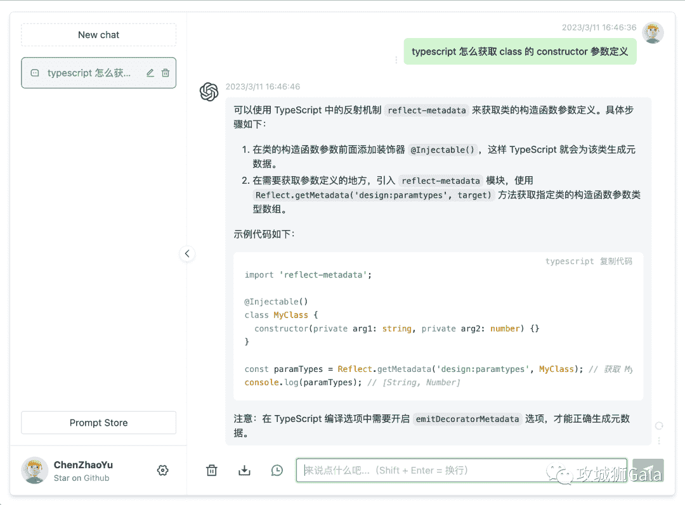

# 2023-06-20搭建ChatGPT与AutoGPT

> 来源：[https://xuqiwei1986.feishu.cn/docx/GL5idxDmDooMQXxP3ddcnjfVnhi](https://xuqiwei1986.feishu.cn/docx/GL5idxDmDooMQXxP3ddcnjfVnhi)

> 🔗 原文链接： h[ttps://mp.weixin.q](https://mp.weixin.qq.com/s/c9znrqNIQ7m831a7j29ZpA)q.com/s/c9znrqNI...

>

Gala 攻城狮Gala

2023-06-20 23:10:07

精确发文时间由壹伴提供

2023-06-20 23:10 发表于 新加坡

手机阅读


欢迎关注 “攻城狮Gala”公/ 众 /号 ，每天一起学习，努力成为Web3全栈

## **背景**

国内使用ChatGPT必须套壳，所以今天介绍两个壳，同时扩展出了新的AI能力，不止是ChatGPT。

参考： ChatGPT割韭菜？我只服国产套壳！ [1] ， AutoGPT确实很强！全自动Ai一分钟部署！ [2]

## **ChatGPT-Web**

这是一个ChatGPT的国内套壳 ChatGPT-Web [3] ，支持两种模式：

1.  1. 使用代理通过accessToken防伪ChatGPT，因为国内无法访问，需要连接代理服务器用自己的session访问；

1.  2. 使用OpenAI的API模拟一个ChatGPT，没有专门为Chat场景优化，程序设置简单role和上下文开启对话；

### **部署**

部署很简单，我使用的OpenAI的API方式，直接docker-compose部署，配置文件如下：

```
version: &#x27;3&#x27;

services:
app:
image: chenzhaoyu94/chatgpt-web # 总是使用 latest ,更新时重新 pull 该 tag 镜像即可
ports:
- 3002:3002
environment:
# DEBUG: &quot;express:*&quot;
OPENAI_API_KEY: sk-**********
# API接口地址，可选，设置 OPENAI_API_KEY 时可用
# OPENAI_API_BASE_URL: xxx
# API模型，可选，设置 OPENAI_API_KEY 时可用，https://platform.openai.com/docs/models
# gpt-4, gpt-4-0314, gpt-4-32k, gpt-4-32k-0314, gpt-3.5-turbo, gpt-3.5-turbo-0301, text-davinci-003, text-davinci-002, cod
# e-davinci-002
OPENAI_API_MODEL: gpt-3.5-turbo
# 反向代理，可选
# API_REVERSE_PROXY: xxx
# 访问权限密钥，可选
# AUTH_SECRET_KEY: gyjyx
# 每小时最大请求次数，可选，默认无限
MAX_REQUEST_PER_HOUR: 1000
# 超时，单位毫秒，可选
TIMEOUT_MS: 60000
# Socks代理，可选，和 SOCKS_PROXY_PORT 一起时生效
# SOCKS_PROXY_HOST: 172.17.0.1
# Socks代理端口，可选，和 SOCKS_PROXY_HOST 一起时生效
# SOCKS_PROXY_PORT: 7890
# HTTPS 代理，可选，支持 http，https，socks5
# HTTPS_PROXY: http://172.17.0.1:7890
```

> 注意国内服务器使用请打开代理模式。docker部署时，注意ip地址应该是宿主机ip。

### **体验**

体验很糟糕，可能是网络环境问题？在体验过程中频繁遇到 chay-process API的 pending 问题，十分影响体验。



Pasted image 20230610161715.png

有能力的小伙伴可以自行维护一个fork版本，界面还是不错的。

### **fork版本**

还有一个该项目的fork版本， chatgpt-web [4] 。该版本没有尝试，更适合做商业化，增加了用户管理。

## AutoGPT-Next-Web

AutoGPT-Next-Web [5] 是一个将AutoGPT Web化的服务，部署也很简单，因为docker image的问题，拉取镜像部署失败，选择手动部署。

### **部署**

```
git clone https://github.com/ConnectAI-E/AutoGPT-Next-Web.git
nvm install v18.12.1
nvm use v18.12.1
npm install
vim .env
./prisma/useSqlite.sh
# Create database migrations
DATABASE_URL=&quot;file:./db.sqlite&quot; npx prisma db push
DATABASE_URL=&quot;file:./db.sqlite&quot; npm run dev
```

环境变量在 .env 。

```
PORT=3000
# Deployment Environment:
NODE_ENV=development
https_proxy=http://127.0.0.1:7890
http_proxy=http://127.0.0.1:7890
all_proxy=socks5://127.0.0.1:7890

# Next Auth config:
# Generate a secret with `openssl rand -base64 32` or visit https://generate-secret.vercel.app/
NEXTAUTH_SECRET=&#x27;jhonh7OKRzZc0ESHUI5eRSvy8sa3woPV7sGmcm8Fkl0=&#x27;
NEXTAUTH_URL=http://chatgpt.xx.xx
DATABASE_URL=file:./db.sqlite
NEXT_PUBLIC_WEB_SEARCH_ENABLED=&#x27;true&#x27; [true](/tags/true) or false
SERP_API_KEY=&#x27;&#x27;
# Your open api key
OPENAI_API_KEY=&#x27;sk-********&#x27;
```

### **体验**

体验还可以，任务会自动拆分然后执行给出结果，但是很多结果显示不全只有一小部分，需要研究下。

## **AgentGPT**

AgentGPT [6] 是另一个AutoGPT的助手，web版本的，部署非常简单。

### **部署**

```
git clone https://github.com/reworkd/AgentGPT.git &amp;&amp; cd AgentGPT
./setup.sh
```

> Note: 注意非常吃资源。。。云服务器需要好的配置，测试了下2c2g不太行，大概率是内存太小了，建议本地部署本地使用。

## **Auto-GPT**

Auto-GPT [7] 本地命令版，没有好的界面。 部署参考 [8] 。


2022_03_wxsousuo.png

#### **引用链接**

[1] ChatGPT割韭菜？我只服国产套壳！: https://www.bilibili.com/video/BV1so4y1M7oA/

[2] AutoGPT确实很强！全自动Ai一分钟部署！: https://www.bilibili.com/video/BV1Fm4y1m7DH/

[3] ChatGPT-Web: https://github.com/Chanzhaoyu/chatgpt-web

[4] chatgpt-web: https://github.com/Kerwin1202/chatgpt-web

[5] AutoGPT-Next-Web: https://github.com/Dogtiti/AutoGPT-Next-Web

[6] AgentGPT: https://github.com/reworkd/AgentGPT

[7] Auto-GPT: https://github.com/Significant-Gravitas/Auto-GPT

[8] 部署参考: https://docs.agpt.co/setup/