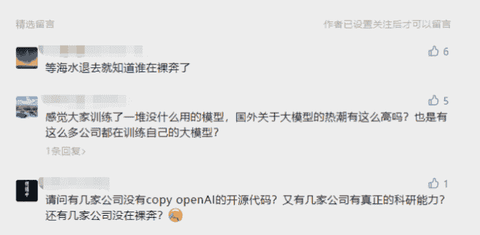

# 2023-06-20反思国产大模型：如果泡沫不可避免，我们该如何面对这场革命？-今日头条

> 来源：[https://xuqiwei1986.feishu.cn/docx/OZtPdBoJComhWxx10rPcQvRynMb](https://xuqiwei1986.feishu.cn/docx/OZtPdBoJComhWxx10rPcQvRynMb)

> 🔗 原文链接： h[ttps://www.toutiao](https://www.toutiao.com/article/7246656837087756859/?log_from=de6a31c7fe4f_1691463170718).com/article/724...

>

# 反思国产大模型：如果泡沫不可避免，我们该如何面对这场革命？

2023-06-20 14:49 · 人人都是产品经理

> 国产大模型与GPT这类先进的大模型之间，到底存在着怎样的发展区别呢？本篇文章具体分析国产大模型发展受限的原因，以及其面临的一些考验，希望能对你有一定的参考帮助。

最近，Facebook早期投资者Roger McNamee在CNBC上批评人们对AI的狂热，是“忘掉了过去科技泡沫带来的痛”。

同样的，在国内，面对越来越多的大模型，部分头脑冷静的人士，也显示出自己的担忧。

“这么多的大模型，真正有自己技术的有几个”？

“有几家公司能持续投入下去”？

更有头部VC机构人士认为，经过他们的私下测试和摸底，几乎国内所有的大模型，都是PR项目…

众所周知，大模型的训练是一个成本极高的过程，需要大量的算力和资金支持。

以OpenAI为例，GPT-3的单次训练成本就高达140万美元，对于一些更大的大模型，训练成本介于200万美元至1200万美元之间。

用知名计算机专家吴军的话来形容，ChatGPT每训练一次，相当于报废了3000辆特斯拉汽车。

这个数字告诉人们：要想打造有竞争力的大模型，不下血本是不行的。

某些体量、资金不足，却仍旧叫嚣着要“对标ChatGPT”的企业，其本身的实力，难免让人产生怀疑。

例如某个在发布大模型后，自身股价最高暴涨338%的国内公司（此处就不点名了），其账上的货币资金不过13亿元。

然而，以ChatGPT的训练成本为例，要想背后的智能算力集群，仅GPU显卡采购成本就超过了10亿元。国内目前能够支撑起类似基础设施的企业不超过3家。

也正因如此，在这场表面热闹的大模型竞赛中，注定有一大票公司，都只是打着大模型的名号，来实现自身利益的“陪跑者”罢了……

不过纵观人类的科技发展史，都由泡沫中的幸存者来继续推动的。即使人类本身，也是物种大爆发这场生物泡沫的幸运儿。如果泡沫无法避免，从业者真正需要的是面对泡沫时的冷静和定力。

# 一、数据孤岛

国产大模型能否达到或超越GPT这类先进模型的水平，有两个较为主要的因素：

1.  在数据集的获取上，如何不断积累足够多、且高质量的数据集；

1.  在炼制大模型的“工艺”上，如何不断探索和突破，找到新的理论和方法。

先说第一点。

目前，在大模型的训练上，用来训练的主流数据集以英文为主，中文数据只占据4.8%。

之前清华计算机系教授唐杰，在对千亿模型ChatGLM-130B训练前数据准备时，就曾面临过清洗中文数据后，可用量不到2TB的情况。

这就是国内所有做大模型的团队不得不面对的惨烈现状。

为解决这个问题，许多国内团队，都开始通过“众志成城”的方式，开源自身的中文数据集，以希望弥补高质量中文数据集的不足。

但是，这种通过各个团队“自觉”开源**的方式，仍然存在着一定局限性，那就是： **由于数据的敏感性、隐私性和所有权等问题，很多行业和领域的数据并不容易获得或共享 。

国内数据大量储存于移动端APP中，于训练大模型而言比较难于抓取。

同时国内互联网巨头之间的数据相互封闭，数据孤岛化情况严重。

例如百度的内容生态数据，腾讯的👸号数据，阿里的电商和物流数，这些属于各大企业的私有数据。虽然都在各自的行业和场景，积累了外人所不能及的优势，但由其所有权和隐私性的问题，导致很难与外界进行共享。

而这些不容易获取的数据，往往无法依赖各团队的“自愿”和“主动”进行开源。

针对这一问题，走在前列的美国AI产业，早已通过更成熟的数据共享平台、数据交易市场、数据信托等机制，促进了数据的流通和价值发现。

具体来说，在这些数据交易平台中，第三方数据拥有者可以将原始数据挂到数据交易市场上公开出售，数据需求方按照约定价格（买断数据/按小时计费、平台会员费）购买后，可以在数据交易平台上获得离线的数据包或者实时API。

若最终成功交易，平台收取一定佣金后返还销售收入给第三方数据拥有者。这类型数据交易平台代表有RapidAPI、Streamr等。

与之相比，国内大数据交易仍处于起步阶段，数据交易主要以单纯的原始数据“粗加工”交易为主。且数据供需不对称，使得数据交易难以满足社会有效需求，数据成交率和成交额不高。

此外，在数据交易过程中，国内市场也缺乏全国统一的规范体系和必要的法律保障，无法有效破解数据定价、数据确权等难题。

**从长**远来看，国内大模型要想在数据的数量、质量上进一步得到提升，就不能单单只靠部分团队“自愿”和“主动”的开源，而要在法律、市场机制等方面，做出更多与时俱进的改革。如此方能促进各个行业间数据的广泛共享。

# 二、“工艺”的差距

除了数据集的数量、质量外，另一个决定大模型能力强弱的关键因素，就是炼制大模型的“工艺”。

前段时间，复旦大学教授、上海市数据科学重点实验室主任肖仰华就表示：与国际同行相比，模型、数据和算力并不是中国最大的劣势，真正的短板在于对大模型“炼制”工艺的掌握，包括数据配方、数据清洗和参数设置等等。

现在有些国内大模型，动辄就对外号称“百亿”、“千亿”规模，仿佛参数量越大，模型性能就愈强。

然而，空有庞大的规模，却缺乏先进的“工艺”，这就像一个脑容量颇大，但却掌握不到学习要领的学生，难以在学习能力上进一步“精进”。

具体来说，如果将炼制大模型的过程，类比成一座工厂中的流水线。那么数据配方就像在开始生产之前选择原材料一样，需要选择不同的数据集，确定不同领域、不同类型、不同模态数据的配比。

而数据清洗就像对原材料的加工一样，对原始语料进行去噪、去重、过滤、规范化等操作，提取有用的信息；

参数设置就像生产过程中的调整和优化一样，通过选择合适的超参数，如学习率、批次大小等，以达到最佳的效果。

虽然上述的每一个具体步骤，国内其实都知道怎么做，但是将它们整合在一起，总体效果和国外是存在差距的。

这虽然不是0和1的区别，但却是50分和100分的区别。

所以，大模型的研制与开发，终归是一个易学难精的过程。而要想进一步提升这样的工艺，就必须在人工智能的基础理论、工程实践以及创新思维上不断积累，从而实现在关键环节上的突破和领先。

可问题是，这些反复试错、探索的过程，往往是一个需要消耗大量时间、资源，且并没有实际产出与盈利的过程。

即便是创造了ChatGPT的OpenAI，目前也处于严重亏损的状态（其去年的亏损已达5.4亿美元）。

这对于国内许多急功近利的企业而言，无疑是一个重大的考验。

因为国内巨头们对技术性风口的追逐和热爱，不坚定，也缺乏耐心。

举例来说，全民造芯运动中，在2017年，资本对半导体的狂热达到了一个顶端，创下至今最高历史记录，单笔平均融资达到 8亿元。

然而，一旦察觉某类技术的研发，是一场漫长且难见收益的过程，某些企业的“浮躁”与“摇摆”就会逐渐显现。

2020年，武汉弘芯半导体，号称千亿投资，台积电技术大牛执掌。但成立仅仅三年，就被曝出项目欠薪停摆。武汉弘芯将大陆唯一一台，价值5亿多元，能够生产7nm芯片的光刻机，拿去银行抵押续命。

**由此可见，国内外大模型的竞争，表面上看，是数据集多寡、质量高低的竞争；稍微深入了看，是**大模型工艺的比拼；而再深入到底层，就变成了不同的商业文化，乃至生态的综合竞争了。

作者：举大名耳

来源👸号：AI新智能

本文由人人都是产品经理合作媒体 @AI新智能 授权发布，未经许可，禁止转载。

题图来自 Unsplash，基于 CC0 协议

该文观点仅代表作者本人，人人都是产品经理平台仅提供信息存储空间服务。