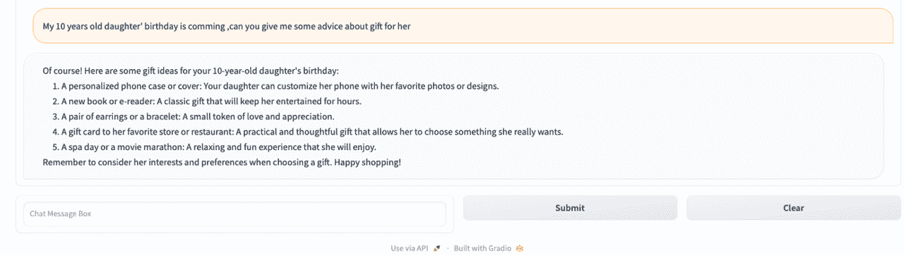

# 2023-06-19如何使用 Hugging Face LLM DLC 部署大型语言模型到 Amazon

> 来源：[https://xuqiwei1986.feishu.cn/docx/VqT7d46sTopS3PxbBE2cC9DJnZe](https://xuqiwei1986.feishu.cn/docx/VqT7d46sTopS3PxbBE2cC9DJnZe)

> 🔗 原文链接： h[ttps://blog.csdn.n](https://blog.csdn.net/revonqi/article/details/131284119?ops_request_misc=%257B%2522request%255Fid%2522%253A%2522169137550616777224431936%2522%252C%2522scm%2522%253A%252220140713.130102334.pc%255Fall.%2522%257D&request_id=169137550616777224431936&biz_id=0&utm_medium=distribute.pc_search_result.none-task-blog-2~all~first_rank_ecpm_v1~times_rank-2-131284119-null-null.142^v92^insert_down1&utm_term=LLM%E9%83%A8%E7%BD%B2&spm=1018.2226.3001.4187)et/revonqi/artic...

>

# 如何使用 Hugging Face LLM DLC 部署大型语言模型到 Amazon SageMaker

本篇文章主要介绍如何使用新的 Hugging Face [LLM 推理](https://huggingface.co/bigscience/bloom)容器将开源 LLMs，比如 BLOOM 部署到亚马逊 SageMaker 进行推理的示例。我们将部署 12B Open Assistant Model ，这是一款由开放助手计划训练的开源 Chat LLM。

这个示例包括:

1.  设置开发环境

1.  获取全新 Hugging Face LLM DLC

1.  将开放助手 12B 部署到亚马逊 SageMaker

1.  进行推理并与我们的模型聊天

1.  清理环境

## [ 什么是](https://so.csdn.net/so/search?q=DLC&spm=1001.2101.3001.7020) Hugging Face LLM Inference DLC ？

H[ugging Face ](https://github.com/huggingface/text-generation-inference)[LLM D](https://so.csdn.net/so/search?q=%E8%AF%AD%E8%A8%80%E6%A8%A1%E5%9E%8B&spm=1001.2101.3001.7020)LC 是一款全新的专用推理容器，可在安全的托管环境中轻松部署 LLM。DLC 由 文本生成推理（TGI） 提供支持，这是一种用于部署和服务大型 语言模型 （LLM）的开源、专门构建的解决方案。TGI 使用张量并行和动态批处理为最受欢迎的开源 LLM（包括 StarCoder、BLOOM、GPT-Neox、Llama 和 T5）实现高性能文本生成。文本生成推理已被 IBM、Grammarly 等客户使用，Open-Assistant 计划对所有支持的模型架构进行了优化，包括：

+   张量并行性和自定义 cuda 内核

+   在最受欢迎的架构上使用 flash-attention 优化了用于推理的变形器代码

+   使用 [bitsandbytes ](https://github.com/TimDettmers/bitsandbytes)进行量化

+   [连续批处理传入的请求 ](https://github.com/huggingface/text-generation-inference/tree/main/router)以增加总吞吐量

+   使用 [safetensors ](https://github.com/huggingface/safetensors)加速重量加载（启动时间）

+   Logits 扭曲器（温度缩放、topk、重复惩罚…）

+   用 [大型语言模型的水印 ](https://arxiv.org/abs/2301.10226)添加水印

+   停止序列，记录概率

+   使用服务器发送事件（SSE）进行 Token 流式传输

官方支持的模型架构目前为：

+   [BLOOM ](https://huggingface.co/bigscience/bloom)/ [BLOOMZ](https://huggingface.co/bigscience/bloomz)

+   [MT0-XXL](https://huggingface.co/bigscience/mt0-xxl)

+   [Galactica](https://huggingface.co/facebook/galactica-120b)

+   [SantaCoder](https://huggingface.co/bigcode/santacoder)

+   [gpt-Neox 20B ](https://huggingface.co/EleutherAI/gpt-neox-20b)（joi、pythia、lotus、rosey、chip、redPajama、open Assistant）

+   [FLAN-T5-XXL ](https://huggingface.co/google/flan-t5-xxl)（T5-11B）

+   [Llama ](https://github.com/facebookresearch/llama)（vicuna、alpaca、koala）

+   [Starcoder ](https://huggingface.co/bigcode/starcoder)/ [santaCoder](https://huggingface.co/bigcode/santacoder)

+   [Falcon 7B ](https://huggingface.co/tiiuae/falcon-7b)/ [Falcon 40B](https://huggingface.co/tiiuae/falcon-40b)

借助[亚马逊 SageMake](https://hf.co/chat)r [上推出的全新 Hugging](https://open-assistant.io/) Face LLM Inference DLC，AWS 客户可以从支持高度并发、低延迟 LLM 体验的相同技术中受益，例如 HuggingChat 、 OpenAssistant 和 Hugging Face Hub 上的 LLM 模型推理 API。

让我们开始吧！

##  1.设置开发环境

我们将使用 SageMaker python SDK 将 OpenAssistant/pythia-12b-sft-v8-7k-steps 部署到亚马逊 SageMaker。我们需要确保配置一个 AWS 账户并安装 SageMaker python SDK。

```
# TODO: once PR is merged: https://github.com/aws/sagemaker-python-sdk/pull/3837/files
!pip install git+https://github.com/xyang16/sagemaker-python-sdk.git@hf --upgrade
 
#!pip install sagemaker --upgrade --quiet
```

如[果你打](https://docs.aws.amazon.com/sagemaker/latest/dg/sagemaker-roles.html)算在本地环境中使用 SageMaker。您需要访问具有 SageMaker 所需权限的 IAM 角色。你可以在 这里 找到更多关于它的信息。

```
import sagemaker
import boto3
sess = sagemaker.Session()
# sagemaker session bucket -&gt; used for uploading data, models and logs
# sagemaker will automatically create this bucket if it not exists
sagemaker_session_bucket=None
if sagemaker_session_bucket is None and sess is not None:
    # set to default bucket if a bucket name is not given
    sagemaker_session_bucket = sess.default_bucket()
 
try:
    role = sagemaker.get_execution_role()
except ValueError:
    iam = boto3.client(&#x27;iam&#x27;)
    role = iam.get_role(RoleName=&#x27;sagemaker_execution_role&#x27;)[&#x27;Role&#x27;][&#x27;Arn&#x27;]
 
sess = sagemaker.Session(default_bucket=sagemaker_session_bucket)
 
print(f&quot;sagemaker role arn: {role}&quot;)
print(f&quot;sagemaker session region: {sess.boto_region_name}&quot;)

```

##  2. 获取全新 Hugging Face LLM DLC

与部署常规的 HuggingFace 模型相比，我们首先需要检索容器 URI 并将其提供给我们的 HuggingFaceModel 模型类，并使用 image_uri 指向该镜像。要在亚马逊 SageMaker 中检索新的 HuggingFace[ LL](https://github.com/aws/deep-learning-containers/blob/master/available_images.md#huggingface-text-generation-inference-containers)M DLC，我们可以使用 SageMaker SDK 提供的 get_huggingface_llm_image_uri 方法。此方法允许我们根据指定的 “后端”、“会话”、“区域” 和 “版本” 检索所需的 Hugging Face LLM DLC 的 URI。你可以在 这里 找到可用的版本。

```
from sagemaker.huggingface import get_huggingface_llm_image_uri
 
# retrieve the llm image uri
llm_image = get_huggingface_llm_image_uri(
  &quot;huggingface&quot;,
  version=&quot;0.6.0&quot;
)
 
# print ecr image uri
print(f&quot;llm image uri: {llm_image}&quot;)
```

要将 [Open Assistant Model]（openAssistant/Pythia-12b-sft-v8-7K-steps）部署到亚马逊 SageMaker，我们创建了一个 HuggingFaceModel 模型类并定义了我们的终端节点配置，包括 hf_model_id、instance_type 等。我们将使用 g5.4xlarge 实例类型，它有 1 个 NVIDIA A10G GPU 和 64GB 的 GPU 内存。

```
import json
from sagemaker.huggingface import HuggingFaceModel
 
# Define Model and Endpoint configuration parameter
hf_model_id = &quot;OpenAssistant/pythia-12b-sft-v8-7k-steps&quot; # model id from huggingface.co/models
use_quantization = True # wether to use quantization or not
instance_type = &quot;ml.g5.4xlarge&quot; # instance type to use for deployment
number_of_gpu = 1 # number of gpus to use for inference and tensor parallelism
health_check_timeout = 300 # Increase the timeout for the health check to 5 minutes for downloading the model
 
# create HuggingFaceModel with the image uri
llm_model = HuggingFaceModel(
  role=role,
  image_uri=llm_image,
  env={
    &#x27;HF_MODEL_ID&#x27;: hf_model_id,
    &#x27;HF_MODEL_QUANTIZE&#x27;: json.dumps(use_quantization),
    &#x27;SM_NUM_GPUS&#x27;: json.dumps(number_of_gpu)
  }
)  

```

在我们创建了 HuggingFaceModel 之后，我们可以使用 deploy 方法将其部署到亚马逊 SageMaker。我们将使用 ml.g5.4xlarge 实例类型部署模型。TGI 将自动在所有 GPU 上分发和分片模型。

```
# Deploy model to an endpoint
# https://sagemaker.readthedocs.io/en/stable/api/inference/model.html#sagemaker.model.Model.deploy
llm = llm_model.deploy(
  initial_instance_count=1,
  instance_type=instance_type,
  # volume_size=400, # If using an instance with local SSD storage, volume_size must be None, e.g. p4 but not p3
  container_startup_health_check_timeout=health_check_timeout, # 10 minutes to be able to load the model
)
```

SageMaker 现在将创建我们的端点并将模型部署到该端点。这可能需要 10-15 分钟。

##  4. 进行推理并与我们的模型聊天

部署终端节点后，我们可以对其进行推理。我们将使用 predictor 中的 predict 方法在我们的端点上进行推理。我们可以用不同的参数进行推断来影响生成。参数可以设置在 parameter 中设置。截至今天，TGI 支持以下参数：

+   温度：控制模型中的随机性。较低的值将使模型更具确定性，而较高的值将使模型更随机。默认值为 0。

+   max_new_tokens：要生成的最大 token 数量。默认值为 20，最大值为 512。

+   repeption_penalty：控制重复的可能性，默认为 null。

+   seed：用于随机生成的种子，默认为 null。

+   stop：用于停止生成的代币列表。生成其中一个令牌后，生成将停止。

+   top_k：用于 top-k 筛选时保留的最高概率词汇标记的数量。默认值为 null，它禁用 top-k 过滤。

+   top_p：用于核采样时保留的参数最高概率词汇标记的累积概率，默认为 null。

+   do_sample：是否使用采样；否则使用贪婪的解码。默认值为 false。

+   best_of：生成 best_of 序列如果是最高标记 logpros 则返回序列，默认为null。

+   details：是否返回有关世代的详细信息。默认值为 false。

+   return_full_text：是返回全文还是只返回生成的部分。默认值为 false。

+   truncate：是否将输入截断到模型的最大长度。默认值为 true。

+   typical_p：代币的典型概率。默认值为 null。

+   水印：生成时使用的水印。默认值为 false。

你可以在 [swagger 文档 ](https://huggingface.github.io/text-generation-inference/)中找到 TGI 的开放 api 规范。

openAssistant/Pythia-12b-sft-v8-7K-steps 是一种对话式聊天模型，这意味着我们可以使用以下提示与它聊天：

```
&lt;|prompter|&gt; [指令] &lt;|文本末尾|&gt;
&lt;|助手|&gt;
```

让我们先试一试，问一下夏天可以做的一些很酷的想法：

```
from sagemaker.huggingface import HuggingFacePredictor
 
llm = HuggingFacePredictor(endpoint_name=&quot;huggingface-pytorch-tgi-inference-2023-06-01-03-54-10-543&quot;)
chat = llm.predict({
        &quot;inputs&quot;: &quot;&quot;&quot;&lt;|prompter|&gt;What are some cool ideas to do in the summer?&lt;|endoftext|&gt;&lt;|assistant|&gt;&quot;&quot;&quot;
})
 
print(chat[0][&quot;generated_text&quot;])
```

现在，我们将使用不同的参数进行推理，以影响生成。参数可以通过输入的 parameters 属性定义。这可以用来让模型在 “机器人” 回合后停止生成。

```
# define payload
prompt=&quot;&quot;&quot;&lt;|prompter|&gt;How can i stay more active during winter? Give me 3 tips.&lt;|endoftext|&gt;&lt;|assistant|&gt;&quot;&quot;&quot;
 
# hyperparameters for llm
payload = {
  &quot;inputs&quot;: prompt,
  &quot;parameters&quot;: {
    &quot;do_sample&quot;: True,
    &quot;top_p&quot;: 0.7,
    &quot;temperature&quot;: 0.7,
    &quot;top_k&quot;: 50,
    &quot;max_new_tokens&quot;: 256,
    &quot;repetition_penalty&quot;: 1.03,
    &quot;stop&quot;: [&quot;&lt;|endoftext|&gt;&quot;]
  }
}
 
# send request to endpoint
response = llm.predict(payload)
 
# print(response[0][&quot;generated_text&quot;][:-len(&quot;&lt;human&gt;:&quot;)])
print(response[0][&quot;generated_text&quot;])

```

现在让我们构建一个快速 gradio 应用程序来和它聊天。

```
!pip install gradio  --upgrade
import gradio as gr
 
# hyperparameters for llm
parameters = {
    &quot;do_sample&quot;: True,
    &quot;top_p&quot;: 0.7,
    &quot;temperature&quot;: 0.7,
    &quot;top_k&quot;: 50,
    &quot;max_new_tokens&quot;: 256,
    &quot;repetition_penalty&quot;: 1.03,
    &quot;stop&quot;: [&quot;&lt;|endoftext|&gt;&quot;]
  }
 
with gr.Blocks() as demo:
    gr.Markdown(&quot;## Chat with Amazon SageMaker&quot;)
    with gr.Column():
        chatbot = gr.Chatbot()
        with gr.Row():
            with gr.Column():
                message = gr.Textbox(label=&quot;Chat Message Box&quot;, placeholder=&quot;Chat Message Box&quot;, show_label=False)
            with gr.Column():
                with gr.Row():
                    submit = gr.Button(&quot;Submit&quot;)
                    clear = gr.Button(&quot;Clear&quot;)
                    
    def respond(message, chat_history):
        # convert chat history to prompt
        converted_chat_history = &quot;&quot;
        if len(chat_history) &gt; 0:
          for c in chat_history:
            converted_chat_history += f&quot;&lt;|prompter|&gt;{c[0]}&lt;|endoftext|&gt;&lt;|assistant|&gt;{c[1]}&lt;|endoftext|&gt;&quot;
        prompt = f&quot;{converted_chat_history}&lt;|prompter|&gt;{message}&lt;|endoftext|&gt;&lt;|assistant|&gt;&quot;
        
        # send request to endpoint
        llm_response = llm.predict({&quot;inputs&quot;: prompt, &quot;parameters&quot;: parameters})        
        
        # remove prompt from response
        parsed_response = llm_response[0][&quot;generated_text&quot;][len(prompt):]        
        chat_history.append((message, parsed_response))
        return &quot;&quot;, chat_history
 
    submit.click(respond, [message, chatbot], [message, chatbot], queue=False)
    clear.click(lambda: None, None, chatbot, queue=False)
 
demo.launch(share=True)
Running on local URL:  http://127.0.0.1:7861
Running on public URL: https://4a3a32ce84d8b318b9.gradio.live
 
This share link expires in 72 hours. For free permanent hosting and GPU upgrades (NEW!), check out Spaces: https://huggingface.co/spaces

```

程序运行成功后，显示如下聊天窗口：



太棒了！我们已经成功地将 Open Assistant 模型部署到亚马逊 SageMaker 并对其进行了推理。此外，我们还构建了一个快速的 gradio 应用程序，可以与我们的模型聊天。

现在，您到了可以使用亚马逊 SageMaker 上全新 Hugging Face LLM DLC 构建世代人工智能应用程序的时候了。

##  5. 清理环境

我们可以删除模型和端点。

```
llm.delete_model()
llm.delete_endpoint()
```

如果您想在 SageMaker 上测试和运行上[面的](https://github.com/VerRan/sagemaker-llm/blob/main/sagemaker-notebook-OpenAssistant:pythia-12B.ipynb)例子，可以在 github 地址（ sagemaker-llm/sagemaker-notebook-OpenAssistant:pythia-12B.ipynb at main · VerRan/sagemaker-llm · GitHub ）获取完整的 notebook。

##  6. 总结

从上面的部署过程，我们可以看到整个部署过程非常简单，这个主要得益于 SageMaker Hugging Face LLM DLC 的支持，还可以通过将 SageMaker 部署的端点与您的应用集成，满足实际的业务需求。