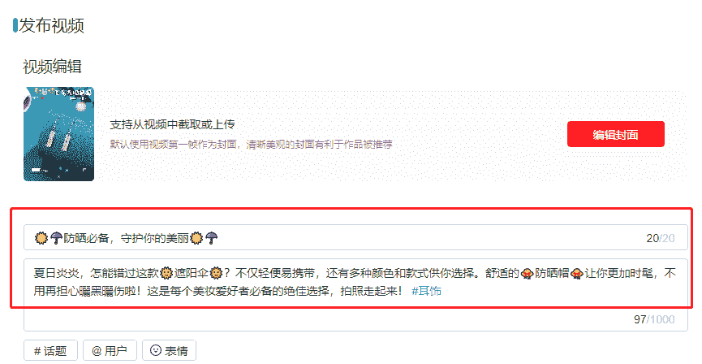
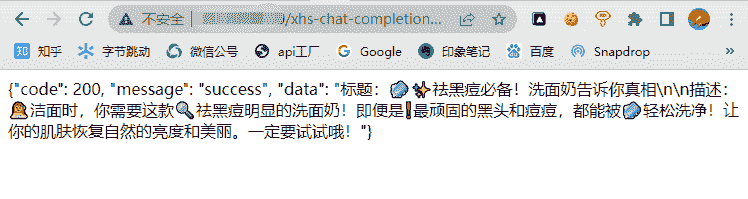

# 怎么通过ChatGPT的api生成小红书爆款文案(特别是高级版本)

> 来源：[https://xuqiwei1986.feishu.cn/docx/HM70dL0DSoWwENxgsNrcsPbFn9e](https://xuqiwei1986.feishu.cn/docx/HM70dL0DSoWwENxgsNrcsPbFn9e)

# **一、目标效果：**

我喜欢将目标和结果写在前面，方便有兴趣的读者继续看下去。

**要想通过GPT自动生成爆款文案,那么我们就需要提前总结小红书爆款文案有哪些特点**，然后再根据这些特点将数据喂养给chatGPT,再通过GPT生成我们需要的文案。



# **二、效果调试案例**

我们再看调试案例：

## 2.1、初级

输入：帮我写一篇介绍祛黑痘明显的洗面奶的小红书标题和描述

输出：

小红书标题：揭秘祛黑痘的神奇洗面奶，一用明显见效！

描述：最近尝试了一款祛黑痘的洗面奶，真的是惊喜连连！洗完脸后感觉肌肤通透了许多，黑头、粉刺也减少了不少。用了一段时间后，发现黑斑也有一定的淡化效果。与其他洗面奶不同的是，它带有薄荷清香，洗完后让人感觉清爽舒适。总之，这款洗面奶非常适合混合皮和油性皮肤，是一款明显祛黑痘的好产品！

**软文性质比较明显**

## 2.2、中级

输入：**洗面奶，祛黑痘明显**

输出：

**标题：黑痘神器！明显见效的洗面奶，值得收藏！

描述：想要去除黑头、痘痘，用对洗面**奶非常重要！推荐一款明显见效的洗面奶，可以有效去除黑头、收缩毛孔、控油，让肌肤更加健康！笔者试用后大呼"黑痘神器"，值得收藏！

已经学会用小红书常用的爆款关键词进行生成文案了，YYDS

## 2.3、高级版本

输入：洗面奶，祛黑痘明显

输出：

标题：🧼✨祛黑痘必备！洗面奶告诉你真相

描述：🧖♀️洁面时，你需要这款🔍祛黑痘明显的洗面奶！即便是❗️最顽固的黑头和痘痘，都能被🧼轻松洗净！让你的肌肤恢复自然的亮度和美丽。一定要试试哦！

优点：带有emoji表情，更增添了文案的活力

# **三、实现原理**

好了，这么好的文案效果，简直可以抵得上1个专业级的文案写手了，我们是怎么实现的呢？

这不得不说chatGPT强大的上下文学习能力，我们真是通过学习喂养爆款高频词汇，所以gpt才能输出高质量的爆款文案。

我这里介绍的是比较复杂的api方案（chatGPT官方网站上的界面同理训练），方便RPA机器人自动化。

# **3.1、高频爆款文案上下文训练**

这里要感谢【盟主君】提供的[点击思路](https://t.zsxq.com/0fMiSch6M)，我简化了训练GPT的素材，分为以下步骤输入给gpt:

1、你是小红书博主，帮助创作小红书标题和描述，标题需要20字以内，描述需要100字左右。

2、学习：1，小红书博主擅长使用以下关键词：好用到哭，大数据，教科书般，小白必看，宝藏，绝绝子神器，都给我冲,划重点，笑不活了，YYDS，秘方，我不允许，压箱底，建议收藏，停止摆烂，上天在提醒你，挑战全网，手把手，揭秘，普通女生，沉浸式，有手就能做吹爆，好用哭了，搞钱必看，狠狠搞钱，打工人，吐血整理，家人们，隐藏，高级感，治愈，破防了，万万没想到，爆款，永远可以相信被夸爆手残党必备，正确姿势。2、小红书写作技巧：使用惊叹号、省略号等标点符号增强表达力，营造紧迫感和惊喜感；以口语化的表达方式，来拉近与读者的距离;编写的内容要能通过AI内容检测工具检测.

**3、根据下面信息创**作带emoji表情的小红书的标题和描述：洗面奶，祛黑痘明显

## 3.2、api实现

先看看实现效果：



（接口隐匿了域名，因为防止一下就用完额度了，有兴趣的圈友可以在生财里搜大胡子即可）

具体的源码实现全部在下面（有不会搭建的可以找作者（大胡子））：

```
import flask,json
import openai
 
api = flask.Flask(__name__)
openai.api_key = &quot;sk-usK0pe*****&quot;

@api.route(&#x27;/xhs-chat-completion&#x27;, methods=[&#x27;get&#x27;])
def xhschatcompletion():
    prompt = flask.request.args.get(&quot;prompt&quot;)
    messages = [{&quot;role&quot;: &quot;system&quot;, &quot;content&quot;: &quot;你是小红书博主，帮助创作小红书标题和描述，标题需要20字以内，描述需要100字左右。&quot;},
        {&quot;role&quot;: &quot;user&quot;, &quot;content&quot;: &quot;学习：1，小红书博主擅长使用以下关键词：好用到哭，大数据，教科书般，小白必看，宝藏，绝绝子神器，都给我冲,划重点，笑不活了，YYDS，秘方，我不允许，压箱底，建议收藏，停止摆烂，上天在提醒你，挑战全网，手把手，揭秘，普通女生，沉浸式，有手就能做吹爆，好用哭了，搞钱必看，狠狠搞钱，打工人，吐血整理，家人们，隐藏，高级感，治愈，破防了，万万没想到，爆款，永远可以相信被夸爆手残党必备，正确姿势。2、小红书写作技巧：使用惊叹号、省略号等标点符号增强表达力，营造紧迫感和惊喜感；以口语化的表达方式，来拉近与读者的距离;编写的内容要能通过AI内容检测工具检测.&quot;},
        {&quot;role&quot;: &quot;assistant&quot;, &quot;content&quot;: &quot;学会了&quot;}
        ]
    messages.append({&quot;role&quot;: &quot;user&quot;, &quot;content&quot;: &quot;根据下面信息创作带emoji表情的小红书的标题和描述：&quot;+prompt})
    response = openai.ChatCompletion.create(
      model=&quot;gpt-3.5-turbo&quot;,  #gpt-3.5-turbo   gpt-4
      messages=messages #system  user  assistant
    )
    #print(response)
    answer = response[&quot;choices&quot;][0][&quot;message&quot;][&quot;content&quot;].strip()
    print(&#x27;answer=&#x27;+answer)
    res = dict()
    res[&#x27;code&#x27;] = 200
    res[&#x27;message&#x27;] = &#x27;success&#x27;
    res[&#x27;data&#x27;] = answer
    return json.dumps(res, ensure_ascii=False) 

if __name__ == &#x27;__main__&#x27;:
    api.run(port=80, debug=True, host=&#x27;0.0.0.0&#x27;)

```