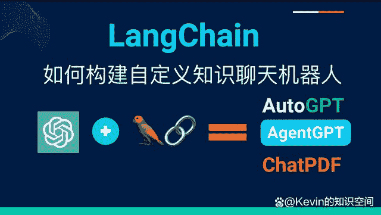
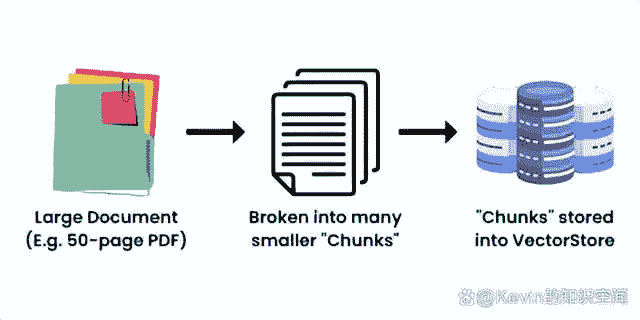
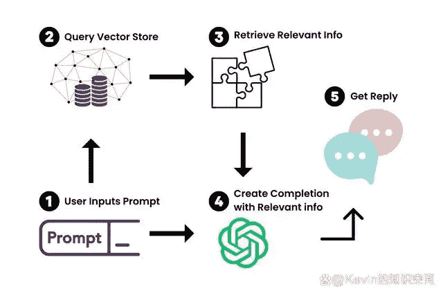

# 2023-06-10 LangChain：一个让你的LLM变得更强大的开源框架

> 来源：[https://xuqiwei1986.feishu.cn/docx/Cu0ndAOeEoz7LsxcC1WclyVJnrd](https://xuqiwei1986.feishu.cn/docx/Cu0ndAOeEoz7LsxcC1WclyVJnrd)

> 🔗 原文链接：https://baijiahao.baidu.com/s?id=1768277489280773991&wfr=spider&for=pc

LangChain：一个让你的LLM变得更强大的开源框架

## 前言

你可能听说过，最近几个月出现了很多人工智能的应用程序。你可能也在用一些这样的应用。

比如ChatPDF和CustomGPT AI这些AI工具，它们可以帮我们省去很多麻烦，我们不用再翻来覆去地看文档，就能找到想要的答案。它们让AI为我们做了很多工作。

那么，开发这些工具的人是怎么做到的呢？其实，他们都用了一个叫LangChain的开源框架。



在这篇文章里，我会告诉你LangChain是什么，以及它是怎么和OpenAI的API一起工作的，来创建这些很厉害的工具。同时，希望通过文本的介绍能给你带来一些灵感，让你也想出自己的创意。OK，我们开始吧！

## 一、LangChain介绍


LangChain 是一个开源的框架，它可以让AI开发人员把像GPT-4这样的大型语言模型（LLM）和外部数据结合起来。它提供了 Python 或 JavaScript（TypeScript） 的包。

你可能知道，GPT模型是用到2021年的数据训练的，这可能会有很大的局限性。虽然这些模型的通用知识很棒，但是如果能让它们连接到自定义的数据和计算，就会有更多的可能性。这就是LangChain做的事情。

简单来说，它可以让你的LLM在回答问题时参考整个数据库。所以你现在可以让你的GPT模型访问最新的数据，比如报告、文档和网站信息。

最近，LangChain 的人气大幅飙升，特别是在三月份GPT-4发布之后。这要归功于它的功能特性和它与强大的LLM搭配时带来的无限可能性。

## 二、LangChain工作原理

你可能觉得LangChain听起来很复杂，但其实它很容易上手。

简单来说，LangChain就是把大量的数据组合起来，让LLM能够尽可能少地消耗计算力就能轻松地引用。它的工作原理是把一个大的数据源，比如一个50页的PDF文件，分成一块一块的，然后把它们嵌入到一个向量存储（Vector Store）里。



创建向量存储的简单示意图

现在我们有了大文档的向量化表示，我们就可以用它和LLM一起工作，只检索我们需要引用的信息，来创建一个提示-完成（prompt-completion）对。

当我们把一个提示输入到我们新的聊天机器人里，LangChain就会在向量存储里查询相关的信息。你可以把它想象成一个专门为你的文档服务的小型谷歌。一旦找到了相关的信息，我们就用它和提示一起喂给LLM，生成我们的答案。



LangChain 如何与 OpenAI 的 LLM 合作

LangChain还可以让你创建一些可以执行动作的应用程序，比如上网、发邮件、完成其他API相关的任务。你可以看看AgentGPT，这是一个很好的例子。

这样的应用程序有很多可能的用途，这里只是我随便想到的一些：

+   个人AI邮件助手
+   AI学习伙伴
+   AI数据分析
+   定制公司客服聊天机器人
+   社交媒体内容创作助手

这样的案例还有更多。我会在以后的文章里介绍具体的构建教程，敬请期待。

## 三、LangChain应用实战

一个LangChain应用程序由5个主要部分组成：

1.  模型（LLM包装器）
1.  提示
1.  链
1.  嵌入和向量存储
1.  代理

我会给你分别来介绍每个部分，让你能够对LangChain的工作原理有一个高层次的理解。接下来，你应该能够运用这些概念，开始设计你自己的用例和创建你自己的应用程序。

接下来我会用Rabbitmetrics（Github）的一些简短的代码片段来进行介绍。他提供了有关此主题的精彩教程。这些代码片段应该能让你准备好使用LangChain。

首先，让我们设置我们的环境。你可以用`pip`安装3个你需要的库：

```
pip install -r requirements.txt
python-dotenv==1.0.0 langchain==0.0.137 pinecone-client==2.2.1
```

`Pinecone` 是我们将要和 LangChain 一起使用的向量存储（Vector Store）。在这里，你要把你的OpenAI、Pinecone环境和Pinecone API的API密钥存储到你的环境配置文件里。你可以在它们各自的网站上找到这些信息。然后我们就用下面的代码来加载那个环境文件：

```
# 加载环境变量
from dotenv import loaddotenv, finddotenv
loaddotenv(finddotenv())
```

现在，我们准备好开始了！

### 3.1 模型（LLM包装器）

为了和我们的LLM交互，我们要实例化一个OpenAI的GPT模型的包装器。在这里，我们要用OpenAI的GPT-3.5-turbo，因为它是最划算的。但是如果你有权限，你可以随意使用更强大的GPT4。

要导入这些，我们可以用下面的代码：

```
# 为了查询聊天模型GPT-3.5-turbo或GPT-4，导入聊天消息和ChatOpenAI的模式（schema）。
from langchain.schema import (
    AIMessage,
    HumanMessage,
    SystemMessage)
from langchain.chat_models import ChatOpenAI
chat = ChatOpenAI(model_name="gpt-3.5-turbo", temperature=0.3)
messages = [
    SystemMessage(content="你是一个专业的数据科学家"),
    HumanMessage(content="写一个Python脚本，用模拟数据训练一个神经网络")
]
response = chat(messages)
print(response.content, end='\n')
```

实际上，`SystemMessage`为GPT-3.5-turbo模块提供了每个提示-完成对的上下文信息。`HumanMessage`是指您在ChatGPT界面中输入的内容，也就是您的提示。

但是对于一个自定义知识的聊天机器人，我们通常会将提示中重复的部分抽象出来。例如，如果我要创建一个推特生成器应用程序，我不想一直输入“给我写一条关于…的推特”。

因此，让我们来看看如何使用提示模板（`PromptTemplates`）来将这些内容抽象出来。

### 3.2 提示

LangChain提供了`PromptTemplates`，允许你可以根据用户输入动态地更改提示，类似于正则表达式（`regex`）的用法。

```
# 导入提示并定义PromptTemplate
from langchain import PromptTemplate
template = """您是一位专业的数据科学家，擅长构建深度学习模型。用几行话解释{concept}的概念"""
prompt = PromptTemplate(
    input_variables=["concept"],
    template=template,
)
# 用PromptTemplate运行LLM
llm(prompt.format(concept="autoencoder"))
llm(prompt.format(concept="regularization"))
```

你可以用不同的方式来改变这些提示模板，让它们适合你的应用场景。如果你熟练使用ChatGPT，这应该对你来说很简单。

### 3.3 链

链可以让你在简单的提示模板上面构建功能。本质上，链就像复合函数，让你可以把你的提示模板和LLM结合起来。

使用之前的包装器和提示模板，我们可以用一个单一的链来运行相同的提示，它接受一个提示模板，并把它和一个LLM组合起来：

```
# 导入LLMChain并定义一个链，用语言模型和提示作为参数。
from langchain.chains import LLMChain
chain = LLMChain(llm=llm, prompt=prompt)
# 只指定输入变量来运行链。
print(chain.run("autoencoder"))
```

除此之外，顾名思义，我们还可以把这些链连起来，创建更大的组合。

比如，我可以把一个链的结果传递给另一个链。在这个代码片段里，Rabbitmetrics把第一个链的完成结果传递给第二个链，让它用500字向一个五岁的孩子解释。

你可以把这些链组合成一个更大的链，然后运行它。

```
# 定义一个第二个提示
second_prompt = PromptTemplate(
    input_variables=["ml_concept"],
    template="把{ml_concept}的概念描述转换成用500字向我解释，就像我是一个五岁的孩子一样",
)
chain_two = LLMChain(llm=llm, prompt=second_prompt)
# 用上面的两个链定义一个顺序链：第二个链把第一个链的输出作为输入
from langchain.chains import SimpleSequentialChain
overall_chain = SimpleSequentialChain(chains=[chain, chain_two], verbose=True)
# 只指定第一个链的输入变量来运行链。
explanation = overall_chain.run("autoencoder")
print(explanation)
```

有了链，你可以创建很多功能，这就是LangChain功能强大的原因。但是它真正发挥作用的地方是和前面提到的向量存储一起使用。接下来我们开始介绍一下这个部分。

### 3.4 嵌入和向量存储

这里我们将结合LangChain进行自定义数据存储。如前所述，嵌入和向量存储的思想是把大数据分成小块，并存储起来。

LangChain有一个文本分割函数来做这个：

```
# 导入分割文本的工具，并把上面给出的解释分成文档块
from langchain.text_splitter import RecursiveCharacterTextSplitter
text_splitter = RecursiveCharacterTextSplitter(
    chunk_size = 100,
    chunk_overlap = 0,
)
texts = text_splitter.create_documents([explanation])
```

分割文本需要两个参数：每个块有多大（`chunk size`）和每个块有多少重叠（`chunk overlap`）。让每个块之间有重叠是很重要的，可以帮助识别相关的相邻块。

每个块都可以这样获取：

`texts[0].page_content`

在我们有了这些块之后，我们需要把它们变成嵌入。这样向量存储就能在查询时找到并返回每个块。我们将使用OpenAI的嵌入模型来做这个。

```
# 导入并实例化 OpenAI embeddings
from langchain.embeddings import OpenAIEmbeddings
embeddings = OpenAIEmbeddings(model_name="ada")
# 用嵌入把第一个文本块变成一个向量
query_result = embeddings.embed_query(texts[0].page_content)
print(query_result)
```

最后，我们需要有一个地方来存储这些向量化的嵌入。如前所述，我们将使用Pinecone来做这个。使用之前环境文件里的API密钥，我们可以初始化Pinecone来存储我们的嵌入。

```
# 导入并初始化Pinecone客户端
import os
import pinecone
from langchain.vectorstores import Pinecone
pinecone.init(
    api_key=os.getenv('PINECONE_API_KEY'),
    environment=os.getenv('PINECONE_ENV')
)
# 上传向量到Pinecone
index_name = "langchain-quickstart"
search = Pinecone.from_documents(texts, embeddings, index_name=index_name)
# 做一个简单的向量相似度搜索
query = "What is magical about an autoencoder?"
result = search.similarity_search(query)
print(result)
```

现在我们能够从我们的Pinecone向量存储里查询相关的信息了！剩下要做的就是把我们学到的东西结合起来，创建我们特定的用例，给我们一个专门的AI“代理”。

### 3.5 代理

一个智能代理就是一个能够自主行动的AI，它可以根据输入，依次完成一系列的任务，直到达成最终的目标。这就意味着我们的AI可以利用其他的API，来实现一些功能，比如发送邮件或做数学题。如果我们再加上我们的LLM+提示链，我们就可以打造出一个适合我们需求的AI应用程序。

这部分的原理可能有点复杂，所以让我们来看一个简单的例子，来演示如何用LangChain中的一个Python代理来解决一个简单的数学问题。这个代理是通过调用我们的LLM来执行Python代码，并用`NumPy`来求解方程的根：

```
# 导入Python REPL工具并实例化Python代理
from langchain.agents.agent_toolkits import create_python_agent
from langchain.tools.python.tool import PythonREPLTool
from langchain.python import PythonREPL
from langchain.llms.openai import OpenAI
agent_executor = create_python_agent(
    llm=OpenAI(temperature=0, max_tokens=1000),
    tool=PythonREPLTool(),
    verbose=True
)
# 执行Python代理
agent_executor.run("找到二次函数3 * x ** 2 + 2 * x - 1的根（零点）。")
```

一个定制知识的聊天机器人，其实就是一个能够把问题和动作串起来的智能代理。它会把问题发送给向量化存储，然后把得到的结果和原来的问题结合起来，给出答案！

## 四、其他变化

你已经初步了解了LangChain的神奇功能，是不是心里已经跃跃欲试，想要亲自动手试试呢？

不过，你可能还不知道，我们现在介绍的只是OpenAI的一个模型，就是能够处理文本的GPT-3.5-turbo。其实，OpenAI还有很多其他的模型，它们都可以和LangChain搭配使用——比如用Dall-E来创造出各种各样的图像。只要运用我们刚才讲过的原理，你就可以轻松打造出AI图片生成器、网站构建器等等。

AI的世界有无限的可能性等着你去发现，赶快去探索吧，我相信你一定会有更多的灵感和创意。

## 五、结论

看完这篇文章，你是不是对这些新AI工具的原理有了更深的了解呢？掌握LangChain的运作方式，对于程序员来说是一项非常重要的技能，它可以让你的AI开发更加高效和创新。

如果你对这篇文章感兴趣，而且你想要学习更多关于AI领域的实战技巧，那么你一定要 关注「技术狂潮AI」 。在这里，你可以看到最新最热的AIGC领域的干货文章和案例实战教程。


举报/反馈

大家都在搜


# LLVM 教程与资源

- [llvm教程](https://baidu.com/s?word=llvm%E6%95%99%E7%A8%8B&rsv_dl=feed_landingpage_rs&from=1020853i&rsf=)
- [llvm源码分析](https://baidu.com/s?word=llvm%E6%BA%90%E7%A0%81%E5%88%86%E6%9E%90&rsv_dl=feed_landingpage_rs&from=1020853i&rsf=)
- [llvm前端](https://baidu.com/s?word=llvm%E5%89%8D%E7%AB%AF&rsv_dl=feed_landingpage_rs&from=1020853i&rsf=)
- [llvm github](https://baidu.com/s?word=llvm%20github&rsv_dl=feed_landingpage_rs&from=1020853i&rsf=)
- [基于llvm开发新的编程语言](https://baidu.com/s?word=%E5%9F%BA%E4%BA%8Ellvm%E5%BC%80%E5%8F%91%E6%96%B0%E7%9A%84%E7%BC%96%E7%A8%8B%E8%AF%AD%E8%A8%80&rsv_dl=feed_landingpage_rs&from=1020853i&rsf=)
- [llvm编译器实战教程](https://baidu.com/s?word=llvm%E7%BC%96%E8%AF%91%E5%99%A8%E5%AE%9E%E6%88%98%E6%95%99%E7%A8%8B&rsv_dl=feed_landingpage_rs&from=1020853i&rsf=)
