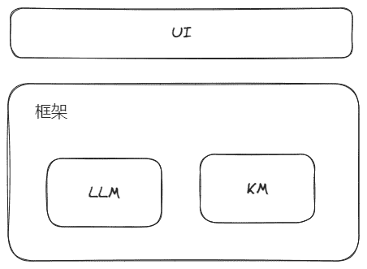
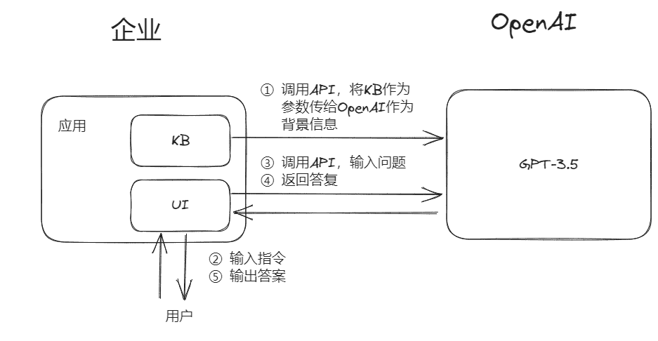
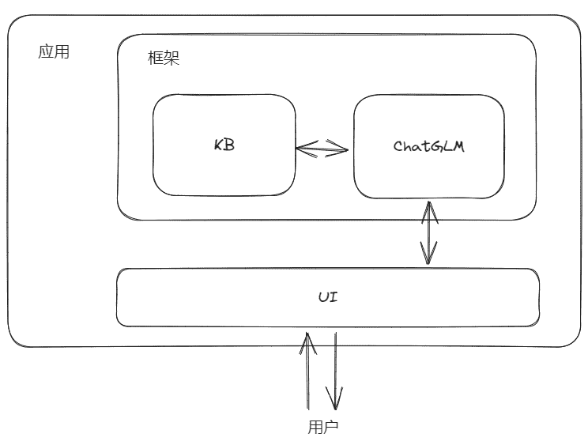

# 2023-06-07关于语言模型私有化部署的讨论

> 来源：[https://xuqiwei1986.feishu.cn/docx/HvRfdytZnoFbFBxR0i8cbeAHnju](https://xuqiwei1986.feishu.cn/docx/HvRfdytZnoFbFBxR0i8cbeAHnju)

> 🔗 原文链接： h[ttps://blog.csdn.n](https://blog.csdn.net/BGRichi/article/details/131098802?ops_request_misc=%257B%2522request%255Fid%2522%253A%2522169137526016800227497272%2522%252C%2522scm%2522%253A%252220140713.130102334.pc%255Fall.%2522%257D&request_id=169137526016800227497272&biz_id=0&utm_medium=distribute.pc_search_result.none-task-blog-2~all~first_rank_ecpm_v1~rank_v31_ecpm-1-131098802-null-null.142^v92^insert_down1&utm_term=LLM%E7%A7%81%E6%9C%89%E5%8C%96&spm=1018.2226.3001.4187)et/BGRichi/artic...

>

# 关于语言模型私有化部署的讨论 | AIGC实践

上周在与TC同行关于AIGC实践的线上交流中[，大家普遍](https://so.csdn.net/so/search?q=%E8%AF%AD%E8%A8%80%E6%A8%A1%E5%9E%8B&spm=1001.2101.3001.7020)比较关心的一个实践切入点是： 语言模型 的私有化部署——简单来说，就是在企业内部，部署一个属于自己的“ChatGPT”，对于本行业/专业知识，以及企业独有的产品和技术信息有充分的了解，并且提供用户接口，通过自然语言交流，解答内外部用户的问题。

其实，在此前/此后的多次单点交流中，也有不同行业的朋友向我咨询相同问题。可见，任何人在体验过ChatGPT超强的语言能力后，都不难意识到，这种交互方式必将会成为未来非常重要的应用场景。

这段时间，我花了不少时间做调研；并且，由于我司主营AI计算设备及软件，也刚好具备相关技术背景，于是便近水楼台地与研发Lead和产品经理分别进行交流，看看是否有机会率先实施并落地一个内部应用。

在此梳理一下相关脉络，做一个简单的分享，希望可以给到有相同问题的朋友一点启发。

**主题**图Prompt：Privatization Deployment of Large Language Models. technological style. --ar 16:9

基本分析

语言模型私有化部署的应用场景，可谓显而易见。

典型场景包括：

+   内部 [知识库 ](https://so.csdn.net/so/search?q=%E7%9F%A5%E8%AF%86%E5%BA%93&spm=1001.2101.3001.7020)：提供企业内部的知识共享平台。

+   智能客服机器人：提供获取产品/技术信息的用户接口。

+   专家咨询机器人：提供医疗、律师等专业领域的咨询服务。

应用范围非常广泛，几乎可以涵盖所有专业咨询行业，以及所有对外输出产品和服务的企业。应用价值就更不必说了：

+   技术革新，全面推进AI化进程。所谓的“第四次工业革命”，具有划时代意义；

+   降本增效。既然AI可以又快又好地完成任务，自然也就不需要付出人工成本。

实现部署的相关资源包括：

+   硬件：LLM对算力有比较高的要求。

+   模型：可采用免费的开源模型。

+   语料库：包括但不限于行业/专业信息；以及企业的产品/技术信息。

+   算法：需要比较专业的算法工程师参与进行模型训练/微调。

研发观点

从研发的角度来看，实现语言模型私有化部署，还是非常有希望的。

实现语言模型私有化部署的系统架构，主要包括：

+   LLM：语言模型；

+   KB：知识库；

+   框架：将LLM和KB建立联系；

+   UI：用户界面。

其中，LLM可采用2种方式实现：

+   使用公共模型：通过调用API接口使用OpenAI GPT-3.5

+   使用开源模型：使用开源模型ChatGLM，但开源不能商用。参考：
https://github.com/imClumsyPanda/langchain-ChatGLM

部署逻辑分别为：

**使用公共模型部署逻辑**

**使用开源模型部署逻辑**

KB的输入是语料库，然后经过一系列处理，成为可被LLM调取的知识。

语料库的准备比较简单，只需要保证：内容是以TXT或者Markdown等格式存储的纯文本信息（不包含样式）。

也就是说，如果采用xml类型的内容系统，应该可以比较容易做系统集成；如果采用Word类型的文档，需要转换成不包含样式的纯文本信息，并做必要的数据清洗，避免在转换后出现异常。

产品观点

产品经理的意见，与研发Lead有很大不同，会比较偏向于相对悲观的观点。在他看来：

现有ChatGPT和文心一言采用的语言模型，具有巨大数量的权重参数，并且在语料库上投入了巨大的开发成本——这绝对是开源模型和数据集，无法比拟的。

即便如此，ChatGPT与文心一言在回答问题时，表现出的实际效果，也不完全令人满意；何况是企业基于开源模型自行开发的应用。

第三，语料库的开发也会牵扯到比较大的投入成本，切不说是行业内的专业信息，即便是聚焦在企业产品和技术上的信息，也可能需要投入非常大的工作量。

所以，投入成本与实现效果决定了，可能不太值得去做这样的尝试。

未来，企业比较有希望实现落地的方式是，当文心一言或其他类似应用，最终达到了一个比较好的输出效果后，可能会对外输出toB业务支持，当然，是需要付费的。对于普通企业而言，这可能是相对比较经济的方式。

总结

以上内容基于本人有限的眼界和理解，仅供参考。如果你的企业找到了低成本、高收益的解决方案，实施并落地了应用，也非常期待听到你的分享。

相关文章： #AIGC实践

其他推荐：

**实施：GitHub + MarkDown 文档系统的**工作环境部署及工作流程说明 | 技术传播

技术传播是一片蓝海 | 技术传播

访谈：TC无处不在，只是我们没有发觉 | 技术传播

这次他们说好要“讲真的” | 传播

在座都别吵了，你们还有我 | 技术传播

一本培养强迫症患者的说明书 | 技术传播

就像用心做好日本料理 | 技术传播

顽固的老头子与无聊的说明书 | 技术传播

转战新媒体 | 技术传播

评测：王者荣耀的用户帮助系统 | 技术传播

让爸爸妈妈也能享受到科技发展带来的便利 | 技术传播

企业级信息管理系统初创方案构思 | 技术传播

睿齐

技术传播从业者

品牌内容策划

自由摄影师

自由撰稿人

**汪力迪**

👸号：techcomm / htstory

**🛰️号：bgrichi**

邮箱：hash_0813@163.com

