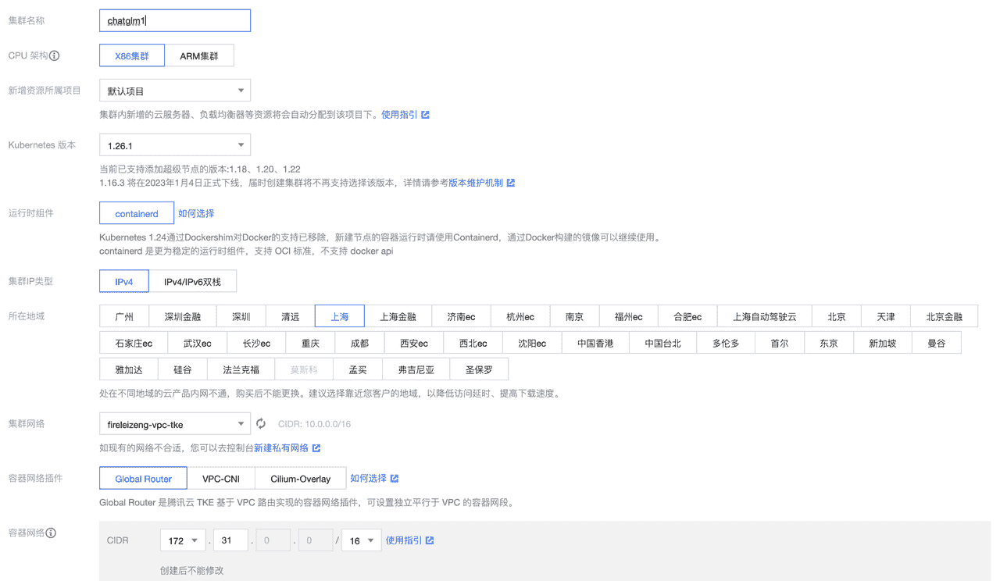
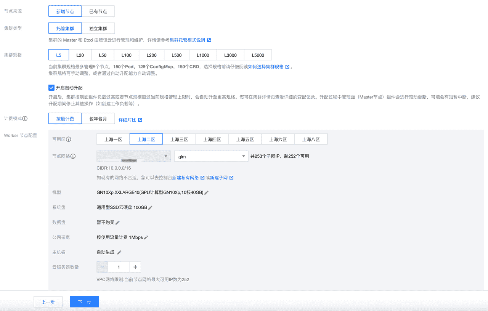
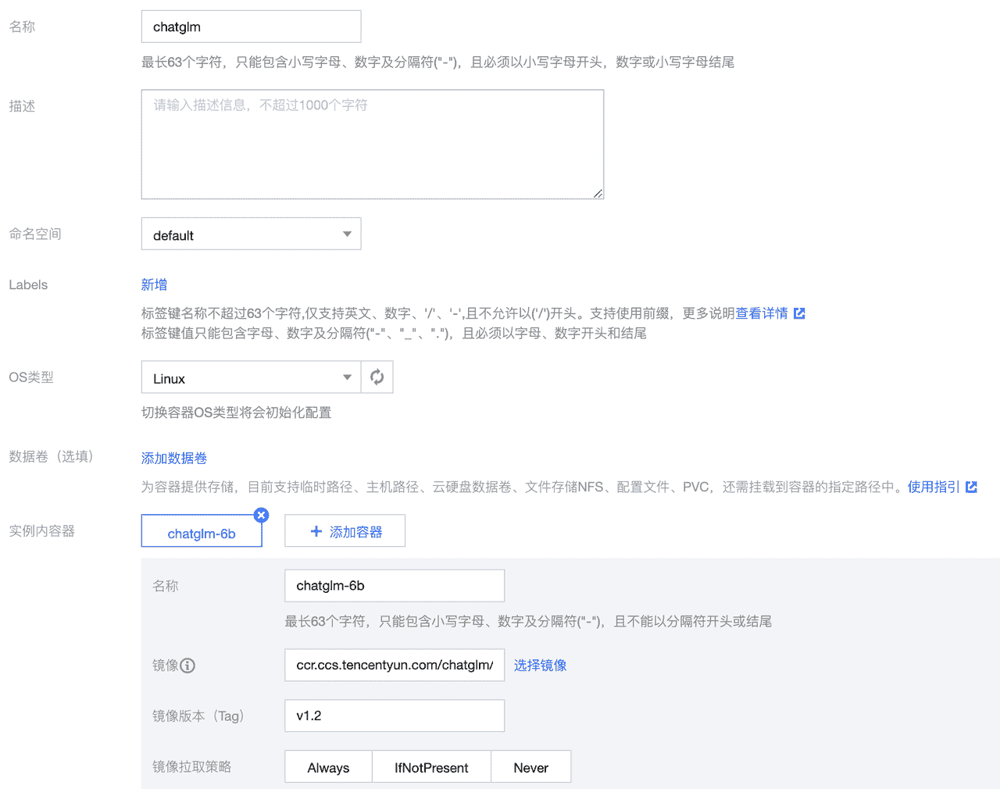
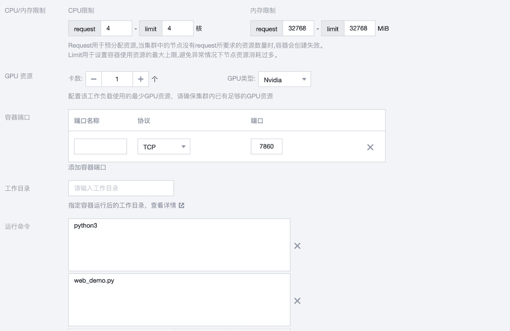
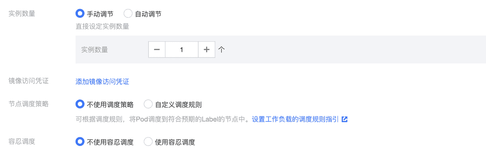
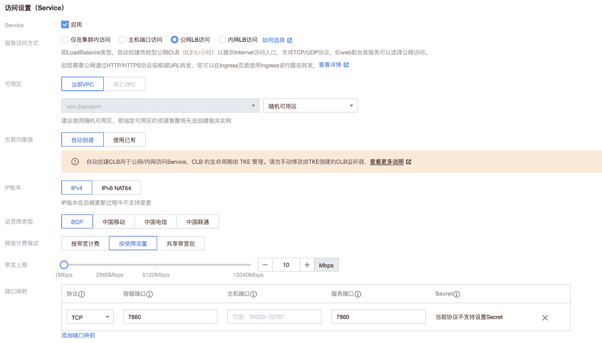
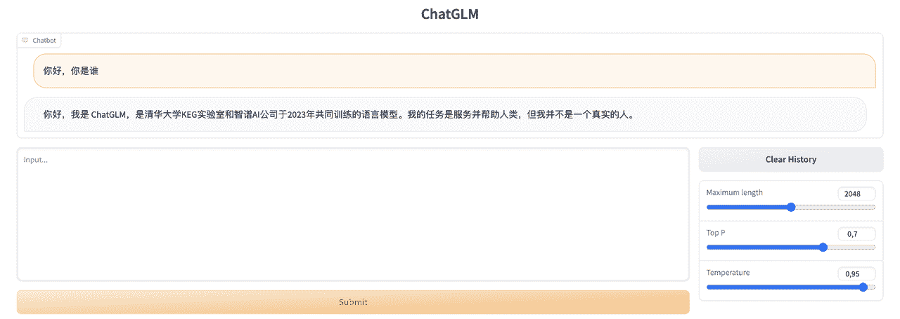
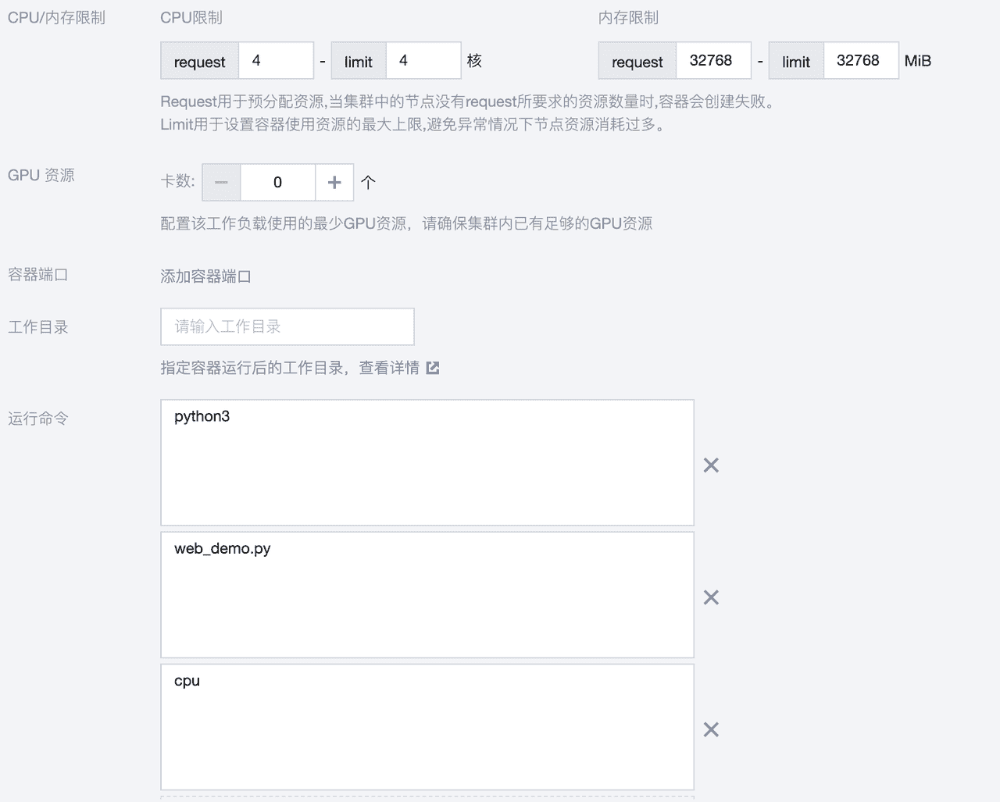

# 2023-05-26TKE快速部署 ChatGLM

> 来源：[https://xuqiwei1986.feishu.cn/docx/ExxPdxeDOow7DXxfdzlc4MBsn7c](https://xuqiwei1986.feishu.cn/docx/ExxPdxeDOow7DXxfdzlc4MBsn7c)

> 🔗 原文链接： h[ttps://cloud.tence](https://cloud.tencent.com/document/product/457/92795)nt.com/document/...

>

最近更新时间：2023-05-26 14:07:01

## 背景介绍

ChatGLM-6B 是一个开源的、支持中英双语的对话语言模型，基于 General Language Model (GLM) 架构，具有62亿参数。结合模型量化技术，用户可以在消费级的显卡上进行本地部署（INT4 量化级别下最低只需6GB显存）。ChatGLM-6B 使用了和 ChatGPT 相似的技术，针对中文问答和对话进行了优化。经过约1TB标识符的中英双语训练，辅以监督微调、反馈自助、人类反馈强化学习等技术的加持。

在开源的中文大模型中，ChatGLM-6B 是非常不错的选择。最近，来自 LMSYS Org（UC 伯克利主导）的研究人员发起的大语言模型版排位赛中，ChatGLM 虽然只有60亿参数，但依然冲进了前五，只比130亿参数的 Alpaca 落后了23分。基于或使用了 ChatGLM-6B 的开源项目如下：

langchain-ChatGLM：基于 langchain 的 ChatGLM 应用，实现基于可扩展知识库的问答。

闻达：大型语言模型调用平台，基于 ChatGLM-6B 实现了类 ChatPDF 功能。

chatgpt_academic：支持 ChatGLM-6B 的学术写作与编程工具箱，具有模块化和多线程调用 LLM 的特点，可并行调用多种 LLM。

glm-bot：将 ChatGLM 接入 Koishi 可在各大聊天平台上调用 ChatGLM 话题。

## 部署步骤

通过控制台创建。

### 准备集群

[1. 开通并创建 TK](https://cloud.tencent.com/document/product/457/32189)E 集群，操作步骤详情可参见  创建容器服务集群  。如下图所示：

2. 在创建集群时，集群选择 **托管 **类型。由于 ChatGLM-6B 的 GPU 版本最少需要14G显存，因此 Worker 节点选择 V100 GPU 节点，型号为 GN10Xp.2XLARGE40，系统盘空间为100GB。如下图所示：

3[. 根据业务部署时对 GPU](https://cloud.tencent.com/document/product/457/65734) 的共享需求，可以选择并打开 qGPU 选项。关于 qGPU 的使用方法，可参见  容器服务使用 qGPU  。

**4. **配置完毕后，确认选项及扩展组件无误，单击 确认 。

### 创建应用

#### 使用控制台创建 Deployment

1. 在 [ 容器服务控制台  ](https://console.cloud.tencent.com/tke2/cluster?rid=1)中，选择集群 ID，进入集群详情页。

2. 选择 **工作负**载 > Deployment ，在 Deployment 页面单击 新建 。

3. 在 **新建 Deployment **中，参考以下信息开始创建 ChatGLM 应用。

在 **实例内容器 **中，

**名称 **：填写 chatglm-6b。

**镜像 **：填写 ccr.ccs.tencentyun.com/chatglm/chatglm-6b:v1.2。

**CPU/内存限制 **：由于 ChatGLM-6B 的资源需要主要是 GPU，因此 CPU 和内存可以按需设置。

**GPU 资源 **：设置为1个，GPU 类型选择 Nvidia。

**容器端口 **：端口填写7860。

**运行命令 **：分别添加 python3 和 web_demo.py 。如下图所示：

4. 在 **基本信息 **中，实例数量选择 **手动调节 **，并设置为1个。如下图所示：

5. 为了让外部可访问，在 **访问设置 ****中，您可参考以**下信息进**行设置。 服务访问**方式 ：选择 公网 LB 访问。

**端口映射 **：将容器端口和服务端口都填写为7860。

**服务访问方式 **：选择公网 LB 访问。

**端口映射 **：将容器端口和服务端口都填写为7860。

6. 设置完成后，单击 **创建 Deployment **，等待 Pod Ready。需注意，由于镜像大小为25GB，因此需要等待一段时间才能完成部署，大致需要等待半小时左右。

7. 选择 服务与路由 > Service ，在页面上获取项目的公网 IP。如下图所示：

在浏览器中输入 http:// IP :7860，即可访问。

#### 使用 YAML 创建 Deployment

您也可以使用以下 YAML 配置直接创建 Deployment：

apiVersion: apps/v1

kind: Deployment

metadata:

name: chatglm-6b

spec:

replicas: 1

selector:

matchLabels:

app: chatglm-6b

template:

metadata:

labels:

app: chatglm-6b

spec:

containers:

- name: chatglm-6b

image: ccr.ccs.tencentyun.com/chatglm/chatglm-6b:v1.2

command:

- python3

- web_demo.py

ports:

- containerPort: 7860

resources:

limits:

nvidia.com/gpu: "1"

---

apiVersion: v1

kind: Service

metadata:

name: chatglm-6b-svc

spec:

type: ClusterIP

ports:

- port: 7860

targetPort: 7860

selector:

app: chatglm-6b

### 创建 CPU 版本应用

如果没有 GPU 硬件，ChatGLM-6B 也可以在 CPU 上进行推理，但推理速度会更慢。资源需要大概32GB内存，相比创建 GPU 版本应用，您需要注意以下两点：

1. 内存资源需要32GB。

2. 将 [ 运行命令  ](https://cloud.tencent.com/document/product/457/92795#7fcb7db0-62d7-4ac7-a5ab-0df2799e2fa7)改为 python3 web_demo.py cpu。如下图所示：

