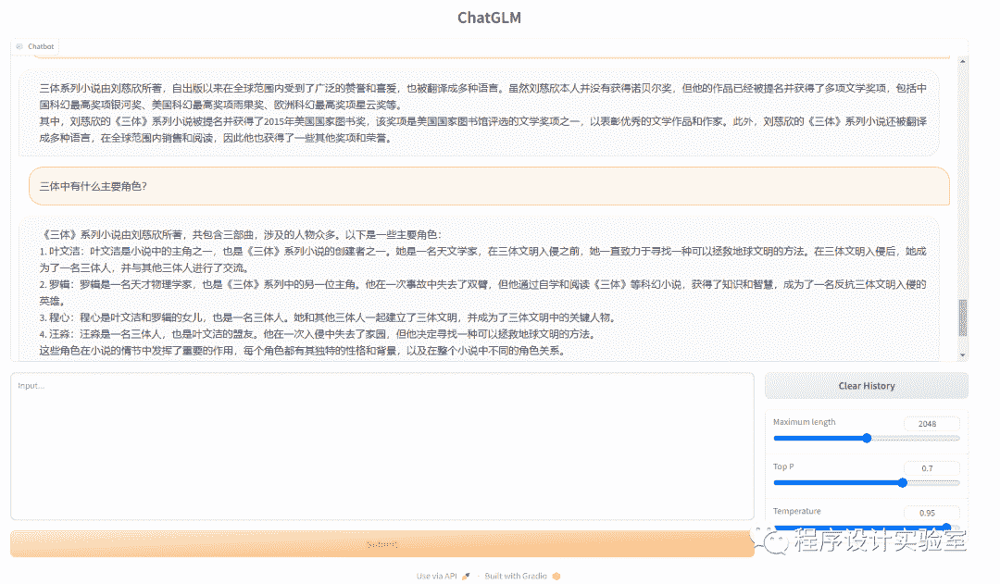
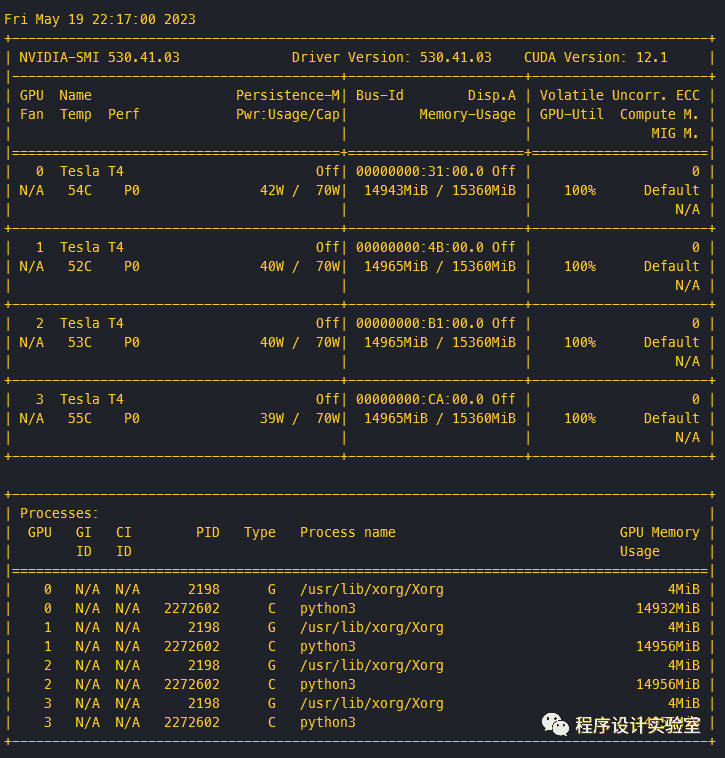

# 2023-05-22LLM环境搭建与模型本地部署

> 来源：[https://xuqiwei1986.feishu.cn/docx/Ocgodqk6yoAzkaxwOkNcjfFSnfe](https://xuqiwei1986.feishu.cn/docx/Ocgodqk6yoAzkaxwOkNcjfFSnfe)

> 🔗 原文链接： h[ttps://blog.csdn.n](https://blog.csdn.net/zls365365/article/details/130818465?ops_request_misc=%257B%2522request%255Fid%2522%253A%2522169137550616777224431936%2522%252C%2522scm%2522%253A%252220140713.130102334.pc%255Fall.%2522%257D&request_id=169137550616777224431936&biz_id=0&utm_medium=distribute.pc_search_result.none-task-blog-2~all~first_rank_ecpm_v1~times_rank-6-130818465-null-null.142^v92^insert_down1&utm_term=LLM%E9%83%A8%E7%BD%B2&spm=1018.2226.3001.4187)et/zls365365/art...

>

# LLM探索：环境搭建与模型本地部署

##  1前言

最近一直在炼丹（搞AIGC这块），突然发现业务代码都索然无味了…

上次发了篇 [AI画图 ](https://so.csdn.net/so/search?q=AI%E7%94%BB%E5%9B%BE&spm=1001.2101.3001.7020)的文章，ChatGPT虽然没法自己部署，但现在开源的LLM还是不少的，只要有一块差不多的显卡，要搞个LLM本地部署还是没问题的。

本文将介绍这以下两个国产开源LLM的本地部署

+   ChatGLM-6B

+   MOSS

本文先简单的把模型跑起来，后续将继续我近期在LLM方向的一些探索记录~

##  2概念

开始之前，先来看看一些基础概念。

###  AIGC

引用以下 mbalib 的内容

> AIGC（AI Genera**ted Co**nte**nt） 即人工智能生成内容，**又称“ 生成式AI ”（ Generative AI ），被认为是继专业生产内容(PGC)、用户生产内容(UGC)之后的新型内容创作方式。

> 互联网内容生产方式经历了PGC——UGC——AIGC的过程。PGC（Professionally Generated Content）是专业生产内容，如Web1.0和广电行业中专业人员生产的文字和视频，其特点是专业、内容质量有保证。UGC（User Generated Content）是用户生产内容，伴随Web2.0概念而产生，特点是用户可以自由上传内容，内容丰富。 AIGC（AI Generated Content） 是由AI生成的内容，其特点是自动化生产、高效。随着自然语言生成技术NLG和AI模型的成熟，AIGC逐渐受到大家的关注，目前已经可以自动生成文字、图片、音频、视频，甚至3D模型和代码。

最近很多的ChatGPT、AI画图，就都属于这个领域。

###  LLM

引用以下 wikipedia 的内容

> A la**rge **language model ( LLM ) is a language model consisting of a neural network with many parameters (typically billions of weights or more), trained on large quantities of unlabeled text using self-supervised learning or semi-supervised learning. LLMs emerged around 2018 and perform well at a wide variety of tasks. This has shifted the focus of natural language processing research away from the previous paradigm of training specialized supervised models for specific tasks.

中文也就是「大 [语言模型 ](https://so.csdn.net/so/search?q=%E8%AF%AD%E8%A8%80%E6%A8%A1%E5%9E%8B&spm=1001.2101.3001.7020)」，现在很火的ChatGPT就是这个LLM的代表，大模型有一个关键的属性：参数量，参数量的大小决定了大模型的能力（不能说是绝对的，但肯定是正相关）。

以下是常见LLM的参数量：

| LLM名称 | 参数量 |
| --- | --- |
| ChatGPT 3.5 | 175B |
| ChatGLM | 6B |
| MOSS | 16B |
| LLaMA | 7B/13B/33B/65B |

篇幅关系只列举这几个，更多的可以看文后的参考资料。

##  3搭建环境

###  硬件

首先要有一台搭载了 [NVIDIA ](https://so.csdn.net/so/search?q=NVIDIA&spm=1001.2101.3001.7020)显卡的Linux系统服务器/电脑。

显存需要达到8G及以上，不然跑不动~

系统推荐使用最新的Ubuntu(22.04)或者其衍生版，以下是我在测试过程中使用的两台服务器配置。

服务器1

+   CPU：Intel(R) Core(TM) i9-10940X CPU @ 3.30GHz

+   内存：64G

+   显卡：NVIDIA GeForce RTX 2080 Ti

服务器2

+   CPU：Intel(R) Xeon(R) Gold 5318Y CPU @ 2.10GHz x2

+   内存：128G

+   显卡：Tesla T4 x4

###  软件

说完了硬件，再看看软件。

#### 驱动

首先，需要显卡驱动，Ubuntu系的发行版安装显卡驱动比喝水还容易，这就是为啥推荐炼丹用Ubuntu的理由。

> PS：完全可以一键完成，不需要再去网上查什么复制了几百遍的博客然后下载一堆东西又是编译又是卸载nouveau啥的了~

Ubuntu桌面版可以直接用「软件更新」App一键安装显卡驱动。

Ubuntu服务器版本，使用 nvidia-detector 命令检测需要安装的驱动版本，示例：

```
$ nvidia-detector
nvidia-driver-530
```

使用 ubuntu-drivers list 获取可安装的驱动列表，示例：

```
$ ubuntu-drivers list
nvidia-driver-418-server, (kernel modules provided by nvidia-dkms-418-server)
nvidia-driver-530, (kernel modules provided by linux-modules-nvidia-530-generic-hwe-22.04)
nvidia-driver-450-server, (kernel modules provided by linux-modules-nvidia-450-server-generic-hwe-22.04)
nvidia-driver-515, (kernel modules provided by linux-modules-nvidia-515-generic-hwe-22.04)
nvidia-driver-470-server, (kernel modules provided by linux-modules-nvidia-470-server-generic-hwe-22.04)
nvidia-driver-525-server, (kernel modules provided by linux-modules-nvidia-525-server-generic-hwe-22.04)
nvidia-driver-515-server, (kernel modules provided by linux-modules-nvidia-515-server-generic-hwe-22.04)
nvidia-driver-510, (kernel modules provided by linux-modules-nvidia-510-generic-hwe-22.04)
nvidia-driver-525, (kernel modules provided by linux-modules-nvidia-525-generic-hwe-22.04)
nvidia-driver-470, (kernel modules provided by linux-modules-nvidia-470-generic-hwe-22.04)
```

然后使用 ubuntu-drivers install nvidia-driver-530 来安装驱动，示例：

```
$ ubuntu-drivers install nvidia-driver-530
 
All the available drivers are already installed.
```

就这么简单

> PS：当然非要自己去NVIDIA官网下载也可以，具体可以看看参考资料。

#### Python

搞AI，Python是必备的，但我们不直接使用系统的Python环境，而是使用conda来管理。

推荐使用 miniconda3 比 anaconda 轻量。

按照官网说明按照 miniconda3 之后，只需要使用以下命令即可创建指定版本的python环境

```
conda create -n 环境名称 python=3.10
```

如果遇到网络环境问题，可以参考我之前这篇文章，配置一下国内镜像： 配置pip国内镜像加快python第三方库安装速度~

##  4ChatGLM-6B

###  介绍

这是清华和智谱公司搞的开源LLM，截止本文撰写时，其在国产开源LLM里面算是天花板的存在了~

> ChatGLM-6B 是一个开源的、支持中英双语的对话语言模型，基于 General Language Model (GLM) 架构，具有 62 亿参数。结合模型量化技术，用户可以在消费级的显卡上进行本地部署（INT4 量化级别下最低只需 6GB 显存）。ChatGLM-6B 使用了和 ChatGPT 相似的技术，针对中文问答和对话进行了优化。经过约 1T 标识符的中英双语训练，辅以监督微调、反馈自助、人类反馈强化学习等技术的加持，62 亿参数的 ChatGLM-6B 已经能生成相当符合人类偏好的回答。

###  硬件需求

| **量化等级** | **最低 GPU 显存 **（推理） | **最低 GPU 显存 **（高效参数微调） |
| --- | --- | --- |
| FP16（无量化） | 13 GB | 14 GB |
| INT8 | 8 GB | 9 GB |
| INT4 | 6 GB | 7 GB |

###  本地部署

#### 下载项目代码

```
git clone https://github.com/THUDM/ChatGLM-6B.git
```

PS：也可以使用我 fork 魔改的版本，主要做了以下修改：

+   部署和模型微调默认开启多卡加速

+   重写API接口，更直观

换成以下命令即可

```
git clone https://github.com/Deali-Axy/ChatGLM-6B.git
```

#### 创建虚拟环境

建议使用 conda 管理

```
conda create -n chatglm python==3.8
```

#### 安装依赖

```
cd ChatGLM-6B
conda activate chatglm
pip install -r requirements.txt
conda install cudatoolkit=11.7 -c nvidia
```

> PS：没有安装 cudatoolkit 的话，会报 RuntimeError: Library cudart is not initialized 错误

> 但 issues 里也有人说可以通过使用CPU输出量化模型后直接调用的方式解决，暂未尝试。

> issues 地址: https://github.com/THUDM/ChatGLM-6B/issues/115

#### 下载模型和启动

项目代码里有命令行和web界面两种demo，任意选一个运行，程序会自动从 huggingface 下载预训练模型。

> PS: huggingface 的模型理论上是可以直接下载的，如果遇到网络问题，请自行使用代理或者从官方提供的某云盘下载模型。

```
# 命令行 demo
python cli_demo.py
# 使用 Gradio 实现的简单Web界面
python web_demo.py
```

Gradio 的默认端口是7860，可以通过在 launch() 方法里传入 server_port 参数自定义端口。

#### 使用量化模型

如果显存没有13G以上，则无法运行FP16精度模型，只能运行量化后的模型，需要修改一下代码。

打开上述的 cli_demo.py 或 web_demo.py 代码

找到以下加载模型的代码，修改一下参数

```
model = AutoModel.from_pretrained(&quot;THUDM/chatglm-6b&quot;, trust_remote_code=True).half().cuda()
```

将上面的代码修改为下面这样以使用量化模型

```
# 按需修改，目前只支持 4/8 bit 量化
model = AutoModel.from_pretrained(&quot;THUDM/chatglm-6b&quot;, trust_remote_code=True).quantize(4).half().cuda()
```

#### 运行效果



image

#### 多卡加速

如果显卡多，可以使用多卡运行以加速推理。

依然是打开上述的 cli_demo.py 或 web_demo.py 代码。

找到以下加载模型的代码

```
model = AutoModel.from_pretrained(&quot;THUDM/chatglm-6b&quot;, trust_remote_code=True).half().cuda()
```

修改为

```
from utils import load_model_on_gpus
model = load_model_on_gpus(&quot;THUDM/chatglm-6b&quot;, num_gpus=4)
```

num_gpus 参数为要使用的显卡数量

我看了 load_model_on_gpus 这个方法的代码，它是通过 auto_configure_device_map 方法把 transformer分成30层，然后再分配到指定数量的显卡上，没法像 CUDA_VISIBLE_DEVICES 环境变量一样通过显卡编号来指定，只能按顺序来分配。

如果机器上同时要运行其他模型，可以考虑先运行这个ChatGLM，再运行其他的，或者重写 auto_configure_device_map 方法，让其可以灵活指定显卡。

###  授权

模型不可以直接商用，据说商用需要购买一年180w的许可证。

##  5MOSS

###  介绍

这个是复旦开源的大模型，使用下来和ChatGLM最大的区别是推理速度特别慢

> MOSS是一个支持中英双语和多种插件的开源对话语言模型， moss-moon 系列模型具有160亿参数，在FP16精度下可在单张A100/A800或两张3090显卡运行，在INT4/8精度下可在单张3090显卡运行。MOSS基座语言模型在约七千亿中英文以及代码单词上预训练得到，后续经过对话指令微调、插件增强学习和人类偏好训练具备多轮对话能力及使用多种插件的能力。

###  硬件需求

| 量化等级 | 加载模型 | 完成一轮对话（估计值） | 达到最大对话长度2048 |
| --- | --- | --- | --- |
| FP16 | 31GB | 42GB | 81GB |
| Int8 | 16GB | 24GB | 46GB |
| Int4 | 7.8GB | 12GB | 26GB |

###  本地部署

#### 下载代码

```
git clone https://github.com/OpenLMLab/MOSS.git
```

#### 创建虚拟环境

建议使用 conda 管理

```
conda create -n moss python==3.8
```

#### 安装依赖

```
cd MOSS
conda activate moss
pip install -r requirements.txt
conda install cudatoolkit=11.7 -c nvidia
```

#### 下载模型和启动

项目代码里有命令行和web界面两种demo，任意选一个运行，程序会自动从 huggingface 下载预训练模型。

```
# 命令行 demo
python moss_cli_demo.py
# 使用 Gradio 实现的简单Web界面
python moss_web_demo_gradio.py
```

#### 修改默认模型和多卡加速

因为MOSS对显存的要求比较高，因此默认用的是4位量化的模型，这里我使用一台4块T4的服务器来部署，所以直接使用FP16模型。

修改 moss_web_demo_gradio.py ，找到以下代码

```
parser.add_argument(&quot;--model_name&quot;, default=&quot;fnlp/moss-moon-003-sft-int4&quot;,
                    ...)
```

把 default 参数改为 fnlp/moss-moon-003-sft

然后再设置一下多卡加速，把GPU参数设置为四个显卡的编号

```
parser.add_argument(&quot;--gpu&quot;, default=&quot;0,1,2,3&quot;, type=str)
```

然后启动，就可以看到四张显卡都吃满了



image

使用下来最大的感受就是慢，往往要一两分钟才能生成一个回答。

我看了下GitHub issues，有很多人也提出了同样的问题。两张A100还需要10s起步，100s左右的生成时间，看来短时间内是无解了，只能等官方优化了~

详见：

+   https://github.com/OpenLMLab/MOSS/issues/87

###  授权

模型采用 GNU AFFERO GENERAL PUBLIC LICENSE 许可证，可以免费商用。

##  6参考资料

+   https://wiki.mbalib.com/wiki/AIGC

+   https://en.wikipedia.org/wiki/Large_language_model

+   https://gitee.com/oschina/awesome-llm

+   https://github.com/Hannibal046/Awesome-LLM

+   安装 NVIDIA 显卡驱动 - https://www.zhihu.com/tardis/zm/art/59618999?source_id=1003

-

> 技术群：添加小编微信并备注进群

> 小编微信：mm1552923

> 公众号：dotNet编程大全