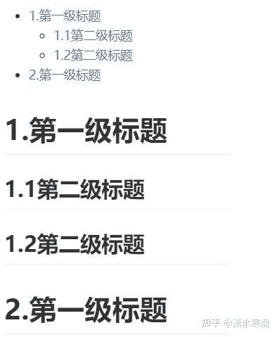

# 2022-05-21 Markdown语法笔记-基础篇

> 来源：https://xuqiwei1986.feishu.cn/docx/FMhWdGYiDoi2QYxZWZWc9GdZnUf
> 🔗 原文链接：https://zhuanlan.zhihu.com/p/517670740?utm_id=0

Markdown是一种轻量级标记语言，创始人为 约翰·格鲁伯（John Gruber）。Gruber认为，Markdown的哲学在于易读与易写。

[TOC]

常用Markdown编译器软件：

+ 有道云笔记
+ Typora
+ ···

**环境说明：**

本节所有实例代码及演示效果（未特别说明）均使用 有道云笔记 工具完成，考虑到Markdown工具之间的不兼容，可能有些语法复制粘贴到其他软件不会正常显示。

## 1. 分级标题

标题主要是点明主题（高度概括）和使文章结构化。

> Markdown提供了两种方式声明标题：`Setext` 和 `Atx`。

### 1.1 Setext风格的标题定义方式

> 在标题文字下方增加 3个连续等号 `=` 和 3个连续减号 `-` ，分别为 `第一标题` 和 `第二标题`。

代码如下：

```
一级标题
===
二级标题
---
```

将得到的如下效果：


### 1.2 Atx风格的标题定义方式

> 在标题文字前方增加1~6个哈希符号 `#` 及空格，其对应 Html 中的 `<h1>` ~ `<h6>` 。

代码如下：

```
# 这是一个一级标题
## 这是一个二级标题
### 这是一个三级标题
#### 这是一个四级标题
##### 这是一个五级标题
###### 这是一个六级标题
这个是正文文字
```

将得到如下效果：


文章结构化代码如下：

```
# 1. 第一级标题1
正文内容
## 1.1 第二级标题1
正文内容
## 1.2 第二级标题2
正文内容
# 2. 第一级标题2
正文内容
```

这是文章结构化的效果：


### 1.3 小结

+ 标题级数不易过多。通常情况下，一、二级标题就能够满足需求，多了反而增加阅读障碍，有的平台就限制标题级数，如知乎就限制标题只有一、二级。
+ `Setext`风格 标题语法相对繁琐，且 `---` 易于分割线语法混淆，因此建议使用 `Atx`风格 标题语法。

## 2. 段落

正文是文章的主体。正文通常由段落组成，段落则由缩进、换行和文本组成。一个普通的段落不应该有空格或者制表符作为缩进。

### 2.1 正文

> 在Markdown文件中，没有任何标记的文字会被解析成正文。

### 2.2 段落

> 在Markdown文件中，使用至少一个空行来区分段落。不同的段落在转换成 HTML 后会被包含在不同的 `<p>` 标签中。

### 2.3 不分段换行

> 不同于分段换行，不分段换行不是用 `<p>` 标签描述段落，而是用 `<br>` 标签折断文字。如果要让文字另起一行而不分段，需在行尾增加两个空格。

代码如下：

```
这是第一行后未加空格
这是第二行后加2空格  
这是第三行未加空格空一行换段

这是第二段
```

这是电脑显示结果：


这是手机显示结果：


（注：按Markdown语法来说，显示结果应该如手机所示，不明白电脑为啥未加空格也能不分段就换行？）

### 2.4 缩进、空白行

> Markdown原生语法不支持缩进和空行。

### 2.5 小结

+ Markdown原生语法不支持缩进，若是需要缩进，则可以通过调整全局CSS样式来实现。

## 3. 粗体与斜体

粗体和斜体通常起强调作用。

### 3.1 粗体与斜体语法

> Markdown实现这一样式的方法是将需要强调的内容，用 星号 `*` 或者 下划线 `_` 包裹住，一个符号的时候代表斜体，如 `*斜体*` ，两个符号的时候代表粗体，如 `**粗体**` 。

代码如下：

```
**这是粗体**
*这是斜体*
__这也是粗体__
_这也是斜体_
```

显示效果如下:


### 3.2 小结

+ 当不是特别有必要强调的文字时，请尽量不要使用粗体和斜体，因为它们会影响读者的阅读速度，造成停顿。同时粗体字可能导致读者完全忽略正文的内容，所以请谨慎使用强调语法。
+ 强调内容的开头和结尾都不能有空格，否则粗体与斜体语法失效。
+ 大多数都用 星号 `*` 来定义粗体和斜体。

## 4. 文本高亮

颜色可以使普通文字表达出更深刻的含义，比如红色用于醒目与警示、绿色用于表达良好与正常等。

### 4.1 文本高亮语法

> Markdown的原生语法并不支持修改前景色和背景色。但现在一些软件类似粗体和斜体，默认为用两个等号 `==` 代表高亮，用 `==` 包裹强调内容

代码如下：

```
==这是文本高亮==
```

显示效果如下：


### 4.2 小结

+ 由于高亮不是Markdown原生语法，一些Markdown工具不支持 `==` 作为高亮代码，如 Typora 就需在 偏好设置 中对 Markdown扩展语法 中的 高亮 进行勾选。
+ 同斜体与粗体一样，高亮也是起强调作用，为了文章的易读性，同时考虑到一些工具的不兼容性，高亮语法最好不使用。
+ 同样强调内容的开头和结尾都不能有空格，否则高亮语法失效。

## 5. 下划线与删除线

下划线可用于圈出文字中需要注意的部分，删除线可用于表示文字中已经失效的内容。

### 5.1 删除线与下划线语法

> - Markdown语法里 `删除线` 使用波浪线 `~` 来描述。
> - Markdown的原生语法没有定义 `下划线`，因为“下划线”效果容易和“超链接”相混淆。如果需要在文章中添加下划线，需要使用 HTML标签 。

代码如下：

```
~~这是删除线~~
++这是有道云笔记中的下划线语法++
```

显示效果如下：


### 5.2 小结

+ 当文章中同时出现 `超链接` 文本和 `下划线` 文本时，要注意样式上的区分，因此写文章时 最好不要 出现下划线。
+ 删除线在不同的编辑器下描述方式可能会有不同，比如：官方定义的删除线是由连续的 两个 `~~` 定义的，但在有些编辑器比如 Atom 中， 单个 `~` 也能出现删除线的效果。
+ 与上述粗体、斜体一样，强调内容的开头和结尾都不能有空格，否则语法失效。

## 6. 分隔线

分隔线是用一条明显的横线，来划分文章的上下两个部分，从而使排版变得美观，保持页面的平衡，引导读者的注意力。

### 6.1 分割线语法

> 通过输入三个或更多的 减号 `-` 、 星号 `*` 、 下划线 `_` 的方式创建一条相当于 `HTML` 语法中 `<hr/>` 一样的分隔线。这三个符号之间可以包含空格，每种类型的分隔线，可以表现为如下形式： `* * *` , `***` , `*****` , `- - -` , `---------` 。

代码如下：

```
***
---
___
```

显示效果如下：


### 6.2 小结

+ 分割线使用的关键字 `*` 、 `-` 、 `_` 都包含多种语义，当我们希望增加分割线的时候，请注意确保该字符连续出现，并且保证 至少 三个，同时，该行前后 不允许 有别的内容。
+ 使用减号 `-` ，用于分隔线的时候需要注意，因为减号还有二级标题的作用，即在一行文字的下面插入三个减号时，该文字变成二级标题，所以使用减号需要确保前面有一空行。
+ 通常选用3个减号 `---` 作为分割符。

## 7. 列表

列表是一种将同类内容进行结构化编排输出的显示方式，常用于目录等结构。

### 7.1 无序和有序列表语法

> Markdown支持有序和无序两种列表，无序列表使用 星号 `*` 、 加号 `+` 、 减号 `-` 表示，有序列表使用数字定义，如: `1.` `xxx` 、 `2.xxx` 、 `3.xxx` 等，还需在文字前加空格，否则不生效。

代码如下：

```
- 这是无序第一层1
    - 这是无序第二层
        - 这个无序第三层
            - 这个是无序第四层
- 这是无序第一层2
1. 这是有序第一层1
    1. 这是有序第二层1
        1. 这是有序第三层
    3. 这是有序第二层2
1. 这是有序第一层2
```

显示效果如下


### 7.2 小结

+ 需要注意的是，书写有序列表时，源码中的顺序号并不代表输出后的序号，如果希望重新定义有序列表的起始数字，需要在两个列表间插入两个空缩进。
+ Markdown的列表支持分段，即一个列表项的后续内容，如果保持了同样的缩进，后续内容也是划归在列表里的。

## 8. 任务列表

To-do任务列表是一种很常见的时间管理工具，它适用于工作计划、个人生活以及家庭学习。使用Markdown语法我们也可以实现一个基本的To-Do任务列表。

Markdown的 `To-Do List` 的内容是由 无序列表 ， 复选框 ， 图标 几种功能的组合。

### 8.1 任务列表语法

> 在 Markdown 文件中，在无序列表 `-` 、 `+` 、 `*` 后面使用中括号 `[]` 声明复选框。在中括号中写入字母 `x` ，便可实现选中效果。

代码如下：

```
- [ ] 未完成
- [x] 已完成
```

显示效果如下：


### 8.2 小结

+ 复选框只有跟在 “无序列表” 之后才能显示；
+ 复选框语法中括号 `[]` 之间只能是空格或者 `x` ，其他情况下，不会渲染成复选框标签。
+ 当我们用Markdown撰写自己的文档时，可以首先用“任务列表”的方式在文章的开头将整篇文章的写作安排写好，这样当我们写作篇幅较长时，这一习惯将会非常有利于思路的整理和延续。

## 9. 引用

引用写法起源于电子邮件，在信件往来过程中，通过引用的形式，表现出邮件的关联性。

### 9.1 引用语法

> Markdown 使用邮件风格 `>` 的引用声明，符号后无需加空格。

代码如下：

```
&gt;这是引用文字  
&gt;
&gt;空行引用
&gt;&gt;这是二层块引用
&gt;&gt;&gt;这是三层块引用
&gt;块引用里 **重点文字**
```

显示效果如下：


### 9.2 小结

+ 在块引用中，同一引用范围内的空行也是需要由块引用标识引导的。
+ 在块引用中，我们依然可以使用其他特殊样式，比如粗体字、列表等。
+ 注意：块引用需要空一行才能结束引用，因此Typora需两次回车可以清除掉引用效果，另起一段。

## 10. 行内代码和代码块引用

Markdown 作为一种排版工具语言，其作用是为了帮助我们处理一些常见的排版问题。但是我们仍有一些场景需要保留文字的原格式，例如保留字符中间的空格数量和多行换行等。Markdown 通过行内代码和代码块的形式让连续字符保持格式不变。

### 10.1 行内代码语法

> 行内代码用一对 反引号 符号将需要转换的文字内容包括起来，它让我们方便地在行内编辑带有特殊字符的文字内容。

代码如下:

```
这个是`行内代码`引用
``有单个反引号`的内容``
```

显示效果如下:


### 10.2 代码块语法

> 在Markdown文档中生成代码块，需要在每行的开头输入不少于4个 空格 符号或者1个 `tab` 符号； 代码块的另一种定义方式是以三个连续的反引号 \`\`\` 作为开始行和结束。

代码+显示效果如下：


### 10.3 小结

+ 行内代码之间不可以包含换行，如果需要包含换行，请用 代码块语法 。
+ 常规的Markdown语义，比如星号 `*` 在代码块中的转义作用 失效 。
+ 代码块 和 行内代码 都是方便于显示特殊字符，相比行内代码， 代码块 更有利于显示段落文本，表现出原文本的换行及缩进效果。
+ Markdown 的代码高亮是对代码块语法的扩展。即通过对代码块进行语法标注，对其在渲染输出时匹配不同的样式，不同的Markdown编译工具输出结果可能不同。

## 11. 超链接与图片链接

Markdown 支持两种超链接的定义方式： 行内定义 和 全局声明 。不管哪种方式，其都是由 中括号 `[]` 来声明。

### 11.1 行内链接

> 如果需要创建行内链接的创建方式，用一对紧跟中括号 `[]` 的小括号 `()` 描述目标链接，小括号内不仅可以包含链接的地址，也可以用引号 `""` 设定链接的标题。图片相应在前面加个感叹号 `!` 。

代码如下：


```
这是[百度](http://www.baidu.com)的网址

这是百度logo：
```

显示效果如下：


### 11.2 全局声明

> - 全局声明超链接：文中标注： `[标题][]` ；文末标注： `[标题]:超链接`
> - 全局声明图片链接：文中标注: `![标题][]` ;文末标注： `[标题]:图片链接`

代码如下：

```
这是[百度][]的网址

这是百度logo：

![logo][]

[百度]:http://www.baidu.com

[logo]:img/5f47375a0c534aa9f6e6886ab157ed03.png
```

显示效果如下：（由于有道云笔记好像不支持全局声明，以下为Typora显示效果）


### 11.3 小结

+ 当我们的连接出现不频繁时，尽量使用行内定义的形式，如果同一目标的超链接出现多次时（2次及以上），请使用全局方式，这样我们的Markdown 文档可读性将更强。
+ markdown对图片处理不强，无法做到像word一样嵌入、环绕文字四周等样式，若对图片样式处理有特殊要求，建议使用word进行编辑。

## 12. 脚注(尾注)

脚注和尾注都是对文章的补充说明。

脚注通常与被注释内容出现在同一页，并位于该页面的最下方，一般用来解释专有名词、数据来源等。

尾注通常出现在文章的最后一页，写在文章全部正文之后，一般用来列明引用的文章列表等。

### 12.1 脚注(尾注)语法

> 脚注（尾注），首先需要在文章的适当位置增加引用的描述，形如： `[^引用ID]: 说明文字` ;
> 在需要增加引用标记的内容后面增加 `[^引用ID]` 。

代码如下

```
这个是个脚注案例[^引用1]。

[^引用1]:这个是脚注内容。
```

显示效果如下：


### 12.2 小结

+ 尾注和脚注是用来对文字内容做补充说明的标记格式；
+ 尾注和脚注声明的方式与超链接很像，但比超链接多了一个 `^` 符号；
+ 尾注和脚注在 Markdown的写法一样，区别在于不同其注释描述的插入位置不同；
+ 对于不分页的文章，建议优先采用尾注的形式，保证格式的统一。

## 13. 转义

### 13.1 转义语法

> Markdown允许写作者使用 `反斜杠` ，将有特殊含义的字符体现在文本之中。例如，当写作者希望在一个单词周围增加星号 `*` 时，（默认会被转化成 HTML 的 `<em>` 标签），写作者可以通过在符号前面插入 `反斜杠` 将其转义。

### 13.2 小结

+ 特殊字符是指在 Markdown文档中有特殊含义的字符，例如 星号 `*` 、 大于号 `>` 等；
+ 特殊字符如果需要在文章中显示，需要对其进行转义，转义的方法是在前面增加 `反斜杠 \` ；
+ 对特殊字符的使用应当特别留意，因为一个转义字符的缺失可能导致整段文字格式的异常。

## 14. 目录

目录通常起到 提纲 （文章结构最直观表现形式）和 索引 的作用。

### 14.1 目录的语法

> - 在 Markdown 中，自动生成目录非常简单，只需要在恰当的位置添加 `[TOC]` 符号，凡是以 `#` 定义的标题都会被编排到目录中。
> - 手动添加目录的方法就是将 列表 和 页内超链接 相结合。

手动添加代码如下：

```
- [1.第一级标题](# 1.第一级标题)

  - [1.1第二级标题](##1.1第二级标题)

  - [1.2第二级标题](##1.2第二级标题)
```


- [2.第一级标题](#2.第一级标题)

# 1.第一级标题

## 1.1第二级标题

## 1.2第二级标题

# 2.第一级标题

显示结果如下：



（注意：目录括号内引用标题 # 之后的空格应取消）

### 14.2 小结

+ 当自动生成的目录无法满足需求时，可通过 页内超链接 的形式定义目录；

+ 由于Markdown没有分页的概念，所以目录中无法自动页码。

# 总结

+ Markdown语法基础篇至此就完成，这个篇节主要从文章标题、引用、文字加粗、斜体等方面进行编写，主要侧重Markdown的原生语法；

+ 由于缺乏公认的、与时俱进的官方标准，导致一些Markdown工具处在差异，但是Markdown书写简单、源代码具有良好的可读性，使其得到了越来越多文字创作者的喜爱，并且兼容兼容 HTML 语法，有扩展能力，能够用LaTex语言编辑公式、Mermaid语言编辑流程图等，具有良好的扩展能力。

# 参考文献

[Markdown 入门教程-慕课教程-慕](https://link.zhihu.com/?target=https%3A//m.imooc.com/wiki/markdownlesson-markdownoverview)课网-Markdown 入门教程相关知识

发布于 2022-05-21 01:31
