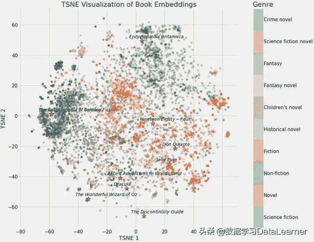
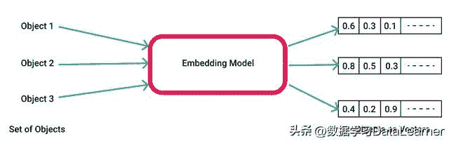
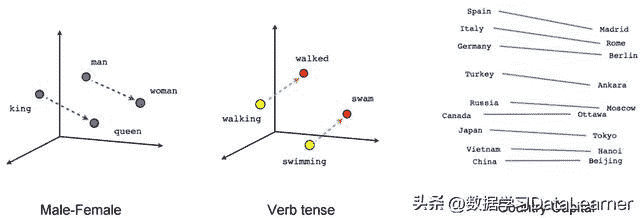

# 2023-05-11Embedding简介

> 来源：[https://xuqiwei1986.feishu.cn/docx/EKlodEiZiojOEyxpfnZcOfo2nWc](https://xuqiwei1986.feishu.cn/docx/EKlodEiZiojOEyxpfnZcOfo2nWc)

> 🔗 原文链接： h[ttps://baijiahao.b](https://baijiahao.baidu.com/s?id=1765559176667572307&wfr=spider&for=pc)aidu.com/s?id=17...

>

深入浅出：大语言模型中必不可少的技术——Embedding简介

今天，推特上一位科技博主SullyOmarr分享了一个关于embedding的内容十分火爆。主要介绍为什么embedding对于在目前的AI大模型中很重要。这是一个十分不错的关于embedding知识的介绍。本文将根据SullyOmarr的内容也对embedding做一个简单的介绍，并解释为什么它在大语言模型中十分重要。本文来自DataLearner官方博客： AI大模型领域的热门技术——Embedding入门介绍以及为什么Embedding在大语言模型中很重要 | 数据学习者官方网站(Datalearner)

+   Embeddings技术简介及其历史概要

+   Embedding的主要价值在哪里？

+   Embedding在大模型中的价值

+   如何基于Embedding让大模型解决长文本（如PDF）的输入问题？

+   如何生成和存储Embedding

+   总结

# Embeddings技术简介及其历史概要

在机器学习和自然语言处理中，embedding是指将高维度的数据（例如文字、图片、音频）映射到低维度空间的过程。embedding向量通常是一个由实数构成的向量，它将输入的数据表示成一个连续的数值空间中的点。

简单来说，embedding就是一个N维的实值向量，它几乎可以用来表示任何事情，如文本、音乐、视频等。在这里，我们也主要是关注文本的embedding。

而embedding重要的原因在于它可以表示单词或者语句的语义。实值向量的embedding可以表示单词的语义，主要是因为这些embedding向量是根据单词在语言上下文中的出现模式进行学习的。例如，如果一个单词在一些上下文中经常与另一个单词一起出现，那么这两个单词的嵌入向量在向量空间中就会有相似的位置。这意味着它们有相似的含义和语义。

embedding技术的发展可以追溯到20世纪50年代和60年代的语言学研究，其中最著名的是Harris在1954年提出的分布式语义理论（distributional semantic theory）。这个理论认为，单词的语义可以通过它们在上下文中的分布来表示，也就是说，单词的含义可以从其周围的词语中推断出来。

在计算机科学领域，最早的embedding技术可以追溯到20世纪80年代和90年代的神经网络研究。在那个时候，人们开始尝试使用神经网络来学习单词的embedding表示。其中最著名的是Bengio在2003年提出的神经语言模型（neural language model），它可以根据单词的上下文来预测下一个单词，并且可以使用这个模型来生成单词的embedding表示。

自从2010年左右以来，随着深度学习技术的发展，embedding技术得到了广泛的应用和研究。在这个时期，出现了一些重要的嵌入算法，例如Word2Vec、GloVe和FastText等。这些算法可以通过训练神经网络或使用矩阵分解等技术来学习单词的嵌入表示。这些算法被广泛用于各种自然语言处理任务中，例如文本分类、机器翻译、情感分析等。

近年来，随着深度学习和自然语言处理技术的快速发展，embedding技术得到了进一步的改进和发展。例如，BERT、ELMo和GPT等大型语言模型可以生成上下文相关的embedding表示，这些embedding可以更好地捕捉单词的语义和上下文信息。

# Embedding的主要价值在哪里？

如前所述，embedding向量是包含语义信息的。也就是含义相近的单词，embedding向量在空间中有相似的位置，但是，除此之外，embedding也有其它优点。

例如，实值向量表示的embedding可以进行向量运算。例如，通过对embedding向量执行向量加法和减法操作，可以推断出单词之间的语义关系。例如，对于embedding向量表示的“king”和“man”，执行“queen = king - man + woman”操作可以得到一个向量表示“queen”，这个向量与实际的“queen”向量在向量空间中非常接近。

此外，实值向量embedding还可以在多个自然语言处理任务中进行共享和迁移。例如，在训练一个情感分析模型时，可以使用在句子分类任务中训练的嵌入向量，这些向量已经学习到了单词的语义和上下文信息，从而可以提高模型的准确性和泛化能力。

综上所述，实值向量embedding可以通过从大量的语言数据中学习单词的语义和上下文信息，从而能够表示单词的语义，并且可以进行向量运算和在不同自然语言处理任务中共享和迁移。

# Embedding在大模型中的价值

前面说的其实都是Embedding在之前的价值。但是，大语言模型时代，例如ChatGPT这样的模型流行之后，大家发现embedding有了新的价值，即解决大模型的输入限制。

此前，OpenAI官方也发布了一个案例，即如何使用embedding来解决长文本输入问题，我们DataLearner官方博客也介绍了这个教程： OpenAI官方教程：如何使用基于embeddings检索来解决GPT无法处理长文本和最新数据的问题 | 数据学习者官方网站(Datalearner)

像 GPT-3 这样的语言模型有一个限制，即它们可以处理的输入文本量有限。这个限制通常在几千到数万个tokens之间，具体取决于模型架构和可用的硬件资源。

这意味着对于更长的文本，例如整本书或长文章，可能无法一次将所有文本输入到语言模型中。在这种情况下，文本必须被分成较小的块或“片段”，可以由语言模型单独处理。但是，这种分段可能会导致输出的上下文连贯性和整体连贯性问题，从而降低生成文本的质量。

这就是Embedding的重要性所在。通过将单词和短语表示为高维向量，Embedding允许语言模型以紧凑高效的方式编码输入文本的上下文信息。然后，模型可以使用这些上下文信息来生成更连贯和上下文适当的输出文本，即使输入文本被分成多个片段。

此外，可以在大量文本数据上预训练Embedding，然后在小型数据集上进行微调，这有助于提高语言模型在各种自然语言处理应用程序中的准确性和效率。

# 如何基于Embedding让大模型解决长文本（如PDF）的输入问题？

这里我们给一个案例来说明如何用Embedding来让ChatGPT回答超长文本中的问题。

如前所述，大多数大语言模型都无法处理过长的文本。除非是GPT-4-32K，否则大多数模型如ChatGPT的输入都很有限。假设此时你有一个很长的PDF，那么，你该如何让大模型“读懂”这个PDF呢？

首先，你可以基于这个PDF来创建向量embedding，并在数据库中存储（当前已经有一些很不错的向量数据库了，如Pinecone）。

接下来，假设你想问个问题“这个文档中关于xxx是如何讨论的？”。那么，此时你有2个向量embedding了，一个是你的问题embedding，一个是之前PDF的embedding。此时，你应该基于你的问题embedding，去向量数据库中搜索PDF中与问题embedding最相似的embedding。然后，把你的问题embedding和检索的得到的最相似的embedding一起给ChatGPT，然后让ChatGPT来回答。

当然，你也可以针对问题和检索得到的embedding做一些提示工程，来优化ChatGPT的回答。

# 如何生成和存储Embedding

其实，生成Embedding的方法有很多。这里列举几个比较经典的方法和库：

1.  Word2Vec：是一种基于神经网络的模型，用于将单词映射到向量空间中。Word2Vec包括两种架构：CBOW (Continuous Bag-of-Words) 和 Skip-gram。CBOW 通过上下文预测中心单词，而 Skip-gram 通过中心单词预测上下文单词。这些预测任务训练出来的神经网络权重可以用作单词的嵌入。

1.  GloVe：全称为 Global Vectors for Word Representation，是一种基于共现矩阵的模型。该模型使用统计方法来计算单词之间的关联性，然后通过奇异值分解（SVD）来生成嵌入。GloVe 的特点是在计算上比 Word2Vec 更快，并且可以扩展到更大的数据集。

1.  FastText：是由 Facebook AI Research 开发的一种模型，它在 Word2Vec 的基础上添加了一个字符级别的 n-gram 特征。这使得 FastText 可以将未知单词的嵌入表示为已知字符级别 n-gram 特征的平均值。FastText 在处理不规则单词和罕见单词时表现出色。

1.  OpenAI的Embeddings：这是OpenAI官方发布的Embeddings的API接口。目前有2代产品。目前主要是第二代模型： text-embedding-ada-002 。它最长的输入是8191个tokens，输出的维度是1536。

这些方法都有各自的优点和适用场景，选择最适合特定应用程序的嵌入生成方法需要根据具体情况进行评估和测试。不过，有人测试过，OpenAI应该是目前最好的。不过，收费哦~但是很便宜，1000个tokens只要0.0004美元，也就是1美元大约可以返回3000页的内容。获取之后直接保存就行。

目前，embedding的保存可以考虑使用向量数据库。例如，

1.  Pinecone的产品，最近刚以10亿美元的估值融资了1亿美金。Shopify, Brex, Hubspot都是它产品的用户。

1.  Milvus是一个开源的向量数据库。

1.  Anthropic VDB，这是Anthropic公司开发的安全性高的向量数据库,能够对向量数据进行改变、删除、替换等操作,同时保证数据库完整性。

# 总结

embedding在word2vec发布的时候很火。这几年似乎没那么热，但是随着大语言模型的长输入限制越来越明显，embedding技术重新被大家所重视。所以大家也得在此下点功夫哦~~