# 2023-05-11AI大模型需要什么样的数据

> 来源：[https://xuqiwei1986.feishu.cn/docx/St79denDWo24jDxHtThcIoXdn3g](https://xuqiwei1986.feishu.cn/docx/St79denDWo24jDxHtThcIoXdn3g)

> 🔗 原文链接： h[ttps://baijiahao.b](https://baijiahao.baidu.com/s?id=1765556039628927611&wfr=spider&for=pc)aidu.com/s?id=17...

> AI 大模型需要什么样的数据集

数据将是未来 AI 大模型竞争的关键要素

人工智能发展的突破得益于高质量数据的发展。例如，大型语言模型的最新进展依赖于更 高质量、更丰富的训练数据集：与 GPT-2 相比，GPT-3 对模型架构只进行了微小的修改， 但花费精力收集更大的高质量数据集进行训练。ChatGPT 与 GPT-3 的模型架构类似，并使 用 RLHF（来自人工反馈过程的强化学习）来生成用于微调的高质量标记数据。

基于此，人工智能领域的权威学者吴承恩发起了“以数据为中心的 AI”运动，即在模型相 对固定的前提下，通过提升数据的质量和数量来提升整个模型的训练效果。提升数据集质 量的方法主要有：添加数据标记、清洗和转换数据、数据缩减、增加数据多样性、持续监 测和维护数据等。因此，我们认为未来数据成本在大模型开发中的成本占比或将提升，主 要包括数据采集，清洗，标注等成本。

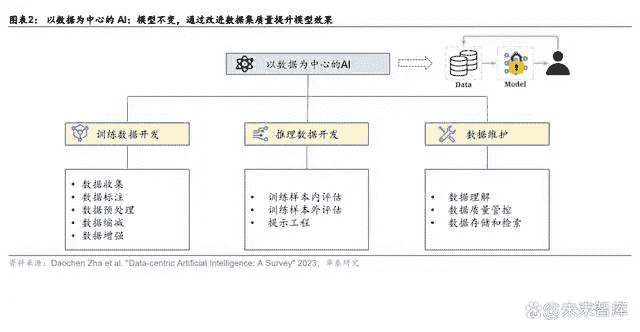

我们认为 AI 大模型需要高质量、大规模、多样性的数据集。 1）高质量：高质量数据集能够提高模型精度与可解释性，并且减少收敛到最优解的时间， 即减少训练时长。 2）大规模：OpenAI 在《Scaling Laws for Neural Language Models》中提出 LLM 模型所 遵循的“伸缩法则”（scaling law），即独立增加训练数据量、模型参数规模或者延长模型训 练时间，预训练模型的效果会越来越好。 3）丰富性：数据丰富性能够提高模型泛化能力，过于单一的数据会非常容易让模型过于拟 合训练数据。

**数据集如何产生**

建立数据集的流程主要分为 1）数据采集；2）数据清洗：由于采集到的数据可能存在缺失 值、噪声数据、重复数据等质量问题；3）数据标注：最重要的一个环节；4）模型训练： 模型训练人员会利用标注好的数据训练出需要的算法模型；5）模型测试：审核员进行模型 测试并将测试结果反馈给模型训练人员，而模型训练人员通过不断地调整参数，以便获得 性能更好的算法模型；6）产品评估：产品评估人员使用并进行上线前的最后评估。

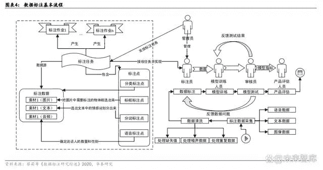

流程#1：数据采集。采集的对象包括视频、图片、音频和文本等多种类型和多种格式的数 据。数据采集目前常用的有三种方式，分别为：1）系统日志采集方法；2）网络数据采集 方法；3）ETL。

流程#2：数据清洗是提高数据质量的有效方法。由于采集到的数据可能存在缺失值、噪声 数据、重复数据等质量问题，故需要执行数据清洗任务，数据清洗作为数据预处理中至关 重要的环节，清洗后数据的质量很大程度上决定了 AI 算法的有效性。

流程#3：数据标注是流程中最重要的一个环节。管理员会根据不同的标注需求，将待标注 的数据划分为不同的标注任务。每一个标注任务都有不同的规范和标注点要求，一个标注 任务将会分配给多个标注员完成。

流程#4：最终通过产品评估环节的数据才算是真正过关。产品评估人员需要反复验证模型 的标注效果，并对模型是否满足上线目标进行评估。

他山之石#1：海外主要大语言模型数据集

参数量和数据量是判断大模型的重要参数。2018 年以来，大语言模型训练使用的数据集规 模持续增长。2018 年的 GPT-1 数据集约 4.6GB，2020 年的 GPT-3 数据集达到了 753GB， 而到了 2021 年的 Gopher，数据集规模已经达到了 10,550GB。总结来说，从 GPT-1 到 LLaMA 的大语言模型数据集主要包含六类：维基百科、书籍、期刊、Reddit 链接、Common Crawl 和其他数据集。

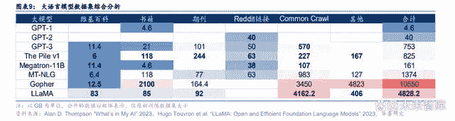

**数据集#1：维基百科 **

维基百科是一个免费的多语言协作在线百科全书。维基百科致力于打造包含全世界所有语 言的自由的百科全书，由超三十万名志愿者组成的社区编写和维护。截至 2023 年 3 月，维 基百科拥有 332 种语言版本，总计 60,814,920 条目。其中，英文版维基百科中有超过 664 万篇文章，拥有超 4,533 万个用户。维基百科中的文本很有价值，因为它被严格引用，以 说明性文字形式写成，并且跨越多种语言和领域。一般来说，重点研究实验室会首先选取 它的纯英文过滤版作为数据集。

**数据集#2：书籍 **

书籍主要用于训练模型的故事讲述能力和反应能力，包括小说和非小说两大类。数据集包 括 Project Gutenberg 和 Smashwords (Toronto BookCorpus/BookCorpus)等。Project Gutenberg 是一个拥有 7 万多本免费电子书的图书馆，包括世界上最伟大的文学作品，尤 其是美国版权已经过期的老作品。BookCorpus 以作家未出版的免费书籍为基础，这些书籍 来自于世界上最大的独立电子书分销商之一的 Smashwords。

**数据集#3：期刊 **

期刊可以从 ArXiv 和美国国家卫生研究院等官网获取。预印本和已发表期刊中的论文为数 据集提供了坚实而严谨的基础，因为学术写作通常来说更有条理、理性和细致。ArXiv 是一 个免费的分发服务和开放获取的档案，包含物理、数学、计算机科学、定量生物学、定量 金融学、统计学、电气工程和系统科学以及经济学等领域的 2,235,447 篇学术文章。美国 国家卫生研究院是美国政府负责生物医学和公共卫生研究的主要机构，支持各种生物医学 和行为研究领域的研究，从其官网的“研究&培训”板块能够获取最新的医学研究论文。

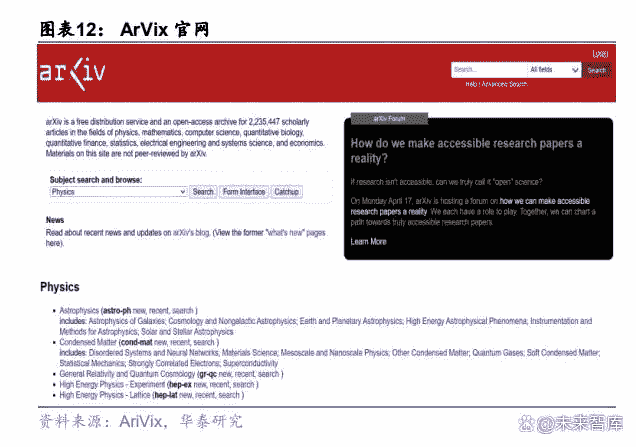

数据集#4：WebText（来自 Reddit 链接）

Reddit 链接代表流行内容的风向标。Reddit 是一个娱乐、社交及新闻网站，注册用户可以 将文字或链接在网站上发布，使它成为了一个电子布告栏系统。WebText 是一个大型数据 集，它的数据是从社交媒体平台 Reddit 所有出站链接网络中爬取的，每个链接至少有三个 赞，代表了流行内容的风向标，对输出优质链接和后续文本数据具有指导作用。 Reddit 宣布收取数据使用费。2023 年 4 月，Reddit 宣布将向使用其 API 训练 AI 聊天机器 人的公司收取数据使用费，其中便包含微软、谷歌、OpenAI 等，目前具体收费标准暂未公 布，但可能会根据不同使用者划分不同等级收费标准。许多公司已经意识到数据的价值， 如图片托管服务商 Shutterstock 已把图像数据出售给 OpenAI，推特计划针对 API 使用收取 几万到几十万美元不等的费用。

数据集#5：Common crawl/C4

Common crawl 是 2008 年至今的一个网站抓取的大型数据集。Common Crawl 是一家非 盈利组织，致力于为互联网研究人员、公司和个人免费提供互联网副本，用于研究和分析， 它的数据包含原始网页、元数据和文本提取，文本包含 40 多种语言和不同领域。重点研究 实验室一般会首先选取它的纯英文过滤版（C4）作为数据集。

**其他数据集 **

The Pile 数据集：一个 825.18 GB 的英语文本数据集，用于训练大规模语言模型。The Pile 由上文提到的 ArXiv、WebText、Wikipedia 等在内的 22 个不同的高质量数据集组成，包括 已经建立的自然语言处理数据集和几个新引入的数据集。除了训练大型语言模型外，The Pile 还可以作为语言模型跨领域知识和泛化能力的广泛覆盖基准。

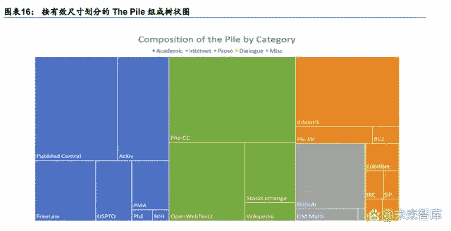

其他数据集包含了 GitHub 等代码数据集、StackExchange 等对话论坛和视频字幕数据集 等。

他山之石#2：海外主要多模态数据集

模态是事物的一种表现形式，多模态通常包含两个或者两个以上的模态形式，包括文本、 图像、视频、音频等。多模态大模型需要更深层次的网络和更大的数据集进行预训练。过 去数年中，多模态大模性参数量及数据量持续提升。例如，2022 年 Stability AI 发布的 Stable Diffusion 数据集包含 58.4 亿图文对/图像，是 2021 年 OpenAI 发布的 DALL-E 数据集的 23 倍。

**类别#1：语音+文本 **

SEMAINE数据集：创建了一个大型视听数据库，作为构建敏感人工侦听器(SAL)代理的迭 代方法的一部分，该代理可以使人参与持续的、情绪化的对话。高质量的录音由五台高分 辨率、高帧率摄像机和四个同步录制的麦克风提供。录音共有 150 个参与者，总共有 959 个与单个 SAL 角色的对话，每个对话大约持续 5 分钟。固体 SAL 录音被转录和广泛注释: 每个剪辑 6-8 个评分者追踪 5 个情感维度和 27 个相关类别。

**类别#2：图像+文本 **

COCO 数据集：MS COCO 的全称是 Microsoft Common Objects in Context，起源于微软 于 2014 年出资标注的 Microsoft COCO 数据集，与 ImageNet 竞赛一样，被视为是计算机 视觉领域最受关注和最权威的比赛之一。 COCO 数据集是一个大型的、丰富的物体检测， 分割和字幕数据集。图像包括 91 类目标，328,000 张图像和 2,500,000 个 label。 Conceptual Captions 数据集：图像标题注释数据集，其中包含的图像比 MS-COCO 数据 集多一个数量级，并代表了更广泛的图像和图像标题风格。通过从数十亿个网页中提取和 过滤图像标题注释来实现这一点。

ImageNet 数据集：建立在 WordNet 结构主干之上的大规模图像本体。ImageNet 的目标是 用平均 5,001,000 张干净的全分辨率图像填充WordNet 的 80,000 个同义词集中的大多数。 这将产生数千万个由 WordNet 语义层次结构组织的注释图像。ImageNet 的当前状态有 12 个子树，5247 个同义词集，总共 320 万张图像。 LAION-400M 数据集：LAION-400M 通过 CommonCrawl 提取出随机抓取 2014-2021 年 的网页中的图片、文本内容。通过 OpenAI 的 Clip 计算，去除了原始数据集中文本和图片 嵌入之间预先相似度低于 0.3 的内容和文本，提供了 4 亿个初筛后的图像文本对样本。 LAION-5B 数据集：其包含 58.5 亿个 CLIP 过滤的图像-文本对的数据集，比 LAION-400M 大 14 倍，是世界第一大规模、多模态的文本图像数据集，共 80T 数据，并提供了色情图片 过滤、水印图片过滤、高分辨率图片、美学图片等子集和模型，供不同方向研究。

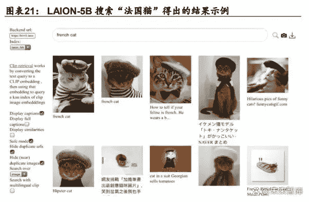

Language Table 数据集：Language-Table 是一套人类收集的数据集，是开放词汇视觉运 动学习的多任务连续控制基准。 IAPR TC-12 数据集：IAPR TC-12 基准的图像集合包括从世界各地拍摄的 2 万张静态自然 图像，包括各种静态自然图像的横截面。这包括不同运动和动作的照片，人物、动物、城 市、风景和当代生活的许多其他方面的照片。示例图像可以在第 2 节中找到。每张图片都 配有最多三种不同语言（英语、德语和西班牙语）的文本标题。 AVA 数据集：AVA 是美学质量评估的数据库，包括 25 万张照片。每一张照片都有一系列 的评分、语义级别的 60 类标签和 14 类照片风格。 OpenViDial 数据集：当人们交谈时，说话者接下来要说什么在很大程度上取决于他看到了 什么。OpenViDal 一个用于此目的的大型多模块对话数据集。这些对话回合和视觉环境都 是从电影和电视剧中提取出来的，其中每个对话回合都与发生的相应视觉环境相匹配。版 本 1 包含 110 万个对话回合以及存储在图像中的 110 万个视觉上下文。版本 2 要大得多， 包含 560 万个对话回合以及存储在图像中的 560 万个视觉上下文。

**类别#3：视频+图像+文本 **

YFCC100 数据集：YFCC100M 是一个包含 1 亿媒体对象的数据集，其中大约 9920 万是照 片，80 万是视频，所有这些都带有创作共用许可。数据集中的每个媒体对象都由几块元数 据表示，例如 Flickr 标识符、所有者名称、相机、标题、标签、地理位置、媒体源。从 2004 年 Flickr 成立到 2014 年初，这些照片和视频是如何被拍摄、描述和分享的，这个集合提供 了一个全面的快照。

**类别#4：图像+语音+文本**

CH-SIMS 数据集：CH-SIMS 是中文单模态和多模态情感分析数据集，包含 2,281 个精细化的野外视 频片段，既有多模态注释，也有独立单模态注释。它允许研究人员研究模态之间的相互作用，或使用 独立的单模态注释进行单模态情感分析。

**类别#5：视频+语音+文本 **

IEMOCAP 数据集：南加州大学语音分析与解释实验室(SAIL)收集的一种新语料库，名为“交 互式情感二元动作捕捉数据库”(IEMOCAP)。该数据库记录了 10 位演员在面部、头部和手 上的二元会话，这些标记提供了他们在脚本和自发口语交流场景中面部表情和手部动作的 详细信息。语料库包含大约 12 小时的数据。详细的动作捕捉信息、激发真实情绪的交互设 置以及数据库的大小使这个语料库成为社区中现有数据库的有价值的补充，用于研究和建 模多模态和富有表现力的人类交流。 MELD 数据集：MELD 收录了《老友记》电视剧 1,433 个对话中的 13,708 个话语。MELD 优于其他对话式情绪识别数据集 SEMAINE 和 IEMOCAP，因为它由多方对话组成，并且 MELD 中的话语数量几乎是这两个数据集的两倍。MELD 中的话语是多模态的，包括音频 和视觉形式以及文本。

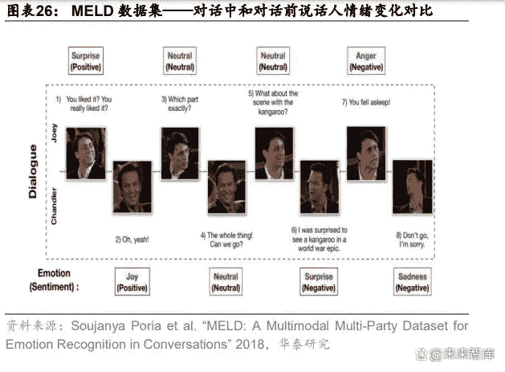

他山之石#3：海外主要大模型数据集由何方发布

海外主要开源大模型数据集发布方主要分为： 1) 非营利组织/开源组织：古腾堡文学档案基金会发布的 Project Gutenberg 截至 2018 年 已收录 57,000 部书籍，平均每周新增 50 部。Common Crawl 抓取网络并免费向公众 提供其档案和数据集，一般每个月完成一次抓取。艾伦人工智能研究所分别于 2017 年、2018 年和 2019 年发布了基于维基百科的 TriviaQA、QuAC、Quoref。Eleuther AI 发布了 825GB 多样化文本数据集 The Pile。LAION 2021 年发布包含 4 亿图文对的 LAION-400M 数据集，2022 年发布包含 58.5 亿图文对的 LAION-5B 数据集； 2) 学术界：例如多伦多大学和麻省理工学院联合发布了 BookCorpus； 3) 互联网巨头研究部门：例如 Google Research 发布了 C4 文本数据集、AVA 和 Conceptual Captions 等等图像数据集等； 4) 政府机构：政府机构是一些常见的数据集发布方，通常包含关于经济和医学等方面的 数据，美国国家卫生研究院发布的 MedQuAD 包括从 12 个 NIH 网站创建的 47,457 个 医学问答对； 5) 多种类型机构合作：尤其是学术界与互联网巨头研究部门、开源组织之间的合作。例 如 Facebook、伦敦大学学院和 DeepMind 联合发布了 ArxivPaper 数据集。卡内基梅 隆大 学、雅虎研究 院和 International Computer Science Institute 联 合发布 了 YFCC100M。

我们认为海外积累丰富的开源高质量数据集得益于：1）相对较好的开源互联网生态；2） 免费线上书籍、期刊的资源积累；3）学术界、互联网巨头研究部门、非盈利研究组织及其 背后的基金形成了开放数据集、发表论文-被引用的开源氛围。

高质量语言数据和图像数据或将耗尽，合成数据有望生成大模型数据

高质量语言数据或将于 2026 年耗尽。数据存量的增长速度远远低于数据集规模的增长速度， 如果当前的趋势继续下去，数据集最终将由于数据耗尽而停止增长。在语言模型方面，语 言数据的质量有好坏，互联网用户生成的语言数据质量往往低于书籍、科学论文等更专业 的语言数据，高质量数据训练出的模型性能更好。根据《Will we run out of data? An analysis of the limits of scaling datasets in Machine Learning》预测，语言数据将于 2030~2040 年 耗尽，其中能训练出更好性能的高质量语言数据将于 2026 年耗尽。此外，视觉数据将于 2030~2060 年耗尽。

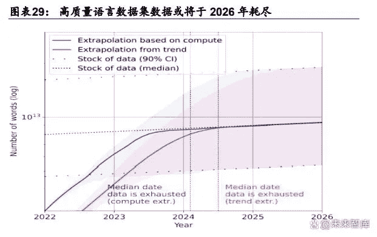

合成数据或将弥补未来数据的不足。合成数据是计算机模拟或算法生成的带有注释的信息， 可以替代真实数据。它可以用于模拟实际情况，补充真实数据的不足，提高数据质量和数 量，以及降低数据采集和处理的成本。OpenAI 在 GPT-4 的技术文档中重点提到了合成数 据的应用，可见其对该领域的重视。根据 Gartner 的预测，2024 年用于训练大模型的数据 中有 60%将是合成数据，到 2030 年大模型使用的绝大部分数据将由人工智能合成。

合成数据有望首先在金融、医疗和汽车等诸多领域落地。在金融行业，金融机构可以在不 提供敏感的历史交易信息前提下，通过合成数据集训练量化交易模型提升获利能力，也可 以用来训练客服机器人以改善服务体验；在生物医药行业，可以通过合成数据集，在不提 供患者隐私信息的条件下训练相关模型完成药物研发工作；在自动驾驶领域，可以通过合 成数据集模拟各种驾驶场景，在保障人员和设备安全的条件下提升自动驾驶能力。

### 数字中国战略助力中国 AI 大模型数据基础发展

数据将是 AI 大模型的关键竞争要素之一，数字中国战略有望助力我国 AI 大模型训练数据 集的发展。近日,中共中央、国务院印发了《数字中国建设整体布局规划》，数据要素为数字 中国建设战略中的关键一环。我们认为当前国内虽然数据资源丰富，但优质的中文大模型 训练语料仍然稀缺。数字中国战略将极大促进我国数据要素市场的完善，从数量和质量两 个维度助力中文大模型数据集的发展：1）数量方面，各地数据交易所设立并运营后，数据 资源将能够在各行业、各企业之间自由流通，缓解大模型训练数据数量不足的问题；2）质 量方面，国内数据服务产业有望蓬勃发展，未来数据服务商将提供数据标注、清洗、维护 等服务，大数据产业专业化分工将助力大模型训练数据集质量提升。

中国 AI 大模型数据集从哪里来

国内各行业数据资源丰富，2021-2026 年数据量规模 CAGR 高于全球，数据主要来源于政 府/传媒/服务/零售等行业。据 IDC，2021-2026 年中国数据量规模将由 18.51ZB 增长至 56.16ZB，CAGR 达到 24.9%，高于全球平均 CAGR。从数据来源看，国内各行业数据差 异化发展，2021 年政府、传媒、专业服务、零售等行业数据量占比较高，分别为 30.4%、 13.4%、13.0%、9.6%，其中接近 90%的数据为非结构化数据，这也要求了海量数据采集 设备和软件的互联互通以及互动互控。另外随着智能化转型的深入，制造、交通运输、批 发、教育等行业数据规模在未来也拥有较大的增长潜力，2021-2026 年数据量增长 CAGR 将分别达到 37.6%、36.1%、37.1%、34.0%。

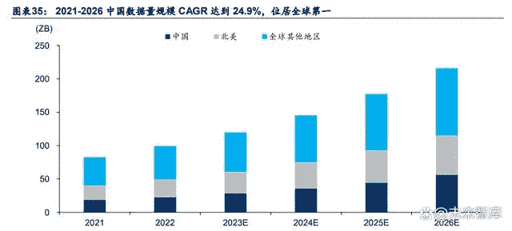

尽管国内数据资源丰富，但由于数据挖掘不足，数据无法自由在市场上流通等现状，优质 中文优质数据集仍然稀缺。目前中文优质数据仍然稀缺，如 ChatGPT 训练数据中中文资料 比重不足千分之一，为 0.0991%，而英文资料占比超过 92.6%。据加利福尼亚大学和 Google 研究机构发现，机器学习和自然语言处理模型使用的数据集 50%由 12 家 Top 机构提供， 其中 10 家为美国机构，1 家为德国机构，仅 1 家机构来自中国，为香港中文大学。值得一 提的是，数据集与数据机构的基尼系数有升高的趋势，即数据集被少数 Top 机构或特定数 据库掌控的集中有所增加。

我们认为国内缺乏高质量数据集主要有以下几方面的原因：1）高质量数据集需要巨大资金 投入，当前国内数据挖掘和数据治理的力度不足；2）国内相关公司不具有开源意识，数据 无法在市场上自由流通；3）国内相关公司成立较晚，数据积累相对国外公司更少；4）学 术领域中文数据集受重视程度低；5）国产数据集市场影响力及普及度较低等。

目前国内科技互联网头部企业主要基于公开数据及自身特有数据差异化训练大模型。具体 而言，百度“文心”大模型训练特有数据主要包括万亿级的网页数据，数十亿的搜索数据 和图片数据等。阿里“通义”大模型的训练数据主要来自阿里达摩院。腾讯“混元”大模 型特有的训练数据主要来自🛰️👸号，🛰️搜索等优质数据。华为“盘古”大模型的训 练数据出公开数据外，还有 B 端行业数据加持，包括气象，矿山，铁路等行业数据。商汤 “日日新”模型的训练数据中包括了自行生成的 Omni Objects 3D 多模态数据集。

未来专业及垂直内容平台有望成为国内优质中文数据集的重要来源：1）专业内容平台：知 乎作为问答知识平台，拥有超过 4300 万创作者产生的超过 3.5 亿条优质中文问答内容，涉 及政治，经济，文化，历史，科技等几乎全部门类。其问答的数据形式天然适合作为大语 言类模型训练使用。🛰️👸号作为内容分享平台，背靠国民级应用🛰️生态链，2022 年 👸号产出超 3.9 亿篇文章，其中既有专业领域内容分析，也有时事热点分析，这些内容对 语言模型的训练迭代有重要作用。2）垂类内容平台：参考彭博基于金融垂类数据发布 BloombergGPT 案例，国内在金融，医疗，生物等行业公司的数据可以作为细分领域大模 型精确训练的基础。

中国大模型如何构建数据集#1：LLM

我们选取了在其论文中详细阐述如何构建预训练数据集的三个大语言模型，研究中国大模 型预训练数据集的来源。我们发现：1）类似海外大语言模型，中国大语言模型的预训练数 据集也主要来自互联网抓取数据（如 Common Crawl、中文公共社交媒体抓取等）、网络百 科全书（如百度百科、搜狗百科）、书籍等等；2）充分借助已有的高质量开源数据集，例 如对 Common Crawl 等进行二次处理。

百度 Plato-XL 大模型：百度于 2021 年发布 PLATO-XL，包括中英文 2 个对话模型，预训 练语料规模达千亿级 token，模型规模高达 110 亿参数。预训练语料库分为：1)英语：会话 样本从 Reddit 评论中提取，这些评论由第三方收集，并在 pushshift.io 上公开发布，遵循 了 PLATO-2 的精心清洗过程；2）中文：预训练数据来自公共领域的社交媒体，过滤后训 练集中有 1.2 亿个样本。 华为盘古大模型：华为于 2021 年发布盘古，是业界首个 2000 亿参数以中文为核心的预训 练生成语言模型，目前开源了盘古α和盘古α增强版两个版本，并支持 NPU 和 GPU 两个 版本，支持丰富的场景应用，在知识问答、知识检索、知识推理、阅读理解等文本生成领 域表现突出，具备较强的少样本学习的能力。

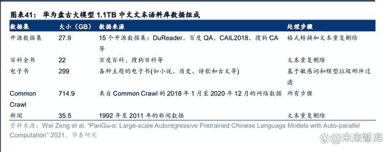

腾讯 WeLM 大模型：腾讯于 2022 年发布 WeLM，数据来源主要分为三部分：1）Common Crawl：Common Crawl 于 2020.08 至 2022.01 期间的文本内容，使用 langdetect 工具过 滤掉非中文的文本；2）特定领域语料库：混合了来自各种来源的数据，包括新闻、书籍、 流行在线论坛以及学术著作，仅中文数据。3）英文数据：添加了从上述来源收集到的约 750GB 的英语数据。数据中有大量的噪音如胡言乱语或模板文本、冒犯性语言、占位符文 本和源代码等，首先应用一组基于规则的过滤器，再在剩余的数据上手动构建好坏数据分 类器提升数据清理泛化能力。

中国大模型如何构建数据集#2：多模态大模型

我们选取了在其论文中详细阐述如何构建预训练数据集的三个多模态模型，研究中国大模 型预训练数据集的来源。我们发现网页抓取、自有数据和开源数据集是多模态大模型数据 集的重要来源：1）网页抓取图文对：例如阿里 M6 大模型、百度 ERNIE-ViLG 大模型都从 网页中抓取文本-图片对，然后经过一定过滤，形成最终数据集的一部分；2）自有数据：例 如阿里 M6 大模型有来自电商的图文数据，百度 ERNIE-ViLG 大模型从内部图像搜索引擎 中收集查询文本和对应的用户点击图像；3）开源数据集：例如百度 ERNIE-ViLG 大模型的 部分图文对数据来自开源的 CC 和 CC12M，并通过百度翻译 API 翻译。

阿里 M6 大模型：于 2021 年发布，参数规模达到 1000 亿。阿里构建了最大的中文多模态 预训练数据集 M6-Corpus，包含超过 1.9 TB 图像和 292GB 文本，涵盖了百科全书、问答、 论坛讨论、产品说明等类型的数据集。研究人员设计了完善的清洁程序：1）文本数据：删 除 HTML 标记和重复的标点符号，只保留中文和英文的字符和标点符号。删除短于 5 个字 符的标题和短于 15 个字符的文本内容。使用“内部垃圾邮件检测器”筛选包含某些政治问 题、色情或脏话等不合适的句子。建立一个语言模型进行评估文本的困惑程度，去掉困惑 程度高的句子；2）图片数据：只有超过 5000 像素的图像才有资格被保留用于预训练。

百度 ERNIE-ViLG 大模型：于 2021 年发布，参数规模达到 100 亿。百度构建了一个由超 过 1.45 亿对高质量中文图像-文本对组成的大规模图像-文本数据集，数据来源如下: 1）中 文网页。从各种中文网页中抓取了 8 亿对原始的中文替代文字描述和图片，进行了几个步 骤的过滤，总共收获了 7000 万对文本-图片，过滤规则主要包括文本长度、文本内容和图 像-文本相似度；2）图片搜索引擎：从内部图像搜索引擎中收集了大约 6000 万个查询文本 和相应的用户点击图像；3）开源图像-文本数据集：从 CC 和 CC12M 中共收集了 1500 万 文本图像对，这些数据集中的字幕通过百度翻译 API 翻译成中文。 InternVideo 大模型：由上海人工智能实验室等、南大、港大、复旦、中科院深圳先进技术 研究院等于 2022 年发布，使用了 6 个来自各个领域的开源数据集和自采视频片段。

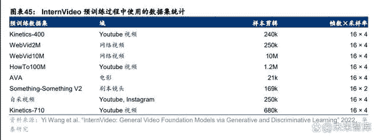

中国开源数据集#1：大语言模型数据集

DuReader 数据集：于 2018 年由百度发布。DuReader 是一个大规模的开放域中文机器阅 读理解数据集。该数据集由 200K 问题、420K 答案和 1M 文档组成，是迄今为止最大的中 文 MRC 数据集。问题和文档基于百度搜索和百度知道，答案是手动生成的。该数据集还提 供了问题类型注释——每个问题都被手动注释为实体、描述或是否以及事实或意见之一。

WuDaoCorpora 数据集：于 2021 年由北京人工智能研究院、清华大学和循环智能联合发 布。WuDaoCorpora 是北京智源研究院最新构建的高质量数据集，悟道文本数据集采用 20 多种规则从 100TB 原始网页数据中清洗得出最终数据集，注重隐私数据信息的去除，从源 头上避免 GPT-3 存在的隐私泄露风险；包含教育、科技等 50+个行业数据标签，可以支持 多领域预训练模型的训练。

CLUECorpus2020 数据集：于 2020 年由 CLUE 发布。CLUECorpus2020 是一个可以直 接用于语言模型预训练或语言生成等自监督学习的大型语料库，它有 100G 的原始语料库， 包含 350 亿个汉字，这些语料库来自 Common crawl。 CAIL2018 数据集：于 2018 年由清华大学、北京大学、中国科学院软件研究所和中国司法 大数据研究院联合发布。CAIL2018 是第一个用于判决预测的大规模中国法律数据集，收录 了中国最高人民法院公布 260 万件刑事案件，是现有判决预测工作中其他数据集的数倍。 对判断结果的注释也更加详细和丰富。它由适用的法律条款、指控和刑期组成，根据案件 的事实描述而定。

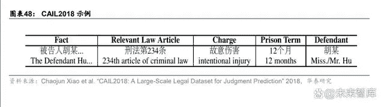

Math23K 数据集：于 2017 年由腾讯人工智能实验室发布。Math23K 是为解决数学问题而 创建的数据集，数据包含从在线教育网站上抓取的 6 万多个中文数学单词问题，都是小学 生真正的数学应用题，有 23,161 个标有结构化方程和答案的问题。

Ape210K 数据集：于 2020 年由猿辅导 AI Lab 和西北大学联合发布。Ape210K 是一个新 的大规模和模板丰富的数学单词问题数据集，包含 210K 个中国小学水平的数学问题，是 Math23K 的 9 倍。每个问题都包含黄金答案和得出答案所需的方程式，有 56K 个模板，是 Math23K 的 25 倍。

DRCD 数据集：于 2018 年由台达研究中心和台达电子联合发布。一个开放领域的传统中文 机器阅读理解数据集，包含来自 2108 篇维基百科文章的 10014 个段落和由注释者生成的 33,941 个问答对。

FCGEC 数据集：于 2022 年由浙江大学和华为联合发布。FCGEC 用于检测、识别和纠正 语法错误，是一个人工标注的多参考语料库，由 41,340 个句子组成，主要来自公立学校语 文考试中的选择题。

E-KAR 数据集：于 2022 年由复旦大学、字节跳动人工智能实验室和 BrainTechnologies,Inc. 联合发布。数据集包含来自公务员考试的 1,655 个（中文）和 1,251 个（英文）问题，这 些问题需要深入的背景知识才能解决。

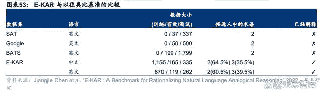

Douban Conversation Corpus 数据集：于 2017 年由北京航空航天大学、南开大学和微 软研究院联合发布。豆瓣会话语料库包括一个训练数据集、一个开发集和一个基于检索的 聊天机器人的测试集，测试数据包含 1000 个对话上下文。

ODSQA 数据集：于 2018 年由台湾大学发布。ODSQA 数据集是用于中文问答的口语数据 集。它包含来自 20 位不同演讲者的三千多个问题。

MATINF 数据集：于 2020 年由武汉大学和密歇根大学联合发布。MATINF 是一个联合标注 的大规模数据集，用于中文母婴护理领域的分类、问答和总结。数据集中的一个条目包括 四个字段：问题、描述、类别和答案。从中国大型母婴护理 QA 网站收集了近 200 万对 问答对，其中包含细粒度的人工标记类，数据清洗后，用剩余的 107 万个条目构建。

中国开源数据集#2：多模态模型数据集

WuDaoMM 数据集：于 2022 年由清华大学和北京智源人工智能研究院联合发布。 WuDaoMM 是北京智源人工智能研究院 WuDaoCorpora 开源数据集的一部分。WuDaoMM 是图像和文本的多模态预训练数据，完整的数据集包含 6.5 亿对图像和文本，包含几千万对 的强相关数据和 6 亿对弱相关数据，包含 19 大类，分别是: 能源、表情、产业、医疗、景 观、动物、新闻、花卉、教育、艺术、人物、科学、海洋、树木、汽车、社会、科技、体 育等。 MUGE 数据集：于 2021 年由清华大学和阿里巴巴联合发布，包括图像描述、图像文本检 索和基于文本的图像生成 3 种多模态理解和生成任务。

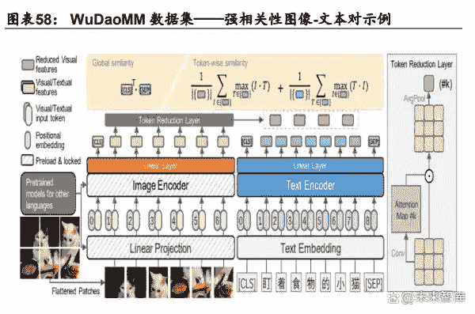

Noah-Wukong 数据集：于 2022 年由华为诺亚方舟实验室和中山大学联合发布。诺亚悟空 数据集是一个大规模的多模态中文数据集，包含 100 万对图文对，数据集中的图像根据大 小和宽高比进行过滤，数据集中的文本根据其语言，长度和频率进行过滤。隐私和敏感词 也被考虑在内。 Zero 数据集：于 2022 年由北京航空航天大学、清华大学、奇虎 360 人工智能研究所联合 发布。Zero 是一种大规模的中文跨模态基准测试，其中包含目前最大的公共预训练数据集 ZERO-Corpus 和五个用于下游任务的人工注释微调数据集。ZERO-Corpus 包含 2.5 亿张 图片和 7.5 亿篇文字描述，另外五个微调数据集中的两个也是目前中国跨模式下游任务中最 大的数据集。

COCO-CN 数据集：于 2018 年由中国人民大学发布。COCO-CN 是一个双语图像描述数据 集，通过手动编写的中文句子和标签丰富了 MS-COCO。新数据集可用于多种任务，包括 图像标记、字幕和检索，所有这些都在跨语言环境中完成。COCO-CN 拥有 20,342 张图片， 27,218 个中文句子和 70,993 个标签，为跨语言图像标注、字幕和检索提供了一个统一平台。 Flickr8k-CN & Flickr30k-CN 数据集：于 2017 年由浙江大学和中国人民大学联合发布。 Flickr8k-cn 是公共数据集，每个测试图像与 5 个中文句子相关联，这些句子是通过手动翻 译 Flickr8k 中对应的 5 个英文句子获得的。Flickr30k-cn 是 Flickr30k 的双语版本，通过其 训练/有效集的英译汉机器翻译和测试集的人工翻译获得。

Product1M 数据集：于 2021 年由北京交通大学、阿里巴巴和中山大学联合发布。Product1M 是用于实际实例级检索的最大的多模式化妆品数据集之一，包含超过 100 万个图像对并且 由两种样品类型组成，即单产品和多产品样品，其中包括各种化妆品品牌。 AI Challenger 图像中文描述数据集：数据来自 2017 AI Challenger，数据集对给定的每一 张图片有五句话的中文描述。数据集包含 30 万张图片，150 万句中文描述。数据集包含人 类关键点检测(HKD)、大规模属性数据集(LAD)和图像中文字幕(ICC)三个子数据集。

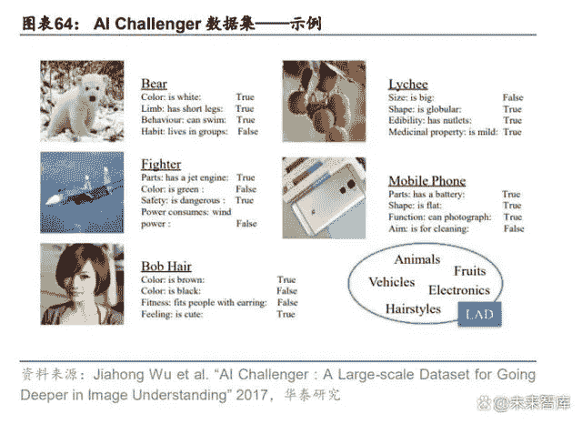

国内数据要素市场建设逐步完善，助力优质数据集生产流通

数字中国建设规划明晰，数据要素为发展框架中关键环节之一。2023 年 2 月 27 日，中共 中央、国务院印发《数字中国建设整体布局规划》，文件中明确数字中国建设按照“2522” 的整体框架进行布局，即夯实数字基础设施和数据资源体系“两大基础”，推进数字技术与 经济、政治、文化、社会、生态文明建设“五位一体”深度融合，强化数字技术创新体系 和数字安全屏障“两大能力”，优化数字化发展国内国际“两个环境”。《规划》提出要释放 商业数据价值潜能，加快建立数据产权制度，开展数据资产计价研究，建立数据要素按价 值贡献参与分配机制。构建国家数据管理体制机制，健全各级数据统筹管理机构，推动公 共数据汇聚利用。

我国重视数据要素发展，组建国家数据局，数据要素政策频出。2023 年 3 月 10 日，党的 二十届二中全会通过了《党和国家机构改革方案》，方案提出组建国家数据局。国家数据局 负责协调推进数据基础制度建设，推进数字基础设施布局建设，统筹数据资源整合共享和 开发利用，统筹推进数字中国、数字经济、数字社会规划和建设等，由国家发展和改革委 员会管理。这对于充分激活数据要素潜能、发挥数字经济对经济社会的基础性作用而言是 场及时雨。

随着数据要素快速融入生产、分配、流通、消费和社会服务管理等各个环节，我们预计未 来几年我国的数据要素市场将会蓬勃发展，并实现快速增长。根据国家工信安全发展研究 中心数据，2021 年我国数据要素行业市场规模为 815 亿元，预计到 2025 年将达到 1749 亿元左右，2020-2025 年 CAGR 为 26.26%。

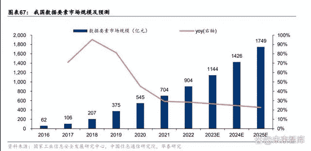

数据要素产业包括数据的内部产生，流通交易，数据加工，行业应用等流程。从企业内原 始数据到企业外可以应用的数据产品，需要经历内部数据产品化，数据交易流通，外部数 据加工等过程。企业通过在内部将数据清洗，预处理，加工等将数据变为数据产品，并将 数据产品放在数据交易平台上交易。在应用端，采购数据企业可以采购交易平台中数据， 后自行加工使用于垂直行业应用领域。

数据交易环节：数据交易所发展进入新阶段，缓解中文数据集数量不足问题

我国数据交易所发展进入新阶段，构筑数据集发展坚实基座。我国自 2014 年开始探索建 立类似证券交易所形式的数据交易机构，截至 2022 年 11 月，各地先后成立 48 家，仍 有 8 家正在筹备建设中。第一阶段：2015 年，党的十八届五中全会提出“实施国家大数 据战略，推进数据资源开放共享”，以贵阳大数据交易所为代表的数据交易机构涌现。早期 建设的数据交易机构大都没有找到成功的商业模式，多数机构已停止运营或转变经营方向。 第二阶段：2021 年以来北京、上海等大数据交易所成立。近两年来，随着党中央国务院多 项重要政策出台，各地新建一批数据交易机构，试图消除供需双方的信息差，推动形成合 理的市场化价格机制和可复制的交易制度和规则。我们预计新一阶段，国家将大力发展数 据交易所，并将带动上下游产业发展，这将为国内大模型数据集发展注入新动力。

由于开源较少，数据无法在市场上自由流通，目前中文优质数据集相对稀缺。对于大模型 训练，能否未来得到优质的大模型，与投入的数据质量非常关键，包括通用参数、文本语 言、图像、视频音频等等，投入数据的质量高低，会直接影响模型最终生成的内容。以 GPT-3 为例，其训练集中中文数据仅占 0.1%，这一方面因为 GPT 为美国开发，以英文语料为主； 另一方面也反映了目前可获得数据集中，中文内容仍然相对稀缺。国内大模型训练基于中 文原生内容仍是第一选择，翻译数据训练效果劣于中文原生内容。

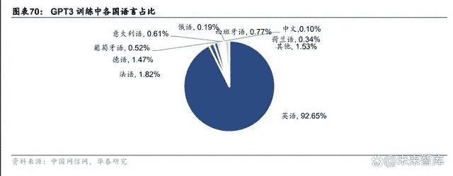

未来随着各地积极推动数据交易所建设，数据有望在各行业、各企业之间实现自由流通， 缓解国内优质数据集不足问题。据上海数据交易所总经理汤奇峰，上海数据交易所 2023 年 场内交易额有望突破 10 亿元。据深圳数据交易所预计，未来 2-3 年，其数据交易规模超过 100 亿元，设立合规工作站 100 家以上，培育、引入数据服务企业 50 家以上。我们认为数 据交易所发展将使得国内数据流通更顺畅，未来中小型模型训练企业可以直接从交易所购 买各行业的数据产品，这将极大地提升大模型训练数据的可获得性，缓解国内优质数据集 不足的问题。

数据加工环节：数据服务产业加速发展，助力中文数据集质量提升

数据服务商链接数据要素产业链上下游，助力形成优质数据集。上海数据交易所在全国率 先提出“数商”概念，以数据交易为中心激活数据要素上下游产业链。并提出了 15 个的“数 商”类别。传统大数据服务商：数据咨询服务商、数据治理服务商、数据资源集成商、数 据加工服务商、数据分析技术服务商等。数据交易相关服务商：数据合规评估服务商、数 据质量评估商、数据资产评估服务商、数据经纪服务商、数据交付服务商、数据交易仲裁 服务商。我们预计数据服务商的参与将会进一步激活数据交易流通市场，提供更多样化的 数据产品，将促进我国大模型数据集的发展。

数据服务商参与有望提升国内大模型训练数据质量。据 Dimensional Research 全球调研报 告，72%的受访者认为至少使用超过 10 万条训练数据进行模型训练，才能保证模型有效 性和可靠性，96%的受访者在训练模型的过程中遇到训练数据质量不佳、数量不足、数据 标注人员不足等难题。我们认为随着国内数据服务产业蓬勃发展，数据服务商未来将在数 据加工处理，数据基础设施建设，数据资源集成，提供数据分析服务等方面协助企业构建 高质量数据集，这将进一步提升我国大模型训练的数据质量，从而促进各行业大模型的发 展效率提升。

### AI 时代数据的监管与隐私保护问题

人工智能引发数据隐私关注，需平衡技术发展与隐私保护。随着人工智能技术的不断发展 和应用，大量的个人数据被采集、存储和处理，由此引发了人们对于 AI 时代数据的隐私保 护的关注和讨论。数据隐私问题的严重性不言而喻，如何平衡人工智能技术的应用与数据 隐私保护之间的关系、如何实现人机共存的良好发展是现在亟需解决的问题。

方法#1：法律法规技术手段——数据隐私需法律约束，全球出台相关法规加强个人数据保 护。数据隐私问题需要法律约束，以确保个人数据得到妥善保护，避免数据滥用和泄露。 全球各地区纷纷出台相关法律法规，例如中国的《中华人民共和国个人信息保护法》、欧盟 的《通用数据保护条例》、美国的《美国隐私法》等，以加强对个人数据的保护。

方法#2：技术手段——隐私保护计算具体涵盖了安全多方计算、联邦学习、同态加密、差 分隐私和机密计算等技术。隐私保护计算是一套包含人工智能、密码学、数据科学等众多 领域交叉融合的跨学科技术体系。它能够在不泄露原始数据的前提下，对数据进行加工、 分析处理、分析验证，其重点提供了数据计算过程和数据计算结果的隐私安全保护能力。

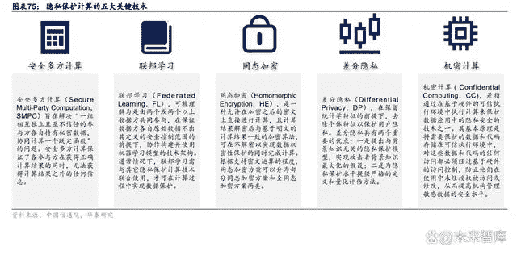

### 数据产业链投资机会

我们认为数据产业链分为数据生产、数据处理、数据使用三大环节。数据使用环节的参与 者包括训练、微调大模型的企业，本文不作展开。以下我们对数据生产、数据处理环节进 行讨论。

**数据生产环节 **

数据生产环节是数据产业链的上游环节，是数据的源头。环节内的企业或从业务运营中直 接产生数据，或作为平台方聚合数据。按照数据的通用程度，我们认为这一环节的公司可 以分为通用类型数据及垂直行业数据 2 类。

1） 通用类型数据：如前文所言，我们认为 AI 大模型需要高质量、大规模、具有多样性的 数据。对标海外主要数据集，通用类型数据来自维基百科、书籍期刊、高质量论坛，因 此国内的数据或来自文本数据领域的百度百科、中文在线、中国科传、知乎，以及图像 视觉领域的视觉中国等公司。 a) 截至 2022 年 6 月，视觉中国拥有超过 2/3 的高水准独家或自有内容，目前提供 4 亿张图片、3,000 万条视频和 35 万首音乐等可销售的各类素材，是全球最大的同 类数字版权内容平台之一。 b) 中国科传从事图书出版业务、期刊业务、出版物进出口业务。截至 2022 年底， 公司年出版新书超过 3000 种，已累计出版图书超过 5 万种，是国内学科分布最 全、出版规模最大的综合性科技出版机构。截至 2022 年底，中国科传出版期刊 554 种，其中中文期刊 254 种，英文期刊 276 种，中英文期刊 5 种，法文期刊 19 种。共有 101 种期刊被 SCI 收录，其中 36 种期刊处于 Q1 区，4 种期刊在国 际同学科期刊中排名第一，16 种期刊居国际同学科期刊排名前 10%。 c) 截至 2022 年 6 月，中文在线累积数字内容资源超 510 万种，网络原创驻站作者 440 余万名。

2） 行业数据：我们认为垂直行业的高价值量数据对于 AI 大模型，尤其是行业大模型的训 练和落地至关重要。处于数字化程度领先的行业中的龙头公司在行业数据积累上具有优 势，例如：1）计算机视觉领域的海康威视、大华股份；2）城市治理、ToB 行业应用领 域的中国电信、中国移动、中国联通等；3）金融领域的同花顺、东方财富等；4）自动 驾驶领域的特斯拉、蔚小理、经纬恒润、德赛西威等。

大模型时代数据价值凸显，国内外数据收费为大势所趋，收费方式尚在摸索中。2023 年 4 月 18 日，美国知名论坛 Reddit 宣布计划向通过其 API 使用数据的公司收费。Reddit 尚未 公布具体的收费标准，但表示会分为不同的等级，根据使用者的规模和需求来区分。Reddit 是大模型训练的优质语料库，OpenAI 的 GPT-3 训练使用了来自 Reddit 的数据，Meta 旗下 的 Facebook AI Research 与华盛顿大学也联合开源了来自 Reddit 数据的 OpenWebText 数据集。对于通用类型数据和行业数据，我们认为其潜在的变现方式可能存在差异： 1） 通用类型数据：我们认为通用类型数据所有者可能采用开发自有模型/应用、售卖数据 2 种变现方式。例如，知乎联合清华系 AI 公司面壁智能发布中文大模型“知海图 AI”。 中文在线则基于自有数据开发了 AI 辅助文字创作工具，并计划售卖数据：根据中文在 线 4 月 19 日回复深交所关注函内容，其收费方式为按照采集数据包的大小及数据类别 进行基础包加增量包的收费，目前尚未签署具体合作协议。 2） 行业数据：我们认为数据是垂直行业企业的护城河之一，结合具体场景和用户充分挖掘 数据能更好地赋能业务。因此垂直行业企业或更偏好基于基础模型，使用自有数据来训 练自有模型，并且可能会尽量规避售卖数据。

**数据处理环节 **

根据 IDC 在 2020 年的数据，百度智能云和海天瑞声是我国 AI 基础数据服务市场中份额最 大的两家公司。Appen、Telus international 则是海外数据服务的主要上市公司。其中， 百度智能云数据众包是平台型 AI 数据服务提供者，服务涵盖方案设计、数据采集与数据标 注全流程，并与政府共建数据标注基地；海天瑞声数据服务涵盖从方案设计到采集、标注 直至交付的全流程；慧听科技包括语言语音、多媒体两大类几十余种数据服务；标贝科技 提供语音合成整体解决方案及数据服务；Appen 拥有 MatrixGo 数据标注平台；Scale AI 通 过帮助机器学习团队生成高质量的地面数据来加速 AI 应用程序的开发；V7 的图像标记平台 可应用于医疗保健、生命科学、制造业、自动驾驶、农业科技等领域；Telus international 服务包括数字化战略、创新、咨询和设计、数字化转型和 IT 生命周期服务、数据注释和智 能自动化；Lion bridge 是 AI 语言服务提供商。

（本文仅供参考，不代表我们的任何投资建议。如需使用相关信息，请参阅报告原文。）

**精选报告来源：【未来智库】。**

举报/反馈

大家都在搜

[人工智能模型 ](https://baidu.com/s?word=%E4%BA%BA%E5%B7%A5%E6%99%BA%E8%83%BD%E6%A8%A1%E5%9E%8B&rsv_dl=feed_landingpage_rs&from=1020853i&rsf=)[AI大数据模型量化 ](https://baidu.com/s?word=AI%E5%A4%A7%E6%95%B0%E6%8D%AE%E6%A8%A1%E5%9E%8B%E9%87%8F%E5%8C%96&rsv_dl=feed_landingpage_rs&from=1020853i&rsf=)[人工智能建模的五种类型 ](https://baidu.com/s?word=%E4%BA%BA%E5%B7%A5%E6%99%BA%E8%83%BD%E5%BB%BA%E6%A8%A1%E7%9A%84%E4%BA%94%E7%A7%8D%E7%B1%BB%E5%9E%8B&rsv_dl=feed_landingpage_rs&from=1020853i&rsf=)[AI大数据 ](https://baidu.com/s?word=AI%E5%A4%A7%E6%95%B0%E6%8D%AE&rsv_dl=feed_landingpage_rs&from=1020853i&rsf=)[大数据工程师 能力模型 ](https://baidu.com/s?word=%E5%A4%A7%E6%95%B0%E6%8D%AE%E5%B7%A5%E7%A8%8B%E5%B8%88%20%E8%83%BD%E5%8A%9B%E6%A8%A1%E5%9E%8B&rsv_dl=feed_landingpage_rs&from=1020853i&rsf=)[ai大数据预测](https://baidu.com/s?word=ai%E5%A4%A7%E6%95%B0%E6%8D%AE%E9%A2%84%E6%B5%8B&rsv_dl=feed_landingpage_rs&from=1020853i&rsf=)