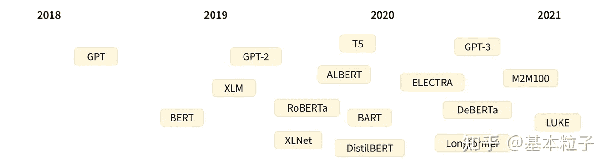
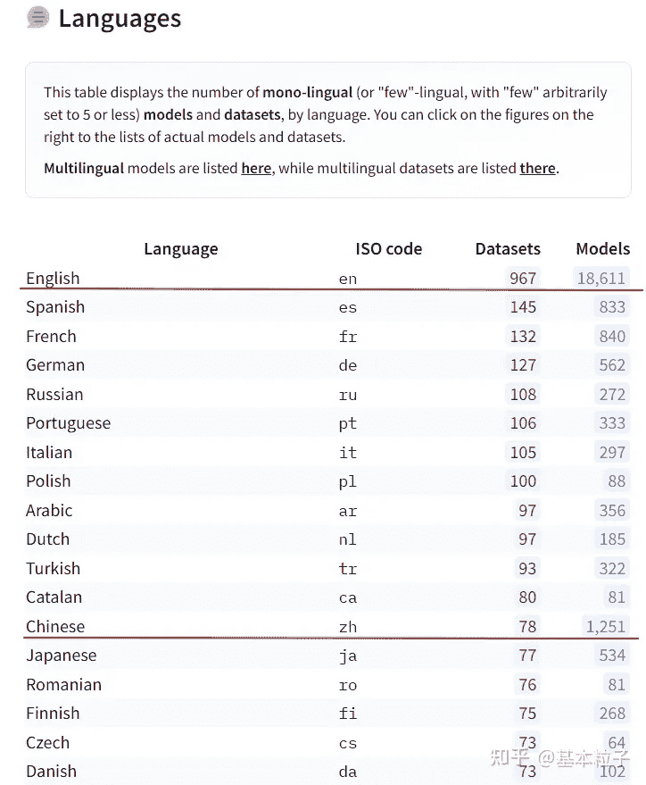
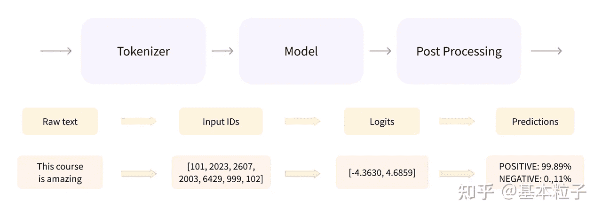
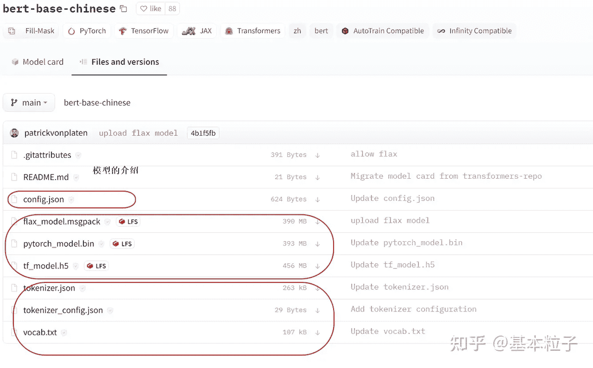
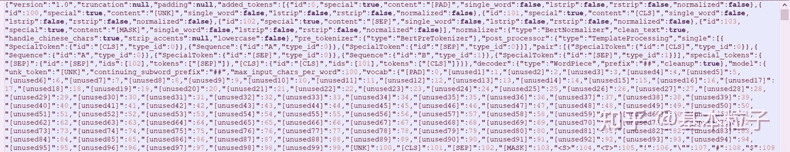

# 2022-06-28Huggingface 超详细介绍 - 知乎

> 来源：https://xuqiwei1986.feishu.cn/docx/RBbPdKDvDo2qS0xNgm4cW29Onof

> 🔗 原文链接：https://zhuanlan.zhihu.com/p/535100411

Hugging face 起初是一家总部位于纽约的聊天机器人初创服务商，他们本来打算创业做聊天机器人，然后在`github`上开源了一个`Transformers`库，虽然聊天机器人业务没搞起来，但是他们的这个库在机器学习社区迅速大火起来。目前已经共享了超100,000个预训练模型，10,000个数据集，变成了机器学习界的`github`。

其之所以能够获得如此巨大的成功，一方面是让我们这些甲方企业的小白，尤其是入门者也能快速用得上科研大牛们训练出的超牛模型。另一方面是，这种特别开放的文化和态度，以及利他利己的精神特别吸引人。`huggingface`上面很多业界大牛也在使用和提交新模型，这样我们就是站在大牛们的肩膀上工作，而不是从头开始，当然我们也没有大牛那么多的计算资源和数据集。

在国内`huggingface`也是应用非常广泛，一些开源框架本质上就是调用`transfomer`上的模型进行微调（当然也有很多大牛在默默提供模型和数据集）。很多`nlp`工程师招聘的条目上也明摆着要求熟悉`huggingface transformer`库的使用。简单介绍了他们多么牛逼之后，我们看看`huggingface`怎么玩吧。因为他既提供了数据集，又提供了模型让你随便调用下载，因此入门非常简单。你甚至不需要知道什么是`GPT`，`BERT`就可以用他的模型了（当然看看我写的`BERT`简介还是十分有必要的）。下面初步介绍下`huggingface`里面都有什么，以及怎么调用`BERT`模型做个简单的任务。

## 我们能从huggingface获得什么

### 内容

`huggingface`的官方网站：http://www.huggingface.co。在这里主要有以下大家需要的资源。

- `Datasets`：数据集，以及数据集的下载地址
- `Models`：各个预训练模型
- `course`：免费的`nlp`课程，可惜都是英文的
- `docs`：文档

下图是一张来自于官网的`Transformers`发展谱系图，短短3，4年就发展出了庞大家族。如果你不是学术界的代表，你无需详细搞懂他们的原理，就可以直接使用这些科研界最先进的模型，下一章我们来介绍如何简单的拿这些模型进行`nlp`任务。



### 一个有趣的现象

在`NLP`领域，在`hugging face`上面数据集和预训练模型的数量以英语为最为众多，远超其他国家的总和（见下图）。就预训练模型来说，排名第二的是汉语。就数据集来说，汉语远远少于英语，也少于法，德，西班牙等语言，甚至少于阿拉伯语和波兰语。这严重跟我想象中的`AI`超级大国及其不匹配。我想一方面因为数据集的积累都需要很多年，中文常用的（`PKU`，`MSRA`）数据集都是十几年前留下的，而我们`AI`和经济的崛起也不过是最近十年的事情。另一方面，数据集都是大价钱整理出来的，而且可以不断的利用他产生新的模型，这样的大杀器怎可随意公布。发布预训练模型可以带来论文，数据集可啥也带不来，基本上中日韩等的数据集明显偏少。



## 小试牛刀

接下来的内容参考了下面的内容，初步带你入门`huggingface`，简单了解如何调用`BERT`模型：

> dxzmpk写的教程 https://www.cnblogs.com/dongxiong/p/12763923.html

> `huggingface`官方教程：https://huggingface.co/docs/transformers/model_doc/bert

- 有必要阅读的论文：

  https://arxiv.org/abs/1706.03762

  https://arxiv.org/abs/1706.03762

### 如果看英文论文太费劲，可以参考我写的学习笔记

- `attention`与`sef-attention`介绍
- `transformer`模型结构介绍
- [`Bert`简单介绍](https://zhuanlan.zhihu.com/p/528867839)

### 安装

`transformers`库`github`地址在：https://github.com/huggingface/transformers

安装方法，在命令行执行（`conda`的话在`anaconda propmt`）：

```
pip install transformers # 安装最新的版本
pip install transformers == 4.0 # 安装指定版本
# 如果你是conda的话
conda install -c huggingface transformers  # 4.0以后的版本才会有
```

测试下安装是否成功

```
from transformers import pipeline  # 引入一个pipeline试试看，如果不报错说明安装成功
# 因为NLP通常是多个任务顺序而成，所以通常使用pipeline，流水线工作
```

### 模型的组成

一般`transformer`模型有三个部分组成：1.`tokennizer`，2.`Model`，3.`Post processing`。如下图所示，图中第二层和第三层是每个部件的输入/输出以及具体的案例。我们可以看到三个部分的具体作用：`Tokenizer`就是把输入的文本做切分，然后变成向量，`Model`负责根据输入的变量提取语义信息，输出`logits`；最后`Post Processing`根据模型输出的语义信息，执行具体的`nlp`任务，比如情感分析，文本自动打标签等；可见`Model`是其中的核心部分，`Model`又可以分为三种模型，针对不同的`NLP`任务，需要选取不同的模型类型：`Encoder`模型（如`Bert`，常用于句子分类、命名实体识别（以及更普遍的单词分类）和抽取式问答。），`Decoder`模型（如`GPT`，`GPT2`，常用于文本生成），以及`sequence2sequence`模型（如`BART`，常用于摘要，翻译，生成性问答等）



说了很多理论的内容，我们可以在`huggingface`的官网，随便找一个预训练模型具体看看包含哪些文件。在这里我举了一个中文的例子`Bert-base-Chinese`（中文还有其他很优秀的预训练模型，比如哈工大和科大讯飞提供的：`roberta-wwm-ext`，百度提供的：`ernie`）。这个模型据说是根据中文维基百科内容训练的，因此语义内容可能不是足够丰富，毕竟其他大佬们提供的数据更多。



`readme`一般是模型的介绍，包括使用方法都会放到里面，不介绍了。其他最重要的组成部分，大概分为三类：

### config

控制模型的名称、最终输出的样式、隐藏层宽度和深度、激活函数的类别等。这些参数我补齐了说明，对于初学者来说，大家一般不需要调整。这些参数都可以通过`configuration`类更改。

```
{
  "architectures": [
    "BertForMaskedLM"                           # 模型的名称
  ],
  "attention_probs_dropout_prob": 0.1,          # 注意力机制的 dropout，默认为0.1
  "directionality": "bidi",                     # 文字编码方向采用bidi算法
  "hidden_act": "gelu",                         # 编码器内激活函数，默认gelu，还可为relu、swish或 gelu_new
  "hidden_dropout_prob": 0.1,                   # 词嵌入层或编码器的 dropout，默认为0.1
  "hidden_size": 768,                           # 编码器内隐藏层神经元数量，默认768
  "initializer_range": 0.02,                    # 神经元权重的标准差，默认为0.02
  "intermediate_size": 3072,                    # 编码器内全连接层的输入维度，默认3072
  "layer_norm_eps": 1e-12,                      # layer normalization 的 epsilon 值，默认为 1e-12
  "max_position_embeddings": 512,               # 模型使用的最大序列长度，默认为512
  "model_type": "bert",                         # 模型类型是bert
  "num_attention_heads": 12,                    # 编码器内注意力头数，默认12
  "num_hidden_layers": 12,                      # 编码器内隐藏层层数，默认12
  "pad_token_id": 0,                            # pad_token_id 未找到相关解释
  "pooler_fc_size": 768,                        # 下面应该是pooler层的参数，本质是个全连接层，作为分类器解决序列级的NLP任务
  "pooler_num_attention_heads": 12,             # pooler层注意力头，默认12
  "pooler_num_fc_layers": 3,                    # pooler 连接层数，默认3
  "pooler_size_per_head": 128,                  # 每个注意力头的size
  "pooler_type": "first_token_transform",       # pooler层类型，网上介绍很少
  "type_vocab_size": 2,                         # 词汇表类别，默认为2
  "vocab_size": 21128                           # 词汇数，bert默认30522，这是因为bert以中文字为单位进入输入
}
```

### tokenizer（包含三个文件）

这些文件是`tokenizer`类生成的，或者处理的，只是处理文本，不涉及任何向量操作。

`vocab.txt`是词典文件（打开就是单个字符，我这里用的是`bert-base-chinsese`，可以看到里面都是保留符号和单个汉字索引，字符）

`tokenizer.json`和`config`是分词的配置文件，根据`vocab`信息和你的设置更新，里面把`vocab`都按顺序做了索引，将来可以根据编码生成`one-hot`向量，然后跟`embeding`训练的矩阵相乘，就可以得到该字符的向量。下图是`tokenizer.json`内容。



模型文件一般是`tensor flow`（上图中的`h5`文件）和`py-torch`（上图中的`bin`文件）的都有，因为作者只是单纯的在学习`torch`，所以以后的文章都只介绍`torch`。

## BERT模型的使用

介绍完了模型库都有哪些内容，下面我们可以导入模型试一试怎么使用啦。

### 导入模型

利用官方的`hub`导入模型；下面导入了一个`BertModel`；在官方的教程中推进使用`pipeline`导入模型的方法；

```
import torch
from transformers import BertModel, BertTokenizer, BertConfig
# 首先要import进来
tokenizer = BertTokenizer.from_pretrained('bert-base-chinese')
config = BertConfig.from_pretrained('bert-base-chinese')
config.update({'output_hidden_states':True}) # 这里直接更改模型配置
model = BertModel.from_pretrained("bert-base-chinese",config=config)
```

利用`pipeline`的方式也是一样的可以导入模型哈，方式如下：

```
from transformers import AutoModel
checkpoint = "bert-base-chinese"

model = AutoModel.from_pretrained(checkpoint)
```

因为`huggingface`官网在国外，自动下载可能比较费劲，笔者在公司下载速度还是非常快的。

默认下载地址在这里：

- 使用 `Windows` 模型保存的路径在 `C:\Users\[用户名]\.cache\torch\transformers\` 目录下，根据模型的不同下载的东西也不相同
- 使用 `Linux` 模型保存的路径在 `~/.cache/torch/transformers/` 目录下

如果自动下载总是中断的话，可以考虑用国内的源，或者手工下载之后指定位置。（`huggingface`官网，选择`models`菜单，然后搜索自己想要的模型，然后把里面的文件下载下来，其中体积较大的有`tf`的有`torch`的，根据自己需要下载）。

```
import transformers
MODEL_PATH = r"D:\\test\\bert-base-chinese"
# 导入模型
tokenizer = transformers.BertTokenizer.from_pretrained(r"D:\\test\\bert-base-chinese\\bert-base-chinese-vocab.txt") 
# 导入配置文件
model_config = transformers.BertConfig.from_pretrained(MODEL_PATH)
# 修改配置
model_config.output_hidden_states = True
model_config.output_attentions = True
# 通过配置和路径导入模型
model = transformers.BertModel.from_pretrained(MODEL_PATH,config = model_config)
```

### 使用模型

上一步我们已经把模型加载进来了，在这里，尝试一下这个模型怎么样，看看能不能把相关的语义带入进来。我们之前文章介绍了`bert`的两个任务（`MLM`和`NSP`），这一节，我们一起测试这两个任务的效果。首先我们逐步来看看`BERT`每个部分的输出都是什么，我们可以看看哪些好玩的东西。

#### tokenizer

上面代码可以看到他实例化了`BertTokenizer`类，它是基于`WordPiece`方法的，先看看他有哪些参数：

> (`vocab_file`，`do_lower_case = True`，`do_basic_tokenize = True`，`never_split = None`，`unk_token = '[UNK]'`，`sep_token = '[SEP]'`，`pad_token = '[PAD]'`，`cls_token = '[CLS]'`，`mask_token = '[MASK]'`，`tokenize_chinese_chars = True`，`strip_accents = None`，`**kwargs`)

`vocab_file`:这里是放置词典的地址，`do_lower_case`,是否都变成小写，默认是`True`哦，`do_basic_tokenize`，做`wordpiece`之前是否要做`basic tokenize`；下面的都是一些关键字的确认。还有就是是否分开中文字符，因为`bert`是面向英文的所有有这些设置，一般不用改，当然我们这里的案例也只是读取了预训练模型。

我们来个小案例看看，分出来的字符是什么样子的。示例如下，可以看出`BERT`对中文是字符级别的分词，对待英文是到`sub-word`级别的：


## Tokenizer 使用示例

```
# 上文的示例代码已经实例话了，这里不重复了；
print(tokenizer.encode(&quot;生活的真谛是美和爱&quot;))  # 对于单个句子编码
print(tokenizer.encode_plus(&quot;生活的真谛是美和爱&quot;,&quot;说的太好了&quot;)) # 对于一组句子编码
# 输出结果如下：
[101, 4495, 3833, 4638, 4696, 6465, 3221, 5401, 1469, 4263, 102]
{&#x27;input_ids&#x27;: [101, 4495, 3833, 4638, 4696, 6465, 3221, 5401, 1469, 4263, 102, 6432, 4638, 1922, 1962, 749, 102], &#x27;token_type_ids&#x27;: [0, 0, 0, 0, 0, 0, 0, 0, 0, 0, 0, 1,
1, 1, 1, 1, 1], &#x27;attention_mask&#x27;: [1, 1, 1, 1, 1, 1, 1, 1, 1, 1, 1, 1, 1, 1, 1, 1, 1]}

# 也可以直接这样用
sentences = [&#x27;网络安全开发分为三个层级&#x27;,
             &#x27;车辆系统层级网络安全开发&#x27;,
             &#x27;车辆功能层级网络安全开发&#x27;,
             &#x27;车辆零部件层级网络安全开发&#x27;,
             &#x27;测试团队根据车辆网络安全目标制定测试技术要求及测试计划&#x27;,
             &#x27;测试团队在网络安全团队的支持下，完成确认测试并编制测试报告&#x27;,
             &#x27;在车辆确认结果的基础上，基于合理的理由，确认在设计和开发阶段识别出的所有风险均已被接受&#x27;,]
test1 = tokenizer(sentences)

print(test1)  # 对列表encoder
print(tokenizer(&quot;网络安全开发分为三个层级&quot;))  # 对单个句子encoder
```

我们来看一下这个输出：对于单个句子是上面那种，他只输出句子`tok`之后的`id`，我们注意到已经加好`[CLS]`、`[SEP]`等标识符了；（查询`tokenizer`可知，`101`是`[CLS]`，`102`是`[SEP]`）除了`input_ids`之外，还自动编码了`token_type_ids`、`attention_mask`

当然除了这种直接调用模型之外，还可以利用`pipeline`方法来

## `model`

`model`实例化了`BertModel`类，除了初始的`Bert`、`GPT`等基本模型，针对不同的下游任务，定义了`BertForQuestionAnswering`、`BertForMultiChoice`、`BertForNextSentencePrediction`以及`BertForSequenceClassification`等下游任务模型。模型导出时将生成`config.json`和`pytorch_model.bin`参数文件，这两个文件前面已将介绍了，一个是配置文件一个是`torch`训练后save的文件。那下面我们来看看这个怎么使用吧。因为中文是字符级的`tok`，所以做`MLM`任务不是很理想，所以下面我用英文的`base`模型示例一个`MLM`任务；

```
from transformers import pipeline
# 运行该段代码要保障你的电脑能够上网，会自动下载预训练模型，大概420M
unmasker = pipeline(&quot;fill-mask&quot;,model = &quot;bert-base-uncased&quot;)  # 这里引入了一个任务叫fill-mask，该任务使用了base的bert模型
unmasker(&quot;The goal of life is [MASK].&quot;, top_k=5) # 输出mask的指，对应排名最前面的5个，也可以设置其他数字
# 输出结果如下，似乎都不怎么有效哈。
[{&#x27;score&#x27;: 0.10933303833007812,
  &#x27;token&#x27;: 2166,
  &#x27;token_str&#x27;: &#x27;life&#x27;,
  &#x27;sequence&#x27;: &#x27;the goal of life is life.&#x27;},
 {&#x27;score&#x27;: 0.03941883146762848,
  &#x27;token&#x27;: 7691,
  &#x27;token_str&#x27;: &#x27;survival&#x27;,
  &#x27;sequence&#x27;: &#x27;the goal of life is survival.&#x27;},
 {&#x27;score&#x27;: 0.032930608838796616,
  &#x27;token&#x27;: 2293,
  &#x27;token_str&#x27;: &#x27;love&#x27;,
  &#x27;sequence&#x27;: &#x27;the goal of life is love.&#x27;},
 {&#x27;score&#x27;: 0.030096106231212616,
  &#x27;token&#x27;: 4071,
  &#x27;token_str&#x27;: &#x27;freedom&#x27;,
  &#x27;sequence&#x27;: &#x27;the goal of life is freedom.&#x27;},
 {&#x27;score&#x27;: 0.024967126548290253,
  &#x27;token&#x27;: 17839,
  &#x27;token_str&#x27;: &#x27;simplicity&#x27;,
  &#x27;sequence&#x27;: &#x27;the goal of life is simplicity.&#x27;}]
```

### 后处理

后处理通常要根据你选择的模型来确定，一般模型的输出是`logits`，其包含我们需要的语义信息，然后后处理是经过一个激活函数输出我们可以使用的向量，比如`softmax`层做二分类，会输出对应两个标签的概率值，然后就可以轻松转化为我们需要的信息啦。

## 3.3 再来试一试我们情感分析的任务

`BERT`论文中介绍了自己在推理，问答等多个任务中的提升，在这里我们只介绍一个简单的情感分析任务。

### 数据集

在我的第一篇笔记里，基于双向的`LSTM`搭建了一个情感分析的示例，当时使用的是`IMDB`电影评论（一共有5万条，正负面评论各25000条）。代码已经对数据集进行了封装和整理，在这里就不重复介绍了。

### 下游任务训练

情感分析任务在`huggingface`中称之为：`Text Classification` 。根据`huggingface`任务方面的定义，在这里我们延展介绍一下那些常见的任务是属于文本分类的：

1. `NLI`（`Natural Language Infenrence`），或称之为`Recognizing Textual Entailment`（`RTE`）蕴含文本识别。针对这类问题有一系列的数据集，以及基于这些数据集训练出来的模型，常见的有：

   `QNLI`，`QNLI`是从另一个权威的`QA`数据集`The Stanford Question Answering Dataset`(斯坦福问答数据集, `SQuAD 1.0`)转换而来的。`SQuAD 1.0`是由问题-段落对组成的问答数据集，其中段落来自`Wiki`，段落中的一个句子包含问题的答案。通过将问题和上下文（即维基百科段落）中的每一句话进行组合，并过滤掉词汇重叠比较低的句子对就得到了`QNLI`中的句子对。本质是一个判断蕴含还是不蕴含的二分类问题；

   `MNLI`，多类型自然语言推理数据库，是一个自然语言推断任务，数据集是通过众包方式对句子对进行文本蕴含标注的集合。给定前提语句和假设语句，任务是预测前提语句是否包含假设（`entailment`）、与假设矛盾(`contradiction`)或者两者都不(中立，`neutral`)。本质是一个三分类问题：判断是有前提，无前提，还是中立的；

   等等还有其他的数据集，包括一些对抗性的；

2. 情感分析（`Sentiment Analysis`）：本质是一个二分类的问题，给定一个文本判断是正面的（`POS`），还是负面的（`NEG`）

3. `Quora Question Pairs`：给出两个问题，判断这两个问题的含义是否一致；属于一个二分类的问题；他的数据集是`quroa`问题队，也被收录在`GLUE`内。

4. [语法校核-Grammatical Correctness](https://link.zhihu.com/?target=https%3A//huggingface.co/datasets/glue/viewer/cola/test)：评估一个句子的语法可接受性，二分类任务，结果是可接受或者不可接受；常用的数据集是：`Corpus of Linguistic Acceptability` (`CoLA`)

说了那么多题外话，我们回过来来看我们本次的任务，他是`Text classification`中的情感分析任务，是一个二分类的任务，给出一段话，从标签`{"POS",'NEG'}`中选择一个最合适的。

沿用之前的数据处理代码，我们这里只更改模型；

好了废话不多说了，上代码，大家去看详细的代码注释吧，由于设置多个`epoch`和较大的`batchsize`，我的电脑完全带动不起来，大家放到`gpu`计算，记得`to device`到`GPU`上。拷贝下来直接就能用。


# 基于深度学习的 IMDB 情感分析

## 代码实现

```
# _*_ coding:utf-8 _*_
# 利用深度学习做情感分析，基于Imdb 的50000个电影评论数据进行；

import torch
from torch.utils.data import DataLoader, Dataset
import os
import re
from random import sample
import numpy as np
import torch.nn as nn
import torch.nn.functional as F
import torch.optim as optim
from transformers import BertModel, BertTokenizer
from tqdm import tqdm

# 路径需要根据情况修改，要看你把数据下载到哪里了
# 数据下载地址在斯坦福官网，网上搜索就有
data_base_path = r"./imdb_test/aclImdb"

# 这个里面是存储你训练出来的模型的，现在是空的
model_path = r"./imdb_test/aclImdb/mode"

# 1. 准备dataset，这里写了一个数据读取的类，并把数据按照不同的需要进行了分类；
class ImdbDataset(Dataset):
    def __init__(self, mode, testNumber=10000, validNumber=5000):
        # 在这里我做了设置，把数据集分成三种形式，可以选择 “train”默认返回全量50000个数据，“test”默认随机返回10000个数据，
        # 如果是选择“valid”模式，随机返回相应数据
        super(ImdbDataset, self).__init__()

        # 读取所有的训练文件夹名称
        text_path = [os.path.join(data_base_path, i) for i in ["test/neg", "test/pos"]]
        text_path.extend([os.path.join(data_base_path, i) for i in ["train/neg", "train/pos"]])

        if mode == "train":
            self.total_file_path_list = []
            # 获取训练的全量数据，因为50000个好像也不算大，就没设置返回量，后续做sentence的时候再做处理
            for i in text_path:
                self.total_file_path_list.extend([os.path.join(i, j) for j in os.listdir(i)])
        if mode == "test":
            self.total_file_path_list = []
            # 获取测试数据集，默认10000个数据
            for i in text_path:
                self.total_file_path_list.extend([os.path.join(i, j) for j in os.listdir(i)])
            self.total_file_path_list = sample(self.total_file_path_list, testNumber)

        if mode == "valid":
            self.total_file_path_list = []
            # 获取验证数据集，默认5000个数据集
            for i in text_path:
                self.total_file_path_list.extend([os.path.join(i, j) for j in os.listdir(i)])
            self.total_file_path_list = sample(self.total_file_path_list, validNumber)

    def tokenize(self, text):
        # 具体要过滤掉哪些字符要看你的文本质量如何

        # 这里定义了一个过滤器，主要是去掉一些没用的无意义字符，标点符号，html字符啥的
        fileters = ['!', '"', '#', '$', '%', '&', '\(', '\)', '\*', '\+', ',', '-', '\.', '/', ':', ';', '<', '=', '>', '\?', '@',
                    '[', '\\', ']', '^', '_', '`', '{', '\|', '}', '~', '\t', '\n', '\x97', '\x96', '”', '“']
        # sub方法是替换
        text = re.sub("<.*?>", " ", text, flags=re.S)  # 去掉<...>中间的内容，主要是文本内容中存在<br/>等内容
        text = re.sub("|".join(fileters), " ", text, flags=re.S)  # 替换掉特殊字符，'|'是把所有要匹配的特殊字符连在一起
        return text  # 返回文本

    def __getitem__(self, idx):
        cur_path = self.total_file_path_list[idx]
        # 返回path最后的文件名。如果path以／或\结尾，那么就会返回空值。即os.path.split(path)的第二个元素。
        # cur_filename返回的是如：“0_3.txt”的文件名
        # 标题的形式是：3_4.txt        前面的3是索引，后面的4是分类
        # 如果是小于等于5分的，是负面评论，labei给值维1，否则就是1
        labels = []
        sentences = []
        if int(cur_filename.split("_")[-1].split(".")[0]) <= 5:
            label = 0
        else:
            label = 1
        # temp.append([label])
        labels.append(label)
        text = self.tokenize(open(cur_path, encoding='UTF-8').read().strip())  # 处理文本中的奇怪符号
        sentences.append(text)
        # 可见我们这里返回了一个list，这个list的第一个值是标签0或者1，第二个值是这句话；
        return sentences, labels

    def __len__(self):
        return len(self.total_file_path_list)

# 2. 这里开始利用huggingface搭建网络模型
# 这个类继承再nn.module,后续再详细介绍这个模块
#
class BertClassificationModel(nn.Module):
    def __init__(self, hidden_size=768):
        super(BertClassificationModel, self).__init__()
        # 这里用了一个简化版本的bert
        model_name = 'distilbert-base-uncased'

        # 读取分词器
        self.tokenizer = BertTokenizer.from_pretrained(pretrained_model_name_or_path=model_name)

        # 读取预训练模型
        self.bert = BertModel.from_pretrained(pretrained_model_name_or_path=model_name)

        for p in self.bert.parameters():  # 冻结bert参数
            p.requires_grad = False
        self.fc = nn.Linear(hidden_size, 2)

    def forward(self, batch_sentences):  # [batch_size, 1]
        sentences_tokenizer = self.tokenizer(batch_sentences,
                                             truncation=True,
                                             padding=True,
                                             max_length=512,
                                             add_special_tokens=True)
        input_ids = torch.tensor(sentences_tokenizer['input_ids'])  # 变量
        attention_mask = torch.tensor(sentences_tokenizer['attention_mask'])  # 变量
        bert_out = self.bert(input_ids=input_ids, attention_mask=attention_mask)  # 模型

        last_hidden_state = bert_out[0]  # [batch_size, sequence_length, hidden_size] # 变量
        bert_cls_hidden_state = last_hidden_state[:, 0, :]  # 变量
        fc_out = self.fc(bert_cls_hidden_state)  # 模型
        return fc_out

# 3. 程序入口，模型也搞完啦，我们可以开始训练，并验证模型的可用性

def main():
    testNumber = 10000  # 多少个数据参与训练模型
    validNumber = 100  # 多少个数据参与验证
    batchsize = 250  # 定义每次放多少个数据参加训练

    trainDatas = ImdbDataset(mode="test", testNumber=testNumber)  # 加载训练集,全量加载，考虑到我的破机器，先加载个100试试吧
    validDatas = ImdbDataset(mode="valid", validNumber=validNumber)  # 加载训练集

    train_loader = torch.utils.data.DataLoader(trainDatas, batch_size=batchsize, shuffle=False)  # 遍历train_dataloader 每次返回batch_size条数据

    val_loader = torch.utils.data.DataLoader(validDatas, batch_size=batchsize, shuffle=False)

    # 这里搭建训练循环，输出训练结果

    epoch_num = 1  # 设置循环多少次训练，可根据模型计算情况做调整，如果模型陷入了局部最优，那么循环多少次也没啥用

    print('training...(约1 hour(CPU))')

    # 初始化模型
    model = BertClassificationModel()

    optimizer = optim.AdamW(model.parameters(), lr=5e-5)  # 首先定义优化器，这里用的AdamW，lr是学习率，因为bert用的就是这个

    # 这里是定义损失函数，交叉熵损失函数比较常用解决分类问题
    # 依据你解决什么问题，选择什么样的损失函数
    criterion = nn.CrossEntropyLoss()

    print("模型数据已经加载完成,现在开始模型训练。")
    for epoch in range(epoch_num):
        for i, (data, labels) in enumerate(train_loader, 0):

            output = model(data[0])
            optimizer.zero_grad()  # 梯度清0
            loss = criterion(output, labels[0])  # 计算误差
            loss.backward()  # 反向传播
            optimizer.step()  # 更新参数

            # 打印一下每一次数据扔进去学习的进展
            print('batch:%d loss:%.5f' % (i, loss.item()))

        # 打印一下每个epoch的深度学习的进展i
        print('epoch:%d loss:%.5f' % (epoch, loss.item()))

    # 下面开始测试模型是不是好用哈
    print('testing...(约2000秒(CPU))')

    # 这里载入验证模型，他把数据放进去拿输出和输入比较，然后除以总数计算准确率
    # 鉴于这个模型非常简单，就只用了准确率这一个参数，没有考虑混淆矩阵这些
    num = 0
    model.eval()  # 不启用 BatchNormalization 和 Dropout，保证BN和dropout不发生变化,主要是在测试场景下使用；
    for j, (data, labels) in enumerate(val_loader, 0):

        output = model(data[0])
        # print(output)
        out = output.argmax(dim=1)
        # print(out)
        # print(labels[0])
        num += (out == labels[0]).sum().item()
        # total += len(labels)
    print('Accuracy:', num / validNumber)

if __name__ == '__main__':
    main()
```

## 发布信息

发布于 2022-06-28 22:15

## 赞赏

「真诚赞赏，手留余香」

赞赏

还没有人赞赏，快来当第一个赞赏的人吧！
