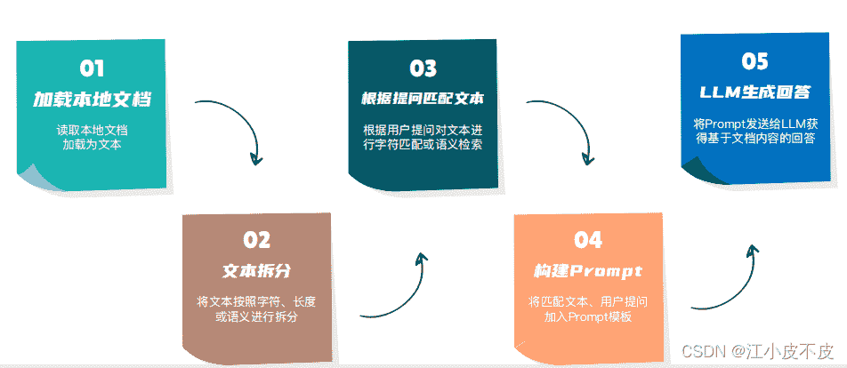
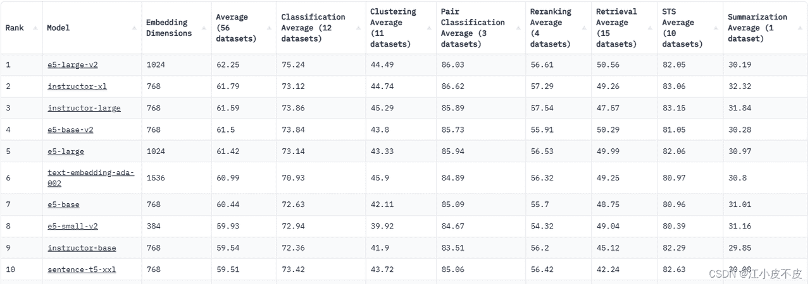
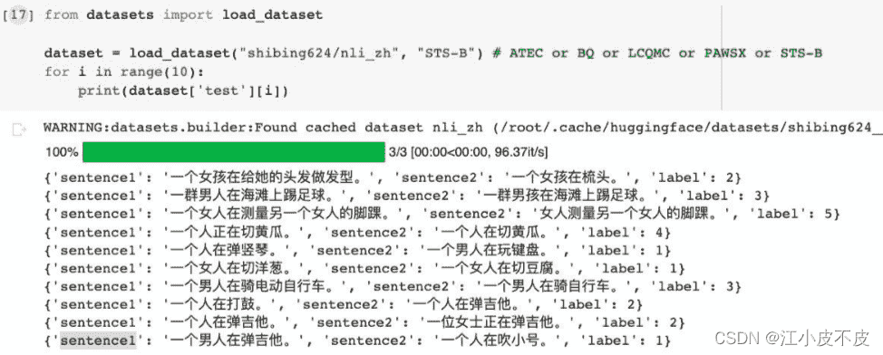
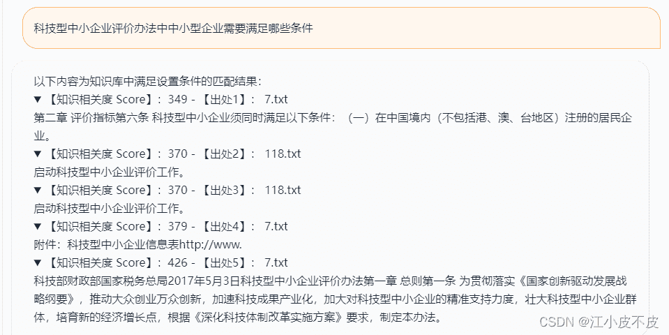
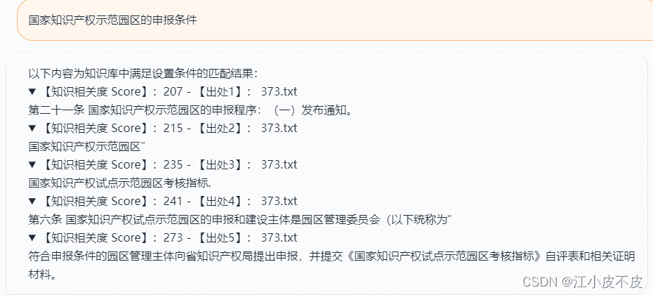
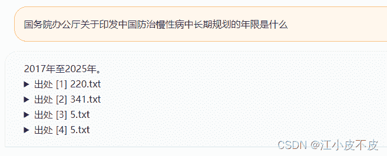
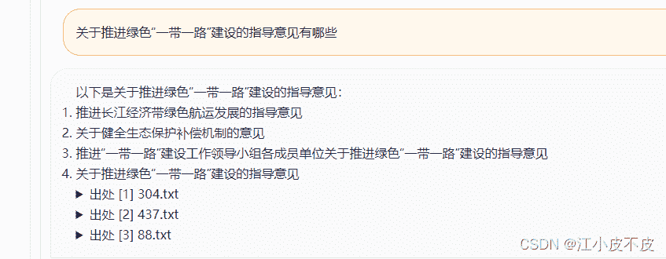

# 2023-06-05基于大模型构建本地知识库

> 来源：[https://xuqiwei1986.feishu.cn/docx/XCZSdN24hocSguxWChhcSmIfnO7](https://xuqiwei1986.feishu.cn/docx/XCZSdN24hocSguxWChhcSmIfnO7)

> 🔗 原文链接： h[ttps://blog.csdn.n](https://blog.csdn.net/qq128252/article/details/131049480)et/qq128252/arti...

>

# 基于大模型构建本地知识库

###  基于大模型构建本地知识库

+   图文概述

+   一、知识库构建

+   1.文本加载和读取

+   2.文本分割

+   3.文本向量化

+   英文排行版

+   中文SOTA

+   二、向量搜索

+   1.向量存储

+   2.用户问题向量化

+   3.知识库中搜索和问题最相似的topK个向量

+   三、大模型理解

+   四、问题

##   图文概述



##   一、知识库构建

###   1.文本加载和读取

支持的格式：

+   pdf

+   txt

+   md

+   docx

###   2.文本分割

> [通常，将大](https://so.csdn.net/so/search?q=%E8%AF%AD%E8%A8%80%E6%A8%A1%E5%9E%8B&spm=1001.2101.3001.7020)型文本文档拆分为较小的块，以便更好地使用 语言模型 。文本拆分器负责将文档拆分为较小的文档。理想情况下，您希望将语义相关的文本片段放在一起。“语义相关”的含义可能取决于文本的类型。

+   根据规则

```
根据中文文章的常见终止符号，利用规则进行文本分割。
如：单字符断句符、中英文省略号、双引号等
```

+   根据语义

```
将文本拆分为语义有意义的小块（通常是句子）。
开始将这些小块组合成一个较大的块，直到达到一定的大小（由某个函数测量）。
达到该大小后，将该块设置为自己的文本段，然后开始创建一个具有一些重叠的新文本块。
```

目前来说，由于语义的不确定性，用规则会取得更好的效果，文本分句长度为800。

###   3.文本向量化

语义检索的重要前提是 **Sentence Embeddings。 可惜目前看到的绝大部分材料都是使用OpenAIEmb****eddings。**OpenAIEmbeddings 调用的mode_name=“ text-embedding-ada-002 ” 排在 第6位

####  英文排行版

[MTEB 排行榜 - MTEB 的拥抱面](https://huggingface.co/spaces/mteb/leaderboard)孔空间 (huggingface.co)



####  中文SOTA

> 这是一个CoSENT（余弦句子）模型：shibing624/text2vec-base-Chinese。

> 它将句子映射到 768 维密集向量空间，可用于任务 如句子嵌入、文本匹配或语义搜索

> 分别拿 text2vec-base-chinese 、 instructor-large 和 OpenAIEmbedding Run这10个中文case，instructor-large 表现最差，text2vec-base-chinese 表现最好：



对于中文模型在政府语料问题的匹配，在这里测试了ernie-base模型和text2vec-large-chinese模型。每个问题分别在top5中命中了源文档几次。

| 中文模型在政府语料问题的匹配top5 | ernie-base | text2vec-large-chinese |
| --- | --- | --- |
| 关于转发国家发展改革委物流业降本增效专项行动方案 | 2/5 | 4/5 |
| 农业综合开发扶持农业优势特色产业促进农业产业化发展的指导意见 | 2/5 | 3/5 |
| 北京市暂时调整有关行政审批和准入特别管理措施的决定 | 3/5 | 5/5 |
| 推进交通运输行业数据资源开放共享的实施意见 | 1/5 | 5/5 |
| 关于改进和规范公安派出所出具证明工作的意见 | 1/5 | 4/5 |
| 谁开展的原油期货保税交割业务暂免征收增值税 | 4/5 | 3/5 |
| 香港联交所上市股票的所得税问题 | 3/5 | 5/5 |
| 图书资料费、数据采集费、会议费/差旅费/国际合作与交流费、设备费、专家咨询费、劳务费、印刷费/宣传费是哪些 | 3/5 | 3/5 |
| 国家知识产权示范园区的申报条件 | 5/5 | 5/5 |

##   二、向量搜索

###   1.向量存储

Faiss是Facebook开源的一个向量检索库,用于大规模向量集合的索引和搜索。主要功能包括:

1.  支持多种索引结构: IVF, IVFFlat, HNSW, etc。这些索引结构可以实现高精度和高召回的向量搜索。

1.  支持多种度量方式:内积,欧氏距离,cosine 相似度等。可选择合适的度量方式对向量集合建立索引。

1.  快速的索引构建与搜索:Faiss使用GPU加速,可以实现亿量级向量的索引构建和搜索。

1.  降维与聚类:Faiss提供PCA,IVFFlat等算法进行向量降维,并支持Kmeans算法进行向量聚类。

1.  高级特性:Faiss支持在线学习,异构向量检索,索引压缩等高级特性。

Faiss的典型应用有:

1.  [图像检索 ](https://so.csdn.net/so/search?q=%E5%9B%BE%E5%83%8F%E6%A3%80%E7%B4%A2&spm=1001.2101.3001.7020):在大规模图片数据库中找到与输入图片最相似的图片。

1.  文本匹配:快速找到与输入文本最相近的文本内容。

1.  推荐系统:根据用户兴趣对大量商品进行快速检索和推荐。

1.  [声纹识别 ](https://so.csdn.net/so/search?q=%E5%A3%B0%E7%BA%B9%E8%AF%86%E5%88%AB&spm=1001.2101.3001.7020):在海量语音数据中实现语音识别和检索。

###   2.用户问题向量化

Embedding 模型进行向量化（text2vec-large-chinese）

###   3.知识库中搜索和问题最相似的topK个向量

```
# chunk_conent   是否启用上下文关联
# score_threshold    搜索匹配score阈值
# vector_search_top_k   搜索知识库内容条数，默认搜索5条结果
# chunk_sizes    匹配单段内容的连接上下文长度
```

+   向量搜索索引中查找与embedding最相似的k个结果,得分scores和索引indices。

+   如果得分scores高于阈值score_threshold,跳过该结果。

+   指定了chunk_conent,则在结果索引的附近扩展查找,将相近的文档片段拼接到doc,但拼接后长度不超过chunk_size。只有相同的文档才会被拼接。





##   三、大模型理解

> 将问题和topK个向量作为上下文输入给大模型，让大模型根据已有的提示信息进行总结归纳回答。

```
基于上下文的prompt模版:根据上述已知信息，简洁和专业的来回答用户的问题。如果无法从中得到答案，请说 “根据已知信息无法回答该问题” 或 “没有提供足够的相关信息”，不允许在答案中添加编造成分，答案请使用中文。 问题是：{question}
```

示例：





##   四、问题

1.  目前该项目不够稳定，会出现奔溃的问题。

1.  多轮对话后，显存溢出造成奔溃。

1.  是否在prompt模版中加入判断，若所问问题非政务类型，转由大模型回答。

1.  大模型可能无法准确地理解政务领域的专业知识和术语，在小部分回答上会存在偏差。

1.  向量搜索时，可能会匹配到低质量文本，导致回答错误。（低质量：匹配到的文本具有一定相关性，但是和用户的问题意图有所偏差）