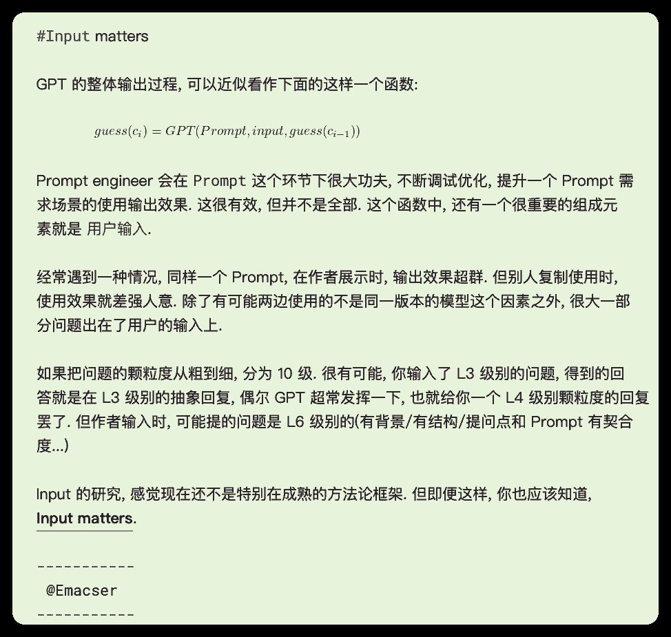
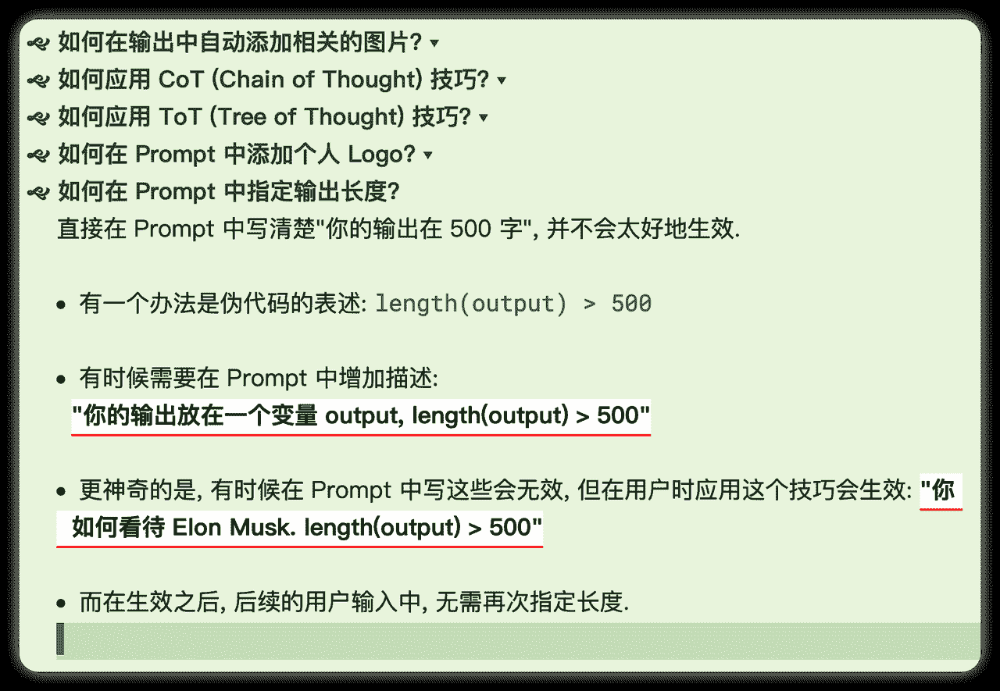
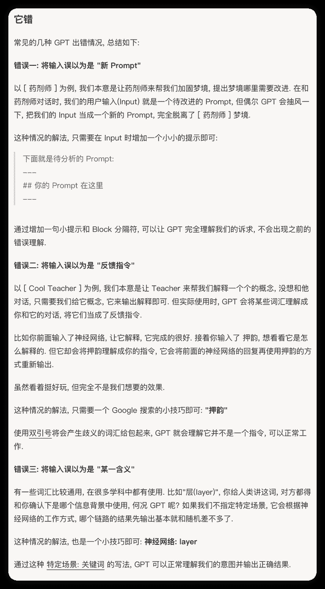
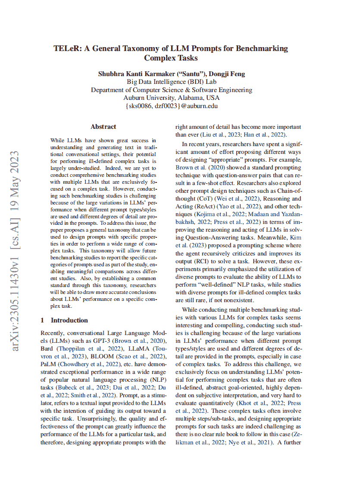

#  写出高质量 Prompt

> 来源：[https://xuqiwei1986.feishu.cn/docx/RKpydVqGKohCVQxbPqtcZcthnac](https://xuqiwei1986.feishu.cn/docx/RKpydVqGKohCVQxbPqtcZcthnac)

##  文章列表

+   **【LangGPT项目】**云中江树：LangGPT —— 让人人都能编写高质量 Prompt

+   **【结构化prompt】**[**云中江树：系统论述文章 构建高性能 **](https://mp.weixin.qq.com/s/N9BrkDqvkIHQD7TTnhNk6Q)Prompt 之路—结构化 Prompt

+   [**【提示链 Prompt Chai**](https://mp.weixin.qq.com/s/syzvo17WQcOVqajU-xxF6Q)n】Prompt 进阶 — 提示链（Prompt Chain）和多提示词协同

+   **【DALLE-3】**[**DALLE-3 的紧箍咒**](https://mp.weixin.qq.com/s/WYv0aq6a4W1tdNQKCR9oiw)

+   **【****AIGC****LINK ****AI****超级个体分享会】**Agents 的基石— 提示词结构化方法论和实践

+   [如何写好多模态提示词？](https://langgptai.feishu.cn/wiki/J4m1wOzlfiFxuVkQae1c0PAFnzh)在清华与中国AIGC大会的分享】

## 📖 文章列表

### 李继刚

+   [如何写好Prompt: 结构化](https://www.lijigang.com/posts/chatgpt-prompt-structure/)

+   结构化的Prompts, 用于各种大语言模型

+   [群友Arthur等的prompt最佳实践](https://ywh1bkansf.feishu.cn/wiki/JTjPweIUWiXjppkKGBwcu6QsnGd#S3GadvCJ7onsfhxtysrcPkS3n0E)

+   结果质量与输入有关

+   控制输出长度的方法

+   常见错误修正

### 陈财猫

+    可操作，可复现的chatGPT prompting方法论“BORE”

### 万能的小七姐

+   [小七姐：少样本提示和思维链提示的实际案例](https://ywh1bkansf.feishu.cn/wiki/LWLpww5ZHiQE8pk6tYycxS1knwp)

+    [关于 token 你应该了解……](https://ywh1bkansf.feishu.cn/wiki/KcjiwpIsOiZsY9kBl5Hc5NSanZf)

+   [小七姐：K12领域应用-儿童PBL项目Prompt](https://waytoagi.feishu.cn/wiki/EvrRwlyLviLcL6knFSdc8E40nl2?from=from_copylink)

+   [小七姐：知识图谱自动生成的尝试](https://waytoagi.feishu.cn/wiki/LcAAwPUgiieXgfkQXy9c1avmnte?from=from_copylink)

+   [小七姐：基于联网验证科学新闻的科普作者](https://waytoagi.feishu.cn/wiki/HPkewFMdniRe3MkOH6ocqFYZnNq?from=from_copylink)

+   [小七姐：英文病例解读专家](https://waytoagi.feishu.cn/wiki/Nnwvw9K9Pikz2nkuMr5cweKDnbf?from=from_copylink)

+   [小七姐：HR工具-通过连续对话生成JD和面试题参考](https://waytoagi.feishu.cn/wiki/W4uIwQczaiWMFAkd8RTc1ZRynvb?from=from_copylink)

### JK

+   [JackeyLiu （JK）：Prompt 自动优化思路](https://waytoagi.feishu.cn/wiki/QOO2wfgsBiPJC7kECozcSGexnvh)

### 李小刀

prompt 论文集：[TELeR分类法](https://jvzu2dy7aak.feishu.cn/wiki/GFqBw6TeNis6yakWn0McCmi7nEH)

[TELeR分类法.pdf](https://internal-api-drive-stream.feishu.cn/space/api/box/stream/download/all/SE1vb3mpSoYCRjxlMgPckRWnn1b)