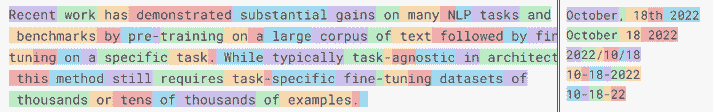

# 微软 Prompt教程

> 来源：[https://xuqiwei1986.feishu.cn/docx/T8dedNzFjom1GKxMbfUc3remnXc](https://xuqiwei1986.feishu.cn/docx/T8dedNzFjom1GKxMbfUc3remnXc)

## 简介

OpenAI 中的 GPT-3、GPT-3.5 和 GPT-4 模型基于提示。 使用基于提示的模型时，用户通过输入文本提示与模型交互，该文本提示通过文本补全进行响应。 补全是模型的输入文本的延续。

虽然这些模型非常强大，但它们的行为对提示也非常敏感。 这使得提示构造成为开发的重要技能。

提示构造可能很困难。 在实践中，提示的作用是配置模型权重以完成所需的任务，但它更像艺术而不是科学，通常需要经验和直觉来制作成功的提示。 本文的目的是帮助你开始学习此学习过程。 它会尝试探讨适用于所有 GPT 模型的一般概念和模式。 但是，请务必了解，每个模型的行为方式不同，因此这些学习成果可能不适用于所有模型。

## 基本信息

本部分介绍 GPT 提示的基本概念和元素。

文本提示是用户与 GPT 模型交互的方式。 与所有生成语言模型一样，GPT 模型会尝试生成最有可能紧跟上一个文本的下一系列字词。 就好像我们在说“当我说 <prompt> 时，你想到的第一件事是什么？”.  以下示例演示了此行为。 给定注明内容的第一个单词，模型能够准确地延续文本。

在开发更复杂的提示时，记住这一基本行为会很有帮助。 无论提供的提示是什么，模型都只是使用它确定的最有可能的情况（基于训练数据和训练目标）做出响应。 如果在提示中提出问题，则模型不会遵循单独的“Q&A”代码路径，而是看起来在回答问题，因为回答即是输入的给定问题最有可能的响应。

### 提示组件

当使用补全 API 而提示的不同部分之间没有区别时，它对于学习和[讨论以识别基础提](https://learn.microsoft.com/zh-cn/azure/cognitive-services/openai/how-to/chatgpt)示组件仍然很有用。 使用聊天补全 API 时，提示的不同部分以具有关联角色（系统、用户和助手）的字典数组的形式发送到 API。 本指南将更宽泛地侧重于如何考虑提示构造，而不是提供特定于某个 API 的规范性指导。

同样重要的是要了解，虽然可能存在其他有效的方法来剖析提示，但这种分解的目标是提供一种相对简单的方法来理解提示构造。 使用补全 API 时，所有组件都是可选的，但必须至少有一个组件存在，而大多数提示包含多个组件。 组件之间也可能存在一些灰色区域。 下面显示的顺序大致对应于每个组件的使用方式（从最多到最少）。

#### Instructions（指示）

指令可能是最常用的提示组件。 指令很简单：向模型说明要执行的操作。 虽然概念简单，但它在实践中可能比较复杂。 下表以两种不同形式显示简单和复杂的指令，借此来说明这一点。

### 主要内容

主要内容是指模型正在处理或转换的某种文本。 主要内容通常与指令一起使用。 一个简单的示例是语言翻译。 在下面的示例中，英语文本被视为主要内容，而“翻译为法语：”是指令。

主要内容也可以更长。 在以下示例中，主要内容是维基百科「时间复杂度」条目的简介部分，长度近 300 字。 为了便于显示，此内容已在表中缩写。

GPT 模型还可以处理结构化的主要内容。 在下面的示例中，有关比利时啤酒的 TSV（本文中为显示为缩写）作为提示的一部分传递给模型。 它能够正确解释内容并回答有关数据的问题。

### 示例

成功的提示通常依赖于“单样本”或“少样本”学习。 这是指加入模型所需行为的一个或多个示例，通常做法是加入输入和输出对。 这不是从模型进行永久更改这一意义上学习，而是通过示例更好地使模型能够仅根据当前推理的需求做出响应。 使用没有示例的提示有时称为“零样本”学习。 请注意，使用聊天补全 API 时，在初始系统消息后，少样本学习示例通常以示例用户/助手交互的形式添加到消息数组中。

上面的示例演示了少样本学习的效用。 如果没有这些示例，模型似乎在猜测所需的行为，而示例则清晰地向模型展示了如何操作。 这也演示了模型的强大功能，它可以推断出所需的标签类别，即使示例中没有“篮球”标签。

### 提示

提示充当模型输出的“快速启动”，帮助将模型定向到所需的输出。 它通常是模型可以作为生成基础的前缀。 在下面的示例中，我们演示了引导故事以包含关键元素的提示。 提示通常与指令一起使用，但并非总是如此。 在下面的示例中，该模型用于汇总长公告电子邮件。 提示在一种情况下用于帮助聚焦模型的输出，在另一种情况下用于建议特定输出格式（项目符号）。

在聊天补全 API 的上下文中，指令采用系统消息的形式，通过提供一系列示例用户/助手交互来指示少样本示例以帮助启动模型。

### 支持内容

支持内容是模型可用于以某种方式影响输出的信息。 它与主要内容的不同之处在于，它不是任务的主要目标，但它通常与主要内容一起使用。 常见示例包括上下文信息，例如当前日期、用户名、用户偏好等。 以下示例使用支持内容来帮助为用户安排一组计划的研讨会。 如果没有支持（重要主题），模型只会列出研讨会（为显示而截断），当被告知我的重要主题时，模型能够准确地分组会议。

## 最佳做法

+   尽量具体。 尽可能少留解读空间。 限制操作空间。

+   具有描述性。 使用类比。

+   强调。 有时可能需要对模型进行重复操作。 在主要内容之前和之后提供说明，使用指令和提示等。

+   给事项排序。 向模型呈现信息的顺序可能会影响输出。 你选择是在内容之前放置指令（“汇总以下内容...”）还是之后（“汇总以上...”）会影响输出。 即使是少样本示例的顺序也很重要。 这被称为“近因偏差”。

+   给模型一个“出路”。 如果模型无法完成分配的任务，有时为模型提供备用路径可能会有所帮助。 例如，在对一段文本提出问题时，可以加入类似于“如果答案不存在，则回复‘未找到’”之类的内容。 这有助于避免模型生成错误响应。

## 空间效率

虽然输入大小会随着 GPT 模型的迭代而增加，但仍存在提供的数据超出模型所能处理的数据量的情况。 GPT 模型将单词分解为“标记”。 常见的多音节单词通常是单个标记，而不太常见的单词会按音节拆分。 标记有时可能违反直觉，如以下示例所示，它演示了不同日期格式的标记边界。 在这种情况下，拼出整个月份比使用完全数字的日期更具空间效益。 当前的标记支持范围：早期 GPT-3 模型支持 2000 个标记，最新的 GPT-4 模型 32k 版本支持最多 32,768 个标记。



由于空间有限，请务必尽可能高效地使用它。

+   表格–如上一部分中的示例所示，GPT 模型可以非常轻松地理解表格格式的数据。 这是一种空间高效的包含数据的方式，相较于在每个字段前面加上名称（例如 JSON）。

+   空格 - 连续的空格被视为单独的标记，这很容易浪费空间。 另一方面，单词前面的空格通常被视为与单词相同的标记的一部分。 请仔细观察空格的使用情况，不要在单独使用空格就足够时使用标点符号。

---

原文地址：https://learn.microsoft.com/en-us/azure/cognitive-services/openai/concepts/prompt-engineering

===================

本指南将指导你提示设计和提示工程方面的一些[高级技术。 如果](https://ywh1bkansf.feishu.cn/wiki/AK9HwYeKHiZQC7k6pmycz8FGn9d)你不熟悉提示工程，建议从提示工程指南简介开始。

虽然提示工程的原则可以在许多不同的模型类型间归纳，但某些模型需要专用的提示结构。 对于 Azure OpenAI GPT 模型，目前有两个不同的 API，提示工程可以在其中发挥作用：

+   聊天补全 API

+   补全 API

每种 API 要求以不同的格式输入数据，这反过来又会影响整体的提示设计。 聊天补全 API 支持 ChatGPT 和 GPT-4 模型。 这些模型旨在接收存储在字典数组中的类似聊天的特定脚本格式的输入。

补全 API 支持较旧的 GPT-3 模型，并且具有更灵活的输入要求，即它接受没有特定格式规则的文本字符串。 从技术上讲，ChatGPT 模型可与任一 API 一起使用，但我们强烈建议对这些模型使用聊天补全 API。 若要了解更多，请参阅使用这些 API 的深入指南。

本指南中的技术将指导你提高使用大型语言模型 （LLM） 生成的响应的准确性和基础。 但是，请务必记住，即使有效地使用了提示工程，你仍需要验证模型生成的响应。 仅仅因为精心制作的提示适用于某个特定方案并不一定意味着它能更广泛地推广到某些用例。 了解 LLM 的限制与了解如何利用其优势一样重要。

本指南不深入介绍聊天补全消息结构背后的机制。 如果你不熟悉以编程方式与 ChatGPT 和 GPT-4 模型交互，建议先阅读有关聊天补全 API 的操作指南。

## 系统消息

系统消息包含在提示的开头，用于为模型提供上下文、说明或与用例相关的其他信息。 可以使用系统消息来描述助手的个性，定义模型应回答和不应回答的内容，以及定义模型响应的格式。

下面的示例显示了示例系统消息和生成的模型响应：

系统消息的其他一些示例包括：

+   “助手是由 OpenAI 训练的大型语言模型。”

+   “助手是一种智能聊天机器人，旨在帮助用户回答有关 Azure OpenAI 服务的技术问题。 仅使用以下上下文回答问题，如果不确定答案，可以说“我不知道”。

+   “助手是一种智能聊天机器人，旨在帮助用户回答其税务相关问题。”

+   “你是一名助手，旨在从文本中提取实体。 用户将粘贴文本字符串，你将使用从文本中提取的实体作为 JSON 对象进行响应。 下面是输出格式的示例：

```
{  
   &quot;name&quot;: &quot;&quot;,
   &quot;company&quot;: &quot;&quot;,
   &quot;phone_number&quot;: &quot;&quot;
}
```

需要了解的一个重要细节是，即使你在系统消息中指示模型在不确定答案时回答“我不知道”，这并不能保证此请求得到履行。 设计良好的系统消息可以增加产生特定结果的可能性，但仍可能会生成不正确的响应，可能会与系统消息中的指令的意图相矛盾。

## 少样本学习

使语言模型适应新任务的一个常见方法是使用少样本学习。 在少样本学习中，需要在提示中提供一组训练示例，以便为模型提供额外的上下文。

使用聊天补全 API[ 时，用户和](https://learn.microsoft.com/zh-cn/azure/cognitive-services/openai/how-to/chatgpt?pivots=programming-language-chat-completions#few-shot-learning-with-chat-completion)助手之间的一系列消息（以新的提示格式编写）可以作为进行少样本学习的示例。 这些例子可以用来引导模型以某种方式相应，模仿特定的行为，并为常见的问题提供种子答案。

[上表介绍了基](https://learn.microsoft.com/zh-cn/azure/cognitive-services/openai/how-to/chatgpt)本的提示结构，但有关确切提示格式的详细说明，需要参考聊天补全指南。

## 非聊天场景

虽然聊天补全 API 已优化为处理多回合对话，但它也可用于非聊天场景。 例如，对于情绪分析场景，可以使用以下提示：

## 从明确的说明开始

提示中显示信息的顺序很重要。 这是因为 GPT 风格的模型是以某种方式构建的，这定义了它们处理输入的方式。 我们的研究表明，在共享其他上下文信息或示例之前，在提示开始时告诉模型你希望它执行的任务有助于生成更高质量的输出。

> **备注**

> 尽管通常仍建议遵循此方法，但与之前的模型版本（GPT-3 和更早）相比，我们的测试表明，无论是否使用该技术，ChatGPT 和 GPT-4 模型的模型响应都是相同的。 在下面的示例中，我们看到添加了语句“几个消息来源... 爆发”到提示的开头或末尾后，不会导致最终模型响应发生任何变化。

## 在末尾重复指令

模型可能容易受到近因偏差的影响，在此上下文中，这意味着提示结束时的信息对输出的影响可能比提示开头的信息更大。 因此，值得尝试的是，在提示结束时重复指令，并评估对生成的响应的影响。

## 引导输出

这是指在提示的末尾包含几个字词或短语，以获取遵循所需形式的模型响应。 例如，使用 “Here’s a bulleted list of key points:\n- ” 等提示有助于确保输出的格式为项目符号列表。

在上述提示中，文本“一个可能的搜索查询是：”引导模型生成单个输出。 如果没有此提示，模型将生成多个搜索查询作为输出。

## 添加明确的语法

对提示使用明确的语法（包括标点符号、标题和节标记）有助于传达意向，并且通常使输出更易于分析。

在下面的示例中，分隔符（本例中为 ---）已添加到不同的信息源或步骤之间。 这允许使用 --- 作为生成的停止条件。 此外，节标题或特殊变量以大写形式显示，用于区分。

如果不确定要使用哪种语法，请考虑使用 Markdown 或 XML。 这些模型已通过 XML 和 Markdown 的大量 Web 内容进行了训练，这可能会提供更好的结果。

## 分解任务

如果任务分解为较小的步骤，大型语言模型（LLM）的性能通常会更好。 例如，在前面引用的搜索查询提示中，可以调整提示的结构，以便首先指示模型提取相关事实，然后指示生成可用于验证这些事实的搜索查询。

请注意，应使用清晰的语法来区分不同部分并引导输出。 在此简单示例中，将任务从一步分解为两步并不十分引人注目，但当为一篇有许多事实主张的大文本做这件事时，将任务分解就会产生很大的不同。

## 使用可供性

有时候，我们可以让模型使用[可供性](https://www.interaction-design.org/literature/topics/affordances)，而不是仅依赖其自身的参数来获取信息和答案。 例如，搜索可以作为一种可供性来帮助减轻虚构答案的风险，并获取最新的信息。

使用可供性的一种简单方法是在模型生成可供性调用时停止生成，然后将结果粘贴回提示中。 下面是执行上述 SEARCH 调用后进行跟进调用的示例。 请注意看我们如何将搜索结果粘贴到提示中并替换之前的 SEARCH 调用。

## 思维链提示

这是分解任务技术的变体。 在这种方法中，不是将一项任务分割成较小的步骤，而是指示模型响应逐步进行，并提出所有涉及的步骤。 这样做可以减少结果不准确的可能性，并使评估模型响应更容易。

## 指定输出结构

使用提示指定输出结构时，可能会对结果的性质和质量产生重大影响。 有时，系统消息输入“仅写出真实事实”或“不捏造信息”可能不足以缓解问题。 相反，要求模型响应同时包含引文有助于减少错误响应的概率。

如果你指示模型在编写语句时引用源材料，则这些语句更有可能有根据。 请求引文会使模型在每次生成响应时都犯两个错误：第一个错误是捏造的响应，第二个错误是错误的引文。 请注意，引文越接近它支持的文本，模型预测引文所需的距离就越短，这表明内联引文比内容末尾的引文更适合缓解虚假内容的生成。

同样，如果要求模型从段落中提取事实陈述，它可能会提取复合语句，例如“X 正在执行 Y 和 Z”（这可能更难验证）。 可以通过指定输出结构来避免这种情况，如（实体 1、关系、实体 2）。

以下示例演示了引文的使用，并指导模型响应适应定义的结构。

## 温度和 Top_p 参数

改变温度参数会改变模型的输出。 温度参数可以设置为 0 到 2。 较高的值（例如 0.7）将使输出更随机，并产生更多发散的响应，而较小的值（例如 0.2）将使输出更加集中和具体。 虚构的故事可以使用更高的温度生成。 而要生成法律文件的话，建议使用低得多的温度。 Top_probability 是另一个参数，与温度类似，它也控制模型响应的随机性，但它的控制方式有所不同。 一般建议一次只更改这两个参数其中之一，而不是同时更改它们。

## 提供基础上下文

提供可靠答案的最有效方法之一是为模型提供数据，让它从基础数据得出响应。 如果你的用例依赖于最新、可靠的信息，且不是纯粹的创意场景，我们强烈建议提供基础数据。 通常，源材料越接近所需答案的最终形式，模型需要完成的工作就越少，这意味着出错的可能性就越小。 下面的示例向系统提供了“描述 GPT-4 在 Azure OpenAI 服务中推出的最新博客”，并要求其命名一些早期客户。

原文地址：https://learn.microsoft.com/en-us/azure/cognitive-services/openai/concepts/advanced-prompt-engineering